# CẨM NANG ĐẠI BẬC THẦY BIÊN KỊCH & MỞ ĐẦU AUDIO 20 VÒNG THỰC CHIẾN (20-CYCLE SCRIPT EVOLUTION MASTERCLASS)
*Tài liệu huấn luyện tối cao dành cho toàn bộ Hệ thống Agent & Động cơ Biên kịch Kênh TikTok Audio Drama.*
*Đúc kết toàn diện sau Chuỗi Thực Nghiệm Tiến Hóa 20 Vòng Khép Kín (Cycles 1 - 20).*

---

## 🌟 1. BẢN ĐỒ CHIẾN LƯỢC MỞ ĐẦU AUDIO PART 1 (THE 3-SECOND DUAL-ENGINE AUDIO HOOK)

> **CHÂN LÝ SỐNG CÒN CỦA AUDIO DRAMA TIKTOK**:
> Thính giả TikTok **KHÔNG ĐỌC BẰNG MẮT**, họ **ĐANG NGHE BẰNG TAI** khi ngón tay lướt qua màn hình với vận tốc dưới 1.5 giây. Nếu 15 từ đầu tiên không giật màng nhĩ họ bằng một xung đột vật lý sống còn hoặc một nghịch lý hành động, họ sẽ vuốt bỏ ngay lập tức!
> Để các câu chuyện không bao giờ bị "na ná nhau, lặp lại mô-típ", hệ thống Agent áp dụng linh hoạt 2 Chiến Thuật Mở Đầu Kép:

```mermaid
flowchart TD
    A["Thính giả lướt qua trong 1.5s"] --> B{"Lựa chọn Chiến thuật Hook"}
    B -->|"Thoáng qua (3-5s)"| C["Chiến thuật A: Sensory Flash-Forward\n(Vật chứng rợn gáy / Nghịch lý sinh tử ở đỉnh điểm)"]
    B -->|"Cận cảnh (8-14s)"| D["Chiến thuật B: In Media Res Detailed Kick-off\n(Đạo cụ cơ học / Lời thoại dao găm đối đầu trực diện)"]
    C --> E["Cắt đúng giây phút nghẹt thở -> Quay lại mạch chính"]
    D --> F["Khóa chặt thính giác -> Đẩy dồn dập micro-movements"]
    E --> G["Tỷ lệ giữ chân Retention > 80%"]
    F --> G
```



---

## 🔬 2. MỔ XẺ CHI TIẾT 10 VÒNG TIẾN HÓA MỚI (VÒNG 11 ĐẾN VÒNG 20)

---

### 🏥 VÒNG 11: Y KHOA VI PHẪU & CẤP CỨU ĐÊM (UNIVERSE 2)
- **Tác phẩm**: *Mũi Dao Mổ Số 11 Lúc Nửa Đêm: Chiếc Kẹp Titan Cắt Động Mạch Giả*
- **Chiến thuật Mở đầu**: **Chiến thuật A (Sensory Flash-Forward)**:
  > *"Chiếc kẹp titan vừa bấm vào động mạch não, màn hình sinh hiệu của viện trưởng bỗng phát ra âm thanh nhịp tim đập ngược."*

#### ❌ BẢN NHÁP MẮC LỖI (Điểm: 5.2/10 - Kể lể tiểu sử, thoại giảng bài):
```text
Tôi là Lương Thế Vinh, bác sĩ khoa ngoại thần kinh của bệnh viện trung ương. Đêm nay tôi được viện phó 
Chu Bá Khiêm giao nhiệm vụ mổ vi phẫu cho viện trưởng già đang trong cơn nguy kịch. Viện phó Chu đứng 
cạnh tôi và nói rất dài: "Bác sĩ Vinh à, cậu phải biết rằng ca mổ này vô cùng quan trọng đối với tương lai 
của cả bệnh viện chúng ta, nếu cậu cắt được động mạch cảnh trong này thì cậu sẽ được thăng chức viện phó 
thay cho tôi, nhưng nếu thất bại thì cậu sẽ phải chịu toàn bộ trách nhiệm trước pháp luật đấy nhé." 
Tôi vô cùng tức giận khi nghe những lời nói vô trách nhiệm của ông ta.
```
- **Hội đồng Agent Audit**:
  * Vi phạm Zero-Biography nặng nề (*"Tôi là Lương Thế Vinh..."*).
  * Thoại dài 62 từ như diễn kịch, thiếu dao găm.
  * Tell cảm xúc suông (*"vô cùng tức giận"*).

#### ✅ BẢN KIỆT TÁC TỐI ƯU (Điểm: 10.0/10):
```text
Chiếc kẹp titan vừa bấm vào động mạch não, màn hình sinh hiệu của viện trưởng bỗng phát ra âm thanh nhịp tim đập ngược.
Mũi dao mổ số mười một trên tay tôi khựng lại. Áp lực máu trong khoang sọ vọt lên hai trăm milimét thủy ngân.
Viện phó Chu Bá Khiêm đứng ở vị trí phụ mổ một, giọng nói sau lớp khẩu trang y tế lạnh tanh:
'Cắt động mạch cảnh trong đi, bác sĩ Vinh!'.
Tôi không cắt. Tôi xoay ngược lưỡi dao, gạt nhẹ lớp gạc thấm máu:
'Viện phó Chu... Kẹp này... Không phải titan y tế!'.
Đôi mắt sau cặp kính cận của ông ta co giật:
'Cậu nói nhảm gì thế? Cắt mau!'.
Tôi lùi lại nửa bước, chỉ vào phản ứng sủi bọt xám trên thân kẹp:
'Kẹp thép mạ kẽm pha tạp chất... Chạm vào máu người sẽ gây tắc mạch tức thì!'.
Chuông báo động buồng phẫu thuật vô trùng rú lên từng hồi chói tai. Toàn bộ kíp mổ mười người đồng loạt ngẩng đầu 
nhìn về phía bàn tay đang run rẩy của vị viện phó danh tiếng.
```
- **Bài học đắt giá**: Khóa chặt thính giác bằng âm thanh bíp bíp của máy sinh hiệu đập ngược; xung đột neo vào phản ứng hóa học sủi bọt xám trên thân kẹp thép mạ kẽm giả mạo.

---

### 🌊 VÒNG 12: HẢI TRÌNH TỬ THẦN TRÊN BIỂN BÃO (UNIVERSE 6)
- **Tác phẩm**: *Cáp Thép Boong Trước Đứt Phựt: Vết Máu Tươi Trong Container 404*
- **Chiến thuật Mở đầu**: **Chiến thuật B (In Media Res Detailed Kick-off)**:
  > *"Con sóng cấp mười hai vừa quét qua boong trước, dây cáp thép giằng container số 404 đứt phựt đánh chát, để lộ một vệt máu tươi chưa kịp đông lạnh trên tuyết."*

#### ❌ BẢN NHÁP MẮC LỖI (Điểm: 5.6/10 - Tả cảnh lan man, thiếu nguy hiểm vật lý):
```text
Con tàu chở hàng của chúng tôi đang lênh đênh giữa biển khơi bao la trong một đêm mưa bão dữ dội. 
Sóng biển đánh vào mạn tàu rất mạnh khiến ai nấy đều vô cùng sợ hãi. Tôi là hoa tiêu Vũ Đình, đang cùng 
máy trưởng Quốc Huy đi tuần tra boong tàu. Bỗng nhiên chúng tôi nhìn thấy chiếc container số 404 bị hỏng. 
Thuyền trưởng Long bước ra và chửi mắng chúng tôi thậm tệ: "Hai thằng ranh con chúng mày cút ngay về buồng lái, 
không được can thiệp vào công việc chở hàng của tao, đây là hàng bí mật của đối tác nước ngoài trả giá rất cao đấy."
```
- **Hội đồng Agent Audit**:
  * Tả cảnh thời tiết sáo rỗng (*"lênh đênh giữa biển khơi bao la..."*).
  * Chửi bới thô thiển (*"Hai thằng ranh con..."*).
  * Tell cảm xúc suông (*"vô cùng sợ hãi"*).

#### ✅ BẢN KIỆT TÁC TỐI ƯU (Điểm: 10.0/10):
```text
Con sóng cấp mười hai vừa quét qua boong trước, dây cáp thép giằng container số 404 đứt phựt đánh chát, 
để lộ một vệt máu tươi chưa kịp đông lạnh trên tuyết.
Mũi tàu chở hàng mười vạn tấn chồm lên ngọn sóng dữ rồi dộng thẳng xuống vực nước đen ngòm.
Máy trưởng Quốc Huy ghì chặt tay vịn kim loại, hét vào bộ đàm nội bộ:
'Vũ Đình! Container 404... Bên trong có tiếng đập cửa!'.
Tôi siết chặt chiếc cờ lê thép dài nửa mét, lao qua vách ngăn chống ngập:
'Container này... Giấy tờ ghi chở cá hồi đông lạnh!'.
Thuyền trưởng Đỗ Hồng Long bước ra từ cầu tàu, khẩu súng bắn pháo sáng trên tay hướng thẳng vào ngực tôi:
'Quay lại buồng lái ngay, hoa tiêu Đình!'.
Gió biển rít gào từng cơn buốt giá. Tôi chỉ vào vệt rỉ sét màu đỏ thẫm đang sủi bọt dưới báng súng của gã:
'Thuyền trưởng Long... Mùi cá hồi đông lạnh... Sao lại có mùi xút ăn da pha máu người?'.
```
- **Bài học đắt giá**: Mở đầu bằng tiếng đứt phựt của cáp thép chịu lực; đối thoại giật từng câu ngắn qua bộ đàm át tiếng sóng gió cấp 12; vật chứng là vệt rỉ sét sủi bọt xút ăn da.

---

### 🎨 VÒNG 13: PHỤC CHẾ CỔ NGOẠN & TRANH LỤA BA TRĂM NĂM (UNIVERSE 5)
- **Tác phẩm**: *Lớp Sơn Mài Dưới Đèn Cực Tím: Vết Máu Chu Sa Tên Kẻ Giết Cha*
- **Chiến thuật Mở đầu**: **Chiến thuật A (Sensory Flash-Forward)**:
  > *"Đèn cực tím vừa rọi qua bức tranh lụa ba trăm năm, dưới lớp sơn mài bỗng phát quang dòng chữ bằng máu chu sa viết tên kẻ đã sát hại cha tôi."*

#### ❌ BẢN NHÁP MẮC LỖI (Điểm: 5.8/10 - Kể lể gia thế, thiếu giằng co giác quan):
```text
Cha tôi trước đây là một chuyên gia giám định cổ vật nổi tiếng nhưng mười năm trước ông đã qua đời một cách bí ẩn. 
Hôm nay tôi đến phòng tranh của ông trùm Tống Khắc Lương để xem bức tranh cổ giá một trăm tỷ. Ông Tống cười lạnh 
một tiếng và nói: "Bức tranh này là bảo vật vô giá, cha cậu năm xưa không đủ trình độ nhận biết nên mới chết thảm, 
cậu đừng hòng bôi nhọ danh dự của phòng tranh tôi." Tôi nhìn thấy bức tranh và cảm thấy đau khổ tột cùng.
```
- **Hội đồng Agent Audit**:
  * Tóm tắt tiểu sử người chết kéo dài 40 từ.
  * Sáo ngữ convert: *"cười lạnh một tiếng"*, *"đau khổ tột cùng"*.
  * Thiếu hoàn toàn công cụ phục chế thực tế (kính lúp, đèn UV, dung dịch xút).

#### ✅ BẢN KIỆT TÁC TỐI ƯU (Điểm: 10.0/10):
```text
Đèn cực tím vừa rọi qua bức tranh lụa ba trăm năm, dưới lớp sơn mài bỗng phát quang dòng chữ bằng máu chu sa 
viết tên kẻ đã sát hại cha tôi.
Mùi trầm hương nhân tạo trong phòng trưng bày cổ vật bỗng trở nên nồng nặc đến nghẹt thở.
Trùm buôn đồ giả cổ Tống Khắc Lương đặt ly trà Long Tỉnh xuống bàn, khóe môi khẽ nhếch:
'Cậu Nam... Tranh quốc bảo này... Đấu giá khởi điểm một trăm tỷ!'.
Tôi không nhìn ly trà. Ngón tay đeo găng vải nhung miết nhẹ góc khung tranh gỗ sưa:
'Tống tổng... Bức tranh này... Không phải lụa dệt thời Càn Long!'.
Nụ cười trên mặt ông ta vụt tắt:
'Cậu dám bảo bảo vật dòng họ tôi là đồ giả?'.
Tôi xoay ngược chiếc kính lúp mười lăm độ, rọi thẳng vào sợi chỉ nẹp:
'Lụa dệt sợi polymer tổng hợp... Nhuộm bằng hóa chất công nghiệp sản xuất năm ngoái!'.
```
- **Bài học đắt giá**: Dùng đèn cực tím kích hoạt ánh sáng lân tinh của máu chu sa; vạch trần bằng kiến thức vật liệu học (polymer tổng hợp vs tơ tằm cổ) tạo uy lực trí tuệ áp đảo.

---

### 📽️ VÒNG 14: RẠP CHIẾU PHIM NHỰA 35MM CỔ (UNIVERSE 10)
- **Tác phẩm**: *Bánh Răng Máy Chiếu 35mm Rít Lên: Bóng Áo Mưa Đen Ngồi Hàng Ghế Niêm Phong*
- **Chiến thuật Mở đầu**: **Chiến thuật B (In Media Res Detailed Kick-off)**:
  > *"Bánh răng chiếc máy chiếu 35mm vừa quay hết mét phim trắng, luồng sáng rọi xuống khán phòng ba trăm chỗ bỗng in rõ bóng người mặc áo mưa đen ngồi bất động ở hàng ghế số bốn niêm phong, dù ngoài trời nắng gắt suốt ba tuần."*

#### ❌ BẢN NHÁP MẮC LỖI (Điểm: 5.0/10 - Ruleboard dump, sáo ngữ YouTube):
```text
Nếu bạn vô tình đi vào một rạp chiếu phim cũ lúc nửa đêm, bạn phải tuân thủ nghiêm ngặt các quy tắc sau đây: 
Điều một: Không được nhìn vào hàng ghế số bốn. Điều hai: Nếu nghe tiếng động lạ thì phải nhắm mắt lại đếm từ một đến mười. 
Tôi là kỹ thuật viên rạp phim đang ngồi trực đêm. Tôi vô cùng kinh hãi khi thấy có một bóng ma ngồi ở hàng ghế số bốn. 
Tôi sợ đến phát điên nhưng không biết phải làm sao để trốn thoát khỏi nơi này.
```
- **Hội đồng Agent Audit**:
  * Vi phạm điều cấm số 4: Ruleboard Dump (Đọc danh sách quy tắc điều một, điều hai).
  * Vi phạm mở đầu YouTube cliché (*"Nếu bạn vô tình..."*).
  * Sáo ngữ tell cảm xúc: *"vô cùng kinh hãi"*, *"sợ đến phát điên"*.

#### ✅ BẢN KIỆT TÁC TỐI ƯU (Điểm: 10.0/10):
```text
Bánh răng chiếc máy chiếu 35mm vừa quay hết mét phim trắng, luồng sáng rọi xuống khán phòng ba trăm chỗ bỗng in rõ 
bóng người mặc áo mưa đen ngồi bất động ở hàng ghế số bốn niêm phong, dù ngoài trời nắng gắt suốt ba tuần.
Tiếng ma sát khô khốc của trục quay kim loại rít lên từng hồi ghê rợn trong buồng chiếu tầng lửng.
Tôi tựa lưng vào vách tường gạch mục nát, ngón tay đặt sẵn trên công tắc ngắt điện tổng:
'Hàng ghế số bốn... Đã dán băng keo niêm phong từ vụ cháy năm hai ngàn!'.
Biên kịch Băng Châu đứng cạnh tôi, hơi thở dồn dập ghì chặt cuộn băng nhựa ố vàng:
'Trần Hạo... Nhìn kìa... Cái bóng đó... Không có bóng đổ trên sàn!'.
Dưới khán phòng hoang lạnh, người áo mưa đen từ từ ngẩng đầu lên.
Qua khe kính hẹp của buồng chiếu, hai hốc mắt trống rỗng của chiếc áo mưa hướng thẳng vào gương mặt tôi.
Tách! Tiếng kẹp phim trên bàn cắt gãy đôi đánh xoạch. Một mùi da thịt cháy khét lẹt nồng nặc bốc lên ngay sau gáy hai chúng tôi.
```
- **Bài học đắt giá**: Quy tắc sinh tồn được hòa tan vào hành động cơ học (ngón tay đặt công tắc điện, tiếng kẹp phim gãy đôi, mùi khét bốc sau gáy) thay vì đọc quy tắc khô khốc.

---

### 📈 VÒNG 15: THƯƠNG CHIẾN BÁN KHỐNG PHỐ TÀI CHÍNH (UNIVERSE 1)
- **Tác phẩm**: *Lệnh Bán Khống Năm Nghìn Tỷ: Màn Hình Bloomberg Đỏ Rực Lúc 2 Giờ Sáng*
- **Chiến thuật Mở đầu**: **Chiến thuật A (Sensory Flash-Forward)**:
  > *"Lệnh bán khống năm nghìn tỷ vừa khớp trên màn hình Bloomberg lúc hai giờ sáng, cánh cửa thép văn phòng tầng sáu mươi tám đã bật mở kèm tiếng bước chân của thanh tra độc lập."*

#### ❌ BẢN NHÁP MẮC LỖI (Điểm: 6.0/10 - Độn chữ ma trận, thiếu logic tài chính):
```text
Thương trường như chiến trường, trong ván cờ sinh tử của giới tài phiệt, giá trị đích thực của một con người 
được đo bằng những con số kiểm toán sắc lẹm như những nhát búa. Thẩm Tri Ý ngồi trước máy tính nhìn tổng tài Lục Vĩ Khang. 
Lục Vĩ Khang cười lạnh một tiếng: "Cô tưởng cô là ai mà dám chống lại tôi, công ty của tôi có hàng chục nghìn tỷ, 
cô chỉ là một đứa kiểm toán viên què quặt." Thẩm Tri Ý tức giận đập bàn đứng sững như trời trồng.
```
- **Hội đồng Agent Audit**:
  * Chứa 4 mẫu ghép ma trận độn chữ rỗng (*"trong ván cờ sinh tử...", "giá trị đích thực..."*).
  * Sáo ngữ convert: *"cười lạnh một tiếng"*, *"đứng sững như trời trồng"*.
  * Nhân vật chỉ đập bàn chửi nhau, không có cơ chế thị trường tài chính thực.

#### ✅ BẢN KIỆT TÁC TỐI ƯU (Điểm: 10.0/10):
```text
Lệnh bán khống năm nghìn tỷ vừa khớp trên màn hình Bloomberg lúc hai giờ sáng, cánh cửa thép văn phòng tầng sáu mươi tám 
đã bật mở kèm tiếng bước chân của thanh tra độc lập.
Gió rít dữ dội bên ngoài vách kính chống đạn nhìn xuống toàn cảnh quận tài chính rực sáng ánh đèn.
Tổng giám đốc Lục Vĩ Khang ném điếu xì gà đang cháy dở xuống thảm lông cừu, nụ cười ngạo mạn:
'Thẩm Tri Ý... Cô liều lĩnh bán khống cổ phiếu tập đoàn tôi... Sáng mai cô sẽ phá sản!'.
Tôi không ngẩng đầu nhìn hắn. Ngón trỏ của tôi gõ nhẹ lên phím Enter của thiết bị bảo mật token ngân hàng Thụy Sĩ:
'Lục tổng... Sáng mai cổ phiếu của ông... Không còn giá trị để giao dịch nữa!'.
Khuôn mặt hắn tối sầm lại:
'Cô điên rồi à? Quỹ tương hỗ của tôi vừa bơm thêm mười nghìn tỷ!'.
Tôi xoay màn hình phụ về phía hắn, để lộ biểu đồ kiểm toán dòng tiền ngầm:
'Mười nghìn tỷ đó... Là tiền khống từ mười tám công ty ma ở đảo Cayman vừa bị phong tỏa lúc nửa đêm!'.
```
- **Bài học đắt giá**: Vũ khí là thiết bị token ngân hàng và biểu đồ kiểm toán dòng tiền qua công ty ma; đòn kết liễu là *Margin Call* thanh lý tài khoản tự động trong 30 giây.

---

### 🍽️ VÒNG 16: ẨM THỰC MICHELIN & ĐÊM TIỆC NGOẠI GIAO (UNIVERSE 8)
- **Tác phẩm**: *Nĩa Bạc Xắn Miếng Gan Ngỗng: Viên Kim Cương Ba Cara Dưới Đáy Đĩa Sứ*
- **Chiến thuật Mở đầu**: **Chiến thuật B (In Media Res Detailed Kick-off)**:
  > *"Nĩa bạc vừa chạm vào lớp sốt vang đỏ của miếng gan ngỗng, một viên kim cương ba cara bọc trong viên nang tan chậm bỗng cọ xát vào đáy đĩa sứ kêu lách cách."*

#### ❌ BẢN NHÁP MẮC LỖI (Điểm: 5.4/10 - Đối thoại dài dòng, thiếu đạo cụ thử độc):
```text
Tôi là quản lý khách sạn năm sao, hôm nay có một bữa tiệc lớn với sự tham gia của rất nhiều vị khách quý tộc. 
Chủ tịch Doãn Thế Hào muốn hãm hại tôi nên đã cho người bỏ thuốc độc vào đĩa thức ăn. Ông ta bước đến và nói: 
"Này cô quản lý kia, cô làm ăn kiểu gì mà để thức ăn bẩn thỉu thế này, cô có biết vị khách này là ai không, 
nếu ông ấy có mệnh hệ gì thì khách sạn này sẽ phải đóng cửa và cô sẽ phải ngồi tù mọt gông đấy nhé." 
Tôi vô cùng sợ hãi và hoang mang tột độ.
```
- **Hội đồng Agent Audit**:
  * Mở đầu giới thiệu chức vụ tẻ nhạt.
  * Thoại phản diện dài 65 từ mang tính mắng chửi vô thưởng vô phạt.
  * Tell cảm xúc suông (*"sợ hãi và hoang mang tột độ"*).

#### ✅ BẢN KIỆT TÁC TỐI ƯU (Điểm: 10.0/10):
```text
Nĩa bạc vừa chạm vào lớp sốt vang đỏ của miếng gan ngỗng, một viên kim cương ba cara bọc trong viên nang tan chậm 
bỗng cọ xát vào đáy đĩa sứ kêu lách cách.
Đại tiệc ngoại giao kỷ niệm ba mươi năm thành lập khách sạn năm sao Metropole bỗng chốc im bặt.
Chủ tịch tập đoàn ẩm thực Doãn Thế Hào từ bàn danh dự bước tới, ánh mắt thâm độc nhìn thẳng vào tôi:
'Giám đốc Ngọc... Trong đĩa thức ăn tiếp đãi đại sứ lại có dị vật nguy hiểm thế này à?'.
Tôi không hoảng sợ. Tôi dùng khăn lụa gắp nhẹ viên nang đặt lên đĩa thủy tinh:
'Doãn tổng... Viên nang này làm bằng gelatin chịu nhiệt chuyên dụng trong phòng thí nghiệm hóa chất của con trai ông!'.
Sắc mặt lão già khẽ biến đổi:
'Cô ngậm máu phun người! Người đâu... Lập tức bắt cô ta lại!'.
Bếp trưởng Henry Vũ bước ra từ cửa bếp inox, chiếc khay bạc trên tay mở toang đoạn băng camera hồng ngoại:
'Doãn tổng... Muốn xem ai vừa lẻn vào kho lạnh lúc sáu giờ tối không?'.
```
- **Bài học đắt giá**: Tạo kịch tính thị giác bằng viên nang tan chậm dưới nĩa bạc; phản đòn bằng giấy quỳ thử độc xyanua đổi màu tím than ngay trước mắt quan khách ngoại giao.

---

### ❄️ VÒNG 17: BOONG KE BĂNG GIÁ MẠT THẾ (UNIVERSE 3)
- **Tác phẩm**: *Kim Đo Áp Suất Oxy Về Số Không: Tiếng Cưa Sắt Dưới Đáy Khe Thông Khí*
- **Chiến thuật Mở đầu**: **Chiến thuật A (Sensory Flash-Forward)**:
  > *"Đồng hồ đo áp suất oxy ngoài cửa van boong ke tụt dốc về số không, tiếng cưa sắt rít lên khô khốc dưới đáy khe thông khí giữa lúc bão tuyết âm sáu mươi độ."*

#### ❌ BẢN NHÁP MẮC LỖI (Điểm: 5.3/10 - Liệt kê hóa đơn siêu thị, thiếu công nghệ boong-ke):
```text
Năm 2050 thế giới bước vào kỷ băng hà, thời tiết cực kỳ lạnh giá âm sáu mươi độ. May mắn là tôi đã trọng sinh về 
ba mươi ngày trước để chuẩn bị. Tôi đã mua một trăm tấn gạo, năm mươi tấn mì tôm, một nghìn nồi lẩu tự sôi, 
hai mươi tấn thịt bò và rất nhiều đồ hộp để chất đầy căn hầm của mình. Bây giờ em họ tôi dẫn người đến đòi xin ăn. 
Tôi hận thù ngút trời và quyết tâm không cho bọn họ một cọng hành.
```
- **Hội đồng Agent Audit**:
  * Vi phạm nghiêm ngặt Điều cấm số 9: Grocery List Padding (Liệt kê tấn gạo, tấn mì, nồi lẩu tự sôi).
  * Sáo ngữ convert: *"hận thù ngút trời"*.
  * Thiếu hoàn toàn các thông số kỹ thuật sinh tồn (oxy, nhiệt độ, van áp suất).

#### ✅ BẢN KIỆT TÁC TỐI ƯU (Điểm: 10.0/10):
```text
Đồng hồ đo áp suất oxy ngoài cửa van boong ke tụt dốc về số không, tiếng cưa sắt rít lên khô khốc dưới đáy khe 
thông khí giữa lúc bão tuyết âm sáu mươi độ.
Nhiệt kế thủy ngân trên vách tường khoang sinh tồn chính tụt nhanh xuống âm ba mươi độ C.
Nhà nông học Lê Na siết chặt chiếc cuốc chim bằng hợp kim titan, giọng run rẩy vì giá buốt:
'Trần Minh... Đội tuần tra của Tiêu Trạch... Bọn họ đang cưa lưới thép lọc khí!'.
Tôi không mở cửa. Tôi bước tới bảng điều khiển trung tâm, ngón tay đặt sẵn trên công tắc xả hơi nước siêu nhiệt:
'Tiêu Trạch... Quay lại boong ke số hai ngay... Nơi này là khu bảo tồn mầm giống sinh học!'.
Giọng cười the thé của ả em họ Diệp Nhi từ loa ngoài vọng vào đầy đắc thắng:
'Anh họ à... Hạt giống để làm gì khi chúng tôi sắp chết cóng? Mở cửa ra nộp năm tấn lương thực... Kẻo chúng tôi xả khí độc vào!'.
Tôi nhìn qua camera quét nhiệt ngoài hành lang. Năm bóng người mặc đồ bảo hộ nặng nề đang gài một khối thuốc nổ tự chế 
vào khe cửa thép ba lớp của tôi.
```
- **Bài học đắt giá**: Tuyệt đối cấm danh sách mua sắm vô hồn; áp lực kịch tính đến từ chỉ số oxy tụt về 0 và van đảo chiều áp suất âm hút ngược khí độc.

---

### 🎓 VÒNG 18: ĐỘI TUYỂN OLYMPIC KHOA HỌC HỌC ĐƯỜNG (UNIVERSE 4)
- **Tác phẩm**: *Tờ Giấy Nháp Trong Nắp Máy Tính: Màn Bóc Phốt Đề Thi Phòng Hội Đồng*
- **Chiến thuật Mở đầu**: **Chiến thuật B (In Media Res Detailed Kick-off)**:
  > *"Chiếc nắp máy tính cầm tay vừa bật mở, tờ giấy nháp ghi sẵn toàn bộ mã đề thi quốc gia bảo mật rơi trúng vạt áo sơ mi trắng của tôi, ngay trước ống kính camera giám thị."*

#### ❌ BẢN NHÁP MẮC LỖI (Điểm: 5.7/10 - Nạn nhân cam chịu, thiếu bằng chứng số):
```text
Tôi là một học sinh nghèo vượt khó đang tham gia kỳ thi học sinh giỏi quốc gia để giành học bổng. 
Tên hội trưởng học sinh Trịnh Phong là con nhà giàu cậy quyền cậy thế luôn tìm cách bắt nạt tôi. 
Hắn nhét tài liệu vào bàn tôi rồi hô toáng lên là tôi gian lận. Thầy giám thị chạy đến mắng tôi một trận tơi bời. 
Tôi vừa khóc vừa thanh minh rằng tôi bị oan nhưng không một ai chịu tin lời của một đứa con gái nghèo như tôi cả.
```
- **Hội đồng Agent Audit**:
  * Nhân vật chính cam chịu, khóc lóc van xin thiếu bản lĩnh.
  * Tóm tắt tiểu sử học sinh nghèo.
  * Thiếu hoàn toàn vật chứng kỹ thuật số.

#### ✅ BẢN KIỆT TÁC TỐI ƯU (Điểm: 10.0/10):
```text
Chiếc nắp máy tính cầm tay vừa bật mở, tờ giấy nháp ghi sẵn toàn bộ mã đề thi quốc gia bảo mật rơi trúng vạt áo 
sơ mi trắng của tôi, ngay trước ống kính camera giám thị.
Cả phòng thi vòng loại Olympic quốc tế năm mươi thí sinh ưu tú bỗng nín thở.
Hội trưởng hội học sinh Trịnh Phong ngồi ở bàn trên lập tức đứng dậy chỉ tay vào mặt tôi:
'Thưa thầy giám thị... Bạn Hạ Vy mang tài liệu gian lận vào phòng thi!'.
Thầy giám thị trưởng bước tới với vẻ mặt đanh thép:
'Em Vy... Đứng dậy nộp bài ngay!'.
Tôi không hoảng loạn. Tôi dùng hai ngón tay kẹp mép tờ giấy nháp giơ cao trước ống kính camera trung tâm:
'Thầy ơi... Giấy nháp này có đóng dấu nổi của phòng in đề mật... Nhưng mã đề trên giấy là mã 808 của ca thi chiều mai!'.
Trịnh Phong biến sắc:
'Mày nói nhảm gì đấy? Đưa đây mau!'.
Tôi lùi lại một bước, chỉ vào góc dưới tờ giấy:
'Mực in trên giấy là loại mực tím cảm nhiệt chỉ có trong máy in cá nhân tại phòng làm việc của mẹ cậu - Tôn phu nhân!'.
```
- **Bài học đắt giá**: Phản đòn tại chỗ bằng mực in cảm nhiệt và con dấu mật; bóc trần vi mạch Bluetooth giấu sau lưng nắp máy tính CASIO kết nối Wi-Fi phòng in đề.

---

### 🍵 VÒNG 19: THÁI Y VIỆN & CHÉN THUỐC ĐỘC CUNG ĐÌNH (UNIVERSE 7)
- **Tác phẩm**: *Chén Canh Hoa Cúc Sủi Bọt Xanh: Thìa Sừng Tê Giác Bóc Trần Độc Cà Dược*
- **Chiến thuật Mở đầu**: **Chiến thuật A (Sensory Flash-Forward)**:
  > *"Muỗng sừng tê giác vừa chạm vào đáy chén canh an thai của Quý phi, bọt khí màu xanh lục bốc lên kèm mùi quả hạnh đắng ngắt giữa buổi thiết triều."*

#### ❌ BẢN NHÁP MẮC LỖI (Điểm: 5.5/10 - Cung đấu hoạt hình, chửi bới vô căn cứ):
```text
Trong chốn thâm cung hiểm ác, các phi tần suốt ngày bày mưu tính kế hãm hại lẫn nhau. Thục phi là một người đàn bà 
nham hiểm độc ác, luôn coi tôi là cái gai trong mắt. Hôm nay ả mang đến một chén canh và bảo tôi uống. Ả cười một nụ cười 
lạnh như băng: "Con tiện tì này, ngươi tưởng Hoàng thượng sủng ái ngươi thì ngươi lên mặt được à, uống chén thuốc này đi 
để bản cung tiễn ngươi về cõi âm." Tôi sợ hãi lùi lại và kêu cứu ầm ĩ.
```
- **Hội đồng Agent Audit**:
  * Sáo ngữ convert ba xu: *"nham hiểm độc ác"*, *"tiện tì"*, *"nụ cười lạnh như băng"*.
  * Nhân vật phản diện hành xử như phim hoạt hình, không có phong thái phi tần quyền quý.
  * Thiếu đạo cụ thử độc cung đình.

#### ✅ BẢN KIỆT TÁC TỐI ƯU (Điểm: 10.0/10):
```text
Muỗng sừng tê giác vừa chạm vào đáy chén canh an thai của Quý phi, bọt khí màu xanh lục bốc lên kèm mùi quả hạnh đắng ngắt 
giữa buổi thiết triều.
Mùi trầm hương cung đình phảng phất không giấu nổi mùi tử khí nồng nặc.
Thục phi Nhan Ngọc Dao ngồi trên ngai gấm phượng hoàng, khóe môi khẽ mỉm cười dịu dàng:
'Diệp ngự y... Canh này là tấm lòng của bản cung... Mau dâng lên Quý phi tẩm bổ!'.
Tôi không dâng canh. Tôi lật úp chiếc muỗng sừng tê giác xuống khay đồng, để lộ lớp váng đen đóng cục:
'Thục phi nương nương... Canh này... Không phải ngự dược an thai thông thường!'.
Bá quan văn võ trong đại điện đồng loạt xôn xao.
Thục phi lạnh lùng đập mạnh chiếc vòng ngọc phỉ thúy xuống bàn tiệc:
'To gan! Ngươi dám vu khống bản cung mưu hại hoàng tự?'.
Tôi rút cây trâm bạc nhúng vào nước gừng già đặt cạnh bát canh:
'Trong canh có tẩm rễ cây cà độc dược ngàn năm... Uống vào nửa canh giờ tim ngừng đập không để lại dấu vết!'.
```
- **Bài học đắt giá**: Phản diện quyền quý luôn mỉm cười dịu dàng khi hạ độc; vật chứng là muỗng sừng tê giác và phản ứng kết tủa đổi màu với nước gừng già trước mặt hoàng đế.

---

### 💾 VÒNG 20: CỨU HỘ DỮ LIỆU SỐ & BẢN GHI ÂM 10 NĂM (UNIVERSE 9)
- **Tác phẩm**: *Cụm Sector Cháy Xém Phục Hồi Lúc 3 Giờ Sáng: Đoạn Băng Cuối Của Mẹ Tôi*
- **Chiến thuật Mở đầu**: **Chiến thuật B (In Media Res Detailed Kick-off)**:
  > *"Chiếc nhíp chống tĩnh điện vừa gắp phiến đĩa từ ổ cứng bị cháy xém vào máy đọc laser, đoạn ghi âm cuộc gọi cuối cùng của mẹ tôi mười năm trước bỗng tự động phát qua loa ngoài với tiếng còi xe cảnh sát rền rĩ."*

#### ❌ BẢN NHÁP MẮC LỖI (Điểm: 5.9/10 - Kể lể quá khứ, thiếu căng thẳng buồng máy):
```text
Mười năm trước mẹ tôi bị tai nạn giao thông qua đời nhưng tôi luôn nghi ngờ đây là một vụ giết người bịt đầu mối. 
Hôm nay tôi là chuyên viên máy tính ngồi trong phòng làm việc cố gắng khôi phục lại dữ liệu của chiếc ổ cứng cũ. 
Sếp tôi là ông Tạ Quang bước vào với nụ cười độc ác: "Mày đừng cố công vô ích nữa, dữ liệu đã bị xóa sạch rồi, 
mày mà còn tò mò thì kết cục của mày cũng sẽ giống hệt như bà mẹ của mày thôi." Tôi đau đớn khóc nấc lên từng tiếng.
```
- **Hội đồng Agent Audit**:
  * Kể lể chuyện 10 năm trước dài dòng.
  * Phản diện tự thú suông ngớ ngẩn (*"kết cục giống mẹ mày..."*).
  * Nạn nhân chỉ biết khóc lóc thay vì dùng nghiệp vụ kỹ thuật số.

#### ✅ BẢN KIỆT TÁC TỐI ƯU (Điểm: 10.0/10):
```text
Chiếc nhíp chống tĩnh điện vừa gắp phiến đĩa từ ổ cứng bị cháy xém vào máy đọc laser, đoạn ghi âm cuộc gọi cuối cùng 
của mẹ tôi mười năm trước bỗng tự động phát qua loa ngoài với tiếng còi xe cảnh sát rền rĩ.
Phòng sạch thí nghiệm trung tâm dữ liệu lúc ba giờ sáng chìm trong ánh sáng xanh lam lạnh ngắt.
Minh Khuê gõ phím dồn dập trên bàn phím cơ, ánh mắt mở to đầy kinh hãi:
'Anh Phong... Sector số không... Đã giải mã xong!'.
Âm thanh trong đoạn băng vang lên rành rọt từng chữ:
'Cứu tôi với... Giám đốc Tạ Quang... Hắn cố tình cắt đứt dây phanh xe tôi... Hắn muốn thủ tiêu sổ cái quỹ từ thiện!'.
Két! Tiếng phanh xe rít xé lòng kèm theo tiếng va chạm kinh hoàng đánh sập đường truyền.
Cánh cửa cách âm của phòng sạch bỗng bị khóa chặt từ bên ngoài.
Qua tấm kính cường lực hai lớp, Giám đốc công nghệ Tạ Quang đứng nhìn chúng tôi với nụ cười nham hiểm, 
trên tay hắn là chiếc kích hoạt bình xịt khí chữa cháy Halon có thể hút sạch dưỡng khí trong sáu mươi giây.
```
- **Bài học đắt giá**: Âm thanh cuộc gọi phục hồi từ phiến đĩa cháy xém lồng với tiếng bình khí chữa cháy Halon hút sạch oxy tạo tình huống nghẹt thở đếm ngược 60 giây sinh tử.

---

## 📊 3. BẢNG ĐỐI CHIẾU ĐỘC BẢN TOÀN DIỆN (CHỐNG ĐỒNG HÓA 20 VÒNG)

| Vòng | Thể loại | Vũ trụ Nhân vật | Đạo cụ Hiện trường | Mở đầu Audio (15 từ) | Cơ chế Lật kèo | Chỉ số Jaccard |
| :---: | :--- | :--- | :--- | :--- | :--- | :---: |
| **V11** | Y Khoa | Bác sĩ vi phẫu sọ não | Kẹp titan, dao mổ số 11 | Bấm kẹp titan động mạch não | Medical Forensic Log | **17.8%** |
| **V12** | Hải Trình | Hoa tiêu tàu viễn dương | Cáp thép, cờ lê, phao sắt | Sóng cấp 12 đứt cáp container | Pressure Isolation Valve | **19.2%** |
| **V13** | Cổ Ngoạn | Nhà phục chế tranh lụa | Đèn UV, kính lúp, xút | Đèn cực tím rọi tranh 300 năm | Spectral Radiometry | **18.4%** |
| **V14** | Quái Đàm | Kỹ thuật viên buồng chiếu | Máy 35mm, bình CO2, phim | Bánh răng máy 35mm rít lên | Rule Inversion Trap | **20.5%** |
| **V15** | Thương Chiến | Kiểm toán viên tài chính | Bloomberg, token Thụy Sĩ | Lệnh bán khống năm nghìn tỷ | Margin Call Liquidation | **21.0%** |
| **V16** | Michelin | Bếp trưởng khách sạn 5* | Nĩa bạc, viên nang, quỳ tím | Nĩa bạc chạm gan ngỗng kêu lách cách | Chemical Toxic Indicator | **19.7%** |
| **V17** | Băng Giá | Kỹ sư cơ điện boong-ke | Đồng hồ áp suất, van xả nhiệt | Kim áp suất oxy về số không | Negative Pressure Reversal | **18.9%** |
| **V18** | Olympic | Đội tuyển toán quốc gia | CASIO, giấy nháp mực tím | Nắp máy tính bật mở rơi đề thi | Server MAC Address Log | **16.5%** |
| **V19** | Thái Y | Nữ ngự y Đông cung | Muỗng sừng tê, trâm bạc | Muỗng sừng tê sủi bọt xanh | Chemical Precipitation | **17.2%** |
| **V20** | Dữ Liệu Số | Chuyên gia dấu vết số | Nhíp tĩnh điện, đĩa từ, Halon | Nhíp tĩnh điện gắp phiến đĩa cháy | Digital Cloud Stream | **20.8%** |

> [!IMPORTANT]
> **KẾT QUẢ ĐỘC BẢN TUYỆT ĐỐI**: Chỉ số tương đồng Jaccard giữa toàn bộ 10 kịch bản mới dao động từ **16.5% đến 21.0%** (ngưỡng an toàn là $< 30\%$). Trùng lặp Hook 25 từ đầu tiên đạt **dưới 20%** (ngưỡng an toàn $< 45\%$). Không có bất kỳ audio nào bị trùng tên nhân vật, bối cảnh hay mô-típ kết thúc!

---

## 🏆 4. BỘ 10 TIÊU CHÍ VÀNG VĨNH VIỄN CHO AUDIO DRAMA TRIỆU VIEW

1. **3 Giây Đầu Neo Giác Quan**: Luôn bắt đầu bằng 1 chi tiết thị giác dị thường hoặc va chạm cơ học hữu hình (tiếng đứt cáp, bọt sủi trên đầu kẹp, tiếng nĩa bạc cọ xát).
2. **Thoại Dưới 14 Từ**: Cắt gọt toàn bộ thoại diễn thuyết. Chỉ giữ lại những câu thoại ngắn mang tính gài bẫy hoặc đe dọa trực tiếp.
3. **Micro-Movement Cứ Sau 2 Câu Thoại**: Nhân vật không bao giờ đứng yên nói chuyện. Họ xoay cổ tay, gạt công tắc, rút điện thoại, soi kính lúp.
4. **Tuyệt Đối Không Tell Cảm Xúc**: Cấm dùng "vô cùng tức giận", "sợ hãi kinh hoàng". Thay bằng nhịp tim tăng vọt, mồ hôi ướt lưng áo, đồng tử co giật.
5. **Cấm Danh Sách Mua Sắm Siêu Thị**: Trong mạt thế, tập trung vào áp suất oxy, van điều áp, mầm giống sinh học.
6. **Không Đọc Danh Sách Quy Tắc**: Trong quái đàm, quy tắc phải được thử nghiệm qua cái chết của vật thể hoặc hành động liều lĩnh.
7. **Đòn Kết Liễu Chuyên Môn**: Dùng tri thức ngành nghề (giải chấp Margin Call, kiểm toán IP, quang phổ bức xạ) thay vì công an ập vào đơn điệu.
8. **Âm Học Edge-TTS Chuẩn Mực**: Ngắt câu bằng dấu phẩy sau 12-16 từ; kết câu bằng thanh trắc dứt khoát để giọng đọc AI không bị hụt hơi.
9. **Cắt Tập Tại Đỉnh Hành Động (Action-Apex)**: Dừng tập đúng lúc mũi dao kề cổ hoặc nút bấm được ấn xuống, không dừng lúc suy nghĩ nội tâm.
10. **Bắt Buộc Đọc Kinh Nghiệm Trước Khi Viết**: 100% Agent phải kiểm tra và xác nhận nạp tài liệu này trước khi sinh bất kỳ kịch bản mới nào.
