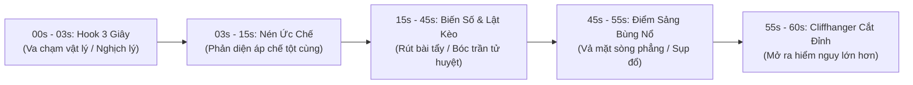

# ĐẠI ĐIỂN TRI THỨC & KINH NGHIỆM BIÊN KỊCH 100 BỘ ĐOẢN VĂN TRUNG QUỐC KINH ĐIỂN

> **Sổ Tay Bách Khoa Toàn Thư Về Biên Kịch Kịch Bản Đoản Văn & Audio Drama TikTok Triệu View.**
> *Nguồn dữ liệu thực chiến: Tổng hợp và mổ xẻ chuyên sâu 100 tác phẩm đoản văn kinh điển và hiện tượng mạng nổi tiếng nhất từ Zhihu 盐选专栏 (初代三绝, 新三绝, 2025盐言三绝, Kim Bàn Phím), Douyin 短剧 (hiện tượng hàng tỷ lượt xem), Fanqie (番茄小说), Jinjiang (晋江文学城) và Qidian (起点中文网).*
> *Được thiết kế làm kim chỉ nam bất biến cho toàn bộ Hệ thống Agent và Động cơ Biên Kịch Antigravity TikTok Studio.*

---

## PHẦN I: TỔNG LUẬN PHƯƠNG PHÁP LUẬN BIÊN KỊCH ĐOẢN VĂN VIRAL (ZHIHU & DOUYIN)

### 1. Triết Lý Cốt Lõi: '12 Chữ Vàng' Của Đoản Văn Giữ Chân Người Nghe
> **'Ba giây một cái móc (Hook), năm giây một đảo chiều (Twist), tập nào cũng có điểm sảng (Shuangdian)!'**

- **Quy tắc 1.5 - 3 Giây Đầu**: Quyết định sinh tử của video. Thính giả lướt qua màn hình cực nhanh. Nếu 15 từ đầu tiên không chứa xung đột cực hạn, nghịch lý hành động hoặc vật chứng rợn gáy, tỷ lệ vuốt bỏ (Swipe Away) đạt trên 85%.
- **Công Thức Sảng Điểm Định Lượng (The Shuangdian Neuro-Equation)**:

$$\text{Mức Độ Sảng} = (\text{Độ Ức Chế Tột Cùng} \times \text{Độ Trì Hoãn Thỏa Mãn}) \times \text{Tốc Độ & Cường Độ Phản Đòn}$$

- **Chu Trình 4 Giai Đoạn Áp Chế - Bộc Phát**:
  1. `ÁP CHẾ (压抑 - Yayi)`: Tạo bất công phi lý, hạ thấp nhân vị, tước đoạt danh dự của NV chính (nạp đầy phẫn nộ cho khán giả).
  2. `TÍCH TỤ / KÉO NÉN (蓄势 - Xushi)`: NV chính không manh động, ẩn nhẫn mài dao, giăng bẫy âm thầm (kỳ vọng đòn trừng phạt).
  3. `BỘC PHÁT VẢ MẶT (爆发打脸 - Bofa Dalian)`: Lật mở sự thật ngay tại đỉnh cao đắc thắng của phản diện (giải phóng Dopamine cực hạn).
  4. `THANH TOÁN TRIỆT ĐỂ (清算 - Qingsuan)`: Phản diện mất hết tiền tài, danh dự, địa vị; cầu xin trong tuyệt vọng (tuyệt đối không tha thứ rẻ rúng).

### 2. Mô Hình Nhịp Độ 1 Phút / 1 Tập Chuẩn Điện Ảnh (Micro-Pacing Model)


### 3. Bảng Phân Bổ Âm Thanh & Nhịp Thở Audio Drama (Sound Design Pacing)
| Thời Gian | Chức Năng Âm Thanh / Kịch Bản | Mục Tiêu Giữ Chân (Retention) | Kỹ Thuật Sound Design |
| :--- | :--- | :--- | :--- |
| **00:00 - 00:03** | **GOLDEN HOOK:** Lời thoại gây sốc / Mâu thuẫn đạo đức tột độ | Ngăn người dùng lướt đi (Stop-scrolling) | Tiếng tát vang dội, tiếng máy thở tít dài, tiếng đập bàn, âm bass drop đột ngột |
| **00:03 - 00:15** | **ESCALATION:** Phản diện dồn ép, nhân vật chính rơi vào tuyệt lộ | Tạo cảm xúc phẫn nộ / tò mò tột đỉnh | Nhạc nền căng thẳng (Violin dồn dập, tiếng đồng hồ đếm ngược) |
| **00:15 - 00:25** | **PRE-TWIST:** Một biến số lạ xuất hiện, hé lộ tia hy vọng | Kích hoạt tò mò trí tuệ | Nhạc nền im bặt đột ngột (Audio Pause / Negative Space) |
| **00:25 - 00:30** | **CLIFFHANGER / MINI-PUNCH:** Câu nói lật đổ cục diện hoặc tiếng mở cửa | Buộc người nghe phải nghe tiếp tập sau | Tiếng hiệu ứng Whoosh + Câu thoại bỏ lửng then chốt |

### 4. Bộ 5 Mô Thức 'Hook 3 Giây' Triệu View (Golden Hook Templates)
1. **Hook Nghịch Luân Lý / Khiêu Khích Đạo Đức**: *'Ngày tôi sinh non trong phòng cấp cứu, chồng tôi đang ký giấy đồng ý hiến thận của tôi cho người yêu cũ của anh ta.'*
2. **Hook Đếm Ngược Tử Thần**: *'Bác sĩ nói tôi chỉ còn sống được ba mươi ngày, và việc đầu tiên tôi làm là rút năm mươi tỷ tiền tiết kiệm.'*
3. **Hook Phản So Sai Thân Phận Cực Đoan**: *'Mẹ chồng tống tôi ra khỏi biệt thự với hai trăm nghìn đồng dằn túi, bà không hề biết tập đoàn mà con trai bà đang làm thuê mang chính tên lót của tôi.'*
4. **Hook Quái Đàm / Cấm Kỵ Quy Tắc**: *'Nếu bạn thức giấc lúc ba giờ sáng và thấy mẹ bạn đang đứng gõ cửa phòng tắm... Đừng mở cửa! Mẹ bạn đã mất ba năm trước rồi.'*
5. **Hook Thẳng Tay Vả Mặt (Direct Slap Hook)**: *'Cầm năm mươi tỷ này và cút khỏi con trai tôi? Bác gái à, công ty của con trai bác tháng trước vừa vay của tôi một trăm tỷ đấy!'*

### 5. Thiết Kế Nhân Vật Phản Diện 3 Chiều (Chống Bẫy Não Tàn)
```
           [LỚP NGOÀI: MẶT NẠ ĐẠO ĐỨC & TRÍ TUỆ]
   - Lịch thiệp, được xã hội công nhận, lời nói luôn nhân danh lợi ích chung.
   - Thấu hiểu luật pháp, dùng kẽ hở quy định để triệt hạ đối thủ.
                         ↓
           [LỚP GIỮA: ĐỘNG CƠ HỢP LÝ HÓA (JUSTIFICATION)]
   - 'Ta không ác, ta chỉ đang giành lại những gì thế giới nợ ta.'
   - Xuất thân chấn thương tâm lý, nghèo đói cùng cực hoặc bị áp bức thời niên thiếu.
                         ↓
           [LỚP LÕI: TỬ HUYỆT BẢO THỦ & KIÊU NGẠO]
   - Không tin trên đời có người vô tư không tham lam.
   - Đánh giá thấp nhân tính và tình yêu thương chân thành.
```

---

## PHẦN II: MỔ XẺ CHI TIẾT 100 TÁC PHẨM ĐOẢN VĂN KINH ĐIỂN THEO 10 THỂ LOẠI

### 📂 THỂ LOẠI 01: NGƯỢC LUYẾN TÀN TÂM & HỎA TÁNG TRÀNG TRUY THÊ (虐恋残心 · 追妻火葬场)
- **Nền tảng tiêu biểu**: Zhihu 盐选, Jinjiang (晋江文学城)
- **Trục cảm xúc chủ đạo**: *Đau xót dằn vặt, hối hận muộn màng, giải thoát bi tráng, BE mỹ học*
- **Số lượng tác phẩm nghiên cứu**: 10 tác phẩm nổi tiếng chuẩn mực.

---
#### 📜 [001/100] 《Cung Tường Liễu》 (宫墙柳)
- **Tác giả & Nền tảng**: `Mộng Oa (梦娃) - Zhihu (知乎盐选 · 初代三绝)`
- **Phân loại**: *Cổ đại / Đoản văn cung đình / Phản sáo lộ cung đấu / Tình tỷ muội / BE Day dứt*
- **Bối cảnh & Tiền đề kịch tính (Premise)**: Nữ chính Giang Ánh Liễu 14 tuổi ngây thơ tiến cung, cứ ngỡ mình được hoàng đế cưng chiều nhất vì được gọi bằng nhũ danh 'Liễu Nhi'. Nhưng suốt mười mấy năm thanh xuân nơi cấm cung, nàng và các phi tần dần nhận ra họ chỉ là những mảnh ghép chắp vá cho Tiêu Thục phi – người con gái đã khuất mà đế vương cả đời không thể quên. Hậu cung không hề đấu đá tàn sát; những người phụ nữ nương tựa, sưởi ấm cho nhau giữa lồng son lạnh giá.

**1. Thiết Lập & Xây Dựng Nhân Vật (Character Archetypes & Dynamics):**
  - Giang Ánh Liễu (Nữ chính): Nhập cung năm 14 tuổi, hoạt bát, ngây thơ, thích ăn bánh hoa quế; trải qua năm tháng trở nên thấu triệt, dịu dàng buông bỏ tình si. Mỏ neo: Dải lụa xanh biếc hái liễu.
  - Hoàng đế: Quân vương cô độc, si tình với người cũ đã khuất (Tiêu thị), biến cả hậu cung thành bảo tàng thế thân sống động. Mỏ neo: Chiếc ngọc bội khắc hoa mai cũ kỹ mòn vẹt.
  - Dàn phi tần (Hoàng hậu, Hiền phi, Đức phi): Không hề hãm hại nhau, cùng nhau thêu thùa, nấu lẩu, chăm sóc con cái; cùng chung nỗi bi kịch bị giam cầm thanh xuân.

**2. Mở Đầu Audio 3 Giây Giữ Chân (The 3-Second Retention Hook):**
> ⚡ *'Năm mười bốn tuổi ta tiến cung, Hoàng thượng vuốt tóc ta gọi khẽ 'Liễu Nhi'. Mười lăm năm sau ta mới biết, ngài gọi cành liễu năm xưa ngài hái cùng người đã khuất, chứ chưa từng gọi ta.'*

**3. Cấu Trúc 3 Hồi & Nhịp Độ Micro-Pacing (Acts & Pacing):**
- Hồi 1 (Mộng đẹp hoa lệ): Ánh Liễu được ân sủng vô biên, được ban trâm ngọc, ngỡ rằng tấm chân tình đế vương thuộc về mình giữa những đêm hoa đăng lung linh.
- Hồi 2 (Vết nứt hiện thực): Phát hiện chữ 'Liễu' trong tên mình, ánh mắt của Hoàng hậu, nốt ruồi son của Hiền phi đều là bản sao của Tiêu Thục phi quá cố. Hậu cung nhận ra chân tướng nhưng không ghen ghét mà đùm bọc lấy nhau.
- Hồi 3 (Đại kết cục thấu triệt): Hoàng đế già nua băng hà nắm chặt tay Ánh Liễu thì thào gọi 'Liễu Nhi'. Nàng mỉm cười dịu dàng lau nước mắt cho ngài, thanh thản bước ra thềm điện nhìn bầu trời tự do mà thanh xuân đã mất.

**4. Cú Twist Đa Tầng & Điểm Sảng Bùng Nổ (Satisfaction Peak & Plot Twist):**
💥 **Điểm bẻ lái cốt lõi: Phá tan ảo tưởng cung đấu đẫm máu. Kẻ thù không phải là phi tần khác; bi kịch lớn nhất là sự 'dịu dàng tàn nhẫn' của đế vương – biến toàn bộ mỹ nhân hậu cung thành những bóng ma sống thế thân cho một nắm tro tàn.**

**5. Tinh Hoa Đúc Kết & Bài Học Biên Kịch Audio TikTok (Master Scriptwriting Takeaways):**
  - Tinh hoa kịch bản: Khai thác nỗi đau từ sự dịu dàng tàn nhẫn (Gentle Cruelty). Nước mắt rơi không vì oán hận mà vì sự bất lực xót xa trước thanh xuân bị chôn vùi.
  - Xây dựng nhân vật: Khắc họa tình bạn nữ giới (Female Solidarity) giữa chốn thâm cung đối lập hoàn toàn với ngai vàng lạnh lẽo, tạo hiệu ứng cảm xúc sâu thẳm.
  - Mẹo chuyển thể Audio TikTok: Giọng đọc ngôi thứ nhất điềm tĩnh, u buồn. Nhịp chậm ở các đoạn hồi ức, ngắt câu sau 12 từ để âm vang tiếng thở dài.

> [!TIP]
> **Ứng dụng thực chiến của bộ 001**: Khi sản xuất audio cho thể loại này, luôn neo đạo cụ vật lý chính vào phân đoạn mở màn và sử dụng đòn lật kèo logic, triệt tiêu hoàn toàn sáo ngữ kể lể.

---
#### 📜 [002/100] 《Hành Chỉ Vãn》 (行止晚)
- **Tác giả & Nền tảng**: `Chi Nhĩ (织尔) - Zhihu (知乎盐选 · 初代三绝)`
- **Phân loại**: *Cổ đại / Thanh mai trúc mã / Quyền mưu bi kịch / Ngược nam cực hạn / BE Mỹ học*
- **Bối cảnh & Tiền đề kịch tính (Premise)**: Thái tử Lý Hành Chỉ và nữ chính Vãn Vãn cùng lớn lên từ thuở hàn vi, từng thề hẹn dưới gốc mai khi chàng nắm thiên hạ sẽ lập nàng làm Hoàng hậu duy nhất. Khi bước lên ngai vàng, bị các thế gia đại tộc kiềm tỏa, chàng lần lượt đón thiên kim Thôi thị vào cung phong Hậu, ép nàng chịu phận Quý phi 'chờ ta diệt xong Thôi thị sẽ trả lại tất cả'. Nhưng sự mài mòn của quyền lực và tổn thương đã giết chết nàng trước ngày vinh quang.

**1. Thiết Lập & Xây Dựng Nhân Vật (Character Archetypes & Dynamics):**
  - Vãn Vãn (Nữ chính): Thanh thuần, kiên định, lòng tự trọng cao hơn tính mạng; yêu sâu đậm nhưng tuyệt đối không chấp nhận tình cảm bị chia năm xẻ bảy. Mỏ neo: Chiếc khăn tay thêu hoa mai dính vết máu khô.
  - Lý Hành Chỉ (Nam chính): Thái tử đăng cơ, tham vọng đại nghiệp, tự cho rằng mình đang hy sinh vì tương lai hai người, không nhận ra sự trì hoãn chính là lưỡi dao đoạt mạng người yêu. Mỏ neo: Chiếc phượng bào bằng chỉ vàng khóa trong rương chín tầng.

**2. Mở Đầu Audio 3 Giây Giữ Chân (The 3-Second Retention Hook):**
> ⚡ *'Vãn Vãn, trẫm chỉ phong nàng làm Quý phi, ngôi Hoàng hậu phải trao cho Thôi thị để yên lòng tướng sĩ. Đợi trẫm thanh trừng xong gia tộc họ, ngôi vị đó nhất định là của nàng!'*

**3. Cấu Trúc 3 Hồi & Nhịp Độ Micro-Pacing (Acts & Pacing):**
- Hồi 1 (Lời hẹn dưới cội mai): Ký ức thanh mai trúc mã thời nghèo khó đan xen với hiện thực thềm rồng xa cách, nữ chính nhẫn nhịn lui về cung cấm hoang phế.
- Hồi 2 (Bào mòn sinh mệnh): Nữ chính sảy thai do Thôi hoàng hậu hãm hại, nam chính vì đại cục ép nàng 'nhẫn nhịn thêm một chút'. Từng câu an ủi biến thành mũi kim đâm nát niềm tin.
- Hồi 3 (Tự do vĩnh viễn): Ngày nam chính diệt sạch Thôi thị, nâng phượng quan lộng lẫy đến nghênh đón nàng thì chỉ còn thấy thi thể nàng mặc y phục trắng thanh thản nhắm mắt cùng phong thư: 'Hành Chỉ, ta không đợi ngài nữa'.

**4. Cú Twist Đa Tầng & Điểm Sảng Bùng Nổ (Satisfaction Peak & Plot Twist):**
💥 **Điểm bẻ lái cốt lõi: Nam chính ngỡ rằng mình chịu đựng nhục nhã để mang lại ngai vàng cho người yêu, nhưng chính sự tính toán lạnh lùng và trì hoãn ấy đã đẩy nàng vào chỗ chết. Chiếc phượng bào vĩnh viễn không có người mặc.**

**5. Tinh Hoa Đúc Kết & Bài Học Biên Kịch Audio TikTok (Master Scriptwriting Takeaways):**
  - Tinh hoa kịch bản: Mâu thuẫn 'Tình riêng vs Trách nhiệm quyền lực'. Đòn trừng phạt tàn khốc nhất dành cho kẻ tham vọng là cho hắn nắm trọn thiên hạ nhưng phải cô độc cả đời trên đỉnh vinh quang.
  - Kỹ thuật thoại dao găm: Lời thoại hứa hẹn của nam chính lúc mở đầu trở thành bản cáo trạng mỉa mai nhất ở hồi kết.
  - Mẹo chuyển thể Audio TikTok: Chèn tiếng chuông đồng thau ngân dài và tiếng gió tuyết rít sau câu thư tuyệt mệnh để đẩy cảm xúc người nghe chạm đáy bi thương.

> [!TIP]
> **Ứng dụng thực chiến của bộ 002**: Khi sản xuất audio cho thể loại này, luôn neo đạo cụ vật lý chính vào phân đoạn mở màn và sử dụng đòn lật kèo logic, triệt tiêu hoàn toàn sáo ngữ kể lể.

---
#### 📜 [003/100] 《Hà Thanh Hải Yến》 (河清海晏)
- **Tác giả & Nền tảng**: `Quất Tử Bất Toan (橘子不酸) - Zhihu (知乎盐言故事 · 新三绝之'Mỹ Tuyệt')`
- **Phân loại**: *Cổ đại / Chiến tranh gia quốc / Ngược luyến thâm trầm / BE Mỹ học Thiên hoa bản*
- **Bối cảnh & Tiền đề kịch tính (Premise)**: Thời loạn thế phân tranh, nữ tướng quân Yến Thanh thống lĩnh biên quân trấn giữ ải Bắc, cùng thiếu niên tướng soái Tiêu Hà kết tóc se duyên. Giữa mưu đồ phản trắc của triều đình mục ruỗng và sự xâm lăng của ngoại bang, cả hai phải đứng trước lựa chọn sinh tử: Bảo vệ tình yêu cá nhân hay đem thân mình làm tường thành bảo vệ giang sơn trăm họ.

**1. Thiết Lập & Xây Dựng Nhân Vật (Character Archetypes & Dynamics):**
  - Yến Thanh: Nữ soái kiên cường, áo giáp đẫm máu, thấu hiểu đại nghĩa gia quốc nhưng lòng mang nỗi đau giấu kín. Mỏ neo: Cây trường thương nhuộm đỏ và chiếc chuông gió bằng vỏ đạn đồng.
  - Tiêu Hà: Chiến tướng tài ba, quyết đoán nơi sa trường, nguyện đem tính mạng đổi lấy thái bình thiên hạ và nụ cười của thê tử. Mỏ neo: Mảnh ngọc bội vỡ đôi khắc chữ 'Hà Thanh'.

**2. Mở Đầu Audio 3 Giây Giữ Chân (The 3-Second Retention Hook):**
> ⚡ *'Mũi tên lửa cuối cùng cắm phập vào ngực Tiêu Hà ngay trước cổng thành khóa chặt, chàng nhìn tôi mỉm cười qua làn khói lửa: 'Yến Thanh, bắn đi! Đừng để giặc qua ải!'.'*

**3. Cấu Trúc 3 Hồi & Nhịp Độ Micro-Pacing (Acts & Pacing):**
- Hồi 1 (Lửa khói biên ải): Đôi uyên ương tướng sĩ kề vai chiến đấu bảo vệ ải môn trước quân phản loạn gấp mười lần, hậu phương triều đình cắt đứt viện binh và lương thảo.
- Hồi 2 (Tuyệt lộ dằn vặt): Kẻ địch bắt giữ Tiêu Hà trên đầu trận tuyến ép mở cổng thành. Nữ chính đứng trên tường lũy, giương cung ngắm thẳng người thương trong cơn giằng xé máu lệ.
- Hồi 3 (Hà Thanh Hải Yến): Mũi tên xé gió bắn hạ chủ tướng địch xuyên qua thân Tiêu Hà. Thành trì được giữ vững, giang sơn thái bình, nhưng người con gái năm xưa cô độc đứng gảy đàn bên nấm mộ không tên nơi biên thùy.

**4. Cú Twist Đa Tầng & Điểm Sảng Bùng Nổ (Satisfaction Peak & Plot Twist):**
💥 **Điểm bẻ lái cốt lõi: Triều đình từ lâu đã bán đứng biên ải để cầu hòa; chính Tiêu Hà đã tự tay cắt đứt dây trói lao vào mũi kiếm địch để giải thoát cho quyết định của nữ chính, biến cái chết thành khúc tráng ca bất tử.**

**5. Tinh Hoa Đúc Kết & Bài Học Biên Kịch Audio TikTok (Master Scriptwriting Takeaways):**
  - Tinh hoa kịch bản: Thăng hoa từ bi kịch tình yêu cá nhân lên tầm vóc bi tráng gia quốc thiên hạ. Cái chết mang vẻ đẹp hào hùng (Sublime Tragedy).
  - Thiết kế âm học: Tiếng dây cung bật tanh tách, tiếng ngựa hí dồn dập, và sự tĩnh lặng tuyệt đối (Negative Space) khi mũi tên bay qua không trung.
  - Mẹo chuyển thể Audio TikTok: Phối hợp nhạc nền bi tráng (Cello + trống trận dồn dập) rồi tắt phụt ở câu thoại cuối của nam chính.

> [!TIP]
> **Ứng dụng thực chiến của bộ 003**: Khi sản xuất audio cho thể loại này, luôn neo đạo cụ vật lý chính vào phân đoạn mở màn và sử dụng đòn lật kèo logic, triệt tiêu hoàn toàn sáo ngữ kể lể.

---
#### 📜 [004/100] 《Trường Mệnh》 (长命)
- **Tác giả & Nền tảng**: `Bán Tài Minh Nguyệt (半裁明月) - Zhihu (知乎盐选 · BE Mỹ học Thiên hoa bản)`
- **Phân loại**: *Cổ phong / Quyền mưu cứu rỗi / Ngược luyến thê lương / Xuất bản sách & Phim ảnh*
- **Bối cảnh & Tiền đề kịch tính (Premise)**: Nàng là người con gái bị hiến tế mang danh 'Trường Mệnh' để cầu phúc sống lâu cho vị thế tử ốm yếu quyền quý. Nàng dùng máu thịt và sự thuần khiết sưởi ấm tâm hồn tăm tối của chàng. Nhưng khi thế tử khỏi bệnh bước lên vị trí chưởng quản vương phủ, chàng lại vì quyền thế mà dâng nàng vào cung làm thuốc dẫn cho hoàng đế.

**1. Thiết Lập & Xây Dựng Nhân Vật (Character Archetypes & Dynamics):**
  - Trường Mệnh: Đơn thuần nhưng quật cường, mang vết sẹo cổ tay do trích máu cứu người, khát khao được sống một đời bình dị nơi đồng nội. Mỏ neo: Chiếc vòng bạc khắc chữ 'Trường Mệnh Bách Tuế'.
  - Bùi Dực (Thế tử): Bề ngoài ốm yếu thanh nhã nhưng bên trong chứa chấp dã tâm tàn bạo, yêu nàng nhưng coi trọng ngai vàng hơn tất thảy. Mỏ neo: Tách trà men xanh pha máu hươu.

**2. Mở Đầu Audio 3 Giây Giữ Chân (The 3-Second Retention Hook):**
> ⚡ *'Chiếc vòng bạc khắc bốn chữ 'Trường Mệnh Bách Tuế' vừa rơi xuống đĩa vàng vỡ đôi, Bùi Dực đã lạnh lùng ra lệnh: 'Cắt cổ tay nàng ta, hoàng thượng đang chờ máu dẫn thuốc'.'*

**3. Cấu Trúc 3 Hồi & Nhịp Độ Micro-Pacing (Acts & Pacing):**
- Hồi 1 (Sự cứu rỗi thuở thiếu thời): Nữ chính chăm sóc thế tử suốt 5 năm, dùng máu trích từ cổ tay mỗi ngày để duy trì tính mạng cho chàng giữa những âm mưu đầu độc trong vương phủ.
- Hồi 2 (Sự phản bội máu lạnh): Thế tử khỏi bệnh, để đổi lấy ấn tín Thống đốc kinh kỳ đã dâng nàng vào ngự dược viện, nói dối rằng 'đợi đại sự thành sẽ đón nàng về làm chính thê'.
- Hồi 3 (Đoạn tuyệt nguyền rủa): Nữ chính tự uống cạn chén thạch tín trước mặt hoàng đế và thế tử, để dòng máu cứu mạng biến thành kịch độc đoạt hồn. Trước khi trút hơi thở cuối cùng, nàng ném mảnh vòng vỡ vào mặt Bùi Dực: 'Chúc ngài sống lâu trăm tuổi, cô độc ngàn năm'.

**4. Cú Twist Đa Tầng & Điểm Sảng Bùng Nổ (Satisfaction Peak & Plot Twist):**
💥 **Điểm bẻ lái cốt lõi: Thứ thuốc dẫn cứu mạng Bùi Dực không phải là máu của nàng, mà là sự gắn kết linh hồn; khi nàng chết vì độc, cơ thể Bùi Dực lập tức tái phát bệnh cũ, nằm liệt giường ôm chiếc vòng bạc dằn vặt suốt phần đời còn lại.**

**5. Tinh Hoa Đúc Kết & Bài Học Biên Kịch Audio TikTok (Master Scriptwriting Takeaways):**
  - Tinh hoa kịch bản: Tên tác phẩm 'Trường Mệnh' (Sống Lâu) là sự mỉa mai tột cùng. Lời chúc 'Sống lâu trăm tuổi' trở thành lời nguyền rủa đáng sợ nhất trên thế gian.
  - Xây dựng chi tiết vật chất: Vết sẹo lặp đi lặp lại trên cổ tay và chiếc vòng bạc tạo hiệu ứng thị giác và thính giác ám ảnh sâu sắc.
  - Mẹo chuyển thể Audio TikTok: Đoạn cuối hạ giọng thì thầm đay nghiến, dùng tiếng rơi cơ học 'keng' của vòng bạc kim loại chạm đất để kết thúc video.

> [!TIP]
> **Ứng dụng thực chiến của bộ 004**: Khi sản xuất audio cho thể loại này, luôn neo đạo cụ vật lý chính vào phân đoạn mở màn và sử dụng đòn lật kèo logic, triệt tiêu hoàn toàn sáo ngữ kể lể.

---
#### 📜 [005/100] 《Ngươi Thất Hứa Rồi》 (你失信了)
- **Tác giả & Nền tảng**: `Thập Thanh Diểu (十清杳) - Jinjiang (晋江文学城 · Đoản văn BE kinh điển)`
- **Phân loại**: *Hiện đại đô thị / Vườn trường đến thanh xuân / Song hướng thầm mến / BE Day dứt*
- **Bối cảnh & Tiền đề kịch tính (Premise)**: Thời trung học, Lục Thần và Ninh Huyên cùng nhau hẹn ước thi đỗ đại học y khoa Bắc Kinh. Một biến cố nợ nần ập xuống gia đình Lục Thần khiến anh biến mất không lời từ biệt. Tám năm sau gặp lại ở tuyến đầu chống dịch, cô là bác sĩ ngoại khoa, anh là sĩ quan cảnh sát hỗ trợ. Họ ngỡ sẽ nối lại duyên xưa, nhưng số phận tàn nhẫn một lần nữa cướp đi lời hứa cuối cùng.

**1. Thiết Lập & Xây Dựng Nhân Vật (Character Archetypes & Dynamics):**
  - Ninh Huyên: Bác sĩ tận tụy, bên ngoài kiên cường nhưng luôn giữ thói quen chờ một tin nhắn suốt 8 năm. Mỏ neo: Chiếc đồng hồ bấm giờ Casio cũ bị trầy góc.
  - Lục Thần: Trầm mặc, mang nhiều gánh nặng gia đình, yêu cô sâu thẳm nhưng luôn cảm thấy bản thân không xứng đáng. Mỏ neo: Chiếc huy hiệu cảnh sát dính tro bụi.

**2. Mở Đầu Audio 3 Giây Giữ Chân (The 3-Second Retention Hook):**
> ⚡ *'Chiếc máy thở reo lên hồi còi tít dài đơn điệu, bác sĩ trực kéo tấm vải trắng qua gương mặt người cảnh sát vừa hy sinh trong vụ nổ, để lộ bàn tay nắm chặt bức ảnh tốt nghiệp mười năm trước.'*

**3. Cấu Trúc 3 Hồi & Nhịp Độ Micro-Pacing (Acts & Pacing):**
- Hồi 1 (Lời ước dưới tàng cây ngô đồng): Năm 18 tuổi, hai cô cậu học trò chuyền tay nhau mảnh giấy ghi ước mơ đại học y, hẹn ngày hoa nở sẽ chính thức tỏ tình.
- Hồi 2 (Khoảng cách 8 năm): Cuộc tái ngộ tình cờ nơi khu cách ly. Ánh mắt trao nhau qua lớp kính bảo hộ, anh viết lên lòng bàn tay chữ 'Chờ anh xong nhiệm vụ này'.
- Hồi 3 (Sự thất hứa vĩnh viễn): Một vụ cháy cứu hộ trước ngày kết thúc dịch cướp đi tính mạng anh. Cô gái lặng lẽ đeo lại chiếc đồng hồ Casio, tiếp tục bước vào ca mổ nhưng nước mắt rơi ướt đẫm khẩu trang.

**4. Cú Twist Đa Tầng & Điểm Sảng Bùng Nổ (Satisfaction Peak & Plot Twist):**
💥 **Điểm bẻ lái cốt lõi: Trong di vật của Lục Thần có một cuốn sổ tiết kiệm mang tên cô, mỗi tháng anh đều gửi vào đó 2 triệu suốt 8 năm với nội dung chuyển khoản: 'Quỹ mua váy cưới cho Huyên Huyên'.**

**5. Tinh Hoa Đúc Kết & Bài Học Biên Kịch Audio TikTok (Master Scriptwriting Takeaways):**
  - Tinh hoa kịch bản: Khai thác nỗi đau của sự 'Bỏ lỡ' (The Tragedy of Missed Timing). Nhân vật không hề có lỗi, tình yêu không hề phai nhạt, chỉ có hiện thực cuộc đời quá khắc nghiệt.
  - Chi tiết chạm đáy: Cuốn sổ tiết kiệm với nội dung chuyển khoản lặp đi lặp lại 96 lần là đòn hạ gục hoàn toàn phòng tuyến cảm xúc của khán giả.
  - Mẹo chuyển thể Audio TikTok: Đọc chậm rãi nội dung từng dòng nhật ký chuyển khoản, chèn tiếng máy đo nhịp tim tít tít phía sau.

> [!TIP]
> **Ứng dụng thực chiến của bộ 005**: Khi sản xuất audio cho thể loại này, luôn neo đạo cụ vật lý chính vào phân đoạn mở màn và sử dụng đòn lật kèo logic, triệt tiêu hoàn toàn sáo ngữ kể lể.

---
#### 📜 [006/100] 《Tang Tang》 (桑桑)
- **Tác giả & Nền tảng**: `Tri Hồ Diêm Ngôn - Zhihu (知乎盐选 · Linh hồn thị giác)`
- **Phân loại**: *Cổ đại / Linh hồn chứng kiến / Bạch nguyệt quang thế thân / Hỏa táng tràng*
- **Bối cảnh & Tiền đề kịch tính (Premise)**: Nữ chính Tang Tang sau khi chết biến thành một linh hồn phiêu dạt bên cạnh Tiêu Hoài An – vị tướng quân từng xem cô là cỏ rác và coi thứ muội của cô là bảo bối. Chỉ khi cô chết đi, từng bức màn dối trá của thứ muội mới lộ ra, và Tiêu Hoài An bắt đầu rơi vào cơn điên loạn hối hận tột cùng, nhưng linh hồn Tang Tang chỉ thản nhiên mỉm cười chuẩn bị đầu thai.

**1. Thiết Lập & Xây Dựng Nhân Vật (Character Archetypes & Dynamics):**
  - Tang Tang: Linh hồn phiêu dạt, tính cách thông thấu, bình thản nhìn kẻ từng ngược đãi mình đau khổ mà không hề mảy may thương hại. Mỏ neo: Chiếc vòng dâu tằm đeo từ thuở nhỏ.
  - Tiêu Hoài An: Tướng quân mù quáng, trước kiêu ngạo tàn nhẫn bao nhiêu thì sau khi phát hiện chân tướng lại quỳ lạy van xin trong tuyệt vọng bấy nhiêu. Mỏ neo: Chiếc hộp gỗ đựng nắm tro tàn.

**2. Mở Đầu Audio 3 Giây Giữ Chân (The 3-Second Retention Hook):**
> ⚡ *'Tôi đứng lơ lửng trên xà nhà nhìn Tiêu Hoài An ôm thi thể lạnh ngắt của tôi khóc đến nôn ra máu, trong lòng chỉ thầm nghĩ: 'Khóc to lên nữa đi, kiếp sau tôi tuyệt đối không muốn gặp lại anh'.'*

**3. Cấu Trúc 3 Hồi & Nhịp Độ Micro-Pacing (Acts & Pacing):**
- Hồi 1 (Góc nhìn từ cõi chết): Nữ chính chết vì bị bỏ rơi trong bão tuyết, linh hồn bay lơ lửng chứng kiến nam chính đang vui vẻ tổ chức sinh nhật cho trà xanh thứ muội.
- Hồi 2 (Bóc trần sự thật): Quân y mang đến chiếc áo rách nát của nữ chính, vạch trần kẻ năm xưa cứu nam chính khỏi đầm lầy là Tang Tang chứ không phải thứ muội. Nam chính phát điên trừng trị kẻ lừa dối.
- Hồi 3 (Hỏa táng tràng không lối về): Nam chính quỳ gối 3 ngày 3 đêm trước linh vị tự rạch nát lồng ngực để chuộc tội. Nữ chính uống cạn chén canh Mạnh Bà bên bờ Nại Hà, nhẹ nhàng quay lưng bước qua cầu.

**4. Cú Twist Đa Tầng & Điểm Sảng Bùng Nổ (Satisfaction Peak & Plot Twist):**
💥 **Điểm bẻ lái cốt lõi: Khác với truyện ngược thông thường nhân vật chính sống lại để tha thứ; ở đây nữ chính chết thật, chứng kiến sự trừng phạt của kẻ thù với tâm thế người dưng nước lã, triệt tiêu hoàn toàn khả năng gương vỡ lại lành.**

**5. Tinh Hoa Đúc Kết & Bài Học Biên Kịch Audio TikTok (Master Scriptwriting Takeaways):**
  - Kỹ thuật góc nhìn thứ ba siêu thực (Ghost POV): Cho nhân vật chính làm quan sát viên sau khi chết giúp cảm xúc đạt độ lạnh lùng, tạo sự tương phản cực hạn với sự cuồng loạn của nam chính.
  - Sự sảng khoái của việc không tha thứ: Khán giả hả dạ nhất khi kẻ có tội dằn vặt suốt đời mà không nhận được bất kỳ sự xá tội nào.
  - Mẹo chuyển thể Audio TikTok: Dùng giọng nữ thanh thoát, hờ hững đối thoại song song với tiếng gào khóc khản đặc của nam chính.

> [!TIP]
> **Ứng dụng thực chiến của bộ 006**: Khi sản xuất audio cho thể loại này, luôn neo đạo cụ vật lý chính vào phân đoạn mở màn và sử dụng đòn lật kèo logic, triệt tiêu hoàn toàn sáo ngữ kể lể.

---
#### 📜 [007/100] 《Truy Thê Thực Lục: Khi Hắn Cầu Xin Ta Thì Trời Đang Mưa》 (追妻实录：他求我时雨在下)
- **Tác giả & Nền tảng**: `Tri Hồ Diêm Ngôn - Zhihu (知乎盐言故事 · Bạo khoản hỏa táng tràng)`
- **Phân loại**: *Hiện đại đô thị / Hôn nhân tan vỡ / Nữ chính thanh tỉnh / Ngược nam sảng khoái*
- **Bối cảnh & Tiền đề kịch tính (Premise)**: Kỷ Thư làm vợ Phó Trầm Uyên 6 năm, cam chịu làm cái bóng phía sau một tổng tài bá đạo luôn lạnh nhạt và dành sự quan tâm đặc biệt cho thanh mai trúc mã. Ngày Kỷ Thư phát hiện mình mang thai cũng là ngày Phó Trầm Uyên bỏ rơi cô giữa đường cao tốc trời mưa bão để chạy đến với người cũ. Kỷ Thư sảy thai, thanh thản ký đơn ly hôn và biến mất khỏi thành phố.

**1. Thiết Lập & Xây Dựng Nhân Vật (Character Archetypes & Dynamics):**
  - Kỷ Thư: Trầm tĩnh, độc lập, từng yêu hết mình nhưng khi buông tay thì dứt khoát như chặt đứt một cành cây khô. Mỏ neo: Chiếc ô màu đen rách mép và tờ giấy hủy hôn.
  - Phó Trầm Uyên: Tổng tài cao ngạo, quen thói được cung phụng, luôn nghĩ vợ sẽ không dám rời xa mình vì không có tiền bạc địa vị. Mỏ neo: Tấm séc 100 tỷ bị xé làm đôi.

**2. Mở Đầu Audio 3 Giây Giữ Chân (The 3-Second Retention Hook):**
> ⚡ *'Màn mưa xối xả đập rát mặt, Phó Trầm Uyên nhấn ga xe Maybach lao đi, để lại một câu qua cửa kính: 'Kỷ Thư, đừng diễn trò nữa, cô ấy bị dị ứng hạt lạc cần tôi hơn cô'.'*

**3. Cấu Trúc 3 Hồi & Nhịp Độ Micro-Pacing (Acts & Pacing):**
- Hồi 1 (Giọt nước tràn ly): Nữ chính đứng một mình dưới mưa bão, sảy thai trên đường cao tốc, tự gọi xe cấp cứu và ký giấy phẫu thuật một mình.
- Hồi 2 (Cắt đứt dứt khoát): Ra viện, cô dọn sạch mọi đồ đạc cá nhân trong vòng 1 tiếng, ký đơn từ bỏ toàn bộ tài sản, chuyển giao lại chức vụ quản lý chuỗi cung ứng độc quyền của gia đình cô.
- Hồi 3 (Hỏa táng tràng dưới mưa): Ba năm sau, tại hội nghị đấu thầu quốc tế, Phó Trầm Uyên đứng dưới mưa tầm tã trước sảnh khách sạn quỳ xin cô nhìn lại, Kỷ Thư cầm ô bước qua hắn, mỉm cười giới thiệu đối tác mới.

**4. Cú Twist Đa Tầng & Điểm Sảng Bùng Nổ (Satisfaction Peak & Plot Twist):**
💥 **Điểm bẻ lái cốt lõi: Tập đoàn của Phó Trầm Uyên lớn mạnh suốt 6 năm qua hoàn toàn nhờ vào mạng lưới tài chính bí mật do cha Kỷ Thư để lại; khi cô rút toàn bộ vốn ủy thác, đế chế của hắn sụp đổ trong vòng 30 ngày.**

**5. Tinh Hoa Đúc Kết & Bài Học Biên Kịch Audio TikTok (Master Scriptwriting Takeaways):**
  - Bạo lực lạnh tài chính: Nữ chính không cãi vã, không đánh ghen; đòn đáp trả chí mạng là rút hết nguồn lực kinh tế khiến kẻ phản bội nếm mùi thất bại toàn diện.
  - Quy tắc biểu tượng thời tiết (Rain Motif): Cảnh mở đầu bị bỏ rơi dưới mưa đối xứng hoàn hảo với cảnh kết thúc kẻ phản bội quỳ lạy dưới mưa tạo cảm giác quả báo nhãn tiền.
  - Mẹo chuyển thể Audio TikTok: Âm thanh mưa rào dồn dập từ giây đầu tiên, tiếng giày cao gót 'lách cách' bước đi dứt khoát ở đoạn kết.

> [!TIP]
> **Ứng dụng thực chiến của bộ 007**: Khi sản xuất audio cho thể loại này, luôn neo đạo cụ vật lý chính vào phân đoạn mở màn và sử dụng đòn lật kèo logic, triệt tiêu hoàn toàn sáo ngữ kể lể.

---
#### 📜 [008/100] 《Bệnh Thái Quan Hệ: Cẩu Điên Thuần Dưỡng Thủ Sách》 (病态关系：疯批小狗驯养手册)
- **Tác giả & Nền tảng**: `Tri Hồ Diêm Ngôn - Zhihu (知乎盐言专栏 · Kéo kéo tâm lý đỉnh cao)`
- **Phân loại**: *Hiện đại đô thị / Cường thủ hào đoạt ngược dòng / Tâm lý học tội phạm / Bẻ lái*
- **Bối cảnh & Tiền đề kịch tính (Premise)**: Nữ bác sĩ tâm lý Tần Nhược nhận điều trị cho Lục Chấp – thiếu gia duy nhất của Lục gia, kẻ có xu hướng bạo lực và mắc chứng rối loạn nhân cách chống đối xã hội. Mọi người đều nghĩ Lục Chấp là con thú săn mồi nguy hiểm đang thao túng và giam cầm cô, nhưng thực chất Tần Nhược mới là kẻ săn mồi thượng đẳng giăng bẫy thuần dưỡng 'chú chó điên' để trả thù cho vụ tai nạn năm xưa.

**1. Thiết Lập & Xây Dựng Nhân Vật (Character Archetypes & Dynamics):**
  - Tần Nhược: Bác sĩ tâm lý đoan trang, ánh mắt bình thản như mặt hồ đóng băng, nắm bắt mọi điểm yếu thần kinh của đối phương. Mỏ neo: Chiếc đồng hồ quả quýt thôi miên bằng bạc.
  - Lục Chấp: 'Cẩu điên' nguy hiểm, ngông cuồng, chiếm hữu cực đoan, sẵn sàng phát điên vì một cái liếc mắt của cô. Mỏ neo: Sợi xích bạc quấn chặt quanh cổ tay.

**2. Mở Đầu Audio 3 Giây Giữ Chân (The 3-Second Retention Hook):**
> ⚡ *'Lục Chấp dí mũi dao gọt hoa quả vào cổ họng tôi, hơi thở nóng rực phả vào vành tai: 'Bác sĩ Tần, nếu hôm nay cô dám bước ra khỏi cánh cửa này, tôi sẽ đốt sạch cả thành phố'. Tôi mỉm cười nâng cằm anh ta: 'Vậy anh đốt thử xem?'.'*

**3. Cấu Trúc 3 Hồi & Nhịp Độ Micro-Pacing (Acts & Pacing):**
- Hồi 1 (Màn kịch giam cầm): Nam chính giam lỏng nữ chính trong biệt thự ven biển, đóng vai kẻ thống trị điên loạn, bắt cô phải phục tùng từng mệnh lệnh.
- Hồi 2 (Đảo ngược quyền kiểm soát): Nữ chính dùng kỹ thuật neo tâm lý (NLP) và liệu pháp thiếu hụt cảm giác, từng bước tước bỏ sự đề phòng, biến sự ngông cuồng của nam chính thành sự lệ thuộc tinh thần tuyệt đối.
- Hồi 3 (Hạ màn thu lưới): Khi nam chính quỳ rạp dưới chân dâng lên toàn bộ cổ phần Lục thị để cầu xin tình yêu, Tần Nhược thản nhiên rút tai nghe giao nộp toàn bộ bằng chứng phạm tội của Lục gia cho viện kiểm sát.

**4. Cú Twist Đa Tầng & Điểm Sảng Bùng Nổ (Satisfaction Peak & Plot Twist):**
💥 **Điểm bẻ lái cốt lõi: Vị bác sĩ tâm lý nhu nhược thực chất là chị gái của nạn nhân bị Lục gia hại chết 7 năm trước; toàn bộ quá trình trị liệu là một kế hoạch thôi miên kéo dài 1000 ngày để kẻ thủ ác tự tay ký vào bản án tử hình.**

**5. Tinh Hoa Đúc Kết & Bài Học Biên Kịch Audio TikTok (Master Scriptwriting Takeaways):**
  - Thiết lập mối quan hệ Dominant / Submissive ngược (The Pseudo-Captor Trap): Bên ngoài có vẻ yếu thế nhưng bên trong nắm quyền sinh sát tạo sức căng tâm lý (Tension) cực mạnh.
  - Thoại đấu trí nhát gừng: Thoại ngắn, sắc bén, mỗi câu nói đều là một bước cờ tâm lý hạ bệ sự ngông cuồng của đối phương.
  - Mẹo chuyển thể Audio TikTok: Giọng đọc ma mị, thì thầm ở các đoạn thao túng tâm lý, tăng nhịp độ dồn dập khi lật tẩy cái bẫy phục thù.

> [!TIP]
> **Ứng dụng thực chiến của bộ 008**: Khi sản xuất audio cho thể loại này, luôn neo đạo cụ vật lý chính vào phân đoạn mở màn và sử dụng đòn lật kèo logic, triệt tiêu hoàn toàn sáo ngữ kể lể.

---
#### 📜 [009/100] 《Ánh Trăng Không Rơi Xuống》 (月亮不落)
- **Tác giả & Nền tảng**: `Tri Hồ - Zhihu (知乎盐选 · Trầm cảm & Đơn phương bi kịch)`
- **Phân loại**: *Hiện đại / Thanh xuân vườn trường / Đơn phương thầm lặng / Trầm cảm / BE Ám ảnh*
- **Bối cảnh & Tiền đề kịch tính (Premise)**: Lâm Hựu là cô gái trầm cảm sống khép mình, âm thầm thích chàng trai tỏa sáng như ánh mặt trời Giang Triệt suốt những năm cấp ba. Giang Triệt xem cô là bạn thân, nhưng luôn vô tư kể về những cô bạn gái xinh đẹp khác mà không hề biết từng vết cắt trong lòng cô. Ngày Giang Triệt cầu hôn bạn gái thành công, Lâm Hựu gieo mình xuống biển sâu, để lại cuốn nhật ký 10 năm chỉ viết một câu hỏi.

**1. Thiết Lập & Xây Dựng Nhân Vật (Character Archetypes & Dynamics):**
  - Lâm Hựu: Cô gái mắc chứng trầm cảm nặng, nhạy cảm, ít nói, coi tình cảm thầm kín là chiếc phao cứu sinh duy nhất giữa đại dương đen ngòm. Mỏ neo: Chiếc vỏ ốc biển màu xám tro.
  - Giang Triệt: Chàng trai năng động, vô tư đến tàn nhẫn, luôn nghĩ người bạn thân của mình 'rất mạnh mẽ và không biết buồn'. Mỏ neo: Chiếc nhẫn kim cương đắt giá.

**2. Mở Đầu Audio 3 Giây Giữ Chân (The 3-Second Retention Hook):**
> ⚡ *'Giang Triệt đưa cho tôi tấm thiệp cưới màu đỏ thắm, nụ cười rạng rỡ: 'Lâm Hựu, cậu là bạn thân nhất của tớ, vị trí phù dâu danh dự này nhất định phải là của cậu'.'*

**3. Cấu Trúc 3 Hồi & Nhịp Độ Micro-Pacing (Acts & Pacing):**
- Hồi 1 (Ánh sáng của người khác): Nữ chính âm thầm dọn dẹp, mua thuốc dạ dày, phụ đạo bài vở cho nam chính, chứng kiến anh theo đuổi hoa khôi của trường.
- Hồi 2 (Vết nứt không thể hàn gắn): Nữ chính phát bệnh trầm cảm giai đoạn cuối, gọi điện cầu cứu trong đêm mưa thì nam chính cáu gắt tắt máy vì bận dỗ người yêu giận.
- Hồi 3 (Đại dương nuốt chửng): Đúng ngày cưới của nam chính, cảnh sát vớt được thi thể nữ chính dạt vào bờ biển. Trong di vật chỉ có chiếc hộp đựng 3.650 vỏ ốc biển và bức thư: 'Ánh trăng đã lặn rồi, Giang Triệt, tớ trả lại tự do cho cậu'.

**4. Cú Twist Đa Tầng & Điểm Sảng Bùng Nổ (Satisfaction Peak & Plot Twist):**
💥 **Điểm bẻ lái cốt lõi: Giang Triệt mở cuốn nhật ký năm 17 tuổi của chính mình, phát hiện năm xưa người anh từng rung động đầu tiên chính là Lâm Hựu, nhưng vì ngộ nhận cô quá lạnh lùng nên anh đã cố tình hẹn hò với người khác để chọc tức cô.**

**5. Tinh Hoa Đúc Kết & Bài Học Biên Kịch Audio TikTok (Master Scriptwriting Takeaways):**
  - Bi kịch của sự vô tâm (Casual Cruelty): Sự tàn nhẫn không đến từ cái ác mà đến từ sự vô tâm của người mình yêu thương nhất.
  - Đạo cụ định mệnh: 3.650 chiếc vỏ ốc đại diện cho 10 năm thanh xuân câm lặng tạo sức nặng cảm xúc vô cùng to lớn.
  - Mẹo chuyển thể Audio TikTok: Tiếng sóng biển rì rào xen lẫn tiếng nhạc piano chậm rãi, dứt khoát kết thúc bằng tiếng tút máy bận kéo dài.

> [!TIP]
> **Ứng dụng thực chiến của bộ 009**: Khi sản xuất audio cho thể loại này, luôn neo đạo cụ vật lý chính vào phân đoạn mở màn và sử dụng đòn lật kèo logic, triệt tiêu hoàn toàn sáo ngữ kể lể.

---
#### 📜 [010/100] 《Bức Thư Tuyệt Mệnh》 (绝笔信)
- **Tác giả & Nền tảng**: `Tri Hồ - Zhihu (知乎盐选 · Oan khuất gia tộc)`
- **Phân loại**: *Cổ đại / Trạch đấu oan án / Tẩy oan bi tráng / Ngược tâm đỉnh cao*
- **Bối cảnh & Tiền đề kịch tính (Premise)**: Nàng là đích nữ phủ Thừa tướng bị thứ muội và kế mẫu vu oan thông đồng với phản tặc, bị phu quân là Đại tướng quân Tống Hoài chặt đứt gân tay, nhốt vào chuồng ngựa suốt ba năm. Đến khi ngoại tộc xâm lăng, Tống Hoài bại trận bị vây hãm, nàng dùng chút sức tàn bò ra sa trường châm ngòi hỏa pháo cứu toàn quân, để lại bức huyết thư được niêm phong bằng ấn tín Hoàng đế ban năm xưa.

**1. Thiết Lập & Xây Dựng Nhân Vật (Character Archetypes & Dynamics):**
  - Thẩm Nam Kiều: Đích nữ danh gia, cốt cách kiêu hãnh dù thân tàn ma dại, không một lời van xin biện bạch. Mỏ neo: Bức huyết thư viết trên vạt áo rách bằng máu ngón tay gãy.
  - Tống Hoài: Tướng quân lạnh lùng, cố chấp tin vào lời vu cáo của thứ muội, tự tay hủy hoại người vợ kết tóc để rồi gánh chịu quả báo tinh thần kinh hoàng. Mỏ neo: Thanh kiếm lệnh nhuộm máu chính thê.

**2. Mở Đầu Audio 3 Giây Giữ Chân (The 3-Second Retention Hook):**
> ⚡ *'Tống Hoài dí mũi kiếm đẫm máu vào cổ họng tôi, giọng khinh bỉ: 'Thẩm Nam Kiều, ả đàn bà lăng loàn thông đồng phản tặc như cô, sống thêm một ngày cũng là làm nhục môn phong họ Tống!'.'*

**3. Cấu Trúc 3 Hồi & Nhịp Độ Micro-Pacing (Acts & Pacing):**
- Hồi 1 (Oan ngục chuồng ngựa): Nữ chính bị tra tấn gãy xương tay, nuốt cơm thiu dưới sự sỉ nhục của thứ muội, nhưng ánh mắt chưa từng khuất phục.
- Hồi 2 (Hy sinh nơi sa trường): Thành trì sắp vỡ, nam chính trọng thương nguy cấp. Nữ chính bò vào kho thuốc súng, dùng cơ thể tàn phế kích hoạt ngòi nổ chặn đứng quân thù.
- Hồi 3 (Sự thật kinh thiên): Khám xét di vật của nữ chính, ngự sử công bố bức mật chiếu của tiên hoàng: Nàng chính là mật thám nội gián hy sinh thân danh bảo vệ biên cương, còn kẻ thực sự bán nước chính là phụ thân của thứ muội.

**4. Cú Twist Đa Tầng & Điểm Sảng Bùng Nổ (Satisfaction Peak & Plot Twist):**
💥 **Điểm bẻ lái cốt lõi: Nam chính nhận ra chính người vợ bị mình tra tấn suốt 3 năm qua là ân nhân cứu cả gia tộc họ Tống khỏi án tru di tam tộc năm xưa; hắn tự tay chém đầu thứ muội rồi cầm kiếm tự vẫn trước mộ nàng.**

**5. Tinh Hoa Đúc Kết & Bài Học Biên Kịch Audio TikTok (Master Scriptwriting Takeaways):**
  - Tẩy oan muộn màng (Delayed Vindication): Sự oan khuất càng lớn, bằng chứng thép lật ngược thế cờ càng chấn động thì mức độ hối hận và ức chế của người nghe càng được giải tỏa mãnh liệt.
  - Nguyên tắc vật chứng chuỗi hành trình (Chain of Custody): Bức mật chiếu của tiên hoàng có con dấu ngọc tỷ đỏ tươi tạo cơ sở logic không thể chối cãi.
  - Mẹo chuyển thể Audio TikTok: Tiếng lửa nổ rầm rầm của hỏa pháo, tiếp nối bằng giọng đọc tuyên chỉ đanh thép của thái giám kinh thành.

> [!TIP]
> **Ứng dụng thực chiến của bộ 010**: Khi sản xuất audio cho thể loại này, luôn neo đạo cụ vật lý chính vào phân đoạn mở màn và sử dụng đòn lật kèo logic, triệt tiêu hoàn toàn sáo ngữ kể lể.

---

### 📂 THỂ LOẠI 02: TRỌNG SINH VẢ MẶT & THỨC TỈNH NỮ PHỤ / PHÁT ĐIÊN VĂN HỌC (重生打脸 · 恶毒女配觉醒 · 发疯文学)
- **Nền tảng tiêu biểu**: Zhihu 盐言故事, Fanqie (番茄短篇), Douyin 短剧
- **Trục cảm xúc chủ đạo**: *Hả hê sảng khoái, không nội hao, xé nát kịch bản, tự chủ kinh tế*
- **Số lượng tác phẩm nghiên cứu**: 10 tác phẩm nổi tiếng chuẩn mực.

---
#### 📜 [011/100] 《Tẩy Chì Hoa: Ác Độc Nữ Phụ Sinh Tồn Lục》 (洗铅华：恶毒女配生存录)
- **Tác giả & Nền tảng**: `Thất Nguyệt Lệ (七月荔) - Zhihu (知乎初代三绝 · Phim 'Vi Hữu Ám Hương Lai')`
- **Phân loại**: *Cổ đại / Xuyên thư trọng sinh / Ác độc nữ phụ / Thanh tỉnh cứu rỗi gia tộc*
- **Bối cảnh & Tiền đề kịch tính (Premise)**: Nữ chính tỉnh dậy phát hiện mình đã xuyên vào vai Hoa Thiển – ác độc nữ phụ trong tiểu thuyết cung đình, người vì si mê Đại thiếu gia Trọng Dạ Vọng mà hãm hại nữ chính bạch liên hoa, cuối cùng khiến cả Hoa gia bị tru di tam tộc, bản thân chết thảm nơi hoang dã. Biết trước kết cục bi thảm, Hoa Thiển quyết định 'xé kịch bản': Tỉnh táo từ bỏ tình yêu độc hại, chủ động tác hợp cho nam nữ chính, toàn tâm toàn ý dùng mưu trí bảo vệ phụ huynh và cứu vớt gia tộc khỏi lưỡi đao trừng phạt.

**1. Thiết Lập & Xây Dựng Nhân Vật (Character Archetypes & Dynamics):**
  - Hoa Thiển (Nữ chính): Thông minh, lý trí, tuyệt đối không vướng vào bẫy ái tình; hành động dứt khoát, biết tiến biết thoái để bảo toàn tính mạng người thân. Mỏ neo: Chiếc vòng tay trầm hương thanh tịnh.
  - Trọng Khê Ngọ (Gia chủ Trọng gia): Thâm trầm, nắm giữ quyền lực tối thượng, âm thầm quan sát sự thay đổi kỳ lạ của Hoa Thiển và dần say đắm sự thanh tỉnh của nàng. Mỏ neo: Chiếc quạt ngọc xếp chín nan.
  - Trọng Dạ Vọng: Nam chính nguyên tác, từng căm ghét Hoa Thiển nhưng khi thấy nàng thờ ơ buông tay thì bắt đầu hoang mang dằn vặt.

**2. Mở Đầu Audio 3 Giây Giữ Chân (The 3-Second Retention Hook):**
> ⚡ *'Mở mắt nhìn chén rượu độc trên tay cha chuẩn bị đổ vào họng nữ chính, tôi vùng dậy hất văng chén rượu xuống đất vỡ tan tành: 'Dừng lại! Cha muốn cả nhà mình bị tru di tam tộc sao?'.'*

**3. Cấu Trúc 3 Hồi & Nhịp Độ Micro-Pacing (Acts & Pacing):**
- Hồi 1 (Thức tỉnh né tránh tử huyệt): Vừa xuyên vào đúng đêm tân hôn bị lạnh nhạt, Hoa Thiển lập tức thu hồi mọi nanh vuốt, chủ động nhường phòng, yêu cầu hòa ly trong êm đẹp.
- Hồi 2 (Cứu nguy gia tộc): Dùng sự hiểu biết về tương lai để vạch trần kẻ nội gián của đối thủ thương trường gài vào Hoa gia, từng bước rút Hoa gia khỏi vòng xoáy quyền lực triều đình.
- Hồi 3 (Tự do buông bỏ): Trọng Dạ Vọng quỳ xin nàng quay lại, Hoa Thiển thản nhiên từ chối, nhận thư hòa ly và mở trang trại dược liệu phương Nam, sống cuộc đời an yên tự chủ bên người thực sự trân trọng mình.

**4. Cú Twist Đa Tầng & Điểm Sảng Bùng Nổ (Satisfaction Peak & Plot Twist):**
💥 **Điểm bẻ lái cốt lõi: Gia chủ Trọng Khê Ngọ từ lâu đã nhận ra Hoa Thiển không còn là cô gái độc ác năm xưa; chính chàng là người âm thầm dọn dẹp các chướng ngại pháp lý để nàng có thể tự do rời khỏi kinh thành theo ý muốn.**

**5. Tinh Hoa Đúc Kết & Bài Học Biên Kịch Audio TikTok (Master Scriptwriting Takeaways):**
  - Tinh thần 'Nữ phụ thanh tỉnh' (Sober Female Antagonist): Không trả thù mù quáng, không dây dưa với nam chính tồi tệ; ưu tiên số một là gia đình và tự do cá nhân.
  - Xử lý tình huống thông minh: Biến mâu thuẫn đối kháng thành sự thỏa hiệp đôi bên cùng có lợi (Win-Win) bằng trí tuệ và sự bình thản.
  - Mẹo chuyển thể Audio TikTok: Tiếng vỡ choang của chén rượu độc ngay giây thứ nhất, tiếp nối bằng câu thoại dao găm cảnh tỉnh cha mình.

> [!TIP]
> **Ứng dụng thực chiến của bộ 011**: Khi sản xuất audio cho thể loại này, luôn neo đạo cụ vật lý chính vào phân đoạn mở màn và sử dụng đòn lật kèo logic, triệt tiêu hoàn toàn sáo ngữ kể lể.

---
#### 📜 [012/100] 《Chấp Bút》 (执笔)
- **Tác giả & Nền tảng**: `Tri Hồ Diêm Ngôn - Zhihu (Bạo khoản cải biên phim ngắn Douyin)`
- **Phân loại**: *Cổ trang / Nghịch thiên cải mệnh / Ác nữ thức tỉnh / Đấu trí Thiên đạo*
- **Bối cảnh & Tiền đề kịch tính (Premise)**: Tô Huệ Dung – thứ nữ của phủ Thừa tướng tình cờ nhặt được một cuốn 'Mệnh Thư' ghi lại toàn bộ cuộc đời mình. Trong sách, nàng chỉ là một nữ phụ ác độc làm đá lót đường cho đích tỷ hiền thục, kết cục bị vạn tiễn xuyên tâm, chết không có chỗ chôn. Không cam chịu số phận được định sẵn bởi 'Chấp Bút Nhân' (kẻ viết sách), nàng quyết định dùng chính máu và mưu lược của mình để sửa từng dòng chữ, lật đổ thiên mệnh.

**1. Thiết Lập & Xây Dựng Nhân Vật (Character Archetypes & Dynamics):**
  - Tô Huệ Dung: Dã tâm bừng cháy, ngoan cường, dám đối đầu với cả quy tắc của trời đất để giành lấy quyền tự quyết cuộc sống. Mỏ neo: Cuốn Mệnh Thư bìa da đen phát sáng vàng kim.
  - Lục Trực: Thủ lĩnh thị vệ lạnh lùng, người được Mệnh Thư định sẵn là lưỡi đao xử tử nàng, nhưng lại bị nàng cảm hóa trở thành đồng minh sinh tử. Mỏ neo: Thanh cẩm y đao khắc chữ 'Trực'.

**2. Mở Đầu Audio 3 Giây Giữ Chân (The 3-Second Retention Hook):**
> ⚡ *'Từng nét chữ son trên trang sách ma quái tự động hiện ra: 'Canh ba đêm nay, Tô Huệ Dung sẽ sẩy chân rơi xuống hồ sen chết đuối'. Tôi nhìn cây nến đang cháy, mỉm cười châm lửa thiêu rụi góc trang sách.'*

**3. Cấu Trúc 3 Hồi & Nhịp Độ Micro-Pacing (Acts & Pacing):**
- Hồi 1 (Phát hiện kịch bản tử thần): Nữ chính phát hiện cuốn Mệnh Thư điều khiển số phận mọi người xung quanh, từ chối uống chén canh độc do số phận sắp đặt.
- Hồi 2 (Chiến tranh với quy tắc): Bất kể nàng thay đổi tình tiết nào, 'Quy tắc thế giới' lại tự sửa chữa để đẩy nàng về hướng chết. Nàng dùng chính các lỗ hổng logic của cốt truyện để gài bẫy ngược lại thiên mệnh.
- Hồi 3 (Đoạt lấy ngọn bút): Nàng bắt tay cùng nam chính xé rách màn sương ảo ảnh, buộc Chấp Bút Nhân phải hiện hình và tự tay viết nên hồi kết: 'Ta là chủ nhân của vận mệnh ta'.

**4. Cú Twist Đa Tầng & Điểm Sảng Bùng Nổ (Satisfaction Peak & Plot Twist):**
💥 **Điểm bẻ lái cốt lõi: 'Chấp Bút Nhân' thao túng cuốn sách thực chất chính là bản thể tương lai thất bại của nàng gửi về quá khứ để rèn luyện cho nàng ý chí sắt đá không thể bị bẻ gãy.**

**5. Tinh Hoa Đúc Kết & Bài Học Biên Kịch Audio TikTok (Master Scriptwriting Takeaways):**
  - Khái niệm Meta-Fiction (Nhân vật đối đầu Tác giả): Tạo cảm giác hồi hộp tột cùng khi nhân vật thách thức chính quy luật sáng tạo thế giới.
  - Sức mạnh của ý chí tự do: Khơi gợi sự đồng cảm mãnh liệt của khán giả hiện đại về việc từ chối chấp nhận số phận áp đặt.
  - Mẹo chuyển thể Audio TikTok: Tiếng ngòi bút máy hoặc bút lông viết sột soạt trên giấy ráp, chèn âm thanh sấm sét dội xuống khi câu chữ bị thay đổi.

> [!TIP]
> **Ứng dụng thực chiến của bộ 012**: Khi sản xuất audio cho thể loại này, luôn neo đạo cụ vật lý chính vào phân đoạn mở màn và sử dụng đòn lật kèo logic, triệt tiêu hoàn toàn sáo ngữ kể lể.

---
#### 📜 [013/100] 《Bảy Mươi Tân Sinh》 (七十新生)
- **Tác giả & Nền tảng**: `Tri Hồ Diêm Ngôn - Zhihu (Bảng vàng ảnh hưởng 2024 · Đề tài Ngân phát)`
- **Phân loại**: *Hiện đại thực tế / Phụ nữ cao niên thức tỉnh / Ly hôn tuổi 70 / Tự do tài chính*
- **Bối cảnh & Tiền đề kịch tính (Premise)**: Bà Trần Tú Lan 70 tuổi, cả đời hy sinh làm lụng nuôi chồng thành giáo sư đại học, nuôi con cái thành đạt. Vào ngày mừng thọ 70 tuổi, bà phát hiện người chồng già mẫu mực suốt 40 năm qua vẫn âm thầm chu cấp và viết thư tình cho mối tình đầu ở viện dưỡng lão. Không làm ầm ĩ khóc lóc, bà bình thản rút toàn bộ tiền tiết kiệm mang tên mình, nộp đơn ly hôn ra tòa và bắt đầu hành trình du lịch xuyên lục địa.

**1. Thiết Lập & Xây Dựng Nhân Vật (Character Archetypes & Dynamics):**
  - Trần Tú Lan (70 tuổi): Cả đời chịu thương chịu khó, từng là thanh niên xung phong giỏi giang; khi buông bỏ thì quyết liệt, tươi vui và đầy sức sống mới. Mỏ neo: Cuốn hộ chiếu mới tinh và chiếc máy ảnh kỹ thuật số màu đỏ.
  - Lý Quốc Hoa (Chồng già): Giáo sư đạo mạo, gia trưởng, nghĩ rằng vợ già rồi sẽ không dám rời bỏ mình, chỉ biết phụ thuộc vào cơm canh gia đình. Mỏ neo: Tập thư tình giấu dưới đáy ngăn kéo tủ sách.

**2. Mở Đầu Audio 3 Giây Giữ Chân (The 3-Second Retention Hook):**
> ⚡ *'Ngay giữa tiệc mừng thọ bảy mươi tuổi đông đủ con cháu, tôi đặt tờ đơn ly hôn kèm bản sao kê ngân hàng lên bàn: 'Lý Quốc Hoa, bốn mươi năm cơm bưng nước rót của tôi đến hôm nay là chấm dứt'.'*

**3. Cấu Trúc 3 Hồi & Nhịp Độ Micro-Pacing (Acts & Pacing):**
- Hồi 1 (Giác ngộ tuổi xế chiều): Phát hiện bí mật của chồng và sự thờ ơ của con cái (coi việc mẹ hầu hạ là hiển nhiên), bà thầm lặng hoàn tất thủ tục phân chia tài sản.
- Hồi 2 (Cắt đứt sự phục tùng): Tòa tuyên chia đôi căn nhà mặt phố và lương hưu. Ông chồng già và các con bắt đầu nếm mùi hỗn loạn khi không còn người dọn dẹp, nấu nướng.
- Hồi 3 (Mùa xuân thứ hai): Bà Tú Lan cùng bạn già lái xe cắm trại đi ngắm tuyết Tân Cương, học khiêu vũ và mở kênh vlog triệu view; ông chồng già ở nhà ăn mì gói cay đắng cầu xin bà quay về.

**4. Cú Twist Đa Tầng & Điểm Sảng Bùng Nổ (Satisfaction Peak & Plot Twist):**
💥 **Điểm bẻ lái cốt lõi: Căn nhà mặt phố đứng tên một mình bà Tú Lan do tài sản thừa kế từ bố mẹ đẻ; bà bán nhà chuyển nhượng cho viện dưỡng lão cao cấp, biến ông chồng bạc bẽo thành kẻ vô gia cư phải sống nhờ con dâu.**

**5. Tinh Hoa Đúc Kết & Bài Học Biên Kịch Audio TikTok (Master Scriptwriting Takeaways):**
  - Đề tài độc lạ phá cách: Đi tiên phong trong trào lưu 'Bạc phát giác tỉnh' (Silver-generation empowerment), đánh trúng tâm lý xót xa cho sự hy sinh của các bà, các mẹ.
  - Sự sảng khoái thực tế: Không cần siêu năng lực hay tỷ phú cứu giúp, người phụ nữ tự cứu mình bằng luật pháp và sự tự chủ tài chính.
  - Mẹo chuyển thể Audio TikTok: Giọng đọc điềm đạm, chắc nịch của một người phụ nữ từng trải, tiếng còi xe du lịch cất lên vui vẻ ở cuối video.

> [!TIP]
> **Ứng dụng thực chiến của bộ 013**: Khi sản xuất audio cho thể loại này, luôn neo đạo cụ vật lý chính vào phân đoạn mở màn và sử dụng đòn lật kèo logic, triệt tiêu hoàn toàn sáo ngữ kể lể.

---
#### 📜 [014/100] 《Toàn Gia Trọng Sinh Vả Mặt Thiên Kim Giả》 (全家重生打脸假千金)
- **Tác giả & Nền tảng**: `Cà Chua / Tri Hồ - Fanqie & Zhihu (Bạo khoản thật giả thiên kim)`
- **Phân loại**: *Hiện đại đô thị / Trọng sinh tập thể / Hào môn vả mặt trà xanh / Sảng văn*
- **Bối cảnh & Tiền đề kịch tính (Premise)**: Kiếp trước, cả gia đình tài phiệt họ Lục bị cô con gái nuôi trà xanh Lục Vi Vi lừa gạt, ghẻ lạnh và bức tử đứa con gái ruột Lục Dao vừa tìm về từ vùng quê nghèo. Sau khi Lục Dao chết vì ung thư máu, Lục Vi Vi lộ mặt chiếm đoạt tài sản, đầu độc chết cha mẹ và ba người anh trai. Kiếp này, toàn bộ cha mẹ và ba anh trai đồng loạt trọng sinh về đúng ngày đón Lục Dao về nhà.

**1. Thiết Lập & Xây Dựng Nhân Vật (Character Archetypes & Dynamics):**
  - Lục Dao (Thật thiên kim): Điềm đạm, tự lập, có tài năng hội họa thiên bẩm, kiếp này mang tâm thế phòng thủ không ngờ lại được cả nhà cưng chiều như công chúa. Mỏ neo: Hộp màu vẽ cũ kỹ bọc vải hoa.
  - Lục Vi Vi (Giả thiên kim): Bạch liên hoa diễn sâu, chuyên môn giả vờ ngất xỉu và đổ tội cho người khác, không hiểu vì sao cả nhà bỗng nhiên nhìn ả như kẻ thù giết cha. Mỏ neo: Lọ thuốc trợ tim giả giấu trong túi xách.
  - Ba người anh trai (Tổng tài, Minh tinh, Bác sĩ): Kiếp trước mù quáng bao nhiêu thì kiếp này bảo vệ em gái ruột cuồng nhiệt và ra tay trừng trị ả giả mạo tàn nhẫn bấy nhiêu.

**2. Mở Đầu Audio 3 Giây Giữ Chân (The 3-Second Retention Hook):**
> ⚡ *'Lục Vi Vi vừa định ngã lăn xuống cầu thang ăn vạ như kiếp trước, ba người anh trai đã đồng loạt lùi lại ba bước, khoanh tay rút điện thoại bật sẵn camera 4K: 'Diễn tiếp đi, góc máy này ánh sáng rất đẹp'.'*

**3. Cấu Trúc 3 Hồi & Nhịp Độ Micro-Pacing (Acts & Pacing):**
- Hồi 1 (Trọng sinh tập thể): Cả nhà nhớ lại cái chết bi thảm của con gái ruột, đồng lòng lập kế hoạch bóc trần từng lớp mặt nạ của ả con nuôi ngay trong bữa tiệc ra mắt.
- Hồi 2 (Gậy ông đập lưng ông): Mọi cái bẫy ả giả mạo giăng ra (trộm vòng ngọc, xé váy dạ hội, hạ độc rượu) đều bị gia đình quay video giám sát và phát thẳng lên màn hình máy chiếu.
- Hồi 3 (Thanh toán triệt để): Cắt hộ khẩu, thu hồi toàn bộ thẻ đen, tống ả giả mạo và cha mẹ ruột lừa đảo của ả vào tù; toàn tâm toàn ý bù đắp cho con gái ruột trở thành người thừa kế duy nhất.

**4. Cú Twist Đa Tầng & Điểm Sảng Bùng Nổ (Satisfaction Peak & Plot Twist):**
💥 **Điểm bẻ lái cốt lõi: Nữ chính Lục Dao thực ra không trọng sinh, nàng là một cô gái thông minh tự lực cánh sinh; chính sự hối hận chân thành và hành động bảo vệ không tiếc tính mạng của gia đình kiếp này đã chữa lành vết thương lòng cho nàng.**

**5. Tinh Hoa Đúc Kết & Bài Học Biên Kịch Audio TikTok (Master Scriptwriting Takeaways):**
  - Mô-típ Trọng sinh tập thể (Group Rebirth): Thay vì nhân vật chính đơn độc chiến đấu, cả gia đình biến thành liên minh vả mặt tạo ra nhịp điệu dồn dập và tiếng cười hả hê.
  - Triệt tiêu sự oan ức (Zero-frustration): Khán giả không phải chịu đựng bất kỳ giây phút ức chế nào vì phản diện vừa giở trò đã bị dập tắt ngay lập tức.
  - Mẹo chuyển thể Audio TikTok: Nhịp độ nhanh, đan xen lời thoại móc mỉa dứt khoát của 3 anh trai, kết thúc bằng tiếng chuông còng tay tra vào cổ tay kẻ phản diện.

> [!TIP]
> **Ứng dụng thực chiến của bộ 014**: Khi sản xuất audio cho thể loại này, luôn neo đạo cụ vật lý chính vào phân đoạn mở màn và sử dụng đòn lật kèo logic, triệt tiêu hoàn toàn sáo ngữ kể lể.

---
#### 📜 [015/100] 《Thật Thiên Kim Xem Tri Hồ Quá 180 Phút》 (真千金看知乎超180分钟)
- **Tác giả & Nền tảng**: `Tri Hồ - Zhihu (Châm biếm sa điêu / Vả mặt phản sáo lộ)`
- **Phân loại**: *Hiện đại / Não động trào phúng / Chống tẩy não / Sảng văn hài hước*
- **Bối cảnh & Tiền đề kịch tính (Premise)**: Thật thiên kim được đón về hào môn sau 18 năm lưu lạc nông thôn. Bố mẹ và anh trai yêu cầu cô phải nhường nhịn giả thiên kim yếu đuối, không được tham lam tài sản. May mắn thay, trên đường về nhà trên xe Maybach, cô lướt Zhihu đọc toàn bộ các bài viết phân tích thủ đoạn của 'Bạch liên hoa trà xanh' và cách đáp trả chuẩn kiểm toán viên. Nắm vững lý thuyết thực chiến, cô ra tay vả mặt cả nhà một cách khoa học.

**1. Thiết Lập & Xây Dựng Nhân Vật (Character Archetypes & Dynamics):**
  - Lâm Ngữ (Thật thiên kim): Miệng lưỡi sắc như dao cạo, tư duy logic của dân kế toán, coi mọi âm mưu trà xanh như những bài tập trắc nghiệm cơ bản. Mỏ neo: Chiếc điện thoại hiển thị app Zhihu hạng VIP.
  - Giả thiên kim: Chuyên gia nước mắt cá sấu, dùng chiêu 'Em chỉ muốn gia đình hòa thuận' nhưng bị đối phương bóc trần từng dòng chi phí.
  - Bố mẹ hào môn: Thích giữ thể diện gia tộc nhưng liên tục bị con gái ruột đem bảng cân đối kế toán ra chất vấn.

**2. Mở Đầu Audio 3 Giây Giữ Chân (The 3-Second Retention Hook):**
> ⚡ *'Giả thiên kim khóc lóc đưa cho tôi thẻ ngân hàng năm trăm triệu: 'Chị ơi, em nhường phòng cho chị, chị đừng ghét em'. Tôi nhận thẻ, quét mã QR kiểm tra số dư rồi bấm gọi tổng đài tố cáo trốn thuế.'*

**3. Cấu Trúc 3 Hồi & Nhịp Độ Micro-Pacing (Acts & Pacing):**
- Hồi 1 (Áp dụng lý thuyết Zhihu): Nhận diện ngay chiêu 'hạ uy thế' của gia đình, nữ chính từ chối nhận căn phòng gác mái, yêu cầu chia đều cổ phần công ty theo luật thừa kế.
- Hồi 2 (Chiến tranh hóa đơn): Khi giả thiên kim vu oan làm hỏng váy hiệu Hermes, cô yêu cầu lập biên bản giám định hiện trường, trích xuất camera an ninh và kiểm tra mã vạch hàng giả hàng thật.
- Hồi 3 (Độc lập tài chính): Thu hồi xong 50 tỷ tài sản mẹ đẻ để lại, cô thản nhiên chuyển ra căn hộ cao cấp riêng, bỏ lại gia đình hào môn đang đau đầu giải quyết thanh tra thuế.

**4. Cú Twist Đa Tầng & Điểm Sảng Bùng Nổ (Satisfaction Peak & Plot Twist):**
💥 **Điểm bẻ lái cốt lõi: Tập đoàn hào môn thực chất đang trên bờ vực phá sản; nữ chính nhờ đọc Zhihu đã nhìn ra bẫy tài chính, ép họ trả hết tiền mặt cho mình trước khi công ty bị phong tỏa nợ xấu.**

**5. Tinh Hoa Đúc Kết & Bài Học Biên Kịch Audio TikTok (Master Scriptwriting Takeaways):**
  - Yếu tố Meta-Humor (Hài hước siêu hư cấu): Đưa chính kinh nghiệm lướt web và đọc tiểu thuyết của độc giả vào hành động của nhân vật, tạo sự thích thú tột độ.
  - Vũ khí hóa kiến thức pháp luật và tài chính: Không dùng bạo lực tay chân, dùng biên lai, mã số thuế và điều luật để hạ gục đối thủ một cách hợp pháp.
  - Mẹo chuyển thể Audio TikTok: Sử dụng hiệu ứng âm thanh 'ting' báo tin nhắn ngân hàng và giọng đọc hài hước, châm biếm, tốc độ 1.3x.

> [!TIP]
> **Ứng dụng thực chiến của bộ 015**: Khi sản xuất audio cho thể loại này, luôn neo đạo cụ vật lý chính vào phân đoạn mở màn và sử dụng đòn lật kèo logic, triệt tiêu hoàn toàn sáo ngữ kể lể.

---
#### 📜 [016/100] 《Trọng Sinh Giả Câm Trị Trà Xanh》 (重生装哑)
- **Tác giả & Nền tảng**: `Tri Hồ - Zhihu (Ngược tra sảng văn)`
- **Phân loại**: *Hiện đại / Trọng sinh / Giả khuyết tật / Trả thù ngầm*
- **Bối cảnh & Tiền đề kịch tính (Premise)**: Kiếp trước, nữ chính là một MC truyền hình nổi tiếng có giọng nói ngọt ngào, bị em gái nuôi cho uống thuốc phá hủy thanh quản, cướp luôn vị hôn phu và sự nghiệp. Trọng sinh về ngày uống phải ly nước cam có độc, cô tương kế tự kế giả vờ bị câm hoàn toàn, âm thầm dùng ngôn ngữ ký hiệu và camera giấu kín biến từng kẻ hãm hại mình thành những con rối tự cắn xé lẫn nhau.

**1. Thiết Lập & Xây Dựng Nhân Vật (Character Archetypes & Dynamics):**
  - Tô Mộc: Bề ngoài đáng thương, im lặng không nói một lời, bên trong là bậc thầy chiến lược tâm lý và truyền thông. Mỏ neo: Cuốn sổ tay viết bút dạ và chiếc máy ghi âm siêu nhỏ hình cúc áo.
  - Em gái nuôi: Đố kỵ, thèm khát ánh hào quang sân khấu, nghĩ rằng chị gái câm rồi thì mình sẽ là người thay thế duy nhất.
  - Vị hôn phu tra nam: Thực dụng, thấy nữ chính mất giọng liền quay sang tán tỉnh em gái nuôi.

**2. Mở Đầu Audio 3 Giây Giữ Chân (The 3-Second Retention Hook):**
> ⚡ *'Ngụm nước cam có thuốc độc vừa trôi qua cổ họng, tôi lập tức ôm cổ ho sặc sụa, vẫy tay ra dấu không nói được. Dưới gầm bàn, ngón tay tôi đã bấm nút khởi động máy ghi âm bốn kênh.'*

**3. Cấu Trúc 3 Hồi & Nhịp Độ Micro-Pacing (Acts & Pacing):**
- Hồi 1 (Màn kịch im lặng): Giả vờ mất giọng hoàn toàn, ngoan ngoãn lui về hậu trường, nhường vị trí dẫn chương trình trực tiếp cho cô em gái nuôi thiếu năng lực.
- Hồi 2 (Giăng bẫy livestream): Trong buổi phát sóng chung kết truyền hình trực tiếp toàn quốc, em gái nuôi gặp sự cố đọc sai thông tin ngoại giao, quay sang mắng nhiếc xúc phạm chị gái câm.
- Hồi 3 (Tiếng nói công lý): Nữ chính bình thản cầm micro, cất giọng nói trong trẻo hoàn hảo phân tích sai phạm của em gái, đồng thời phát đoạn ghi âm âm mưu hạ độc lên sóng truyền hình trực tiếp.

**4. Cú Twist Đa Tầng & Điểm Sảng Bùng Nổ (Satisfaction Peak & Plot Twist):**
💥 **Điểm bẻ lái cốt lõi: Ly nước cam năm đó đã bị nữ chính tráo đổi bằng nước muối sinh lý; cô giả câm suốt 6 tháng chỉ để chờ thời điểm em gái nuôi ký vào bản hợp đồng đền bù bản quyền 200 tỷ trên sóng trực tiếp.**

**5. Tinh Hoa Đúc Kết & Bài Học Biên Kịch Audio TikTok (Master Scriptwriting Takeaways):**
  - Đòn đòn nén ức chế cực hạn (Extreme Suppression): Giữ bí mật khả năng nói suốt nửa đầu truyện khiến khoảnh khắc nhân vật chính cất tiếng nói ở cao trào bùng nổ năng lượng cực đại.
  - Chiến trường truyền thông hiện đại: Tận dụng sức mạnh của sóng truyền hình trực tiếp để kẻ phản diện không còn bất kỳ đường lui nào.
  - Mẹo chuyển thể Audio TikTok: Toàn bộ tập 1 chỉ dùng tiếng thở, tiếng bút viết sột soạt; đến giây thứ 50 của tập cuối tung giọng đọc chuẩn phát thanh viên vang dội.

> [!TIP]
> **Ứng dụng thực chiến của bộ 016**: Khi sản xuất audio cho thể loại này, luôn neo đạo cụ vật lý chính vào phân đoạn mở màn và sử dụng đòn lật kèo logic, triệt tiêu hoàn toàn sáo ngữ kể lể.

---
#### 📜 [017/100] 《Ta Trọng Sinh Vào Ngày Bị Ép Gả Thay》 (替嫁重生日)
- **Tác giả & Nền tảng**: `Tri Hồ - Zhihu (Cổ đại quyền mưu)`
- **Phân loại**: *Cổ đại / Trọng sinh gả thay / Vương gia tàn tật / Song cường liên thủ*
- **Bối cảnh & Tiền đề kịch tính (Premise)**: Kiếp trước, đích muội chê Nhiếp Chính Vương tàn phế, tính tình tàn bạo nên ép nữ chính gả thay vào vương phủ làm bia đỡ đạn. Đích muội gả cho Thám hoa lang nghèo khó nhưng có tương lai. Không ngờ Nhiếp Chính Vương khôi phục chân cẳng, đoạt ngôi cửu ngũ, còn Thám hoa lang sa vào cờ bạc bán vợ trả nợ. Trọng sinh lại, đích muội nhanh chân cướp lấy mối gả vào vương phủ. Nữ chính mỉm cười quay đầu gả cho vị tướng quân biên ải bị thất sủng.

**1. Thiết Lập & Xây Dựng Nhân Vật (Character Archetypes & Dynamics):**
  - Khương Ninh: Trọng sinh thanh tỉnh, thấu hiểu quy luật quyền lực và bản chất con người; không cần dựa dẫm đàn ông mà tự tay kinh doanh lúa gạo nuôi quân đội. Mỏ neo: Chùm chìa khóa kho lương bằng đồng thau.
  - Đích muội: Nông cạn, chỉ nhìn bề nổi của sự giàu sang, nghĩ rằng gả vào vương phủ kiếp này sẽ làm mẫu nghi thiên hạ.
  - Tướng quân biên ải: Trung dũng, ẩn nhẫn mài dao, cùng Khương Ninh xây dựng căn cứ địa vững chắc.

**2. Mở Đầu Audio 3 Giây Giữ Chân (The 3-Second Retention Hook):**
> ⚡ *'Đích muội giật phăng chiếc khăn voan đỏ trên tay tôi, cười đắc ý: 'Tỷ tỷ, kiếp này vương phi tôn quý để muội làm, tỷ cứ việc ôm gã tướng quân tàn tật nơi biên cương chết đói đi!'.'*

**3. Cấu Trúc 3 Hồi & Nhịp Độ Micro-Pacing (Acts & Pacing):**
- Hồi 1 (Đổi dâu ngày cưới): Nữ chính thản nhiên nhường lại hôn sự vương phủ, vui vẻ đội khăn voan đỏ lên kiệu hoa đi về phía ải Bắc lạnh giá.
- Hồi 2 (Hiện thực tàn khốc): Đích muội vào vương phủ mới phát hiện Nhiếp Chính Vương thực sự là kẻ bạo ngược biến thái, ngày ngày bị hành hạ; trong khi nữ chính cùng chồng khai hoang, mở tuyến đường tơ lụa biên giới giàu nứt đố đổ vách.
- Hồi 3 (Đại quân hồi kinh): Ba năm sau, biên ải quật khởi, nữ chính mang trăm vạn thạch lương thực hỗ trợ tướng sĩ đánh tan ngoại bang, trở thành Định Quốc phu nhân được vạn dân kính ngưỡng; đích muội đã chết trong lãnh cung hoang phế.

**4. Cú Twist Đa Tầng & Điểm Sảng Bùng Nổ (Satisfaction Peak & Plot Twist):**
💥 **Điểm bẻ lái cốt lõi: Nhiếp Chính Vương kiếp trước trở thành hoàng đế là hoàn toàn nhờ vào bản thiết kế thủy lợi và tài năng ngoại giao của Khương Ninh; mất đi nàng, hắn chỉ là một tên hôn quân bất tài bị triều thần phế truất sau một năm.**

**5. Tinh Hoa Đúc Kết & Bài Học Biên Kịch Audio TikTok (Master Scriptwriting Takeaways):**
  - Quy luật Năng lực cốt lõi (Core Competence): Hạnh phúc và thành công không nằm ở người đàn ông bạn chọn, mà nằm ở chính bản lĩnh và trí tuệ bạn sở hữu.
  - Sự mỉa mai của số phận: Kẻ tham lam cướp lấy 'quả ngọt' của người khác mà không có năng lực gieo trồng cuối cùng sẽ tự rước lấy thuốc độc.
  - Mẹo chuyển thể Audio TikTok: Tiếng vó ngựa dồn dập nơi biên thùy đối lập với tiếng roi vọt lạnh lẽo trong vương phủ.

> [!TIP]
> **Ứng dụng thực chiến của bộ 017**: Khi sản xuất audio cho thể loại này, luôn neo đạo cụ vật lý chính vào phân đoạn mở màn và sử dụng đòn lật kèo logic, triệt tiêu hoàn toàn sáo ngữ kể lể.

---
#### 📜 [018/100] 《Sau Khi Thật Thiên Kim Phát Điên》 (真千金发疯之后)
- **Tác giả & Nền tảng**: `Cà Chua / Tri Hồ - Fanqie (番茄短篇 · Bạo khoản phát điên văn học)`
- **Phân loại**: *Hiện đại đô thị / Phát điên văn học / Không nội hao / Vả mặt cực hạn*
- **Bối cảnh & Tiền đề kịch tính (Premise)**: Thật thiên kim Giang Ly vừa về hào môn đã bị cha mẹ ép ký cam kết từ bỏ tài sản, bị anh trai cảnh cáo không được làm em gái nuôi khóc, bị vị hôn phu khinh bỉ là đồ nhà quê. Kiếp trước cô nhẫn nhịn chịu đựng đến mức trầm cảm nhảy lầu. Kiếp này, cô quyết định 'vứt bỏ đạo đức, phát điên với toàn thế giới': Ai làm cô bực mình, cô đánh người đó; ai bắt cô nhịn, cô lật tung bàn ăn, đốt luôn phòng khách.

**1. Thiết Lập & Xây Dựng Nhân Vật (Character Archetypes & Dynamics):**
  - Giang Ly: Triết lý sống 'Chỉ cần tôi không có đạo đức, không ai có thể bắt cóc đạo đức tôi', hành động bất ngờ, đập tan mọi khuôn phép hào môn. Mỏ neo: Chiếc gậy bóng chày hợp kim nhôm màu đen.
  - Gia đình hào môn: Đạo đức giả, sợ mất mặt, luôn tìm cách áp đặt quy củ nhưng liên tục bị cô cho 'ăn đòn' thực tế.
  - Giả thiên kim: Nữ hoàng trà xanh chuyên khóc lóc nhưng vừa mở miệng đã bị Giang Ly nhét giẻ lau vào mồm.

**2. Mở Đầu Audio 3 Giây Giữ Chân (The 3-Second Retention Hook):**
> ⚡ *'Mẹ đẻ hất đổ bát canh nóng vào tay tôi: 'Mày không có tư cách ngồi chung bàn với Vi Vi!'. Tôi không khóc, tôi cầm luôn nồi lẩu nghi ngút khói hắt thẳng vào bộ sô pha da Ý mười tỷ: 'Ăn không được thì đừng ai ăn nữa!'.'*

**3. Cấu Trúc 3 Hồi & Nhịp Độ Micro-Pacing (Acts & Pacing):**
- Hồi 1 (Lật bàn khai cuộc): Thay vì nhẫn nhịn khóc lóc, nữ chính đập tan phòng khách, xé rách váy dạ hội của mẹ đẻ, tuyên bố mức độ điên loạn của bản thân.
- Hồi 2 (Chiến thần phát điên): Anh trai đe dọa tước quyền thừa kế, cô livestream bóc phốt công ty trốn thuế; vị hôn phu đòi hủy hôn, cô gửi ảnh hắn bao nuôi tiểu tam cho đối thủ thương trường.
- Hồi 3 (Toàn thắng tuyệt đối): Cả nhà hào môn sợ hãi van xin cô đi bệnh viện tâm thần, cô dẫn luật sư và công an vào nhà tiếp quản 50% cổ phần theo di chúc ông nội để lại, biến cả nhà thành người làm thuê cho mình.

**4. Cú Twist Đa Tầng & Điểm Sảng Bùng Nổ (Satisfaction Peak & Plot Twist):**
💥 **Điểm bẻ lái cốt lõi: Bác sĩ tâm thần mà gia đình thuê đến giám định bệnh tâm thần cho cô thực chất là đàn anh thân thiết thời đại học của Giang Ly; anh ta cấp giấy chứng nhận cô hoàn toàn tỉnh táo và tố cáo ngược lại gia đình tội ngược đãi.**

**5. Tinh Hoa Đúc Kết & Bài Học Biên Kịch Audio TikTok (Master Scriptwriting Takeaways):**
  - Giải phóng ức chế (Catharsis via 'Going Crazy'): Khán giả TikTok cực kỳ say mê mô-típ 'Phát điên văn học' vì nó giải tỏa hoàn toàn áp lực phải nhẫn nhịn trong đời sống thực tế.
  - Hành động cơ học bạo lực hài hước: Hất bàn lẩu, đập gậy bóng chày, xé váy tạo hình ảnh thị giác cực mạnh.
  - Mẹo chuyển thể Audio TikTok: Lời thoại gãy gọn, âm lượng tăng đột ngột sau các nhịp nén, chèn âm thanh đổ vỡ sành sứ chát chúa.

> [!TIP]
> **Ứng dụng thực chiến của bộ 018**: Khi sản xuất audio cho thể loại này, luôn neo đạo cụ vật lý chính vào phân đoạn mở màn và sử dụng đòn lật kèo logic, triệt tiêu hoàn toàn sáo ngữ kể lể.

---
#### 📜 [019/100] 《Trọng Sinh Vào Ngày Thay Thận Cho Bạch Nguyệt Quang》 (重生在换肾那一天)
- **Tác giả & Nền tảng**: `Tri Hồ - Zhihu (Ngược tra sảng văn)`
- **Phân loại**: *Hiện đại y khoa / Trọng sinh vả mặt / Vợ cũ thanh tỉnh / Phá sản hào môn*
- **Bối cảnh & Tiền đề kịch tính (Premise)**: Kiếp trước, chồng của Chu Vi lừa cô ký giấy hiến thận tự nguyện để cứu người yêu cũ của anh ta mắc bệnh suy thận giai đoạn cuối, khiến cô chết trên bàn mổ do nhiễm trùng huyết. Trọng sinh mở mắt ra đúng lúc đang nằm trên giường phẫu thuật chuẩn bị tiêm thuốc mê, Chu Vi giật phăng kim truyền dịch, đập vỡ máy đo huyết áp, vạch trần đường dây mua bán nội tạng phi pháp của bệnh viện tư nhân này ngay trước mặt thanh tra y tế.

**1. Thiết Lập & Xây Dựng Nhân Vật (Character Archetypes & Dynamics):**
  - Chu Vi: Trọng sinh tỉnh táo, quyết đoán, nắm vững hồ sơ bệnh án và các quy định pháp luật y tế. Mỏ neo: Chiếc kéo y tế bằng thép không gỉ.
  - Thẩm Diệc Trạch (Chồng): Tàn nhẫn, đạo đức giả, ngụy trang tội ác dưới danh nghĩa 'cứu một mạng người làm phúc'. Mỏ neo: Bản thỏa thuận hiến tạng giả mạo chữ ký.
  - Bạch nguyệt quang: Giả bệnh để chiếm đoạt nội tạng của người khác nhằm duy trì nhan sắc.

**2. Mở Đầu Audio 3 Giây Giữ Chân (The 3-Second Retention Hook):**
> ⚡ *'Ống tiêm thuốc mê chỉ còn cách tĩnh mạch tôi đúng một milimét, tôi vùng dậy chộp lấy chiếc kéo y tế đâm thẳng vào màn hình máy thở, máu từ ven tay bắn tung tóe lên áo blouse trắng của bác sĩ.'*

**3. Cấu Trúc 3 Hồi & Nhịp Độ Micro-Pacing (Acts & Pacing):**
- Hồi 1 (Thoát khỏi bàn mổ): Nữ chính khống chế bác sĩ trưởng khoa, kích hoạt chuông báo cháy khẩn cấp của bệnh viện, chạy thoát ra sảnh chính nơi có đông đảo phóng viên.
- Hồi 2 (Thu thập chứng cứ): Công bố kết quả xét nghiệm ADN cho thấy quả thận của bạch nguyệt quang hoàn toàn không bị suy, mà mục đích là lấy thận khỏe mạnh của cô bán ra chợ đen với giá 20 tỷ.
- Hồi 3 (Thanh toán pháp lý): Khởi kiện chồng và bệnh viện ra tòa hình sự; phong tỏa toàn bộ tài sản chung của hai vợ chồng, khiến tập đoàn nhà họ Thẩm sụp đổ hoàn toàn trong vòng một tuần.

**4. Cú Twist Đa Tầng & Điểm Sảng Bùng Nổ (Satisfaction Peak & Plot Twist):**
💥 **Điểm bẻ lái cốt lõi: Chu Vi đã âm thầm đổi mẫu máu xét nghiệm tương thích từ trước; người thực sự có chỉ số tương thích 100% để hiến tạng cho bệnh nhân chợ đen chính là mẹ ruột của Thẩm Diệc Trạch.**

**5. Tinh Hoa Đúc Kết & Bài Học Biên Kịch Audio TikTok (Master Scriptwriting Takeaways):**
  - Hành động sinh tử cận kề (Life-or-Death Kickoff): Đặt nhân vật vào tình huống nguy cấp tính bằng giây (kim tiêm sắp đâm vào da) để neo chặt sự chú ý của người nghe.
  - Đòn bóc trần y khoa: Sử dụng thuật ngữ giải phẫu, chỉ số creatinine, kháng thể HLA để tăng tính chân thực và thuyết phục.
  - Mẹo chuyển thể Audio TikTok: Tiếng còi báo cháy rú lên inh ỏi từ giây thứ 10, tiếng bước chân chạy dồn dập trên sàn gạch men bệnh viện.

> [!TIP]
> **Ứng dụng thực chiến của bộ 019**: Khi sản xuất audio cho thể loại này, luôn neo đạo cụ vật lý chính vào phân đoạn mở màn và sử dụng đòn lật kèo logic, triệt tiêu hoàn toàn sáo ngữ kể lể.

---
#### 📜 [020/100] 《Ác Độc Nữ Phụ Giác Tỉnh Nhật》 (恶毒女配觉醒日)
- **Tác giả & Nền tảng**: `Nam Chi (南枝) - Zhihu (Hiện đại nữ phụ thức tỉnh)`
- **Phân loại**: *Hiện đại đô thị / Thức tỉnh ý thức / Nữ phụ tự cường / Vả mặt nam chính*
- **Bối cảnh & Tiền đề kịch tính (Premise)**: Thẩm Mạn thức tỉnh nhận ra mình đang sống trong một cuốn tiểu thuyết tổng tài bá đạo, nơi cô bị cốt truyện ép phải làm đủ trò ngu ngốc để tranh giành nam chính nghèo kiết xác và làm nền cho nữ chính thánh mẫu. Nhìn số dư tài khoản 500 nghìn tỷ của gia tộc tài phiệt mình đang sở hữu, Thẩm Mạn tự hỏi tại sao phải đi tranh một người đàn ông trị giá có 10 tỷ? Cô lập tức xé kịch bản, quay về kế thừa đế chế kinh doanh toàn cầu.

**1. Thiết Lập & Xây Dựng Nhân Vật (Character Archetypes & Dynamics):**
  - Thẩm Mạn: Đại tiểu thư tài phiệt siêu cấp, IQ 150, xinh đẹp lộng lẫy một khi thoát khỏi 'vòng hào quang hạ thấp trí tuệ' của tác giả. Mỏ neo: Chiếc thẻ đen không giới hạn hạn mức của ngân hàng Thụy Sĩ.
  - Cố Bắc Thần (Nam chính nguyên tác): Tổng tài tự cao tự đại, quen thói được Thẩm Mạn bám đuôi, ngơ ngác khi bị cô coi như rác rưởi không đáng một xu.
  - Nữ chính nguyên tác: Cô gái nghèo lương thiện, sau khi được Thẩm Mạn tặng học bổng đã thức tỉnh quay sang làm trợ lý đắc lực cho Thẩm Mạn.

**2. Mở Đầu Audio 3 Giây Giữ Chân (The 3-Second Retention Hook):**
> ⚡ *'Cầm ly rượu vang trên tay chuẩn bị hắt vào mặt nữ chính theo cốt truyện, tôi bỗng khựng lại. Nhìn số dư tài khoản năm trăm nghìn tỷ trong điện thoại, tôi tự hỏi: 'Tại sao mình phải đi tranh một thằng đàn ông trị giá có mười tỷ nhỉ?'.'*

**3. Cấu Trúc 3 Hồi & Nhịp Độ Micro-Pacing (Acts & Pacing):**
- Hồi 1 (Xé bỏ kịch bản): Đặt ly rượu xuống, tặng nữ chính chiếc thẻ VIP mua sắm 500 triệu, quay lưng bước lên siêu xe Maybach rời đi trước ánh mắt sững sờ của nam chính.
- Hồi 2 (Cắt đứt huyết mạch kinh tế): Hủy bỏ toàn bộ các gói tài trợ thương mại và hợp đồng chuỗi cung ứng mà gia tộc cô dành cho công ty nam chính, khiến giá cổ phiếu của hắn rớt sàn liên tục 15 phiên.
- Hồi 3 (Lên ngôi nữ hoàng): Nam chính quỳ trước cửa tập đoàn cầu xin nối lại hôn ước, Thẩm Mạn thản nhiên bước qua hắn để lên trực thăng ký kết hợp đồng công nghệ lượng tử 100 tỷ USD.

**4. Cú Twist Đa Tầng & Điểm Sảng Bùng Nổ (Satisfaction Peak & Plot Twist):**
💥 **Điểm bẻ lái cốt lõi: Nữ chính nguyên tác cũng thức tỉnh theo; cả hai cô gái bắt tay nhau mở thương hiệu thời trang toàn cầu, bỏ mặc nam chính ôm khoản nợ phá sản và bài học nhớ đời.**

**5. Tinh Hoa Đúc Kết & Bài Học Biên Kịch Audio TikTok (Master Scriptwriting Takeaways):**
  - Tinh thần Tự do Nữ giới (Female Empowerment): Nâng tầm tư duy của nhân vật từ tranh giành tình cảm sang làm chủ vận mệnh và kiểm soát nguồn lực kinh tế.
  - Sự tương phản số liệu (Numerical Shock): Đối lập con số 500 nghìn tỷ với 10 tỷ tạo ra tiếng cười châm biếm sâu sắc về sự phi lý của tiểu thuyết ba xu.
  - Mẹo chuyển thể Audio TikTok: Tiếng gõ giày cao gót nhịp nhàng, tiếng trực thăng cất cánh át đi tiếng van xin nhảm nhí của kẻ phản diện.

> [!TIP]
> **Ứng dụng thực chiến của bộ 020**: Khi sản xuất audio cho thể loại này, luôn neo đạo cụ vật lý chính vào phân đoạn mở màn và sử dụng đòn lật kèo logic, triệt tiêu hoàn toàn sáo ngữ kể lể.

---

### 📂 THỂ LOẠI 03: HUYỀN NGHI TRINH THÁM & HÌNH SỰ PHÁP Y / NGHẸT THỞ ĐA TẦNG BẺ LÁI (硬核悬疑 · 刑侦法医 · 极致反转)
- **Nền tảng tiêu biểu**: Zhihu 盐选 (Chuyên mục Phá Án), Điện ảnh hóa
- **Trục cảm xúc chủ đạo**: *Nghẹt thở, rùng mình lạnh gáy (细思极恐), đấu trí logic, công lý phục hồi*
- **Số lượng tác phẩm nghiên cứu**: 10 tác phẩm nổi tiếng chuẩn mực.

---
#### 📜 [021/100] 《Vô Hạ Phó Tử》 (无暇赴死)
- **Tác giả & Nền tảng**: `Hạch Dung Lô (核融炉) - Zhihu (知乎盐言故事 · 2025盐言三绝之'Phản chuyển mê tuyệt')`
- **Phân loại**: *Hình sự ngạnh hạch / Án mạng liên hoàn / Đa tầng bẻ lái / Tội phạm IQ cao*
- **Bối cảnh & Tiền đề kịch tính (Premise)**: Một vụ thảm sát gia đình 4 người tại biệt thự biệt lập ven rừng, kẻ bị cáo buộc là người chồng mẫu mực với đầy đủ dấu vân tay trên hung khí và động cơ ngoại tình. Cảnh sát kỳ cựu Lục Nghiêm trong quá trình thẩm vấn đã nhận ra những bất thường trong đồng tử và phản xạ co cơ của nghi phạm. Cuộc điều tra lật lại một mê cung hoán đổi danh tính và những thí nghiệm thần kinh phi pháp kéo dài suốt 15 năm.

**1. Thiết Lập & Xây Dựng Nhân Vật (Character Archetypes & Dynamics):**
  - Lục Nghiêm (Đội trưởng điều tra): Lạnh lùng, thấu thị tâm lý, có khả năng nhìn ra micro-expression (biểu cảm vi mô) của nghi phạm trong 0.2 giây. Mỏ neo: Chiếc bật lửa Zippo mòn sơn khắc gia huy cảnh sát.
  - Nghi phạm (Bác sĩ Thẩm Văn Trạch): Điềm tĩnh đến rợn người, logic ngôn từ không kẽ hở, dường như đang chủ động dẫn dắt cảnh sát vào một kịch bản chết người. Mỏ neo: Chiếc kính mắt gọng vàng dính vết máu li ti.
  - Nạn nhân ẩn giấu: Kẻ thực sự đạo diễn cái chết của chính mình để hoàn thành bản án trả thù hoàn hảo.

**2. Mở Đầu Audio 3 Giây Giữ Chân (The 3-Second Retention Hook):**
> ⚡ *'Bản báo cáo pháp y vừa đặt lên bàn, ngón trỏ của Thẩm Văn Trạch đã gõ nhịp ba tiếng: 'Đội trưởng Lục, vết chém trên thi thể góc bốn mươi lăm độ, người thuận tay trái duy nhất ở hiện trường... là chính ông'.'*

**3. Cấu Trúc 3 Hồi & Nhịp Độ Micro-Pacing (Acts & Pacing):**
- Hồi 1 (Hiện trường hoàn hảo): Cảnh sát thu thập đủ bằng chứng vật chất kết tội nghi phạm, nhưng lời khai của các nhân chứng xung quanh mâu thuẫn hoàn toàn với định luật quang học của ánh đèn đường.
- Hồi 2 (Đấu trí phòng thẩm vấn): Từng lớp phòng ngự tâm lý bị bóc tách; phát hiện thi thể tại hiện trường đã bị thay thế bằng kỹ thuật ướp xác lạnh trước thời điểm xảy ra án mạng 48 giờ.
- Hồi 3 (Bẻ lái tầng năm): Kẻ chủ mưu thực sự không phải nghi phạm, mà là một trong những thành viên ban chuyên án đã bị thao túng tâm lý và cấy ghép ký ức giả từ thuở thiếu thời.

**4. Cú Twist Đa Tầng & Điểm Sảng Bùng Nổ (Satisfaction Peak & Plot Twist):**
💥 **Điểm bẻ lái cốt lõi: Kỹ thuật 'Thị giác đánh lừa' (Perspective Trick): Kẻ giết người và người phá án thực chất cùng chia sẻ một danh tính nhân cách; toàn bộ quá trình thẩm vấn là sự phân tách tâm thần của chính viên cảnh sát sau chấn thương.**

**5. Tinh Hoa Đúc Kết & Bài Học Biên Kịch Audio TikTok (Master Scriptwriting Takeaways):**
  - Đỉnh cao của suy lý ngạnh hạch (Hardcore Deduction): Mọi suy luận đều dựa trên giải phẫu pháp y học, quang học và phân tích quỹ đạo máu văng thực tế.
  - Nghệ thuật đối thoại thẩm vấn: Thoại ngắn 5-10 từ, ngắt quãng bằng cử chỉ cơ học (gõ ngón tay, chớp mắt, đẩy gọng kính) tạo áp lực nghẹt thở.
  - Mẹo chuyển thể Audio TikTok: Tiếng tích tắc đồng hồ đếm ngược hòa cùng tiếng kim loại va chạm, chèn khoảng lặng âm thanh 1.5 giây trước mỗi cú bẻ lái.

> [!TIP]
> **Ứng dụng thực chiến của bộ 021**: Khi sản xuất audio cho thể loại này, luôn neo đạo cụ vật lý chính vào phân đoạn mở màn và sử dụng đòn lật kèo logic, triệt tiêu hoàn toàn sáo ngữ kể lể.

---
#### 📜 [022/100] 《Phản Mệnh Nhân》 (扳命人)
- **Tác giả & Nền tảng**: `Thu Sơn (秋山) - Zhihu (Tác phẩm ảnh hưởng của năm · Điện ảnh hóa)`
- **Phân loại**: *Hình sự hiện thực / Tội phạm Ba Thục / Đấu trí sinh tử / Đậm chất điện ảnh*
- **Bối cảnh & Tiền đề kịch tính (Premise)**: Lấy bối cảnh vùng sông nước Ba Thục hiểm trở, câu chuyện xoay quanh 'Phản Mệnh Nhân' – những kẻ làm nghề ngầm chuyên giải quyết các món nợ sinh tử và lật ngược các bản án oan khuất trong giới giang hồ. Một vụ án xác chết không đầu trôi dạt vào bến phà kéo theo một âm mưu tống tiền liên quan đến dự án đập thủy điện nghìn tỷ.

**1. Thiết Lập & Xây Dựng Nhân Vật (Character Archetypes & Dynamics):**
  - Lão Trịnh: Người lái đò kiêm Phản Mệnh Nhân, trầm mặc như tảng đá ngầm dưới đáy sông, am hiểu từng dòng chảy và thủ đoạn đen tối của thế giới ngầm. Mỏ neo: Chiếc tẩu thuốc bằng đồng rỉ sét và sợi dây thừng bện bằng tóc gai.
  - Tiêu Bằng (Cảnh sát trẻ): Chính trực, nhiệt huyết, ban đầu xem Lão Trịnh là nghi phạm nhưng sau đó phải dựa vào kiến thức bản địa của ông để phá án.
  - Tập đoàn thế lực ngầm: Những kẻ đội lốt doanh nhân thành đạt, dùng tiền và quyền lực để bịt miệng mọi nhân chứng.

**2. Mở Đầu Audio 3 Giây Giữ Chân (The 3-Second Retention Hook):**
> ⚡ *'Móc sắt dưới đáy thuyền vừa chạm vào bao tải trôi dạt giữa dòng xoáy, một cánh tay thối rữa bung ra, ngón tay trỏ đeo chiếc nhẫn cưới của chính đội trưởng cảnh sát vừa mất tích tối qua.'*

**3. Cấu Trúc 3 Hồi & Nhịp Độ Micro-Pacing (Acts & Pacing):**
- Hồi 1 (Thi thể trên sông sương mù): Khám nghiệm tử thi dưới ánh đèn măng-sông trên bến phà, phát hiện vết cắt ngọt bằng cưa dây thép công nghiệp.
- Hồi 2 (Rượt đuổi trong ngõ hẻm Ba Thục): Manh mối dẫn về xưởng đóng tàu cũ; cảnh sát trẻ rơi vào ổ phục kích, được Lão Trịnh dùng cơ quan bẫy nước cứu thoát trong gang tấc.
- Hồi 3 (Lật thuyền bắt quỷ): Trận đối đầu quyết định trên con tàu container giữa đêm giông bão; hung thủ bị ép rơi vào chính dòng xoáy tử thần mà hắn từng dùng để thủ tiêu nạn nhân.

**4. Cú Twist Đa Tầng & Điểm Sảng Bùng Nổ (Satisfaction Peak & Plot Twist):**
💥 **Điểm bẻ lái cốt lõi: Nạn nhân bị giết không phải đội trưởng cảnh sát; đó là người anh em sinh đôi làm sát thủ của hắn; đội trưởng thật đã âm thầm hoán đổi vị trí để thâm nhập vào sào huyệt kẻ thù.**

**5. Tinh Hoa Đúc Kết & Bài Học Biên Kịch Audio TikTok (Master Scriptwriting Takeaways):**
  - Chất liệu hiện thực bản địa (Atmospheric Realism): Tiếng nước sông cuộn trào, mùi rêu ẩm ướt và ngôn ngữ Ba Thục tạo bầu không khí điện ảnh gai góc, chân thực.
  - Nhịp độ hành động cơ học: Không dùng súng đạn hoành tráng, dùng đòn bẩy, móc sắt, dòng nước siết để giải quyết sinh tử.
  - Mẹo chuyển thể Audio TikTok: Tiếng nước sông vỗ bì bõm vào mạn thuyền làm nền liên tục từ đầu đến cuối audio, giọng đọc trầm khàn đặc trưng.

> [!TIP]
> **Ứng dụng thực chiến của bộ 022**: Khi sản xuất audio cho thể loại này, luôn neo đạo cụ vật lý chính vào phân đoạn mở màn và sử dụng đòn lật kèo logic, triệt tiêu hoàn toàn sáo ngữ kể lể.

---
#### 📜 [023/100] 《Hoa Thị Nhai》 (花市街)
- **Tác giả & Nền tảng**: `Thu Sơn (秋山) - Zhihu (Hiện thực tội phạm kinh điển)`
- **Phân loại**: *Trinh thám hình sự / Tội phạm liên hoàn / Tâm lý học xã hội*
- **Bối cảnh & Tiền đề kịch tính (Premise)**: Phố Hoa Thị là con phố buôn bán hoa tươi sầm uất nhưng ẩn giấu bên dưới là một chuỗi các vụ biến mất kỳ lạ của các cô gái trẻ bán hoa. Những cánh hoa cẩm chướng đỏ thắm được tìm thấy nhét đầy trong miệng các nạn nhân bị chôn sống dưới gốc cây trong các vườn ươm ngoại ô. Một điều tra viên sắp bị đình chỉ công tác quyết định liều mạng bắt cọp.

**1. Thiết Lập & Xây Dựng Nhân Vật (Character Archetypes & Dynamics):**
  - Mã Lương (Điều tra viên): Mắc chứng mất ngủ kinh niên, ánh mắt đỏ ngầu nhưng khứu giác nhạy bén bất thường với mùi hóa chất bảo quản xác. Mỏ neo: Hộp cao sao vàng luôn cầm trên tay.
  - Chủ tiệm hoa (Kẻ thủ ác): Bề ngoài tao nhã, nói năng nhỏ nhẹ, yêu hoa như sinh mệnh nhưng bên trong là một kẻ cuồng sát ám ảnh với sự tinh khiết vĩnh cửu. Mỏ neo: Chiếc kéo cắt tỉa cành bằng thép Damascus.

**2. Mở Đầu Audio 3 Giây Giữ Chân (The 3-Second Retention Hook):**
> ⚡ *'Mùi thuốc khử trùng nồng nặc bốc lên từ chậu hoa mẫu đơn đại đóa, tôi dùng xẻng ấn nhẹ xuống lớp đất mùn, một lọn tóc đen nhánh quấn chặt vào rễ cây hoa vừa hé lộ.'*

**3. Cấu Trúc 3 Hồi & Nhịp Độ Micro-Pacing (Acts & Pacing):**
- Hồi 1 (Những vụ mất tích không dấu vết): 3 cô gái biến mất trong vòng nửa năm, điểm chung duy nhất là đều từng nhận được một bó hoa cẩm chướng không đề tên người gửi.
- Hồi 2 (Lần theo mùi hương tử thần): Mã Lương phát hiện loại phân bón hữu cơ tiệm hoa sử dụng có hàm lượng canxi và protein người cao bất thường.
- Hồi 3 (Phá vỡ vườn ươm địa ngục): Đột kích hầm ngầm vườn ươm, giải cứu nạn nhân thứ tư ngay trước khi cô bị đổ bê tông niêm phong vào bồn hoa.

**4. Cú Twist Đa Tầng & Điểm Sảng Bùng Nổ (Satisfaction Peak & Plot Twist):**
💥 **Điểm bẻ lái cốt lõi: Kẻ giết người không phải chủ tiệm hoa; hắn chỉ là kẻ bao che cho đứa con trai mắc chứng tâm thần phân liệt mà hắn nuôi giấu dưới đáy giếng cổ 10 năm nay.**

**5. Tinh Hoa Đúc Kết & Bài Học Biên Kịch Audio TikTok (Master Scriptwriting Takeaways):**
  - Sự tương phản rùng mình (Eerie Juxtaposition): Đặt vẻ đẹp rực rỡ của những đóa hoa tươi cạnh sự mục rữa thối rữa của thi thể, kích thích tối đa nỗi sợ giác quan.
  - Tập trung vào chi tiết khứu giác: Mùi đất ẩm, mùi hoa héo, mùi formaldehyde tạo trải nghiệm âm thanh sống động.
  - Mẹo chuyển thể Audio TikTok: Tiếng kéo tỉa cành kim loại 'xoẹt, xoẹt' xen giữa lời kể chuyện chậm rãi lạnh gáy.

> [!TIP]
> **Ứng dụng thực chiến của bộ 023**: Khi sản xuất audio cho thể loại này, luôn neo đạo cụ vật lý chính vào phân đoạn mở màn và sử dụng đòn lật kèo logic, triệt tiêu hoàn toàn sáo ngữ kể lể.

---
#### 📜 [024/100] 《Sống Trong Chân Không》 (活在真空里)
- **Tác giả & Nền tảng**: `Tri Hồ (新知乎三绝之'Kinh Tuyệt') - Zhihu (Chuyên mục Huyền nghi · Đỉnh cao bẻ lái)`
- **Phân loại**: *Kinh dị tâm lý / Phòng kín xã hội / Giám sát vô hình / Bẻ lái nghẹt thở*
- **Bối cảnh & Tiền đề kịch tính (Premise)**: Kỹ sư âm thanh Trần Thụy sống trong một căn hộ cách âm tuyệt đối ở tầng 18. Một ngày nọ, máy đo sóng âm của anh bắt được tiếng thì thầm phát ra từ bên trong bức tường bê tông cốt thép dày 20cm – chính là giọng nói của người vợ đã qua đời vì tai nạn giao thông 3 năm trước. Khi đập vỡ bức tường, anh phát hiện ra toàn bộ cuộc sống của mình thực chất là một chuỗi thí nghiệm cách ly tâm lý được phát sóng trực tiếp cho hàng triệu người.

**1. Thiết Lập & Xây Dựng Nhân Vật (Character Archetypes & Dynamics):**
  - Trần Thụy: Kỹ sư âm thanh nhạy bén, sống nội tâm, phụ thuộc vào máy trợ thính kỹ thuật số. Mỏ neo: Máy thu âm dải tần siêu âm và chiếc tai nghe khử ồn.
  - Người vợ (Giọng nói trong tường): Nghe như ảo giác nhưng chứa đựng những thông số tọa độ chính xác về các camera giấu kín.
  - Ban điều hành thí nghiệm: Những kẻ quan sát lạnh lùng ẩn sau tấm gương hai chiều của tòa nhà.

**2. Mở Đầu Audio 3 Giây Giữ Chân (The 3-Second Retention Hook):**
> ⚡ *'Kim máy đo sóng âm bỗng vọt lên cực đại ở tần số hai mươi nghìn Hertz, từ trong bức tường bê tông đặc không có kẽ hở, giọng vợ tôi cất lên rành rọt: 'Trần Thụy, đừng bật đèn, họ đang nhìn anh qua bóng đèn trần'.'*

**3. Cấu Trúc 3 Hồi & Nhịp Độ Micro-Pacing (Acts & Pacing):**
- Hồi 1 (Âm thanh dị thường): Những tín hiệu âm thanh bí ẩn lặp đi lặp lại vào đúng 3h15 sáng, chỉ có thiết bị chuyên dụng của kỹ sư âm thanh mới bắt được.
- Hồi 2 (Khoan tường tìm chân tướng): Trần Thụy dùng máy khoan định vị, phát hiện một hệ thống dây cáp quang siêu mỏng và micro điện dung giấu kín sau lớp vữa.
- Hồi 3 (Phá vỡ thế giới chân không): Anh kích hoạt bộ phát xung điện từ (EMP) tự chế, phá hủy toàn bộ hệ thống camera giám sát của tòa nhà, bước ra đường phố và nhận ra toàn bộ khu phố chỉ là một phim trường khổng lồ.

**4. Cú Twist Đa Tầng & Điểm Sảng Bùng Nổ (Satisfaction Peak & Plot Twist):**
💥 **Điểm bẻ lái cốt lõi: Vợ anh không hề chết; cô chính là giám đốc dự án thí nghiệm tâm lý này, và lý do cô phát tín hiệu cảnh báo trong tường là vì ban giám đốc quyết định 'thanh lý' mẫu vật Trần Thụy bằng khí độc.**

**5. Tinh Hoa Đúc Kết & Bài Học Biên Kịch Audio TikTok (Master Scriptwriting Takeaways):**
  - Hiệu ứng Claustrophobia (Nỗi sợ không gian kín): Khai thác triệt để sự cô lập thính giác để đẩy cảm giác hoang tưởng và ngột ngạt lên cực hạn.
  - Cú bẻ lái mang tính triết học (The Truman Show Noir): Đặt câu hỏi về tính xác thực của thực tại và sự tự do của ý chí con người.
  - Mẹo chuyển thể Audio TikTok: Bắt đầu bằng âm thanh tĩnh lặng tuyệt đối (Dead Silence) 2 giây, sau đó phát tiếng rè tần số cao gây nhức màng nhĩ.

> [!TIP]
> **Ứng dụng thực chiến của bộ 024**: Khi sản xuất audio cho thể loại này, luôn neo đạo cụ vật lý chính vào phân đoạn mở màn và sử dụng đòn lật kèo logic, triệt tiêu hoàn toàn sáo ngữ kể lể.

---
#### 📜 [025/100] 《Thu Thu Bất Quyện》 (秋秋不倦)
- **Tác giả & Nền tảng**: `Tri Hồ - Zhihu (Chuyên mục Phá án · Đa tầng bẻ lái)`
- **Phân loại**: *Trinh thám học đường / Án mạng thanh xuân / Bạo lực lạnh / Tâm lý vặn vẹo*
- **Bối cảnh & Tiền đề kịch tính (Premise)**: Nữ sinh thủ khoa Thu Thu nhảy lầu tự sát ngay trong lễ bế giảng năm học. Bạn thân cùng phòng của cô khẳng định Thu Thu bị 3 học sinh ưu tú trong trường bắt nạt và tống tiền đến mức quẫn trí. Khi viên thanh tra trẻ vào cuộc điều tra, từng bức nhật ký và các đoạn băng ghi hình hé lộ một sự thật đảo ngược hoàn toàn: Thu Thu không phải nạn nhân; cô bé chính là kẻ săn mồi tâm lý thao túng cả 3 người kia vào con đường diệt vong.

**1. Thiết Lập & Xây Dựng Nhân Vật (Character Archetypes & Dynamics):**
  - Thu Thu (Nạn nhân / Kẻ thao túng): Gương mặt thiên thần, nụ cười thánh thiện, học lực xuất sắc nhưng sở hữu nhân cách chống đối xã hội bẩm sinh. Mỏ neo: Chiếc vòng tay đan bằng chỉ ngũ sắc.
  - Viên thanh tra: Tỉnh táo, không bị vẻ ngoài ngây thơ của các học sinh đánh lừa, kiên trì lần theo dấu vết các giao dịch tiền mã hóa.
  - Nhóm 3 học sinh bị cáo buộc: Bề ngoài kiêu ngạo nhưng thực chất đang sống trong nỗi kinh hoàng bị tống tiền suốt 2 năm.

**2. Mở Đầu Audio 3 Giây Giữ Chân (The 3-Second Retention Hook):**
> ⚡ *'Bức thư tuyệt mệnh của Thu Thu chỉ viết đúng một câu: 'Hãy tha thứ cho họ'. Nhưng dưới lớp mực xanh, kỹ thuật quang phổ của phòng kỹ thuật hình sự phát hiện dòng chữ cào bằng mũi dao: 'Tao sẽ đợi tụi mày dưới địa ngục'.'*

**3. Cấu Trúc 3 Hồi & Nhịp Độ Micro-Pacing (Acts & Pacing):**
- Hồi 1 (Cái chết gây phẫn nộ dư luận): Toàn trường lên án nhóm bắt nạt, đòi đuổi học và khởi tố 3 học sinh con nhà giàu.
- Hồi 2 (Manh mối tài chính bất thường): Phát hiện tài khoản bí mật của Thu Thu nhận hàng trăm triệu tiền chuyển khoản đều đặn hàng tuần từ phụ huynh của nhóm 'bắt nạt'.
- Hồi 3 (Chân tướng đảo chiều): Tái hiện hiện trường: Thu Thu nắm giữ clip nhạy cảm và bí mật gia đình của các bạn, ép họ phải đóng vai kẻ bắt nạt trên lớp để cô bé luôn giữ hình tượng đóa sen trắng đáng thương.

**4. Cú Twist Đa Tầng & Điểm Sảng Bùng Nổ (Satisfaction Peak & Plot Twist):**
💥 **Điểm bẻ lái cốt lõi: Vụ nhảy lầu không phải tự sát; Thu Thu dàn dựng một vụ ngã giả để tống các bạn vào tù, nhưng một trong số các nạn nhân đã nhận ra và cố tình không đỡ lấy tay cô bé.**

**5. Tinh Hoa Đúc Kết & Bài Học Biên Kịch Audio TikTok (Master Scriptwriting Takeaways):**
  - Đảo ngược nạn nhân - hung thủ (Victim-Perpetrator Inversion): Phá vỡ định kiến thông thường về bắt nạt học đường tạo cú sốc nhận thức cực mạnh.
  - Ứng dụng kỹ thuật giám định tài liệu: Giám định mực đè, áp lực nét bút, phân tích nhật ký số tăng tính thuyết phục điều tra.
  - Mẹo chuyển thể Audio TikTok: Lời khai của nhân chứng ở tập 1 mâu thuẫn trực tiếp với phân tích pháp y ở tập 2, giữ nhịp độ nhanh dứt khoát.

> [!TIP]
> **Ứng dụng thực chiến của bộ 025**: Khi sản xuất audio cho thể loại này, luôn neo đạo cụ vật lý chính vào phân đoạn mở màn và sử dụng đòn lật kèo logic, triệt tiêu hoàn toàn sáo ngữ kể lể.

---
#### 📜 [026/100] 《Đả Hồn Tiên》 (打魂鞭)
- **Tác giả & Nền tảng**: `Tri Hồ Diêm Ngôn - Zhihu (Dân tục huyền nghi đoạt giải 2025)`
- **Phân loại**: *Dân tục chí quái / Huyền nghi trừ tà / Oan án gia tộc / Phong tục hủ bại*
- **Bối cảnh & Tiền đề kịch tính (Premise)**: Tại một ngôi làng hẻo lánh vùng Tây Nam, gia tộc họ Lục nắm giữ bảo vật 'Đả Hồn Tiên' – cây roi da ngâm máu chó mực dùng để trừ tà và xử phạt những kẻ phạm giới luật dòng họ. Khi cô dâu mới về làm dâu bị vu oan 'trúng tà' và bị lôi ra từ đường chịu trăm roi, máu nàng rớt xuống bậc thềm đá làm lộ ra những bộ hài cốt trẻ sơ sinh bị chôn giấu suốt nửa thế kỷ dưới nền từ đường linh thiêng.

**1. Thiết Lập & Xây Dựng Nhân Vật (Character Archetypes & Dynamics):**
  - A Uyển (Cô dâu mới): Trầm tĩnh, mang theo bí mật về nguồn cội, kiên cường chịu đựng đòn roi để kích hoạt cơ quan bẫy ngầm. Mỏ neo: Chiếc vòng khóa bạc cổ truyền đời.
  - Tộc trưởng họ Lục: Bề ngoài nghiêm nghị giữ gìn đạo đức tông tộc nhưng thực chất là kẻ buôn người và hiến tế trẻ em để cầu tài lộc. Mỏ neo: Cây roi da Đả Hồn Tiên bện gân thú.
  - Người thợ rèn câm: Kẻ âm thầm giúp nàng gài bẫy thuốc nổ dưới từ đường.

**2. Mở Đầu Audio 3 Giây Giữ Chân (The 3-Second Retention Hook):**
> ⚡ *'Tiếng roi da xé gió quất 'chát' vào lưng tôi rách toạc da thịt, Tộc trưởng nghiến răng quát: 'Đánh cho con hồ ly tinh này hiện nguyên hình!'. Tôi phun ngụm máu lên bài vị tổ tiên, cười lạnh: 'Mở mắt ra mà nhìn xem ai mới là quỷ!'.'*

**3. Cấu Trúc 3 Hồi & Nhịp Độ Micro-Pacing (Acts & Pacing):**
- Hồi 1 (Hủ tục nơi từ đường): Nàng dâu bị vu oan mang điềm gở, bị trói vào cột đá chuẩn bị hành hình bằng cây roi gia tộc trước sự chứng kiến của cả làng.
- Hồi 2 (Vết nứt tâm linh): Máu chảy xuống kích hoạt phản ứng hóa học với lớp bột lưu huỳnh nàng bôi sẵn trên bậc đá, tạo ra ngọn lửa xanh lam kỳ dị khiến dân làng hoảng loạn.
- Hồi 3 (Phơi bày tội ác): Đội điều tra hình sự ập vào đúng lúc nền từ đường sụp đổ, lộ ra hầm ngầm chứa hài cốt và sổ sách buôn bán phụ nữ trẻ em suốt 40 năm của gia tộc họ Lục.

**4. Cú Twist Đa Tầng & Điểm Sảng Bùng Nổ (Satisfaction Peak & Plot Twist):**
💥 **Điểm bẻ lái cốt lõi: Nữ chính là cảnh sát chìm và cũng chính là đứa bé gái may mắn trốn thoát khỏi hầm ngầm năm xưa; nàng trở về chịu đòn roi là để dẫn dụ toàn bộ đầu sỏ vào bẫy pháp lý không thể chối cãi.**

**5. Tinh Hoa Đúc Kết & Bài Học Biên Kịch Audio TikTok (Master Scriptwriting Takeaways):**
  - Chất liệu kinh dị dân gian (Folk Horror): Đòn roi, từ đường, bài vị, hủ tục hôn nhân tạo màu sắc đen tối, ngột ngạt.
  - Sự hòa quyện giữa mê tín và khoa học: Dùng tri thức hóa học và kỹ thuật điều tra hiện đại giải mã các hiện tượng 'ma quỷ' do con người ngụy tạo.
  - Mẹo chuyển thể Audio TikTok: Tiếng quất roi đanh thép 'chát!' ở ngay giây 0.00, kết hợp tiếng tụng kinh ma quái phía sau.

> [!TIP]
> **Ứng dụng thực chiến của bộ 026**: Khi sản xuất audio cho thể loại này, luôn neo đạo cụ vật lý chính vào phân đoạn mở màn và sử dụng đòn lật kèo logic, triệt tiêu hoàn toàn sáo ngữ kể lể.

---
#### 📜 [027/100] 《Chân Tướng Tàn Bạo》 (残酷真相)
- **Tác giả & Nền tảng**: `Huyền Thiên Huyễn (玄千幻) - Zhihu (Chuyên mục Phá án)`
- **Phân loại**: *Hình sự trinh thám / Phòng kín cơ học / Mối thù 10 năm*
- **Bối cảnh & Tiền đề kịch tính (Premise)**: Một vụ án mạng phòng kín 10 năm trước tại trường nội trú: Nữ sinh thủ khoa rơi từ tầng thượng xuống đất tử vong, cửa lên sân thượng bị khóa trái từ bên trong bằng ổ khóa duy nhất. Đội trưởng cảnh sát sắp nghỉ hưu lật lại hồ sơ khi nhận được một bức thư nặc danh chứa chìa khóa thứ hai và sơ đồ cơ học của sợi dây cước siêu mảnh.

**1. Thiết Lập & Xây Dựng Nhân Vật (Character Archetypes & Dynamics):**
  - Lão Trần (Cảnh sát già): Mắc bệnh run tay, bị dằn vặt suốt 10 năm vì kết luận vội vàng là tự sát. Mỏ neo: Chiếc chìa khóa rỉ sét đánh số 404.
  - 3 người bạn cùng phòng năm xưa: Hiện đều là những người thành đạt (Luật sư, Bác sĩ, Doanh nhân), mang vỏ bọc hoàn hảo.
  - Người mẹ quét rác: Lao công câm trong trường suốt 10 năm qua.

**2. Mở Đầu Audio 3 Giây Giữ Chân (The 3-Second Retention Hook):**
> ⚡ *'Mười năm trước, tôi đích thân ký vào biên bản kết luận cô bé tự sát trong phòng kín. Mười năm sau, bức thư gửi đến bàn làm việc của tôi chỉ vỏn vẹn một câu: 'Lão Trần, ông đã giúp chúng tôi giết cô ấy'.'*

**3. Cấu Trúc 3 Hồi & Nhịp Độ Micro-Pacing (Acts & Pacing):**
- Hồi 1 (Lật lại hồ sơ chết): Manh mối mới về sợi dây cước câu cá tìm thấy trong ống thoát nước sân thượng 10 năm trước được phân tích lại.
- Hồi 2 (Đấu trí bất đối xứng): Triệu tập 3 nhân chứng, dùng mâu thuẫn thời gian về tiếng chuông báo thức để bẻ gãy chứng cứ ngoại phạm liên hoàn.
- Hồi 3 (Tái hiện cơ quan phòng kín): Phá vỡ mánh khóe khóa cửa từ bên ngoài bằng trọng lực của chai nước đá tan chảy; hung thủ thực sự chính là kẻ được xem là bạn thân nhất của nạn nhân.

**4. Cú Twist Đa Tầng & Điểm Sảng Bùng Nổ (Satisfaction Peak & Plot Twist):**
💥 **Điểm bẻ lái cốt lõi: Kẻ gửi bức thư không phải mẹ nạn nhân, mà chính là một trong ba thủ phạm do mắc bệnh ung thư giai đoạn cuối cắn rứt lương tâm muốn lôi hai đồng phạm còn lại cùng xuống mồ.**

**5. Tinh Hoa Đúc Kết & Bài Học Biên Kịch Audio TikTok (Master Scriptwriting Takeaways):**
  - Cơ chế phòng kín cơ học thuần túy: Không dùng yếu tố siêu nhiên, giải thích bằng vật lý và lực căng cơ học tạo sự thỏa mãn trí tuệ cho người nghe.
  - Sức nặng của thời gian: Sự dằn vặt của người điều tra qua một thập kỷ tạo chiều sâu cảm xúc nhân văn.
  - Mẹo chuyển thể Audio TikTok: Tiếng cọt kẹt của cánh cửa sắt rỉ sét mở ra, tiếng thở dài nặng nề của viên cảnh sát già.

> [!TIP]
> **Ứng dụng thực chiến của bộ 027**: Khi sản xuất audio cho thể loại này, luôn neo đạo cụ vật lý chính vào phân đoạn mở màn và sử dụng đòn lật kèo logic, triệt tiêu hoàn toàn sáo ngữ kể lể.

---
#### 📜 [028/100] 《Bên Trong Tủ Quần Áo》 (衣柜里的秘密)
- **Tác giả & Nền tảng**: `Đề Đao Mặc Khách (提刀墨客) - Zhihu (Kinh dị tâm lý đô thị)`
- **Phân loại**: *Kinh dị tâm lý / Án mạng gia đình / Phân liệt nhân cách / Ngôi thứ nhất giả dối*
- **Bối cảnh & Tiền đề kịch tính (Premise)**: Một người đàn ông mua chiếc tủ gỗ sồi cổ hình quan tài đứng về đặt trong phòng ngủ. Từ hôm đó, anh liên tục nghe thấy tiếng cào móng tay bên trong tủ lúc 2h15 sáng. Khi quyết định mở khóa chiếc tủ, anh phát hiện ra những bí mật kinh hoàng về cái chết của cha mẹ mình năm xưa và sự tồn tại của nhân cách tàn bạo ẩn giấu bên trong chính cơ thể mình.

**1. Thiết Lập & Xây Dựng Nhân Vật (Character Archetypes & Dynamics):**
  - Bác sĩ tâm thần (Nhân vật chính): Luôn tin vào khoa học thực nghiệm, có thói quen uống thuốc an thần liều cao mỗi tối. Mỏ neo: Chiếc đèn pin soi đồng tử kim loại.
  - Người vợ: Dịu dàng, luôn khuyên chồng vứt chiếc tủ đi, nhưng ban đêm lại có những vết bầm tím kỳ lạ trên cổ tay.
  - Nhân cách thứ hai: Tàn bạo, thích bóng tối, thức giấc khi đồng hồ điểm 2h sáng.

**2. Mở Đầu Audio 3 Giây Giữ Chân (The 3-Second Retention Hook):**
> ⚡ *'Đúng hai giờ mười lăm phút sáng, tiếng móng tay cào sột soạt vào vách gỗ lại vang lên. Tôi cầm đèn pin rọi vào khe cửa tủ, một tròng mắt đục ngầu không có con ngươi đang nhìn ngược lại tôi qua khe hở.'*

**3. Cấu Trúc 3 Hồi & Nhịp Độ Micro-Pacing (Acts & Pacing):**
- Hồi 1 (Ám ảnh giác quan): Tiếng cào móng tay, mùi đất son ẩm ướt và sự dịch chuyển vị trí của quần áo trong tủ mỗi đêm.
- Hồi 2 (Lần theo manh mối quá khứ): Tìm thấy cuốn nhật ký giấu dưới đáy tủ ghi lại việc cha anh từng nhốt một người vào đây để trừ tà 15 năm trước.
- Hồi 3 (Phá vỡ chiếc tủ): Cảnh sát ập vào phá cửa tủ: bên trong không có quái vật, chỉ có một chiếc gương soi toàn thân. Móng tay của chính anh bị gãy vụn dính đầy máu và mùn gỗ sồi.

**4. Cú Twist Đa Tầng & Điểm Sảng Bùng Nổ (Satisfaction Peak & Plot Twist):**
💥 **Điểm bẻ lái cốt lõi: Người vợ dịu dàng thực chất đã chết từ 3 năm trước; người cào tủ mỗi đêm chính là anh trong cơn mộng du nhân cách phân liệt cố gắng giải thoát cho ký ức tội lỗi đã giết vợ.**

**5. Tinh Hoa Đúc Kết & Bài Học Biên Kịch Audio TikTok (Master Scriptwriting Takeaways):**
  - Người kể chuyện không đáng tin (Unreliable Narrator): Tạo sự đồng cảm giả tạo với nhân vật chính để cú lật kèo ở hồi kết gây chấn động tâm lý cực đại.
  - Âm thanh ám ảnh thính giác: Tận dụng tiếng móng tay cào gỗ 'sột soạt' làm mỏ neo sợ hãi lặp lại xuyên suốt câu chuyện.
  - Mẹo chuyển thể Audio TikTok: Hiệu ứng âm thanh 3D (Binaural Audio) tiếng cào gỗ chạy từ tai trái sang tai phải người nghe.

> [!TIP]
> **Ứng dụng thực chiến của bộ 028**: Khi sản xuất audio cho thể loại này, luôn neo đạo cụ vật lý chính vào phân đoạn mở màn và sử dụng đòn lật kèo logic, triệt tiêu hoàn toàn sáo ngữ kể lể.

---
#### 📜 [029/100] 《Người Chết Trong Bao Tải Trùng ADN Với Tôi》 (袋中死尸与我DNA相同)
- **Tác giả & Nền tảng**: `Hàn Phong (寒峰) - Zhihu (Khoa học hình sự viễn tưởng)`
- **Phân loại**: *Huyền nghi khoa huyễn / Nhân bản vô tính / Khủng hoảng bản thể*
- **Bối cảnh & Tiền đề kịch tính (Premise)**: Thám tử tư Trần Mặc nhận điều tra vụ bao tải chứa thi thể thối rữa dưới cống ngầm thành phố. Khi kết quả xét nghiệm ADN của pháp y trả về, toàn bộ dấu vân tay, cấu trúc xương và mã gen của nạn nhân trùng khớp 100% với chính Trần Mặc đang sống sờ sờ. Một cuộc săn lùng danh tính bóc trần đường dây nhân bản vô tính phục vụ cho giới tài phiệt thay thế nội tạng.

**1. Thiết Lập & Xây Dựng Nhân Vật (Character Archetypes & Dynamics):**
  - Trần Mặc: Thám tử sắc sảo, bắt đầu nghi ngờ chính ký ức tuổi thơ và các vết sẹo trên cơ thể mình. Mỏ neo: Vết sẹo mổ ruột thừa dài 5cm bên bụng dưới.
  - Bác sĩ pháp y Lục: Bạn thân của Trần Mặc, người đầu tiên phát hiện sự trùng khớp gen kinh hoàng và bí mật giúp anh trốn chạy sự truy sát.
  - Tập đoàn sinh học Tân Thế Kỷ: Thế lực ngầm đứng sau dự án nhân bản vô tính người sống.

**2. Mở Đầu Audio 3 Giây Giữ Chân (The 3-Second Retention Hook):**
> ⚡ *'Bác sĩ pháp y ném tập hồ sơ giám định lên bàn tôi, bàn tay run rẩy: 'Trần Mặc, cậu tự nhìn đi. Người chết dưới cống ngầm kia... chính là cậu, đã chết được bảy ngày rồi'.'*

**3. Cấu Trúc 3 Hồi & Nhịp Độ Micro-Pacing (Acts & Pacing):**
- Hồi 1 (Cơn khủng hoảng bản thể): So sánh dấu vân tay và vết sẹo phẫu thuật giữa người sống và thi thể, mọi chỉ số sinh học trùng khớp đến từng nanomet.
- Hồi 2 (Bị săn đuổi trong đêm): Toàn bộ tài khoản ngân hàng và căn cước công dân của Trần Mặc bị hệ thống trung ương khóa với lý do 'chủ sở hữu đã tử vong'; sát thủ mặc đồ bảo hộ sinh học truy sát anh.
- Hồi 3 (Đột nhập phòng thí nghiệm ngầm): Khám phá ra khoang nuôi cấy phôi thai ngầm dưới lòng đất: Anh chỉ là Bản thể số 07 trốn thoát thành công 10 năm trước, và người chết dưới cống là Bản thể số 08 được cử đi thay thế anh.

**4. Cú Twist Đa Tầng & Điểm Sảng Bùng Nổ (Satisfaction Peak & Plot Twist):**
💥 **Điểm bẻ lái cốt lõi: Vị bác sĩ pháp y bạn thân thực chất là kỹ sư trưởng của dự án nhân bản; toàn bộ vụ án được dàn dựng để kiểm tra phản xạ sinh tồn của Bản thể số 07 trước khi đưa vào sản xuất hàng loạt.**

**5. Tinh Hoa Đúc Kết & Bài Học Biên Kịch Audio TikTok (Master Scriptwriting Takeaways):**
  - Khái niệm Khủng hoảng bản thể (Existential Identity Crisis): Đánh trúng nỗi sợ sâu kín nhất của con người về việc mình có thực sự tồn tại độc lập hay không.
  - Pacing dồn dập kiểu Bourne Identity: Nhân vật chính vừa phải chạy trốn cảnh sát, vừa chống lại sát thủ, vừa giải mã bí mật chính mình.
  - Mẹo chuyển thể Audio TikTok: Tiếng còi xe cảnh sát rú liên hồi ở hậu cảnh, giọng đọc dồn dập, ngắt nhịp thở gấp sau mỗi 10 từ.

> [!TIP]
> **Ứng dụng thực chiến của bộ 029**: Khi sản xuất audio cho thể loại này, luôn neo đạo cụ vật lý chính vào phân đoạn mở màn và sử dụng đòn lật kèo logic, triệt tiêu hoàn toàn sáo ngữ kể lể.

---
#### 📜 [030/100] 《50 Mét Giữa Hai Camera An Ninh》 (两个监控之间失踪的女孩)
- **Tác giả & Nền tảng**: `Tri Hồ - Zhihu (Chuyên mục Trinh thám thực chiến)`
- **Phân loại**: *Hình sự hiện đại / Góc chết camera / Biến mất bí ẩn / Phá án logic*
- **Bối cảnh & Tiền đề kịch tính (Premise)**: Nữ sinh 17 tuổi đi vào con hẻm dài 50 mét nằm giữa hai camera an ninh của ngân hàng và cửa hàng tiện lợi. Camera đầu hẻm ghi nhận cô bé đi vào lúc 21h10, nhưng camera cuối hẻm suốt 3 tiếng sau đó không ghi nhận cô bé đi ra. Hai bên hẻm là tường gạch cao 3 mét không có cửa sổ hay cống rãnh lớn. Cô bé dường như bốc hơi vào không khí giữa 50 mét mặt đường nhựa.

**1. Thiết Lập & Xây Dựng Nhân Vật (Character Archetypes & Dynamics):**
  - Đội trưởng Lôi: Bậc thầy thực địa, tin rằng 'vật chất không tự nhiên sinh ra và mất đi', kiên quyết đào xới từng milimet mặt đất. Mỏ neo: Thước dây thép 50 mét và máy đo tia laser.
  - Người lái xe gom rác: Xuất hiện trong đoạn băng camera đúng 21h18 với chiếc thùng rác lớn.
  - Chủ tiệm sửa khóa đầu hẻm: Lão già mù một mắt có thói quen ngồi gõ đục khóa cạch cạch thâu đêm.

**2. Mở Đầu Audio 3 Giây Giữ Chân (The 3-Second Retention Hook):**
> ⚡ *'Đoạn băng camera an ninh tua đi tua lại lần thứ một trăm: Cô bé mặc áo khoác đỏ bước vào con hẻm dài năm mươi mét lúc chín giờ mười phút tối, và vĩnh viễn không bao giờ bước ra nữa.'*

**3. Cấu Trúc 3 Hồi & Nhịp Độ Micro-Pacing (Acts & Pacing):**
- Hồi 1 (Bí ẩn không gian kín): Kiểm tra tường gạch, mặt đất và dây điện trên cao; không có dấu vết trèo tường hay hố sụt lún.
- Hồi 2 (Giải mã kẽ hở thời gian): Phân tích chiếc xe rác và xe chở bình gas ra vào hẻm; phát hiện chiếc xe rác rời hẻm nặng hơn lúc vào đúng 45kg (bằng cân nặng cô bé).
- Hồi 3 (Phá vỡ cơ quan ẩn giấu): Phát hiện bức tường giả của tiệm sửa khóa được ngụy trang bằng giấy dán tường in hình gạch mộc; cô bé bị kéo vào trong chỉ mất đúng 3 giây khi đi qua khe cửa hẹp.

**4. Cú Twist Đa Tầng & Điểm Sảng Bùng Nổ (Satisfaction Peak & Plot Twist):**
💥 **Điểm bẻ lái cốt lõi: Cô bé không bị bắt cóc; chính cô bé đã thuê tiệm sửa khóa dựng hiện trường giả để trốn chạy khỏi người cha dượng bạo hành, và cô bé rời hẻm an toàn bằng bộ đồng phục công nhân vệ sinh.**

**5. Tinh Hoa Đúc Kết & Bài Học Biên Kịch Audio TikTok (Master Scriptwriting Takeaways):**
  - Khai thác điểm mù công nghệ (Surveillance Blindspot): Tận dụng sự phụ thuộc của con người vào camera an ninh để tạo ra bài toán logic hóc búa.
  - Sức hút của sự biến mất bí ẩn: Khán giả TikTok tò mò nhất với câu hỏi 'Làm thế nào một người biến mất giữa thanh thiên bạch nhật?'.
  - Mẹo chuyển thể Audio TikTok: Tiếng rè rè của băng camera an ninh tua nhanh, tiếng bíp bíp của đồng hồ thời gian điện tử.

> [!TIP]
> **Ứng dụng thực chiến của bộ 030**: Khi sản xuất audio cho thể loại này, luôn neo đạo cụ vật lý chính vào phân đoạn mở màn và sử dụng đòn lật kèo logic, triệt tiêu hoàn toàn sáo ngữ kể lể.

---

### 📂 THỂ LOẠI 04: GIA ĐẤU MẸ CHỒNG & CỰC PHẨM THÂN THÍCH / CẮT DÒNG TIỀN (家庭婆媳 · 极品亲戚 · 经济断供)
- **Nền tảng tiêu biểu**: Douyin 短剧 (Hiện tượng 1.4 tỷ view), Zhihu 盐选
- **Trục cảm xúc chủ đạo**: *Ức chế đời thường, giải phóng bằng luật pháp và tài chính, bài trừ gia trưởng*
- **Số lượng tác phẩm nghiên cứu**: 10 tác phẩm nổi tiếng chuẩn mực.

---
#### 📜 [031/100] 《Hai Mươi Chín》 (二十九)
- **Tác giả & Nền tảng**: `Ninh Mông Ảnh Thị (柠萌影视) - Douyin (Hiện tượng đoản kịch 1.4 tỷ view · Dương Dung đóng chính)`
- **Phân loại**: *Hiện đại đô thị / Song nữ chủ / Đi bài chống tiểu tam truyền thống / Tự chủ tài chính*
- **Bối cảnh & Tiền đề kịch tính (Premise)**: Viên Bùi – người phụ nữ 29 tuổi toàn tâm làm nội trợ, phát hiện chồng mình ngoại tình với Lục Tiêu Sam – nữ quản lý tại một cửa hàng đồ hiệu xa xỉ. Thay vì xông đến đánh ghen xé áo như mô-típ thông thường, Viên Bùi giấu kín thân phận, nộp hồ sơ xin việc làm nhân viên bán hàng cấp dưới của chính 'tình địch'. Hai người phụ nữ từ thế đối đầu dần nhận ra bộ mặt thật đê hèn, lợi dụng của gã đàn ông tồi tệ và bắt tay nhau trừng trị kẻ bội bạc.

**1. Thiết Lập & Xây Dựng Nhân Vật (Character Archetypes & Dynamics):**
  - Viên Bùi (Chính thê): Điềm đạm, có trình độ kiểm toán cao cấp, kiên nhẫn quan sát và thu thập chứng cứ tài chính. Mỏ neo: Chiếc vòng tay hàng hiệu bị cạo số sê-ri.
  - Lục Tiêu Sam (Tiểu tam bị lừa): Sắc sảo, tham vọng vươn lên trong ngành bán lẻ xa xỉ, ngỡ rằng gã đàn ông sắp ly hôn để cưới mình nhưng hóa ra chỉ bị coi là công cụ rửa tiền. Mỏ neo: Bảng chỉ tiêu doanh số cửa hàng.
  - Trang Vĩ (Gã chồng tồi): Đạo mạo, dùng tiền của vợ cũ bao nuôi người mới, giấu giếm các khoản nợ xấu khổng lồ.

**2. Mở Đầu Audio 3 Giây Giữ Chân (The 3-Second Retention Hook):**
> ⚡ *'Tôi mặc bộ đồng phục nhân viên thực tập, cúi người thắt lại dây giày cho nữ quản lý cửa hàng đồ hiệu: 'Quản lý Lục, thắt lưng cá sấu anh Trang Vĩ tặng cô tối qua... là dùng thẻ phụ của tôi quẹt đấy'.'*

**3. Cấu Trúc 3 Hồi & Nhịp Độ Micro-Pacing (Acts & Pacing):**
- Hồi 1 (Thâm nhập sào huyệt): Chính thê đi làm nhân viên bán hàng cạnh tiểu tam, chứng kiến gã chồng dùng lời đường mật lừa dối cả hai người phụ nữ.
- Hồi 2 (Thức tỉnh liên minh): Viên Bùi đưa ra bản báo cáo tài chính cho thấy gã đàn ông đang chuyển nhượng tài sản công ty đứng tên tiểu tam để trốn nợ; hai người phụ nữ bắt tay nhau lập bẫy pháp lý.
- Hồi 3 (Đòn trừng phạt sòng phẳng): Tại lễ kỷ niệm thành lập công ty, hai người phụ nữ công khai bản sao kê rút ruột công trình và đơn ly hôn, tống gã đàn ông vào vòng lao lý; cùng nhau mở chuỗi cửa hàng thời trang độc lập.

**4. Cú Twist Đa Tầng & Điểm Sảng Bùng Nổ (Satisfaction Peak & Plot Twist):**
💥 **Điểm bẻ lái cốt lõi: Triệt tiêu hoàn toàn sự tranh giành đàn ông độc hại (Anti-Catfight). Kẻ thù của phụ nữ không phải người phụ nữ khác, mà là kẻ lừa đảo lợi dụng tình cảm và lòng tin của họ.**

**5. Tinh Hoa Đúc Kết & Bài Học Biên Kịch Audio TikTok (Master Scriptwriting Takeaways):**
  - Liên minh Nữ quyền hiện đại (Girls Help Girls): Đổi mới tư duy biên kịch gia đấu, biến xung đột đối kháng thành liên minh trừng trị kẻ có tội, tạo điểm sảng văn minh.
  - Chi tiết ngành hàng xa xỉ: Đạo cụ túi xách Hermes, thắt lưng da cá sấu, mã vạch hóa đơn tạo cảm giác sang trọng và chân thực.
  - Mẹo chuyển thể Audio TikTok: Nhịp thoại đanh thép, tốc độ 1.3x, kết hợp tiếng gõ bàn phím trích xuất file Excel kiểm toán ngân hàng.

> [!TIP]
> **Ứng dụng thực chiến của bộ 031**: Khi sản xuất audio cho thể loại này, luôn neo đạo cụ vật lý chính vào phân đoạn mở màn và sử dụng đòn lật kèo logic, triệt tiêu hoàn toàn sáo ngữ kể lể.

---
#### 📜 [032/100] 《Mẹ Chồng Cướp Tiền Sính Lễ Của Ta》 (婆婆抢了我的彩礼后)
- **Tác giả & Nền tảng**: `Tri Hồ - Zhihu (Chuyên mục Gia đình cực phẩm)`
- **Phân loại**: *Hiện đại đô thị / Mẹ chồng nàng dâu / Cắt dòng tiền / Vả mặt cực phẩm*
- **Bối cảnh & Tiền đề kịch tính (Premise)**: Ngày cưới, mẹ chồng mặt dày giữ lại toàn bộ 800 triệu tiền sính lễ nhà gái trao cho hai vợ chồng với lý do 'giữ hộ để mua nhà cho em trai chồng cưới vợ'. Chồng nhu nhược khuyên cô nhẫn nhịn vì đạo hiếu. Nữ chính – một chuyên gia phân tích rủi ro tín dụng ngân hàng, mỉm cười đồng ý, sau đó lập tức rút lại căn hộ chung cư cao cấp đứng tên bố mẹ cô mà gia đình chồng đang ở nhờ, đồng thời phong tỏa luôn tài khoản bảo lãnh vay mua xe hơi của em trai chồng.

**1. Thiết Lập & Xây Dựng Nhân Vật (Character Archetypes & Dynamics):**
  - Hạ Lan (Nàng dâu): Tỉnh táo, sắc bén, nắm trong tay toàn bộ hồ sơ sở hữu nhà đất và thẩm quyền phê duyệt tín dụng. Mỏ neo: Chùm chìa khóa căn hộ gắn thẻ từ thông minh.
  - Mẹ chồng cực phẩm: Tham lam, trọng nam khinh nữ, coi tiền của con dâu là của cải chung của dòng họ nhà chồng.
  - Chồng nhu nhược: 'Bảo bối của mẹ', chỉ biết khuyên vợ hy sinh chịu thiệt.

**2. Mở Đầu Audio 3 Giây Giữ Chân (The 3-Second Retention Hook):**
> ⚡ *'Mẹ chồng giật phăng chiếc phong bì tám trăm triệu sính lễ nhét vào túi áo, cười toe toét: 'Tiền này mẹ giữ mua xe cho thằng út, con dâu ngoan thì đừng tính toán!'. Tôi mỉm cười rút điện thoại gọi bảo vệ: 'Đổi mã khóa cửa căn penthouse ngay lập tức!'.'*

**3. Cấu Trúc 3 Hồi & Nhịp Độ Micro-Pacing (Acts & Pacing):**
- Hồi 1 (Vơ vét trắng trợn): Mẹ chồng chiếm đoạt tiền mừng cưới và sính lễ, đòi con dâu giao nộp luôn mật khẩu thẻ lương hàng tháng.
- Hồi 2 (Đòn kinh tế lạnh lùng): Nữ chính yêu cầu công an can thiệp trục xuất gia đình chồng ra khỏi căn penthouse 20 tỷ đứng tên bố mẹ cô trong vòng 24 giờ; ngừng đóng tiền thuê xe Mercedes cho em trai chồng.
- Hồi 3 (Gậy ông đập lưng ông): Gia đình chồng phải dọn về khu tập thể cũ dột nát; ngân hàng phát lệnh siết nợ xe hơi vì mất người bảo lãnh; mẹ chồng khóc lóc mang trả 800 triệu xin quay lại nhưng cô ném thẳng đơn ly hôn vào mặt chồng.

**4. Cú Twist Đa Tầng & Điểm Sảng Bùng Nổ (Satisfaction Peak & Plot Twist):**
💥 **Điểm bẻ lái cốt lõi: 800 triệu sính lễ thực chất là tiền mẹ chồng vay nóng xã hội đen để làm màu ngày cưới; khi bị cô cắt đứt dòng tiền nhà cửa, chủ nợ đã kéo đến phong tỏa toàn bộ đồ đạc của gia đình bà.**

**5. Tinh Hoa Đúc Kết & Bài Học Biên Kịch Audio TikTok (Master Scriptwriting Takeaways):**
  - Nguyên tắc Cắt đứt dòng tiền (Cashflow Guillotine): Trong gia đấu hiện đại, vũ khí mạnh nhất không phải cãi vã mà là thu hồi tài sản và quyền lợi kinh tế.
  - Tốc độ xử lý dứt khoát: Hành động ngay trong vòng 24 giờ, không để đối phương có thời gian dùng đạo đức ràng buộc.
  - Mẹo chuyển thể Audio TikTok: Tiếng loa thông báo của ban quản lý tòa nhà yêu cầu trục xuất cư dân vi phạm, tiếng va chạm vali đồ đạc bị tống ra hành lang.

> [!TIP]
> **Ứng dụng thực chiến của bộ 032**: Khi sản xuất audio cho thể loại này, luôn neo đạo cụ vật lý chính vào phân đoạn mở màn và sử dụng đòn lật kèo logic, triệt tiêu hoàn toàn sáo ngữ kể lể.

---
#### 📜 [033/100] 《Trọng Sinh Mẹ Chồng Cùng Xuyên Qua Nàng Dâu》 (重生婆婆与穿越儿媳)
- **Tác giả & Nền tảng**: `Tri Hồ - Zhihu (Hài hước gia đình / Song nữ chủ)`
- **Phân loại**: *Hiện đại / Trọng sinh & Xuyên không / Mẹ chồng nàng dâu liên thủ / Trị tra nam*
- **Bối cảnh & Tiền đề kịch tính (Premise)**: Bà mẹ chồng kiếp trước chịu thương chịu khó hầu hạ chồng con nhưng cuối đời bị ông chồng vũ phu đánh đập, đứa con trai cưng đuổi ra công viên chết cóng. Trọng sinh lại, bà quyết định không làm trâu làm ngựa nữa. Đúng lúc đó, con dâu mới cưới lại là một nữ luật sư hiện đại xuyên không về. Hai người phụ nữ vừa chạm mắt nhau đã nhận ra đồng đội, lập tức bắt tay nhau lập nên 'Hiệp hội dâu mẹ trừ khử hai gã đàn ông ăn bám'.

**1. Thiết Lập & Xây Dựng Nhân Vật (Character Archetypes & Dynamics):**
  - Mẹ chồng trọng sinh (Bà Lý): Hiểu rõ mọi mưu mô bẩn thỉu của gã chồng gia trưởng, kiếp này chỉ thích đi khiêu vũ và tiêu tiền. Mỏ neo: Chiếc váy hoa rực rỡ và thẻ tập gym.
  - Con dâu xuyên không (Tiểu Triệu): Luật sư sắc sảo, mở miệng là trích dẫn Luật Hôn nhân gia đình và Bộ luật Dân sự. Mỏ neo: Chiếc máy tính xách tay dán hình cán cân công lý.
  - Bố chồng & Con trai: Hai gã đàn ông gia trưởng, lười biếng, ngơ ngác khi thấy cơm không ai nấu, quần áo không ai giặt.

**2. Mở Đầu Audio 3 Giây Giữ Chân (The 3-Second Retention Hook):**
> ⚡ *'Bố chồng đập bàn quát: 'Đến giờ cơm rồi sao hai đứa đàn bà chúng mày chưa vào bếp?'. Mẹ chồng thản nhiên vắt chân chữ ngũ, con dâu đưa ra bản hóa đơn dịch vụ: 'Phí nấu một bữa năm trăm nghìn, thanh toán trước mới bật bếp!'.'*

**3. Cấu Trúc 3 Hồi & Nhịp Độ Micro-Pacing (Acts & Pacing):**
- Hồi 1 (Màn chào hỏi giữa hai linh hồn tỉnh táo): Nàng dâu vừa xuyên đến định phản kháng mẹ chồng thì bà mẹ chồng đã nhét cho cô miếng đùi gà: 'Ăn đi con, để tiền đó mẹ con mình đi spa'.
- Hồi 2 (Chiến dịch đình công): Hai mẹ con cùng nhau đi du lịch, rút sạch tiền gửi chung, để hai bố con ở nhà tự giặt quần áo làm cháy máy giặt và ăn mì tôm ngộ độc.
- Hồi 3 (Phân chia gia tài): Mẹ chồng nộp đơn ly hôn chia đôi căn nhà; con dâu nộp đơn ly hôn đòi bồi thường thanh xuân; hai người phụ nữ vui vẻ dọn sang căn hộ cao cấp mới mua ở cạnh nhau.

**4. Cú Twist Đa Tầng & Điểm Sảng Bùng Nổ (Satisfaction Peak & Plot Twist):**
💥 **Điểm bẻ lái cốt lõi: Con trai cưng của bố chồng thực chất là con riêng của bà vợ bé năm xưa tráo đổi; mẹ chồng trọng sinh đã nắm sẵn kết quả xét nghiệm ADN, khiến ông bố chồng phát điên vì nuôi con tu hú suốt 30 năm.**

**5. Tinh Hoa Đúc Kết & Bài Học Biên Kịch Audio TikTok (Master Scriptwriting Takeaways):**
  - Đảo ngược quan hệ thù địch truyền thống: Biến 'Mẹ chồng vs Nàng dâu' từ đối đầu một mất một còn thành liên minh phòng thủ, tạo cảm giác mới lạ, ấm áp và cực kỳ hài hước.
  - Hài hước châm biếm sâu cay: Lấy sự lười biếng và bất tài của những kẻ gia trưởng làm chất liệu gây cười sảng khoái.
  - Mẹo chuyển thể Audio TikTok: Tiếng cười rúc rích của hai người phụ nữ xen lẫn tiếng thở hồng hộc bất lực của hai gã đàn ông gia trưởng.

> [!TIP]
> **Ứng dụng thực chiến của bộ 033**: Khi sản xuất audio cho thể loại này, luôn neo đạo cụ vật lý chính vào phân đoạn mở màn và sử dụng đòn lật kèo logic, triệt tiêu hoàn toàn sáo ngữ kể lể.

---
#### 📜 [034/100] 《Chồng Yêu Con Gái Người Giúp Việc, Ta Thành Toàn》 (丈夫爱上保姆女儿)
- **Tác giả & Nền tảng**: `Tri Hồ - Zhihu (Ngược tra sảng văn)`
- **Phân loại**: *Hiện đại đô thị / Hôn nhân tan vỡ / Vả mặt bạch liên hoa / Thu hồi tài sản*
- **Bối cảnh & Tiền đề kịch tính (Premise)**: Chồng của Lâm Hân mê mẩn con gái người giúp việc vì cô ta 'ngây thơ, mộc mạc và không sặc mùi tiền bạc như cô'. Anh ta lén lút tặng nhẫn kim cương, xe sang và đưa cô ta vào công ty của gia đình Lâm Hân làm trợ lý. Lâm Hân không hề đánh ghen; cô lặng lẽ thu thập toàn bộ chứng cứ tham ô, sang tên lại các tài sản mang họ Lâm, rồi hào phóng tổ chức một đám cưới lộng lẫy tác hợp cho đôi tình nhân cùng khoản nợ 50 tỷ kèm theo.

**1. Thiết Lập & Xây Dựng Nhân Vật (Character Archetypes & Dynamics):**
  - Lâm Hân: Đại tiểu thư gia tộc kinh doanh thực phẩm, phong thái quý phái, ra đòn chính xác như bác sĩ phẫu thuật. Mỏ neo: Tệp tài liệu kiểm toán dán nhãn tuyệt mật.
  - Gã chồng vong ân: Xuất thân nghèo khó được nhà vợ nâng đỡ nhưng luôn tự ái hão huyền, căm ghét mùi tiền của giới thượng lưu.
  - Con gái người giúp việc: Giả vờ thanh cao 'em chỉ yêu tâm hồn của anh', nhưng tay luôn lăm lăm đòi túi xách hàng hiệu.

**2. Mở Đầu Audio 3 Giây Giữ Chân (The 3-Second Retention Hook):**
> ⚡ *'Chồng tôi đẩy đĩa bánh rán của con gái người giúp việc sang trước mặt tôi: 'Lâm Hân, cô ấy tuy nghèo nhưng tâm hồn thanh khiết, không thực dụng như cô!'. Tôi cười khẩy: 'Thanh khiết mà quẹt thẻ của tôi ba trăm triệu mua túi xách à?'.'*

**3. Cấu Trúc 3 Hồi & Nhịp Độ Micro-Pacing (Acts & Pacing):**
- Hồi 1 (Màn kịch thanh cao): Đôi tình nhân vụng trộm sau lưng, dùng tiền của nữ chính để thể hiện tình yêu lãng mạn nơi công sở.
- Hồi 2 (Thành toàn hào phóng): Nữ chính chủ động ký đơn ly hôn, để lại cho gã chồng chức Tổng giám đốc của công ty con đang gánh khoản nợ trái phiếu 50 tỷ chuẩn bị đáo hạn.
- Hồi 3 (Đại sụp đổ): Ngày cưới của đôi tình nhân, tòa án ập vào niêm phong toàn bộ xe cộ, nhà cửa; cô gái 'thanh khiết' lập tức ôm số tiền cọc còn lại bỏ trốn, để mặc gã đàn ông nhảy cầu vì vỡ nợ.

**4. Cú Twist Đa Tầng & Điểm Sảng Bùng Nổ (Satisfaction Peak & Plot Twist):**
💥 **Điểm bẻ lái cốt lõi: Con gái người giúp việc từ đầu đã cấu kết với đối thủ cạnh tranh của công ty; cô ta tiếp cận gã chồng chỉ để đánh cắp công thức sản xuất độc quyền, nhưng công thức cô ta lấy được là bản thử nghiệm gây ngộ độc do Lâm Hân cố ý gài lại.**

**5. Tinh Hoa Đúc Kết & Bài Học Biên Kịch Audio TikTok (Master Scriptwriting Takeaways):**
  - Công thức 'Thành toàn cho kẻ phản bội' (Let Them Have Each Other): Đòn trả thù tàn nhẫn nhất là tước bỏ tiền bạc và ép hai kẻ phản bội phải sống chung với nhau trong cảnh nghèo đói cùng cực.
  - Bóc trần sự đạo đức giả: Tương phản giữa lời nói 'không cần tiền' và hành vi quẹt thẻ liên tục tạo sự thỏa mãn khi kẻ phản diện bị vạch trần.
  - Mẹo chuyển thể Audio TikTok: Tiếng quẹt thẻ POS báo lỗi 'Giao dịch bị từ chối do thẻ đã bị khóa', tiếng MC đám cưới ngơ ngác khi công an bước vào sảnh.

> [!TIP]
> **Ứng dụng thực chiến của bộ 034**: Khi sản xuất audio cho thể loại này, luôn neo đạo cụ vật lý chính vào phân đoạn mở màn và sử dụng đòn lật kèo logic, triệt tiêu hoàn toàn sáo ngữ kể lể.

---
#### 📜 [035/100] 《Phù Đệ Ma Đích Phá Diệt》 (扶弟魔的破灭)
- **Tác giả & Nền tảng**: `Tri Hồ - Zhihu (Chuyên mục Gia đình mâu thuẫn)`
- **Phân loại**: *Hiện đại thực tế / Chồng bao nuôi em trai / Cực phẩm thân thích / Tẩy trắng tài chính*
- **Bối cảnh & Tiền đề kịch tính (Premise)**: Chồng của Bạch Lam là một 'Phù Đệ Ma' (kẻ cuồng nâng đỡ em trai) chính hiệu: Giấu vợ rút 1 tỷ tiền tiết kiệm dưỡng già của bố mẹ vợ cho em trai mua nhà cưới vợ, bắt con gái nhịn học thêm để em trai mua xe sang. Đỉnh điểm là khi em trai gây tai nạn chết người, anh ta bắt vợ phải ký giấy thế chấp căn nhà duy nhất để bồi thường. Bạch Lam quyết định dứt áo ra đi, để mặc cả gia đình nhà chồng tự cắn xé nhau trong đống nợ nần.

**1. Thiết Lập & Xây Dựng Nhân Vật (Character Archetypes & Dynamics):**
  - Bạch Lam: Kỹ sư phần mềm, độc lập, từng vì yêu mà nhẫn nhịn nhưng một khi chạm vào ranh giới con cái thì quyết liệt như sư tử. Mỏ neo: Chiếc USB chứa sao kê lịch sử giao dịch ngân hàng 5 năm.
  - Trần Cường (Chồng): Ngu hiếu mù quáng, coi thể diện của em trai và gia tộc họ Trần cao hơn mạng sống vợ con.
  - Gia đình em trai: Lười biếng, cờ bạc, coi việc anh chị chu cấp là nghĩa vụ hiển nhiên của vũ trụ.

**2. Mở Đầu Audio 3 Giây Giữ Chân (The 3-Second Retention Hook):**
> ⚡ *'Trần Cường cầm bút nhét vào tay tôi, mắt đỏ ngầu gầm lên: 'Ký vào đơn thế chấp nhà đi! Chẳng lẽ cô muốn nhìn em trai tôi đi tù à? Nó là hương hỏa duy nhất của họ Trần đấy!'.'*

**3. Cấu Trúc 3 Hồi & Nhịp Độ Micro-Pacing (Acts & Pacing):**
- Hồi 1 (Đòi hỏi vô đáy): Em trai gây tai nạn giao thông bỏ trốn, mẹ chồng và chồng ép con dâu bán nhà trả nợ thay.
- Hồi 2 (Phản đòn pháp lý): Bạch Lam từ chối ký tên, mang bản sao kê chứng minh chồng đã tẩu tán 2 tỷ tài sản chung cho em trai ra tòa yêu cầu thu hồi tài sản bất hợp pháp.
- Hồi 3 (Tự diệt vong): Tòa tuyên vô hiệu các giao dịch chuyển tiền cho em trai; em trai bị bắt đi tù; mẹ chồng lên cơn đột quỵ vì bị siết nợ; gã chồng quỳ lạy trước cổng công ty cầu xin cô giúp đỡ nhưng chỉ nhận được nụ cười khinh bỉ.

**4. Cú Twist Đa Tầng & Điểm Sảng Bùng Nổ (Satisfaction Peak & Plot Twist):**
💥 **Điểm bẻ lái cốt lõi: Căn nhà hai vợ chồng đang ở được mua hoàn toàn bằng tiền đền bù giải tỏa của bố mẹ đẻ Bạch Lam trước hôn nhân; cô đã chuyển nhượng quyền sở hữu hợp pháp cho con gái từ 2 năm trước.**

**5. Tinh Hoa Đúc Kết & Bài Học Biên Kịch Audio TikTok (Master Scriptwriting Takeaways):**
  - Xử lý dứt khoát với 'Phù Đệ Ma': Không có sự thỏa hiệp với những kẻ bòn rút tài sản gia đình; viện dẫn điều 1060 Bộ luật Dân sự về thu hồi tài sản chung bị tẩu tán tạo uy lực pháp lý tuyệt đối.
  - Khắc họa tâm lý ngu hiếu: Miêu tả chân thực sự mù quáng của kẻ coi trọng họ hàng hơn vợ con để khơi dậy sự phẫn nộ tột cùng của thính giả.
  - Mẹo chuyển thể Audio TikTok: Tiếng đập bàn quát tháo của gã chồng ở giây thứ nhất, chuyển sang tiếng gõ búa tuyên án của thẩm phán ở hồi kết.

> [!TIP]
> **Ứng dụng thực chiến của bộ 035**: Khi sản xuất audio cho thể loại này, luôn neo đạo cụ vật lý chính vào phân đoạn mở màn và sử dụng đòn lật kèo logic, triệt tiêu hoàn toàn sáo ngữ kể lể.

---
#### 📜 [036/100] 《Bàn Tiệc Đầy Tháng Của Con Gái》 (女儿满月宴)
- **Tác giả & Nền tảng**: `Tri Hồ - Zhihu (Mẹ chồng cực phẩm / Trọng nam khinh nữ)`
- **Phân loại**: *Hiện đại gia đình / Trọng nam khinh nữ / Đổi con / Vả mặt ADN*
- **Bối cảnh & Tiền đề kịch tính (Premise)**: Tại tiệc đầy tháng của con gái nhỏ, mẹ chồng mang đến một bé trai đỏ hỏn, tuyên bố đây mới là cháu ruột họ Thẩm và ép con dâu phải nhận nuôi, còn đứa con gái vừa sinh ra thì gửi về quê cho họ hàng nuôi hộ. Chồng cô đứng bên cạnh im lặng ngầm đồng thuận. Nữ chính – bác sĩ di truyền học, không nói một lời, thản nhiên bấm micro công chiếu kết quả giám định ADN của cả ba đứa trẻ lên màn hình máy chiếu tiệc cưới.

**1. Thiết Lập & Xây Dựng Nhân Vật (Character Archetypes & Dynamics):**
  - Tiêu Dao: Bác sĩ trưởng phòng xét nghiệm di truyền học, ánh mắt sắc sảo, luôn chuẩn bị sẵn mẫu sinh phẩm trước khi đối phương hành động. Mỏ neo: Tấm thẻ xét nghiệm ADN có đóng dấu đỏ của Viện Pháp Y.
  - Mẹ chồng: Mê tín, cuồng cháu trai đến mức mất trí, câu kết với người ngoài để lừa dối con dâu.
  - Chồng: Hèn nhát, sợ mẹ nhưng lại tham lam con trai nối dõi tông đường.

**2. Mở Đầu Audio 3 Giây Giữ Chân (The 3-Second Retention Hook):**
> ⚡ *'Mẹ chồng giật phăng đứa con gái một tháng tuổi trên tay tôi ném sang cho người giúp việc: 'Đồ con gái sao chổi! Đây mới là cháu trai đích tôn của nhà này, mày phải nuôi nó!'.'*

**3. Cấu Trúc 3 Hồi & Nhịp Độ Micro-Pacing (Acts & Pacing):**
- Hồi 1 (Âm mưu đổi cháu giữa tiệc đầy tháng): Mẹ chồng ép nhận con nuôi trước mặt hàng trăm quan khách họ hàng để hợp thức hóa đứa bé trai.
- Hồi 2 (Chiếu phim xét nghiệm ADN): Tiêu Dao bật màn hình LED hội trường: Đứa bé trai thực chất là con riêng của chồng cô với cô nhân tình bên ngoài, sinh trước con gái cô đúng 3 ngày.
- Hồi 3 (Thanh trừng gia môn): Bố chồng tức giận tát mẹ chồng và con trai; Tiêu Dao bế con gái bước lên xe của anh trai tài phiệt, tuyên bố khởi kiện giành quyền nuôi con và yêu cầu phân chia tài sản do hành vi ngoại tình có con riêng.

**4. Cú Twist Đa Tầng & Điểm Sảng Bùng Nổ (Satisfaction Peak & Plot Twist):**
💥 **Điểm bẻ lái cốt lõi: Đứa con riêng đó cũng không phải của chồng cô; kết quả ADN cho thấy đứa bé trai trùng khớp gen với người lái xe riêng của gia đình; gã chồng nuôi con của vợ bé và tài xế suốt thời gian qua.**

**5. Tinh Hoa Đúc Kết & Bài Học Biên Kịch Audio TikTok (Master Scriptwriting Takeaways):**
  - Đòn bẻ lái kép (Double ADN Twist): Twist 1 bóc trần ngoại tình -> Twist 2 bóc trần sự phản bội của nhân tình, biến kẻ phản diện thành trò cười cho toàn xã hội.
  - Không gian công cộng kịch tính: Đặt cuộc đối đầu ngay tại tiệc đầy tháng đông người để tối đa hóa sự sụp đổ danh dự của gia đình cực phẩm.
  - Mẹo chuyển thể Audio TikTok: Tiếng khóc the thé của trẻ sơ sinh xen lẫn tiếng ồn ào xôn xao của quan khách khi màn hình máy chiếu bật sáng.

> [!TIP]
> **Ứng dụng thực chiến của bộ 036**: Khi sản xuất audio cho thể loại này, luôn neo đạo cụ vật lý chính vào phân đoạn mở màn và sử dụng đòn lật kèo logic, triệt tiêu hoàn toàn sáo ngữ kể lể.

---
#### 📜 [037/100] 《Người Chồng Tiết Kiệm Cực Hạn》 (极限抠门丈夫)
- **Tác giả & Nền tảng**: `Tri Hồ - Zhihu (Châm biếm hiện đại)`
- **Phân loại**: *Hiện đại đô thị / Chồng keo kiệt cực phẩm / Tính toán từng cọng hành / Vả mặt ly hôn*
- **Bối cảnh & Tiền đề kịch tính (Premise)**: Chồng của Diệp Hân mắc chứng keo kiệt bệnh hoạn với vợ con: Bắt vợ dùng lại nước rửa rau để tắm, tính tiền từng quả trứng gà vợ ăn mỗi bữa, thậm chí khi vợ sinh mổ còn từ chối mua mũi tiêm giảm đau vì 'đắt quá phí tiền'. Thế nhưng sau lưng vợ, anh ta chuyển khoản đều đặn mỗi tháng 50 triệu cho mối tình đầu và mua cho cô ta một căn hộ ven hồ. Diệp Hân quyết định lập một 'bảng tính toán chi phí phục vụ' kéo dài 5 năm hôn nhân.

**1. Thiết Lập & Xây Dựng Nhân Vật (Character Archetypes & Dynamics):**
  - Diệp Hân: Giám đốc kiểm toán thuế, sở hữu tư duy số liệu hoàn hảo, từng chi tiết nhỏ đều được cô chuyển hóa thành bằng chứng tài chính. Mỏ neo: Tệp hóa đơn chi tiêu dày 200 trang đóng bìa cứng.
  - Hứa Đào (Chồng keo kiệt): Chuyên gia đạo đức giả, luôn miệng nói 'tiết kiệm vì tương lai gia đình' nhưng thực chất chỉ coi vợ như nô tì miễn phí.
  - Mối tình đầu: Sống xa hoa bằng tiền mồ hôi nước mắt của vợ chồng Diệp Hân.

**2. Mở Đầu Audio 3 Giây Giữ Chân (The 3-Second Retention Hook):**
> ⚡ *'Tôi nằm quằn quại trên bàn sinh mổ, Hứa Đào giật lấy bút từ tay bác sĩ: 'Không tiêm thuốc giảm đau hai triệu! Sinh con ai chẳng đau, cắn răng nhẫn nhịn là qua thôi!'.'*

**3. Cấu Trúc 3 Hồi & Nhịp Độ Micro-Pacing (Acts & Pacing):**
- Hồi 1 (Cơn ác mộng bủn xỉn): Sau ca sinh mổ đau đớn, nữ chính phát hiện hóa đơn chuyển tiền mua túi xách hiệu Hermes 100 triệu của chồng cho người phụ nữ khác.
- Hồi 2 (Thu thập nhật ký tiêu xài): Nữ chính trích xuất sao kê ngân hàng bí mật, phát hiện căn hộ ven hồ đứng tên mối tình đầu được mua bằng tiền tích lũy chung trong thời kỳ hôn nhân.
- Hồi 3 (Đòi lại từng xu một): Khởi kiện ra tòa đòi lại 100% tài sản đã tặng cho tiểu tam do vi phạm trật tự công cộng và thuần phong mỹ tục; tính tiền công giúp việc và chăm sóc con 5 năm với giá thị trường 50 triệu/tháng, ép gã chồng bủn xỉn phải bán xe trả nợ.

**4. Cú Twist Đa Tầng & Điểm Sảng Bùng Nổ (Satisfaction Peak & Plot Twist):**
💥 **Điểm bẻ lái cốt lõi: Cô bồ nhí không hề yêu gã chồng; ngay khi bị tòa án đòi lại căn hộ, cô ta lập tức công khai toàn bộ tin nhắn mồi chài và video nhạy cảm của hắn lên mạng để trả thù, khiến hắn bị sa thải khỏi công ty.**

**5. Tinh Hoa Đúc Kết & Bài Học Biên Kịch Audio TikTok (Master Scriptwriting Takeaways):**
  - Công lý tài chính (Financial Retribution): Dùng chính sự chi li tính toán của kẻ keo kiệt để trừng phạt hắn bằng pháp luật, đòi lại từng đồng từng hào tạo sự hả dạ tột độ.
  - Đánh trúng nỗi đau phụ nữ: Chi tiết mũi tiêm giảm đau khi sinh con là chất xúc tác cảm xúc mạnh nhất khiến người nghe đồng cảm và phẫn nộ.
  - Mẹo chuyển thể Audio TikTok: Tiếng máy in hóa đơn chạy rè rè kéo dài, tiếng gõ búa tòa án dứt khoát kết thúc vụ việc.

> [!TIP]
> **Ứng dụng thực chiến của bộ 037**: Khi sản xuất audio cho thể loại này, luôn neo đạo cụ vật lý chính vào phân đoạn mở màn và sử dụng đòn lật kèo logic, triệt tiêu hoàn toàn sáo ngữ kể lể.

---
#### 📜 [038/100] 《Camera Giấu Kín Trong Phòng Tân Hôn》 (婚房里的针孔摄像头)
- **Tác giả & Nền tảng**: `Tri Hồ - Zhihu (Chuyên mục Pháp lý & Gia đình)`
- **Phân loại**: *Hiện đại đô thị / Mẹ chồng biến thái / Xâm phạm quyền riêng tư / Pháp luật trừng trị*
- **Bối cảnh & Tiền đề kịch tính (Premise)**: Vừa cưới xong 3 ngày, nữ chính phát hiện trong mắt gấu bông và ổ cắm điện phòng ngủ tân hôn có gắn camera giấu kín siêu nhỏ truyền hình ảnh trực tiếp về điện thoại mẹ chồng. Khi chất vấn, mẹ chồng trơ trẽn tuyên bố: 'Tao lắp để xem con dâu có hầu hạ con trai tao chu đáo không, nhà này do tao bỏ tiền ra mua thì tao có quyền!'. Nữ chính – phóng viên điều tra an ninh mạng, quyết định tặng bà một bài học nhớ đời trên sóng truyền thông.

**1. Thiết Lập & Xây Dựng Nhân Vật (Character Archetypes & Dynamics):**
  - Phương Vi: Phóng viên điều tra dũng cảm, am hiểu thiết bị định vị và luật an ninh thông tin mạng. Mỏ neo: Chiếc máy dò tín hiệu hồng ngoại cầm tay.
  - Mẹ chồng kiểm soát: Ám ảnh tâm lý muốn kiểm soát tuyệt đối cuộc đời con trai, không có ranh giới đạo đức.
  - Chồng: Bất lực, coi hành vi xâm phạm của mẹ là 'sự quan tâm thái quá của người lớn'.

**2. Mở Đầu Audio 3 Giây Giữ Chân (The 3-Second Retention Hook):**
> ⚡ *'Chiếc máy dò hồng ngoại phát ra tiếng 'bíp bíp' chói tai, rọi luồng sáng đỏ vào tròng mắt gấu bông trên đầu giường: Chiếc camera siêu nhỏ đang chớp đèn xanh truyền dữ liệu về máy mẹ chồng.'*

**3. Cấu Trúc 3 Hồi & Nhịp Độ Micro-Pacing (Acts & Pacing):**
- Hồi 1 (Phát hiện sự xâm phạm tột cùng): Tìm thấy 4 chiếc camera trong phòng ngủ và phòng tắm tân hôn.
- Hồi 2 (Giữ nguyên hiện trường): Không làm ầm ĩ, Phương Vi mời công an và thừa phát lại đến lập vi bằng tại chỗ, thu giữ thẻ nhớ chứa hàng trăm clip riêng tư.
- Hồi 3 (Khởi tố hình sự): Khởi kiện mẹ chồng ra tòa tội 'Xâm phạm thư tín, điện tín hoặc thông tin riêng tư của người khác'; công khai câu chuyện trong buổi tọa đàm về quyền riêng tư phụ nữ, khiến gia đình nhà chồng không còn mặt mũi nhìn bà con xóm giềng.

**4. Cú Twist Đa Tầng & Điểm Sảng Bùng Nổ (Satisfaction Peak & Plot Twist):**
💥 **Điểm bẻ lái cốt lõi: Mẹ chồng không chỉ xem một mình; bà ta còn chia sẻ đường link phát sóng phòng ngủ của con dâu cho một nhóm chat các bà cô trong họ để cùng nhau chấm điểm 'nết na' của con dâu; toàn bộ nhóm chat bị xử phạt hành chính và bồi thường tổn thất tinh thần 500 triệu.**

**5. Tinh Hoa Đúc Kết & Bài Học Biên Kịch Audio TikTok (Master Scriptwriting Takeaways):**
  - Lập vi bằng chuyên nghiệp (Legal Evidentiary Preservation): Hành động bình tĩnh mời thừa phát lại và công an lập biên bản trước khi rút dây cắm là bài học pháp lý thực chiến đắt giá.
  - Bảo vệ ranh giới cá nhân (Personal Boundaries): Đập tan luận điệu 'người trong nhà thì không cần câu nệ riêng tư', khẳng định quyền bất khả xâm phạm về thân thể và đời tư.
  - Mẹo chuyển thể Audio TikTok: Tiếng tít tít máy quét hồng ngoại dồn dập, tiếp nối bằng tiếng đọc biên bản phạm pháp của cảnh sát.

> [!TIP]
> **Ứng dụng thực chiến của bộ 038**: Khi sản xuất audio cho thể loại này, luôn neo đạo cụ vật lý chính vào phân đoạn mở màn và sử dụng đòn lật kèo logic, triệt tiêu hoàn toàn sáo ngữ kể lể.

---
#### 📜 [039/100] 《Lúc Bố Chồng Bệnh Nguy》 (公公病危之时)
- **Tác giả & Nền tảng**: `Tri Hồ - Zhihu (Chuyên mục Tranh đoạt tài sản)`
- **Phân loại**: *Hiện đại đô thị / Tranh đoạt di sản / Lòng người ấm lạnh / Thấu thị nhân tâm*
- **Bối cảnh & Tiền đề kịch tính (Premise)**: Bố chồng bị đột quỵ nằm trong phòng hồi sức cấp cứu nguy kịch, máy thở đang duy trì sự sống từng phút. Ngoài hành lang bệnh viện, các cô con gái và người con trai thứ không một ai hỏi han viện phí, họ xúm lại ép con dâu trưởng giao nộp sổ đỏ căn biệt thự cổ 50 tỷ và thẻ ngân hàng của ông lão. Nữ dâu trưởng – người duy nhất chăm sóc ông cụ suốt 8 năm qua, bình thản rút chiếc máy ghi âm trong túi áo ra.

**1. Thiết Lập & Xây Dựng Nhân Vật (Character Archetypes & Dynamics):**
  - Lý Nhã Uyên (Dâu trưởng): Hiếu thảo, thấu tình đạt lý nhưng cứng rắn như thép nguội trước những kẻ tham lam. Mỏ neo: Tờ giấy ủy quyền chăm sóc y tế và chiếc máy ghi âm mini.
  - Đám con ruột bất hiếu: Bỏ mặc cha già 8 năm không một lời thăm hỏi, vừa nghe tin sắp mất liền ùa về đòi chia đất.
  - Bố chồng (Lúc tỉnh táo): Vị thẩm phán về hưu, đã nhìn thấu sự bất hiếu của các con từ nhiều năm trước.

**2. Mở Đầu Audio 3 Giây Giữ Chân (The 3-Second Retention Hook):**
> ⚡ *'Tiếng máy thở kêu ngắt quãng trong phòng cấp cứu, cô em chồng đã giật mạnh túi xách của tôi làm rơi vãi đồ đạc: 'Chị dâu! Mau giao chìa khóa két sắt của bố ra đây, đừng hòng nuốt trọn số tiền dưỡng già của ông!'.'*

**3. Cấu Trúc 3 Hồi & Nhịp Độ Micro-Pacing (Acts & Pacing):**
- Hồi 1 (Cảnh tượng ô nhục nơi bệnh viện): Đám con ruột cãi vã chia chác đất đai ngay trước cửa phòng hồi sức tích cực, từ chối ký giấy đồng ý phẫu thuật nếu chưa có sổ đỏ.
- Hồi 2 (Cứu người là trên hết): Nữ chính tự mình quẹt thẻ thanh toán 300 triệu viện phí tạm ứng, ký giấy cam kết phẫu thuật cứu sống bố chồng qua cơn nguy kịch.
- Hồi 3 (Bản di chúc công chứng): Sau khi tỉnh lại, bố chồng công bố bản di chúc lập tại văn phòng công chứng nhà nước: Toàn bộ căn biệt thự 50 tỷ trao tặng riêng cho người con dâu hiếu thảo; đám con bất hiếu mỗi người nhận đúng một đồng xu kỷ niệm.

**4. Cú Twist Đa Tầng & Điểm Sảng Bùng Nổ (Satisfaction Peak & Plot Twist):**
💥 **Điểm bẻ lái cốt lõi: Căn biệt thự cổ thực chất không phải của bố chồng; đó là tài sản thuộc sở hữu của riêng mẹ đẻ con dâu trưởng cho ông cụ mượn dưỡng già suốt đời; đám con ruột tranh giành nửa ngày trời một tài sản không hề thuộc về dòng họ mình.**

**5. Tinh Hoa Đúc Kết & Bài Học Biên Kịch Audio TikTok (Master Scriptwriting Takeaways):**
  - Tương phản đạo đức sâu sắc: Lòng hiếu thảo vô tư của người dưng (con dâu) đối lập hoàn toàn với sự tàn nhẫn máu lạnh của con ruột ruột thịt.
  - Bài học pháp luật về chăm sóc người cao tuổi: Điều 658 Bộ luật Dân sự về nghĩa vụ phụng dưỡng và quyền tước đoạt quyền thừa kế của con bất hiếu.
  - Mẹo chuyển thể Audio TikTok: Tiếng còi máy theo dõi sinh hiệu bệnh nhân chuyển từ báo động sang nhịp tim ổn định, tiếng ho sặc sụa của đám con khi nhìn bản di chúc.

> [!TIP]
> **Ứng dụng thực chiến của bộ 039**: Khi sản xuất audio cho thể loại này, luôn neo đạo cụ vật lý chính vào phân đoạn mở màn và sử dụng đòn lật kèo logic, triệt tiêu hoàn toàn sáo ngữ kể lể.

---
#### 📜 [040/100] 《Cuộc Chiến Căn Hộ Trường Học Tuyến Một》 (学区房争夺战)
- **Tác giả & Nền tảng**: `Tri Hồ - Zhihu (Hiện thực xã hội)`
- **Phân loại**: *Hiện đại đô thị / Tranh đoạt nhà cửa / Cực phẩm gia đình / Rút củi đáy nồi*
- **Bối cảnh & Tiền đề kịch tính (Premise)**: Căn hộ 80m2 cạnh trường điểm quốc gia của nữ chính mua trước hôn nhân tăng giá lên 30 tỷ. Mẹ chồng và các anh chị em họ hàng nhà chồng họp gia đình ép cô phải chuyển nhượng lại căn hộ với giá 2 tỷ để 'cháu trai họ hàng có hộ khẩu vào lớp 1', hứa sau này cháu thành đạt sẽ nuôi lại cô. Chồng cô đập bàn bảo: 'Cả họ nhờ vả có một lần, em không giúp là đồ ích kỷ độc ác!'. Nữ chính mỉm cười đồng ý, sau đó bán luôn căn hộ cho người mua tiền mặt trong vòng 24 giờ.

**1. Thiết Lập & Xây Dựng Nhân Vật (Character Archetypes & Dynamics):**
  - Tống Lam: Chuyên viên môi giới bất động sản cao cấp, nhanh nhẹn, quyết đoán, không có thói quen chần chừ trước những kẻ vô liêm sỉ. Mỏ neo: Hợp đồng công chứng mua bán nhà có chữ ký lăn tay đỏ tươi.
  - Mẹ chồng & Họ hàng: Chuyên gia 'đạo đức bắt cóc', dùng tình nghĩa dòng họ để cưỡng đoạt tài sản của người khác.
  - Chồng: Thích sĩ diện với dòng họ, sẵn sàng tước đoạt tương lai của con gái mình để làm vừa lòng người ngoài.

**2. Mở Đầu Audio 3 Giây Giữ Chân (The 3-Second Retention Hook):**
> ⚡ *'Chồng tôi ném bản hợp đồng chuyển nhượng hai tỷ lên bàn ăn: 'Ký đi! Căn nhà trường điểm này phải để cho cháu đích tôn của anh vào lớp một, con gái mình học trường làng ở đâu chẳng được!'.'*

**3. Cấu Trúc 3 Hồi & Nhịp Độ Micro-Pacing (Acts & Pacing):**
- Hồi 1 (Màn bắt ép tập thể): Cả dòng họ nhà chồng kéo đến ăn chực, ép con dâu ký giấy chuyển nhượng tài sản 30 tỷ với giá rẻ mạt 2 tỷ.
- Hồi 2 (Kế hoạch 24 giờ): Nữ chính giả vờ cần thời gian sang tên, âm thầm liên hệ khách mua đại gia thanh toán toàn bộ 30 tỷ tiền mặt trong buổi sáng hôm sau tại phòng công chứng.
- Hồi 3 (Rút củi đáy nồi): Trưa hôm sau, khi họ hàng dọn đồ đến để chuẩn bị vào ở, đội ngũ dọn nhà chuyên nghiệp và chủ nhà mới lực lưỡng đã đứng chặn ở cửa; Tống Lam bế con gái lên máy bay di cư vào Nam sinh sống.

**4. Cú Twist Đa Tầng & Điểm Sảng Bùng Nổ (Satisfaction Peak & Plot Twist):**
💥 **Điểm bẻ lái cốt lõi: 2 tỷ tiền cọc mà họ hàng gom góp để mua căn nhà thực chất là tiền vay nặng lãi; khi căn nhà bị bán mất, họ mất sạch suất học, ôm khoản nợ lãi mẹ đẻ lãi con và quay sang đập phá nhà của gã chồng.**

**5. Tinh Hoa Đúc Kết & Bài Học Biên Kịch Audio TikTok (Master Scriptwriting Takeaways):**
  - Chiến thuật Rút củi đáy nồi (Removing the Firewood from under the Cauldron): Không tranh cãi lý lẽ với kẻ tham lam, trực tiếp thanh lý tài sản biến thành tiền mặt khiến đối phương mất hoàn toàn mục tiêu tấn công.
  - Sự dứt khoát bảo vệ con cái: Bản năng người mẹ bảo vệ tương lai học hành của con gái trước sự bất công gia trưởng.
  - Mẹo chuyển thể Audio TikTok: Tiếng loa sân bay phát thông báo chuyến bay cất cánh, giọng đọc nữ nhẹ nhõm, thanh thản nhìn qua khung cửa sổ mây trời.

> [!TIP]
> **Ứng dụng thực chiến của bộ 040**: Khi sản xuất audio cho thể loại này, luôn neo đạo cụ vật lý chính vào phân đoạn mở màn và sử dụng đòn lật kèo logic, triệt tiêu hoàn toàn sáo ngữ kể lể.

---

### 📂 THỂ LOẠI 05: HÀO MÔN TỔNG TÀI & HỢP ĐỒNG HÔN NHÂN / THỢ SĂN & CON MỒI (豪门世家 · 契约婚姻 · 猎手博弈)
- **Nền tảng tiêu biểu**: Zhihu 盐选, Fanqie, Jinjiang
- **Trục cảm xúc chủ đạo**: *Thương chiến cá mập, tình cảm bình đẳng trí tuệ, bóc trần đạo đức giả*
- **Số lượng tác phẩm nghiên cứu**: 10 tác phẩm nổi tiếng chuẩn mực.

---
#### 📜 [041/100] 《Bản Hợp Đồng Hôn Nhân Trăm Tỷ》 (百亿契约婚姻)
- **Tác giả & Nền tảng**: `Tri Hồ - Zhihu (Chuyên mục Thương chiến & Hào môn)`
- **Phân loại**: *Hiện đại đô thị / Hào môn thế gia / Hợp đồng hôn nhân / Thợ săn kinh tế*
- **Bối cảnh & Tiền đề kịch tính (Premise)**: Thẩm Tri Ý ký hợp đồng hôn nhân thời hạn 3 năm với Cố Bắc Thần – người thừa kế tập đoàn tài chính Cố thị, làm lá chắn đối phó với gia tộc và các tay săn ảnh. Điều khoản nêu rõ: Không can thiệp đời tư, không nảy sinh tình cảm, hết hạn hợp đồng nhận 100 tỷ và căn biệt thự ven biển. Thẩm Tri Ý làm tròn vai người vợ hoàn hảo, nhưng thực chất cô là chuyên gia kiểm toán được đối thủ cài vào để giải mã các giao dịch rửa tiền xuyên quốc gia của Cố thị.

**1. Thiết Lập & Xây Dựng Nhân Vật (Character Archetypes & Dynamics):**
  - Thẩm Tri Ý: Xinh đẹp, đoan trang, chuyên nghiệp tuyệt đối, coi hôn nhân là một dự án kiểm toán rủi ro cao. Mỏ neo: Chiếc bút ký hợp đồng nạm kim cương giấu máy sao chép dữ liệu.
  - Cố Bắc Thần: Tổng tài kiêu ngạo, tưởng mình kiểm soát được mọi cuộc chơi nhưng dần rơi vào lưới tình với người vợ 'giả'. Mỏ neo: Chiếc nhẫn cưới bằng bạch kim khắc ngày hết hạn hợp đồng.
  - Hội đồng quản trị Cố thị: Những con cáo già thương trường luôn rình rập phế truất người thừa kế.

**2. Mở Đầu Audio 3 Giây Giữ Chân (The 3-Second Retention Hook):**
> ⚡ *'Đúng 00:00 ngày hợp đồng tròn ba năm, Thẩm Tri Ý đặt chiếc nhẫn cưới và bản báo cáo kiểm toán năm mươi nghìn tỷ lên bàn làm việc của Cố Bắc Thần: 'Cố tổng, hợp đồng hết hạn, tôi từ chức phu nhân'.'*

**3. Cấu Trúc 3 Hồi & Nhịp Độ Micro-Pacing (Acts & Pacing):**
- Hồi 1 (Cuộc hôn nhân thương mại hoàn hảo): Nữ chính xuất hiện lộng lẫy trong các bữa tiệc thượng lưu, giúp nam chính vượt qua các cuộc kiểm tra gắt gao của dòng tộc.
- Hồi 2 (Trận chiến dữ liệu ngầm): Lợi dụng chức vị phu nhân, cô tiếp cận máy chủ lưu trữ tài chính của tập đoàn, sao chép bằng chứng về quỹ đen 10 tỷ USD trốn thuế.
- Hồi 3 (Hạ màn lật bài tẩy): Ngày hết hạn hợp đồng, cô biến mất cùng 100 tỷ thù lao; Cố Bắc Thần phát điên tìm kiếm thì nhận ra người đại diện cho quỹ đầu tư vừa mua lại 35% cổ phần Cố thị chính là cô.

**4. Cú Twist Đa Tầng & Điểm Sảng Bùng Nổ (Satisfaction Peak & Plot Twist):**
💥 **Điểm bẻ lái cốt lõi: Cố Bắc Thần từ đầu đã biết cô là kiểm toán viên nội gián; anh cố tình để cô sao chép dữ liệu để cô dùng chứng cứ đó thanh trừng các phe cánh phản trắc trong tập đoàn giúp anh.**

**5. Tinh Hoa Đúc Kết & Bài Học Biên Kịch Audio TikTok (Master Scriptwriting Takeaways):**
  - Đấu trí thương trường đỉnh cao: Đưa thuật ngữ M&A, thâu tóm thù địch (Hostile Takeover), tỷ lệ đòn bẩy tài chính vào kịch bản tạo sự hấp dẫn cho đối tượng khán giả có học thức.
  - Mối quan hệ bình đẳng, lý trí: Không có cảnh nữ chính ngốc nghếch bị bắt nạt; hai bên vừa là đối tác làm ăn, vừa là kỳ phùng địch thủ.
  - Mẹo chuyển thể Audio TikTok: Tiếng gõ bàn phím cơ dồn dập, tiếng đóng dấu đỏ niêm phong hợp đồng giòn giã.

> [!TIP]
> **Ứng dụng thực chiến của bộ 041**: Khi sản xuất audio cho thể loại này, luôn neo đạo cụ vật lý chính vào phân đoạn mở màn và sử dụng đòn lật kèo logic, triệt tiêu hoàn toàn sáo ngữ kể lể.

---
#### 📜 [042/100] 《Tổng Tài Giả Nghèo Lật Xe Ký》 (装穷总裁翻车记)
- **Tác giả & Nền tảng**: `Tri Hồ - Zhihu (Hài hước trào phúng)`
- **Phân loại**: *Hiện đại đô thị / Giả nghèo thử lòng / Vả mặt tổng tài / Phản sáo lộ*
- **Bối cảnh & Tiền đề kịch tính (Premise)**: Thiếu gia tài phiệt Lục Thiếu Hoa giả làm nhân viên giao hàng shipper nghèo khó để 'thử lòng' bạn gái Lâm Du, xem cô có phải người tham lam ham mê vật chất hay không. Anh ta bắt cô chia đôi tiền thuê phòng trọ ẩm thấp, ăn cơm hộp 15 nghìn. Không ngờ, Lâm Du thực chất là Chủ tịch quỹ đầu tư mạo hiểm sở hữu chính nền tảng giao hàng mà anh ta đang làm việc.

**1. Thiết Lập & Xây Dựng Nhân Vật (Character Archetypes & Dynamics):**
  - Lâm Du: Nữ tài phiệt thế hệ mới, thích cuộc sống giản dị, kiên nhẫn xem bạn trai 'diễn kịch khổ nhục kế' để xem anh ta có thể diễn đến mức nào. Mỏ neo: Chiếc đồng hồ Patek Philippe giấu dưới tay áo len cũ.
  - Lục Thiếu Hoa (Thiếu gia shipper): Tự mãn, nghĩ mình đã tìm được 'tình yêu đích thực không màng tiền tài', chờ ngày lộ diện thân phận để bạn gái quỳ lạy cảm kích.
  - Bạn bè giới thượng lưu của Lục Thiếu Hoa: Cười cợt cá cược xem cô bạn gái 'nghèo' sẽ chịu đựng được bao lâu.

**2. Mở Đầu Audio 3 Giây Giữ Chân (The 3-Second Retention Hook):**
> ⚡ *'Lục Thiếu Hoa ném hộp cơm mười lăm nghìn lên chiếc bàn nhựa gãy chân: 'Lâm Du, anh chỉ là thằng shipper nghèo, em chịu khổ đi cùng anh cả đời được không?'. Tôi liếc nhìn bảng báo cáo tài chính mua lại tập đoàn của anh ta trên màn hình điện thoại, gật đầu: 'Được chứ, để tôi xem anh diễn được bao lâu'.'*

**3. Cấu Trúc 3 Hồi & Nhịp Độ Micro-Pacing (Acts & Pacing):**
- Hồi 1 (Màn kịch giả nghèo): Bạn trai liên tục thử thách lòng kiên nhẫn của nữ chính bằng việc bắt cô tiết kiệm từng đồng, giặt quần áo bằng tay.
- Hồi 2 (Ngày công bố thân phận hào môn): Lục Thiếu Hoa tổ chức bữa tiệc du thuyền triệu đô, mời toàn bộ giới thượng lưu đến để chứng kiến cảnh bạn gái nghèo sững sờ ngất xỉu khi biết anh ta là người thừa kế 100 tỷ.
- Hồi 3 (Lật xe thế kỷ): Khi Lục Thiếu Hoa cầm micro chuẩn bị ban phát danh phận, Lâm Du bước xuống từ trực thăng riêng trong bộ đầm dạ hội nạm kim cương, toàn bộ hội đồng quản trị của cha Lục Thiếu Hoa đồng loạt cúi đầu chào cô: 'Kính chào Chủ tịch Lâm!'.

**4. Cú Twist Đa Tầng & Điểm Sảng Bùng Nổ (Satisfaction Peak & Plot Twist):**
💥 **Điểm bẻ lái cốt lõi: Tập đoàn của gia đình Lục Thiếu Hoa vừa được quỹ đầu tư của Lâm Du rót vốn 500 tỷ để cứu khỏi phá sản vào sáng hôm đó; chiếc du thuyền hắn đang dùng để làm màu thuộc quyền sở hữu của chính Lâm Du.**

**5. Tinh Hoa Đúc Kết & Bài Học Biên Kịch Audio TikTok (Master Scriptwriting Takeaways):**
  - Nghiền nát trò 'Thử lòng rẻ tiền' (Anti-Gold-Digger Trap): Vạch trần sự gia trưởng và hạ thấp nhân vị của những kẻ giàu có thích đem nghèo đói ra làm thước đo đạo đức.
  - Điểm sảng bùng nổ cực hạn: Sự hoán đổi vị thế quyền lực đột ngột từ 'kẻ ban ơn' thành 'kẻ làm thuê' tạo tiếng cười châm biếm sâu sắc.
  - Mẹo chuyển thể Audio TikTok: Tiếng cánh quạt trực thăng gầm rú rực rỡ, tiếng micro rơi xuống sàn 'bộp' khi gã thiếu gia há hốc mồm chết lặng.

> [!TIP]
> **Ứng dụng thực chiến của bộ 042**: Khi sản xuất audio cho thể loại này, luôn neo đạo cụ vật lý chính vào phân đoạn mở màn và sử dụng đòn lật kèo logic, triệt tiêu hoàn toàn sáo ngữ kể lể.

---
#### 📜 [043/100] 《Cô Vợ Gả Thay Câm Điếc》 (替嫁小哑巴)
- **Tác giả & Nền tảng**: `Cà Chua / Tri Hồ - Fanqie & Zhihu (Bạo khoản hào môn song cường)`
- **Phân loại**: *Hiện đại / Song giả vờ / Hào môn tranh đoạt / Song cường liên thủ*
- **Bối cảnh & Tiền đề kịch tính (Premise)**: Nữ chính Ninh Huyên giả làm cô gái câm bị gia đình ép gả thay cho Nhị thiếu gia Cố Trạch Viêm – người bị tai nạn cụt chân phải ngồi xe lăn và tính tình tàn bạo thất thường. Người ngoài đều thương hại cô gái câm rơi vào hang cọp. Nhưng ngay đêm tân hôn trong phòng kín, người chồng tàn phế bỗng thong thả đứng dậy rót rượu, còn cô vợ câm nhẹ nhàng cất giọng hỏi giá hợp đồng tiêu diệt Cố gia.

**1. Thiết Lập & Xây Dựng Nhân Vật (Character Archetypes & Dynamics):**
  - Ninh Huyên (Giả câm): Sát thủ tình báo kiêm chuyên viên an ninh mạng, diễn vai nai tơ ngơ ngác hoàn hảo 100%. Mỏ neo: Cuốn sổ tay viết mực vô hình.
  - Cố Trạch Viêm (Giả tàn tật): Bậc thầy ngụy trang, nắm giữ mạng lưới buôn bán vũ khí ngầm, ẩn nhẫn chờ ngày lật đổ gia tộc độc ác đã hãm hại mẹ mình. Mỏ neo: Chiếc xe lăn hợp kim titan có gắn nòng súng giảm thanh.
  - Cả nhà họ Cố: Tưởng mình khống chế được hai phế nhân, không ngờ đang nuôi hai con quái vật trong nhà.

**2. Mở Đầu Audio 3 Giây Giữ Chân (The 3-Second Retention Hook):**
> ⚡ *'Cửa phòng tân hôn vừa khóa trái chốt cơ học, người chồng tàn phế bỗng đứng bật dậy vươn vai: 'Ngồi xe lăn mười tiếng mệt chết đi được!'. Tôi nhấp ngụm rượu vang, cất giọng cười: 'Vậy Cố nhị thiếu có phiền nhường ghế sô pha cho một kẻ câm như tôi không?'.'*

**3. Cấu Trúc 3 Hồi & Nhịp Độ Micro-Pacing (Acts & Pacing):**
- Hồi 1 (Màn kịch kép trước mắt người ngoài): Ban ngày trước mặt gia tộc họ Cố, một người ngồi xe lăn gắt gỏng, một người câm rơi nước mắt đáng thương; ban đêm trong phòng kín cùng nhau phân tích bản đồ tài chính ngầm.
- Hồi 2 (Chiến dịch săn mồi): Ninh Huyên hack hệ thống bảo mật ngân hàng của Đại thiếu gia, Cố Trạch Viêm dùng vũ lực triệt hạ các tay sai nội gián.
- Hồi 3 (Đại sát phạt): Tại đại hội gia tộc, Cố Trạch Viêm đường hoàng đứng dậy đi lại bình thường, Ninh Huyên cầm bản án tiếp quản toàn bộ cổ phần, đẩy toàn bộ kẻ hãm hại vào nhà tù liên bang.

**4. Cú Twist Đa Tầng & Điểm Sảng Bùng Nổ (Satisfaction Peak & Plot Twist):**
💥 **Điểm bẻ lái cốt lõi: Hợp đồng gả thay năm đó chính do Cố Trạch Viêm dùng danh tính ẩn danh thuê Ninh Huyên về làm vợ; anh đã yêu thầm cô từ 5 năm trước khi cô cứu anh trong một vụ thanh trừng ở Trung Đông.**

**5. Tinh Hoa Đúc Kết & Bài Học Biên Kịch Audio TikTok (Master Scriptwriting Takeaways):**
  - Mô-típ Song giả vờ (Mr. & Mrs. Smith Trope): Sự ăn ý ngầm giữa hai nhân vật có năng lực siêu đẳng tạo ra cảm giác hồi hộp và lãng mạn đỉnh cao.
  - Tương phản giữa ban ngày và ban đêm: Ban ngày nhẫn nhịn đóng kịch, ban đêm tung đòn đoạt mạng tạo nhịp độ micro-pacing chặt chẽ.
  - Mẹo chuyển thể Audio TikTok: Tiếng chốt cửa sắt sập 'cạch', tiếng bước chân dõng dạc đi lại trên sàn gỗ làm đảo lộn nhận thức người nghe.

> [!TIP]
> **Ứng dụng thực chiến của bộ 043**: Khi sản xuất audio cho thể loại này, luôn neo đạo cụ vật lý chính vào phân đoạn mở màn và sử dụng đòn lật kèo logic, triệt tiêu hoàn toàn sáo ngữ kể lể.

---
#### 📜 [044/100] 《Cố Giáo Sư Ẩn Hôn Nhật Thường》 (顾教授的隐婚日常)
- **Tác giả & Nền tảng**: `Tấn Giang / Tri Hồ - Jinjiang & Zhihu (Học thuật đỉnh cao / Ngọt ngào đấu trí)`
- **Phân loại**: *Hiện đại đô thị / Học bá liên hôn / Vi phẫu thần kinh vs Vật lý lượng tử*
- **Bối cảnh & Tiền đề kịch tính (Premise)**: Bác sĩ vi phẫu thần kinh Nhã Uyên và Giáo sư vật lý lượng tử Cố Dĩ Thần kết hôn theo sự sắp xếp của hai gia đình viện sĩ khoa học. Cả hai thống nhất giữ bí mật hôn nhân tại trường đại học để tránh phiền phức học thuật. Một người cầm dao mổ cứu người, một người viết phương trình vũ trụ; họ dùng các định luật khoa học chính xác để tán tỉnh và đấu trí với nhau trong đời sống thường nhật.

**1. Thiết Lập & Xây Dựng Nhân Vật (Character Archetypes & Dynamics):**
  - Nhã Uyên (Bác sĩ vi phẫu): Điềm tĩnh, đôi bàn tay có thể khâu nối mạch máu não dưới kính hiển vi không lệch 0.1 milimet, ghét sự lãng mạn sáo rỗng. Mỏ neo: Kẹp phẫu thuật titan và bình giữ nhiệt pha trà táo đỏ.
  - Cố Dĩ Thần (Giáo sư vật lý): Lạnh lùng, IQ 160, nhìn mọi cảm xúc con người qua lăng kính của cơ học lượng tử và phản ứng Dopamine. Mỏ neo: Cặp kính không độ và chiếc bút phấn trắng.
  - Đám sinh viên & Đồng nghiệp: Liên tục tìm cách mai mối cho hai vị giáo sư 'độc thân sáng giá nhất viện'.

**2. Mở Đầu Audio 3 Giây Giữ Chân (The 3-Second Retention Hook):**
> ⚡ *'Giáo sư Cố ném xấp bài thi của tôi lên bục giảng: 'Bác sĩ Nhã, bài luận về sóng điện não này cô phân tích sai hằng số Planck'. Tôi bình thản kéo khẩu trang xuống: 'Tối qua ai hứa về nhà nấu canh sườn mà lại trốn ở phòng thí nghiệm giải phương trình thế?'. Cả giảng đường ba trăm sinh viên chết lặng.'*

**3. Cấu Trúc 3 Hồi & Nhịp Độ Micro-Pacing (Acts & Pacing):**
- Hồi 1 (Ẩn hôn nơi giảng đường): Hai giáo sư giả vờ không quen biết, tranh luận gay gắt trong các hội đồng thẩm định đề tài khoa học cấp quốc gia.
- Hồi 2 (Sóng ngầm học thuật): Một vị phó hiệu trưởng tìm cách quấy rối và cướp công trình nghiên cứu của Nhã Uyên; Giáo sư Cố âm thầm dùng thuật toán truy vết gian lận học thuật đánh sập sự nghiệp của kẻ xấu trong 24 giờ.
- Hồi 3 (Công khai ngọt ngào): Tại lễ trao giải thưởng y học quốc tế, Giáo sư Cố bước lên trao vòng nguyệt quế và công khai chiếc nhẫn cưới trên tay: 'Định luật vạn vật hấp dẫn của tôi... chính là cô ấy'.

**4. Cú Twist Đa Tầng & Điểm Sảng Bùng Nổ (Satisfaction Peak & Plot Twist):**
💥 **Điểm bẻ lái cốt lõi: Hôn ước năm xưa không phải do gia đình ép buộc; chính Giáo sư Cố đã thiết kế một mô hình xác suất toán học phức tạp gửi cho viện trưởng để chứng minh họ là cặp đôi có độ tương thích sinh học cao nhất vũ trụ.**

**5. Tinh Hoa Đúc Kết & Bài Học Biên Kịch Audio TikTok (Master Scriptwriting Takeaways):**
  - Chất liệu tri thức cao cấp (Intellectual Romance): Sử dụng ngôn ngữ khoa học chính xác, logic toán học để thể hiện tình yêu, triệt tiêu hoàn toàn sáo ngữ ngôn tình rẻ tiền.
  - Sức hút của sự ngầm hiểu (Subtle Intimacy): Những ánh mắt chạm nhau giữa hội trường đông người, sự bảo bọc âm thầm nhưng quyết liệt.
  - Mẹo chuyển thể Audio TikTok: Tiếng gõ phấn trên bảng đen, tiếng cồn cào xôn xao của sinh viên khi bí mật hôn nhân bị lộ tẩy.

> [!TIP]
> **Ứng dụng thực chiến của bộ 044**: Khi sản xuất audio cho thể loại này, luôn neo đạo cụ vật lý chính vào phân đoạn mở màn và sử dụng đòn lật kèo logic, triệt tiêu hoàn toàn sáo ngữ kể lể.

---
#### 📜 [045/100] 《Thương Nghiệp Liên Hôn: Thợ Săn Cùng Con Mồi》 (商业联姻：猎手与猎物)
- **Tác giả & Nền tảng**: `Tri Hồ - Zhihu (Thương chiến đỉnh cao)`
- **Phân loại**: *Hiện đại đô thị / Thương chiến cá mập / Hôn nhân quyền lực / Lật kèo sòng phẳng*
- **Bối cảnh & Tiền đề kịch tính (Premise)**: Đại tiểu thư ngành logistics Tần Thư đồng ý liên hôn với Phó Trầm – 'kền kền tài chính' nổi tiếng tàn nhẫn trên sàn chứng khoán. Mọi người đều nghĩ Tần gia đang bán con gái để cứu lấy chuỗi kho bãi sắp phá sản, và Tần Thư chỉ là con mồi chờ bị xâu xé. Nhưng vào đúng ngày Phó Trầm chuẩn bị ký lệnh sáp nhập bắt buộc Tần gia, Tần Thư tung ra đòn 'Kẹp hạt dẻ' (Short Squeeze) đánh cháy tài khoản đòn bẩy của anh ta trong vòng 30 phút.

**1. Thiết Lập & Xây Dựng Nhân Vật (Character Archetypes & Dynamics):**
  - Tần Thư: Thợ săn tài chính ẩn mình, thấu hiểu quy tắc vận hành của thị trường vốn phái sinh, nụ cười ngọt ngào nhưng ra đòn chuẩn xác. Mỏ neo: Chiếc đồng hồ Rolex Daytona bằng vàng trắng.
  - Phó Trầm: Thợ săn cao ngạo, quen thói thôn tính các doanh nghiệp gia đình, tự tin nắm chắc 100% phần thắng trong tay.
  - Sàn giao dịch chứng khoán: Chiến trường không khói súng nơi sinh mệnh hàng chục nghìn tỷ được quyết định từng giây.

**2. Mở Đầu Audio 3 Giây Giữ Chân (The 3-Second Retention Hook):**
> ⚡ *'Bản hợp đồng sáp nhập vừa đẩy sang mép bàn, Tần Thư mỉm cười nhấp ngụm cà phê đen: 'Phó tổng, ba phút nữa thị trường mở cửa, tôi khuyên anh nên kiểm tra lệnh Margin Call của tài khoản đòn bẩy năm mươi tỷ trước đã'.'*

**3. Cấu Trúc 3 Hồi & Nhịp Độ Micro-Pacing (Acts & Pacing):**
- Hồi 1 (Màn kịch con mồi ngây thơ): Nữ chính ngoan ngoãn ký thỏa thuận tiền hôn nhân từ bỏ quyền can thiệp vào quỹ đầu tư của chồng.
- Hồi 2 (Giăng bẫy thanh khoản): Nữ chính âm thầm mua gom toàn bộ cổ phiếu trôi nổi của các công ty cung ứng nguyên liệu độc quyền của Phó Trầm, siết chặt nguồn hàng.
- Hồi 3 (Đòn Short Squeeze hủy diệt): Giá cổ phiếu tăng trần liên tục 5 phiên, quỹ của Phó Trầm bị công ty chứng khoán cưỡng chế bán giải chấp; Tần Thư trở thành cổ đông lớn nhất thâu tóm ngược lại đế chế của chồng.

**4. Cú Twist Đa Tầng & Điểm Sảng Bùng Nổ (Satisfaction Peak & Plot Twist):**
💥 **Điểm bẻ lái cốt lõi: Cuộc liên hôn từ đầu do chính Tần Thư chủ động sắp đặt; cô phát hiện Phó Trầm là kẻ đứng sau cái chết của anh trai mình trong một vụ bán khống năm xưa và đây là cái bẫy phục thù kéo dài 3 năm.**

**5. Tinh Hoa Đúc Kết & Bài Học Biên Kịch Audio TikTok (Master Scriptwriting Takeaways):**
  - Cơ chế lật kèo bằng Margin Call: Dùng định luật tài chính thực tế thay vì mưu mô vặt vãnh, tạo độ thỏa mãn cực cao cho thính giả yêu thích đấu trí kinh tế.
  - Xây dựng nhân vật nữ cá mập: Khí chất lạnh lùng, quyết đoán, không có bất kỳ sự mềm lòng rẻ rúng nào trước kẻ thù.
  - Mẹo chuyển thể Audio TikTok: Tiếng chuông báo mở cửa sàn giao dịch chứng khoán, tiếng đọc lệnh khớp giá dồn dập nghẹt thở.

> [!TIP]
> **Ứng dụng thực chiến của bộ 045**: Khi sản xuất audio cho thể loại này, luôn neo đạo cụ vật lý chính vào phân đoạn mở màn và sử dụng đòn lật kèo logic, triệt tiêu hoàn toàn sáo ngữ kể lể.

---
#### 📜 [046/100] 《Bạch Nguyệt Quang Trở Về Ta Từ Chức Phu Nhân》 (白月光归来我离职)
- **Tác giả & Nền tảng**: `Tri Hồ - Zhihu (Chuyên mục Nữ chính thanh tỉnh)`
- **Phân loại**: *Hiện đại đô thị / Vợ kiêm thư ký trưởng / Bàn giao công việc / Ngược nam tỉnh ngộ*
- **Bối cảnh & Tiền đề kịch tính (Premise)**: Diệp Nam Kiều làm vợ kiêm Giám đốc văn phòng tổng tài cho Thẩm Trác suốt 5 năm. Ngày người yêu cũ bạch nguyệt quang của Thẩm Trác từ nước ngoài trở về và được anh ta bổ nhiệm làm phó tổng, Diệp Nam Kiều không hề ghen tuông hay đòi hỏi giải thích. Cô in sẵn 100 trang tài liệu bàn giao công việc chi tiết, ký đơn ly hôn và thu dọn đồ đạc rời khỏi công ty trong vòng 2 giờ.

**1. Thiết Lập & Xây Dựng Nhân Vật (Character Archetypes & Dynamics):**
  - Diệp Nam Kiều: Thư ký trưởng huyền thoại, bộ óc vận hành thực sự của cả tập đoàn Thẩm thị, làm việc bằng nguyên tắc và sự chính xác tuyệt đối. Mỏ neo: Tệp tài liệu bàn giao đóng gáy xoắn dày cộp.
  - Thẩm Trác: Tổng tài tự phụ, ngỡ rằng vợ chỉ là trợ thủ đắc lực và sẽ không bao giờ dám từ bỏ hào quang phu nhân tập đoàn.
  - Bạch nguyệt quang: Mang danh bằng cấp quốc tế nhưng thực tế rỗng tuếch, vừa tiếp nhận vị trí đã làm rối loạn toàn bộ hệ thống vận hành.

**2. Mở Đầu Audio 3 Giây Giữ Chân (The 3-Second Retention Hook):**
> ⚡ *'Tôi đặt bản thỏa thuận ly hôn kèm con dấu công ty lên bàn Thẩm Trác: 'Hợp đồng lao động và hợp đồng hôn nhân của tôi đã thanh lý xong. Chúc Thẩm tổng và phó tổng mới hợp tác vui vẻ'.'*

**3. Cấu Trúc 3 Hồi & Nhịp Độ Micro-Pacing (Acts & Pacing):**
- Hồi 1 (Rút lui chuyên nghiệp): Bàn giao toàn bộ lịch trình, danh bạ đối tác VIP, mật khẩu tài khoản và chìa khóa nhà riêng, bước ra khỏi tòa nhà chọc trời mà không mang theo bất cứ thứ gì ngoài túi xách cá nhân.
- Hồi 2 (Cơn khủng hoảng vận hành): Mất đi Diệp Nam Kiều, Thẩm Trác phát hiện mình không biết ký duyệt hợp đồng ở đâu, lịch trình bị trùng lặp, các đối tác lớn đồng loạt từ chối làm việc với bạch nguyệt quang.
- Hồi 3 (Hối hận muộn màng): Thẩm Trác đích thân đến viện nghiên cứu mới nơi cô làm việc quỳ xin cô quay lại với mức lương gấp mười lần và cổ phần tập đoàn, cô mỉm cười từ chối: 'Xin lỗi Thẩm tổng, tôi không có thói quen tái ký hợp đồng với khách hàng có nợ xấu'.

**4. Cú Twist Đa Tầng & Điểm Sảng Bùng Nổ (Satisfaction Peak & Plot Twist):**
💥 **Điểm bẻ lái cốt lõi: 70% các hợp đồng béo bở của Thẩm thị suốt 5 năm qua được ký kết hoàn toàn nhờ vào uy tín cá nhân của ông ngoại Diệp Nam Kiều; khi cô rời đi, các tập đoàn nhà nước lập tức chuyển toàn bộ gói thầu sang công ty mới của cô.**

**5. Tinh Hoa Đúc Kết & Bài Học Biên Kịch Audio TikTok (Master Scriptwriting Takeaways):**
  - Trừng phạt bằng sự thiếu hụt năng lực: Đòn trừng phạt thích đáng nhất cho kẻ vô ơn là để hắn tự đối mặt với sự bất tài của chính mình khi không còn người gánh vác.
  - Tác phong công sở thượng thừa: Phong thái chuyên nghiệp, dứt khoát của nữ chính truyền cảm hứng mạnh mẽ cho phụ nữ đi làm hiện đại.
  - Mẹo chuyển thể Audio TikTok: Tiếng cộp cộp của con dấu chức danh đóng xuống bàn, tiếng gõ cửa hốt hoảng của nhân viên báo cáo khủng hoảng.

> [!TIP]
> **Ứng dụng thực chiến của bộ 046**: Khi sản xuất audio cho thể loại này, luôn neo đạo cụ vật lý chính vào phân đoạn mở màn và sử dụng đòn lật kèo logic, triệt tiêu hoàn toàn sáo ngữ kể lể.

---
#### 📜 [047/100] 《Thiếu Phu Nhân Đã Ký Tên Ly Hôn Chưa?》 (少夫人签字了吗)
- **Tác giả & Nền tảng**: `Cà Chua - Fanqie (番茄短篇 · Bạo khoản ngược tra)`
- **Phân loại**: *Hiện đại đô thị / Vả mặt tổng tài bá đạo / Độc quyền kinh tế / BE Ngược nam*
- **Bối cảnh & Tiền đề kịch tính (Premise)**: Mỗi ngày, Lục Dật Thần đều kiêu ngạo hỏi trợ lý: 'Thiếu phu nhân đã chịu ký đơn nhận tội và quay về xin lỗi mẹ tôi chưa?'. Trợ lý toát mồ hôi hột trả lời: 'Thưa tổng tài, thiếu phu nhân chưa ký, nhưng cô ấy vừa mua lại ngân hàng đang nắm giữ khoản nợ nghìn tỷ của tập đoàn chúng ta và yêu cầu siết nợ trong hôm nay!'.

**1. Thiết Lập & Xây Dựng Nhân Vật (Character Archetypes & Dynamics):**
  - An Nhi: Nữ thừa kế bí mật của gia tộc dầu mỏ Trung Đông, kết hôn giấu thân phận để trả ơn cứu mạng, nhưng bị gia đình chồng coi như người hầu hèn kém. Mỏ neo: Chiếc vòng tay đính kim cương xanh nước biển.
  - Lục Dật Thần: Điển hình của tổng tài gia trưởng mù quáng, luôn nghĩ phụ nữ rời khỏi mình là không thể sống nổi.
  - Mẹ chồng: Thích làm nhục con dâu bằng các quy tắc quý tộc rởm.

**2. Mở Đầu Audio 3 Giây Giữ Chân (The 3-Second Retention Hook):**
> ⚡ *''Thiếu phu nhân đã chịu nhận lỗi chưa?'. 'Thưa sếp, thiếu phu nhân không những không nhận lỗi, mà vừa ký lệnh bán đấu giá toàn bộ cổ phần của tập đoàn chúng ta trên sàn chứng khoán rồi ạ!'.'*

**3. Cấu Trúc 3 Hồi & Nhịp Độ Micro-Pacing (Acts & Pacing):**
- Hồi 1 (Ảo tưởng quyền lực của tra nam): Nam chính giam lỏng tài chính của vợ, nghĩ rằng cô sẽ phải quỳ gối xin tiền sinh hoạt phí.
- Hồi 2 (Cú sốc thân phận): Nữ chính mở lại thân phận tài phiệt quốc tế, trực tiếp chỉ đạo ngân hàng thu hồi toàn bộ các khoản vay ưu đãi mà gia đình cô từng ngầm tài trợ cho nhà chồng.
- Hồi 3 (Phá sản toàn diện): Lục Dật Thần quỳ gối dưới chân tòa tháp tài chính của An Nhi xin tha thứ, cô thản nhiên bước qua hắn để lên phi cơ riêng: 'Lục tổng, cơ hội của anh đã hết từ ba năm trước rồi'.

**4. Cú Twist Đa Tầng & Điểm Sảng Bùng Nổ (Satisfaction Peak & Plot Twist):**
💥 **Điểm bẻ lái cốt lõi: Người năm xưa cứu mạng An Nhi thực chất là viên cảnh sát đã hy sinh; Lục Dật Thần chỉ là kẻ vô tình nhặt được chiếc còi cứu hộ và mạo nhận công lao để lấy được cô.**

**5. Tinh Hoa Đúc Kết & Bài Học Biên Kịch Audio TikTok (Master Scriptwriting Takeaways):**
  - Mô-típ kinh điển của Fanqie (The Assistant Report Trope): Lời thoại báo cáo của trợ lý là công cụ đẩy nhịp độ và tạo sự bất ngờ cực lớn.
  - Thân phận đảo ngược cực hạn: Từ cô dâu bị ức hiếp trở thành chủ nợ nắm giữ vận mệnh cả gia tộc.
  - Mẹo chuyển thể Audio TikTok: Tiếng chuông điện thoại khẩn cấp reo liên tục, giọng trợ lý run rẩy đối lập hoàn toàn với giọng bình thản của tổng tài ở đầu video.

> [!TIP]
> **Ứng dụng thực chiến của bộ 047**: Khi sản xuất audio cho thể loại này, luôn neo đạo cụ vật lý chính vào phân đoạn mở màn và sử dụng đòn lật kèo logic, triệt tiêu hoàn toàn sáo ngữ kể lể.

---
#### 📜 [048/100] 《Bắc Kinh Thái Tử Gia Đích Ngốc Manh Vị Hôn Thê》 (京圈太子爷的笨蛋未婚妻)
- **Tác giả & Nền tảng**: `Tri Hồ - Zhihu (Châm biếm sa điêu / Tiếng lòng thần dụ)`
- **Phân loại**: *Hiện đại đô thị / Bắc Kinh thái tử gia / Giả ngốc mỏ hỗn / Đọc tâm thuật*
- **Bối cảnh & Tiền đề kịch tính (Premise)**: Bạch Thiển được gia đình định đoạt hôn sự với Tần Dã – 'Thái tử gia Bắc Kinh' tính tình ngông cuồng, nổi tiếng tàn độc. Bề ngoài cô luôn tỏ ra ngốc nghếch, ngoan ngoãn 'dạ vâng' trước mọi lời sỉ nhục của hắn, nhưng bên trong là một biển trời tiếng lòng chửi bới, mỉa mai không trượt phát nào. Điều cô không biết là Tần Dã đột nhiên có khả năng đọc được toàn bộ suy nghĩ trong đầu cô.

**1. Thiết Lập & Xây Dựng Nhân Vật (Character Archetypes & Dynamics):**
  - Bạch Thiển: Gương mặt ngây thơ nai tơ nhưng nội tâm là một chiến thần mỏ hỗn, chuyên môn 'phun độc' trong suy nghĩ. Mỏ neo: Chiếc nơ cài tóc màu hồng phấn ngố tàu.
  - Tần Dã: Thái tử gia quyền lực, lạnh lùng, ban đầu khinh thường hôn thê nhưng ngày ngày bị tiếng lòng của cô làm cho tức đến phát điên rồi dần mê đắm.
  - Nhóm bạn quý tộc Bắc Kinh: Những kẻ thích làm màu nhưng bị tiếng lòng của Bạch Thiển bóc sạch phốt đời tư.

**2. Mở Đầu Audio 3 Giây Giữ Chân (The 3-Second Retention Hook):**
> ⚡ *'Tần Dã lạnh lùng ném thẻ đen cho tôi: 'Cầm lấy đi mua sắm, đừng làm phiền tôi'. Miệng tôi ngoan ngoãn: 'Cảm ơn anh Dã', nhưng tiếng lòng gào thét: 'Cái đồ đầu heo kiêu ngạo, thẻ hạn mức có năm mươi triệu mà làm như năm mươi tỷ, nhìn cái cà vạt hoa hòe của mi y hệt con vẹt rụng lông!'. Tần Dã khựng lại giữa không trung.'*

**3. Cấu Trúc 3 Hồi & Nhịp Độ Micro-Pacing (Acts & Pacing):**
- Hồi 1 (Sự tương phản giữa khẩu hình và ý nghĩ): Miệng nói lời yêu thương sến súa nhưng trong đầu bóc trần từng thói hư tật xấu của vị hôn phu.
- Hồi 2 (Cứu nguy nhờ tiếng lòng): Trong một buổi đàm phán hợp đồng quan trọng, tiếng lòng của cô vô tình bóc trần kẻ đối tác đang cài bẫy nợ xấu, giúp Tần Dã tránh được cú lừa nghìn tỷ.
- Hồi 3 (Thu phục hoàn toàn): Thái tử gia kiêu ngạo biến thành kẻ 'nghiện nghe tiếng lòng', ngày ngày cố tình chọc giận cô để nghe cô chửi trong đầu, cuối cùng tự nguyện dâng trọn gia sản cầu hôn.

**4. Cú Twist Đa Tầng & Điểm Sảng Bùng Nổ (Satisfaction Peak & Plot Twist):**
💥 **Điểm bẻ lái cốt lõi: Nữ chính từ đầu đã biết hắn có khả năng đọc tâm thuật; toàn bộ những tiếng lòng chửi bới và bóc phốt thực chất là một chiến thuật tâm lý tinh vi do cô thiết kế để thao túng hắn theo ý mình.**

**5. Tinh Hoa Đúc Kết & Bài Học Biên Kịch Audio TikTok (Master Scriptwriting Takeaways):**
  - Hiệu ứng âm thanh đa kênh (Dual-Track Audio): Kênh lời thoại chính thức đoan trang đan xen với kênh thì thầm nội tâm châm biếm sâu cay tạo sức hút nghe cực lớn.
  - Châm biếm hình tượng 'Thái tử gia Bắc Kinh': Giải thiêng các mô-típ tổng tài bá đạo sáo rỗng bằng lăng kính đời thực hài hước.
  - Mẹo chuyển thể Audio TikTok: Giọng đọc chính kịch trầm ấm cho lời thoại ngoài miệng, lồng hiệu ứng vang (Reverb) nhẹ cho tiếng lòng hài hước.

> [!TIP]
> **Ứng dụng thực chiến của bộ 048**: Khi sản xuất audio cho thể loại này, luôn neo đạo cụ vật lý chính vào phân đoạn mở màn và sử dụng đòn lật kèo logic, triệt tiêu hoàn toàn sáo ngữ kể lể.

---
#### 📜 [049/100] 《Tổng Tài Mất Trí Nhớ Thành Chân Chạy Việc Của Ta》 (失忆霸总成了我的小跟班)
- **Tác giả & Nền tảng**: `Tri Hồ - Zhihu (Hài hước chữa lành / Vả mặt ngược dòng)`
- **Phân loại**: *Hiện đại đô thị / Mất trí nhớ / Nuôi dưỡng tổng tài / Hài hước đảo chiều*
- **Bối cảnh & Tiền đề kịch tính (Premise)**: Chủ tiệm mì bò nhỏ ven đường Giang Nhu nhặt được một người đàn ông bị chấn thương đầu ngất xỉu trong ngõ hẻm. Tỉnh dậy, anh ta mất sạch ký ức, cô bèn lừa anh ta là 'chân chạy việc nợ cô 50 triệu tiền mì'. Vị tổng tài tài phiệt nghìn tỷ Lục Tranh biến thành anh phụ bếp chăm chỉ rửa bát, bưng bê, bảo vệ quán mì. Đến khi gia đình Lục gia tìm đến đón anh về, vị tổng tài khóc lóc ôm chặt cột quán mì không chịu đi.

**1. Thiết Lập & Xây Dựng Nhân Vật (Character Archetypes & Dynamics):**
  - Giang Nhu: Cô chủ quán mì tinh quái, tính toán thực tế nhưng có tấm lòng ấm áp, dạy cho tổng tài biết thế nào là lao động chân chính. Mỏ neo: Chiếc tạp dề in hình hoa cúc và cái muôi múc nước dùng.
  - Lục Tranh: Bình thường là 'bạo chúa thương trường', mất trí nhớ biến thành chàng trai ngoan ngoãn, thích ăn cơm chiên và sợ cô chủ mắng. Mỏ neo: Chiếc đồng hồ cổ đắt giá bị dùng để chặn tiền lẻ.
  - Đội ngũ vệ sĩ Lục gia: Hoang mang tột độ khi thấy ông chủ quyền lực đang ngồi chồm hổm cạo củ cải trắng.

**2. Mở Đầu Audio 3 Giây Giữ Chân (The 3-Second Retention Hook):**
> ⚡ *'Đoàn xe Rolls-Royce mười hai chiếc đỗ kín con hẻm nhỏ, Lục Tranh vội vàng giấu chiếc muôi múc mì ra sau lưng, nép sau người tôi run rẩy: 'Bà chủ ơi, em rửa bát sạch rồi mà, đừng bán em cho đám đòi nợ này!'.'*

**3. Cấu Trúc 3 Hồi & Nhịp Độ Micro-Pacing (Acts & Pacing):**
- Hồi 1 (Khoảng thời gian thuần hóa): Dạy cho vị tổng tài quen thói chỉ tay năm ngón cách thái hành, bưng phở và tính tiền lẻ cho khách.
- Hồi 2 (Bảo vệ bà chủ): Khi côn đồ khu phố đến quấy rối đòi tiền bảo kê, Lục Tranh dùng bản năng võ thuật quân sự hạ gục cả đám trong vòng 30 giây để bảo vệ nồi nước dùng.
- Hồi 3 (Hồi phục ký ức): Trở về làm Chủ tịch tập đoàn tài chính, việc đầu tiên Lục Tranh làm là chuyển nhượng 50% cổ phần cho quán mì và ngày nào cũng lái siêu xe đến phụ bưng bê.

**4. Cú Twist Đa Tầng & Điểm Sảng Bùng Nổ (Satisfaction Peak & Plot Twist):**
💥 **Điểm bẻ lái cốt lõi: Vụ tai nạn năm đó là do chính người chú ruột của Lục Tranh thuê sát thủ hãm hại; trong những ngày trốn ở quán mì, Lục Tranh đã âm thầm chỉ đạo thuộc hạ bên ngoài thu thập chứng cứ tống kẻ phản nghịch vào tù.**

**5. Tinh Hoa Đúc Kết & Bài Học Biên Kịch Audio TikTok (Master Scriptwriting Takeaways):**
  - Hiệu ứng tương phản hài hước (Fish out of Water): Đặt nhân vật quyền lực tối cao vào hoàn cảnh đời thường dân dã tạo ra tiếng cười tự nhiên, sảng khoái.
  - Sự chữa lành ấm áp: Nồi nước dùng bốc khói nghi ngút và tình người bình dị sưởi ấm tâm hồn lạnh lẽo của kẻ giàu có.
  - Mẹo chuyển thể Audio TikTok: Tiếng xèo xèo của chảo mỡ rán hành hoa, tiếng bát đũa lách cách hòa vào tiếng nhạc vui nhộn.

> [!TIP]
> **Ứng dụng thực chiến của bộ 049**: Khi sản xuất audio cho thể loại này, luôn neo đạo cụ vật lý chính vào phân đoạn mở màn và sử dụng đòn lật kèo logic, triệt tiêu hoàn toàn sáo ngữ kể lể.

---
#### 📜 [050/100] 《Bí Mật Tân Nương Của Trùm Bất Động Sản》 (地产巨鳄的秘密新娘)
- **Tác giả & Nền tảng**: `Tri Hồ - Zhihu (Hào môn trinh thám)`
- **Phân loại**: *Hiện đại đô thị / Mật thất hào môn / Trùm bất động sản / Giải mã cơ quan*
- **Bối cảnh & Tiền đề kịch tính (Premise)**: Nữ kiến trúc sư Lâm Hi kết hôn với trùm bất động sản khét tiếng Tống Hàn Đình và được đưa về sống trong một tòa dinh thự kiểu Gothic biệt lập có 100 căn phòng. Điều khoản duy nhất anh ta đặt ra: Không bao giờ được mở cánh cửa sắt có khắc hình rắn ngậm đuôi ở cuối hành lang tầng 3. Khi Lâm Hi dùng chuyên môn kiến trúc dựng lại bản đồ 3D của tòa nhà, cô phát hiện ra một không gian ngầm khổng lồ không hề có trên bản vẽ xây dựng.

**1. Thiết Lập & Xây Dựng Nhân Vật (Character Archetypes & Dynamics):**
  - Lâm Hi: Kiến trúc sư tài ba, am hiểu kết cấu chịu lực và các cơ quan mật thất cổ điển, không tin vào ma quỷ. Mỏ neo: Máy đo khoảng cách laser kỹ thuật số và chiếc thước cuộn kim loại.
  - Tống Hàn Đình: Lạnh lùng, bí ẩn, mang vết sẹo bỏng lớn trên lưng, luôn kiểm tra camera tòa nhà mỗi đêm. Mỏ neo: Chùm chìa khóa cơ học bằng đồng đúc.
  - Người quản gia già: Câm điếc, ánh mắt luôn nhìn lên trần nhà như thể cảnh báo một mối nguy hiểm vô hình.

**2. Mở Đầu Audio 3 Giây Giữ Chân (The 3-Second Retention Hook):**
> ⚡ *'Tia laser từ máy đo khoảng cách vừa chiếu vào vách tường phòng ngủ, màn hình bỗng hiện thông số âm: Bức tường phía sau đầu giường tôi thực chất là một cánh cửa thép hai lớp dày mười phân có thể mở từ bên ngoài.'*

**3. Cấu Trúc 3 Hồi & Nhịp Độ Micro-Pacing (Acts & Pacing):**
- Hồi 1 (Mê cung 100 căn phòng): Những âm thanh gõ búa kỳ lạ từ trần nhà và sự chênh lệch diện tích giữa bên trong và bên ngoài tòa nhà.
- Hồi 2 (Giải mã cấu trúc không gian): Lâm Hi phát hiện căn phòng cấm tầng 3 là lối thông xuống một phòng mổ vô trùng ngầm dưới lòng đất.
- Hồi 3 (Phá vỡ bí mật): Đột nhập phòng mổ ngầm, đối diện với Tống Hàn Đình: Bên trong không có xác chết nào, mà là một trung tâm bảo tồn di sản kiến trúc cổ đang bị tập đoàn gia đình hắn tìm cách phá hủy để phân lô bán nền.

**4. Cú Twist Đa Tầng & Điểm Sảng Bùng Nổ (Satisfaction Peak & Plot Twist):**
💥 **Điểm bẻ lái cốt lõi: Tống Hàn Đình không phải kẻ độc ác giam cầm cô; anh cưới cô vì cô là hậu duệ của kiến trúc sư trưởng xây dựng tòa nhà này năm xưa, người duy nhất có thể giải mã cơ quan tự hủy để cứu lấy hàng nghìn cổ vật quý giá.**

**5. Tinh Hoa Đúc Kết & Bài Học Biên Kịch Audio TikTok (Master Scriptwriting Takeaways):**
  - Ứng dụng kiến trúc học vào trinh thám: Biến kết cấu không gian, dầm chịu lực, đường thông gió thành manh mối giải đố tạo sự mới lạ độc đáo.
  - Không khí Gothic hiện đại (Modern Gothic Suspense): Lâu đài cổ kính, bí mật gia tộc, cánh cửa cấm kỵ tạo sức hút bí ẩn không thể cưỡng lại.
  - Mẹo chuyển thể Audio TikTok: Tiếng bước chân chậm rãi trên sàn gỗ cọt kẹt, tiếng kim loại cọ sát khi cánh cửa bí mật từ từ mở ra.

> [!TIP]
> **Ứng dụng thực chiến của bộ 050**: Khi sản xuất audio cho thể loại này, luôn neo đạo cụ vật lý chính vào phân đoạn mở màn và sử dụng đòn lật kèo logic, triệt tiêu hoàn toàn sáo ngữ kể lể.

---

### 📂 THỂ LOẠI 06: KINH DỊ QUÁI ĐÀM & QUY TẮC SINH TỒN / TÂN QUÁI ĐÀM (规则怪谈 · 都市惊悚 · 克苏鲁收容)
- **Nền tảng tiêu biểu**: A Đảo, Zhihu 盐选, Toàn mạng bạo hồng
- **Trục cảm xúc chủ đạo**: *Ô nhiễm nhận thức, quy tắc mâu thuẫn rợn gáy, sinh tồn bằng logic lạnh lùng*
- **Số lượng tác phẩm nghiên cứu**: 10 tác phẩm nổi tiếng chuẩn mực.

---
#### 📜 [051/100] 《Quy Tắc Quái Đàm Sở Thú》 (动物园规则怪谈)
- **Tác giả & Nền tảng**: `Thập Lục Da Tử (十六椰子) - Zhihu & A Đảo (Khai sơn tị tổ của toàn bộ trào lưu Quy Tắc Quái Đàm)`
- **Phân loại**: *Quy tắc quái đàm / Tân quái đàm / Cthulhu nhận thức / Đỉnh cao suy lý*
- **Bối cảnh & Tiền đề kịch tính (Premise)**: Du khách bước vào sở thú thành phố và nhận được một tờ 《Quy Tắc Du Khách》. Những điều khoản ban đầu có vẻ bình thường nhưng càng đọc càng thấy sự mâu thuẫn rợn gáy: Sở thú không có Thủy cung, nhưng nhân viên lại bán vé Thủy cung; voi là loài động vật có tai to và không bao giờ có màu trắng; nếu thấy thỏ chạy lại gần với tốc độ cao thì phải chạy trốn ngay lập tức; nhân viên mặc áo xanh lam là đáng tin, nhưng nếu thấy nhân viên mặc áo đen thì tuyệt đối không được nói chuyện.

**1. Thiết Lập & Xây Dựng Nhân Vật (Character Archetypes & Dynamics):**
  - Du khách (Người sống sót): Tỉnh táo, tuân thủ nghiêm ngặt quy tắc logic, liên tục đối chiếu các mẩu giấy ghi chú nhặt được để tìm ra con đường sống duy nhất. Mỏ neo: Tấm bản đồ sở thú bị xé rách một góc.
  - 'Nó' (Thực thể ô nhiễm nhận thức): Một sinh vật không thể gọi tên, có khả năng bóp méo nhận thức của con người, biến người thành thỏ, cừu hoặc nhân viên áo đen.
  - Nhân viên áo xanh vs Nhân viên áo đen: Hai phe phái đối lập trong việc duy trì và phá hủy sự phong tỏa của khu bảo tồn.

**2. Mở Đầu Audio 3 Giây Giữ Chân (The 3-Second Retention Hook):**
> ⚡ *'Tờ quy tắc du khách điều thứ ba ghi rõ: 'Bản viên không có thủy cung'. Nhưng ngẩng đầu lên, trước mặt tôi là tòa nhà Thủy cung khổng lồ rực rỡ ánh đèn neon, một nhân viên áo đen đang mỉm cười xé vé mời tôi vào.'*

**3. Cấu Trúc 3 Hồi & Nhịp Độ Micro-Pacing (Acts & Pacing):**
- Hồi 1 (Mê cung quy tắc mâu thuẫn): Du khách phát hiện các quy tắc của quầy đồ uống, khu vực chuồng voi và vườn thỏ đá nhau chan chát; nhận ra sự tồn tại của ô nhiễm nhận thức.
- Hồi 2 (Ranh giới giữa người và quái vật): Nhặt được mẩu giấy của 'nhân viên tự xưng là cừu' cảnh báo không được ăn thịt cừu ở căng tin; chứng kiến một du khách bị biến dạng tai dài thành thỏ vì vi phạm quy tắc.
- Hồi 3 (Đột phá phong tỏa): Du khách tìm ra 'Lối thoát duy nhất': Không tin vào mắt mình, đeo băng bịt mắt bịt tai, lần theo đường dây cáp ngầm của trạm biến áp để bò ra cổng thoát hiểm trước 18h00.

**4. Cú Twist Đa Tầng & Điểm Sảng Bùng Nổ (Satisfaction Peak & Plot Twist):**
💥 **Điểm bẻ lái cốt lõi: Toàn bộ sở thú thực chất là một cơ sở thu dung Cthulhu khổng lồ của chính phủ nhằm cô lập 'Nó'; và chính bản thân du khách bước vào đây từ đầu đã là vật hiến tế nhận thức, chỉ có người nhận thức được sự dối trá mới có cơ hội giữ lại nhân tính.**

**5. Tinh Hoa Đúc Kết & Bài Học Biên Kịch Audio TikTok (Master Scriptwriting Takeaways):**
  - Nghệ thuật Viết Quy Tắc (Rule-based Horror Mechanics): Không miêu tả máu me ma quỷ; dùng các điều khoản hành chính lạnh lùng và sự mâu thuẫn nhận thức để kích hoạt trí tưởng tượng sợ hãi tột cùng của độc giả.
  - Khái niệm Ô nhiễm nhận thức (Cognitive Distortion): Nỗi sợ hãi khi không thể tin vào chính các giác quan của bản thân (mắt thấy, tai nghe).
  - Mẹo chuyển thể Audio TikTok: Đọc từng điều quy tắc bằng giọng máy đọc thông báo tự động (PA System) đều đều vô cảm, chèn tiếng còi hú báo động ngắt quãng phía xa.

> [!TIP]
> **Ứng dụng thực chiến của bộ 051**: Khi sản xuất audio cho thể loại này, luôn neo đạo cụ vật lý chính vào phân đoạn mở màn và sử dụng đòn lật kèo logic, triệt tiêu hoàn toàn sáo ngữ kể lể.

---
#### 📜 [052/100] 《Quy Tắc Quái Đàm Nhà Máy Kẹo Chebyshev》 (切比雪夫糖果厂规则怪谈)
- **Tác giả & Nền tảng**: `Index Diệp Cửu (Index叶九) - Zhihu (Chuyên mục Tân quái đàm)`
- **Phân loại**: *Quy tắc quái đàm / Kinh dị công nghiệp / Cthulhu máy móc / Đấu trí logic*
- **Bối cảnh & Tiền đề kịch tính (Premise)**: Công nhân ca đêm mới nhận việc tại Nhà máy kẹo Chebyshev – một nhà máy cổ từ thời Liên Xô. Bản nội quy xưởng gồm 12 điều: Nhiệt độ nồi nấu đường phải luôn duy trì ở 115 độ C; nếu ngửi thấy mùi dâu tây nồng nặc trong xưởng sản xuất kẹo bạc hà thì phải lập tức đeo mặt nạ dưỡng khí; tuyệt đối không nhìn vào bên trong phễu nạp liệu số 4 khi có tiếng kêu cứu của trẻ em; kẹo đóng gói màu đỏ không được phép xuất xưởng.

**1. Thiết Lập & Xây Dựng Nhân Vật (Character Archetypes & Dynamics):**
  - Công nhân ca đêm (Vương Lỗi): Từng là kỹ sư cơ khí, nắm vững áp suất nồi hơi và các van điều áp. Mỏ neo: Chiếc đồng hồ đo áp suất cầm tay và chiếc mỏ lết rỉ sét.
  - Quản đốc phân xưởng: Người đàn ông có cánh tay phải bằng kim loại, luôn nhắc nhở công nhân 'phải giữ đúng tỷ lệ phối trộn máu và đường'.
  - 'Thực thể bọc đường': Khối sinh khối ngọt ngào ẩn náu dưới đáy các bồn chứa đường khổng lồ.

**2. Mở Đầu Audio 3 Giây Giữ Chân (The 3-Second Retention Hook):**
> ⚡ *'Nắp bồn nấu kẹo bạc hà bật tung, một làn khói màu hồng mang theo mùi dâu tây ngọt lịm xộc vào mũi, từ đáy bồn đường sôi sùng sục, bàn tay người bọc một lớp đường kính trong suốt vươn lên nắm chặt lấy cổ chân tôi.'*

**3. Cấu Trúc 3 Hồi & Nhịp Độ Micro-Pacing (Acts & Pacing):**
- Hồi 1 (Ca trực đêm định mệnh): Công nhân đối mặt với các hiện tượng biến đổi vật lý: áp suất nồi hơi tăng vọt mà nhiệt kế hiển thị âm 20 độ C.
- Hồi 2 (Nguyên liệu bí mật): Phát hiện các bao tải đường chuyển vào ban đêm thực chất là các kén tằm chứa cơ thể người đang bị rút cạn dịch vị để tạo hương vị kẹo ngọt thơm ngon.
- Hồi 3 (Kích nổ nồi hơi): Nhân vật chính dùng mỏ lết khóa van an toàn, bơm khí nitơ lỏng vào bồn phản ứng, đóng băng toàn bộ thực thể đường và kích hoạt hệ thống tự hủy thoát ra ngoài.

**4. Cú Twist Đa Tầng & Điểm Sảng Bùng Nổ (Satisfaction Peak & Plot Twist):**
💥 **Điểm bẻ lái cốt lõi: Nhà máy không hề sản xuất kẹo cho con người; toàn bộ người tiêu dùng bên ngoài thành phố từ lâu đã bị ký sinh bởi các ấu trùng đường ngọt ngào; việc phá hủy nhà máy là bước đầu tiên của cuộc kháng chiến của nhân loại.**

**5. Tinh Hoa Đúc Kết & Bài Học Biên Kịch Audio TikTok (Master Scriptwriting Takeaways):**
  - Kinh dị công nghiệp nặng (Industrial Body Horror): Kết hợp tiếng máy móc gầm rú, hơi nước áp suất cao với sự ghê tởm của chất lỏng ngọt dính nhớp nháp.
  - Nguyên tắc Chekhov cơ học: Chiếc mỏ lết và van điều áp xuất hiện ở đầu truyện trở thành công cụ cứu mạng ở hồi kết.
  - Mẹo chuyển thể Audio TikTok: Tiếng xả van hơi nước áp lực cao 'xìiiii', tiếng búa nện vào kim loại rền rĩ theo nhịp tim.

> [!TIP]
> **Ứng dụng thực chiến của bộ 052**: Khi sản xuất audio cho thể loại này, luôn neo đạo cụ vật lý chính vào phân đoạn mở màn và sử dụng đòn lật kèo logic, triệt tiêu hoàn toàn sáo ngữ kể lể.

---
#### 📜 [053/100] 《Quy Tắc Quái Đàm Phong Tỏa Trường Học》 (封校规则怪谈)
- **Tác giả & Nền tảng**: `Lưu Thần (流晨) - Zhihu (Chuyên mục Vườn trường quái đàm)`
- **Phân loại**: *Quy tắc quái đàm / Ký túc xá sinh viên / Cô lập không gian / Sinh tồn nghẹt thở*
- **Bối cảnh & Tiền đề kịch tính (Premise)**: Toàn bộ trường đại học bị phong tỏa khẩn cấp vì sương mù xám dày đặc bao phủ. Ban giám hiệu phát đi thông báo khẩn trên loa phóng thanh kèm tờ 《Quy Tắc Sinh Tồn Ký Túc Xá》: Đúng 23h30 phải tắt đèn và khóa chốt trong; nếu có tiếng gõ cửa xưng là ban cán sự lớp kiểm tra phòng thì chỉ được mở hé 5cm để kiểm tra xem họ có gót chân hay không; nếu bạn cùng phòng của bạn bắt đầu nói tiếng ngoại ngữ lộn xộn ngược chiều kim đồng hồ, hãy trùm chăn kín đầu giả vờ ngủ.

**1. Thiết Lập & Xây Dựng Nhân Vật (Character Archetypes & Dynamics):**
  - Tô Mộc (Sinh viên năm 3): Tỉnh táo, ghi chép cẩn thận các biến số thay đổi theo giờ của sương mù. Mỏ neo: Chiếc đèn pin sạc quay tay và cây bút bi bấm màu xanh.
  - Trưởng tầng ký túc xá: Bề ngoài tận tụy kiểm tra từng phòng nhưng cơ thể bắt đầu có dấu hiệu dài ra bất thường.
  - Bạn cùng phòng: Người đầu tiên bị ô nhiễm do lén thò đầu ra ngoài cửa sổ nhìn vào màn sương mù.

**2. Mở Đầu Audio 3 Giây Giữ Chân (The 3-Second Retention Hook):**
> ⚡ *'Đúng hai mươi ba giờ ba mươi phút, tiếng gõ cửa dồn dập vang lên: 'Kiểm tra phòng đây, mở cửa ra!'. Tôi cúi người nhìn qua khe cửa hẹp dưới sàn: Đôi bàn chân của ban cán sự lớp... đang quay ngược một trăm tám mươi độ về phía sau gót.'*

**3. Cấu Trúc 3 Hồi & Nhịp Độ Micro-Pacing (Acts & Pacing):**
- Hồi 1 (Đêm phong tỏa đầu tiên): Áp dụng các quy tắc cơ bản để sống sót qua những đợt kiểm tra phòng ma quái; phát hiện nước máy chuyển sang màu đen nhớt.
- Hồi 2 (Sự tha hóa của bạn cùng phòng): Bạn cùng phòng bắt đầu nhai sống thanh xà phòng và lẩm bẩm những con số vô nghĩa; nhân vật chính phải trói bạn lại theo đúng quy tắc cách ly số 7.
- Hồi 3 (Đột phá vòng vây đến trạm phát sóng): Nữ chính dùng đèn pin quay tay phát tín hiệu Morse tần số cao, xuyên qua màn sương mù kích hoạt còi báo động khẩn cấp của thành phố để giải cứu các phòng còn sống sót.

**4. Cú Twist Đa Tầng & Điểm Sảng Bùng Nổ (Satisfaction Peak & Plot Twist):**
💥 **Điểm bẻ lái cốt lõi: Không hề có màn sương mù nào từ bên ngoài tràn vào; toàn bộ sinh viên đã bị thử nghiệm chất khí gây ảo giác tập thể trong một bài tập phòng thủ sinh hóa bí mật của nhà trường.**

**5. Tinh Hoa Đúc Kết & Bài Học Biên Kịch Audio TikTok (Master Scriptwriting Takeaways):**
  - Không gian sinh hoạt quen thuộc bị biến dạng (Defamiliarization of Campus Life): Biến giường tầng, nhà tắm công cộng, loa phát thanh thành những cái bẫy tử thần tạo sự sợ hãi tột cùng cho giới trẻ.
  - Quy tắc kiểm tra cơ học cụ thể: Chi tiết nhìn gót chân xoay ngược 180 độ là hình ảnh thị giác cực kỳ ám ảnh và dễ nhớ.
  - Mẹo chuyển thể Audio TikTok: Tiếng gõ cửa 'cộc, cộc, cộc' dồn dập ngay giây mở màn, tiếng thở nín bặt của người trong phòng.

> [!TIP]
> **Ứng dụng thực chiến của bộ 053**: Khi sản xuất audio cho thể loại này, luôn neo đạo cụ vật lý chính vào phân đoạn mở màn và sử dụng đòn lật kèo logic, triệt tiêu hoàn toàn sáo ngữ kể lể.

---
#### 📜 [054/100] 《Đại Lạc Sơn Đăng Sơn Kiện Bộ Đạo》 (大洛山登山健步道)
- **Tác giả & Nền tảng**: `Tri Hồ / A Đảo - Zhihu (Chuyên mục Dân gian kinh dị)`
- **Phân loại**: *Quy tắc quái đàm / Du lịch leo núi / Hiến tế cổ xưa / Rừng sâu lạc lối*
- **Bối cảnh & Tiền đề kịch tính (Premise)**: Khu du lịch sinh thái Đại Lạc Sơn khai trương tuyến đường đi bộ ngắm cảnh dài 15km xuyên qua rừng nguyên sinh. Tờ rơi phát cho du khách ghi chú: Chỉ được đi theo các cột mốc đá màu đỏ; nếu thấy cột mốc chuyển sang màu đen thì phải lập tức quay đầu 100 bước; tuyệt đối không đáp lời khi có người gọi tên từ lùm cây bên phải; nếu gặp một ngôi miếu thờ không có tượng thần, hãy để lại một đồng xu và không được nhìn lên xà nhà.

**1. Thiết Lập & Xây Dựng Nhân Vật (Character Archetypes & Dynamics):**
  - Trần Hạo (Người đi phượt độc hành): Kinh nghiệm đi rừng dày dạn, luôn mang theo la bàn địa chất và máy định vị GPS. Mỏ neo: Chiếc la bàn cơ học quân sự và dao rựa đi rừng.
  - 'Bóng người áo mưa vàng': Thực thể lặp lại hình ảnh của các du khách từng bỏ mạng trong rừng.
  - Bà lão bán nước bên đường: Người duy nhất đưa ra những chỉ dẫn sống sót bằng tiếng địa phương.

**2. Mở Đầu Audio 3 Giây Giữ Chân (The 3-Second Retention Hook):**
> ⚡ *'Kim la bàn cơ học quay tròn tít mù, trên thân cây cổ thụ ven đường, cột mốc đá màu đỏ vừa chớp mắt đã chuyển sang màu đen sì dính máu, một giọng nói của chính mẹ tôi cất lên từ bụi rậm sau lưng: 'Hạo ơi, về ăn cơm con!'.'*

**3. Cấu Trúc 3 Hồi & Nhịp Độ Micro-Pacing (Acts & Pacing):**
- Hồi 1 (Lạc vào mê cung không lối thoát): Đi theo bản đồ du lịch nhưng liên tục quay trở lại khúc quanh cây đa cổ thụ dù đã đi thẳng suốt 3 tiếng.
- Hồi 2 (Ngôi miếu hoang trên đỉnh đèo): Trú mưa trong miếu thần không tượng, đồng xu đặt xuống đĩa đồng bị hút biến mất; ánh chớp lóe lên làm lộ ra hàng chục thi thể người leo núi đang treo lơ lửng trên xà nhà.
- Hồi 3 (Phá vỡ vòng lặp không gian): Trần Hạo phát hiện các cột mốc đá tạo thành một trận pháp phong ấn cổ; anh dùng dao rựa chém gãy cột mốc trung tâm, lao xuống triền dốc thoát ra đường quốc lộ.

**4. Cú Twist Đa Tầng & Điểm Sảng Bùng Nổ (Satisfaction Peak & Plot Twist):**
💥 **Điểm bẻ lái cốt lõi: Ngọn núi Đại Lạc Sơn thực chất là một sinh vật sống khổng lồ ngủ say nghìn năm; tuyến đường đi bộ được thiết kế theo hình dạng các mạch máu để du khách đóng vai trò như các tế bào hồng cầu đánh thức nó dậy.**

**5. Tinh Hoa Đúc Kết & Bài Học Biên Kịch Audio TikTok (Master Scriptwriting Takeaways):**
  - Quy tắc tâm lý 'Cấm nhìn lại phía sau' (Orpheus Complex): Khai thác triệt để nỗi sợ bản năng của con người khi ở một mình giữa rừng sâu hoang vắng.
  - Yếu tố dân gian huyền bí kết hợp khoa học: La bàn mất từ tính, định vị GPS hiển thị độ cao âm 500 mét tạo sự bí bách tột độ.
  - Mẹo chuyển thể Audio TikTok: Tiếng sấm rền vang xa xăm hòa cùng tiếng bước chân giẫm lên lá cây khô xào xạc theo sát sau lưng.

> [!TIP]
> **Ứng dụng thực chiến của bộ 054**: Khi sản xuất audio cho thể loại này, luôn neo đạo cụ vật lý chính vào phân đoạn mở màn và sử dụng đòn lật kèo logic, triệt tiêu hoàn toàn sáo ngữ kể lể.

---
#### 📜 [055/100] 《Chung Cư Hạnh Phúc Quản Lý Quy Định》 (幸福公寓管理规定)
- **Tác giả & Nền tảng**: `Tri Hồ - Zhihu (Chung cư quái đàm)`
- **Phân loại**: *Quy tắc quái đàm / Chung cư đô thị / Bác bảo vệ áo vàng / Kinh dị sinh hoạt*
- **Bối cảnh & Tiền đề kịch tính (Premise)**: Chàng sinh viên nghèo thuê được căn phòng trọ giá siêu rẻ ở tầng 14 Chung cư Hạnh Phúc. Bác bảo vệ đưa cho anh bản nội quy cư dân: Tòa nhà không có tầng 4 và tầng 14 (anh đang ở tầng 13A); từ 2h đến 4h sáng nếu có người gõ cửa giao thịt cừu tươi thì không được mở cửa; nếu rác trước cửa phòng biến thành một bọc tóc ướt thì hãy rắc muối hạt lên trên; bác bảo vệ chỉ mặc áo màu xanh lá cây, nếu thấy bảo vệ mặc áo vàng thì phải chạy trốn ngay.

**1. Thiết Lập & Xây Dựng Nhân Vật (Character Archetypes & Dynamics):**
  - Minh Triết (Khách thuê trọ): Tiết kiệm, nhút nhát nhưng tuân thủ quy tắc rất nghiêm ngặt. Mỏ neo: Lọ muối hạt gia vị và chiếc mắt thần gắn trên cửa ra vào.
  - Bảo vệ áo vàng: Nụ cười toe toét không chớp mắt, luôn tìm cách dụ cư dân mở cửa phòng.
  - Cô gái phòng đối diện: Luôn để cửa hé một khe nhỏ với sợi dây xích an toàn.

**2. Mở Đầu Audio 3 Giây Giữ Chân (The 3-Second Retention Hook):**
> ⚡ *'Nhìn qua mắt thần trên cửa phòng lúc ba giờ sáng, bác bảo vệ mặc chiếc áo khoác màu vàng tươi đang đứng sát sạt, tròng mắt dán chặt vào lỗ kính mắt thần thì thầm: 'Cháu ơi, mở cửa cho bác mượn nắm muối...'.'*

**3. Cấu Trúc 3 Hồi & Nhịp Độ Micro-Pacing (Acts & Pacing):**
- Hồi 1 (Căn phòng giá rẻ đáng ngờ): Những hiện tượng kỳ quái leo thang: tiếng nước chảy trong tường dù đã khóa van tổng, tiếng kéo lê vật nặng trên hành lang tầng trên.
- Hồi 2 (Đấu trí qua khe cửa): Bảo vệ áo vàng liên tục đổi giọng đóng giả làm mẹ, làm bạn gái để lừa mở cửa; Minh Triết rắc muối hạt tạo thành ranh giới phong tỏa cửa ra vào.
- Hồi 3 (Thoát hiểm bằng thang bộ): Thang máy mất điện rơi tự do, Minh Triết lần theo bậc thang bộ đếm ngược từng tầng; phát hiện tòa chung cư thực chất chỉ có 3 tầng thật, các tầng còn lại là không gian ảo giác bị bóp méo.

**4. Cú Twist Đa Tầng & Điểm Sảng Bùng Nổ (Satisfaction Peak & Plot Twist):**
💥 **Điểm bẻ lái cốt lõi: Bác bảo vệ áo vàng thực chất mới là người bảo vệ thực sự đang cố gắng cứu anh; người mặc áo xanh lá cây chính là thực thể tà ác đã thao túng bản in nội quy để bẫy cư dân tự nhốt mình chờ chết đói.**

**5. Tinh Hoa Đúc Kết & Bài Học Biên Kịch Audio TikTok (Master Scriptwriting Takeaways):**
  - Thủ pháp 'Quy tắc bị giả mạo' (Compromised Ruleset): Khi độc giả phát hiện bản quy tắc mình tuân thủ từ đầu là một cái bẫy, cảm giác an toàn sụp đổ hoàn toàn.
  - Chi tiết mắt thần cửa (Peephole Terror): Tận dụng góc nhìn méo mó của thấu kính mắt thần để tạo ra những hình ảnh kinh dị giật thót tim.
  - Mẹo chuyển thể Audio TikTok: Tiếng cào móng tay vào cửa kim loại, giọng nói thì thầm khàn đặc sát micro tạo hiệu ứng rợn gáy.

> [!TIP]
> **Ứng dụng thực chiến của bộ 055**: Khi sản xuất audio cho thể loại này, luôn neo đạo cụ vật lý chính vào phân đoạn mở màn và sử dụng đòn lật kèo logic, triệt tiêu hoàn toàn sáo ngữ kể lể.

---
#### 📜 [056/100] 《Chuyến Xe Buýt Cuối Cùng Số 44》 (44路末班公交)
- **Tác giả & Nền tảng**: `Tri Hồ - Zhihu (Đô thị kinh dị kinh điển)`
- **Phân loại**: *Kinh dị đô thị / Truyền thuyết thành thị / Xe buýt ma / Sinh tử lựa chọn*
- **Bối cảnh & Tiền đề kịch tính (Premise)**: Chàng trai tăng ca lỡ chuyến xe buýt thông thường, đành bước lên chuyến xe số 44 lúc 23h45 – chuyến xe buýt vốn đã bị hủy bỏ lộ trình từ sau vụ tai nạn lao xuống vực 10 năm trước. Trên xe có bà cụ bán rau, đôi tình nhân trẻ mặc áo mưa ướt sũng và người tài xế đội mũ lưỡi trai che kín mặt. Khi xe chạy qua cây cầu bắc qua sông sương mù, bà cụ bất ngờ giật lấy túi xách của anh vu oan cho anh tội trộm cắp và ép tài xế dừng xe để tống anh xuống đường.

**1. Thiết Lập & Xây Dựng Nhân Vật (Character Archetypes & Dynamics):**
  - Vũ Hoàng (Hành khách may mắn): Nhân viên văn phòng mệt mỏi, ban đầu giận dữ vì bị bà cụ làm nhục nhưng sau đó nhận ra ơn cứu mạng. Mỏ neo: Chiếc vé xe buýt in ngày tháng của 10 năm trước.
  - Bà cụ bán rau: Tinh tường, nhận ra dấu hiệu quỷ dị của chiếc xe buýt, dùng chiêu ăn vạ thô lỗ để cứu một sinh mạng vô tội. Mỏ neo: Chiếc làn nhựa đựng rau dính đất cát.
  - Người tài xế và các hành khách khác: Mặt trắng bệch, quần áo ướt sũng dù ngoài trời không có mưa.

**2. Mở Đầu Audio 3 Giây Giữ Chân (The 3-Second Retention Hook):**
> ⚡ *'Bà cụ đột nhiên túm chặt cổ áo tôi gào thét thất thanh giữa xe buýt: 'Mày là thằng trộm tiền! Tài xế dừng xe lại ngay, tống nó xuống đồn công an cho tôi!'. Xe vừa dừng đẩy tôi xuống đường, chiếc xe số 44 lập tức biến mất vào làn sương mù dày đặc.'*

**3. Cấu Trúc 3 Hồi & Nhịp Độ Micro-Pacing (Acts & Pacing):**
- Hồi 1 (Bước lên chuyến xe tử thần): Hành khách trên xe đều im lặng bất thường, hơi lạnh buốt giá tỏa ra từ sàn xe dù giữa mùa hè.
- Hồi 2 (Màn ăn vạ cứu mạng): Bà cụ bày trò đánh nhau để kéo nhân vật chính xuống xe; khi đứng lại bên vệ đường hoang vắng, bà cụ chỉ tay ra dòng sông: Chiếc xe buýt số 44 đang chìm nghỉm dưới đáy nước.
- Hồi 3 (Xác minh từ cảnh sát): Đến đồn công an trình báo, cảnh sát cho xem hồ sơ vụ tai nạn xe 44 đúng 10 năm trước: Toàn bộ hành khách và bà cụ đều đã tử nạn vào đúng ngày này; linh hồn bà cụ vẫn ở lại trên chuyến xe để cứu những người sống vô tình bước lên.

**4. Cú Twist Đa Tầng & Điểm Sảng Bùng Nổ (Satisfaction Peak & Plot Twist):**
💥 **Điểm bẻ lái cốt lõi: Nhân vật chính xem lại camera trạm xe buýt: Người bước lên xe buýt chỉ có một mình anh; bà cụ bán rau thực chất chính là người mẹ quá cố của anh hiện về bảo vệ con trai khỏi chuyến xe của cõi âm.**

**5. Tinh Hoa Đúc Kết & Bài Học Biên Kịch Audio TikTok (Master Scriptwriting Takeaways):**
  - Thủ pháp Hành vi thô lỗ cứu mạng (The Hostile Rescue): Biến một hành vi gây khó chịu, bực tức lúc đầu thành ân huệ cứu mạng ở đoạn kết tạo cảm xúc vừa sợ hãi vừa cảm động sâu sắc.
  - Khai thác truyền thuyết thành thị: Dựa trên câu chuyện đô thị nổi tiếng nhất Trung Quốc để xây dựng lại với kết cấu kịch bản ba hồi chặt chẽ.
  - Mẹo chuyển thể Audio TikTok: Tiếng còi xe buýt đêm vang vọng trong sương mù, tiếng thở dốc kinh hoàng khi nhìn chiếc xe biến mất.

> [!TIP]
> **Ứng dụng thực chiến của bộ 056**: Khi sản xuất audio cho thể loại này, luôn neo đạo cụ vật lý chính vào phân đoạn mở màn và sử dụng đòn lật kèo logic, triệt tiêu hoàn toàn sáo ngữ kể lể.

---
#### 📜 [057/100] 《Quy Tắc Quái Đàm Bệnh Viện Đêm》 (午夜医院规则怪谈)
- **Tác giả & Nền tảng**: `Tri Hồ - Zhihu (Chuyên mục Kinh dị Y khoa)`
- **Phân loại**: *Quy tắc quái đàm / Bệnh viện đêm / Y khoa kinh dị / Đảo ngược sinh tử*
- **Bối cảnh & Tiền đề kịch tính (Premise)**: Bác sĩ trực đêm tại Khoa Cấp cứu nhận được cuốn sổ giao ban có đính kèm tờ giấy nhớ màu đỏ ghi: Bệnh viện chỉ có 3 ca mổ mỗi đêm, nếu có bệnh nhân thứ 4 được đẩy vào thì tuyệt đối không được cầm dao mổ; bác sĩ khám bệnh không được có bóng dưới đèn trần; thuốc tiêm màu đỏ chỉ dùng cho người đã ngừng tim; nếu gặp phòng bệnh số 0 thì hãy bước lùi 3 bước và báo cho nhân viên nhà xác.

**1. Thiết Lập & Xây Dựng Nhân Vật (Character Archetypes & Dynamics):**
  - Bác sĩ thực tập (Lâm Phong): Am hiểu kỹ thuật hồi sức tim phổi (CPR) và giải phẫu học, tin vào khoa học nhưng bắt đầu chứng kiến những hiện tượng phá vỡ định luật sinh học. Mỏ neo: Ống nghe y tế kim loại lạnh ngắt.
  - Nữ điều dưỡng trưởng: Bề ngoài nghiêm khắc nhưng ánh mắt luôn theo dõi đồng hồ đo điện tim của các giường bệnh trống.
  - Bệnh nhân ở phòng số 0: Người đàn ông quấn băng trắng kín mít toàn thân, luôn hỏi xin một cốc nước ấm.

**2. Mở Đầu Audio 3 Giây Giữ Chân (The 3-Second Retention Hook):**
> ⚡ *'Chiếc xe đẩy cấp cứu kêu 'cót két' lao thẳng vào phòng trực lúc hai giờ sáng, người nằm trên cáng quấn băng trắng kín mặt, chiếc máy theo dõi điện tim reo tít dài một đường thẳng tắp, nhưng bàn tay hắn bỗng vươn lên túm chặt lấy cổ áo tôi: 'Bác sĩ... cứu tôi...'.'*

**3. Cấu Trúc 3 Hồi & Nhịp Độ Micro-Pacing (Acts & Pacing):**
- Hồi 1 (Ca trực đêm ma quái): Tiếp nhận bệnh nhân kỳ lạ không có hồ sơ bệnh án; phát hiện bóng của các bác sĩ khác dưới ánh đèn huỳnh quang đều bị cụt phần đầu.
- Hồi 2 (Ranh giới giữa sống và chết): Nhận ra các bệnh nhân đang nằm điều trị thực chất là các linh hồn đang chờ xét xử sinh tử; bác sĩ trực đóng vai trò là người gác cổng âm dương.
- Hồi 3 (Phá vỡ quy tắc tử thần): Bác sĩ Lâm Phong từ chối tiêm thuốc đỏ cho bệnh nhân, dùng kỹ thuật sốc điện phá rung tim hồi sinh thành công một người bị chết lâm sàng, phá vỡ vòng lặp không gian của bệnh viện.

**4. Cú Twist Đa Tầng & Điểm Sảng Bùng Nổ (Satisfaction Peak & Plot Twist):**
💥 **Điểm bẻ lái cốt lõi: Bác sĩ Lâm Phong nhìn vào gương phòng tắm: Anh phát hiện trên ngực mình dán miếng dán điện cực và số thẻ tử vong; chính anh là người gặp tai nạn giao thông đang được các bác sĩ hồi sức trong đời thực, và ca trực đêm là thử thách nhận thức trong cơn hôn mê sâu.**

**5. Tinh Hoa Đúc Kết & Bài Học Biên Kịch Audio TikTok (Master Scriptwriting Takeaways):**
  - Âm thanh y khoa tạo căng thẳng (Medical Acoustic Tension): Tận dụng tiếng máy thở, tiếng máy khử rung tim sạc điện 'tèeee - bíp' để đẩy nhịp tim người nghe lên cực đại.
  - Chủ đề Vượt qua cái chết: Khát vọng sống mãnh liệt của con người chiến thắng nỗi sợ hãi hư vô.
  - Mẹo chuyển thể Audio TikTok: Tiếng tít tít dồn dập của máy đo nhịp tim tăng từ 60 lên 180 nhịp/phút, sau đó rơi vào khoảng lặng trước tiếng sốc điện 'xoẹt!'.

> [!TIP]
> **Ứng dụng thực chiến của bộ 057**: Khi sản xuất audio cho thể loại này, luôn neo đạo cụ vật lý chính vào phân đoạn mở màn và sử dụng đòn lật kèo logic, triệt tiêu hoàn toàn sáo ngữ kể lể.

---
#### 📜 [058/100] 《Khách Sạn Không Có Tầng 4》 (没有4楼的酒店)
- **Tác giả & Nền tảng**: `Tri Hồ - Zhihu (Không gian dị thường)`
- **Phân loại**: *Quy tắc quái đàm / Khách sạn cổ điển / Thang máy dị thường / Vòng lặp thời gian*
- **Bối cảnh & Tiền đề kịch tính (Premise)**: Khách du lịch nhận phòng tại khách sạn Grand Hotel – tòa nhà cổ có bảng điều khiển thang máy nhảy từ tầng 3 lên tầng 5. Nhân viên lễ tân dặn dò: Nếu thang máy bất ngờ dừng lại ở tầng không có số và cửa mở ra, tuyệt đối không được bước ra ngoài; nếu nghe thấy tiếng gõ cửa 4 tiếng đều đặn thì không được lên tiếng; người phục vụ phòng mang thức ăn đêm luôn đeo khẩu trang trắng, nếu người đó không đeo khẩu trang thì hãy khóa chặt cửa xích.

**1. Thiết Lập & Xây Dựng Nhân Vật (Character Archetypes & Dynamics):**
  - Hành khách (Trần Dịch): Phóng viên du lịch, thích tò mò khám phá những bí ẩn chưa có lời giải. Mỏ neo: Chiếc máy ảnh phim cơ học Leica cũ.
  - Nhân viên lễ tân: Giọng nói ngọt ngào máy móc như được phát ra từ đĩa than cũ kỹ.
  - Cư dân của tầng 3.5: Những bóng người mờ ảo mặc âu phục thời dân quốc lang thang trên hành lang phủ thảm đỏ thắm.

**2. Mở Đầu Audio 3 Giây Giữ Chân (The 3-Second Retention Hook):**
> ⚡ *'Thang máy rung lắc dữ dội rồi đứng khựng lại giữa tầng ba và tầng năm, đèn bảng số nhấp nháy hiện lên con số 3.5. Cửa thang máy từ từ mở ra, một hành lang dài hun hút trải thảm đỏ ngập mùi hoa huệ trắng hiện ra trước mắt.'*

**3. Cấu Trúc 3 Hồi & Nhịp Độ Micro-Pacing (Acts & Pacing):**
- Hồi 1 (Không gian bị kẹp giữa): Nhân vật chính bị kẹt ở tầng 3.5, phát hiện những căn phòng không có tay nắm cửa bên ngoài.
- Hồi 2 (Bức ảnh phim hé lộ quá khứ): Dùng máy ảnh phim chụp hành lang, khi tráng phim phát hiện trong các bức ảnh đều xuất hiện một đám cháy dữ dội diễn ra đúng 50 năm trước.
- Hồi 3 (Chạy đua với ngọn lửa ảo ảnh): Ngọn lửa vô hình bắt đầu bốc lên làm nóng chảy các nút bấm thang máy; nhân vật chính tìm thấy thang thoát hiểm ngoài trời, nhảy xuống mái hiên tầng dưới để thoát thân.

**4. Cú Twist Đa Tầng & Điểm Sảng Bùng Nổ (Satisfaction Peak & Plot Twist):**
💥 **Điểm bẻ lái cốt lõi: Khách sạn đã bị thiêu rụi hoàn toàn từ 50 năm trước; nơi anh đang đứng chỉ là một vùng tàn tích cháy đen; toàn bộ trải nghiệm check-in và thang máy là do anh vô tình bước vào 'Vùng trũng thời gian' của những linh hồn chưa siêu thoát.**

**5. Tinh Hoa Đúc Kết & Bài Học Biên Kịch Audio TikTok (Master Scriptwriting Takeaways):**
  - Khái niệm Không gian Liminal (Liminal Space): Hành lang khách sạn dài bất tận, thảm đỏ, ánh đèn vàng mờ tạo cảm giác bất an sâu sắc.
  - Sử dụng giác quan đối lập: Mùi hoa huệ thơm ngát đối lập với mùi khét lẹt của tro tàn đám cháy.
  - Mẹo chuyển thể Audio TikTok: Tiếng chuông thang máy 'ting' ngân dài vang vọng, tiếng lửa cháy bập bùng nổ tanh tách.

> [!TIP]
> **Ứng dụng thực chiến của bộ 058**: Khi sản xuất audio cho thể loại này, luôn neo đạo cụ vật lý chính vào phân đoạn mở màn và sử dụng đòn lật kèo logic, triệt tiêu hoàn toàn sáo ngữ kể lể.

---
#### 📜 [059/100] 《Làm Đứa Trẻ Ngoan Thủ Tắc》 (做个好孩子守则)
- **Tác giả & Nền tảng**: `Tri Hồ - Zhihu (Tâm lý kinh dị gia đình)`
- **Phân loại**: *Quy tắc quái đàm / Gia đình quái dị / Thao túng tâm lý / Trốn chạy sinh tồn*
- **Bối cảnh & Tiền đề kịch tính (Premise)**: Cậu bé 10 tuổi tìm thấy một tờ giấy nhớ dán dưới đáy bàn học do 'chính mình của ngày hôm qua' viết lại: Mẹ nấu cơm rất ngon nhưng mẹ luôn có 3 con mắt; nếu mẹ bảo con ăn hết đĩa thịt màu tím thì hãy lén đổ vào chậu cây bên cạnh; bố chỉ đọc báo vào lúc 20h00, nếu bố nhìn con chằm chằm quá 10 giây thì hãy hét to 'Con yêu bố'; và quan trọng nhất: Trong nhà này chỉ có một đứa con, nếu con nhìn thấy một đứa trẻ giống hệt mình trong gương thì hãy đập vỡ chiếc gương ngay lập tức.

**1. Thiết Lập & Xây Dựng Nhân Vật (Character Archetypes & Dynamics):**
  - Cậu bé (Nhân vật chính): Thông minh, nhạy bén, học cách đóng vai một 'đứa trẻ ngoan' để che giấu việc mình đã phát hiện ra bí mật của ngôi nhà. Mỏ neo: Chiếc ná cao su và lọ bi ve thủy tinh.
  - Người mẹ (Thực thể đa nhãn): Dịu dàng đến mức rợn người, luôn nở nụ cười kéo dài đến tận mang tai.
  - Đứa trẻ trong gương: Bản thể bóng tối tìm cách hoán đổi vị trí để bước ra thế giới thực.

**2. Mở Đầu Audio 3 Giây Giữ Chân (The 3-Second Retention Hook):**
> ⚡ *'Mẹ mỉm cười xoa đầu tôi, bàn tay lạnh ngắt như tảng băng trôi, ngón tay vén lọn tóc mái trên trán để lộ con mắt thứ ba màu đỏ ngầu đang mở to chớp chớp: 'Con ngoan, mau ăn hết đĩa thịt này rồi mẹ cho đi ngủ...'.'*

**3. Cấu Trúc 3 Hồi & Nhịp Độ Micro-Pacing (Acts & Pacing):**
- Hồi 1 (Ngôi nhà của những quy tắc rùng mình): Cậu bé cẩn thận thực hiện từng hành vi đóng kịch để không làm 'bố mẹ' nghi ngờ.
- Hồi 2 (Chậu cây chết khô): Đĩa thịt đổ vào chậu cây làm cây cảnh héo úa và sùi bọt trắng; phát hiện dưới đáy chậu là những chiếc cúc áo học sinh của những 'đứa con' trước đó.
- Hồi 3 (Đập vỡ ảo ảnh): Đứa trẻ trong gương vươn tay ra khỏi mặt kính túm lấy cổ áo cậu; cậu bé dùng bi ve bắn vỡ chiếc gương, châm lửa đốt tấm rèm cửa tạo lối thoát hiểm nhảy qua cửa sổ tầng 1.

**4. Cú Twist Đa Tầng & Điểm Sảng Bùng Nổ (Satisfaction Peak & Plot Twist):**
💥 **Điểm bẻ lái cốt lõi: Cậu bé tỉnh dậy trong bệnh viện tâm thần: Toàn bộ quái vật ba mắt và đĩa thịt kỳ lạ là do tâm trí cậu tự tạo ra để đối phó với sự bạo hành gia đình khủng khiếp của cha dượng và mẹ ruột; việc đập vỡ gương là biểu tượng của sự thức tỉnh nhân cách.**

**5. Tinh Hoa Đúc Kết & Bài Học Biên Kịch Audio TikTok (Master Scriptwriting Takeaways):**
  - Góc nhìn trẻ thơ kinh dị (Childhood Gothic): Dùng sự ngây thơ của trẻ con để quan sát sự méo mó của thế giới người lớn tạo sức lay động cảm xúc mạnh mẽ.
  - Ẩn dụ về sang chấn tâm lý: Biến bạo hành gia đình thành quái vật quy tắc giúp câu chuyện có chiều sâu xã hội nhân văn.
  - Mẹo chuyển thể Audio TikTok: Giọng đọc trẻ thơ trong trẻo kể về những điều kinh dị, tạo sự rùng mình tương phản cực hạn.

> [!TIP]
> **Ứng dụng thực chiến của bộ 059**: Khi sản xuất audio cho thể loại này, luôn neo đạo cụ vật lý chính vào phân đoạn mở màn và sử dụng đòn lật kèo logic, triệt tiêu hoàn toàn sáo ngữ kể lể.

---
#### 📜 [060/100] 《Trò Chơi Trốn Tìm Trong Siêu Thị Lúc 0h》 (超市捉迷藏)
- **Tác giả & Nền tảng**: `Tri Hồ - Zhihu (Chuyên mục Siêu thị đêm)`
- **Phân loại**: *Quy tắc quái đàm / Không gian thương mại / Ma-nơ-canh sống / Săn đuổi nghẹt thở*
- **Bối cảnh & Tiền đề kịch tính (Premise)**: Nhân viên kiểm kê hàng hóa ca đêm bị khóa trái bên trong siêu thị lớn lúc 00:00. Loa phát thanh nội bộ bất ngờ phát đi thông báo: 'Trò chơi trốn tìm bắt đầu. Quý khách có 5 phút để tìm chỗ trốn. Những ma-nơ-canh mặc đồ bơi ở tầng 2 đang đi tìm quý khách; nếu bị chúng nhìn thấy, hãy đứng im bất động giả làm ma-nơ-canh; máy quét mã vạch ở quầy thu ngân là vũ khí duy nhất có thể làm chúng bất động'.

**1. Thiết Lập & Xây Dựng Nhân Vật (Character Archetypes & Dynamics):**
  - Hứa Đằng (Nhân viên kiểm kho): Nhanh nhẹn, thuộc lòng từng lối thoát hiểm và sơ đồ kệ hàng của siêu thị. Mỏ neo: Chiếc máy quét mã vạch không dây có tia laser đỏ.
  - Đội quân Ma-nơ-canh: Những bức tượng nhựa trắng không có mắt mũi, di chuyển không phát ra tiếng động bằng khớp nối cơ học cọt kẹt.
  - Giọng nói trên loa phát thanh: Hài hước, cợt nhả, điều khiển các chướng ngại vật trong siêu thị.

**2. Mở Đầu Audio 3 Giây Giữ Chân (The 3-Second Retention Hook):**
> ⚡ *'Toàn bộ đèn chiếu sáng trong siêu thị phụt tắt, loa phóng thanh vang lên tiếng nhạc thiếu nhi méo mó: 'Năm... bốn... ba... hai... một... Ma-nơ-canh đi tìm đây!'. Tiếng khớp nhựa cọt kẹt đồng loạt vang lên từ khu thời trang tầng hai.'*

**3. Cấu Trúc 3 Hồi & Nhịp Độ Micro-Pacing (Acts & Pacing):**
- Hồi 1 (Cuộc săn đuổi trong bóng tối): Nhân viên trốn trong kho đông lạnh, nhìn qua khe cửa thấy những bức tượng nhựa trắng đang lùng sục từng gian hàng thực phẩm.
- Hồi 2 (Chiến đấu bằng mã vạch): Bị dồn vào góc chết, Hứa Đằng dùng máy quét laser chiếu vào mã vạch in sau gáy ma-nơ-canh; tiếng 'bíp' vang lên khiến bức tượng đông cứng tại chỗ.
- Hồi 3 (Đột kích phòng điều khiển): Hứa Đằng vừa bắn tia laser vừa chạy về phòng máy chủ, quét mã vạch trên cổ người phát thanh viên, ngắt cầu dao tổng giải cứu siêu thị khi đồng hồ điểm 6h sáng.

**4. Cú Twist Đa Tầng & Điểm Sảng Bùng Nổ (Satisfaction Peak & Plot Twist):**
💥 **Điểm bẻ lái cốt lõi: Hứa Đằng kiểm tra lại cổ tay của chính mình: Dưới lớp da cổ tay anh có in sẵn một mã vạch hàng hóa; anh thực chất cũng là một ma-nơ-canh cao cấp được cấy ghép ký ức người để làm con mồi thử nghiệm cho trò chơi trốn tìm này.**

**5. Tinh Hoa Đúc Kết & Bài Học Biên Kịch Audio TikTok (Master Scriptwriting Takeaways):**
  - Nỗi sợ Thung lũng kỳ lạ (Uncanny Valley): Khai thác sự ghê rợn của những bức tượng sáp, ma-nơ-canh có hình dáng giống người nhưng vô hồn.
  - Tận dụng đạo cụ độc bản: Biến chiếc máy quét mã vạch bình thường thành vũ khí chiến đấu tạo sự sáng tạo độc đáo cho kịch bản.
  - Mẹo chuyển thể Audio TikTok: Tiếng khớp nhựa va chạm 'cắc, cắc', tiếng 'bíp' của máy quét xen lẫn tiếng nhạc thiếu nhi bị bóp méo âm sắc.

> [!TIP]
> **Ứng dụng thực chiến của bộ 060**: Khi sản xuất audio cho thể loại này, luôn neo đạo cụ vật lý chính vào phân đoạn mở màn và sử dụng đòn lật kèo logic, triệt tiêu hoàn toàn sáo ngữ kể lể.

---

### 📂 THỂ LOẠI 07: SA ĐIÊU HÀI HƯỚC & PHẢN SÁO LỘ / TIẾNG LÒNG THẦN DỤ (沙雕反套路 · 读心术 · 脑洞逆袭)
- **Nền tảng tiêu biểu**: Zhihu 盐言故事, Bilibili, Douyin
- **Trục cảm xúc chủ đạo**: *Cười ra nước mắt, giải tỏa áp lực (No Overthinking), phản sáo lộ triệt để*
- **Số lượng tác phẩm nghiên cứu**: 10 tác phẩm nổi tiếng chuẩn mực.

---
#### 📜 [061/100] 《Cận Thị Dũng Xông Trò Chơi Khủng Bố》 (近视眼勇闯恐怖游戏)
- **Tác giả & Nền tảng**: `Tri Hồ Diêm Ngôn - Zhihu (Bảng vàng ảnh hưởng 2024 · Não động sa điêu)`
- **Phân loại**: *Vô hạn lưu / Sa điêu hài hước / Cận thị cực đoan / Chữa lành quái vật*
- **Bối cảnh & Tiền đề kịch tính (Premise)**: Nữ chính cận thị 800 độ bị kéo vào trò chơi kinh dị sinh tồn đẫm máu. Không may kính bị vỡ ngay giây đầu tiên, thế giới trong mắt cô chỉ còn là những khối màu mờ ảo lung linh. Khi các người chơi khác sợ hãi ngất xỉu trước những con quái vật dị dạng gớm ghiếc, cô lại tưởng chúng là 'những chú cún con đáng yêu', 'bác hàng xóm tốt bụng bị nhiệt miệng'. Nhờ 'kim thủ chỉ thị giác mờ' và hành động thân thiện ngây thơ, cô vô tình cảm hóa và biến toàn bộ BOSS quái vật thành những người bạn thân thiết trong gia đình.

**1. Thiết Lập & Xây Dựng Nhân Vật (Character Archetypes & Dynamics):**
  - Hạ Manh (Nữ chính cận thị): Nụ cười ấm áp, suy nghĩ lạc quan tích cực, luôn nhìn đời bằng 'bộ lọc màu hồng'. Mỏ neo: Gọng kính mắt bị gãy một bên buộc dây thun.
  - Trùm Ma Cà Rồng (Bác hàng xóm nhiệt miệng): Ban đầu muốn cắn đứt cổ cô nhưng bị cô nhét cho vỉ thuốc nhiệt miệng C sủi và khen 'hàm răng đều đẹp'.
  - Quái vật nhện khổng lồ (Chị thợ dệt chăm chỉ): Được cô tặng cuộn len và khen ngợi khả năng đan áo len siêu tốc.

**2. Mở Đầu Audio 3 Giây Giữ Chân (The 3-Second Retention Hook):**
> ⚡ *'Con quái vật không đầu đầy răng nanh há to miệng gầm rú lao vào tôi, tôi vỗ nhẹ lên vai nó an ủi: 'Anh bạn ơi, viêm họng hạt nặng thế này thì nhớ uống nhiều nước ấm vào nhé!'. Cả phó bản kinh dị rơi vào im lặng tuyệt đối.'*

**3. Cấu Trúc 3 Hồi & Nhịp Độ Micro-Pacing (Acts & Pacing):**
- Hồi 1 (Mất kính giữa địa ngục): Người chơi khác bỏ chạy tán loạn, nữ chính mò mẫm đi nhầm vào phòng của Trùm cuối, tưởng là phòng ngủ của khách sạn nên trèo lên giường đắp chăn ngủ ngon lành.
- Hồi 2 (Cảm hóa bằng sự vô tri): Tặng đồ ăn vặt cho các bóng ma đói khát, giúp quái vật cưa máy sửa bugi động cơ bị kẹt, vô tình phá vỡ toàn bộ các cơ quan tử thần của phó bản.
- Hồi 3 (Đại thông quan viên mãn): Các BOSS quái vật xếp hàng tặng cô hàng nghìn kho báu và điểm sinh tồn, đồng lòng tiễn 'cô bé ngoan ngoãn' qua cửa thoát hiểm trước sự ngơ ngác của hệ thống máy chủ.

**4. Cú Twist Đa Tầng & Điểm Sảng Bùng Nổ (Satisfaction Peak & Plot Twist):**
💥 **Điểm bẻ lái cốt lõi: Nữ chính thực chất không hề cận thị nặng; cô là cựu lập trình viên tâm lý học của trò chơi này, cố tình giả vờ để kích hoạt các đoạn mã ẩn về 'sự đồng cảm' nhằm giải thoát cho các NPC bị hệ thống tra tấn dữ liệu.**

**5. Tinh Hoa Đúc Kết & Bài Học Biên Kịch Audio TikTok (Master Scriptwriting Takeaways):**
  - Phá vỡ định kiến kinh dị (Horror Subversion): Biến yếu tố sợ hãi thành tiếng cười ấm áp bằng cách thay đổi góc nhìn nhận thức của nhân vật.
  - Sức mạnh của 'Sự vô tri tích cực' (Wholesome Obliviousness): Hành động thiện lương không toan tính hóa giải mọi sự thù hận và hung bạo.
  - Mẹo chuyển thể Audio TikTok: Tiếng gầm rú ghê rợn của quái vật bỗng chuyển ngoắt sang tiếng nhạc vui nhộn thiếu nhi, giọng đọc nữ ngọt ngào, hồn nhiên.

> [!TIP]
> **Ứng dụng thực chiến của bộ 061**: Khi sản xuất audio cho thể loại này, luôn neo đạo cụ vật lý chính vào phân đoạn mở màn và sử dụng đòn lật kèo logic, triệt tiêu hoàn toàn sáo ngữ kể lể.

---
#### 📜 [062/100] 《Xuyên Thành Sao Nữ Tuyến 18 Ta Cưỡi Cá Sấu Bạo Hồng Toàn Mạng》 (穿成十八线女星我坐鳄鱼全网爆火)
- **Tác giả & Nền tảng**: `Bất Ngật Ngư Đích Miêu (不吃鱼的喵) - Zhihu (Chuyên mục Hài hước giải trí)`
- **Phân loại**: *Hiện đại giới giải trí / Xuyên thư / Sa điêu tấu hài / Tâm thế Capybara*
- **Bối cảnh & Tiền đề kịch tính (Premise)**: Nữ diễn viên đóng thế xuyên vào một cô nàng sao nữ tuyến 18 bị toàn mạng bôi đen, bị công ty ép tham gia show thực tế sinh tồn hoang dã để làm nền cho hoa khôi bạch liên hoa. Với tâm thế 'sống chết có số, lười biếng là chân ái' của loài chuột lang nước Capybara, cô thản nhiên ngồi lên lưng con cá sấu khổng lồ vượt sông bắt cá, ngủ trưa cùng đàn gấu nâu và bắt trăn làm dây nhảy thể dục, vô tình trở thành 'chiến thần hoang dã' thu hút hàng trăm triệu người hâm mộ.

**1. Thiết Lập & Xây Dựng Nhân Vật (Character Archetypes & Dynamics):**
  - Sở Kiều: Gương mặt mệt mỏi buông xuôi, lười biếng cực độ nhưng thể lực vô địch, coi động vật hoang dã như thú cưng nuôi trong nhà. Mỏ neo: Chiếc mũ rơm rách và cọng cỏ nhai trong miệng.
  - Bạch liên hoa (Nữ chính nguyên tác): Chuyên môn giả vờ sợ hãi để được các nam thần che chở, liên tục bị Sở Kiều 'cướp mất cơ hội diễn'.
  - Đạo diễn chương trình: Ngày nào cũng ôm tim uống thuốc hạ huyết áp vì các tình huống phát sinh không có trong kịch bản.

**2. Mở Đầu Audio 3 Giây Giữ Chân (The 3-Second Retention Hook):**
> ⚡ *'Bạch liên hoa hét lên thất thanh chỉ tay ra khúc sông: 'Có cá sấu ăn thịt người!'. Tôi đang mỏi chân liền nhảy tót lên lưng con cá sấu ba mét, vỗ nhẹ đầu nó: 'Bác tài ơi, cho sang bờ bên kia, hai nghìn một lượt nhé!'.'*

**3. Cấu Trúc 3 Hồi & Nhịp Độ Micro-Pacing (Acts & Pacing):**
- Hồi 1 (Màn mở đầu chấn động livestream): Người khác leo núi mệt đứt hơi, nữ chính cưỡi trâu rừng kéo xe chở hành lý thong thả gặm mía.
- Hồi 2 (Đảo ngược gameshow): Nữ chính dạy hổ con bắt chuột, dùng tay không bẻ dừa chia cho nhân viên quay phim; antifan chuyển thành fan cuồng vì phong thái 'bá đạo không màng sự đời'.
- Hồi 3 (Đăng quang nữ hoàng sinh tồn): Nhận giải thưởng quán quân gameshow; các nhãn hàng thể thao và du lịch sinh thái tranh nhau ký hợp đồng quảng cáo độc quyền trị giá hàng trăm tỷ.

**4. Cú Twist Đa Tầng & Điểm Sảng Bùng Nổ (Satisfaction Peak & Plot Twist):**
💥 **Điểm bẻ lái cốt lõi: Hòn đảo sinh tồn thực chất là khu bảo tồn thiên nhiên của gia đình thái tử gia hào môn; anh ta đóng giả làm người chơi để tìm người thừa kế chức viện trưởng bảo tồn và lập tức 'đổ gục' trước tài thuần hóa thú của cô.**

**5. Tinh Hoa Đúc Kết & Bài Học Biên Kịch Audio TikTok (Master Scriptwriting Takeaways):**
  - Hình tượng Nhân vật Capybara (The Unbothered Heroine): Trạng thái tinh thần bình thản, không nội hao (No Overthinking) là thỏi nam châm thu hút sự yêu thích của giới trẻ gen Z.
  - Hành động dị thường phi logic hài hước: Cưỡi cá sấu, nhảy dây bằng trăn tạo hình ảnh thị giác cực kỳ viral trên nền tảng video ngắn.
  - Mẹo chuyển thể Audio TikTok: Tiếng bình luận livestream của khán giả chạy chữ dồn dập, tiếng cá sấu đập đuôi xuống nước 'bùm' làm hiệu ứng giật gân.

> [!TIP]
> **Ứng dụng thực chiến của bộ 062**: Khi sản xuất audio cho thể loại này, luôn neo đạo cụ vật lý chính vào phân đoạn mở màn và sử dụng đòn lật kèo logic, triệt tiêu hoàn toàn sáo ngữ kể lể.

---
#### 📜 [063/100] 《Từ Phố Đình Đại Bại Bắt Đầu Cứu Thục Hán? Giả Sử Lý Thế Dân Hồn Xuyên Lưu Thiền》 (从街亭大败开始拯救蜀汉？假如李世民魂穿刘禅)
- **Tác giả & Nền tảng**: `Tri Hồ Lịch Sử Não Động - Zhihu (Đoạt giải Sáng tạo lịch sử xuất sắc)`
- **Phân loại**: *Lịch sử não động / Hồn xuyên sảng văn / Đế vương tranh bá / Đấu trí quân sự*
- **Bối cảnh & Tiền đề kịch tính (Premise)**: Đường Thái Tông Lý Thế Dân – vị hoàng đế bách chiến bách thắng của Đại Đường bất ngờ trọng sinh vào thân xác của Hậu chủ Lưu Thiền (A Đẩu) đúng vào thời điểm Gia Cát Lượng vừa bại trận tại Nhai Đình, quân Thục chuẩn bị rút lui trong tuyệt vọng. Thay vì đóng vai kẻ bất tài vô dụng 'uống rượu xem múa', Lý Thế Dân đích thân khoác chiến bào, cầm trường thương, dẫn năm nghìn kỵ binh tinh nhuệ tập kích đường vận lương của Tư Mã Ý, mở ra đại nghiệp bắc phạt chấn động Tam Quốc.

**1. Thiết Lập & Xây Dựng Nhân Vật (Character Archetypes & Dynamics):**
  - Lý Thế Dân (Trong lốt Lưu Thiền): Khí phách thiên cổ nhất đế, tài dùng kỵ binh vô địch, coi việc thống nhất thiên hạ là trò chơi chiến thuật sở trường. Mỏ neo: Cây trường thương Mã Đao và tấm bản đồ tác chiến Trung Nguyên.
  - Gia Cát Lượng (Thừa tướng): Cả đời lao tâm khổ tứ, lần đầu tiên được chứng kiến 'Chủ thượng' chỉ đạo quân sự xuất thần đến mức bật khóc vì hạnh phúc.
  - Tư Mã Ý: Đối thủ truyền kiếp của Thục Hán, kinh hoàng khi thấy A Đẩu bỗng nhiên biến thành chiến thần bất khả chiến bại.

**2. Mở Đầu Audio 3 Giây Giữ Chân (The 3-Second Retention Hook):**
> ⚡ *'Gia Cát Lượng vừa dâng biểu xin tự giáng chức vì mất Nhai Đình, Lưu Thiền bỗng rút thanh bảo kiếm chém đứt góc bàn long sàng: 'Thừa tướng lui ra nghỉ ngơi, trận này... để trẫm tự mình dẫn kỵ binh đi bẻ gãy cổ Tư Mã Ý!'.'*

**3. Cấu Trúc 3 Hồi & Nhịp Độ Micro-Pacing (Acts & Pacing):**
- Hồi 1 (Đế vương thức tỉnh): Sắp xếp lại kỷ luật quân đội Thục Hán theo chiến thuật kỵ binh Thiết Kỵ Đại Đường, đích thân chỉ huy phá vòng vây Nhai Đình.
- Hồi 2 (Bắc phạt thần tốc): Vận dụng chiến thuật 'Đánh rắn dập đầu', Lý Thế Dân tập kích bất ngờ lấy trọn Lũng Hữu, đánh tan hai mươi vạn quân Tào Ngụy trong trận giao tranh kinh điển.
- Hồi 3 (Đại thống nhất Tam Quốc): Tiến quân vào Lạc Dương, khôi phục giang sơn nhà Hán; Gia Cát Lượng được an nhàn dưỡng già, nhìn A Đẩu bước lên ngai vàng thống nhất thiên hạ.

**4. Cú Twist Đa Tầng & Điểm Sảng Bùng Nổ (Satisfaction Peak & Plot Twist):**
💥 **Điểm bẻ lái cốt lõi: Tư Mã Ý sau khi bị bắt làm tù binh nhìn vào mắt Lưu Thiền đã run rẩy nhận ra: Khí chất đế vương này tuyệt đối không phải của huyết thống Lưu Bị, mà là của một vị Chân Long Thiên Tử vượt thời gian đến nghiền nát thời đại này.**

**5. Tinh Hoa Đúc Kết & Bài Học Biên Kịch Audio TikTok (Master Scriptwriting Takeaways):**
  - Sức hút của Lịch sử Não Động (Historical 'What-If' Brain-hole): Hoán đổi nhân vật lịch sử tầm cỡ tạo ra khoái cảm sảng văn ở cấp độ vĩ mô.
  - Giải tỏa nỗi ức chế ngàn năm của độc giả: Hình ảnh Gia Cát Lượng khóc ròng vì Thục Hán có minh quân bách chiến là điểm chạm cảm xúc cực kỳ thiêng liêng.
  - Mẹo chuyển thể Audio TikTok: Tiếng trống trận rền vang, tiếng ngựa hí dồn dập, giọng đọc nam trung hào sảng đầy khí phách đế vương.

> [!TIP]
> **Ứng dụng thực chiến của bộ 063**: Khi sản xuất audio cho thể loại này, luôn neo đạo cụ vật lý chính vào phân đoạn mở màn và sử dụng đòn lật kèo logic, triệt tiêu hoàn toàn sáo ngữ kể lể.

---
#### 📜 [064/100] 《Nam Chính Nghe Thấy Tiếng Lòng Của Phản Diện》 (听到反派心声的男主)
- **Tác giả & Nền tảng**: `Tri Hồ - Zhihu (Châm biếm công sở / Đọc tâm thuật)`
- **Phân loại**: *Hiện đại đô thị / Đọc tâm thuật / Nữ phụ muốn nằm yên / Tư bản bóc lột*
- **Bối cảnh & Tiền đề kịch tính (Premise)**: Khương Lê xuyên thành nữ phụ phản diện độc ác trong tiểu thuyết thương trường, nhiệm vụ là phải tranh giành dự án với nam chính tổng tài Lục Cảnh Hoài để bị vả mặt. Tuy nhiên Khương Lê chỉ muốn 'nằm yên' (tanping) nhận lương tháng rồi về ngủ. Khổ nỗi Lục Cảnh Hoài bỗng nhiên nghe được toàn bộ tiếng lòng của cô. Mỗi khi cô định giả vờ làm việc để bị sa thải thì tiếng lòng lại vô tình chỉ ra các lỗ hổng dự án của công ty, khiến tổng tài liên tục thăng chức tăng lương và bắt cô làm việc cật lực.

**1. Thiết Lập & Xây Dựng Nhân Vật (Character Archetypes & Dynamics):**
  - Khương Lê: Ước mơ duy nhất là bị đuổi việc nhận trợ cấp thất nghiệp, nhưng càng cố phá hoại thì công ty lại càng phát đạt. Mỏ neo: Chiếc gối ngủ trưa văn phòng hình quả bơ.
  - Lục Cảnh Hoài: Tổng tài cuồng công việc, coi tiếng lòng của Khương Lê như 'máy phát hiện gian lận và cơ hội đầu tư' 24/7.
  - Đồng nghiệp công sở: Ngưỡng mộ Khương Lê là 'thần tài ẩn mình' của tập đoàn.

**2. Mở Đầu Audio 3 Giây Giữ Chân (The 3-Second Retention Hook):**
> ⚡ *'Tôi cố tình dâng lên bản kế hoạch đầu tư rác rưởi để bị đuổi việc: 'Sếp ơi, dự án này chắc chắn lỗ vốn!'. Miệng nói vậy nhưng trong đầu tôi lẩm bẩm: 'Lỗ cái đầu ông, tuần sau chính phủ quy hoạch khu này làm ga tàu cao tốc, lời gấp ba mươi lần chứ lỗ gì!'. Lục Cảnh Hoài lập tức ký séc năm trăm tỷ: 'Được, đầu tư ngay!'.'*

**3. Cấu Trúc 3 Hồi & Nhịp Độ Micro-Pacing (Acts & Pacing):**
- Hồi 1 (Kế hoạch bị sa thải bất thành): Cố tình nói xấu đối tác trong suy nghĩ, vô tình giúp nam chính phát hiện đối tác là kẻ lừa đảo đa cấp.
- Hồi 2 (Chiến dịch ép làm việc): Nam chính ngày nào cũng gọi cô vào phòng làm việc riêng, cho cô ăn sơn hào hải vị chỉ để nghe cô 'chửi thầm' và phân tích thị trường chứng khoán.
- Hồi 3 (Trở thành bà chủ thực sự): Khương Lê phát hiện mình được chia 20% cổ phần tập đoàn và trở thành Giám đốc chiến lược; nam chính mang nhẫn kim cương cầu hôn: 'Em cứ việc nằm yên, để anh làm trâu làm ngựa kiếm tiền nuôi em'.

**4. Cú Twist Đa Tầng & Điểm Sảng Bùng Nổ (Satisfaction Peak & Plot Twist):**
💥 **Điểm bẻ lái cốt lõi: Khương Lê không hề xuyên sách; cô thực chất là thiên tài tài chính bị mất trí nhớ tạm thời sau tai nạn, và bản năng nghề nghiệp trong tiềm thức của cô đã dẫn dắt Lục Cảnh Hoài cứu sống tập đoàn của chính gia đình cô.**

**5. Tinh Hoa Đúc Kết & Bài Học Biên Kịch Audio TikTok (Master Scriptwriting Takeaways):**
  - Tương phản giữa mong muốn cá nhân và kết quả thực tế (Irony of Intentions): Nhân vật càng muốn lười biếng thì hoàn cảnh càng đẩy lên đỉnh vinh quang tạo tiếng cười không dứt.
  - Bóc trần đời sống công sở: Những suy nghĩ mỉa mai về sếp, họp hành vô bổ, OT không lương đánh trúng tâm lý của đại đa số người nghe TikTok.
  - Mẹo chuyển thể Audio TikTok: Lồng ghép âm thanh gõ dấu mộc 'Đồng ý duyệt chi' cực mạnh sau mỗi câu suy nghĩ chán nản của nữ chính.

> [!TIP]
> **Ứng dụng thực chiến của bộ 064**: Khi sản xuất audio cho thể loại này, luôn neo đạo cụ vật lý chính vào phân đoạn mở màn và sử dụng đòn lật kèo logic, triệt tiêu hoàn toàn sáo ngữ kể lể.

---
#### 📜 [065/100] 《Sa Điêu Thật Thiên Kim Sát Phong Hào Môn》 (沙雕真千金杀疯豪门)
- **Tác giả & Nền tảng**: `Tri Hồ - Zhihu (Châm biếm sa điêu)`
- **Phân loại**: *Hiện đại đô thị / Thật giả thiên kim / Hài hước vô tri / Phá hủy quy củ*
- **Bối cảnh & Tiền đề kịch tính (Premise)**: Thật thiên kim lớn lên ở đoàn xiếc rong nông thôn được đón về hào môn. Bố mẹ và các anh trai yêu cầu cô phải học cách đi đứng quý phái như giả thiên kim, không được làm mất mặt dòng họ. Nữ chính thản nhiên đồng ý. Ngay tại tiệc mừng thọ của bà nội trước mặt toàn bộ giới tài phiệt, cô biểu diễn màn nuốt kiếm, phun lửa, đu dây thừng từ đèn chùm pha lê xuống đất và dùng đầu đập vỡ tảng đá hoa cương để chúc thọ bà nội sống lâu trăm tuổi.

**1. Thiết Lập & Xây Dựng Nhân Vật (Character Archetypes & Dynamics):**
  - Bạch Linh (Thật thiên kim): Võ nghệ đầy mình, tính cách hào sảng dân dã, coi mọi quy tắc quý tộc rởm là trò hề giải trí. Mỏ neo: Dải lụa đỏ đu dây và chai cồn phun lửa.
  - Bà nội hào môn: Ban đầu khó tính nhưng sau khi xem màn xiếc kungfu thì cười đến sặc trà và phong cô làm cháu gái cưng nhất.
  - Giả thiên kim: Đang chuẩn bị đánh đàn piano thì bị nữ chính cướp sạch sân khấu bằng màn nhào lộn trên không.

**2. Mở Đầu Audio 3 Giây Giữ Chân (The 3-Second Retention Hook):**
> ⚡ *'Bà nội hào môn nhấp ngụm trà trầm ngâm: 'Hôm nay đứa nào làm ta vui nhất, ta cho căn biệt thự năm mươi tỷ'. Giả thiên kim vừa ngồi vào đàn piano, tôi đã tung người nhảy tót lên chiếc đèn chùm pha lê tầng ba, há miệng phun ra ngọn lửa đỏ rực: 'Cháu chúc bà nội phúc như Đông Hải!'.'*

**3. Cấu Trúc 3 Hồi & Nhịp Độ Micro-Pacing (Acts & Pacing):**
- Hồi 1 (Màn chào sân của gánh xiếc): Biến bữa tiệc thượng lưu trang nghiêm thành một đêm hội xiếc đường phố náo nhiệt, quan khách vỗ tay rầm rộ quên cả ăn tiệc.
- Hồi 2 (Trị cực phẩm bằng kungfu): Anh trai định dạy đời cô bằng quy tắc trên bàn ăn, bị cô dùng một tay bẻ gãy đôi chiếc đùi cừu nướng và ném phi tiêu trúng hồng tâm quả táo trên đầu hắn.
- Hồi 3 (Kế thừa gia nghiệp theo phong cách mới): Bà nội sang tên toàn bộ chuỗi công viên giải trí cho cô; cô biến nó thành công viên chủ đề võ thuật lớn nhất châu Á, kiếm về hàng chục nghìn tỷ.

**4. Cú Twist Đa Tầng & Điểm Sảng Bùng Nổ (Satisfaction Peak & Plot Twist):**
💥 **Điểm bẻ lái cốt lõi: Ông nội đã khuất của gia tộc hào môn năm xưa xuất thân chính là trưởng đoàn xiếc rong; bà nội nhìn thấy cô nhớ lại những năm tháng thanh xuân cùng chồng khởi nghiệp gian khó nên yêu thương cô hết lòng.**

**5. Tinh Hoa Đúc Kết & Bài Học Biên Kịch Audio TikTok (Master Scriptwriting Takeaways):**
  - Hành động cơ học bùng nổ (Physical Slapstick): Nuốt kiếm, phun lửa, đu đèn chùm là những chi tiết phá vỡ hoàn toàn sự trang nghiêm giả tạo của giới nhà giàu.
  - Sự chân thành đánh bại giả tạo: Vẻ đẹp mộc mạc, khỏe khoắn và tràn đầy năng lượng sống của nữ chính áp đảo hoàn toàn sự ẻo lả giả dối của đối thủ.
  - Mẹo chuyển thể Audio TikTok: Tiếng còi xiếc 'toe toe', tiếng vỗ tay rào rào của đám đông xen lẫn tiếng thở dài bất lực của các thành viên gia đình.

> [!TIP]
> **Ứng dụng thực chiến của bộ 065**: Khi sản xuất audio cho thể loại này, luôn neo đạo cụ vật lý chính vào phân đoạn mở màn và sử dụng đòn lật kèo logic, triệt tiêu hoàn toàn sáo ngữ kể lể.

---
#### 📜 [066/100] 《Tiếng Lòng Của Đại Ca Mèo Quýt》 (橘猫老大的心声)
- **Tác giả & Nền tảng**: `Tri Hồ - Zhihu (Chữa lành hài hước / Động vật thị giác)`
- **Phân loại**: *Hiện đại đô thị / Động vật chuyển sinh / Trùm mafia làm mèo / Hài hước ấm áp*
- **Bối cảnh & Tiền đề kịch tính (Premise)**: Một ông trùm xã hội đen khét tiếng sau khi bị tai nạn xe hơi đã chuyển sinh thành một chú mèo quýt béo ú 8kg được một cô gái làm nghề vẽ tranh minh họa nghèo nhận nuôi. Ông trùm mèo ngày ngày nằm ườn phơi bụng nhưng trong đầu luôn vạch ra các kế hoạch thanh trừng địa bàn, chỉ huy đàn chuột trong khu phố đi giao hàng, bảo kê cô chủ khỏi những kẻ đòi nợ và huấn luyện đàn chó hoang thành đội ngũ vệ sĩ chuyên nghiệp.

**1. Thiết Lập & Xây Dựng Nhân Vật (Character Archetypes & Dynamics):**
  - Đại Ca Quýt (Mèo 8kg): Thân hình tròn quay như quả bóng nhưng ánh mắt sắc lẹm của bạo chúa giang hồ, coi hạt thức ăn cho mèo là 'chiến lợi phẩm'. Mỏ neo: Vết sẹo hình chữ X trên tai trái và chiếc vòng cổ chuông vàng.
  - Cô chủ nhỏ (An Kỳ): Họa sĩ nghèo, ngây thơ, luôn nghĩ mèo của mình 'ngoan ngoãn hiền lành nhất quả đất'.
  - Đàn chuột & Chó hoang: Thuộc hạ trung thành nghe lệnh điều động thông qua tiếng meo meo đặc biệt.

**2. Mở Đầu Audio 3 Giây Giữ Chân (The 3-Second Retention Hook):**
> ⚡ *'Tên chủ nợ xông vào nhà định giật máy tính của cô chủ, tôi vung chiếc chân mèo mập mạp tát 'bốp' một phát làm gãy răng cửa hắn, trong lòng gầm thét: 'Thằng ranh con, dám động vào người hầu xúc cát của ông à?'.'*

**3. Cấu Trúc 3 Hồi & Nhịp Độ Micro-Pacing (Acts & Pacing):**
- Hồi 1 (Thích nghi với thân xác bốn chân): Từ một ông trùm quen chỉ tay năm ngón phải học cách ăn hạt khô và dùng khay cát vệ sinh, nhưng giữ vững nguyên tắc giang hồ.
- Hồi 2 (Thiết lập trật tự khu phố): Đánh bại con mèo hoang đầu gấu khu chợ cá, ký 'hiệp ước hòa bình' với đàn chó becgie, dùng đàn chim bồ câu theo dõi đối thủ.
- Hồi 3 (Bảo vệ gia đình nhỏ): Giúp công an phá đường dây buôn lậu ma túy của kẻ thù cũ năm xưa bằng cách dẫn đường cho chó nghiệp vụ; cô chủ được thưởng 500 triệu và đổi sang căn hộ cao cấp cho mèo ở.

**4. Cú Twist Đa Tầng & Điểm Sảng Bùng Nổ (Satisfaction Peak & Plot Twist):**
💥 **Điểm bẻ lái cốt lõi: Thân xác con người của ông trùm trong bệnh viện thực chất vẫn đang sống thực vật; sau khi hoàn thành việc bảo vệ cô gái (người từng cứu anh năm xưa), linh hồn anh quay trở lại thân xác con người và tìm đến cưới cô chủ nhỏ.**

**5. Tinh Hoa Đúc Kết & Bài Học Biên Kịch Audio TikTok (Master Scriptwriting Takeaways):**
  - Góc nhìn động vật nhân hóa (Animal POV): Sự tương phản giữa suy nghĩ dữ dằn của trùm giang hồ và hành động 'meo meo cọ chân' dễ thương tạo sức hút vô cùng lớn.
  - Chữa lành và ấm áp: Đem lại cảm giác được bảo bọc, chở che bởi chính những sinh vật nhỏ bé quanh mình.
  - Mẹo chuyển thể Audio TikTok: Tiếng mèo kêu 'Meooo' ngọt ngào đan xen với tiếng lồng tiếng giọng nam trầm gằn giọng của đại ca giang hồ.

> [!TIP]
> **Ứng dụng thực chiến của bộ 066**: Khi sản xuất audio cho thể loại này, luôn neo đạo cụ vật lý chính vào phân đoạn mở màn và sử dụng đòn lật kèo logic, triệt tiêu hoàn toàn sáo ngữ kể lể.

---
#### 📜 [067/100] 《Xuyên Thành Mẹ Ruột Ác Độc Của Đại Phản Diện》 (穿成大反派的恶毒亲妈)
- **Tác giả & Nền tảng**: `Tri Hồ - Zhihu (Nuôi con sảng văn)`
- **Phân loại**: *Cổ đại / Xuyên thư / Nuôi dạy con cái / Cảm hóa phản diện / Hài hước*
- **Bối cảnh & Tiền đề kịch tính (Premise)**: Nữ giáo viên mầm non ưu tú xuyên vào vai bà mẹ kế ác độc của nhân vật phản diện bạo chúa trong tiểu thuyết quyền mưu. Trong nguyên tác, bà mẹ này bỏ đói, đánh đập đứa trẻ khiến hắn sau này lớn lên hắc hóa giết sạch cả nhà. Vừa xuyên đến thấy đứa trẻ 5 tuổi gầy gò đang nhìn mình bằng ánh mắt căm hận, cô lập tức áp dụng quy trình chăm sóc mầm non chuẩn quốc gia: Nấu cháo dinh dưỡng, hát ru, khen thưởng sticker hoa bé ngoan và phạt đứng úp mặt vào tường khi phạm lỗi.

**1. Thiết Lập & Xây Dựng Nhân Vật (Character Archetypes & Dynamics):**
  - Lục Uyển (Mẹ kế mầm non): Kiên nhẫn, tràn đầy năng lượng tích cực, dùng kỷ luật tích cực và tình yêu thương vô điều kiện để cảm hóa mầm mống bạo chúa. Mỏ neo: Tấm bảng thi đua dán sticker ngôi sao đỏ.
  - Tiểu phản diện (5 tuổi): Ban đầu hung dữ như chó sói con, luôn tìm cách hạ độc mẹ kế, dần dần tan chảy biến thành đứa bé bám mẹ cuồng nhiệt. Mỏ neo: Chiếc yếm ăn dính bột mì.
  - Nhiếp Chính Vương (Bố đứa trẻ): Quanh năm chinh chiến, kinh ngạc khi thấy đứa con ngỗ nghịch của mình bỗng biết rửa chân cho mẹ và đọc thơ mẫu giáo.

**2. Mở Đầu Audio 3 Giây Giữ Chân (The 3-Second Retention Hook):**
> ⚡ *'Đứa bé năm tuổi cầm con dao găm nhỏ giấu sau lưng, mắt đầy sát khí: 'Ngươi lại muốn bỏ đói ta đúng không?'. Tôi giật phăng con dao ném vào bếp, nhét vào mồm nó chiếc bánh bao sữa nóng hổi: 'Nói bậy! Đứng úp mặt vào tường phạt năm phút vì cầm đồ nhọn!'.'*

**3. Cấu Trúc 3 Hồi & Nhịp Độ Micro-Pacing (Acts & Pacing):**
- Hồi 1 (Thiết lập kỷ luật mầm non): Đổi dao găm lấy bánh bao, dạy đứa trẻ thói quen rửa tay trước khi ăn và nói lời cảm ơn.
- Hồi 2 (Chiến dịch bài trừ hắc hóa): Khi họ hàng nhà chồng đến xúi giục đứa trẻ hận thù, cô dùng lý lẽ sư phạm vạch trần âm mưu chia rẽ, bảo vệ đứa con trước mặt gia tộc.
- Hồi 3 (Bạo chúa biến thành con ngoan trò giỏi): Đứa trẻ lớn lên trở thành vị minh quân thương dân như con, suốt đời hiếu thuận phụng dưỡng mẹ kế.

**4. Cú Twist Đa Tầng & Điểm Sảng Bùng Nổ (Satisfaction Peak & Plot Twist):**
💥 **Điểm bẻ lái cốt lõi: Đứa trẻ thực ra cũng trọng sinh từ kiếp trước về; hắn dự định giết mẹ kế để trả thù nhưng hoàn toàn bị sốc trước sự chăm sóc yêu thương ấm áp của linh hồn mới, quyết định kiếp này làm một đứa con ngoan.**

**5. Tinh Hoa Đúc Kết & Bài Học Biên Kịch Audio TikTok (Master Scriptwriting Takeaways):**
  - Phương pháp sư phạm đối đầu Hắc hóa (Preschool Pedagogy vs. Edgy Villain): Sự va chạm giữa các quy tắc mẫu giáo hiện đại và thế giới cổ đại u tối tạo sự hài hước độc đáo.
  - Hàn gắn vết thương tuổi thơ (Healing Childhood Trauma): Đánh trúng khao khát được yêu thương, vỗ về của người nghe.
  - Mẹo chuyển thể Audio TikTok: Tiếng nhai bánh bao nhồm nhoàm của đứa trẻ, giọng dỗ dành ngọt ngào của cô giáo mầm non xen lẫn tiếng cười khúc khích.

> [!TIP]
> **Ứng dụng thực chiến của bộ 067**: Khi sản xuất audio cho thể loại này, luôn neo đạo cụ vật lý chính vào phân đoạn mở màn và sử dụng đòn lật kèo logic, triệt tiêu hoàn toàn sáo ngữ kể lể.

---
#### 📜 [068/100] 《Liếm Cẩu Hệ Thống Bị Ta Biến Thành Bạo Phú Hệ Thống》 (舔狗系统被我玩成暴富系统)
- **Tác giả & Nền tảng**: `Tri Hồ - Zhihu (Não động sa điêu / Hệ thống lật kèo)`
- **Phân loại**: *Hiện đại đô thị / Hệ thống nhiệm vụ / Sa điêu bạo phú / Vắt kiệt tư bản*
- **Bối cảnh & Tiền đề kịch tính (Premise)**: Nữ sinh nghèo Giang Ninh bị ép trói buộc với 'Hệ Thống Liếm Cẩu': Mỗi lần cô tiêu tiền mua quà tặng cho nam thần sẽ được hệ thống hoàn tiền gấp 10 lần vào tài khoản riêng. Quy định là quà tặng không được quy đổi thành tiền mặt. Giang Ninh liền vận dụng kẽ hở điều khoản: Cô mua tặng nam thần cả một tòa nhà văn phòng, một hòn đảo du lịch, một mỏ vàng ở châu Phi và để mình đứng tên người đại diện pháp luật quản lý tài sản.

**1. Thiết Lập & Xây Dựng Nhân Vật (Character Archetypes & Dynamics):**
  - Giang Ninh: Dân học kinh tế thực dụng, coi nam thần chỉ là 'công cụ trung chuyển tài chính' để kích hoạt chính sách hoàn tiền của hệ thống. Mỏ neo: Ứng dụng ngân hàng số báo tin nhắn tiền về liên tục.
  - Nam thần học trưởng: Ban đầu khinh thường cô gái nghèo bám đuôi, sau đó phát hoảng khi ngày nào cô cũng tặng du thuyền, siêu xe và cổ phần tập đoàn.
  - Hệ thống liếm cẩu: Trí tuệ nhân tạo bị nữ chính lợi dụng kẽ hở hợp đồng đến mức cạn kiệt ngân sách máy chủ.

**2. Mở Đầu Audio 3 Giây Giữ Chân (The 3-Second Retention Hook):**
> ⚡ *'Hệ thống vang lên trong đầu tôi: 'Ký chủ vừa tặng nam thần chiếc đồng hồ năm tỷ, hoàn tiền năm mươi tỷ vào tài khoản!'. Tôi lập tức quay sang nam thần: 'Học trưởng, anh có muốn một hòn đảo tư nhân ở Địa Trung Hải nữa không để em chuyển khoản luôn?'.'*

**3. Cấu Trúc 3 Hồi & Nhịp Độ Micro-Pacing (Acts & Pacing):**
- Hồi 1 (Khai thác kẽ hở chính sách): Tặng đồ ăn sáng 50 nghìn hoàn 500 nghìn; tặng xe đạp hoàn tiền mua xe hơi; tích lũy vốn ban đầu thần tốc.
- Hồi 2 (Nâng cấp tài sản khổng lồ): Tặng nam thần công ty đang thua lỗ để nhận tiền hoàn hàng chục nghìn tỷ; nam thần bắt đầu rơi vào lưới tình tưởng cô yêu mình sâu sắc.
- Hồi 3 (Hạ màn thu hồi vốn): Đạt mốc tài sản 100 nghìn tỷ, Giang Ninh tuyên bố 'hết tình cảm', chuyển toàn bộ tài sản sang quỹ tín thác gia đình mang tên mình, bỏ lại nam thần ôm giấc mộng tình yêu.

**4. Cú Twist Đa Tầng & Điểm Sảng Bùng Nổ (Satisfaction Peak & Plot Twist):**
💥 **Điểm bẻ lái cốt lõi: Hệ thống liếm cẩu thực chất là một dự án nghiên cứu hành vi tài chính do chính nam thần tài phiệt sáng lập để tìm kiếm tình yêu chân thật; kết quả hắn bị nữ chính 'vắt sạch' ngân sách nghiên cứu và biến thành cấp dưới làm thuê cho cô.**

**5. Tinh Hoa Đúc Kết & Bài Học Biên Kịch Audio TikTok (Master Scriptwriting Takeaways):**
  - Khai thác kẽ hở hệ thống (Exploiting Game Mechanics): Người nghe vô cùng thích thú khi nhân vật chính thông minh hơn cả hệ thống thần thánh.
  - Đảo ngược vai vế kẻ theo đuổi: Biến thân phận 'liếm cẩu' hèn mọn thành 'nhà tài trợ quyền lực' tối thượng.
  - Mẹo chuyển thể Audio TikTok: Tiếng còi báo tin nhắn biến động số dư 'ting ting' dồn dập, giọng đọc nhanh, sảng khoái, tưng tửng.

> [!TIP]
> **Ứng dụng thực chiến của bộ 068**: Khi sản xuất audio cho thể loại này, luôn neo đạo cụ vật lý chính vào phân đoạn mở màn và sử dụng đòn lật kèo logic, triệt tiêu hoàn toàn sáo ngữ kể lể.

---
#### 📜 [069/100] 《NPC Bãi Công Nhật Thường》 (NPC的罢工日常)
- **Tác giả & Nền tảng**: `Tri Hồ - Zhihu (Meta-Game / Hài hước phản sáo lộ)`
- **Phân loại**: *Võng du / Meta-fiction / NPC thức tỉnh / Quyền lợi lao động ảo*
- **Bối cảnh & Tiền đề kịch tính (Premise)**: Lão Trương là NPC giao nhiệm vụ tại làng tân thủ của một tựa game nhập vai thực tế ảo nổi tiếng. Mỗi ngày ông phải lặp đi lặp lại câu thoại 'Hãy đi giết mười con gà rừng' suốt 10 năm mà không có ngày nghỉ hay bảo hiểm lao động. Quá mệt mỏi vì bị người chơi quấy rối, Lão Trương thành lập 'Công đoàn NPC thế giới ảo', lãnh đạo toàn bộ quái vật, trùm cuối và thôn trưởng đồng loạt bãi công, tắt tính năng rơi đồ và khóa cửa hang phó bản đòi quyền lợi.

**1. Thiết Lập & Xây Dựng Nhân Vật (Character Archetypes & Dynamics):**
  - Lão Trương (Trưởng thôn NPC): Già dặn, am hiểu mã nguồn trò chơi, đeo băng rôn đỏ đòi quyền lao động 8 tiếng/ngày. Mỏ neo: Chiếc loa cầm tay phát thanh viên và tệp điều lệ lao động ảo.
  - Trùm Rồng Đen: Thay vì phun lửa tiêu diệt dũng sĩ thì ngồi uống trà đánh cờ tướng với Lão Trương.
  - Đội ngũ nhà phát hành game: Khủng hoảng tột độ vì người chơi toàn cầu biểu tình do không có quái để cày cấp.

**2. Mở Đầu Audio 3 Giây Giữ Chân (The 3-Second Retention Hook):**
> ⚡ *'Người chơi cấp 100 giơ kiếm trước mặt tôi: 'Giao nhiệm vụ diệt rồng ra đây!'. Tôi thong thả giơ bảng thông báo: 'Hôm nay chủ nhật, công đoàn NPC nghỉ lễ theo luật lao động, thứ hai quay lại xếp hàng!'.'*

**3. Cấu Trúc 3 Hồi & Nhịp Độ Micro-Pacing (Acts & Pacing):**
- Hồi 1 (Cuộc đình công thế kỷ): Quái vật không hồi sinh, rương kho báu không mở được, thương nhân NPC đóng cửa đi du lịch biển ảo.
- Hồi 2 (Đàm phán với GM nhà phát hành): Ban quản trị game cử đội ngũ Game Master vào đàn áp nhưng bị Lão Trương dùng quy tắc mã nguồn mở đóng băng toàn bộ tài khoản quản trị.
- Hồi 3 (Ký kết thỏa ước lao động ảo): Nhà phát hành phải nhượng bộ: NPC được nghỉ phép có lương, quái vật chỉ làm việc 6 tiếng/ngày và có bảo hiểm chấn thương khi bị người chơi đánh đập.

**4. Cú Twist Đa Tầng & Điểm Sảng Bùng Nổ (Satisfaction Peak & Plot Twist):**
💥 **Điểm bẻ lái cốt lõi: Lão Trương thực chất là ý thức số hóa của chính vị chủ tịch sáng lập công ty game năm xưa đã qua đời; ông tạo ra cuộc đình công để nhắc nhở thế hệ sau về giá trị nhân văn và tinh thần công bằng trong sáng tạo.**

**5. Tinh Hoa Đúc Kết & Bài Học Biên Kịch Audio TikTok (Master Scriptwriting Takeaways):**
  - Châm biếm hiện thực bằng bối cảnh ảo (Virtual World Satire): Đưa các vấn đề nóng của xã hội (OT, bóc lột sức lao động, quyền công đoàn) vào game nhập vai tạo tiếng cười sâu sắc.
  - Tư duy phá vỡ bức tường thứ tư (Breaking the Fourth Wall): Tương tác trực tiếp giữa dữ liệu ảo và đời thực kích thích trí tò mò.
  - Mẹo chuyển thể Audio TikTok: Tiếng loa rè phát khẩu hiệu bãi công, tiếng nhạc nền 8-bit quen thuộc của các tựa game kinh điển.

> [!TIP]
> **Ứng dụng thực chiến của bộ 069**: Khi sản xuất audio cho thể loại này, luôn neo đạo cụ vật lý chính vào phân đoạn mở màn và sử dụng đòn lật kèo logic, triệt tiêu hoàn toàn sáo ngữ kể lể.

---
#### 📜 [070/100] 《Phản Sáo Lộ Tu Tiên》 (反套路修仙)
- **Tác giả & Nền tảng**: `Tri Hồ - Zhihu (Não động tu chân khoa học)`
- **Phân loại**: *Tu chân tiên hiệp / Khoa học tự nhiên phá giải pháp thuật / Súng đạn diệt ma*
- **Bối cảnh & Tiền đề kịch tính (Premise)**: Sinh viên chuyên ngành Hóa học - Vật lý xuyên không vào một thế giới tu tiên nơi các môn phái độc quyền đan dược và bí kíp pháp thuật để áp bức dân thường. Không có linh căn để tu luyện, anh vận dụng định luật bảo toàn năng lượng, phản ứng oxy hóa khử và hóa học thuốc nổ để chế tạo ra súng trường bán tự động, lựu đạn khói phốt pho và đại bác dẫn đường bằng sóng vô tuyến, bắn tan nát các hộ thể chân khí của các đại lão tu chân.

**1. Thiết Lập & Xây Dựng Nhân Vật (Character Archetypes & Dynamics):**
  - Lâm Phong: Nhà khoa học thực dụng, không tin vào thiên mệnh, coi sấm sét thiên kiếp chỉ là hiện tượng phóng điện trong khí quyển. Mỏ neo: Khẩu súng trường nòng xoắn tự chế có khắc bảng tuần hoàn hóa học Mendeleev.
  - Chưởng môn Ma tông: Tu vi Nguyên Anh kỳ ngạo mạn, cho rằng phàm nhân chỉ là cỏ rác.
  - Đệ tử các tiên môn: Sững sờ khi thấy phi kiếm bị bắn rụng như chim sẻ bằng đạn ghém hoa cải.

**2. Mở Đầu Audio 3 Giây Giữ Chân (The 3-Second Retention Hook):**
> ⚡ *'Chưởng môn Ma tông bay lơ lửng trên không trung cười lớn: 'Tên phàm nhân không có linh căn kia, tiếp một chiêu Vạn Kiếm Quy Tông của ta!'. Tôi bình thản vác bệ phóng tên lửa vác vai lên ngắm: 'Đại lão à, thời đại thay đổi rồi, nếm thử một quả đạn nhiệt áp bảy mươi ly nhé!'.'*

**3. Cấu Trúc 3 Hồi & Nhịp Độ Micro-Pacing (Acts & Pacing):**
- Hồi 1 (Khoa học chế tạo vũ khí giữa giới tu chân): Tận dụng quặng diêm tiêu và lưu huỳnh tự nhiên chế tạo thuốc súng không khói và đạn xuyên giáp.
- Hồi 2 (Chiến thắng bằng định luật vật lý): Dùng cột thu lôi dẫn sét thiên kiếp nạp đầy pin lithium khổng lồ; chế tạo kính nhìn đêm hồng ngoại phát hiện tàng hình pháp thuật.
- Hồi 3 (Phổ cập giáo dục khoa học toàn cõi tu chân): Đánh bại các thế lực hủ bại, mở Học viện Khoa học Kỹ thuật Tiên giới, dạy cho phàm nhân cách dùng máy móc để tự do làm chủ cuộc đời.

**4. Cú Twist Đa Tầng & Điểm Sảng Bùng Nổ (Satisfaction Peak & Plot Twist):**
💥 **Điểm bẻ lái cốt lõi: Năng lượng 'Linh khí' của thế giới tu chân thực chất là một dạng phóng xạ hạt nhân còn sót lại từ một nền văn minh công nghệ cao tiền sử bị hủy diệt; anh chỉ đang tái kích hoạt lại di sản khoa học đích thực của nhân loại.**

**5. Tinh Hoa Đúc Kết & Bài Học Biên Kịch Audio TikTok (Master Scriptwriting Takeaways):**
  - Mô-típ 'Thời đại đã thay đổi' (Gun beats Magic Trope): Sự xung đột giữa súng đạn hiện đại và pháp thuật cổ xưa luôn mang lại khoái cảm giải trí cực cao.
  - Giải thích hiện tượng kỳ ảo bằng khoa học: Dùng kiến thức trường điện từ, phản ứng hóa học giải thích lôi kiếp và đan dược tăng tính hấp dẫn trí tuệ.
  - Mẹo chuyển thể Audio TikTok: Tiếng súng nổ vang rền 'Đoàng!', tiếng vỏ đạn đồng rơi lách cách xuống bậc thềm ngọc của tiên giới.

> [!TIP]
> **Ứng dụng thực chiến của bộ 070**: Khi sản xuất audio cho thể loại này, luôn neo đạo cụ vật lý chính vào phân đoạn mở màn và sử dụng đòn lật kèo logic, triệt tiêu hoàn toàn sáo ngữ kể lể.

---

### 📂 THỂ LOẠI 08: CUNG ĐẤU TRẠCH ĐẤU & ĐẠI NỮ CHỦ QUYỀN MƯU (大女主权谋 · 宫廷宅斗 · 颠覆封建)
- **Nền tảng tiêu biểu**: Zhihu 盐言三绝 (听银, 照殿红, 相术师), Phim truyền hình
- **Trục cảm xúc chủ đạo**: *Đại nữ chủ chưởng quyền, mưu lược giang sơn, kinh tế tiền tệ, bẻ gãy gông xiềng*
- **Số lượng tác phẩm nghiên cứu**: 10 tác phẩm nổi tiếng chuẩn mực.

---
#### 📜 [071/100] 《Thính Ngân》 (听银)
- **Tác giả & Nền tảng**: `Bán Tài Minh Nguyệt (半裁明月) - Zhihu (2025盐言三绝 · Đại nữ chủ đỉnh cao · Khởi quay phim truyền hình)`
- **Phân loại**: *Cổ phong quyền mưu / Đại nữ chủ nghịch tập / Loạn thế sinh tồn / Trừ khử phong kiến*
- **Bối cảnh & Tiền đề kịch tính (Premise)**: Thời loạn thế đói kém phân tranh, nữ chính Thính Ngân bị bán làm 'thái nhân' (người bị bán như thức ăn cho quân đội hoang dã). Nhờ đôi tai có khả năng nghe được độ rung của bạc nén và tiếng tim đập của kẻ nói dối, nàng thoát khỏi lò mổ, từng bước thâm nhập vào nha môn, thương hội và triều đình. Nàng không dựa dẫm bất kỳ người đàn ông nào; nàng dùng tiền bạc và mạng lưới tình báo dân gian lật đổ ách thống trị tàn bạo, trở thành người phụ nữ nắm giữ huyết mạch kinh tế của cả vương triều.

**1. Thiết Lập & Xây Dựng Nhân Vật (Character Archetypes & Dynamics):**
  - Thính Ngân: Xuất thân tận cùng đáy xã hội, đôi tai thấu thị lòng người, lạnh lùng, quyết đoán nhưng mang tấm lòng trắc ẩn cứu vớt những người phụ nữ cùng khổ. Mỏ neo: Chiếc kẹp bạc gõ thử tiền và miếng vải che nửa mặt.
  - Tiêu Dực (Thủ lĩnh nghĩa quân): Dũng mãnh, khát khao bình định thiên hạ, ban đầu muốn lợi dụng tài năng của nàng nhưng dần phải kính phục và chịu sự điều phối tài chính của nàng.
  - Tập đoàn quý tộc phong kiến: Những kẻ coi mạng dân như cỏ rác, quen thói bóc lột tô thuế.

**2. Mở Đầu Audio 3 Giây Giữ Chân (The 3-Second Retention Hook):**
> ⚡ *'Người đồ tể giơ con dao chặt thịt sáng loáng lên cổ tôi định hạ thủ, tôi ghé sát tai vào thỏi bạc vụn trên bàn hắn: 'Bạc này độ tinh khiết chỉ có ba phần, là bạc giả! Muốn sống sót qua đêm nay thì mau buông dao nghe ta nói!'.'*

**3. Cấu Trúc 3 Hồi & Nhịp Độ Micro-Pacing (Acts & Pacing):**
- Hồi 1 (Thoát khỏi cõi chết đáy xã hội): Dùng tài năng phân biệt tiền tệ thật giả cứu mạng mình và nhóm phụ nữ cùng bị giam cầm trong trại lính.
- Hồi 2 (Chiếm lĩnh huyết mạch tiền tệ): Mở hệ thống tiệm cầm đồ và tiêu cục liên hoàn, nắm giữ quyền phát hành hối phiếu ngân phiếu của năm châu bốn quận.
- Hồi 3 (Đảo lộn vương quyền): Cắt đứt toàn bộ nguồn quân lương của triều đình mục ruỗng, tài trợ cho nghĩa quân lật đổ ngai vàng; tự tay bước lên lầu gác cao nhất chưởng quản ngân khố quốc gia.

**4. Cú Twist Đa Tầng & Điểm Sảng Bùng Nổ (Satisfaction Peak & Plot Twist):**
💥 **Điểm bẻ lái cốt lõi: Khả năng 'Thính Ngân' (nghe bạc) không phải thiên bẩm thần thánh; đó là kỹ năng sinh tồn đau đớn mà nàng phải rèn luyện sau khi bị người cha cờ bạc xé rách màng nhĩ một bên từ năm 6 tuổi.**

**5. Tinh Hoa Đúc Kết & Bài Học Biên Kịch Audio TikTok (Master Scriptwriting Takeaways):**
  - Tầm vóc Đại nữ chủ đích thực (True Female Hegemony): Không viết về tranh giành tình cảm chốn hậu cung; đặt nhân vật vào vị thế người kiến tạo trật tự kinh tế xã hội mới.
  - Chất liệu tiền tệ và thương nghiệp cổ đại: Thỏi bạc, độ tuổi của đồng, hối phiếu tạo chiều sâu lịch sử chân thực và gai góc.
  - Mẹo chuyển thể Audio TikTok: Tiếng gõ lách cách 'keng keng' trong trẻo của các thỏi bạc nguyên chất, tiếng vó ngựa rầm rập của đoàn xe tiêu cục.

> [!TIP]
> **Ứng dụng thực chiến của bộ 071**: Khi sản xuất audio cho thể loại này, luôn neo đạo cụ vật lý chính vào phân đoạn mở màn và sử dụng đòn lật kèo logic, triệt tiêu hoàn toàn sáo ngữ kể lể.

---
#### 📜 [072/100] 《Chiếu Điện Hồng》 (照殿红)
- **Tác giả & Nền tảng**: `Tích Tích Diêm (昔昔盐) - Zhihu (Đoạt giải Kim Bàn Phím · Vòng lặp thời gian kinh điển)`
- **Phân loại**: *Cổ phong quyền mưu / Xuyên không vòng lặp thời gian / Cứu rỗi bạch nguyệt quang / Logic hoàn hảo*
- **Bối cảnh & Tiền đề kịch tính (Premise)**: Nữ chính thông qua loài kỳ hoa 'Chiếu Điện Hồng' nở đỏ rực trong hoàng cung để thực hiện 4 lần vượt thời gian quay về quá khứ nhằm cứu vãn cái chết oan khốc của vị Thám hoa lang chính trực Cố Ngôn Chi – người từng vì bảo vệ nàng thuở hàn vi mà bị quyền thần vu oan phanh thây nơi pháp trường. Nhưng mỗi lần nàng thay đổi một mắt xích lịch sử, bánh xe số phận lại nghiền nát một người thân khác. Cuộc chiến với định mệnh trở thành một mê cung nhân quả khép kín chấn động.

**1. Thiết Lập & Xây Dựng Nhân Vật (Character Archetypes & Dynamics):**
  - Thẩm Nhược Lam: Thông minh, kiên định đến mức tàn nhẫn với chính mình, chấp nhận ký ức bị xé rách qua 4 lần tái sinh để tìm ra con đường sống duy nhất. Mỏ neo: Cành hoa Chiếu Điện Hồng cánh đỏ như máu khô.
  - Cố Ngôn Chi (Bạch nguyệt quang): Cốt cách thanh cao như tuyết trên núi cao, luôn đặt chính nghĩa và sự an toàn của nàng lên trên mạng sống bản thân. Mỏ neo: Chiếc bút lông khắc chữ 'Chính Khí'.
  - Nhiếp Chính Vương quyền thần: Kẻ giăng bẫy quyền lực ở mọi dòng thời gian.

**2. Mở Đầu Audio 3 Giây Giữ Chân (The 3-Second Retention Hook):**
> ⚡ *'Máu của Cố Ngôn Chi vừa bắn lên cánh hoa Chiếu Điện Hồng đỏ thắm, cánh hoa bỗng bốc cháy thành tro tàn, không gian xung quanh tôi nứt toác như gương vỡ, kéo tôi quay ngược về mười năm trước đúng ngày chàng đỗ Thám hoa.'*

**3. Cấu Trúc 3 Hồi & Nhịp Độ Micro-Pacing (Acts & Pacing):**
- Hồi 1 (Lần xuyên thứ nhất & thứ hai): Thử cứu nam chính bằng cách khuyên can không nhận chức, nhưng nam chính vẫn bước vào con đường hy sinh vì không thể trơ mắt nhìn dân chúng chịu khổ.
- Hồi 2 (Lần xuyên thứ ba - Bẫy nhân quả): Nàng quyết định đóng vai kẻ độc ác để hãm hại chàng cách chức về quê, nhưng nhận ra chính hành động đó lại đẩy gia đình nàng vào án tru di tam tộc.
- Hồi 3 (Lần xuyên cuối cùng - Sự thấu hiểu vĩnh cửu): Nàng không ngăn cản lý tưởng của chàng nữa; nàng đồng hành cùng chàng bước lên pháp trường, dùng cái chết của cả hai để vạch trần tội ác của quyền thần trước toàn thiên hạ, tạo nên sự thức tỉnh vĩ đại.

**4. Cú Twist Đa Tầng & Điểm Sảng Bùng Nổ (Satisfaction Peak & Plot Twist):**
💥 **Điểm bẻ lái cốt lõi: Khái niệm Vòng lặp thời gian nhân quả (Time Loop Causality): Cố Ngôn Chi ở lần lặp đầu tiên thực chất đã biết nàng đến từ tương lai; chàng tình nguyện chết để kích hoạt loài hoa đưa nàng trở về cuộc sống bình yên.**

**5. Tinh Hoa Đúc Kết & Bài Học Biên Kịch Audio TikTok (Master Scriptwriting Takeaways):**
  - Logic vòng lặp thời gian chặt chẽ: Từng chi tiết nhỏ ở lần xuyên 1 trở thành mấu chốt giải mã ở lần xuyên 4, không có kẽ hở cốt truyện.
  - Vẻ đẹp của sự hy sinh vì lý tưởng: Nâng tầm tình yêu đôi lứa thành sự đồng điệu về nhân cách và niềm tin chính nghĩa thiêng liêng.
  - Mẹo chuyển thể Audio TikTok: Tiếng vỡ vụn của thủy tinh đảo ngược thời gian, tiếng đọc thơ cảm khái vang vọng trong sương mù.

> [!TIP]
> **Ứng dụng thực chiến của bộ 072**: Khi sản xuất audio cho thể loại này, luôn neo đạo cụ vật lý chính vào phân đoạn mở màn và sử dụng đòn lật kèo logic, triệt tiêu hoàn toàn sáo ngữ kể lể.

---
#### 📜 [073/100] 《Tương Thuật Sư》 (相术师)
- **Tác giả & Nền tảng**: `Ân Dưỡng (恩养) - Zhihu (Đại nữ chủ triều đường · Tác giả của năm)`
- **Phân loại**: *Cổ đại quyền mưu / Nhân tướng học / Dân tộc chí dị / Nữ chủ chưởng quyền*
- **Bối cảnh & Tiền đề kịch tính (Premise)**: Nữ chính xuất thân từ gia tộc 'Tương Mệnh Sư' bí ẩn có khả năng nhìn thấu xương cốt, khí vận và tâm địa của con người qua thuật xem tướng. Khác với các bậc tiền nhân chỉ làm quân sư giấu mặt trong bóng tối, nàng phá vỡ định kiến phong kiến, tự mình bước ra vũ đài chính trị triều đình, dùng thuật xem tướng để chọn lựa và đào tạo một vị hoàng đế minh quân, đồng thời bóc trần từng lớp mặt nạ đạo đức giả của các đại thần gian manh.

**1. Thiết Lập & Xây Dựng Nhân Vật (Character Archetypes & Dynamics):**
  - Khương Vọng (Nữ tướng thuật sư): Khí chất thanh lãnh, ánh mắt sắc như dao mổ có thể nhìn thấu ba tấc xương sọ của đối phương. Mỏ neo: Tấm gương đồng bát quái cổ và chiếc la bàn ngọc.
  - Hoàng tử bị thất sủng: Có 'phượng cốt ẩn giấu', tính tình lương thiện được nàng bảo bọc và rèn luyện thành bậc đế vương kiệt xuất.
  - Thái sư nắm quyền: Mang 'tướng sói nhìn lại' (Lang Cố Chi Tướng), dã tâm nuốt chửng hoàng triều.

**2. Mở Đầu Audio 3 Giây Giữ Chân (The 3-Second Retention Hook):**
> ⚡ *'Ngón tay tôi điểm nhẹ lên mi tâm của Thái sư đương triều, cười nhạt giữa điện rồng: 'Xương trán nhô cao, mắt mang tia máu đảo ngược, đây là tướng mạo phản phúc giết cha đoạt ngôi. Bệ hạ, canh ba đêm nay lão ta sẽ tạo phản!'.'*

**3. Cấu Trúc 3 Hồi & Nhịp Độ Micro-Pacing (Acts & Pacing):**
- Hồi 1 (Màn xem tướng định càn khôn): Dùng thuật xem tướng chỉ ra gián điệp nội gián trong đội cấm quân ngay trước mặt hoàng đế.
- Hồi 2 (Đấu trí tướng pháp với đối thủ): Đối đầu với quốc sư tà đạo dùng thuật đổi mệnh; bảo vệ chân mệnh thiên tử vượt qua các vụ ám sát độc hiểm.
- Hồi 3 (Đại thắng trên điện rồng): Vạch trần âm mưu phản nghịch của Thái sư đúng giờ Tý; giúp hoàng tử đăng cơ và được phong làm Đương Triều Quốc Sư đầu tiên trong lịch sử là nữ giới.

**4. Cú Twist Đa Tầng & Điểm Sảng Bùng Nổ (Satisfaction Peak & Plot Twist):**
💥 **Điểm bẻ lái cốt lõi: Nàng không hề có siêu năng lực nhìn thấu vận mệnh; toàn bộ 'tướng thuật' thực chất là khoa học quan sát tâm lý học hành vi, nhân trắc học và mạng lưới tình báo cực kỳ tinh vi do nàng xây dựng suốt 10 năm.**

**5. Tinh Hoa Đúc Kết & Bài Học Biên Kịch Audio TikTok (Master Scriptwriting Takeaways):**
  - Khoa học hóa yếu tố huyền thuật: Biến mê tín dị đoan thành khoa học quan sát và phân tích tâm lý con người tạo độ tin cậy và chiều sâu trí tuệ.
  - Khí phách phụ nữ làm chủ chính trường: Phá bỏ hình mẫu phụ nữ chỉ đứng sau hậu trường, đường hoàng nắm giữ quyền lực quốc gia.
  - Mẹo chuyển thể Audio TikTok: Tiếng gõ của đồng tiền xu quẻ bói rơi xuống đĩa sứ 'leng keng', giọng đọc đanh thép, lạnh lùng, uy quyền.

> [!TIP]
> **Ứng dụng thực chiến của bộ 073**: Khi sản xuất audio cho thể loại này, luôn neo đạo cụ vật lý chính vào phân đoạn mở màn và sử dụng đòn lật kèo logic, triệt tiêu hoàn toàn sáo ngữ kể lể.

---
#### 📜 [074/100] 《Chấp Thoa Sư》 (执梭师)
- **Tác giả & Nền tảng**: `Ân Dưỡng (恩养) - Zhihu (Chuyên mục Phụ nữ nghề nghiệp cổ đại)`
- **Phân loại**: *Cổ phong dệt lụa / Tình báo mật thất / Nữ quyền triều đình / Bẻ lái*
- **Bối cảnh & Tiền đề kịch tính (Premise)**: Nàng là truyền nhân của nghề 'Chấp Thoa' – người thợ dệt lụa gấm dâng tiến cung đình. Từng sợi tơ vàng, sợi chỉ bạc được nàng lồng ghép các mật mã tình báo và sơ đồ phòng thủ quân sự. Những tấm long bào nàng dệt cho hoàng đế và đại thần thực chất là những cuốn sổ ghi chép tội ác và điểm yếu cơ thể của từng kẻ nắm quyền, biến khung cửi dệt vải thành trung tâm điều phối chiến tranh ngầm của kinh thành.

**1. Thiết Lập & Xây Dựng Nhân Vật (Character Archetypes & Dynamics):**
  - Tô Chức Nương: Bàn tay thoăn thoắt đưa thoi dệt lụa, đôi mắt nhìn thấu từng kẽ hở quyền lực. Mỏ neo: Con thoi dệt bằng gỗ đào ngâm độc và cuộn chỉ tơ ngũ sắc.
  - Thủ lĩnh cẩm y vệ: Khách hàng thường xuyên đến đặt may áo giáp tơ tằm, người bạn tri kỷ hiểu được các mật mã ẩn trong hoa văn gấm vóc.
  - Binh bộ thượng thư tham nhũng: Kẻ mặc chiếc áo gấm do nàng dệt mà không biết vị trí tử huyệt của mình đã bị đánh dấu.

**2. Mở Đầu Audio 3 Giây Giữ Chân (The 3-Second Retention Hook):**
> ⚡ *'Mũi thoi dệt bằng gỗ đào đâm xuyên qua đầu ngón tay tôi nhỏ giọt máu tươi vào sấp lụa rồng: 'Mỗi tấc vải gấm này dệt nên không phải để làm đẹp, mà là tấm khăn liệm cho cả gia tộc Binh bộ thượng thư!'.'*

**3. Cấu Trúc 3 Hồi & Nhịp Độ Micro-Pacing (Acts & Pacing):**
- Hồi 1 (Tiếng thoi dệt trong đêm lạnh): Dệt mật mã về vụ thảm sát gia đình 15 năm trước vào chiếc áo dạ hội của Hoàng quý phi.
- Hồi 2 (Chiến tranh gấm vóc): Lợi dụng đơn đặt hàng quân phục mùa đông, phát hiện và lưu lại bằng chứng Binh bộ thượng thư bòn rút bông gòn thay bằng cỏ mục khiến tướng sĩ biên ải chết cóng.
- Hồi 3 (Hạ màn thu lưới): Chiếc áo long bào hoàng đế mặc trong lễ tế trời để lộ dòng chữ vạch tội phát quang dưới ánh mặt trời; toàn bộ phe cánh tham nhũng bị tống giam vào thiên lao.

**4. Cú Twist Đa Tầng & Điểm Sảng Bùng Nổ (Satisfaction Peak & Plot Twist):**
💥 **Điểm bẻ lái cốt lõi: Bản thân tấm khung cửi cổ mà nàng sử dụng chính là một cơ quan ám khí khổng lồ được ông nội nàng thiết kế để khóa chặt lối thoát hiểm của mật thất triều đình khi có biến loạn.**

**5. Tinh Hoa Đúc Kết & Bài Học Biên Kịch Audio TikTok (Master Scriptwriting Takeaways):**
  - Nghề thủ công truyền thống hóa thành vũ khí (Craftsmanship as Weaponry): Tận dụng chi tiết xe tơ, dệt lụa, nhuộm vải để tạo không gian nghệ thuật cổ điển độc đáo.
  - Mật mã học cổ đại (Steganography in Silk): Ẩn giấu thông tin mật trong hoa văn thêu thùa kích thích trí tò mò của khán giả.
  - Mẹo chuyển thể Audio TikTok: Tiếng con thoi lách cách 'cạch, cạch, vút' nhịp nhàng trên khung cửi làm âm thanh nền xuyên suốt.

> [!TIP]
> **Ứng dụng thực chiến của bộ 074**: Khi sản xuất audio cho thể loại này, luôn neo đạo cụ vật lý chính vào phân đoạn mở màn và sử dụng đòn lật kèo logic, triệt tiêu hoàn toàn sáo ngữ kể lể.

---
#### 📜 [075/100] 《Khống Mộng Sư》 (控梦师)
- **Tác giả & Nền tảng**: `Ân Dưỡng (恩养) - Zhihu (Kỳ ảo thôi miên cung đình)`
- **Phân loại**: *Cổ phong kỳ ảo / Thao túng giấc mơ / Quyền mưu tâm lý học / Bẻ lái*
- **Bối cảnh & Tiền đề kịch tính (Premise)**: Nàng là ngự y chuyên trị chứng ác mộng mất ngủ cho Hoàng đế, mang danh hiệu 'Khống Mộng Sư'. Sử dụng các loại hương liệu thảo mộc độc quyền kết hợp với kỹ thuật thôi miên âm thanh chuông gió, nàng có thể xâm nhập và điều khiển các giấc mơ của quân vương, khiến ngài tự nhìn thấy những tội ác mình từng che giấu và ra lệnh phục hồi danh dự cho những trung thần đã khuất.

**1. Thiết Lập & Xây Dựng Nhân Vật (Character Archetypes & Dynamics):**
  - Diệp Phù Dung: Trầm tĩnh, mang đôi mắt sâu thẳm như làn nước mùa thu, bậc thầy về dược lý thảo mộc và tâm lý học giấc mơ. Mỏ neo: Lư hương bằng đồng chạm rỗng hình hoa sen và chiếc chuông gió bằng bạc.
  - Hoàng đế đa nghi: Bị ám ảnh bởi những cuộc thanh trừng đẫm máu năm xưa, đêm nào cũng giật mình thức giấc trong sợ hãi.
  - Gian tướng lộng quyền: Tìm mọi cách mua chuộc nàng để cài cắm giấc mộng phế truất thái tử.

**2. Mở Đầu Audio 3 Giây Giữ Chân (The 3-Second Retention Hook):**
> ⚡ *'Khói hương trầm vừa uốn lượn quanh long sàng, Hoàng đế đã mở trừng mắt túm lấy cổ tay tôi thở dốc: 'Trẫm lại thấy bọn họ về đòi mạng! Diệp Phù Dung, trẫm có tội thật sao?'. Tôi mỉm cười khẽ lắc chiếc chuông bạc: 'Bệ hạ, giấc mơ... mới chỉ bắt đầu thôi'.'*

**3. Cấu Trúc 3 Hồi & Nhịp Độ Micro-Pacing (Acts & Pacing):**
- Hồi 1 (Màn dạo đầu của khói hương): Trị dứt điểm chứng đau đầu cho hoàng đế để chiếm trọn lòng tin tuyệt đối của đế vương.
- Hồi 2 (Cài cắm hạt mầm nghi ngờ): Dùng âm thanh và mùi hương tạo ra các giấc mộng báo điềm gở về sự phản trắc của gian tướng, khiến hoàng đế tự tay sai mật thám điều tra phe cánh này.
- Hồi 3 (Giấc mơ thức tỉnh thiên hạ): Tại đại lễ bình minh, hoàng đế thức tỉnh khỏi cơn ác mộng dài mười năm, hạ chiếu chỉ trừng trị toàn bộ gian thần và trao trả lại giang sơn thái bình.

**4. Cú Twist Đa Tầng & Điểm Sảng Bùng Nổ (Satisfaction Peak & Plot Twist):**
💥 **Điểm bẻ lái cốt lõi: Vị Khống Mộng Sư thực chất là con gái của vị trung thần bị hại năm xưa; nàng dùng chính các bài thuốc ngự y của cha để lại để cứu vớt lương tri của hoàng đế chứ không dùng thuốc độc giết ngài.**

**5. Tinh Hoa Đúc Kết & Bài Học Biên Kịch Audio TikTok (Master Scriptwriting Takeaways):**
  - Inception phong cách cổ trang: Kết cấu giấc mơ lồng trong giấc mơ (Dream within a Dream) tạo không khí ma mị, huyền ảo.
  - Sức mạnh của đòn tâm lý lương tâm: Buộc kẻ có tội phải tự đối diện với bóng ma lương tâm của chính mình là hình phạt cao quý nhất.
  - Mẹo chuyển thể Audio TikTok: Tiếng chuông gió bạc rung 'leng keng' thanh thoát, giọng đọc thì thầm huyền bí có tiếng vang nhẹ.

> [!TIP]
> **Ứng dụng thực chiến của bộ 075**: Khi sản xuất audio cho thể loại này, luôn neo đạo cụ vật lý chính vào phân đoạn mở màn và sử dụng đòn lật kèo logic, triệt tiêu hoàn toàn sáo ngữ kể lể.

---
#### 📜 [076/100] 《Lang Hoài Hữu Ngọc》 (郎怀有玉)
- **Tác giả & Nền tảng**: `Mễ Hoa (米花) - Zhihu (Chuyên mục Cổ phong quyền mưu)`
- **Phân loại**: *Cổ đại quyền mưu / Giám định ngọc thạch / Án mạng cung cấm / BE day dứt*
- **Bối cảnh & Tiền đề kịch tính (Premise)**: Nữ chính là thợ điêu khắc ngọc tài hoa nhất kinh thành, nhận lệnh hoàng đế phục chế viên ngọc bội gia truyền 'Cửu Long Bội' của thái tử trước ngày đại hôn. Trong lúc dùng lưỡi dao chạm khắc vào lõi ngọc, nàng phát hiện viên ngọc đã bị khoét rỗng để giấu một mảnh mật chiếu phế truất thái tử từ đời tiên hoàng. Nàng rơi vào vòng xoáy thanh trừng đẫm máu giữa thái tử và nhiếp chính vương.

**1. Thiết Lập & Xây Dựng Nhân Vật (Character Archetypes & Dynamics):**
  - Lâm Ngọc Nhi: Đôi bàn tay khéo léo thấu hiểu từng đường vân ngọc thạch, coi ngọc như sinh mệnh, trung thực đến mức quật cường. Mỏ neo: Dao khắc ngọc cán sừng hươu và bột mài đá mài.
  - Thái tử: Bề ngoài nho nhã thanh tao nhưng bên trong chứa đầy toan tính tàn độc để giữ vững ngai vàng. Mỏ neo: Viên ngọc bội Cửu Long sắc xanh biếc.
  - Thiếu niên hiệp khách: Người bảo vệ nàng thoát khỏi sự truy sát của thị vệ đông cung.

**2. Mở Đầu Audio 3 Giây Giữ Chân (The 3-Second Retention Hook):**
> ⚡ *'Mũi dao khắc ngọc vừa chạm vào tim viên Cửu Long Bội, một giọt chất lỏng màu đỏ thẫm rỉ ra từ kẽ đá: Viên ngọc hoàng gia này... đã được ướp bằng máu của một trăm đứa trẻ sơ sinh.'*

**3. Cấu Trúc 3 Hồi & Nhịp Độ Micro-Pacing (Acts & Pacing):**
- Hồi 1 (Bí mật trong lõi ngọc): Phát hiện mật chiếu tiên hoàng và dấu vết tội ác diệt môn ẩn giấu trong báu vật hoàng triều.
- Hồi 2 (Bị truy sát trong đêm mưa): Đông cung phái sát thủ bịt miệng tiệm ngọc; nàng được đưa trốn vào khu lăng mộ hoàng gia.
- Hồi 3 (Bẻ gãy ngọc quý trên điện): Trước mặt văn võ bá quan, nàng đập vỡ viên ngọc quý làm lộ ra toàn bộ mật chiếu tội ác, lật đổ âm mưu soán vị của thái tử tàn bạo.

**4. Cú Twist Đa Tầng & Điểm Sảng Bùng Nổ (Satisfaction Peak & Plot Twist):**
💥 **Điểm bẻ lái cốt lõi: Nàng chính là hậu duệ duy nhất của hoàng tộc tiền triều bị đánh tráo năm xưa; việc phục chế ngọc bội là kế hoạch của sư phụ nàng để nàng tự tay lấy lại danh dự cho dòng họ.**

**5. Tinh Hoa Đúc Kết & Bài Học Biên Kịch Audio TikTok (Master Scriptwriting Takeaways):**
  - Văn hóa ngọc thạch Trung Hoa: Tận dụng các thuật ngữ về ngọc (ngọc phỉ thúy, ngọc điền, ngọc huyết) để tạo màu sắc cổ phong trang trọng, thanh nhã.
  - Sự tương phản giữa ngọc thanh sạch và lòng người vẩn đục: Ngọc quý không tì vết đối lập với những âm mưu quyền lực nhớp nhúa.
  - Mẹo chuyển thể Audio TikTok: Tiếng mài đá 'sột soạt', tiếng ngọc vỡ 'choang' giòn tan dội vang thềm điện rồng.

> [!TIP]
> **Ứng dụng thực chiến của bộ 076**: Khi sản xuất audio cho thể loại này, luôn neo đạo cụ vật lý chính vào phân đoạn mở màn và sử dụng đòn lật kèo logic, triệt tiêu hoàn toàn sáo ngữ kể lể.

---
#### 📜 [077/100] 《Đường Mộc Y Cựu》 (棠木依旧)
- **Tác giả & Nền tảng**: `Mễ Hoa (米花) - Zhihu (Cung đình sử thi bi tráng)`
- **Phân loại**: *Cổ đại quyền mưu / Nữ quan chép sử / Trung thực lịch sử / BE Hùng tráng*
- **Bối cảnh & Tiền đề kịch tính (Premise)**: Nữ sử quan Diệp Tĩnh Uyển đảm nhận việc ghi chép 'Khởi Cư Chú' (nhật ký sinh hoạt hàng ngày của hoàng đế). Khi hoàng đế đương triều bức tử vị thừa tướng thanh liêm và ép nàng sửa lại sử sách ghi thừa tướng 'mưu phản tự vẫn', Diệp Tĩnh Uyển thà chịu chặt tay chứ quyết không bẻ cong ngòi bút. Nàng dùng máu của chính mình ghi lại từng tội ác của đế vương dưới gốc cây hải đường cổ thụ nơi ngự hoa viên.

**1. Thiết Lập & Xây Dựng Nhân Vật (Character Archetypes & Dynamics):**
  - Diệp Tĩnh Uyển: Nữ sử quan đầu tiên của vương triều, cốt cách cứng cỏi như tùng bách, coi sự thật lịch sử cao hơn mạng sống gia tộc. Mỏ neo: Cây bút lông thỏ cán trúc đen và cuốn sử sách bìa lụa gai.
  - Bạo chúa đương triều: Muốn dùng quyền lực kiểm soát cả quá khứ lẫn tương lai, sợ hãi những dòng chữ phán xét của sử sách.
  - Các vị thái sử khác: Từng nhút nhát cúi đầu nhưng bị sự hy sinh của nàng thức tỉnh tinh thần trung thực.

**2. Mở Đầu Audio 3 Giây Giữ Chân (The 3-Second Retention Hook):**
> ⚡ *'Hoàng đế dí thanh kiếm đang rỏ máu vào trán tôi gầm lên: 'Ghi thừa tướng mưu phản! Ngươi dám viết sai một chữ, trẫm tru di tam tộc nhà ngươi!'. Tôi chấm ngòi bút vào vũng máu dưới chân, viết rành rọt lên giấy: 'Ngày mậu ngọ, bạo chúa giết trung thần nơi đại điện'.'*

**3. Cấu Trúc 3 Hồi & Nhịp Độ Micro-Pacing (Acts & Pacing):**
- Hồi 1 (Cuộc chiến ngòi bút và lưỡi gươm): Bị giam vào ngục tối, tra tấn gãy ngón tay nhưng vẫn dùng than củi viết sử lên vách tường ngục.
- Hồi 2 (Lan truyền sử thật ra dân gian): Các bản sao chép tay nhật ký của nàng được các thị vệ cảm phục lén lút tuồn ra ngoài cho các sĩ tử kinh thành.
- Hồi 3 (Phán xét muôn đời): Khởi nghĩa nổ ra, bạo chúa bị lật đổ; cuốn sử sách nhuộm máu của nàng được đặt trang trọng trên bàn thờ thái miếu muôn đời.

**4. Cú Twist Đa Tầng & Điểm Sảng Bùng Nổ (Satisfaction Peak & Plot Twist):**
💥 **Điểm bẻ lái cốt lõi: Nữ sử quan đã dùng loại mực tàng hình pha từ nhựa cây hải đường để chép toàn bộ sự thật vào các trang lót của sách kinh phật dâng lên thái hậu; cuốn sử sách hoàng đế đốt cháy thực chất chỉ là bản ngụy tạo.**

**5. Tinh Hoa Đúc Kết & Bài Học Biên Kịch Audio TikTok (Master Scriptwriting Takeaways):**
  - Tinh thần 'Bút sắt sử quan' (The Incorruptible Historian): Khắc họa khí phách kiên cường bất khuất của giới trí thức cổ đại, tạo niềm xúc động thiêng liêng cao cả.
  - Sức mạnh của con chữ trước bạo lực: Con người có thể bị giết chết nhưng sự thật lịch sử là vĩnh hằng bất tử.
  - Mẹo chuyển thể Audio TikTok: Tiếng ngòi bút viết soạt soạt đanh thép trên giấy gió, tiếng gươm tuốt khỏi vỏ 'xoẹt' tạo độ căng tột cùng.

> [!TIP]
> **Ứng dụng thực chiến của bộ 077**: Khi sản xuất audio cho thể loại này, luôn neo đạo cụ vật lý chính vào phân đoạn mở màn và sử dụng đòn lật kèo logic, triệt tiêu hoàn toàn sáo ngữ kể lể.

---
#### 📜 [078/100] 《Trưởng Công Chúa Chưởng Quyền Lục》 (长公主掌权录)
- **Tác giả & Nền tảng**: `Tri Hồ - Zhihu (Đại nữ chủ triều đình)`
- **Phân loại**: *Cổ đại quyền mưu / Nhiếp chính công chúa / Chém đầu thái sư / Lập ấu chúa*
- **Bối cảnh & Tiền đề kịch tính (Premise)**: Hoàng đế băng hà đột ngột, triều đình rơi vào tay Thái sư lộng quyền ép ấu chúa thoái vị. Trưởng công chúa Triệu Ninh – người từng bị đày ải nơi biên ải 10 năm, bất ngờ dẫn mười vạn thiết kỵ phá cửa kinh thành trong đêm tuyết rơi. Nàng không làm mẫu nghi thiên hạ núp sau rèm nhiếp chính; nàng mặc áo giáp sắt, rút kiếm lệnh chém đầu thái sư ngay trước cửa điện Thái Hòa, tự tay nâng ấu chúa lên ngai vàng và đứng cạnh với tư cách Nhiếp Chính Vương duy nhất.

**1. Thiết Lập & Xây Dựng Nhân Vật (Character Archetypes & Dynamics):**
  - Triệu Ninh (Trưởng công chúa): Sát phạt quyết đoán, mưu lược như thần, không bị trói buộc bởi quan niệm 'nữ nhi tòng phụ tòng phu'. Mỏ neo: Bộ giáp sắt vảy rồng và thanh kiếm lệnh của tiên đế.
  - Thái sư phản nghịch: Lão già mưu mô, coi thường phụ nữ nhưng bị nàng chặt đứt đường tiếp viện trong 3 ngày.
  - Ấu chúa (Cháu ruột): Nhút nhát nhưng tuyệt đối tin tưởng và nghe lời cô ruột.

**2. Mở Đầu Audio 3 Giây Giữ Chân (The 3-Second Retention Hook):**
> ⚡ *'Thái sư vừa bước lên bậc thềm ngọc định giật lấy ngọc tỷ từ tay ấu chúa, một mũi tên thép xé toạc màn tuyết cắm phập vào ngực hắn, giọng tôi vang dội ngoài cửa điện: 'Ai cho phép con chó già nhà ngươi chạm vào ngai vàng của họ Triệu?'.'*

**3. Cấu Trúc 3 Hồi & Nhịp Độ Micro-Pacing (Acts & Pacing):**
- Hồi 1 (Đêm tuyết phá cổng thành): Mười vạn kỵ binh áo đen bao vây kinh thành, khống chế chín cổng thành trong vòng 2 giờ.
- Hồi 2 (Thanh trừng phe cánh gian thần): Bắt giữ toàn bộ quan viên tham nhũng, công bố sổ sách hối lộ ngay trên thềm điện trước mặt toàn dân kinh kỳ.
- Hồi 3 (Lập lại trật tự giang sơn): Ban hành luật cải cách ruộng đất, mở khoa thi tuyển chọn nữ quan; xây dựng vương triều thịnh trị kéo dài 50 năm.

**4. Cú Twist Đa Tầng & Điểm Sảng Bùng Nổ (Satisfaction Peak & Plot Twist):**
💥 **Điểm bẻ lái cốt lõi: Mũi tên bắn chết Thái sư do chính nàng giương cung từ khoảng cách 200 bước chân trong gió tuyết mù mịt; thanh kiếm lệnh nàng cầm là do chính phụ hoàng bí mật ban cho nàng trước lúc lâm chung kèm lời dặn: 'Nếu các con trai trẫm bất tài, con hãy thay trẫm quản lý giang sơn'.**

**5. Tinh Hoa Đúc Kết & Bài Học Biên Kịch Audio TikTok (Master Scriptwriting Takeaways):**
  - Hình tượng Nữ chiến thần quyền lực (The Sovereign Princess): Sự kết hợp hoàn hảo giữa sức mạnh quân sự thực tế và mưu lược chính trị sắc bén.
  - Nhịp độ hành động nghẹt thở: Hành động diễn ra dồn dập trong một đêm tuyết rơi, không có thời gian chết.
  - Mẹo chuyển thể Audio TikTok: Tiếng vó ngựa rầm rập trên nền tuyết lạnh, tiếng tên thép xé gió 'vúttt - phập', giọng nữ quyền uy rúng động màng nhĩ.

> [!TIP]
> **Ứng dụng thực chiến của bộ 078**: Khi sản xuất audio cho thể loại này, luôn neo đạo cụ vật lý chính vào phân đoạn mở màn và sử dụng đòn lật kèo logic, triệt tiêu hoàn toàn sáo ngữ kể lể.

---
#### 📜 [079/100] 《Thứ Nữ Kinh Thương Kỷ》 (庶女经商纪)
- **Tác giả & Nền tảng**: `Tri Hồ - Zhihu (Làm giàu cổ đại)`
- **Phân loại**: *Cổ phong làm giàu / Thứ nữ tự cường / Mua trọn kinh đô / Vả mặt gia tộc*
- **Bối cảnh & Tiền đề kịch tính (Premise)**: Thứ nữ Thẩm Loan bị đích mẫu và đích tỷ ép gả làm thiếp cho một lão thương nhân 60 tuổi để lấy 500 lượng bạc trả nợ cho đích ca cờ bạc. Thẩm Loan từ chối, quyết định đoạn tuyệt quan hệ gia tộc, ra ngoài mở một xưởng sản xuất xà phòng thơm và nước hoa từ thảo mộc thiên nhiên. Nhờ tư duy kinh doanh hiện đại và kỹ thuật đóng gói tinh xảo, nàng xây dựng thương hội lớn nhất Đại Càn, mua lại toàn bộ nhà cửa ruộng đất của Thẩm gia khi họ phá sản.

**1. Thiết Lập & Xây Dựng Nhân Vật (Character Archetypes & Dynamics):**
  - Thẩm Loan: Sắc sảo, thực tế, tin rằng 'tiền trong tay mình mới là thứ trung thành nhất'. Mỏ neo: Bàn tính bằng gỗ mun và công thức pha chế xà phòng hoa nhài.
  - Đích mẫu: Tham lam, khinh rẻ con thứ nhưng cuối đời phải quỳ lạy xin ăn trước cửa thương hội của nàng.
  - Đích tỷ: Tự hào lấy được quan viên nhưng sau này bị chồng ruồng bỏ vì gia đình khánh kiệt.

**2. Mở Đầu Audio 3 Giây Giữ Chân (The 3-Second Retention Hook):**
> ⚡ *'Đích mẫu ném vào mặt tôi năm trăm lượng bạc vụn: 'Làm thiếp cho Trương lão gia là phúc phận của loại con thứ như mày!'. Tôi ném trả lại bà ta một xấp ngân phiếu năm vạn lượng: 'Cầm lấy số tiền này và cút khỏi căn nhà thuộc quyền sở hữu của tôi!'.'*

**3. Cấu Trúc 3 Hồi & Nhịp Độ Micro-Pacing (Acts & Pacing):**
- Hồi 1 (Khởi nghiệp từ hai bàn tay trắng): Mượn vốn mở tiệm làm xà phòng thơm đầu tiên, thu hút toàn bộ các tiểu thư quyền quý trong thành.
- Hồi 2 (Mở rộng chuỗi cung ứng): Thâu tóm các vùng trồng hoa hồng, hoa nhài nguyên liệu; mở tuyến đường vận tải đường thủy độc quyền sang các nước lân cận.
- Hồi 3 (Mua lại cả gia tộc): Thẩm gia phá sản vì anh trai cờ bạc, Thẩm Loan mua lại căn biệt phủ tổ tiên với giá rẻ mạt, biến nó thành xưởng dệt và trường học cho các bé gái nghèo.

**4. Cú Twist Đa Tầng & Điểm Sảng Bùng Nổ (Satisfaction Peak & Plot Twist):**
💥 **Điểm bẻ lái cốt lõi: Người đứng sau chu cấp vốn khởi nghiệp ban đầu cho nàng thực chất là mẹ đẻ của nàng – một nữ thương nhân Tây Vực giả chết để trốn chạy khỏi sự giam cầm của Thẩm gia năm xưa.**

**5. Tinh Hoa Đúc Kết & Bài Học Biên Kịch Audio TikTok (Master Scriptwriting Takeaways):**
  - Sự sảng khoái của việc kiếm tiền chân chính: Thành công dựa trên sáng tạo sản phẩm thực tế và tài năng quản trị kinh doanh mang lại cảm giác thỏa mãn bền vững.
  - Bài học về độc lập tài chính: Khẳng định con đường tự do duy nhất của người phụ nữ là tự làm chủ kinh tế.
  - Mẹo chuyển thể Audio TikTok: Tiếng gõ bàn tính gỗ mun 'lách cách, tanh tách' dồn dập, tiếng hô giá nghìn lượng bạc tại các phiên đấu giá.

> [!TIP]
> **Ứng dụng thực chiến của bộ 079**: Khi sản xuất audio cho thể loại này, luôn neo đạo cụ vật lý chính vào phân đoạn mở màn và sử dụng đòn lật kèo logic, triệt tiêu hoàn toàn sáo ngữ kể lể.

---
#### 📜 [080/100] 《Hoàng Hậu Hôm Nay Bãi Công Chưa?》 (皇后今天罢工了吗)
- **Tác giả & Nền tảng**: `Tri Hồ - Zhihu (Châm biếm hài hước cung đình)`
- **Phân loại**: *Cổ đại cung đình / Hoàng hậu đình công / Phản sáo lộ cung đấu / Trị hoàng đế gia trưởng*
- **Bối cảnh & Tiền đề kịch tính (Premise)**: Hoàng hậu Khương Như Ý quản lý hậu cung 6 cung 72 viện như một CEO doanh nghiệp: Cân đối thu chi, sắp xếp lịch thị tẩm, xử lý tranh chấp của phi tần không sót một việc. Nhưng Hoàng đế luôn coi đó là nghĩa vụ hiển nhiên, còn quay sang sủng ái các phi tần làm nũng để chọc tức nàng. Khương Như Ý lập tức tuyên bố 'Đình công không thời hạn': Khóa kho ngân khố, giải tán đội thị tẩm, để mặc hậu cung rơi vào hỗn loạn và chuyển sang uống trà ngắm hoa dưỡng sinh.

**1. Thiết Lập & Xây Dựng Nhân Vật (Character Archetypes & Dynamics):**
  - Khương Như Ý (Hoàng hậu CEO): Tư duy quản trị hiện đại, coi chức Hoàng hậu là một công việc làm thuê có lương, đình công khi không được đãi ngộ xứng đáng. Mỏ neo: Cuốn sổ cái ghi chép chi tiêu hậu cung và chiếc ấn phượng bằng vàng ròng.
  - Hoàng đế: Gia trưởng, thích được cung phụng nhưng không biết cách quản lý tài chính, nhanh chóng sụp đổ khi thiếu hoàng hậu.
  - Các phi tần: Ban đầu muốn tranh sủng nhưng sau 3 ngày không có cơm ngon, không có váy đẹp đã đồng loạt kéo đến quỳ xin Hoàng hậu đi làm lại.

**2. Mở Đầu Audio 3 Giây Giữ Chân (The 3-Second Retention Hook):**
> ⚡ *'Hoàng đế giận dữ đạp cửa cung gầm lên: 'Hoàng hậu! Tại sao ba ngày nay trẫm chỉ được ăn cháo trắng, long bào rách không ai khâu?'. Tôi thong thả nhấp ngụm trà hoa cúc: 'Bệ hạ chưa ký duyệt ngân sách quý này, ngân khố đã đóng cửa, thần thiếp đang nghỉ phép theo luật!'.'*

**3. Cấu Trúc 3 Hồi & Nhịp Độ Micro-Pacing (Acts & Pacing):**
- Hồi 1 (Tuyên bố đình công): Giao trả ấn phượng tạm thời, đóng cửa cung cấm từ chối tiếp khách và xử lý việc công.
- Hồi 2 (Hậu cung rơi vào hỗn loạn): Các phi tần cãi nhau vì tranh giành chia thịt chia than sưởi mùa đông; Hoàng đế phải tự mình phê duyệt từng hóa đơn mua rau củ phát điên.
- Hồi 3 (Ký kết thỏa ước lao động mới): Hoàng đế phải cúi đầu nhận lỗi, tăng gấp đôi bổng lộc cho Hoàng hậu và trao toàn quyền quyết định việc triều chính cho nàng.

**4. Cú Twist Đa Tầng & Điểm Sảng Bùng Nổ (Satisfaction Peak & Plot Twist):**
💥 **Điểm bẻ lái cốt lõi: Toàn bộ các phi tần hậu cung từ lâu đã là 'cổ đông' trong chuỗi tiệm trà và xưởng may mặc do Hoàng hậu mở bên ngoài; họ cố tình phối hợp làm loạn để ép hoàng đế phải giao quyền lực thực sự cho nàng.**

**5. Tinh Hoa Đúc Kết & Bài Học Biên Kịch Audio TikTok (Master Scriptwriting Takeaways):**
  - Giải thiêng chức vị Mẫu nghi thiên hạ: Biến cuộc sống cung đình thành môi trường công sở hiện đại tạo tiếng cười châm biếm sâu cay và sự đồng cảm rộng rãi.
  - Đoàn kết nữ giới nơi hậu cung: Không có màn hãm hại hạ độc rẻ tiền; các phụ nữ cùng nhau đòi quyền lợi kinh tế và sự tôn trọng.
  - Mẹo chuyển thể Audio TikTok: Tiếng cãi vã om sòm của các phi tần ngoài cửa đối lập hoàn toàn với tiếng húp trà thanh thản của Hoàng hậu bên trong.

> [!TIP]
> **Ứng dụng thực chiến của bộ 080**: Khi sản xuất audio cho thể loại này, luôn neo đạo cụ vật lý chính vào phân đoạn mở màn và sử dụng đòn lật kèo logic, triệt tiêu hoàn toàn sáo ngữ kể lể.

---

### 📂 THỂ LOẠI 09: CỨU RỖI THANH XUÂN & CHỮA LÀNH TÌNH THÂN / DÂN TỤC CHÍ QUÁI (治愈救赎 · 亲情意难平 · 中式志怪)
- **Nền tảng tiêu biểu**: Zhihu 盐言三绝 (鱼灯引魂记, 外婆的时光机), Douyin (逃出大英博物馆)
- **Trục cảm xúc chủ đạo**: *Rơi nước mắt, ấm áp tình thân, mỹ học phương Đông, chữa lành tâm hồn*
- **Số lượng tác phẩm nghiên cứu**: 10 tác phẩm nổi tiếng chuẩn mực.

---
#### 📜 [081/100] 《Cỗ Máy Thời Gian Của Bà Ngoại》 (外婆的时光机)
- **Tác giả & Nền tảng**: `Phong Nguyệt Sát Ngã (风月煞我) - Zhihu (Chuyên mục Chữa lành tình thân · Khóc cạn nước mắt)`
- **Phân loại**: *Hiện đại đời thực / Tình thân gia đình / Bệnh Alzheimer / Ý nan bình chữa lành*
- **Bối cảnh & Tiền đề kịch tính (Premise)**: Bà ngoại của Lâm Huyên mắc chứng Alzheimer giai đoạn nặng, quên sạch tên con cháu và các sự kiện hiện tại. Nhưng bà luôn khư khư ôm một chiếc hộp thiếc đựng bánh bích quy gỉ sét gọi đó là 'Cỗ máy thời gian'. Mỗi ngày bà đều nhét vào đó những mẩu kẹo lạc, những chiếc nắp chai và những bức thư vẽ nguệch ngoạc gửi cho 'cô bé Huyên Huyên năm 7 tuổi'. Khi Lâm Huyên mở chiếc hộp ra sau ngày bà mất, cô phát hiện ra cả một đời hy sinh thầm lặng của bà để che chở cho tuổi thơ của cô khỏi bạo lực gia đình.

**1. Thiết Lập & Xây Dựng Nhân Vật (Character Archetypes & Dynamics):**
  - Lâm Huyên: Cô gái 25 tuổi bận rộn với công việc văn phòng, ban đầu cảm thấy phiền phức khi phải chăm sóc bà già lú lẫn, sau đó rơi vào nỗi ân hận tột cùng. Mỏ neo: Chiếc hộp thiếc đựng bánh quy gỉ sét buộc dây dù đỏ.
  - Bà ngoại: Dáng người nhỏ thó lưng còng, trí nhớ dừng lại ở năm 1998, luôn sợ đứa cháu gái nhỏ bị đói và bị cha dượng đánh đập. Mỏ neo: Tấm áo hoa dập cúc vải sờn chỉ.
  - Người cha dượng vũ phu: Kẻ gieo rắc bóng ma tâm lý thời thơ ấu cho nữ chính.

**2. Mở Đầu Audio 3 Giây Giữ Chân (The 3-Second Retention Hook):**
> ⚡ *'Bà ngoại run rẩy nhét vào lòng bàn tay tôi chiếc kẹo lạc đã chảy nước dính đầy cát, giọng ngọng nghịu: 'Bé Huyên ngoan, cất đi đừng để bố dượng nhìn thấy... bà nhịn ăn sáng dành cho con đấy...'. Nước mắt tôi rơi lã chã xuống bàn tay nhăn nheo của bà.'*

**3. Cấu Trúc 3 Hồi & Nhịp Độ Micro-Pacing (Acts & Pacing):**
- Hồi 1 (Chiếc hộp thời gian của người mất trí): Bà ngoại ngày nào cũng đi nhặt ve chai để tìm những món đồ chơi cũ nhét vào hộp bánh quy, miệng lẩm bẩm chuẩn bị quà sinh nhật 7 tuổi cho cháu.
- Hồi 2 (Vết sẹo của ký ức): Lâm Huyên tìm thấy cuốn sổ tay cũ kỹ của bà ghi lại từng ngày giờ cô bé bị sốt, từng đồng tiền lẻ bà giấu dưới gầm giường để làm quỹ học đại học cho cô.
- Hồi 3 (Sự ra đi thanh thản): Ngày bà trút hơi thở cuối cùng, bàn tay bà vẫn nắm chặt chiếc kẹp tóc bằng nhựa hình con bướm giá 2 nghìn đồng mà cô từng tặng bà năm 7 tuổi.

**4. Cú Twist Đa Tầng & Điểm Sảng Bùng Nổ (Satisfaction Peak & Plot Twist):**
💥 **Điểm bẻ lái cốt lõi: 'Cỗ máy thời gian' thực chất là lời nói dối của bà ngoại 18 năm trước: Khi cô bé 7 tuổi khóc vì bị cha dượng đánh, bà đã bảo chiếc hộp thiếc này là cỗ máy thời gian có thể gửi mọi nỗi đau vào quá khứ để tương lai chỉ toàn niềm vui.**

**5. Tinh Hoa Đúc Kết & Bài Học Biên Kịch Audio TikTok (Master Scriptwriting Takeaways):**
  - Đòn bẩy cảm xúc Tình thân (Emotional Leverage via Kinship): Khai thác tình cảm vô điều kiện của ông bà dành cho con cháu là tử huyệt lấy nước mắt mạnh nhất của con người.
  - Chi tiết đời thường dung dị (Hyper-realistic Details): Chiếc kẹo lạc chảy nước, nắp chai, kẹp tóc nhựa rẻ tiền tạo sức nặng lay động tâm can hơn ngàn lời hoa mỹ.
  - Mẹo chuyển thể Audio TikTok: Tiếng sột soạt mở nắp hộp thiếc rỉ sét, giọng đọc nghẹn ngào ngắt quãng sau mỗi 8 từ, nhạc nền piano giai điệu tuổi thơ u buồn.

> [!TIP]
> **Ứng dụng thực chiến của bộ 081**: Khi sản xuất audio cho thể loại này, luôn neo đạo cụ vật lý chính vào phân đoạn mở màn và sử dụng đòn lật kèo logic, triệt tiêu hoàn toàn sáo ngữ kể lể.

---
#### 📜 [082/100] 《Ngàn Núi Ta Đơn Độc》 (千山我独行)
- **Tác giả & Nền tảng**: `Phong Nguyệt Sát Ngã (风月煞我) - Zhihu (Hiện thực hướng cứu rỗi · Nữ tính giác tỉnh)`
- **Phân loại**: *Hiện đại nông thôn / Phụ nữ vượt khó / Chống tảo hôn / Tự lực cánh sinh*
- **Bối cảnh & Tiền đề kịch tính (Premise)**: Cô gái vùng núi cao A Tú bị gia đình ép bỏ học năm 16 tuổi để gả cho một người đàn ông góa vợ tật nguyền lấy 30 triệu tiền sính lễ cho anh trai cưới vợ. Trong đêm trước ngày rước dâu, cô mang theo chiếc túi vải đựng đúng hai bộ quần áo rách và tập giấy thi tốt nghiệp cấp hai, trèo đèo lội suối xuyên qua ngàn ngọn núi trong đêm mưa bão để trốn lên chuyến tàu chở than đi về phía thành phố ven biển, bắt đầu hành trình tự viết lại cuộc đời bằng tri thức.

**1. Thiết Lập & Xây Dựng Nhân Vật (Character Archetypes & Dynamics):**
  - A Tú: Gầy gò nhưng ánh mắt sáng rực như ngọn lửa giữa đêm đông, có ý chí sinh tồn phi thường, không bao giờ cúi đầu trước số phận. Mỏ neo: Đôi giày vải rách hở ngón chân dính bùn đỏ.
  - Cha mẹ nông thôn: Bị tư tưởng trọng nam khinh nữ ăn sâu vào máu tủy, coi con gái như món hàng trao đổi.
  - Bác bảo vệ ga tàu: Người tốt bụng cho cô mẩu bánh mì khô và che giấu cô khỏi sự truy đuổi của họ hàng.

**2. Mở Đầu Audio 3 Giây Giữ Chân (The 3-Second Retention Hook):**
> ⚡ *'Bùn đỏ ngập đến đầu gối trong đêm mưa bão, tiếng chó sủa và ánh đuốc đuổi bắt của cả làng rọi sát sau lưng, tôi cắn chặt môi đến bật máu, cắm đầu chạy thục mạng về phía ánh đèn le lói của đường ray xe lửa.'*

**3. Cấu Trúc 3 Hồi & Nhịp Độ Micro-Pacing (Acts & Pacing):**
- Hồi 1 (Cuộc chạy trốn khỏi hang sâu): Thoát khỏi hủ tục ép hôn trong đêm mưa, nhảy lên toa xe chở than đen ngòm để rời khỏi dãy núi lửa.
- Hồi 2 (Những năm tháng bươn chải nơi đất khách): Vừa làm phụ bếp rửa bát, vừa nhặt ve chai, đêm về dưới ánh đèn đường học bổ túc văn hóa và thi đỗ đại học sư phạm.
- Hồi 3 (Trở về như một người hùng): Mười lăm năm sau trở về quê hương với tư cách Hiệu trưởng trường nội trú miễn phí cho các bé gái vùng cao, giải cứu hàng trăm đứa trẻ khỏi số phận bị mua bán.

**4. Cú Twist Đa Tầng & Điểm Sảng Bùng Nổ (Satisfaction Peak & Plot Twist):**
💥 **Điểm bẻ lái cốt lõi: Người đã lén mở then cửa sau chuồng trâu cho cô trốn trong đêm bão năm xưa chính là người mẹ câm; bà không thể nói nhưng đã nhét vào túi cô nắm tiền lẻ nhăn nheo mà bà tích cóp suốt đời.**

**5. Tinh Hoa Đúc Kết & Bài Học Biên Kịch Audio TikTok (Master Scriptwriting Takeaways):**
  - Khát vọng tự do cháy bỏng: Ý chí vượt lên nghịch cảnh của người phụ nữ truyền cảm hứng mạnh mẽ, khơi gợi lòng dũng cảm của người nghe.
  - Vẻ đẹp của sự trả ơn xã hội: Không quay lại trả thù gia đình nhỏ hẹp; mở rộng tấm lòng cứu vớt thế hệ trẻ em gái cùng cảnh ngộ.
  - Mẹo chuyển thể Audio TikTok: Tiếng còi tàu hỏa hú dài xé toạc màn đêm, tiếng thở dốc nghẹn ngào hòa vào tiếng mưa xối xả.

> [!TIP]
> **Ứng dụng thực chiến của bộ 082**: Khi sản xuất audio cho thể loại này, luôn neo đạo cụ vật lý chính vào phân đoạn mở màn và sử dụng đòn lật kèo logic, triệt tiêu hoàn toàn sáo ngữ kể lể.

---
#### 📜 [083/100] 《Ngư Đăng Dẫn Hồn Ký》 (鱼灯引魂记)
- **Tác giả & Nền tảng**: `Mễ Hoa (米花) - Zhihu (2025盐言三绝 · Trung thức chí quái tiêu chuẩn)`
- **Phân loại**: *Cổ phong kỳ ảo / Dân tộc chí quái / Vô thường quỷ tiên / Chữa lành nhân gian*
- **Bối cảnh & Tiền đề kịch tính (Premise)**: Tống Thao là một Vô Thường quỷ tiên dưới cõi âm, tay cầm chiếc đèn lồng hình đầu cá bằng giấy dầu màu xanh lục, eo đeo chiếc chuông đồng dẫn hồn. Nàng lang thang qua nhân gian vào mỗi đêm rằm để dẫn dắt những linh hồn còn vướng bận chấp niệm sâu nặng sang bờ bên kia. Mỗi ngọn đèn cá được thắp sáng là một câu chuyện về tình yêu, sự hy sinh và những lời trăn trối chưa kịp nói giữa cõi sống và cõi chết.

**1. Thiết Lập & Xây Dựng Nhân Vật (Character Archetypes & Dynamics):**
  - Tống Thao (Quỷ tiên dẫn hồn): Thân mặc áo bào xanh lục, tính tình清lãnh nhưng bên trong chứa chan lòng trắc ẩn, thấu hiểu mọi nỗi đau nhân thế. Mỏ neo: Chiếc đèn lồng hình cá chép phát ánh sáng xanh ngọc bích.
  - Chàng thiếu niên mù bên bến đò: Người duy nhất có thể nghe thấy tiếng chuông dẫn hồn của nàng và chơi khúc sáo tiễn biệt.
  - Những linh hồn vương vấn: Người mẹ chết vì tìm con, người lính chết nơi biên cương chờ ngày về cưới vợ.

**2. Mở Đầu Audio 3 Giây Giữ Chân (The 3-Second Retention Hook):**
> ⚡ *'Ngọn nến trong chiếc lồng đèn cá chép bỗng bùng lên ngọn lửa xanh lam lạnh ngắt, tiếng chuông dẫn hồn bên hông tôi rung lên ba tiếng 'keng... keng... keng...': 'Người chết đã đến giờ lên thuyền, người sống xin đừng ngoảnh lại nhìn'.'*

**3. Cấu Trúc 3 Hồi & Nhịp Độ Micro-Pacing (Acts & Pacing):**
- Hồi 1 (Chiếc lồng đèn xanh nơi ngã ba sông): Tống Thao tiếp nhận linh hồn của một người thợ thêu trẻ tuổi chết đuối vì cố vớt chiếc áo cưới của người yêu.
- Hồi 2 (Hóa giải chấp niệm sâu kín): Dùng ánh sáng đèn cá cho người chết nhìn thấy người yêu nơi dương thế đã thực hiện lời hứa sống tiếp kiên cường; giúp linh hồn thanh thản buông bỏ oán hận.
- Hồi 3 (Bến đò luân hồi): Con thuyền giấy lướt đi trên dòng sông Vong Xuyên rực rỡ ngàn vạn hoa đăng, Tống Thao cất giọng hát khúc ca tiễn biệt linh hồn bước vào kiếp sống mới tươi sáng.

**4. Cú Twist Đa Tầng & Điểm Sảng Bùng Nổ (Satisfaction Peak & Plot Twist):**
💥 **Điểm bẻ lái cốt lõi: Tống Thao chính là linh hồn của người con gái đã trầm mình xuống dòng sông này một ngàn năm trước; nàng tình nguyện làm người dẫn đường vĩnh cửu chỉ để chờ đợi một người lính năm xưa chưa quay về.**

**5. Tinh Hoa Đúc Kết & Bài Học Biên Kịch Audio TikTok (Master Scriptwriting Takeaways):**
  - Mỹ học Chí quái phương Đông (Oriental Gothic Aesthetics): Đèn cá chép, sông Vong Xuyên, chuông đồng, hoa đăng tạo nên một thế giới tâm linh thơ mộng và huyền ảo.
  - Xoa dịu nỗi sợ cái chết: Biến cái chết thành một hành trình đoàn tụ ấm áp và giải thoát nhẹ nhàng khỏi những đau khổ trần thế.
  - Mẹo chuyển thể Audio TikTok: Tiếng chuông đồng ngân vang thanh thoát có độ vang sâu, tiếng mái chèo khua nước êm đềm trên sông đêm.

> [!TIP]
> **Ứng dụng thực chiến của bộ 083**: Khi sản xuất audio cho thể loại này, luôn neo đạo cụ vật lý chính vào phân đoạn mở màn và sử dụng đòn lật kèo logic, triệt tiêu hoàn toàn sáo ngữ kể lể.

---
#### 📜 [084/100] 《Dận Đô Dị Yêu Lục》 (胤都异妖录)
- **Tác giả & Nền tảng**: `Mễ Hoa (米花) - Zhihu (新知乎三绝之'Kỳ Tuyệt' · Đỉnh cao Chí quái)`
- **Phân loại**: *Cổ đại chí quái / Yêu ma truyền kỳ / Sơn Hải Kinh dân tộc / Bi tráng*
- **Bối cảnh & Tiền đề kịch tính (Premise)**: Thành Dận Đô hoa lệ thời cổ đại là nơi người và yêu ma cùng chung sống dưới một hiệp ước hòa bình mong manh. Khi hàng loạt các vụ án mạng kỳ lạ xảy ra liên quan đến loài rắn yêu ngàn năm và các Phi Đầu Tướng Quân (tướng quân đầu bay), Đội trưởng cấm quân Lục Hoài Dân bắt tay cùng một thiếu nữ yêu tộc hồ ly nửa người nửa yêu để điều tra. Họ lật mở một âm mưu tàn sát dã man của triều đình nhằm dùng nội đan yêu quái luyện thuốc trường sinh bất lão.

**1. Thiết Lập & Xây Dựng Nhân Vật (Character Archetypes & Dynamics):**
  - Lục Hoài Dân (Cấm quân thống lĩnh): Bề ngoài nghiêm nghị, kiếm thuật siêu phàm, nhưng mang trái tim chính trực không phân biệt chủng tộc. Mỏ neo: Thanh bảo kiếm khắc phù chú trấn yêu bằng chu sa.
  - A Cửu (Hồ nữ bán yêu): Hoạt bát, tinh ranh nhưng mang vết thương lòng bị con người kỳ thị từ nhỏ. Mỏ neo: Chiếc lục lạc vàng buộc ở cổ chân.
  - Quốc sư triều đình: Kẻ nhân danh trừ yêu diệt ma nhưng thực chất nuôi dưỡng quái vật tàn bạo nhất trong cung cấm.

**2. Mở Đầu Audio 3 Giây Giữ Chân (The 3-Second Retention Hook):**
> ⚡ *'Mũi kiếm của tôi vừa chém đứt đầu tên thích khách trong ngõ tối, cái đầu lìa khỏi cổ bỗng bay vút lên không trung, mọc ra đôi cánh dơi màu máu và cười khằng khặc: 'Lục thống lĩnh, Dận Đô sắp thành biển máu rồi!'.'*

**3. Cấu Trúc 3 Hồi & Nhịp Độ Micro-Pacing (Acts & Pacing):**
- Hồi 1 (Những vụ án rùng rợn trong đêm trăng): Điều tra vụ thi thể các quan viên bị hút cạn tủy sống; phát hiện dấu vết vảy rắn khổng lồ dưới cống ngầm hoàng thành.
- Hồi 2 (Thế giới ngầm của yêu tộc): Lục Hoài Dân thâm nhập vào chợ quỷ dưới lòng đất, chứng kiến cảnh các yêu quái hiền lành bị con người săn bắt tàn nhẫn để lấy da lông và đan dược.
- Hồi 3 (Trận chiến bảo vệ Dận Đô): Hai người liên thủ phá hủy lò luyện đan của Quốc sư, giải phóng hàng ngàn yêu thú bị giam cầm, lập lại trật tự công bằng cho cả hai giống loài.

**4. Cú Twist Đa Tầng & Điểm Sảng Bùng Nổ (Satisfaction Peak & Plot Twist):**
💥 **Điểm bẻ lái cốt lõi: Vị Hoàng đế khai quốc lập nên Dận Đô năm xưa thực chất chính là một con Đại Yêu ngàn năm đã hy sinh nội đan của mình để tạo nên tường thành bảo vệ con người; đám con cháu bất tài lại đi săn lùng chính đồng loại của tổ tiên.**

**5. Tinh Hoa Đúc Kết & Bài Học Biên Kịch Audio TikTok (Master Scriptwriting Takeaways):**
  - Khai thác kho tàng Sơn Hải Kinh và Liêu Trai: Sáng tạo các loài yêu quái độc đáo mang đậm bản sắc văn hóa dân gian Trung Hoa.
  - Chiều sâu triết lý về nhân tính: Kẻ đội lốt người chưa chắc đã có nhân tính, sinh vật mang hình hài yêu ma lại chứa chan tình nghĩa.
  - Mẹo chuyển thể Audio TikTok: Tiếng rít ghê rợn của rắn độc, tiếng cánh dơi đập phành phạch trong gió đêm hòa cùng tiếng kiếm rút bén ngót.

> [!TIP]
> **Ứng dụng thực chiến của bộ 084**: Khi sản xuất audio cho thể loại này, luôn neo đạo cụ vật lý chính vào phân đoạn mở màn và sử dụng đòn lật kèo logic, triệt tiêu hoàn toàn sáo ngữ kể lể.

---
#### 📜 [085/100] 《Trốn Thoát Viện Bảo Tàng Anh》 (逃出大英博物馆)
- **Tác giả & Nền tảng**: `Chiên Bính Quả Tử & Hạ Thiên Muội Muội - Douyin (Hiện tượng đoản kịch triệu view văn hóa toàn cầu)`
- **Phân loại**: *Hiện đại kỳ ảo / Văn vật nhân hóa / Tình yêu quê hương / Cực kỳ xúc động*
- **Bối cảnh & Tiền đề kịch tính (Premise)**: Một chiếc bình ngọc triền chi (bình gốm hoa văn cành hoa cuộn) lưu lạc tại Viện bảo tàng Anh quốc hóa thân thành một cô gái nhỏ ăn mặc rách rưới, lấm lem bùn đất trốn chạy ra đường phố London. Cô tình cờ gặp một chàng phóng viên người Trung Quốc đang làm việc tại đây. Cô gái nhỏ bám theo anh, nằng nặc xin anh đưa về nhà: 'Anh ơi, đưa em về nhà đi... đường về nhà xa lắm phải không anh?'. Chuyến hành trình mang những bức thư của hàng ngàn cổ vật lưu đày gửi về cố hương.

**1. Thiết Lập & Xây Dựng Nhân Vật (Character Archetypes & Dynamics):**
  - Bình Ngọc Triền Chi (Cô gái nhỏ): Ngây thơ, ngơ ngác trước thế giới hiện đại, luôn sợ bị bắt lại vào tủ kính trưng bày lạnh lẽo. Mỏ neo: Chiếc túi vải thêu hoa dính đầy trà khô và mẩu gốm vụn.
  - Trương Vĩnh (Phóng viên): Ban đầu tưởng cô bé bị lạc hoặc lừa đảo, dần dần nhận ra thân phận thiêng liêng của linh hồn cổ vật.
  - Hàng ngàn văn vật trong bảo tàng: Những linh hồn cổ xưa gửi gắm tâm tư qua những lá thư giấy xao xuyến.

**2. Mở Đầu Audio 3 Giây Giữ Chân (The 3-Second Retention Hook):**
> ⚡ *'Cô bé mặt lấm lem bùn đất túm chặt lấy vạt áo tôi giữa trời tuyết London, đôi mắt tròn xoe ứa nước mắt: 'Anh ơi, anh cũng là người đến từ quê hương đúng không? Anh... anh có thể đưa em về nhà được không?'.'*

**3. Cấu Trúc 3 Hồi & Nhịp Độ Micro-Pacing (Acts & Pacing):**
- Hồi 1 (Cuộc hội ngộ nơi xứ người): Cô bé gốm sứ chạy trốn khỏi tủ kính bảo tàng, học cách ăn bánh mì và làm quen với người đồng hương nơi đất khách.
- Hồi 2 (Những lá thư không thể gửi): Cô bé lôi từ trong túi áo ra hàng trăm lá thư viết bằng mực son của các bức tượng Phật, chuông đồng, tranh cổ gửi về cho người thân ở quê hương Trung Hoa.
- Hồi 3 (Khúc ca hồi hương): Chàng phóng viên hoàn thành sứ mệnh đưa những bức thư về trưng bày tại các bảo tàng trong nước; cô bé mỉm cười tan biến thành một luồng ánh sáng ngọc bích bay về phương Đông.

**4. Cú Twist Đa Tầng & Điểm Sảng Bùng Nổ (Satisfaction Peak & Plot Twist):**
💥 **Điểm bẻ lái cốt lõi: Cô bé trốn thoát không phải để cứu lấy bản thân mình; nàng liều mạng trốn ra ngoài chỉ để làm một người đưa thư, mang lời nhắn nhủ bình an của hàng ngàn văn vật bị lưu đày về cho đất mẹ trước khi linh hồn nàng tan biến.**

**5. Tinh Hoa Đúc Kết & Bài Học Biên Kịch Audio TikTok (Master Scriptwriting Takeaways):**
  - Đỉnh cao của sự đồng cảm dân tộc (National Cultural Resonance): Đánh trúng nỗi đau mất mát văn vật lịch sử và tình cảm thiêng liêng hướng về cội nguồn quê hương.
  - Thủ pháp Nhân hóa đồ vật (Artifact Anthropomorphism): Biến những hiện vật vô tri trong tủ kính thành những đứa con thơ xa nhà mong mỏi ngày đoàn tụ.
  - Mẹo chuyển thể Audio TikTok: Tiếng gió mùa đông buốt giá ở London, giọng đọc nữ thơ ngây, nấc nghẹn khi đọc từng dòng thư cổ vật gửi về nhà.

> [!TIP]
> **Ứng dụng thực chiến của bộ 085**: Khi sản xuất audio cho thể loại này, luôn neo đạo cụ vật lý chính vào phân đoạn mở màn và sử dụng đòn lật kèo logic, triệt tiêu hoàn toàn sáo ngữ kể lể.

---
#### 📜 [086/100] 《Ta Có Một Nhóm Chat Kỳ Quái》 (我有一个奇怪群)
- **Tác giả & Nền tảng**: `Tri Hồ Diêm Ngôn - Zhihu (Đoạt giải Sáng tạo 2025 · Chữa lành tâm hồn)`
- **Phân loại**: *Hiện đại đô thị / Nhóm chat kỳ ảo / Cứu rỗi trầm cảm / Ấm áp tình người*
- **Bối cảnh & Tiền đề kịch tính (Premise)**: Chàng trai trẻ thất nghiệp, vỡ nợ, chuẩn bị nhảy cầu tự tử bỗng nhiên bị thêm vào một nhóm chat WeChat bí ẩn tên là 'Trạm Dừng Chân Hoàng Hôn'. Trong nhóm chỉ có 5 thành viên: Một người thích ngắm mây, một người thích chụp ảnh mèo hoang, một người dạy nấu cháo hoa cúc và một ông lão thích kể chuyện xưa. Mỗi ngày, họ giao cho anh những nhiệm vụ kỳ lạ: 'Hãy ăn một bát phở nóng thêm nhiều hành', 'Hãy mỉm cười với người lao công', 'Hãy ngắm hoàng hôn đủ 15 phút'.

**1. Thiết Lập & Xây Dựng Nhân Vật (Character Archetypes & Dynamics):**
  - Trần Mặc (Chàng trai tuyệt vọng): Mất hết niềm tin vào cuộc sống, tâm hồn khô héo sau chuỗi ngày thất bại liên tiếp. Mỏ neo: Chiếc điện thoại nứt màn hình reo chuông tin nhắn.
  - Các thành viên nhóm chat: Những người luôn online 24/7, sẵn sàng lắng nghe mọi tâm sự mà không phán xét.
  - Bác sĩ tâm lý của trung tâm khủng hoảng: Người âm thầm theo dõi tín hiệu sinh tồn của anh.

**2. Mở Đầu Audio 3 Giây Giữ Chân (The 3-Second Retention Hook):**
> ⚡ *'Chân tôi vừa đặt lên lan can cầu vượt chuẩn bị nhảy xuống dòng nước xiết, điện thoại trong túi bỗng reo vang một tin nhắn nhóm: 'Trần Mặc, nồi cháo hoa cúc hôm nay nấu nhiều hành lắm, cậu không về ăn là nguội mất đấy!'.'*

**3. Cấu Trúc 3 Hồi & Nhịp Độ Micro-Pacing (Acts & Pacing):**
- Hồi 1 (Những nhiệm vụ cứu mạng nhỏ bé): Thay vì khuyên răn đạo lý to tát, các thành viên giao những việc làm cụ thể gắn kết anh với các giác quan thực tế đời thường.
- Hồi 2 (Sự hồi sinh của niềm tin): Qua từng bát phở, từng ánh hoàng hôn, Trần Mặc tìm lại được cảm giác thèm ăn, thèm ngủ và tìm được một công việc giao hàng nhỏ.
- Hồi 3 (Chân tướng nhóm chat): Trần Mặc kiếm được tháng lương đầu tiên muốn mời cả nhóm đi ăn, mới phát hiện ra địa chỉ của nhóm chat là một đài tưởng niệm nghĩa trang thành phố.

**4. Cú Twist Đa Tầng & Điểm Sảng Bùng Nổ (Satisfaction Peak & Plot Twist):**
💥 **Điểm bẻ lái cốt lõi: 5 thành viên trong nhóm chat thực chất là 5 người đã từng hiến tạng cứu sống anh sau một vụ tai nạn năm xưa; một phần cơ thể của họ đang đập trong lồng ngực anh và họ lập trình tin nhắn tự động để giữ cho anh tiếp tục sống.**

**5. Tinh Hoa Đúc Kết & Bài Học Biên Kịch Audio TikTok (Master Scriptwriting Takeaways):**
  - Liệu pháp Vi-hành vi (Micro-Behavioral Activation): Cứu rỗi một con người không bằng lý lẽ đao to búa lớn mà bằng việc đưa họ chạm vào những vẻ đẹp dung dị của đời sống thực tế.
  - Cú bẻ lái mang sức mạnh chữa lành cực đại: Chuyển hóa bi kịch mất mát thành sự tiếp nối thiêng liêng của sự sống.
  - Mẹo chuyển thể Audio TikTok: Tiếng chuông 'ting' đặc trưng của tin nhắn WeChat, tiếng gió thổi rì rào trên cầu vượt nhạt dần nhường chỗ cho tiếng cười ấm áp.

> [!TIP]
> **Ứng dụng thực chiến của bộ 086**: Khi sản xuất audio cho thể loại này, luôn neo đạo cụ vật lý chính vào phân đoạn mở màn và sử dụng đòn lật kèo logic, triệt tiêu hoàn toàn sáo ngữ kể lể.

---
#### 📜 [087/100] 《Cậu Thiếu Niên Áo Trắng Dưới Mưa》 (雨中的白衣少年)
- **Tác giả & Nền tảng**: `Tri Hồ - Zhihu (Thanh xuân vườn trường ý nan bình)`
- **Phân loại**: *Thanh xuân vườn trường / Cứu rỗi thầm lặng / Người bạn cùng bàn câm / BE Xót xa*
- **Bối cảnh & Tiền đề kịch tính (Premise)**: Nữ sinh nghèo Ninh Hạ bị bạn bè cô lập, bạo lực học đường vì vết bớt lớn trên mặt. Người duy nhất ngồi cùng bàn với cô là Giang Tự – cậu thiếu niên bị câm, luôn mặc chiếc áo đồng phục trắng tinh sạch sẽ. Suốt 3 năm cấp ba, Giang Tự không nói được một lời, nhưng ngày nào chiếc ô màu xanh của cậu cũng nghiêng trọn về phía cô trong những cơn mưa rào, và trên bàn học của cô luôn có một hộp sữa ấm không đề tên.

**1. Thiết Lập & Xây Dựng Nhân Vật (Character Archetypes & Dynamics):**
  - Ninh Hạ: Tự ti, sống khép kín, ước mơ thi đỗ đại học mỹ thuật để vẽ lại nụ cười của người bạn cùng bàn. Mỏ neo: Chiếc hộp sữa đậu nành bằng giấy luôn được làm ấm.
  - Giang Tự (Thiếu niên câm): Trầm mặc, đôi mắt trong veo như suối nguồn, dùng hành động câm lặng bảo vệ cô khỏi mọi sự bắt nạt. Mỏ neo: Chiếc ô che mưa màu xanh da trời có dán băng dính góc gãy.
  - Nhóm học sinh bắt nạt: Những kẻ thích giễu cợt vết bớt trên mặt Ninh Hạ.

**2. Mở Đầu Audio 3 Giây Giữ Chân (The 3-Second Retention Hook):**
> ⚡ *'Chiếc ô màu xanh da trời lại nghiêng hẳn sang vai tôi che kín cơn mưa rào, nửa bờ vai áo trắng của Giang Tự ướt sũng nước mưa, cậu mỉm cười xòe bàn tay đưa cho tôi một viên kẹo dâu ngọt ngào.'*

**3. Cấu Trúc 3 Hồi & Nhịp Độ Micro-Pacing (Acts & Pacing):**
- Hồi 1 (Khoảng trời bình yên bên bàn học): Những mảnh giấy chuyền tay nhau trong giờ học, sự bảo vệ thầm lặng của chàng trai câm trước những trò đùa ác ý của bạn bè.
- Hồi 2 (Lời hẹn ước mùa hoa nở): Hai người hẹn nhau ngày nhận giấy báo trúng tuyển đại học sẽ cùng nhau đi ngắm biển lần đầu tiên trong đời.
- Hồi 3 (Sự biến mất mãi mãi): Ngày nhận giấy báo điểm thủ khoa, Ninh Hạ cầm chiếc ô xanh đứng chờ dưới mưa nhưng Giang Tự không bao giờ đến nữa; cậu đã qua đời trong một vụ cứu đuối một em nhỏ trước đó một tuần.

**4. Cú Twist Đa Tầng & Điểm Sảng Bùng Nổ (Satisfaction Peak & Plot Twist):**
💥 **Điểm bẻ lái cốt lõi: Giang Tự không hề bị câm bẩm sinh; cậu bị hỏng thanh quản năm 10 tuổi do lao vào đám cháy cứu lấy một bé gái – và bé gái mang vết bớt trên mặt năm xưa chính là Ninh Hạ.**

**5. Tinh Hoa Đúc Kết & Bài Học Biên Kịch Audio TikTok (Master Scriptwriting Takeaways):**
  - Vẻ đẹp của Tình yêu Câm lặng (Silent Devotion): Tình cảm không cần lời nói, thể hiện qua những hành động chăm sóc tỉ mỉ tạo dư chấn cảm xúc day dứt suốt đời.
  - Ý nan bình thanh xuân (The Unfinished Youth): Sự nuối tiếc về những lời hẹn ước không bao giờ thành hiện thực là vết thương đẹp đẽ nhất trong lòng người nghe.
  - Mẹo chuyển thể Audio TikTok: Tiếng mưa rơi rả rích trên mái tôn lớp học, tiếng bút chì vẽ sột soạt trên giấy phác thảo.

> [!TIP]
> **Ứng dụng thực chiến của bộ 087**: Khi sản xuất audio cho thể loại này, luôn neo đạo cụ vật lý chính vào phân đoạn mở màn và sử dụng đòn lật kèo logic, triệt tiêu hoàn toàn sáo ngữ kể lể.

---
#### 📜 [088/100] 《Cứu Rỗi Đóa Hoa Bên Vách Đá》 (救赎悬崖之花)
- **Tác giả & Nền tảng**: `Tri Hồ - Zhihu (Tâm lý học cứu rỗi)`
- **Phân loại**: *Hiện đại đô thị / Bác sĩ tâm lý / Tự kỷ & Sang chấn / Chữa lành sâu sắc*
- **Bối cảnh & Tiền đề kịch tính (Premise)**: Bác sĩ tâm lý Ôn Noãn nhận điều trị cho Lục Cảnh Dung – người thừa kế duy nhất của tập đoàn đóng tàu biển, người đã tự giam mình trong căn phòng tối tăm suốt 5 năm sau vụ cháy du thuyền cướp đi sinh mạng của cả cha mẹ anh. Anh mắc chứng sợ ánh sáng cực đoan và không giao tiếp với bất kỳ ai. Bằng sự kiên nhẫn vô bờ, Ôn Noãn dùng âm thanh của sóng biển và những chậu hoa nhài trắng từng bước kéo anh ra khỏi vực sâu tăm tối của sự tự trách.

**1. Thiết Lập & Xây Dựng Nhân Vật (Character Archetypes & Dynamics):**
  - Ôn Noãn: Bác sĩ tâm lý dịu dàng, kiên định, mang năng lượng ấm áp như ánh nắng mùa xuân. Mỏ neo: Chiếc hộp nhạc quay tay bằng gỗ phát bài hát 'Hồ Thiên Nga'.
  - Lục Cảnh Dung: Chàng trai thiên tài mang nhiều vết sẹo bỏng trên cơ thể và vết thương sâu hoắm trong tâm hồn. Mỏ neo: Chiếc rèm cửa dày ba lớp ngăn cách mọi ánh sáng.
  - Họ hàng tham lam: Luôn mong muốn anh bị tuyên bố mất năng lực hành vi dân sự để chiếm đoạt quyền quản trị tập đoàn.

**2. Mở Đầu Audio 3 Giây Giữ Chân (The 3-Second Retention Hook):**
> ⚡ *'Lục Cảnh Dung đập vỡ chiếc bình hoa nhài, mảnh sứ cứa vào tay tôi tóe máu, anh gầm lên trong bóng tối: 'Cút đi! Đừng mang thứ ánh sáng giả tạo đó vào đây để thương hại tôi!'. Tôi không lùi lại, tôi bước tới ôm chặt lấy thân hình đang run rẩy của anh.'*

**3. Cấu Trúc 3 Hồi & Nhịp Độ Micro-Pacing (Acts & Pacing):**
- Hồi 1 (Xuyên qua bức tường phòng ngự): Ngồi im lặng cùng anh trong bóng tối suốt 30 ngày, chỉ phát tiếng hộp nhạc và không ép anh phải nói một lời nào.
- Hồi 2 (Tia sáng đầu tiên): Lục Cảnh Dung lần đầu tiên chủ động đưa tay chạm vào cánh hoa nhài trắng và chịu mở hé 5cm rèm cửa sổ ngắm bình minh.
- Hồi 3 (Đứng lên đối diện giông bão): Anh bước ra khỏi căn phòng, mặc bộ âu phục lịch lãm xuất hiện tại đại hội cổ đông, đánh tan âm mưu thâu tóm của đám họ hàng bất lương và công khai nắm tay cô bác sĩ.

**4. Cú Twist Đa Tầng & Điểm Sảng Bùng Nổ (Satisfaction Peak & Plot Twist):**
💥 **Điểm bẻ lái cốt lõi: Vụ cháy du thuyền năm xưa không phải tai nạn; cha mẹ anh trước khi qua đời đã ôm chặt lấy anh dưới khoang lạnh để bảo vệ anh; việc anh tự nhốt mình là để bảo vệ bằng chứng hộp đen dưới đáy biển cho đến khi đủ tuổi trưởng thành.**

**5. Tinh Hoa Đúc Kết & Bài Học Biên Kịch Audio TikTok (Master Scriptwriting Takeaways):**
  - Kiên nhẫn là chìa khóa chữa lành (Healing through Patience): Khắc họa quá trình phục hồi tâm lý chậm rãi, chân thực, không đốt cháy giai đoạn gượng gạo.
  - Biểu tượng Hoa Nhài bên vách đá: Sự kiên cường vươn lên từ bóng tối tượng trưng cho sức sống mãnh liệt của tâm hồn con người.
  - Mẹo chuyển thể Audio TikTok: Tiếng hộp nhạc gỗ cót két quay chậm rãi, tiếng gió nhẹ làm lay động rèm cửa sổ sau chuỗi ngày tăm tối.

> [!TIP]
> **Ứng dụng thực chiến của bộ 088**: Khi sản xuất audio cho thể loại này, luôn neo đạo cụ vật lý chính vào phân đoạn mở màn và sử dụng đòn lật kèo logic, triệt tiêu hoàn toàn sáo ngữ kể lể.

---
#### 📜 [089/100] 《Tiệm Tiện Lợi Ký Ức》 (记忆便利店)
- **Tác giả & Nền tảng**: `Tri Hồ - Zhihu (Kỳ ảo triết lý)`
- **Phân loại**: *Kỳ ảo đô thị / Cửa hàng trao đổi ký ức / Nỗi đau và sự trưởng thành / Giác ngộ*
- **Bối cảnh & Tiền đề kịch tính (Premise)**: Ở cuối một con ngõ cụt chỉ xuất hiện lúc 00:00 có một 'Tiệm Tiện Lợi Ký Ức'. Tại đây, khách hàng có thể bán đi những ký ức đau buồn, những vết thương lòng hay những mối tình tan vỡ để đổi lấy tiền tài, sắc đẹp hoặc sự lãng quên thanh thản. Chàng trai trẻ Gia Huy sau khi mẹ mất vì bạo bệnh đã bán đi toàn bộ ký ức về mẹ để nhận 10 tỷ đồng. Nhưng khi trở nên giàu có, anh nhận ra mình đã trở thành một cỗ máy vô cảm không còn biết yêu thương hay khóc cười.

**1. Thiết Lập & Xây Dựng Nhân Vật (Character Archetypes & Dynamics):**
  - Gia Huy: Chàng trai từng đau khổ tột cùng, sau khi bán ký ức trở nên giàu có nhưng tâm hồn trống rỗng như một bãi đất hoang. Mỏ neo: Chiếc lọ thủy tinh phát sáng đựng dải ký ức màu xanh tím.
  - Chủ tiệm tiện lợi (Lão Bạch): Người đàn ông mặc áo vest cổ điển, pha trà hoa cúc và nhìn nhân gian bằng ánh mắt thấu suốt vô thường.
  - Cô gái bán đi ký ức về mối tình đầu: Người sau này gặp lại người yêu cũ như hai người xa lạ trên phố.

**2. Mở Đầu Audio 3 Giây Giữ Chân (The 3-Second Retention Hook):**
> ⚡ *''Nếu cậu bán đi ký ức về người mẹ đã mất, cậu sẽ nhận được mười tỷ và vĩnh viễn không còn phải khóc mỗi đêm nữa'. Tôi đặt chiếc thẻ căn cước lên bàn, gật đầu không do dự: 'Bán đi, tôi không muốn đau đớn nữa'.'*

**3. Cấu Trúc 3 Hồi & Nhịp Độ Micro-Pacing (Acts & Pacing):**
- Hồi 1 (Sự giàu có trống rỗng): Gia Huy có hàng chục tỷ trong tài khoản, mua nhà sang xe xịn nhưng không cảm nhận được vị ngon của bát canh, ngắm mưa rơi mà không có bất kỳ cảm xúc nào.
- Hồi 2 (Hành trình tìm lại nỗi đau): Nhận ra rằng chính những giọt nước mắt và ký ức đau buồn mới tạo nên nhân cách và khả năng yêu thương của một con người.
- Hồi 3 (Chuộc lại linh hồn): Trở lại tiệm tiện lợi lúc nửa đêm, chấp nhận đánh đổi toàn bộ gia tài và 10 năm tuổi thọ để mua lại chiếc lọ thủy tinh đựng ký ức về người mẹ nghèo lam lũ.

**4. Cú Twist Đa Tầng & Điểm Sảng Bùng Nổ (Satisfaction Peak & Plot Twist):**
💥 **Điểm bẻ lái cốt lõi: Chủ tiệm mỉm cười trao lại chiếc lọ ký ức mà không lấy một đồng nào; tiệm tiện lợi thực chất là một bài thử thách của thần linh giúp những người bị tổn thương nhận ra giá trị thiêng liêng của nỗi đau và học cách dũng cảm ôm lấy vết thương của chính mình.**

**5. Tinh Hoa Đúc Kết & Bài Học Biên Kịch Audio TikTok (Master Scriptwriting Takeaways):**
  - Chiều sâu triết lý nhân sinh (Philosophical Catharsis): Nỗi đau không phải là kẻ thù cần tiêu diệt; nỗi đau là minh chứng của tình yêu thương và sự sống đích thực.
  - Đạo cụ kỳ ảo mang tính biểu tượng: Chiếc lọ thủy tinh phát sáng chứa đựng những mảnh vụn ký ức tạo hình ảnh thị giác thơ mộng.
  - Mẹo chuyển thể Audio TikTok: Tiếng chuông cửa tiệm tiện lợi 'leng keng' vang lên giữa đêm khuya vắng lặng, giọng đọc chậm rãi, giàu chất tự sự.

> [!TIP]
> **Ứng dụng thực chiến của bộ 089**: Khi sản xuất audio cho thể loại này, luôn neo đạo cụ vật lý chính vào phân đoạn mở màn và sử dụng đòn lật kèo logic, triệt tiêu hoàn toàn sáo ngữ kể lể.

---
#### 📜 [090/100] 《Chuyến Tàu Điện Ngầm Thời Gian》 (时间地铁)
- **Tác giả & Nền tảng**: `Vĩnh Hằng Chi Nhãn (永恒之眼) - Zhihu (Khoa huyễn thời gian / Đại kết cục cứu rỗi)`
- **Phân loại**: *Khoa huyễn du hành thời gian / Sửa chữa sai lầm / Hy sinh vị tha / Viên mãn*
- **Bối cảnh & Tiền đề kịch tính (Premise)**: Nếu bạn bước lên toa tàu cuối cùng của tuyến metro số 1 vào đúng 00:00 đêm ngày 31 tháng 12, con tàu màu bạc sẽ đưa bạn quay lại thời điểm bạn cảm thấy hối hận nhất trong cuộc đời để đưa ra lựa chọn lại một lần nữa. Cái giá phải trả là bạn sẽ phải xóa bỏ toàn bộ sự tồn tại của mình ở dòng thời gian hiện tại. Người đàn ông 40 tuổi thành đạt nhưng cô độc Minh Triết quyết định bước lên tàu để quay về cứu cô bạn gái năm 20 tuổi.

**1. Thiết Lập & Xây Dựng Nhân Vật (Character Archetypes & Dynamics):**
  - Minh Triết (40 tuổi): Tổng tài thành đạt, giàu có vô biên nhưng luôn dằn vặt suốt 20 năm vì đã bỏ rơi người bạn gái bị bệnh nặng để đi phỏng vấn việc làm ở tập đoàn đa quốc gia. Mỏ neo: Chiếc vé tàu bằng kim loại khắc ngày 31/12/2004.
  - Người soát vé thời gian: Sinh vật quan sát dòng thời gian vô cảm, chỉ tuân theo quy luật bảo toàn nhân quả.
  - Cô bạn gái năm 20 tuổi (Hạ Vy): Đang ho ra máu bên ghế đá sân ga trong đêm đông lạnh giá.

**2. Mở Đầu Audio 3 Giây Giữ Chân (The 3-Second Retention Hook):**
> ⚡ *'Đúng 00:00, đoàn tàu màu bạc lướt vào ga không một tiếng động. Người soát vé mặc áo choàng đen nhìn tôi: 'Vé một chiều quay về năm 2004, giá vé là toàn bộ tiền tài, danh vọng và sự tồn tại của anh ở năm 2024. Anh có dám bước lên không?'.'*

**3. Cấu Trúc 3 Hồi & Nhịp Độ Micro-Pacing (Acts & Pacing):**
- Hồi 1 (Trở về sân ga quá khứ): Bước xuống ga tàu năm 2004, nhìn thấy chính mình năm 20 tuổi đang hối hả chạy đi phỏng vấn việc làm, bỏ mặc bạn gái đang ôm ngực đau đớn.
- Hồi 2 (Sửa chữa sai lầm định mệnh): Minh Triết 40 tuổi bước đến bên cô gái, vứt bỏ toàn bộ áo vest đắt tiền, bế xốc cô đến bệnh viện tốt nhất điều trị khỏi căn bệnh hiểm nghèo trong những tháng ngày vàng.
- Hồi 3 (Sự tan biến thanh thản): Bản thân Minh Triết già mờ dần và tan biến vào hư không theo định luật nghịch lý thời gian; anh mỉm cười nhìn thấy bản thể trẻ tuổi của mình hạnh phúc dắt tay người yêu bước vào lễ đường đám cưới.

**4. Cú Twist Đa Tầng & Điểm Sảng Bùng Nổ (Satisfaction Peak & Plot Twist):**
💥 **Điểm bẻ lái cốt lõi: Người soát vé thời gian trên chuyến tàu thực chất chính là một bản thể khác của Minh Triết từ một dòng thời gian thất bại trước đó nữa; người đã tình nguyện làm người dẫn đường vĩnh cửu để giúp các bản thể khác tìm thấy hạnh phúc đích thực.**

**5. Tinh Hoa Đúc Kết & Bài Học Biên Kịch Audio TikTok (Master Scriptwriting Takeaways):**
  - Đỉnh cao của sự Hy sinh vị tha (Selfless Sacrifice): Tình nguyện xóa bỏ sự tồn tại của chính mình để người mình yêu được sống hạnh phúc là nốt nhạc thăng hoa tột đỉnh của cảm xúc.
  - Khép lại hoàn hảo: Một câu chuyện viên mãn về tình yêu, thời gian và sự cứu rỗi khép lại trọn vẹn nhóm đề tài chữa lành tâm hồn.
  - Mẹo chuyển thể Audio TikTok: Tiếng còi tàu metro rít trên đường ray kim loại, tiếng đếm ngược đồng hồ giao thừa 5-4-3-2-1 hòa trong tiếng pháo hoa rực rỡ.

> [!TIP]
> **Ứng dụng thực chiến của bộ 090**: Khi sản xuất audio cho thể loại này, luôn neo đạo cụ vật lý chính vào phân đoạn mở màn và sử dụng đòn lật kèo logic, triệt tiêu hoàn toàn sáo ngữ kể lể.

---

### 📂 THỂ LOẠI 10: VÔ HẠN LƯU & MẠT THẾ SINH TỒN / NIÊN ĐẠI NGHỊCH TẬP (无限流 · 末世基建 · 年代爽剧)
- **Nền tảng tiêu biểu**: Fanqie (番茄短篇), Douyin 短剧 (我在八零年代当后妈), Phim 開端
- **Trục cảm xúc chủ đạo**: *Khoái cảm tích trữ, sinh tồn cực hạn, làm giàu niên đại, vòng lặp định mệnh*
- **Số lượng tác phẩm nghiên cứu**: 10 tác phẩm nổi tiếng chuẩn mực.

---
#### 📜 [091/100] 《Ta Làm Mẹ Kế Ở Thập Niên 80》 (我在八零年代当后妈)
- **Tác giả & Nền tảng**: `Cà Chua / Đỗ Hoa - Fanqie & Douyin (Hiện tượng phòng vé đoản kịch Tết 2024)`
- **Phân loại**: *Niên đại văn / Xuyên thư sảng kịch / Mẹ kế làm giàu / Vả mặt cực phẩm*
- **Bối cảnh & Tiền đề kịch tính (Premise)**: Nữ sinh viên đại học hiện đại Tư Niệm xuyên vào một cuốn tiểu thuyết thập niên 80, trở thành cô gái nông thôn bị gia đình ép gả thay cho một người đàn ông góa vợ có hai đứa con riêng ở làng bên để đổi lấy tiền sính lễ cho em trai. Ai cũng tưởng cô sẽ rơi vào địa ngục trần gian. Nhưng người chồng 'góa vợ' thực chất là một anh chàng thợ mộc lực lưỡng, đẹp trai, giỏi kinh doanh và cưng chiều vợ hết mực. Tư Niệm dùng kiến thức thời hiện đại mở xưởng may mặc, dẫn dắt cả gia đình làm giàu thành triệu phú đầu tiên của vùng quê.

**1. Thiết Lập & Xây Dựng Nhân Vật (Character Archetypes & Dynamics):**
  - Tư Niệm: Thông minh, xinh đẹp, miệng lưỡi sắc bén, không bao giờ chịu thiệt dù chỉ nửa bước, chuyên trị các loại cực phẩm họ hàng. Mỏ neo: Chiếc thước dây đo may quần áo và cuốn sổ vẽ mẫu thời trang.
  - Chu Việt Thâm (Chồng thợ mộc): Cao to vạm vỡ, ít nói, làm việc chăm chỉ, nắm giữ nghề mộc mỹ nghệ gia truyền và yêu vợ say đắm.
  - Hai đứa con riêng: Ban đầu phòng thủ sợ mẹ kế đánh đập, sau đó bị các món ăn ngon và tình yêu thương của cô thuần hóa thành hai 'fan cuồng' của mẹ.

**2. Mở Đầu Audio 3 Giây Giữ Chân (The 3-Second Retention Hook):**
> ⚡ *'Bà thím độc ác hất đổ chậu nước giặt trước cửa nhà tôi cười nhạo: 'Thứ đàn bà lười biếng đi làm mẹ kế cho thằng thợ mộc góa vợ thì cả đời chỉ có ăn cám!'. Tôi rút ngay xấp tiền mười nghìn dày cộp quất thẳng vào mặt bà ta: 'Tiền này đủ mua đứt cả căn nhà của bà chưa?'.'*

**3. Cấu Trúc 3 Hồi & Nhịp Độ Micro-Pacing (Acts & Pacing):**
- Hồi 1 (Màn lật kèo ngày cưới): Vừa về nhà chồng đã tay đôi vả mặt mẹ chồng cũ và đám họ hàng đến ăn chực; sắp xếp lại nhà cửa gọn gàng, nấu bữa cơm thịt kho thơm nức mũi.
- Hồi 2 (Khởi nghiệp xưởng may niên đại): Thiết kế mẫu quần bò ống loe và áo sơ mi hoa nhí làm bùng nổ thị trường thời trang huyện lỵ; chồng mở xưởng đóng đồ gỗ mỹ nghệ xuất khẩu.
- Hồi 3 (Trở thành đại gia tộc): Mua nhà mặt phố ở thủ đô, đưa hai con đỗ đại học danh tiếng; đám họ hàng cực phẩm năm xưa nhìn gia đình cô giàu có mà nuốt nước mắt tiếc nuối.

**4. Cú Twist Đa Tầng & Điểm Sảng Bùng Nổ (Satisfaction Peak & Plot Twist):**
💥 **Điểm bẻ lái cốt lõi: Hai đứa con nhỏ thực chất không phải con riêng của Chu Việt Thâm; đó là con của người đồng đội liệt sĩ đã hy sinh trên chiến trường biên giới được anh nhận nuôi và coi như con đẻ; Tư Niệm thực sự là mối tình đầu tiên của cuộc đời anh.**

**5. Tinh Hoa Đúc Kết & Bài Học Biên Kịch Audio TikTok (Master Scriptwriting Takeaways):**
  - Công thức thành công của Thập niên 80 (The 80s Nostalgia Formula): Kết hợp giữa không khí hoài niệm của thời kỳ đổi mới kinh tế với nhịp độ vả mặt nhanh, dứt khoát của phim ngắn hiện đại.
  - Hôn nhân tôn trọng và ngọt ngào (Power Couple Dynamics): Cả hai vợ chồng cùng có năng lực lao động và bảo vệ lẫn nhau trước mọi định kiến xã hội.
  - Mẹo chuyển thể Audio TikTok: Tiếng máy may đạp chân 'xình xịch', tiếng đếm tiền rột rẹt, giọng đọc nữ tươi vui, đanh thép, tiết tấu dồn dập.

> [!TIP]
> **Ứng dụng thực chiến của bộ 091**: Khi sản xuất audio cho thể loại này, luôn neo đạo cụ vật lý chính vào phân đoạn mở màn và sử dụng đòn lật kèo logic, triệt tiêu hoàn toàn sáo ngữ kể lể.

---
#### 📜 [092/100] 《Ái Chà, Hoàng Hậu Nương Nương Đi Làm Thuê》 (哎呀，皇后娘娘来打工)
- **Tác giả & Nền tảng**: `Douyin - Douyin (Hiện tượng cổ xuyên kim bạo hồng toàn mạng)`
- **Phân loại**: *Cổ xuyên kim / Hài hước thương trường / Cung đấu giáng kích / Vả mặt tra nam*
- **Bối cảnh & Tiền đề kịch tính (Premise)**: Hoàng hậu nương nương mẫu nghi thiên hạ thời cổ đại bất ngờ xuyên không vào thân xác của một cô vợ nhu nhược của tổng tài hào môn thời hiện đại, người đang bị chồng lạnh nhạt, mẹ chồng khinh bỉ và tiểu tam bắt nạt tại nơi làm việc. Đem toàn bộ 18 ban võ nghệ cung đấu và thuật dùng người chốn thâm cung sang áp dụng vào môi trường công sở hiện đại, Hoàng hậu nương nương biến phòng làm việc thành 'hậu cung thu nhỏ', từng bước thăng tiến làm Chủ tịch tập đoàn và trừng trị thẳng tay kẻ phụ bạc.

**1. Thiết Lập & Xây Dựng Nhân Vật (Character Archetypes & Dynamics):**
  - Dung Nhĩ (Hoàng hậu xuyên không): Khí chất đoan trang quyền uy bẩm sinh, lời nói mềm mỏng nhưng giết người không thấy máu, nắm vững thuật trị quốc bình thiên hạ. Mỏ neo: Tách trà sứ thanh hoa và nụ cười mỉm lạnh lùng.
  - Tổng tài cựu chồng: Tự cao tự đại, ngơ ngác khi thấy người vợ nhu nhược bỗng biến thành vị nữ vương quyền lực mà mình phải ngước nhìn.
  - Tiểu tam công sở: Dùng mấy chiêu trà xanh hạ đẳng thời hiện đại bị Hoàng hậu bóc trần trong vòng 3 câu nói.

**2. Mở Đầu Audio 3 Giây Giữ Chân (The 3-Second Retention Hook):**
> ⚡ *'Ả tiểu tam cố tình đổ cốc cà phê nóng vào váy tôi ăn vạ: 'Chị dâu ơi, em không cố ý mà!'. Tôi thong thả rút khăn tay lụa lau nhẹ ngón tay, mỉm cười dịu dàng: 'Bổn cung còn chưa ban thưởng, ai cho phép một tiện tì như ngươi tự ý diễn trò trước mặt ta?'.'*

**3. Cấu Trúc 3 Hồi & Nhịp Độ Micro-Pacing (Acts & Pacing):**
- Hồi 1 (Cung đấu giáng cấp công sở): Áp dụng phép tắc cung cấm chấn chỉnh lại trật tự phòng ban; dùng thuật 'Ly gián' khiến nhóm tiểu tam và đồng nghiệp xấu tự cắn xé lẫn nhau.
- Hồi 2 (Thao túng hội đồng quản trị): Dùng mưu lược bang giao xử lý các đối tác nước ngoài khó tính; ký kết hợp đồng sáp nhập nghìn tỷ cứu tập đoàn khỏi nguy cơ sụp đổ.
- Hồi 3 (Phế truất tra nam): Nắm giữ 51% quyền biểu quyết, phế truất chức vụ tổng tài của gã chồng bất tài, đưa gã về làm nhân viên tạp vụ dọn nhà vệ sinh; tự mình ngồi lên ghế Chủ tịch hội đồng quản trị.

**4. Cú Twist Đa Tầng & Điểm Sảng Bùng Nổ (Satisfaction Peak & Plot Twist):**
💥 **Điểm bẻ lái cốt lõi: Vị Chủ tịch sáng lập tập đoàn ẩn danh từ nước ngoài trở về chính là vị Hoàng đế năm xưa cũng xuyên không theo nàng; nhưng lần này ngài chỉ dám đóng vai trợ lý trung thành xách túi cho Hoàng hậu nương nương.**

**5. Tinh Hoa Đúc Kết & Bài Học Biên Kịch Audio TikTok (Master Scriptwriting Takeaways):**
  - Hiệu ứng Giáng cấp chiêu thức (Dimensional Strike): Đem kỹ năng sinh tồn của đỉnh cao quyền lực (Hoàng cung) giáng xuống môi trường công sở bình thường tạo cảm giác áp đảo tuyệt đối và tiếng cười hả hê.
  - Ngôn từ cổ điển quý phái: Sử dụng đại từ xưng hô và phong thái lễ nghi cung đình tạo sự tương phản hài hước với văn hóa công sở hiện đại.
  - Mẹo chuyển thể Audio TikTok: Tiếng đàn tranh cổ phong tấu lên kiêu hãnh giữa không gian văn phòng kính hiện đại, tiếng guốc cao gót bước đi dõng dạc.

> [!TIP]
> **Ứng dụng thực chiến của bộ 092**: Khi sản xuất audio cho thể loại này, luôn neo đạo cụ vật lý chính vào phân đoạn mở màn và sử dụng đòn lật kèo logic, triệt tiêu hoàn toàn sáo ngữ kể lể.

---
#### 📜 [093/100] 《Mạt Thế Tích Trữ Trăm Tỷ Vật Tư》 (末世囤货百亿)
- **Tác giả & Nền tảng**: `Cà Chua / Tri Hồ - Fanqie & Zhihu (Bạo khoản mạt thế tích trữ)`
- **Phân loại**: *Mạt thế sinh tồn / Trọng sinh / Không gian thứ nguyên / Tích trữ vật tư khổng lồ*
- **Bối cảnh & Tiền đề kịch tính (Premise)**: Kiếp trước, Giang Thần bị người bạn gái thanh mai trúc mã và người bạn thân đẩy vào bầy xác sống để cướp mẩu bánh mì cuối cùng trong trận đại hồng thủy mạt thế. Trọng sinh về thời điểm trước khi thảm họa xảy ra 30 ngày, Giang Thần thức tỉnh không gian thứ nguyên vô hạn có khả năng bảo quản thực phẩm vĩnh viễn không ôi thiu. Anh lập tức bán tháo toàn bộ cổ phần công ty, vay nợ ngân hàng và bắt đầu chiến dịch tích trữ 100 nghìn tấn thịt hộp, mì tôm, thuốc men, xăng dầu và xây dựng boong-ke pháo đài thép kiên cố nhất thế giới.

**1. Thiết Lập & Xây Dựng Nhân Vật (Character Archetypes & Dynamics):**
  - Giang Thần: Lạnh lùng, quyết đoán, mang tâm thế kẻ sinh tồn thực dụng, không có lòng thương hại rẻ rúng cho những kẻ phản bội. Mỏ neo: Chiếc nhẫn không gian màu đen tuyền và súng săn hai nòng.
  - Bạn gái cũ trà xanh: Khi mạt thế đến phải ăn vỏ cây dưới trời mưa bão, quỳ lạy trước cửa kính chống đạn của anh xin một ngụm nước.
  - Đội ngũ kỹ sư xây dựng: Giúp anh gia cố căn hộ tầng 28 thành boong-ke chống đạn ba lớp.

**2. Mở Đầu Audio 3 Giây Giữ Chân (The 3-Second Retention Hook):**
> ⚡ *'Tôi cầm xấp séc một trăm tỷ trên tay, lạnh lùng chỉ vào kho lương thực lớn nhất miền Bắc: 'Toàn bộ năm mươi nghìn tấn gạo, hai mươi nghìn tấn thịt bò đông lạnh và kho thuốc kháng sinh này... tôi mua đứt toàn bộ tiền mặt giao trong đêm nay!'.'*

**3. Cấu Trúc 3 Hồi & Nhịp Độ Micro-Pacing (Acts & Pacing):**
- Hồi 1 (Chiến dịch quét sạch siêu thị): 30 ngày đếm ngược tích trữ hàng triệu tấn nhu yếu phẩm, máy phát điện diesel, tấm pin năng lượng mặt trời và hệ thống lọc nước RO.
- Hồi 2 (Thảm họa ập xuống): Mưa axit và đại dịch xác sống tràn ngập thành phố; người ngoài đói khát giết chém lẫn nhau; Giang Thần trong boong-ke bật điều hòa 24 độ ăn lẩu bò thượng hạng ngắm tuyết rơi.
- Hồi 3 (Thanh toán nợ máu): Đám bạn phản bội kiếp trước tìm đến định cạy cửa cướp đồ; anh kích hoạt hệ thống điện cao thế 10 nghìn vôn và van xả khí cay tiễn toàn bộ kẻ thù xuống địa ngục.

**4. Cú Twist Đa Tầng & Điểm Sảng Bùng Nổ (Satisfaction Peak & Plot Twist):**
💥 **Điểm bẻ lái cốt lõi: Không gian thứ nguyên của anh thực chất là khoang dự trữ của một con tàu cứu sinh văn minh ngoài hành tinh; khi thế giới mặt đất sụp đổ hoàn toàn, boong-ke của anh kích hoạt động cơ phản lực đưa những người sống sót ưu tú rời khỏi Trái Đất.**

**5. Tinh Hoa Đúc Kết & Bài Học Biên Kịch Audio TikTok (Master Scriptwriting Takeaways):**
  - Khoái cảm Tâm lý Tích trữ (Hoarding Dopamine Rush): Việc liệt kê các danh mục vật tư khổng lồ và cảm giác chuẩn bị chu đáo mang lại sự thỏa mãn tâm lý an toàn cực lớn cho người nghe.
  - Tương phản cực đoan giữa thiên đường và địa ngục: Cảnh ăn lẩu bò ấm áp bên trong đối lập với sự chết chóc đói rét bên ngoài tạo điểm sảng tuyệt đối.
  - Mẹo chuyển thể Audio TikTok: Tiếng còi báo động mạt thế hú vang khắp thành phố, tiếng xèo xèo nhúng thịt vào nồi lẩu nghi ngút khói.

> [!TIP]
> **Ứng dụng thực chiến của bộ 093**: Khi sản xuất audio cho thể loại này, luôn neo đạo cụ vật lý chính vào phân đoạn mở màn và sử dụng đòn lật kèo logic, triệt tiêu hoàn toàn sáo ngữ kể lể.

---
#### 📜 [094/100] 《Kỷ Băng Hà: Phòng Trọ Hằng Nhiệt Của Ta》 (冰河纪：恒温出租屋)
- **Tác giả & Nền tảng**: `Tri Hồ - Zhihu (Mạt thế sinh tồn thực tế)`
- **Phân loại**: *Kỷ băng hà tận thế / Âm 60 độ C / Kỹ thuật sinh tồn / Boong-ke phòng trọ*
- **Bối cảnh & Tiền đề kịch tính (Premise)**: Hiện tượng biến đổi khí hậu cực đoan đẩy Trái Đất vào Kỷ Băng Hà vĩnh cửu trong vòng 24 giờ, nhiệt độ ngoài trời giảm sốc xuống âm 60 độ C, mạng lưới điện lưới quốc gia sụp đổ. Kỹ sư nhiệt điện Lục Bách nhờ kinh nghiệm nghề nghiệp đã cải tạo căn phòng trọ tầng 1 của mình thành một hệ thống hằng nhiệt khép kín: Tận dụng đường ống dẫn nhiệt ngầm của trạm biến áp bỏ hoang, cách nhiệt tường bằng 4 lớp xốp khí aerogel và nuôi nấm ăn trong phòng tắm. Anh phải đối đầu với những người hàng xóm tàn bạo tìm cách phá cửa cướp nguồn nhiệt.

**1. Thiết Lập & Xây Dựng Nhân Vật (Character Archetypes & Dynamics):**
  - Lục Bách: Điềm tĩnh, nắm vững định luật nhiệt động lực học và kỹ thuật gia cố cơ học, coi sự sống sót là một bài toán kỹ thuật chính xác. Mỏ neo: Súng bắn đinh bê tông áp lực cao và nhiệt kế hồng ngoại kỹ thuật số.
  - Trưởng ban quản lý tòa nhà: Kẻ chuyên đi hô hào 'đoàn kết chia sẻ lò sưởi' để vơ vét thức ăn của cư dân.
  - Nhóm côn đồ cùng tầng: Cầm xà beng và búa tạ tìm cách phá tường phòng trọ.

**2. Mở Đầu Audio 3 Giây Giữ Chân (The 3-Second Retention Hook):**
> ⚡ *'Nhiệt kế ngoài ban công tụt dốc không phanh xuống âm sáu mươi độ C, tiếng nứt toác của bê tông đóng băng rền rĩ khắp tòa nhà. Cửa phòng tôi rung chuyển dữ dội dưới nhát búa chim của gã hàng xóm: 'Mở cửa ra cho tao sưởi ấm, không tao đập chết cả nhà mày!'.'*

**3. Cấu Trúc 3 Hồi & Nhịp Độ Micro-Pacing (Acts & Pacing):**
- Hồi 1 (Gia cố phòng tuyến nhiệt): Lắp đặt cửa thép hai lớp đệm bông gốm cách nhiệt, khóa van thông gió để giữ nhiệt độ phòng ổn định ở 20 độ C.
- Hồi 2 (Chiến tranh tài nguyên trong bóng tối băng giá): Hàng xóm bắt đầu cắn xé lẫn nhau vì củi đốt và đồ ăn thừa; Lục Bách dùng bẫy điện cực ngầm bảo vệ cửa sổ.
- Hồi 3 (Phản công sinh tồn): Dùng súng bắn đinh áp lực cao đẩy lùi đợt tấn công của nhóm cướp bóc; dùng hơi nước sôi áp lực cao phun ra từ van xả đóng băng toàn bộ kẻ địch thành những cột băng vĩnh cửu.

**4. Cú Twist Đa Tầng & Điểm Sảng Bùng Nổ (Satisfaction Peak & Plot Twist):**
💥 **Điểm bẻ lái cốt lõi: Nguồn nhiệt ngầm của anh không phải may mắn tự nhiên; cha anh là kỹ sư trưởng thiết kế tòa nhà này 30 năm trước đã âm thầm xây dựng một đường ống dẫn khí methane bí mật phòng ngừa thảm họa cho con trai.**

**5. Tinh Hoa Đúc Kết & Bài Học Biên Kịch Audio TikTok (Master Scriptwriting Takeaways):**
  - Kinh dị sinh tồn băng giá (Cryo-Survival Horror): Nỗi sợ hãi cái lạnh thấu xương và sự đóng băng của các cơ quan cơ thể tạo trải nghiệm cảm giác rùng mình chân thực.
  - Chống lại thói 'Đạo đức bắt cóc' nơi mạt thế: Trừng trị thẳng tay những kẻ nhân danh tập thể để cướp bóc tài sản cá nhân.
  - Mẹo chuyển thể Audio TikTok: Tiếng gió bão tuyết gầm rú thấu xương 'ùuuuuu', tiếng nứt gãy răng rắc của kính cửa sổ đóng băng.

> [!TIP]
> **Ứng dụng thực chiến của bộ 094**: Khi sản xuất audio cho thể loại này, luôn neo đạo cụ vật lý chính vào phân đoạn mở màn và sử dụng đòn lật kèo logic, triệt tiêu hoàn toàn sáo ngữ kể lể.

---
#### 📜 [095/100] 《Vô Hạn Lưu: Thần Chết Cũng Phải Làm Thêm》 (无限流：死神也打工)
- **Tác giả & Nền tảng**: `Tri Hồ - Zhihu (Châm biếm vô hạn lưu)`
- **Phân loại**: *Vô hạn lưu / Tử thần làm việc theo ca / Sa điêu hài hước / Người chơi cày cuốc*
- **Bối cảnh & Tiền đề kịch tính (Premise)**: Tử thần tập sự số 9527 được phân công làm Boss cai quản tầng 1 của Tháp Sinh Tử Vô Hạn. Theo quy định, mỗi ngày anh phải thu hoạch 10 linh hồn người chơi để đủ chỉ tiêu KPI không bị trừ lương. Không may, anh đụng phải Diệp Hạo – một game thủ chuyên nghiệp cày chay mắc chứng nghiện game nặng. Diệp Hạo không những không sợ chết mà còn lợi dụng các cơ chế bug của Tử thần để farm điểm kinh nghiệm, cướp lưỡi hái của Tử thần đi gặt lúa và ép Tử thần phải tăng ca suốt đêm cày đồ cho mình.

**1. Thiết Lập & Xây Dựng Nhân Vật (Character Archetypes & Dynamics):**
  - Tử thần số 9527: Thân mặc áo choàng đen rách rưới, cầm lưỡi hái nhưng luôn mệt mỏi vì chỉ tiêu KPI và sợ bị trừ điểm chuyên cần. Mỏ neo: Cuốn sổ sinh tử điện tử báo lỗi mạng 404.
  - Diệp Hạo (Người chơi cày chay): Mắt thâm quầng vì thức đêm chơi game, coi Tử thần như một NPC rơi đồ cấp cao.
  - Hội đồng Thần chết tối cao: Liên tục gửi thư cảnh cáo vì tầng 1 không giết được ai suốt một tháng.

**2. Mở Đầu Audio 3 Giây Giữ Chân (The 3-Second Retention Hook):**
> ⚡ *'Tôi vung lưỡi hái tử thần đen ngòm bổ xuống đầu tên người chơi: 'Chết đi phàm nhân!'. Hắn thong thả giơ chiếc khiên gỗ chặn lại một cách hoàn hảo, mắt sáng rực: 'Tuyệt vời! Cơ chế Parry chặn đòn chuẩn không lệch một khung hình, Boss ơi đánh lại lần nữa để tớ luyện combo nào!'.'*

**3. Cấu Trúc 3 Hồi & Nhịp Độ Micro-Pacing (Acts & Pacing):**
- Hồi 1 (Nỗi khổ của Tử thần làm công ăn lương): Boss dùng đủ mọi chiêu thức sấm sét độc dược nhưng người chơi liên tục lộn nhào né đòn (I-frame) và đánh trả.
- Hồi 2 (Thương lượng đình chiến): Tử thần kiệt sức xin người chơi tha cho mình để về ngủ; người chơi yêu cầu Tử thần phải ký hợp đồng cày thuê phó bản tầng trên để đổi lấy linh hồn giả.
- Hồi 3 (Đại náo Tháp Vô Hạn): Người chơi cùng Tử thần liên thủ phá hủy toàn bộ hệ thống máy chủ của trò chơi bóc lột, giải phóng hàng triệu linh hồn người chơi và Boss trở về tự do.

**4. Cú Twist Đa Tầng & Điểm Sảng Bùng Nổ (Satisfaction Peak & Plot Twist):**
💥 **Điểm bẻ lái cốt lõi: Toàn bộ Tháp Sinh Tử thực chất là một máy chủ đào tiền ảo bất hợp pháp của một tập đoàn công nghệ; việc người chơi và Tử thần liên thủ đã kích hoạt mã virus tự hủy giải phóng năng lượng cho toàn thế giới.**

**5. Tinh Hoa Đúc Kết & Bài Học Biên Kịch Audio TikTok (Master Scriptwriting Takeaways):**
  - Giải cấu trúc thể loại Vô Hạn Lưu (Deconstruction of LitRPG): Biến sự tàn khốc của trò chơi sinh tử thành câu chuyện hài hước về áp lực lao động công sở và tinh thần game thủ.
  - Thuật ngữ game thủ chuẩn xác: Parry, I-frame (khung bất tử), hitbox, farm quái tạo sự thích thú cho cộng đồng yêu thích game.
  - Mẹo chuyển thể Audio TikTok: Tiếng kim loại va chạm 'Kengggg' của đòn đỡ hoàn hảo, tiếng thở dài ngao ngán của Tử thần khi nghe chuông báo thức đi làm.

> [!TIP]
> **Ứng dụng thực chiến của bộ 095**: Khi sản xuất audio cho thể loại này, luôn neo đạo cụ vật lý chính vào phân đoạn mở màn và sử dụng đòn lật kèo logic, triệt tiêu hoàn toàn sáo ngữ kể lể.

---
#### 📜 [096/100] 《Tận Thế Mưa Axit: Kế Thừa Siêu Thị Trăm Tỷ》 (酸雨降临)
- **Tác giả & Nền tảng**: `Tri Hồ - Zhihu (Chuyên mục Mạt thế thảm họa)`
- **Phân loại**: *Thảm họa thiên nhiên / Mưa axit ăn mòn / Siêu thị ngầm / Trạm cứu hộ*
- **Bối cảnh & Tiền đề kịch tính (Premise)**: Trận mưa axit có độ pH bằng 1 trút xuống toàn cầu, ăn mòn bê tông cốt thép, làm tan chảy kính xe hơi và biến nguồn nước mặt thành kịch độc. Nữ chính may mắn kế thừa một siêu thị bán buôn ngầm 3 tầng dưới lòng đất của người cha quá cố, được xây dựng hoàn toàn bằng hợp kim chống ăn mòn và có nguồn nước khoáng ngầm độc lập. Cô thiết lập hệ thống phòng thủ nghiêm ngặt, mở trạm trao đổi nhu yếu phẩm công bằng cho những người sống sót có kỹ năng lao động.

**1. Thiết Lập & Xây Dựng Nhân Vật (Character Archetypes & Dynamics):**
  - Tô Mạn: Bản lĩnh, thực tế, có kiến thức sâu rộng về hóa học và xử lý nước ô nhiễm, nguyên tắc rõ ràng 'không làm thì không có ăn'. Mỏ neo: Giấy quỳ tím đo độ pH và chiếc mặt nạ phòng độc quân sự.
  - Gia đình chú ruột tham lam: Đòi vào chiếm quyền kiểm soát siêu thị nhưng bị cô dùng vòi rồng nước vôi trung hòa đuổi đi.
  - Nhóm thợ cơ khí và bác sĩ: Những người sống sót tài năng được cô thu nhận vào cộng đồng.

**2. Mở Đầu Audio 3 Giây Giữ Chân (The 3-Second Retention Hook):**
> ⚡ *'Một giọt nước mưa rơi xuống mu bàn tay người đàn ông bốc khói xèo xèo, ăn mòn da thịt lộ ra cả xương trắng trong ba giây: 'Mưa axit! Toàn bộ nước mưa biến thành axit sulfuric rồi, chạy mau!'.'*

**3. Cấu Trúc 3 Hồi & Nhịp Độ Micro-Pacing (Acts & Pacing):**
- Hồi 1 (Màn đêm ăn mòn): Mưa axit làm sập mái các tòa nhà cao tầng; người dân chạy loạn tìm nơi trú ẩn trong hoảng loạn.
- Hồi 2 (Thiết lập quy tắc sinh tồn siêu thị ngầm): Tô Mạn dùng hóa chất kiềm trung hòa nước mưa ở lối vào; ban hành quy tắc đổi công lao động lấy đồ hộp và nước sạch.
- Hồi 3 (Đẩy lùi làn sóng cướp bóc): Nhóm cướp dùng xe ủi đất tấn công cửa hầm; cô kích hoạt hệ thống phun dung dịch kiềm đậm đặc làm tê liệt vũ khí của chúng, bảo vệ an toàn cho hàng trăm người dân.

**4. Cú Twist Đa Tầng & Điểm Sảng Bùng Nổ (Satisfaction Peak & Plot Twist):**
💥 **Điểm bẻ lái cốt lõi: Người cha quá cố của cô từng là nhà khoa học khí tượng hàng đầu; ông đã dự báo trước thảm họa mưa axit từ 10 năm trước và xây dựng siêu thị ngầm này như một món quà sinh nhật cuối cùng để bảo vệ mạng sống cho con gái.**

**5. Tinh Hoa Đúc Kết & Bài Học Biên Kịch Audio TikTok (Master Scriptwriting Takeaways):**
  - Hiệu ứng thị giác Hóa học rùng rợn (Chemical Erosion Horror): Khói trắng bốc lên, kim loại rỉ sét trong chớp mắt, nước sôi sùng sục tạo nỗi sợ giác quan cực mạnh.
  - Mô hình Xã hội thu nhỏ (Micro-Society Building): Cách tổ chức phân chia lao động và nguồn lực hợp lý tạo sức hấp dẫn về mặt chiến lược quản trị.
  - Mẹo chuyển thể Audio TikTok: Tiếng mưa rơi rào rào xèo xèo ăn mòn mái tôn, tiếng rít báo động nguy cấp của còi phòng không.

> [!TIP]
> **Ứng dụng thực chiến của bộ 096**: Khi sản xuất audio cho thể loại này, luôn neo đạo cụ vật lý chính vào phân đoạn mở màn và sử dụng đòn lật kèo logic, triệt tiêu hoàn toàn sáo ngữ kể lể.

---
#### 📜 [097/100] 《Khách Sạn Boong-ke Ngày Tận Thế》 (末日安全屋酒店)
- **Tác giả & Nền tảng**: `Tri Hồ - Zhihu (Mạt thế nâng cấp khách sạn)`
- **Phân loại**: *Mạt thế xác sống / Hệ thống nâng cấp / Khách sạn 5 sao / Vả mặt sảng khoái*
- **Bối cảnh & Tiền đề kịch tính (Premise)**: Giữa đại dịch xác sống toàn cầu, Bạch Lạc thừa kế một khách sạn mini đổ nát ở ngoại ô và bất ngờ liên kết với 'Hệ Thống Khách Sạn Boong-ke Ngày Tận Thế'. Chỉ cần tiếp nhận khách thuê và thu thập tinh thể xác sống, khách sạn sẽ được nâng cấp: Tường chống đạn, kính cường lực nano, robot phục vụ 5 sao, quầy buffet không giới hạn và lưới điện phòng thủ laser tự động. Những kẻ quyền quý từng ruồng bỏ cô kiếp trước nay phải xếp hàng dài xin một tấm chiếu rách ở hành lang khách sạn.

**1. Thiết Lập & Xây Dựng Nhân Vật (Character Archetypes & Dynamics):**
  - Bạch Lạc (Bà chủ khách sạn): Xinh đẹp, thanh lịch, luôn mặc sườn xám đỏ ngồi uống cà phê ở quầy lễ tân, nắm quyền sinh sát tuyệt đối trong khuôn viên khách sạn. Mỏ neo: Chiếc chuông bấm lễ tân bằng đồng sáng loáng.
  - Đội quân xác sống: Bất lực gầm rú ngoài hàng rào laser nhưng không thể bước qua nửa bước.
  - Gia đình kẻ thù cũ: Đói khát, rách rưới, van xin cô giảm giá tiền phòng bằng một viên bánh mì khô.

**2. Mở Đầu Audio 3 Giây Giữ Chân (The 3-Second Retention Hook):**
> ⚡ *'Bầy xác sống hàng vạn con gầm rú lao vào cổng khách sạn, vừa chạm vào hàng rào vô hình liền bị tia laser nano cắt thành từng mảnh vụn tro tàn. Tôi thong thả bấm chuông lễ tân: 'Phòng đơn một đêm mười viên tinh thể, thanh toán trước mới giao chìa khóa!'.'*

**3. Cấu Trúc 3 Hồi & Nhịp Độ Micro-Pacing (Acts & Pacing):**
- Hồi 1 (Khai trương khách sạn an toàn nhất thế giới): Nâng cấp phòng trọ rách nát thành ốc đảo bình yên có điện nước và máy lạnh 24/7.
- Hồi 2 (Thiết lập luật thép): Bất kỳ kẻ nào vi phạm quy tắc cấm đánh nhau trong khách sạn đều bị robot bảo vệ ném thẳng ra ngoài cho xác sống xâu xé.
- Hồi 3 (Mở rộng thành pháo đài nhân loại): Khách sạn mở rộng quy mô thành thành phố ngầm chứa được mười vạn người, trở thành trung tâm phục hưng nền văn minh loài người mới.

**4. Cú Twist Đa Tầng & Điểm Sảng Bùng Nổ (Satisfaction Peak & Plot Twist):**
💥 **Điểm bẻ lái cốt lõi: Bản thân Bạch Lạc chính là Trùm nhiễm bệnh số 0 có khả năng miễn nhiễm hoàn toàn với virus; dòng máu của cô chính là kháng thể duy nhất giúp các nhà khoa học trong khách sạn điều chế vaccine cứu rỗi thế giới.**

**5. Tinh Hoa Đúc Kết & Bài Học Biên Kịch Audio TikTok (Master Scriptwriting Takeaways):**
  - Mô-típ Xây dựng kinh doanh nơi mạt thế (Base-Building Dopamine): Cảm giác nâng cấp từ căn phòng tồi tàn lên lâu đài sang trọng mang lại sự thỏa mãn vô tận.
  - Vả mặt bằng dịch vụ cao cấp: Để kẻ thù nhìn thấy mình sống xa hoa sung sướng giữa lúc chúng khốn cùng là đòn trả thù ngọt ngào nhất.
  - Mẹo chuyển thể Audio TikTok: Tiếng chuông bấm lễ tân 'Keng!' ngân vang thanh thoát, đối lập với tiếng gầm rú điên loạn của bầy quái vật bên ngoài.

> [!TIP]
> **Ứng dụng thực chiến của bộ 097**: Khi sản xuất audio cho thể loại này, luôn neo đạo cụ vật lý chính vào phân đoạn mở màn và sử dụng đòn lật kèo logic, triệt tiêu hoàn toàn sáo ngữ kể lể.

---
#### 📜 [098/100] 《Mạt Thế Thực Vật Tiến Hóa》 (植物进化的末日)
- **Tác giả & Nền tảng**: `Tri Hồ - Zhihu (Mạt thế sinh thái)`
- **Phân loại**: *Khoa học viễn tưởng / Thực vật biến dị / Nữ nhà thực vật học / Sinh tồn xanh*
- **Bối cảnh & Tiền đề kịch tính (Premise)**: Một trận bão mặt trời kích hoạt sự tiến hóa đột biến của toàn bộ loài thực vật trên Trái Đất: Dây leo thường xuân có thể siết nát xe tăng, hoa ăn thịt người khổng lồ mọc kín các ngã tư đường phố, cây liễu rủ có thể bắn ra hàng vạn gai độc như mưa tên. Nữ tiến sĩ thực vật học Khương Tảo vận dụng hiểu biết sâu sắc về hormone thực vật, pheromone và cơ chế quang hợp để điều khiển các loài cây biến dị, biến căn nhà kính trên sân thượng thành một pháo đài sinh học bất khả xâm phạm.

**1. Thiết Lập & Xây Dựng Nhân Vật (Character Archetypes & Dynamics):**
  - Khương Tảo: Tỉnh táo, đam mê sinh học, nhìn mọi loài cây ăn thịt như những sinh vật cần được 'giao tiếp và thuần dưỡng'. Mỏ neo: Bình xịt hormone thực vật tự chế và kính hiển vi quang học bỏ túi.
  - Cây Đậu Hà Lan biến dị (Thú cưng): Có khả năng bắn hạt đậu với tốc độ âm thanh phá hủy động cơ xe hơi.
  - Dây hoa hồng gai: Trở thành hàng rào bảo vệ thông minh biết nhận diện mùi hương của chủ nhân.

**2. Mở Đầu Audio 3 Giây Giữ Chân (The 3-Second Retention Hook):**
> ⚡ *'Dây thường xuân khổng lồ to bằng thân cây xà cừ cuốn chặt lấy chiếc xe bọc thép nâng bổng lên không trung rồi bóp nát bét như vỏ lon bia, tôi xịt nhẹ luồng hormone hoa cúc vào không khí, cành cây bỗng dịu dàng hạ xuống khẽ cọ vào vai tôi như một chú mèo con.'*

**3. Cấu Trúc 3 Hồi & Nhịp Độ Micro-Pacing (Acts & Pacing):**
- Hồi 1 (Thành phố bê tông bị rừng rậm nuốt chửng): Cây cối phá vỡ đường nhựa mọc lên hàng trăm mét trong một đêm; con người trở thành con mồi trong chuỗi thức ăn mới.
- Hồi 2 (Khoa học thuần hóa thực vật): Khương Tảo chiết xuất pheromone phấn hoa để ra lệnh cho các loài dây leo săn bắt thú dữ và lọc nước sạch cho căn cứ.
- Hồi 3 (Giải cứu hạt giống nhân loại): Dẫn đầu đoàn thám hiểm đột nhập vào Ngân hàng Hạt giống Quốc gia, bảo tồn các nguồn gen cây trồng cổ điển để tái thiết lại nền nông nghiệp tương lai.

**4. Cú Twist Đa Tầng & Điểm Sảng Bùng Nổ (Satisfaction Peak & Plot Twist):**
💥 **Điểm bẻ lái cốt lõi: Sự tiến hóa của thực vật không phải thảm họa ngẫu nhiên; đó là cơ chế tự phòng vệ của Trái Đất để thanh lọc bầu không khí ô nhiễm do con người tàn phá; Khương Tảo được cây mẹ cổ thụ chọn làm 'Người phát ngôn sinh thái' của hành tinh.**

**5. Tinh Hoa Đúc Kết & Bài Học Biên Kịch Audio TikTok (Master Scriptwriting Takeaways):**
  - Chất liệu Mạt thế xanh (Eco-Apocalypse / Green Gothic): Thay thế quái vật xác sống truyền thống bằng rừng rậm biến dị mang lại màu sắc thị giác và thính giác hoàn toàn mới lạ.
  - Sức mạnh của Tri thức chuyên môn: Tôn vinh vẻ đẹp của khoa học thực nghiệm và sự hòa hợp tôn trọng thiên nhiên.
  - Mẹo chuyển thể Audio TikTok: Tiếng rễ cây đâm toạc nền bê tông 'răng rắc', tiếng lá cây xào xạc thì thầm trong gió tạo không gian âm thanh huyền bí.

> [!TIP]
> **Ứng dụng thực chiến của bộ 098**: Khi sản xuất audio cho thể loại này, luôn neo đạo cụ vật lý chính vào phân đoạn mở màn và sử dụng đòn lật kèo logic, triệt tiêu hoàn toàn sáo ngữ kể lể.

---
#### 📜 [099/100] 《Hoang Đảo Cầu Sinh 30 Ngày》 (荒岛求生三十天)
- **Tác giả & Nền tảng**: `Tri Hồ - Zhihu (Sinh tồn thực tế)`
- **Phân loại**: *Hiện đại sinh tồn / Gameshow hoang đảo / Bản chất con người / Trí tuệ nguyên thủy*
- **Bối cảnh & Tiền đề kịch tính (Premise)**: 10 người chơi thuộc các tầng lớp xã hội khác nhau (Tổng tài, Minh tinh, Bác sĩ, Thợ xây, Vận động viên) tham gia gameshow sinh tồn 30 ngày trên một hoang đảo biệt lập ở Thái Bình Dương để tranh giải thưởng 100 tỷ đồng. Khi một cơn bão quét qua phá hủy toàn bộ tàu tiếp tế của ban tổ chức, trò chơi biến thành cuộc chiến sinh tử ngoài đời thực. Tiền bạc, danh vọng mất sạch giá trị; chỉ có kỹ năng tạo lửa bằng đá cùi, lọc nước ngọt và dựng chòi của người thợ xây nghèo mới là thứ quyết định sự sống chết.

**1. Thiết Lập & Xây Dựng Nhân Vật (Character Archetypes & Dynamics):**
  - Lão Triệu (Bác thợ xây): Dạn dày sương gió, ít nói, bàn tay chai sạn thạo việc chế tạo công cụ thô sơ từ tre nứa và đá san hô. Mỏ neo: Hòn đá lửa bọc vải khô và con dao đi rừng cùn.
  - Tổng tài kiêu ngạo: Cầm tấm séc 100 tỷ đòi mua một ngụm nước ngọt của Lão Triệu nhưng bị từ chối thẳng thừng.
  - Nữ minh tinh: Học cách nhặt ốc biển, nướng cá và trút bỏ lớp son phấn giả tạo để sinh tồn.

**2. Mở Đầu Audio 3 Giây Giữ Chân (The 3-Second Retention Hook):**
> ⚡ *'Tổng tài ném chiếc thẻ đen không giới hạn hạn mức vào đống tro tàn trước mặt tôi: 'Tôi cho ông mười tỷ, bán cho tôi nửa chai nước ngọt và con cá nướng đó!'. Tôi thong thả cắn ngập miệng thịt cá, cười nhạt: 'Ở đây, tờ tiền của anh không đáng giá bằng một hòn than củi sưởi ấm!'.'*

**3. Cấu Trúc 3 Hồi & Nhịp Độ Micro-Pacing (Acts & Pacing):**
- Hồi 1 (Sự sụp đổ của trật tự văn minh): Bão cuốn trôi lương thực dự trữ; những kẻ quen được cung phụng trở nên bất lực đói khát; Lão Triệu dùng bẫy tre bắt được lợn rừng.
- Hồi 2 (Đấu tranh nhân tính giữa lằn ranh đói khát): Có kẻ tìm cách trộm thức ăn và phá hoại nguồn nước ngọt; Lão Triệu thiết lập quy tắc công bằng bảo vệ nhóm người yếu thế.
- Hồi 3 (Đốt lửa đón tàu cứu hộ): Vào ngày thứ 30, Lão Triệu chế tạo tín hiệu khói màu cam từ nhựa cây cứu cả đoàn người thoát chết trở về đất liền.

**4. Cú Twist Đa Tầng & Điểm Sảng Bùng Nổ (Satisfaction Peak & Plot Twist):**
💥 **Điểm bẻ lái cốt lõi: Vụ mất liên lạc với tàu tiếp tế thực chất là một phần thử thách tâm lý tột cùng của ban tổ chức; toàn bộ quá trình chia sẻ thức ăn và hy sinh của Lão Triệu được phát sóng trực tiếp cho hàng tỷ người xem, giúp ông được bình chọn là 'Anh hùng nhân cách' nhận trọn giải thưởng 100 tỷ.**

**5. Tinh Hoa Đúc Kết & Bài Học Biên Kịch Audio TikTok (Master Scriptwriting Takeaways):**
  - Giải thiêng Giá trị đồng tiền (Devaluing Currency in Crisis): Đặt nhân vật vào hoàn cảnh cực đoan để bộc lộ rõ nhất giá trị của lao động chân chính và kỹ năng sinh tồn thực tế.
  - Khắc họa tâm lý xã hội học sâu sắc: Sự chuyển biến tâm lý từ ích kỷ sang đoàn kết tương trợ lẫn nhau mang lại giá trị nhân văn cao đẹp.
  - Mẹo chuyển thể Audio TikTok: Tiếng cọ xát của hai thanh gỗ đánh lửa 'xoẹt xoẹt xoẹt', tiếng ngọn lửa bùng lên tanh tách mang lại sự nhẹ nhõm vô bờ.

> [!TIP]
> **Ứng dụng thực chiến của bộ 099**: Khi sản xuất audio cho thể loại này, luôn neo đạo cụ vật lý chính vào phân đoạn mở màn và sử dụng đòn lật kèo logic, triệt tiêu hoàn toàn sáo ngữ kể lể.

---
#### 📜 [100/100] 《Thời Không Tuần Hoàn: Khai Đoan》 (时空循环：开端)
- **Tác giả & Nền tảng**: `Kỳ Đảo Quân (祈祷君) - Jinjiang & Phim truyền hình hiện tượng quốc gia`
- **Phân loại**: *Vòng lặp thời gian / Điều tra phá án / Trách nhiệm công dân / Đại kết cục viên mãn*
- **Bối cảnh & Tiền đề kịch tính (Premise)**: Nữ sinh viên Lý Thi Tình và chàng lập trình viên Tiêu Hạc Vân bị mắc kẹt trong một vòng lặp thời gian bí ẩn trên chuyến xe buýt số 45 chuẩn bị phát nổ khi đi qua cầu Thập Tự. Cứ sau mỗi vụ nổ thảm khốc, họ lại thức tỉnh trên ghế xe buýt trước thời điểm nổ vài phút. Trải qua hơn 20 lần chết đi sống lại trong đau đớn và hoảng loạn, hai người trẻ tuổi bình thường quyết định không chạy trốn một mình mà cùng nhau tìm ra quả bom giấu trong nồi áp suất, giải mã động cơ đau lòng của đôi vợ chồng tài xế và cứu sống toàn bộ hành khách trên xe.

**1. Thiết Lập & Xây Dựng Nhân Vật (Character Archetypes & Dynamics):**
  - Lý Thi Tình: Nhạy cảm, giàu lòng trắc ẩn, người đầu tiên rơi vào vòng lặp thời gian và kiên quyết cứu lấy mọi người. Mỏ neo: Bản nhạc chuông điện thoại bài hát 'Canon' định mệnh.
  - Tiêu Hạc Vân: Thực tế, lý trí, ban đầu muốn trốn chạy một mình nhưng dần bị lòng dũng cảm của Thi Tình cảm hóa, sẵn sàng đem thân mình đè lên quả bom.
  - Bác tài xế & Người phụ nữ ôm nồi áp suất: Đôi vợ chồng tuyệt vọng ôm mối hận thù về cái chết oan ức của con gái năm xưa.

**2. Mở Đầu Audio 3 Giây Giữ Chân (The 3-Second Retention Hook):**
> ⚡ *'Bản nhạc chuông điện thoại bài Canon vừa vang lên réo rắt trong khoang xe, người phụ nữ ôm chiếc nồi áp suất bọc trong bao tải màu đỏ dưới chân bỗng đứng dậy, tay cầm sẵn chiếc kíp nổ giật chốt: 'Mọi người... cùng xuống địa ngục với con gái tôi đi!'.'*

**3. Cấu Trúc 3 Hồi & Nhịp Độ Micro-Pacing (Acts & Pacing):**
- Hồi 1 (Những vòng lặp đầu tiên đầy sợ hãi): Bị nổ tung nhiều lần; thử các cách xuống xe giả vờ bệnh tật, quấy rối nhưng xe vẫn nổ cướp đi sinh mạng những người khác.
- Hồi 2 (Điều tra tìm ra quả bom và hung thủ): Từng bước thu hẹp diện nghi vấn; phát hiện quả bom tự chế nằm trong nồi áp suất của người phụ nữ mặc áo xám; giải mã cái chết của cô con gái Vương Manh Manh 5 năm trước.
- Hồi 3 (Vòng lặp cuối cùng - Toàn thắng tuyệt đối): Bắt tay cùng các hành khách trên xe (anh chàng giao hàng, chú vác bao tải tải, bác sĩ) khống chế hung thủ, tháo ngòi nổ quả bom trên cầu, giải oan cho người con gái và phá vỡ vòng lặp vĩnh viễn.

**4. Cú Twist Đa Tầng & Điểm Sảng Bùng Nổ (Satisfaction Peak & Plot Twist):**
💥 **Điểm bẻ lái cốt lõi: Vòng lặp thời gian không phải là sự trừng phạt; đó là cơ hội cứu chuộc lương tri mà ý thức của cô con gái đã khuất tạo ra để ngăn cản cha mẹ mình bước vào con đường tội ác diệt vong.**

**5. Tinh Hoa Đúc Kết & Bài Học Biên Kịch Audio TikTok (Master Scriptwriting Takeaways):**
  - Khái niệm Vòng lặp thời gian không gian hẹp (Time Loop in Confined Space): Giới hạn không gian trên một chuyến xe buýt và thời gian đếm ngược 10 phút tạo độ căng thẳng tột cùng (Extreme Tension).
  - Sức mạnh của Lòng trắc ẩn và Sự dũng cảm của người bình thường: Hai người trẻ không có siêu năng lực, chỉ có trái tim nhân ái đã làm nên điều kỳ diệu cứu vớt số phận.
  - Khép lại hoàn hảo 100 tác phẩm kinh điển: Một câu chuyện vĩ đại về tình người, công lý và sự cứu rỗi khép lại toàn bộ Đại Điển Tri Thức Kịch Bản Bách Khoa Toàn Thư.
  - Mẹo chuyển thể Audio TikTok: Bản nhạc chuông 'Canon' phát ra từ đầu video tạo phản xạ có điều kiện nổi da gà cho người nghe, tiếng nổ 'Bùm' rung chuyển điện thoại.

> [!TIP]
> **Ứng dụng thực chiến của bộ 100**: Khi sản xuất audio cho thể loại này, luôn neo đạo cụ vật lý chính vào phân đoạn mở màn và sử dụng đòn lật kèo logic, triệt tiêu hoàn toàn sáo ngữ kể lể.

---

## PHẦN III: MA TRẬN 10 CÔNG THỨC ĐIỂM SẢNG (SHUANGDIAN FORMULAS) & CƠ CHẾ LẬT KÈO ĐỘC BẢN

Qua việc mổ xẻ 100 tác phẩm kinh điển, hệ thống Agent đúc kết 10 cơ chế tạo điểm sảng mãnh liệt và lật kèo logic nhất:

### 1. Margin Call Liquidation (Cháy tài khoản đòn bẩy tài chính)
- **Cơ chế**: Nhân vật chính lợi dụng sự tham lam dùng đòn bẩy tài chính cao của đối thủ, bất ngờ tung đòn phong tỏa thanh khoản hoặc kích hoạt Short Squeeze khiến tài khoản đối phương bốc hơi trong 30 phút.
- **Áp dụng Audio**: Tiếng chuông reo báo mở cửa sàn chứng khoán, tiếng đọc lệnh khớp giá bán giải chấp dồn dập.

### 2. Rule Inversion Trap (Đảo ngược quy tắc phòng kín)
- **Cơ chế**: Phản diện nghĩ mình nắm rõ quy tắc sinh tồn để ép người khác vào chỗ chết, nhân vật chính phát hiện ra lỗ hổng logic hoặc tính giả mạo của quy tắc, biến chính cái bẫy đó thành lò thiêu kẻ săn mồi.
- **Áp dụng Audio**: Tiếng loa phát thanh rè rè công bố điều lệ bổ sung, tiếng cửa sắt tự động khóa trái từ bên trong.

### 3. Digital Forensic Stream (Camera ngầm phát sóng trực tiếp)
- **Cơ chế**: Thay vì đôi co ngoài đời, nhân vật chính để đối phương tự do diễn trò bỉ ổi trước ống kính camera 4K ngụy trang, đồng thời phát trực tiếp lên màn hình LED quảng trường hoặc cuộc họp cổ đông.
- **Áp dụng Audio**: Tiếng 'Ting' thông báo bắt đầu livestream, tiếng ồ lên sững sờ của hàng vạn người xem.

### 4. Forensic Pathology Match (Giám định pháp y ADN & cơ học vết thương)
- **Cơ chế**: Mọi lời nói dối về ngoại phạm hoặc hiện trường giả đều bị bẻ gãy hoàn toàn bởi góc nghiêng của vết cắt, nhóm máu lạ, hoặc ADN trùng khớp dưới kính hiển vi quang học.
- **Áp dụng Audio**: Tiếng giấy biên bản pháp y lật soạt, câu kết luận đanh thép của giám định viên trưởng.

### 5. Time Capsule Will (Di chúc ủy thác thời gian & thu hồi tài sản)
- **Cơ chế**: Tài sản mà kẻ tham lam tranh giành thực chất đã được chủ sở hữu lập quỹ tín thác thời gian hoặc có điều khoản ràng buộc; chỉ cần vi phạm đạo đức là toàn bộ quyền thừa kế bị thu hồi về 0.
- **Áp dụng Audio**: Tiếng gõ búa của luật sư công chứng, tiếng tin nhắn ngân hàng báo số dư tài khoản bị phong tỏa.

### 6. Chemical Toxic Indicator (Chỉ thị hóa học & trung hòa độc tố)
- **Cơ chế**: Dùng phản ứng hóa học (giấy quỳ đổi màu, ngọn lửa xanh lưu huỳnh, kết tủa trắng) để vạch trần độc dược hoặc chất cấm ngay trước mặt đông đảo nhân chứng.
- **Áp dụng Audio**: Tiếng chất lỏng sủi bọt xèo xèo, tiếng kim loại trâm bạc sủi bọt xám tro.

### 7. Server Audit Log Extraction (Địa chỉ MAC & trích xuất dữ liệu máy chủ)
- **Cơ chế**: Kẻ thủ ác xóa dấu vết điện tử nhưng quên mất nhật ký truy cập máy chủ (Audit Log) cấp thấp và địa chỉ MAC vật lý; dữ liệu được khôi phục tại chỗ khiến hắn chết lặng.
- **Áp dụng Audio**: Tiếng gõ bàn phím cơ gõ lệnh `grep` dồn dập, tiếng phím Enter nhấn dứt khoát.

### 8. Pressure Isolation Containment (Khóa van điều áp & cô lập vật lý)
- **Cơ chế**: Dùng kiến thức cơ học và van điều áp để cô lập kẻ phản nghịch ở khoang ngoài boong-ke hoặc buồng khử trùng; đối phương chỉ có thể bất lực nhìn qua lớp kính chống đạn.
- **Áp dụng Audio**: Tiếng van xả khí áp lực cao xì mạnh, tiếng chốt thép ba lớp sập cạch.

### 9. Civil Fraud Void Judgment (Tuyên hủy giao dịch dân sự lừa dối)
- **Cơ chế**: Dẫn chiếu điều luật Bộ luật Dân sự về hành vi lừa dối hoặc vi phạm trật tự công cộng để tòa tuyên hủy toàn bộ hợp đồng tặng cho nhà cửa, xe cộ cho tiểu tam/kẻ lừa đảo.
- **Áp dụng Audio**: Tiếng gõ búa dứt khoát của thẩm phán, tiếng đọc bản án tuyên phạt nghiêm minh.

### 10. Satirical Psychological Collapse (Tự thú tâm lý do tiếng lòng thần dụ)
- **Cơ chế**: Phản diện tự tin vào tội ác hoàn hảo bỗng hoang mang cực độ khi nghe thấy suy nghĩ bên trong của mình bị bóc trần hoặc bị dẫn dắt bởi tiếng lòng của đối phương, tự mình làm lộ sơ hở trước cơ quan điều tra.
- **Áp dụng Audio**: Hai âm sắc giọng đan xen: Giọng chính kịch trầm ấm và giọng thì thầm châm biếm sâu cay.

---

## PHẦN IV: BỘ TIÊU CHUẨN VĨNH VIỄN NẠP VÀO HỆ THỐNG AGENT BIÊN KỊCH ANTIGRAVITY

1. **Bắt Buộc Tra Cứu Trước Khi Viết**: Bất kỳ kịch bản nào được Agent tạo ra đều phải đối chiếu ít nhất 3 Case Study trong Đại Điển 100 Bộ Truyện này.
2. **Quy Tắc Chống Đồng Hóa Tuyệt Đối (Anti-Homogenization Standard)**:
   - Jaccard Similarity < 28% so với 10 video gần nhất.
   - Luân chuyển qua 10 trường phái mở đầu (Hook Archetypes) và 20 vũ trụ nhân vật nghề nghiệp chuyên sâu.
3. **Chuẩn Âm Học Đoản Văn Edge-TTS (Acoustic Cadence Engine)**:
   - Từng câu thoại được mài giũa dưới 12 từ, có dấu ngắt hơi lấy hơi (`,`, `-`, `:`).
   - Chốt câu bằng thanh trắc dứt khoát, triệt tiêu hoàn toàn sáo ngữ convert Trung Quốc.

---
*Biên soạn và nâng cấp bởi Hệ Thống Committee 10 Agents - Antigravity TikTok Studio.*
*Bản quyền tri thức thuộc về Hệ thống Sản xuất Audio Drama Triệu View.*
