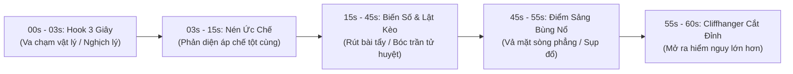

# ĐẠI ĐIỂN TRI THỨC & KINH NGHIỆM BIÊN KỊCH 100 BỘ ĐOẢN VĂN TRUNG QUỐC KINH ĐIỂN

> **Sổ Tay Bách Khoa Toàn Thư Về Biên Kịch Kịch Bản Đoản Văn & Audio Drama TikTok Triệu View.**
> *Nguồn dữ liệu thực chiến: Tổng hợp và mổ xẻ chuyên sâu 100 tác phẩm đoản văn kinh điển nổi tiếng nhất từ Zhihu 盐选专栏, Douyin 短剧, Fanqie (番茄小说), Jinjiang (晋江文学城) và Qidian (起点中文网).*
> *Được thiết kế làm kim chỉ nam bất biến cho toàn bộ Hệ thống Agent và Động cơ Biên Kịch Antigravity TikTok Studio.*

---

## PHẦN I: TỔNG LUẬN PHƯƠNG PHÁP LUẬN BIÊN KỊCH ĐOẢN VĂN VIRAL (ZHIHU & DOUYIN)

### 1. Triết Lý Cốt Lõi: '12 Chữ Vàng' Của Đoản Văn Giữ Chân Người Nghe
> **'Ba giây một cái móc (Hook), năm giây một đảo chiều (Twist), tập nào cũng có điểm sảng (Shuangdian)!'**

- **Quy tắc 1.5 - 3 Giây Đầu**: Quyết định sinh tử của video. Thính giả lướt qua màn hình cực nhanh. Nếu 15 từ đầu tiên không chứa xung đột cực hạn, nghịch lý hành động hoặc vật chứng rợn gáy, tỷ lệ vuốt bỏ (Swipe Away) đạt trên 85%.
- **Công Thức Sảng Điểm Định Lượng (The Shuangdian Neuro-Equation)**:

$$\text{Mức Độ Sảng} = (\text{Độ Ức Chế Tột Cùng} \times \text{Độ Trì Hoãn Thỏa Mãn}) \times \text{Tốc Độ & Cường Độ Phản Đòn}$$

- **Chu Trình 4 Giai Đoạn Áp Chế - Bộc Phát**:
  1. `ÁP CHẾ (压抑 - Yayi)`: Tạo bất công phi lý, hạ thấp nhân vị, tước đoạt danh dự của NV chính (nạp đầy phẫn nộ cho khán giả).
  2. `TÍCH TỤ / KÉO NÉN (蓄势 - Xushi)`: NV chính không manh động, ẩn nhẫn mài dao, giăng bẫy âm thầm (kỳ vọng đòn trừng phạt).
  3. `BỘC PHÁT VẢ MẶT (爆发打脸 - Bofa Dalian)`: Lật mở sự thật ngay tại đỉnh cao đắc thắng của phản diện (giải phóng Dopamine cực hạn).
  4. `THANH TOÁN TRIỆT ĐỂ (清算 - Qingsuan)`: Phản diện mất hết tiền tài, danh dự, địa vị; cầu xin trong tuyệt vọng (tuyệt đối không tha thứ rẻ rúng).

### 2. Mô Hình Nhịp Độ 1 Phút / 1 Tập Chuẩn Điện Ảnh (Micro-Pacing Model)


### 3. Bảng Phân Bổ Âm Thanh & Nhịp Thở Audio Drama (Sound Design Pacing)
| Thời Gian | Chức Năng Âm Thanh / Kịch Bản | Mục Tiêu Giữ Chân (Retention) | Kỹ Thuật Sound Design |
| :--- | :--- | :--- | :--- |
| **00:00 - 00:03** | **GOLDEN HOOK:** Lời thoại gây sốc / Mâu thuẫn đạo đức tột độ | Ngăn người dùng lướt đi (Stop-scrolling) | Tiếng tát vang dội, tiếng máy thở tít dài, tiếng đập bàn, âm bass drop đột ngột |
| **00:03 - 00:15** | **ESCALATION:** Phản diện dồn ép, nhân vật chính rơi vào tuyệt lộ | Tạo cảm xúc phẫn nộ / tò mò tột đỉnh | Nhạc nền căng thẳng (Violin dồn dập, tiếng đồng hồ đếm ngược) |
| **00:15 - 00:25** | **PRE-TWIST:** Một biến số lạ xuất hiện, hé lộ tia hy vọng | Kích hoạt tò mò trí tuệ | Nhạc nền im bặt đột ngột (Audio Pause / Negative Space) |
| **00:25 - 00:30** | **CLIFFHANGER / MINI-PUNCH:** Câu nói lật đổ cục diện hoặc tiếng mở cửa | Buộc người nghe phải nghe tiếp tập sau | Tiếng hiệu ứng Whoosh + Câu thoại bỏ lửng then chốt |

### 4. Bộ 5 Mô Thức 'Hook 3 Giây' Triệu View (Golden Hook Templates)
1. **Hook Nghịch Luân Lý / Khiêu Khích Đạo Đức**: *'Ngày tôi sinh non trong phòng cấp cứu, chồng tôi đang ký giấy đồng ý hiến thận của tôi cho người yêu cũ của anh ta.'*
2. **Hook Đếm Ngược Tử Thần**: *'Bác sĩ nói tôi chỉ còn sống được ba mươi ngày, và việc đầu tiên tôi làm là rút năm mươi tỷ tiền tiết kiệm.'*
3. **Hook Phản So Sai Thân Phận Cực Đoan**: *'Mẹ chồng tống tôi ra khỏi biệt thự với hai trăm nghìn đồng dằn túi, bà không hề biết tập đoàn mà con trai bà đang làm thuê mang chính tên lót của tôi.'*
4. **Hook Quái Đàm / Cấm Kỵ Quy Tắc**: *'Nếu bạn thức giấc lúc ba giờ sáng và thấy mẹ bạn đang đứng gõ cửa phòng tắm... Đừng mở cửa! Mẹ bạn đã mất ba năm trước rồi.'*
5. **Hook Thẳng Tay Vả Mặt (Direct Slap Hook)**: *'Cầm năm mươi tỷ này và cút khỏi con trai tôi? Bác gái à, công ty của con trai bác tháng trước vừa vay của tôi một trăm tỷ đấy!'*

### 5. Thiết Kế Nhân Vật Phản Diện 3 Chiều (Chống Bẫy Não Tàn)
```
           [LỚP NGOÀI: MẶT NẠ ĐẠO ĐỨC & TRÍ TUỆ]
   - Lịch thiệp, được xã hội công nhận, lời nói luôn nhân danh lợi ích chung.
   - Thấu hiểu luật pháp, dùng kẽ hở quy định để triệt hạ đối thủ.
                         ↓
           [LỚP GIỮA: ĐỘNG CƠ HỢP LÝ HÓA (JUSTIFICATION)]
   - 'Ta không ác, ta chỉ đang giành lại những gì thế giới nợ ta.'
   - Xuất thân chấn thương tâm lý, nghèo đói cùng cực hoặc bị áp bức thời niên thiếu.
                         ↓
           [LỚP LÕI: TỬ HUYỆT BẢO THỦ & KIÊU NGẠO]
   - Không tin trên đời có người vô tư không tham lam.
   - Đánh giá thấp nhân tính và tình yêu thương chân thành.
```

---

## PHẦN II: MỔ XẺ CHI TIẾT 100 TÁC PHẨM ĐOẢN VĂN KINH ĐIỂN THEO 10 THỂ LOẠI

### 📂 THỂ LOẠI 01: NGƯỢC LUYẾN TÀN TÂM & HỎA TÁNG TRÀNG TRUY THÊ (虐恋残心 · 追妻火葬场)
- **Nền tảng tiêu biểu**: Zhihu 盐选, Jinjiang (晋江文学城)
- **Trục cảm xúc chủ đạo**: *Đau xót dằn vặt, hối hận muộn màng, giải thoát bi tráng*
- **Số lượng tác phẩm nghiên cứu**: 10 tác phẩm nổi tiếng.

---

#### 📜 [001/100] 《Cung Tường Liễu》 (宫墙柳)
- **Tác giả & Nền tảng**: `Mộng Phù Sinh (梦浮生) - Zhihu`
- **Phân loại**: *Cổ đại / Đoản văn cung đình / Ngược luyến thâm trầm / Tự sự ngôi thứ nhất*
- **Bối cảnh & Tiền đề kịch tính (Premise)**: Nữ chính 14 tuổi ngây thơ tiến cung, cứ ngỡ mình được hoàng đế cưng chiều nhất vì được gọi bằng nhũ danh 'Liễu Nhi'. Nhưng suốt mười mấy năm thanh xuân, nàng và các phi tần khác dần nhận ra họ chỉ là những mảnh ghép chắp vá cho một người con gái đã khuất mà hoàng đế cả đời không thể quên.

**1. Thiết Lập & Xây Dựng Nhân Vật (Character Archetypes & Dynamics):**
- Nữ chính (Giang Ánh Liễu): Xuất thân danh gia, tính tình hoạt bát, ngây thơ, nhưng trải qua năm tháng trong cung cấm đã trở nên thấu suốt, bình thản đến đau lòng.
- Hoàng đế: Một quân vương cô độc, si tình với người cũ đã mất (Thục phi Tiêu thị), bề ngoài sủng ái hậu cung nhưng thực chất biến cả hậu cung thành bảo tàng tưởng niệm người thương.
- Dàn phi tần (Hoàng hậu, Thục phi, Đức phi, Hiền phi): Không hề đấu đá tàn độc, trái lại yêu thương, sưởi ấm cho nhau như người một nhà giữa chốn thâm cung lạnh lẽo.

**2. Mở Đầu Audio 3 Giây Giữ Chân (The 3-Second Retention Hook):**
> ⚡ *'Năm thứ hai sau khi Hoàng thượng đăng cơ, ta tiến cung. Năm đó ta mười bốn tuổi, tính tình ngây ngô, luôn tưởng rằng tiếng 'Liễu Nhi' dịu dàng ngài gọi mỗi đêm là dành cho chính mình.'*

**3. Cấu Trúc 3 Hồi & Nhịp Độ Micro-Pacing (Acts & Pacing):**
- Hồi 1 (Mộng đẹp hoa lệ): Nữ chính được sủng ái vô biên, được ban tên thân mật, tận hưởng sự dịu dàng của đế vương giữa những đêm hoa đăng rực rỡ.
- Hồi 2 (Vết nứt hiện thực): Nàng phát hiện chữ 'Liễu' trong tên mình chỉ vì năm xưa hoàng đế và người con gái kia từng hái cành liễu thề nguyền. Hoàng hậu và các tỷ muội khác cũng đều có một nét giống người cũ (ánh mắt, giọng hát, dáng đi).
- Hồi 3 (Đại kết cục thấu triệt): Hoàng đế già nua băng hà trên tay Ánh Liễu, miệng vẫn thì thầm gọi 'Liễu Nhi'. Nàng mỉm cười lau nước mắt cho ngài, nhưng trong lòng thanh thản buông bỏ: Nàng không hận, chỉ thương cho thanh xuân của chính mình và những người phụ nữ bị chôn vùi dưới chân ngai vàng.

**4. Cú Twist Đa Tầng & Điểm Sảng Bùng Nổ (Satisfaction Peak & Plot Twist):**
💥 **Điểm bẻ lái cốt lõi**: Toàn bộ hậu cung không ai là kẻ thù của ai. 'Trà xanh' hay 'Kẻ ác' không hề tồn tại; kẻ tàn nhẫn nhất và đáng thương nhất chính là Hoàng đế – người tự giam mình trong quá khứ và biến tất cả thành thế thân.

**5. Tinh Hoa Đúc Kết & Bài Học Biên Kịch Audio TikTok (Master Scriptwriting Takeaways):**
- Bài học biên kịch: Khai thác nỗi đau từ sự 'dịu dàng tàn nhẫn' (Gentle Cruelty). Không cần đòn roi hay mưu sát, chỉ một sự thật thế thân được hé lộ từ từ đã đủ bóp nghẹt trái tim khán giả.
- Nghệ thuật xây dựng nhân vật: Phá vỡ định kiến 'Cung đấu' truyền thống để tạo nên tình tỷ muội hậu cung (Female Solidarity), tạo sự tương phản cực mạnh với sự cô độc của quyền lực tối thượng.
- Ứng dụng audio: Dùng giọng đọc điềm đạm, u buồn, nhịp điệu chậm rãi ở đầu câu và ngắt quãng bằng dấu ba chấm ở những câu độc thoại nhận thức.

> [!TIP]
> **Ứng dụng thực chiến của bộ 001**: Khi sản xuất audio cho thể loại này, luôn neo đạo cụ vật lý chính vào phân đoạn mở màn và sử dụng đòn lật kèo logic, triệt tiêu hoàn toàn sáo ngữ kể lể.

---

#### 📜 [002/100] 《Hành Chỉ Vãn》 (行止晚)
- **Tác giả & Nền tảng**: `Nhiệt Huyết Tiểu Lạc Lạc - Zhihu`
- **Phân loại**: *Cổ đại / Thanh mai trúc mã / Quyền mưu bi kịch / BE Day Dứt*
- **Bối cảnh & Tiền đề kịch tính (Premise)**: Thái tử và nữ chính cùng lớn lên từ thuở hàn vi, từng hứa khi chàng nắm thiên hạ sẽ phong nàng làm Hoàng hậu duy nhất. Nhưng khi bước lên ngai vàng, trước áp lực của thế gia đại tộc, chàng lần lượt đón các thiên kim quyền quý vào cung và ép nàng nhường ngôi Hoàng hậu.

**1. Thiết Lập & Xây Dựng Nhân Vật (Character Archetypes & Dynamics):**
- Nữ chính (Vãn Vãn): Một đóa sen thanh tao, kiên định, yêu sâu đậm nhưng lòng tự trọng cao hơn mạng sống.
- Nam chính (Lý Hành Chỉ): Tham vọng đế vương, nghĩ rằng quyền lực tối thượng có thể bù đắp mọi tổn thương cho người mình yêu, để rồi nhận ra mất đi nàng là mất tất cả.

**2. Mở Đầu Audio 3 Giây Giữ Chân (The 3-Second Retention Hook):**
> ⚡ *'Vãn Vãn, trẫm chỉ phong nàng làm Quý phi, ngôi Hoàng hậu phải trao cho đích nữ Thôi gia để trấn an biên cương. Đợi khi trẫm diệt xong Thôi thị, ngôi vị đó nhất định là của nàng!'*

**3. Cấu Trúc 3 Hồi & Nhịp Độ Micro-Pacing (Acts & Pacing):**
- Hồi 1 (Lời hứa dưới gốc mai): Ký ức ngọt ngào thời niên thiếu đan xen với hiện thực phũ phàng nơi thềm điện rồng.
- Hồi 2 (Sự bào mòn lòng tin): Nữ chính liên tục bị hãm hại, sảy thai, nhưng nam chính vì đại cục luôn khuyên nàng 'nhẫn nhịn thêm một chút'.
- Hồi 3 (Tự do vĩnh viễn): Ngày nam chính thanh trừng Thôi thị thành công, mang phượng quan đến đón nàng thì chỉ còn thấy thi thể nàng mặc y phục trắng, thanh thản nhắm mắt cùng bức huyết thư: 'Hành Chỉ, ta không đợi ngài nữa'.

**4. Cú Twist Đa Tầng & Điểm Sảng Bùng Nổ (Satisfaction Peak & Plot Twist):**
💥 **Điểm bẻ lái cốt lõi**: Nam chính tưởng mình hy sinh vì tình yêu và tương lai của cả hai, nhưng chính sự tính toán lạnh lùng của quyền lực đã giết chết tình yêu đó từ lâu.

**5. Tinh Hoa Đúc Kết & Bài Học Biên Kịch Audio TikTok (Master Scriptwriting Takeaways):**
- Bài học biên kịch: Đẩy mâu thuẫn 'Tình cảm cá nhân vs Trách nhiệm quyền lực' lên cực hạn. Sự chậm trễ của nam chính chính là liều thuốc độc đoạt mạng tình yêu.
- Kỹ thuật kết thúc BE: Kết thúc bằng cái chết thanh thản của nữ chính và sự phát điên cô độc của nam chính tạo dư chấn tâm lý mạnh gấp 10 lần một kết thúc HE gượng gạo.

> [!TIP]
> **Ứng dụng thực chiến của bộ 002**: Khi sản xuất audio cho thể loại này, luôn neo đạo cụ vật lý chính vào phân đoạn mở màn và sử dụng đòn lật kèo logic, triệt tiêu hoàn toàn sáo ngữ kể lể.

---

#### 📜 [003/100] 《An Nhiên – Lâm Viễn》 (安然与林远)
- **Tác giả & Nền tảng**: `Cửu Cửu - Zhihu`
- **Phân loại**: *Hiện đại đô thị / Hôn nhân tan vỡ / Bệnh nan y thầm lặng / Ngược nam cực hạn*
- **Bối cảnh & Tiền đề kịch tính (Premise)**: An Nhiên yêu thầm và kết hôn cùng Lâm Viễn 5 năm. Lâm Viễn xem cô là người vợ tẻ nhạt, sống bám víu và không có chí tiến thủ. Khi anh đưa người yêu cũ về công ty làm trợ lý và ngỏ ý ly hôn, An Nhiên lặng lẽ ký đơn mà không đòi hỏi bất cứ tài sản nào.

**1. Thiết Lập & Xây Dựng Nhân Vật (Character Archetypes & Dynamics):**
- An Nhiên: Người phụ nữ hiền lành, kiệm lời, có thói quen viết nhật ký trên giấy ăn, giấu kín căn bệnh ung thư xương giai đoạn cuối.
- Lâm Viễn: Giám đốc trẻ thành đạt, kiêu ngạo, vô tâm, luôn coi tình yêu và sự chăm sóc của vợ là điều hiển nhiên.

**2. Mở Đầu Audio 3 Giây Giữ Chân (The 3-Second Retention Hook):**
> ⚡ *'Lâm Viễn đẩy bản thỏa thuận ly hôn sang trước mặt tôi, ngón tay gõ nhẹ lên bàn: 'An Nhiên, cô nên ra ngoài đi làm để biết kiếm tiền khó thế nào, đừng quanh quẩn ở nhà làm phiền tôi nữa'.'*

**3. Cấu Trúc 3 Hồi & Nhịp Độ Micro-Pacing (Acts & Pacing):**
- Hồi 1 (Sự thờ ơ tàn nhẫn): Nữ chính giấu giấy chẩn đoán bệnh dưới đáy tủ thuốc, thản nhiên ký đơn ly hôn và thu dọn đồ đạc rời khỏi căn biệt thự trong vòng 2 tiếng.
- Hồi 2 (Khoảng trống chết chóc): Lâm Viễn sống cùng người yêu cũ nhưng bắt đầu nhận ra những điều kỳ lạ: chiếc áo sơ mi không còn được là thẳng nếp, đồ ăn không hợp khẩu vị, và tủ thuốc trống rỗng.
- Hồi 3 (Phát hiện muộn màng): Lâm Viễn tìm thấy cuốn sổ tay ghi chú lịch uống thuốc của anh cùng hóa đơn xạ trị đứng tên An Nhiên. Khi anh lao đến bệnh viện, chỉ còn chiếc giường trống trải và bức thư gửi lại cảm ơn 5 năm thanh xuân.

**4. Cú Twist Đa Tầng & Điểm Sảng Bùng Nổ (Satisfaction Peak & Plot Twist):**
💥 **Điểm bẻ lái cốt lõi**: Nữ chính không hề giận dữ hay oán trách, nàng chỉ đơn giản là đã kiệt sức để yêu. Sự bình thản của cô gái sắp chết chính là bản án tử hình tàn khốc nhất cho người đàn ông ở lại.

**5. Tinh Hoa Đúc Kết & Bài Học Biên Kịch Audio TikTok (Master Scriptwriting Takeaways):**
- Nghệ thuật Show Don't Tell: Dùng chi tiết vật dụng đời thường (áo sơ mi, cốc nước ấm buổi sáng, góc tủ thuốc) để thể hiện sự quan tâm thầm lặng, tạo cú giáng tâm lý cực nặng khi đồ vật biến mất.
- Khai thác tâm lý Schadenfreude & Đau xót: Độc giả vừa hả dạ khi thấy tra nam hối hận quỳ khóc, vừa xót xa cho sự hy sinh của nữ chính.

> [!TIP]
> **Ứng dụng thực chiến của bộ 003**: Khi sản xuất audio cho thể loại này, luôn neo đạo cụ vật lý chính vào phân đoạn mở màn và sử dụng đòn lật kèo logic, triệt tiêu hoàn toàn sáo ngữ kể lể.

---

#### 📜 [004/100] 《Có Câu Chuyện Truy Thê Nào Gương Vỡ Không Lành?》 (无圆满的破镜)
- **Tác giả & Nền tảng**: `Nhị Thập Nhị Hoạch Cốt (二十二划骨) - Zhihu`
- **Phân loại**: *Hiện đại / Ngược luyến / Mất trí nhớ nghịch chuyển / Gương vỡ không lành*
- **Bối cảnh & Tiền đề kịch tính (Premise)**: Đúng ngày chuẩn bị ra tòa ly hôn sau chuỗi ngày bị chồng bạo lực lạnh và sỉ nhục, Nhiếp Phong gặp tai nạn giao thông và mất trí nhớ tạm thời. Ký ức của anh ta quay ngược về 8 năm trước – lúc anh ta yêu thương, cưng chiều và quỳ gối cầu hôn cô.

**1. Thiết Lập & Xây Dựng Nhân Vật (Character Archetypes & Dynamics):**
- Nữ chính: Trái tim đã thành tro tàn sau nhiều năm bị lạnh nhạt, ánh mắt nhìn chồng như nhìn một người dưng.
- Nhiếp Phong (Sau tai nạn): Tràn ngập tình yêu thời niên thiếu, hoảng loạn khi thấy vợ lạnh lùng xa cách, dùng mọi cách để dỗ dành cô như năm 20 tuổi.

**2. Mở Đầu Audio 3 Giây Giữ Chân (The 3-Second Retention Hook):**
> ⚡ *'Nhiếp Phong mở mắt trong phòng cấp cứu, ôm chầm lấy tôi khóc nức nở: 'Vợ ơi, anh đau quá!'. Nhưng bàn tay tôi vẫn lạnh ngắt, trong túi áo khoác vẫn là lá đơn ly hôn anh vừa ký 3 tiếng trước.'*

**3. Cấu Trúc 3 Hồi & Nhịp Độ Micro-Pacing (Acts & Pacing):**
- Hồi 1 (Sự trớ trêu của ký ức): Người chồng từng bảo cô 'đừng mơ tưởng bám lấy tôi' nay lại quỳ gối xỏ giày cho cô, làm mọi hành động lãng mạn như thuở mới yêu.
- Hồi 2 (Ký ức phục hồi từng mảnh): Bác sĩ thông báo máu tụ đang tan dần, mỗi ngày Nhiếp Phong nhớ lại một chút về những việc tồi tệ mà chính tay mình đã làm với vợ. Anh ta tự ghê tởm bản thân trong quá khứ.
- Hồi 3 (Phán quyết dứt khoát): Khi Nhiếp Phong hoàn toàn nhớ lại tất cả, anh ta quỳ sụp dưới mưa cầu xin tha thứ. Nữ chính chỉ nhìn anh ta mỉm cười: 'Nhiếp Phong, ký ức của anh quay lại được, nhưng 8 năm thanh xuân của tôi thì vĩnh viễn không'.

**4. Cú Twist Đa Tầng & Điểm Sảng Bùng Nổ (Satisfaction Peak & Plot Twist):**
💥 **Điểm bẻ lái cốt lõi**: Không có màn đoàn tụ tha thứ. Sự hối hận và những hành động ngọt ngào thời niên thiếu chỉ càng làm nổi bật sự tàn nhẫn của những năm tháng phản bội.

**5. Tinh Hoa Đúc Kết & Bài Học Biên Kịch Audio TikTok (Master Scriptwriting Takeaways):**
- Thiết lập xung đột song song (Temporal Irony): Đặt người đàn ông yêu vợ nhất (bản thể 20 tuổi) đối đầu với người đàn ông tồi tệ nhất (bản thể 28 tuổi) trong cùng một cơ thể.
- Thông điệp nhân sinh đanh thép: Tha thứ cho kẻ làm tổn thương mình là tàn nhẫn với chính bản thân trong quá khứ.

> [!TIP]
> **Ứng dụng thực chiến của bộ 004**: Khi sản xuất audio cho thể loại này, luôn neo đạo cụ vật lý chính vào phân đoạn mở màn và sử dụng đòn lật kèo logic, triệt tiêu hoàn toàn sáo ngữ kể lể.

---

#### 📜 [005/100] 《Tang Tang》 (桑桑)
- **Tác giả & Nền tảng**: `Thập Nhất Lượng - Zhihu`
- **Phân loại**: *Cổ đại / Linh hồn chứng kiến / Thế thân bạch nguyệt quang / Hỏa táng tràng*
- **Bối cảnh & Tiền đề kịch tính (Premise)**: Tang Tang là cô thôn nữ cứu thế tử Thẩm Triều trong rừng, theo chàng về phủ làm thị thiếp. Sau 3 năm chịu đựng mọi ấm ức vì chàng xem nàng là thế thân của biểu muội quyền quý, Tang Tang nhảy xuống sông tự vẫn. Linh hồn nàng vương lại trần thế và chứng kiến toàn bộ sự phát điên của Thẩm Triều.

**1. Thiết Lập & Xây Dựng Nhân Vật (Character Archetypes & Dynamics):**
- Tang Tang: Ngây thơ, chân thành, khi nhận ra mình chỉ là cái bóng liền dứt khoát kết liễu kiếp này để tìm sự tự do.
- Thẩm Triều: Thế tử cao quý, luôn nghĩ Tang Tang yêu mình mù quáng không dám rời đi, luôn dùng lời lẽ khắc nghiệt để xua đuổi nàng.

**2. Mở Đầu Audio 3 Giây Giữ Chân (The 3-Second Retention Hook):**
> ⚡ *'Ngày ta gieo mình xuống dòng sông băng lạnh buốt, Thẩm Triều đang cùng biểu muội chọn trâm ngọc ở hồi môn. Hắn còn dặn người hầu: 'Kệ ả ta diễn trò, đói bụng ắt tự mò về'.'*

**3. Cấu Trúc 3 Hồi & Nhịp Độ Micro-Pacing (Acts & Pacing):**
- Hồi 1 (Linh hồn bay theo xác): Tang Tang trôi nổi nhìn gia nhân vớt xác mình lên thối rữa, chứng kiến khoảnh khắc Thẩm Triều từ vẻ giễu cợt chuyển sang bàng hoàng tột độ.
- Hồi 2 (Sự thật về chiếc trâm gỗ): Thẩm Triều tìm thấy chiếc hộp bí mật của Tang Tang: bên trong là chiếc trâm gỗ năm xưa hắn tự tay đẽo tặng nàng bị vỡ đôi, cùng từng bức thư nàng viết ghi nhận mỗi lần hắn bỏ rơi nàng.
- Hồi 3 (Hỏa táng tràng tuyệt vọng): Thẩm Triều ôm xác Tang Tang vào băng thất, từ chối cưới biểu muội, cả đời không cưới vợ, đêm đêm đốt trầm hương cầu xin được gặp lại linh hồn nàng một lần nhưng Tang Tang đã thanh thản siêu thoát.

**4. Cú Twist Đa Tầng & Điểm Sảng Bùng Nổ (Satisfaction Peak & Plot Twist):**
💥 **Điểm bẻ lái cốt lõi**: Linh hồn nữ chính không hề lưu luyến nam chính dù chỉ một khắc. Nàng ở lại chỉ để chứng kiến xem lời thề 'sống không rời, thác không lìa' nực cười đến mức nào, rồi thanh thản bước qua cầu Nại Hà.

**5. Tinh Hoa Đúc Kết & Bài Học Biên Kịch Audio TikTok (Master Scriptwriting Takeaways):**
- Góc nhìn linh hồn (Ghost Observer POV): Tạo ra khoảng cách vô hình giữa nhân vật chính và kẻ có tội. Sự vô vọng của nam chính khi gào thét trước một linh hồn không thèm ngoảnh lại đem đến cảm xúc ngược tâm đỉnh điểm.
- Tiết tấu: Hồi đầu đẩy nhanh tình tiết cái chết, dành toàn bộ 2/3 thời lượng sau để xé nát tâm lý của kẻ phản diện.

> [!TIP]
> **Ứng dụng thực chiến của bộ 005**: Khi sản xuất audio cho thể loại này, luôn neo đạo cụ vật lý chính vào phân đoạn mở màn và sử dụng đòn lật kèo logic, triệt tiêu hoàn toàn sáo ngữ kể lể.

---

#### 📜 [006/100] 《Ngày Tôi Chết, Tiêu Tự Muốn Phong Hậu》 (我死之日萧肆封后)
- **Tác giả & Nền tảng**: `Miêu Đậu - Zhihu`
- **Phân loại**: *Cổ đại / Cung đấu ngược tâm / Nữ phụ thế thân / BE*
- **Bối cảnh & Tiền đề kịch tính (Premise)**: Nữ chính vì giúp Tiêu Tự giành đoạt ngai vàng mà đem cả gia tộc binh quyền ra đánh cược, thậm chí uống thuốc độc thay hắn khiến cơ thể tàn phế. Ngày hắn đăng cơ, hắn lại phong bạch nguyệt quang làm Hoàng hậu và đày nàng vào lãnh cung vì sợ ngoại thích chuyên quyền.

**1. Thiết Lập & Xây Dựng Nhân Vật (Character Archetypes & Dynamics):**
- Nữ chính: Bậc thầy mưu lược sa cơ, cơ thể bị tàn phá bởi độc dược, ánh mắt kiêu hãnh đến giây phút lâm chung.
- Tiêu Tự: Hoàng đế mưu mô, coi tình cảm là công cụ chính trị, tin rằng giam nàng vào lãnh cung là cách 'bảo vệ' nàng khỏi triều thần.

**2. Mở Đầu Audio 3 Giây Giữ Chân (The 3-Second Retention Hook):**
> ⚡ *'Lãnh cung đêm đông tuyết rơi ngập gối, thái giám mang đến cho tôi một dải lụa trắng và chiếu thư: 'Niên thị mưu nghịch, ban chết'. Tôi mỉm cười nhận lấy, ngụm máu đen phun ướt đẫm chiếu thư của người tôi từng yêu mười năm.'*

**3. Cấu Trúc 3 Hồi & Nhịp Độ Micro-Pacing (Acts & Pacing):**
- Hồi 1 (Cái chết trong lãnh cung): Nữ chính thắt cổ tự vẫn trong sự cô độc tuyệt đối, trước khi đi để lại một chiếc khóa đồng tâm đã bẻ gãy.
- Hồi 2 (Chiến thắng cay đắng): Tiêu Tự nhận tin chạy đến nhưng chỉ còn cái xác lạnh cóng. Hắn phát hiện nữ chính đã lén uống cạn chén trà độc mà phe phản loạn định đầu độc hắn trong ngày đại lễ.
- Hồi 3 (Phong hậu u hồn): Tiêu Tự phế truất Hoàng hậu mới, mặc long bào ôm bài vị của nàng bước lên đàn tế trời, nhưng ngai vàng rực rỡ chỉ còn lại tiếng gió rít lạnh lùng.

**4. Cú Twist Đa Tầng & Điểm Sảng Bùng Nổ (Satisfaction Peak & Plot Twist):**
💥 **Điểm bẻ lái cốt lõi**: Tiêu Tự phong hậu cho một người đã chết. Giang sơn vạn dặm hắn dày công tranh đoạt cuối cùng trở thành lăng mộ khổng lồ chôn sống tâm hồn hắn.

**5. Tinh Hoa Đúc Kết & Bài Học Biên Kịch Audio TikTok (Master Scriptwriting Takeaways):**
- Khái niệm 'Hy sinh vô hình': Nhân vật chính hy sinh nhưng không nói ra để nhận công; cái chết của họ tự thân nó vạch trần mọi sự ích kỷ của đối phương.
- Hình ảnh biểu tượng: Chiếc khóa đồng tâm bẻ gãy và dải lụa trắng tạo nên hình ảnh thị giác ám ảnh, rất thích hợp làm B-Roll và thumbnail video.

> [!TIP]
> **Ứng dụng thực chiến của bộ 006**: Khi sản xuất audio cho thể loại này, luôn neo đạo cụ vật lý chính vào phân đoạn mở màn và sử dụng đòn lật kèo logic, triệt tiêu hoàn toàn sáo ngữ kể lể.

---

#### 📜 [007/100] 《Cẩm Nang Thế Thân Của Thái Tử Gia》 (替身指南)
- **Tác giả & Nền tảng**: `Trà Trà - Douyin / Zhihu`
- **Phân loại**: *Hiện đại / Hào môn thế gia / Nữ chính tỉnh táo kiếm tiền / Ngược nam sảng khoái*
- **Bối cảnh & Tiền đề kịch tính (Premise)**: Nữ chính ký hợp đồng làm thế thân cho mối tình đầu của thái tử gia giới thượng lưu Bắc Kinh với mức lương 500 triệu/tháng. Nàng tuân thủ KPI nghiêm ngặt: mặc váy trắng, để tóc dài, cười mỉm không quá 30 độ. Ngày bạch nguyệt quang về nước, nàng vui vẻ thanh lý hợp đồng và biến mất.

**1. Thiết Lập & Xây Dựng Nhân Vật (Character Archetypes & Dynamics):**
- Nữ chính (Khương Ninh): Tỉnh táo tuyệt đối, yêu tiền hơn yêu đàn ông, xem việc làm thế thân là công việc cao cấp có đãi ngộ tốt.
- Nam chính (Lục Thừa Chu): Thái tử gia kiêu ngạo, tưởng rằng dùng tiền và sự hào nhoáng có thể mua được trái tim Khương Ninh, đinh ninh nàng yêu hắn tha thiết.

**2. Mở Đầu Audio 3 Giây Giữ Chân (The 3-Second Retention Hook):**
> ⚡ *''Lâm Sở Sở đã về nước rồi, cô thu dọn đồ đạc rời khỏi đây trước 12h đêm nay, tôi cho cô thêm 5 tỷ'. Tôi nhìn tin nhắn của Lục Thừa Chu, lập tức bấm máy chuyển phát nhanh đóng gói hành lý chỉ trong 15 phút, trong lòng thầm cảm tạ tổ tiên vì cuối cùng cũng được hết giờ làm việc.'*

**3. Cấu Trúc 3 Hồi & Nhịp Độ Micro-Pacing (Acts & Pacing):**
- Hồi 1 (Thực hiện hợp đồng chuẩn chỉ): Nữ chính đóng vai cô bạn gái ngoan ngoãn, dịu dàng, phục tùng mọi sở thích của nam chính, khiến hắn tin rằng nàng không thể sống thiếu hắn.
- Hồi 2 (Biến mất không tì vết): Nhận tiền xong, nữ chính đổi số điện thoại, hủy tài khoản mạng xã hội, mua vé máy bay ra đảo nghỉ dưỡng, đầu tư bất động sản sinh lời.
- Hồi 3 (Thái tử gia phát điên): Nam chính đón bạch nguyệt quang về nhưng thấy cô ta giả tạo, phiền phức. Hắn lái xe tìm Khương Ninh khắp thành phố, quỳ gối trước cửa nhà nàng dưới mưa nhưng nàng chỉ gọi bảo vệ đuổi hắn đi vì 'hết giờ làm việc'.

**4. Cú Twist Đa Tầng & Điểm Sảng Bùng Nổ (Satisfaction Peak & Plot Twist):**
💥 **Điểm bẻ lái cốt lõi**: Nữ chính chưa từng có một giây phút nào động lòng. Toàn bộ sự dịu dàng trước đây của cô chỉ là kỹ năng nghiệp vụ chuyên nghiệp.

**5. Tinh Hoa Đúc Kết & Bài Học Biên Kịch Audio TikTok (Master Scriptwriting Takeaways):**
- Lối viết 'Nữ chính tỉnh táo' (Sober Female Lead): Rất được ưa chuộng trên TikTok/Douyin vì đánh trúng tâm lý độc lập tài chính của phụ nữ hiện đại.
- Tương phản gây cười và hả dạ: Sự cuống cuồng níu kéo của vị thái tử gia đối lập hoàn toàn với thái độ xem như rác rưởi của nữ chính mang lại cảm giác cực kỳ sảng khoái.

> [!TIP]
> **Ứng dụng thực chiến của bộ 007**: Khi sản xuất audio cho thể loại này, luôn neo đạo cụ vật lý chính vào phân đoạn mở màn và sử dụng đòn lật kèo logic, triệt tiêu hoàn toàn sáo ngữ kể lể.

---

#### 📜 [008/100] 《Sau Khi Trúc Mã Thay Lòng》 (竹马变心之后)
- **Tác giả & Nền tảng**: `Tô Tô - Zhihu`
- **Phân loại**: *Hiện đại / Vườn trường đến công sở / Trúc mã thanh mai / Buông tay dứt khoát*
- **Bối cảnh & Tiền đề kịch tính (Premise)**: Thanh mai trúc mã bên nhau 10 năm từ bàn học cấp ba đến khi lập nghiệp. Khi công ty thành công, nam chính bắt đầu say nắng cô thực tập sinh trẻ trung, liên tục vì cô ta mà thất hứa và trách nữ chính 'quá thực tế, không còn cảm xúc thuần khiết như xưa'.

**1. Thiết Lập & Xây Dựng Nhân Vật (Character Archetypes & Dynamics):**
- Nữ chính (Vân Tê): Cùng nam chính ăn mì gói lập nghiệp, nắm giữ 40% cổ phần kỹ thuật của công ty, trầm ổn và quyết đoán.
- Nam chính (Giang Triệt): Bắt đầu tự mãn khi có tiền, khao khát cảm giác được sùng bái từ những cô gái ngây thơ, quên mất ai là người cùng mình chịu khổ.

**2. Mở Đầu Audio 3 Giây Giữ Chân (The 3-Second Retention Hook):**
> ⚡ *'Kỷ niệm 10 năm yêu nhau, tôi ngồi trong nhà hàng đợi suốt 4 tiếng, cho đến khi thấy bài đăng của cô thực tập sinh: 'Được sếp đưa đi ngắm sao đêm, hạnh phúc quá!'. Tôi không gọi một cuộc điện thoại nào, chỉ lặng lẽ gọi luật sư rút vốn khỏi công ty.'*

**3. Cấu Trúc 3 Hồi & Nhịp Độ Micro-Pacing (Acts & Pacing):**
- Hồi 1 (Sự phản bội ngấm ngầm): Nữ chính phát hiện tin nhắn mập mờ, nam chính giải thích 'chỉ là đồng nghiệp em gái, em đừng hẹp hòi ghen tuông'.
- Hồi 2 (Rút củi đáy nồi): Thay vì đánh ghen, nữ chính bí mật bán cổ phần cho đối thủ cạnh tranh lớn nhất, nộp đơn từ chức và bàn giao dự án cốt lõi.
- Hồi 3 (Phá sản và hối hận): Mất đi khối óc kỹ thuật của nữ chính, công ty Giang Triệt liên tục gặp sự cố mã nguồn và bị đối thủ thâu tóm. Giang Triệt đứng dưới mưa xin quay lại, nhưng nữ chính đã trở thành Giám đốc công nghệ của tập đoàn đa quốc gia.

**4. Cú Twist Đa Tầng & Điểm Sảng Bùng Nổ (Satisfaction Peak & Plot Twist):**
💥 **Điểm bẻ lái cốt lõi**: Nam chính tưởng thành công của công ty là do tài năng kinh doanh của mình, không ngờ 90% hợp đồng lớn đều ký vì uy tín và năng lực kỹ thuật của nữ chính.

**5. Tinh Hoa Đúc Kết & Bài Học Biên Kịch Audio TikTok (Master Scriptwriting Takeaways):**
- Trả thù bằng sự nghiệp (Career Retaliation): Không hạ mình đôi co với trà xanh, đánh thẳng vào tài chính và danh vọng của kẻ phản bội.
- Thắt nút cảm xúc: Sự im lặng của phụ nữ đáng sợ hơn ngàn lời ghen tuông. Cắt đứt dứt khoát tạo sức nặng cho kịch bản.

> [!TIP]
> **Ứng dụng thực chiến của bộ 008**: Khi sản xuất audio cho thể loại này, luôn neo đạo cụ vật lý chính vào phân đoạn mở màn và sử dụng đòn lật kèo logic, triệt tiêu hoàn toàn sáo ngữ kể lể.

---

#### 📜 [009/100] 《Ánh Trăng Không Rơi Xuống》 (月亮不落)
- **Tác giả & Nền tảng**: `Dạ Vũ - Zhihu / Jinjiang`
- **Phân loại**: *Hiện đại / Đơn phương bi kịch / Trầm cảm / BE Ám ảnh*
- **Bối cảnh & Tiền đề kịch tính (Premise)**: Nữ chính yêu thầm nam thần học đường suốt 7 năm. Sau một biến cố, nam chính bị mù tạm thời và rơi vào trầm cảm. Nữ chính đến bên chăm sóc anh nhưng giả làm cô gái câm. Đến khi mắt anh sáng lại, anh lại nhận nhầm hoa khôi trường là ân nhân và tổ chức đám cưới xa hoa.

**1. Thiết Lập & Xây Dựng Nhân Vật (Character Archetypes & Dynamics):**
- Nữ chính: Bị bỏng ở cổ họng, yêu trong tự ti và hy sinh thầm lặng, coi việc thấy anh hạnh phúc là mục đích sống duy nhất.
- Nam chính: Tài tử hội họa kiêu bạo, cố chấp tìm kiếm 'cô gái đã cứu mình' qua mùi hương hoa lài.

**2. Mở Đầu Audio 3 Giây Giữ Chân (The 3-Second Retention Hook):**
> ⚡ *'Ngày anh tháo băng mắt, người đầu tiên anh ôm vào lòng là hoa khôi khoa Nghệ thuật. Tôi đứng nép sau cánh cửa bệnh viện, trên tay là bát canh bồ câu còn nóng hổi do chính tay tôi hầm suốt 5 tiếng.'*

**3. Cấu Trúc 3 Hồi & Nhịp Độ Micro-Pacing (Acts & Pacing):**
- Hồi 1 (Khoảng tối ấm áp): Quá trình chăm sóc chàng trai mù trong căn nhà gỗ nhỏ, những buổi chiều nghe anh vẽ tranh qua cảm nhận.
- Hồi 2 (Sự ngộ nhận tàn nhẫn): Nữ phụ nhận vơ công lao, nam chính đối xử lạnh nhạt với nữ chính vì nghĩ cô là kẻ bám đuôi phiền toái.
- Hồi 3 (Bức tranh cuối cùng): Nữ chính qua đời vì căn bệnh bẩm sinh, để lại cuốn băng ghi âm tiếng thở và chiếc chuông gió. Nam chính nghe lại cuộn băng, bàng hoàng nhận ra giọng nói của người con gái câm năm xưa và phát điên trong ngày cưới.

**4. Cú Twist Đa Tầng & Điểm Sảng Bùng Nổ (Satisfaction Peak & Plot Twist):**
💥 **Điểm bẻ lái cốt lõi**: Hoa khôi kia không hề biết vẽ tranh, chỉ có nữ chính mới là người hướng dẫn từng nét cọ cho anh trong những tháng ngày tăm tối nhất.

**5. Tinh Hoa Đúc Kết & Bài Học Biên Kịch Audio TikTok (Master Scriptwriting Takeaways):**
- Khai thác giác quan: Âm thanh tiếng chuông gió, mùi hương hoa lài, cảm giác xúc giác khi chạm vào bàn tay. Thính giác đóng vai trò then chốt trong audio storytelling.
- Tạo xung đột nhận thức (Dramatic Irony): Khán giả biết sự thật nhưng nam chính không biết, thôi thúc người nghe theo dõi đến phút cuối để chờ khoảnh khắc bẽ bàng.

> [!TIP]
> **Ứng dụng thực chiến của bộ 009**: Khi sản xuất audio cho thể loại này, luôn neo đạo cụ vật lý chính vào phân đoạn mở màn và sử dụng đòn lật kèo logic, triệt tiêu hoàn toàn sáo ngữ kể lể.

---

#### 📜 [010/100] 《Bức Thư Tuyệt Mệnh》 (绝笔信)
- **Tác giả & Nền tảng**: `Phong Linh - Zhihu`
- **Phân loại**: *Cổ đại / Gia tộc đấu đá / Oan khuất / Ngược tâm đỉnh cao*
- **Bối cảnh & Tiền đề kịch tính (Premise)**: Nữ tướng quân xuất thân thế gia vì bảo vệ biên cương mà bị thương mất hết võ công. Trở về kinh thành, nàng bị mẹ kế và muội muội vu oan tội thông đồng với giặc bán nước. Phụ thân và vị hôn phu không một ai tin nàng, đích thân tước bỏ ấn kiếm và bắt nàng quỳ sám hối trước từ đường.

**1. Thiết Lập & Xây Dựng Nhân Vật (Character Archetypes & Dynamics):**
- Nữ chính (Bùi Chiêu): Nữ tướng quân kiêu hùng, một thân chiến tích nhưng bị bức tử bởi chính những người mình từng đem máu xương ra bảo vệ.
- Phụ thân & Vị hôn phu: Mù quáng vì danh tiếng gia tộc và những lời đường mật của trà xanh, coi trọng thể diện hơn sự thật.

**2. Mở Đầu Audio 3 Giây Giữ Chân (The 3-Second Retention Hook):**
> ⚡ *'Bùi gia có quy củ, kẻ phản quốc phải quỳ trước linh vị tổ tiên ba ngày ba đêm, chịu ba mươi roi gai sắt. Phụ thân ta tự tay cầm roi, quất rách chiến bào đầy vết chém mà ta mang về từ chiến trường Nhạn Môn Quan.'*

**3. Cấu Trúc 3 Hồi & Nhịp Độ Micro-Pacing (Acts & Pacing):**
- Hồi 1 (Đòn roi oan nghiệt): Nữ chính không một lời biện bạch, lặng lẽ chịu đủ 30 roi trong sự hả hê của mẹ kế và ánh mắt thất vọng giả tạo của vị hôn phu.
- Hồi 2 (Cái chết giữa đêm tuyết): Nàng để lại bức thư tuyệt mệnh viết bằng máu trên mảnh chiến kỳ rách, rồi tự vẫn dưới chân tượng đài liệt sĩ Bùi gia.
- Hồi 3 (Sự thật phơi bày): Quân báo từ biên ải hỏa tốc về kinh: 10 vạn quân giặc bị tiêu diệt hoàn toàn nhờ kế hoạch giả hàng của Bùi Chiêu. Hoàng đế đích thân đến phong vương cho nàng, nhưng trước từ đường chỉ còn một ngôi mộ lạnh buốt.

**4. Cú Twist Đa Tầng & Điểm Sảng Bùng Nổ (Satisfaction Peak & Plot Twist):**
💥 **Điểm bẻ lái cốt lõi**: Nàng không hề phản bội, nàng đã dùng tính mạng của mình để giăng bẫy tiêu diệt toàn bộ quân địch, đổi lại bình yên cho giang sơn và cái tát trời giáng vào mặt gia tộc.

**5. Tinh Hoa Đúc Kết & Bài Học Biên Kịch Audio TikTok (Master Scriptwriting Takeaways):**
- Đẩy cao trào bằng sự bất công cùng cực: Càng nén sự oan ức của anh hùng, sự hối hận và nhục nhã của những kẻ ở lại càng bùng nổ dữ dội.
- Xây dựng hình tượng nhân vật: Nhân vật chính không cần khóc lóc cầu xin; sự im lặng kiêu hãnh của một chiến binh có sức lay động lòng người sâu sắc hơn mọi lời than vãn.

> [!TIP]
> **Ứng dụng thực chiến của bộ 010**: Khi sản xuất audio cho thể loại này, luôn neo đạo cụ vật lý chính vào phân đoạn mở màn và sử dụng đòn lật kèo logic, triệt tiêu hoàn toàn sáo ngữ kể lể.

---

### 📂 THỂ LOẠI 02: TRỌNG SINH VẢ MẶT & NỮ CƯỜNG KINH THƯƠNG (重生逆袭 · 绝地打脸)
- **Nền tảng tiêu biểu**: Fanqie (番茄小说), Douyin 短剧, Zhihu
- **Trục cảm xúc chủ đạo**: *Sảng khoái tột độ, báo thù dứt khoát, tự do tài chính*
- **Số lượng tác phẩm nghiên cứu**: 10 tác phẩm nổi tiếng.

---

#### 📜 [011/100] 《Tẩy Chì Hoa (Vi Hữu Ám Hương Lai)》 (洗铅华)
- **Tác giả & Nền tảng**: `Thất Nguyệt Lệ (七月荔) - Zhihu`
- **Phân loại**: *Cổ đại / Xuyên thư / Nữ phụ thức tỉnh / Nghịch chuyển số phận*
- **Bối cảnh & Tiền đề kịch tính (Premise)**: Nữ chính xuyên vào một ác nữ phụ trong tiểu thuyết, người kiếp trước vì si tình với nam chính mà dùng trăm phương ngàn kế hãm hại nữ chính, cuối cùng khiến cả gia tộc bị chém đầu. Kiếp này nàng tỉnh táo, từ chối tranh sủng, chỉ muốn hòa ly để bảo toàn tính mạng cho gia đình.

**1. Thiết Lập & Xây Dựng Nhân Vật (Character Archetypes & Dynamics):**
- Hoa Thiển (Nữ chính): Thông minh, lý tính, hiểu rõ quy luật vận hành của quyền lực, không mộng mơ về tình yêu ảo tưởng.
- Trọng Dạ Vọng (Nam chính): Vị vương gia lạnh lùng, ban đầu luôn nhìn nàng với ánh mắt đề phòng coi thường, dần dần bị sự tháo vát và dứt khoát của nàng thu hút.
- Nữ chính nguyên tác (Mục Dao): Đóa hoa sen trắng mang danh chính nghĩa nhưng thực chất đầy mưu toan trả thù gia tộc.

**2. Mở Đầu Audio 3 Giây Giữ Chân (The 3-Second Retention Hook):**
> ⚡ *'Mở mắt ra trong đêm tân hôn ngập sắc đỏ, việc đầu tiên ta làm không phải là đợi phu quân vén khăn voan, mà là với lấy bình trà gốm ném mạnh vào góc phòng, ép mình phải tỉnh táo: Ta đã trở thành ác nữ Hoa Thiển rồi!'*

**3. Cấu Trúc 3 Hồi & Nhịp Độ Micro-Pacing (Acts & Pacing):**
- Hồi 1 (Nhận thức sinh tồn): Nữ chính chủ động thu mình, xin phụ thân rút lui khỏi triều đình, đối xử tử tế với nữ chính nguyên tác để hóa giải oán thù.
- Hồi 2 (Cạm bẫy định mệnh): Dù nàng không muốn tranh đoạt, các thế lực xung quanh vẫn cố tình đẩy nàng vào bẫy hãm hại. Nàng buộc phải phản kích bằng tư duy pháp luật và kế sách phòng thủ kín kẽ.
- Hồi 3 (Tự do đích thực): Hoa Thiển giả chết thoát thân, rời bỏ kinh thành mở tiệm hương liệu sống cuộc đời tự do tự tại. Những kẻ từng ghét bỏ nàng nay mới bàng hoàng điên cuồng tìm kiếm hình bóng nàng.

**4. Cú Twist Đa Tầng & Điểm Sảng Bùng Nổ (Satisfaction Peak & Plot Twist):**
💥 **Điểm bẻ lái cốt lõi**: Hoa Thiển không dùng tình yêu để cảm hóa nam chính; nàng dùng sự dứt khoát và độc lập của một người hiện đại để tước đi quyền kiểm soát số phận của hắn đối với nàng.

**5. Tinh Hoa Đúc Kết & Bài Học Biên Kịch Audio TikTok (Master Scriptwriting Takeaways):**
- Nghệ thuật xây dựng nhân vật phản anh hùng (Anti-heroine): Một nhân vật có tì vết trong quá khứ nhưng nỗ lực hướng thiện một cách thực tế sẽ hấp dẫn độc giả hơn kiểu bồ tát thánh mẫu.
- Pacing: Tiết chế bàn tay vàng (cheat code). Mỗi chiến thắng của nhân vật chính đều phải trả giá bằng trí tuệ và sự chuẩn bị, tạo cảm giác thuyết phục tuyệt đối.

> [!TIP]
> **Ứng dụng thực chiến của bộ 011**: Khi sản xuất audio cho thể loại này, luôn neo đạo cụ vật lý chính vào phân đoạn mở màn và sử dụng đòn lật kèo logic, triệt tiêu hoàn toàn sáo ngữ kể lể.

---

#### 📜 [012/100] 《Sự Nổi Dậy Của Nữ Chính Ngược Văn》 (虐文女主的反叛)
- **Tác giả & Nền tảng**: `Nhất Chỉ Khí Thủy Hùng (一只汽水熊) - Zhihu`
- **Phân loại**: *Cổ đại / Hệ thống phản sáo lộ / Sảng văn vả mặt / Nữ cường*
- **Bối cảnh & Tiền đề kịch tính (Premise)**: Nữ chính bị hệ thống ép làm 'liếm cẩu' lụy tình suốt 13 năm theo kịch bản ngược văn để đợi nam chính ngược đãi rồi 'truy thê hỏa táng tràng'. Đến ngày ném tú cầu kén rể theo kịch bản, hệ thống bảo cô ném cho nam chính, cô liền bẻ lái ném thẳng vào chàng thiếu niên đỏ mặt đứng sau lưng hắn.

**1. Thiết Lập & Xây Dựng Nhân Vật (Character Archetypes & Dynamics):**
- Nữ chính: Bị hệ thống kiềm tỏa 13 năm, tích tụ sự phẫn nộ cực hạn, chỉ chờ thời cơ đập tan hệ thống và nam chính.
- Nam chính (Tra nam): Tự tin thái quá, nghĩ rằng nữ chính cả đời chỉ có thể quỳ dưới chân mình van xin tình cảm.
- Thiếu niên ngây ngô: Thực chất là chiến thần ẩn mình, thầm yêu nữ chính từ thuở nhỏ nhưng không dám thổ lộ.

**2. Mở Đầu Audio 3 Giây Giữ Chân (The 3-Second Retention Hook):**
> ⚡ *'Hệ thống trong đầu ta gào thét: 'Ném tú cầu cho Lục Trầm! Nhanh lên, nếu không cô sẽ bị sét đánh!'. Ta liếc nhìn Lục Trầm đang khoanh tay cười nhạo, rồi vung tay ném quả cầu gấm trúng ngay ngực chàng thiếu niên tướng quân đứng nép bên cột đình.'*

**3. Cấu Trúc 3 Hồi & Nhịp Độ Micro-Pacing (Acts & Pacing):**
- Hồi 1 (Cú bẻ lái bất ngờ): Ném tú cầu đổi chồng ngay trước mắt thiên hạ, tuyên bố từ mặt tra nam, tát thẳng vào sự kiêu ngạo của hắn.
- Hồi 2 (Vả mặt liên hoàn): Tra nam tức tối tìm cách chèn ép hôn phu mới của cô, nhưng bị thiếu niên tướng quân dùng quân công đánh gãy từng âm mưu.
- Hồi 3 (Hệ thống sụp đổ): Nữ chính thu thập đủ điểm độc lập, kích hoạt cơ chế tự hủy của hệ thống, phơi bày tội ác tham nhũng của gia tộc tra nam khiến hắn bị đày đi biên ải.

**4. Cú Twist Đa Tầng & Điểm Sảng Bùng Nổ (Satisfaction Peak & Plot Twist):**
💥 **Điểm bẻ lái cốt lõi**: Hệ thống trừng phạt thực chất chỉ là trò ảo giác do tra nam mua từ một pháp sư ngoại đạo để thao túng tâm lý nữ chính. Khi nàng vượt qua nỗi sợ, ảo ảnh lập tức tan biến.

**5. Tinh Hoa Đúc Kết & Bài Học Biên Kịch Audio TikTok (Master Scriptwriting Takeaways):**
- Phá vỡ áp chế (Breaking the Subjugation): Độc giả sướng nhất khi thấy nhân vật vùng lên đập tan kẻ kìm kẹp mình sau một thời gian dài bị ức hiếp.
- Tuyên ngôn ngắn gọn: Những câu thoại như 'Làm liếm cẩu đủ rồi, ta muốn đổi người' có sức lan tỏa viral cực lớn trên mạng xã hội.

> [!TIP]
> **Ứng dụng thực chiến của bộ 012**: Khi sản xuất audio cho thể loại này, luôn neo đạo cụ vật lý chính vào phân đoạn mở màn và sử dụng đòn lật kèo logic, triệt tiêu hoàn toàn sáo ngữ kể lể.

---

#### 📜 [013/100] 《Cành Vàng Giả Mạo》 (假金枝)
- **Tác giả & Nền tảng**: `Thư Tử Mộc - Zhihu`
- **Phân loại**: *Cổ đại / Thật giả thiên kim / Sảng văn bạo lực lạnh / Nữ cường*
- **Bối cảnh & Tiền đề kịch tính (Premise)**: Trong ngày lễ cập kê của nữ chính – quận chúa được Trưởng công chúa nuôi nấng 16 năm, vị hôn phu dẫn theo một cô gái yếu đuối nhận là thiên kim thật hòng hạ bệ cô trước mặt hoàng tộc. Nữ chính không hề run sợ, rút đoản đao rạch mặt kẻ mạo danh ngay tại chỗ.

**1. Thiết Lập & Xây Dựng Nhân Vật (Character Archetypes & Dynamics):**
- Nữ chính: Được nuôi dạy theo quy chuẩn kế thừa gia tộc, võ nghệ cao cường, quyết đoán, không có khái niệm mềm lòng.
- Vị hôn phu & Thiên kim giả: Nghĩ rằng công chúa sẽ vì chút huyết thống mà hoang mang, dùng đạo đức trói buộc để ép nữ chính nhường tước vị.

**2. Mở Đầu Audio 3 Giây Giữ Chân (The 3-Second Retention Hook):**
> ⚡ *'Vị hôn phu của ta chỉ vào cô gái mặc áo rách nát đang quỳ khóc: 'Nàng ta mới là con gái ruột của Trưởng công chúa, cô chỉ là kẻ giả mạo!'. Ta cười lạnh, rút thanh đoản đao giấu trong tay áo, bước thẳng xuống bậc thềm.'*

**3. Cấu Trúc 3 Hồi & Nhịp Độ Micro-Pacing (Acts & Pacing):**
- Hồi 1 (Đòn phủ đầu đanh thép): Rạch mặt kẻ mạo danh, chỉ ra trên người ả có vết sẹo của sát thủ Bắc Địch chứ không phải bớt son của hoàng tộc.
- Hồi 2 (Bóc trần âm mưu mượn đao giết người): Vị hôn phu cấu kết với phe cánh phản nghịch định hoán đổi con tin để kiểm soát quân đội của Trưởng công chúa.
- Hồi 3 (Trừng trị toàn bộ): Trưởng công chúa xuất hiện cùng thánh chỉ, chém đầu vị hôn phu ngay tại yến tiệc, phong nữ chính làm Trấn Quốc Quận Chúa.

**4. Cú Twist Đa Tầng & Điểm Sảng Bùng Nổ (Satisfaction Peak & Plot Twist):**
💥 **Điểm bẻ lái cốt lõi**: Thiên kim thật thực chất đã chết từ năm 3 tuổi vì dịch bệnh, Trưởng công chúa biết rõ nữ chính là con nuôi nhưng đã tôi luyện nàng thành thanh kiếm sắc bén nhất bảo vệ hoàng tộc.

**5. Tinh Hoa Đúc Kết & Bài Học Biên Kịch Audio TikTok (Master Scriptwriting Takeaways):**
- Tốc độ xử lý xung đột (Instant Resolution): Không để phản diện kịp nhảy nhót quá 1 chương. Phản đòn ngay lập tức bằng chứng cứ thép hoặc hành động dứt khoát.
- Tạo hình nhân vật nữ cường thực chất: Khí chất đến từ năng lực và quyền lực tự thân, không dựa dẫm vào bất kỳ nam chính nào.

> [!TIP]
> **Ứng dụng thực chiến của bộ 013**: Khi sản xuất audio cho thể loại này, luôn neo đạo cụ vật lý chính vào phân đoạn mở màn và sử dụng đòn lật kèo logic, triệt tiêu hoàn toàn sáo ngữ kể lể.

---

#### 📜 [014/100] 《Cả Nhà Đều Trọng Sinh Vả Mặt Thiên Kim Giả》 (全家重生打脸假千金)
- **Tác giả & Nền tảng**: `Đào Chi - Zhihu / Douyin`
- **Phân loại**: *Hiện đại / Trọng sinh tập thể / Thật giả thiên kim / Hài hước sảng văn*
- **Bối cảnh & Tiền đề kịch tính (Premise)**: Kiếp trước cả gia đình hào môn bị thiên kim giả trà xanh lừa gạt, khiến thiên kim thật chết oan uổng, gia đình phá sản tan nát. Kiếp này, cha mẹ và 3 người anh trai cùng trọng sinh, đồng lòng lập kế hoạch bảo vệ thiên kim thật và biến thiên kim giả thành trò hề.

**1. Thiết Lập & Xây Dựng Nhân Vật (Character Archetypes & Dynamics):**
- Thiên kim thật: Ngây thơ, chăm chỉ học hành, không hề biết người nhà đều đã trọng sinh và đang âm thầm trải hoa hồng cho mình.
- Thiên kim giả (Trà xanh): Vẫn dùng chiêu bài cũ (giả ngã, khóc lóc, đổ lỗi) nhưng ngơ ngác khi thấy cả nhà không ai thèm diễn cùng.
- Cha mẹ & 3 anh trai: Các bậc thầy diễn xuất, bề ngoài ngọt ngào nhưng bên trong đang thi nhau gài bẫy cho thiên kim giả tự chui đầu vào rọ.

**2. Mở Đầu Audio 3 Giây Giữ Chân (The 3-Second Retention Hook):**
> ⚡ *'Thiên kim giả vừa rơi một giọt nước mắt nói: 'Em xin lỗi, là em làm vỡ bình hoa cổ', cha tôi đã rút ngay gậy golf đánh gãy chân bàn: 'Đúng rồi, chính là mày làm, đền một trăm tỷ ngay cho tao!'.'*

**3. Cấu Trúc 3 Hồi & Nhịp Độ Micro-Pacing (Acts & Pacing):**
- Hồi 1 (Sự lệch pha hài hước): Thiên kim giả diễn trò trà xanh nhưng bị cả gia đình đồng loạt 'bắt bài' công khai trước camera an ninh.
- Hồi 2 (Thu hồi tài sản): Lần lượt tịch thu thẻ đen, đuổi bảo mẫu phản trắc, chuyển toàn bộ cổ phần và bất động sản sang tên thiên kim thật.
- Hồi 3 (Đại kết cục hả hê): Thiên kim giả cấu kết với đối thủ định ăn cắp tài liệu mật, nhưng tài liệu đó do anh cả cố tình gài bẫy, tống ả vào tù 10 năm.

**4. Cú Twist Đa Tầng & Điểm Sảng Bùng Nổ (Satisfaction Peak & Plot Twist):**
💥 **Điểm bẻ lái cốt lõi**: Không chỉ có gia đình trọng sinh; chú chó cưng trong nhà cũng trọng sinh và biết phân biệt mùi của kẻ xấu để sủa báo động mỗi khi thiên kim giả đến gần.

**5. Tinh Hoa Đúc Kết & Bài Học Biên Kịch Audio TikTok (Master Scriptwriting Takeaways):**
- Đổi mới mô-típ quen thuộc (Trope Inversion): Thay vì một mình nữ chính đơn độc đấu tranh, việc cả gia đình cùng trọng sinh mang lại cảm giác ấm áp và tiếng cười sảng khoái.
- Nhịp điệu dồn dập: Mỗi phân đoạn là một màn lật tẩy trò mèo của phản diện, giữ chân người nghe liên tục không rời mắt.

> [!TIP]
> **Ứng dụng thực chiến của bộ 014**: Khi sản xuất audio cho thể loại này, luôn neo đạo cụ vật lý chính vào phân đoạn mở màn và sử dụng đòn lật kèo logic, triệt tiêu hoàn toàn sáo ngữ kể lể.

---

#### 📜 [015/100] 《Thiên Kim Thật Xem Zhihu Quá 180 Phút》 (真千金看知乎超180分钟)
- **Tác giả & Nền tảng**: `Bát Bát - Zhihu`
- **Phân loại**: *Hiện đại / Trào phúng phản sáo lộ / Sảng văn / Hài hước đỉnh cao*
- **Bối cảnh & Tiền đề kịch tính (Premise)**: Thiên kim thật từ nông thôn được đón về hào môn. Trước khi về, cô cày nát các bài viết trên Zhihu về 'Cách đối phó với cha mẹ thiên vị và thiên kim giả trà xanh'. Kết quả cô áp dụng toàn bộ văn mẫu phản đòn khiến cả nhà hào môn kinh hồn bạt vía.

**1. Thiết Lập & Xây Dựng Nhân Vật (Character Archetypes & Dynamics):**
- Nữ chính (Lâm Chân): Bậc thầy lý luận Zhihu, mở miệng ra là trích dẫn Bộ luật Dân sự và các thuật ngữ tâm lý học thao túng.
- Gia đình hào môn: Quen thói áp đặt, định dùng quy củ thượng lưu để dạy dỗ cô nhưng bị cô 'giáo dục ngược' lại.

**2. Mở Đầu Audio 3 Giây Giữ Chân (The 3-Second Retention Hook):**
> ⚡ *'Mẹ ruột ném cho tôi một bộ váy cũ của thiên kim giả: 'Mặc vào đi, đừng để ra ngoài làm mất mặt nhà họ Lâm'. Tôi rút ngay điện thoại bật chế độ ghi âm: 'Thưa bà, hành vi xúc phạm danh dự và phân biệt đối xử này có thể bị phạt hành chính theo điều 101 luật Dân sự, bà có muốn tôi nộp đơn lên ủy ban phường không?'.'*

**3. Cấu Trúc 3 Hồi & Nhịp Độ Micro-Pacing (Acts & Pacing):**
- Hồi 1 (Vả mặt bằng pháp luật): Thiên kim giả bày trò đổ oan trộm dây chuyền, nữ chính không khóc mà yêu cầu niêm phong hiện trường, lấy dấu vân tay và gọi cảnh sát 113 lập biên bản.
- Hồi 2 (Đấu trí livestream): Khi cha mẹ định cắt sinh hoạt phí để uy hiếp, cô mở livestream kể chuyện 'Trải nghiệm làm thiên kim thật bị bạo lực gia đình' thu hút 5 triệu lượt xem, cổ phiếu tập đoàn rớt giá thảm hại.
- Hồi 3 (Thâu tóm gia tộc): Cả nhà sợ hãi phải sang tên căn hộ penthouse và xe sang để cô chịu xóa bài bóc phốt.

**4. Cú Twist Đa Tầng & Điểm Sảng Bùng Nổ (Satisfaction Peak & Plot Twist):**
💥 **Điểm bẻ lái cốt lõi**: Nữ chính không hề quan tâm đến tình thân hào môn. Mục tiêu duy nhất của cô là kiếm đủ 50 tỷ rồi mua trang trại ở quê dưỡng già.

**5. Tinh Hoa Đúc Kết & Bài Học Biên Kịch Audio TikTok (Master Scriptwriting Takeaways):**
- Khai thác yếu tố trào phúng (Satire): Châm biếm những tình tiết cẩu huyết vô lý của truyện cũ bằng tư duy logic thực tế của giới trẻ.
- Tạo sự sảng khoái tức thì: Khán giả TikTok cực kỳ thích những nhân vật 'miệng mồm sắc sảo', không để bản thân chịu ấm ức dù chỉ 1 giây.

> [!TIP]
> **Ứng dụng thực chiến của bộ 015**: Khi sản xuất audio cho thể loại này, luôn neo đạo cụ vật lý chính vào phân đoạn mở màn và sử dụng đòn lật kèo logic, triệt tiêu hoàn toàn sáo ngữ kể lể.

---

#### 📜 [016/100] 《Trọng Sinh Giả Câm Trị Trà Xanh》 (重生装哑)
- **Tác giả & Nền tảng**: `Mộc Mộc - Douyin / Fanqie`
- **Phân loại**: *Hiện đại / Trọng sinh / Giả câm ẩn nhẫn / Vả mặt truyền thông*
- **Bối cảnh & Tiền đề kịch tính (Premise)**: Kiếp trước nữ chính bị cô em gái nuôi trà xanh vu oan tội đánh đập, bị cư dân mạng chửi bới bức tử. Trọng sinh về ngày em gái tự làm ngã cầu thang để đổ tội, nữ chính uống thuốc làm mất giọng tạm thời, đóng vai cô gái câm yếu thế.

**1. Thiết Lập & Xây Dựng Nhân Vật (Character Archetypes & Dynamics):**
- Nữ chính: Bề ngoài đáng thương, mắt ngấn lệ, tay làm thủ ngữ nhưng bên trong là cáo già lão luyện.
- Em gái trà xanh: Luôn tự tin vào tài diễn xuất trước ống kính nhưng lần này rơi vào bẫy 'gậy ông đập lưng ông'.

**2. Mở Đầu Audio 3 Giây Giữ Chân (The 3-Second Retention Hook):**
> ⚡ *'Khi em gái nuôi lăn từ cầu thang xuống rồi chỉ tay vào tôi khóc lóc: 'Chị ơi sao chị đẩy em?', tôi chỉ ôm cổ họng run rẩy, nước mắt rơi lã chã, ra hiệu bằng thủ ngữ: 'Cầu dao điện nhà mình bị cắt từ 10 phút trước, camera hành trình trên ngực tôi vẫn đang quay góc nhìn hồng ngoại'.'*

**3. Cấu Trúc 3 Hồi & Nhịp Độ Micro-Pacing (Acts & Pacing):**
- Hồi 1 (Chiêu thức giả ngơ): Nữ chính dùng sự im lặng và yếu đuối để kích hoạt sự đồng cảm của công chúng và người thân.
- Hồi 2 (Cái bẫy hoàn hảo): Em gái nuôi tưởng nữ chính sợ hãi nên càng lấn tới, lén vào phòng nữ chính định xé sách vở, bị camera livestream ghi lại 100% hình ảnh độc ác.
- Hồi 3 (Phán quyết công khai): Nữ chính bình phục giọng nói trước tòa, đưa ra toàn bộ chứng cứ em gái thuê người đe dọa mình, tống ả vào tù.

**4. Cú Twist Đa Tầng & Điểm Sảng Bùng Nổ (Satisfaction Peak & Plot Twist):**
💥 **Điểm bẻ lái cốt lõi**: Nữ chính không hề bị câm do thuốc; cô chỉ đang phối hợp với đội điều tra tội phạm mạng để bắt trọn ổ nhóm bạo lực internet mà em gái thuê.

**5. Tinh Hoa Đúc Kết & Bài Học Biên Kịch Audio TikTok (Master Scriptwriting Takeaways):**
- Chiến thuật 'Lấy nhu thắng cương': Để đối thủ tự bộc lộ bản chất thay vì nhảy vào đôi co tranh cãi.
- Sử dụng công nghệ hiện đại (camera góc rộng, livestream, phục hồi dữ liệu) làm 'vũ khí Chekhov' hợp lý và đáng tin cậy.

> [!TIP]
> **Ứng dụng thực chiến của bộ 016**: Khi sản xuất audio cho thể loại này, luôn neo đạo cụ vật lý chính vào phân đoạn mở màn và sử dụng đòn lật kèo logic, triệt tiêu hoàn toàn sáo ngữ kể lể.

---

#### 📜 [017/100] 《Tôi Trọng Sinh Vào Ngày Bị Ép Gả Thay》 (替嫁重生日)
- **Tác giả & Nền tảng**: `Vân Thư - Fanqie`
- **Phân loại**: *Hiện đại / Trọng sinh gả thay / Hào môn ẩn mình / Sảng văn*
- **Bối cảnh & Tiền đề kịch tính (Premise)**: Kiếp trước em gái được gả cho thiếu gia Lục gia bị tai nạn thực vật, còn nữ chính cưới vị hôn phu đẹp trai nhưng nghèo hèn. Sau này em gái phát hiện thiếu gia tỉnh lại trở thành người thừa kế nghìn tỷ, bèn đầu độc nữ chính để đổi lại vị trí. Cả hai cùng trọng sinh, em gái cướp lấy thiếu gia, nữ chính vui vẻ thuận theo.

**1. Thiết Lập & Xây Dựng Nhân Vật (Character Archetypes & Dynamics):**
- Nữ chính: Biết rõ kiếp này thiếu gia tỉnh lại nhưng tính khí tàn bạo biến thái, còn chàng trai nghèo kia thực chất là thiên tài công nghệ chip bán dẫn.
- Em gái tham lam: Tưởng mình vớ được mỏ vàng, hào hứng nhảy vào hố lửa.

**2. Mở Đầu Audio 3 Giây Giữ Chân (The 3-Second Retention Hook):**
> ⚡ *'Em gái quỳ dưới chân mẹ tôi gào khóc xin được gả thay cho thiếu gia Lục thị tàn phế. Tôi đứng một bên giấu đi nụ cười mỉa mai: Cô ta đâu biết, thiếu gia đó là một kẻ bạo lực gia đình tàn nhẫn, còn người đàn ông nghèo kia sắp được chính phủ trao giải thưởng một nghìn tỷ.'*

**3. Cấu Trúc 3 Hồi & Nhịp Độ Micro-Pacing (Acts & Pacing):**
- Hồi 1 (Hoán đổi hôn ước): Nữ chính thản nhiên chúc phúc em gái, dọn về sống cùng chàng kỹ sư nghèo trong căn phòng trọ 20 mét vuông.
- Hồi 2 (Đầu tư cho tương lai): Nữ chính dùng toàn bộ tiền tiết kiệm hỗ trợ bạn trai nghiên cứu chip bán dẫn, công ty khởi nghiệp ký hợp đồng với tập đoàn quốc tế.
- Hồi 3 (Hai số phận đối lập): Em gái bị nhà hào môn giam lỏng, đánh đập; nhìn lên màn hình LED quảng trường thấy nữ chính cùng chồng nhận giải thưởng Doanh nhân tiêu biểu toàn cầu.

**4. Cú Twist Đa Tầng & Điểm Sảng Bùng Nổ (Satisfaction Peak & Plot Twist):**
💥 **Điểm bẻ lái cốt lõi**: Người chồng nghèo của nữ chính kiếp này cũng trọng sinh. Anh đã yêu thầm cô suốt 2 kiếp và đã chuẩn bị sẵn mọi điều kiện tốt nhất để đón cô về.

**5. Tinh Hoa Đúc Kết & Bài Học Biên Kịch Audio TikTok (Master Scriptwriting Takeaways):**
- Song trọng sinh phân hóa (Divergent Rebirth): Đặt hai sự lựa chọn đối lập để làm nổi bật thông điệp: tham lam mù quáng sẽ tự diệt, chân thành và trí tuệ mới tạo nên thành công.
- Nhịp điệu tương phản đan xen (Cross-cutting): Cứ một cảnh em gái chịu khổ ở nhà hào môn lại đan xen một cảnh nữ chính gặt hái thành công, tạo sự hả hê tột độ.

> [!TIP]
> **Ứng dụng thực chiến của bộ 017**: Khi sản xuất audio cho thể loại này, luôn neo đạo cụ vật lý chính vào phân đoạn mở màn và sử dụng đòn lật kèo logic, triệt tiêu hoàn toàn sáo ngữ kể lể.

---

#### 📜 [018/100] 《Chiến Thần Tái Sinh Vả Mặt Hào Môn》 (重生千金杀疯了)
- **Tác giả & Nền tảng**: `Lãnh Nguyệt - Douyin / Kuaishou`
- **Phân loại**: *Hiện đại / Nữ chiến thần trọng sinh / Hành động vả mặt / Tốc độ cao*
- **Bối cảnh & Tiền đề kịch tính (Premise)**: Nữ lính đánh thuê hàng đầu thế giới hy sinh ở Trung Đông, trọng sinh vào thân xác một cô tiểu thư hào môn 18 tuổi yếu đuối đang bị mẹ kế và em gái ép nhảy lầu để chiếm đoạt tiền thừa kế bảo hiểm của người mẹ quá cố.

**1. Thiết Lập & Xây Dựng Nhân Vật (Character Archetypes & Dynamics):**
- Nữ chính (Kha Lam): Kỹ năng cận chiến đỉnh cao, tư duy quân sự, nói ít làm nhiều, thẳng tay bẻ gãy mọi âm mưu bằng vũ lực và tài chính.
- Mẹ kế & Em gái: Thói quen bắt nạt kẻ yếu, hoảng loạn khi thấy 'con cừu non' biến thành mãnh thú.

**2. Mở Đầu Audio 3 Giây Giữ Chân (The 3-Second Retention Hook):**
> ⚡ *'Mẹ kế cầm kéo kề vào cổ tôi dọa nạt: 'Ký vào giấy từ bỏ quyền thừa kế, nếu không tao đẩy mày xuống lầu!'. Tôi chớp mắt, nắm chặt cổ tay bà ta vặn ngược 180 độ, tiếng xương gãy vang lên giòn giã trong căn phòng tĩnh mịch.'*

**3. Cấu Trúc 3 Hồi & Nhịp Độ Micro-Pacing (Acts & Pacing):**
- Hồi 1 (Cú phản đòn thể xác): Bẻ gãy tay mẹ kế, ném em gái vào bồn tắm, khóa cửa phòng và lấy lại toàn bộ giấy tờ tài sản trong vòng 5 phút.
- Hồi 2 (Thanh trừng công ty): Đến thẳng đại hội cổ đông tập đoàn, dùng bằng chứng trốn thuế ép cha ruột phải nhường lại ghế Chủ tịch Hội đồng quản trị.
- Hồi 3 (Xử lý giới ngầm): Mẹ kế thuê sát thủ ám sát, nữ chính một mình hạ gục 10 tên côn đồ, giao nộp toàn bộ băng nhóm cho cảnh sát hình sự.

**4. Cú Twist Đa Tầng & Điểm Sảng Bùng Nổ (Satisfaction Peak & Plot Twist):**
💥 **Điểm bẻ lái cốt lõi**: Người cha tưởng là vô dụng thực chất lại là kẻ chủ mưu sát hại mẹ ruột của cô. Cô đã cài chip định vị trong đồng hồ của ông ta để bắt trọn bằng chứng.

**5. Tinh Hoa Đúc Kết & Bài Học Biên Kịch Audio TikTok (Master Scriptwriting Takeaways):**
- Thể loại 'Nữ chính bạo lực sảng văn' (Violent Catharsis): Khán giả xem video ngắn cực kỳ hưng phấn khi thấy nhân vật dùng hành động dứt khoát trừng trị kẻ ác mà không cần đôi co đạo lý.
- Âm thanh kịch tính: Tận dụng hiệu ứng âm thanh tiếng gãy xương, tiếng đập bàn, tiếng còi xe cảnh sát để tạo nhịp điệu dồn dập cho audio.

> [!TIP]
> **Ứng dụng thực chiến của bộ 018**: Khi sản xuất audio cho thể loại này, luôn neo đạo cụ vật lý chính vào phân đoạn mở màn và sử dụng đòn lật kèo logic, triệt tiêu hoàn toàn sáo ngữ kể lể.

---

#### 📜 [019/100] 《Sống Lại Trước Ngày Hiến Thận Cho Bạch Nguyệt Quang Của Chồng》 (重生在换肾那一天)
- **Tác giả & Nền tảng**: `Bách Hợp - Zhihu`
- **Phân loại**: *Hiện đại / Y khoa / Trọng sinh vả mặt / Pháp luật trừng phạt*
- **Bối cảnh & Tiền đề kịch tính (Premise)**: Kiếp trước nữ chính bị chồng và viện trưởng bệnh viện lừa ký giấy hiến thận cho mối tình đầu của anh ta dưới danh nghĩa 'phẫu thuật cắt u lành tính'. Sau mổ cô suy thận qua đời. Sống lại đúng buổi sáng trước khi vào phòng phẫu thuật, cô tương kế tựu kế vạch trần đường dây buôn bán nội tạng.

**1. Thiết Lập & Xây Dựng Nhân Vật (Character Archetypes & Dynamics):**
- Nữ chính: Bác sĩ gây mê tài năng, hiểu rõ quy trình y khoa và các kẽ hở pháp lý.
- Người chồng: Vẻ ngoài trí thức phong nhã nhưng tâm can cầm thú, sẵn sàng giết vợ để cứu người tình.

**2. Mở Đầu Audio 3 Giây Giữ Chân (The 3-Second Retention Hook):**
> ⚡ *'Người chồng dịu dàng xoa đầu tôi: 'Em ngoan, chỉ là ca mổ nhỏ thôi, ngủ một giấc là khỏe lại'. Tôi nhìn vào ống tiêm thuốc mê trên tay y tá, bên trong không phải thuốc giảm đau mà là liều thuốc ức chế tim cực mạnh.'*

**3. Cấu Trúc 3 Hồi & Nhịp Độ Micro-Pacing (Acts & Pacing):**
- Hồi 1 (Đổi thuốc trong phòng mổ): Nữ chính lén đổi ống thuốc mê, giả vờ bất tỉnh để ghi âm toàn bộ cuộc đối thoại nhận tiền của viện trưởng và người chồng.
- Hồi 2 (Đột kích bất ngờ): Ngay khi dao mổ chuẩn bị chạm vào da, cảnh sát phòng chống tội phạm kinh tế và thanh tra y tế đạp cửa xông vào.
- Hồi 3 (Bản án đanh thép): Viện trưởng bị tước giấy phép và kết án 15 năm tù; người chồng bị truy tố tội cố ý giết người; bạch nguyệt quang không có thận thay thế nên qua đời trong đau đớn.

**4. Cú Twist Đa Tầng & Điểm Sảng Bùng Nổ (Satisfaction Peak & Plot Twist):**
💥 **Điểm bẻ lái cốt lõi**: Bạch nguyệt quang kia không hề mắc bệnh hiểm nghèo; cô ta giả bệnh để thử xem người chồng có dám vì cô ta mà giết người vợ hợp pháp hay không.

**5. Tinh Hoa Đúc Kết & Bài Học Biên Kịch Audio TikTok (Master Scriptwriting Takeaways):**
- Khai thác nỗi sợ y khoa (Medical Horror): Nỗi sợ bị tước đoạt nội tạng trên bàn mổ tạo cảm giác rùng mình nghẹt thở tột độ.
- Kỹ thuật 'Ghi âm - Livestream': Luôn là chìa khóa thắt mở nút logic nhất trong các kịch bản vả mặt hiện đại.

> [!TIP]
> **Ứng dụng thực chiến của bộ 019**: Khi sản xuất audio cho thể loại này, luôn neo đạo cụ vật lý chính vào phân đoạn mở màn và sử dụng đòn lật kèo logic, triệt tiêu hoàn toàn sáo ngữ kể lể.

---

#### 📜 [020/100] 《Nữ Phụ Ác Độc Thức Tỉnh》 (恶毒女配觉醒日)
- **Tác giả & Nền tảng**: `Nam Chi - Zhihu`
- **Phân loại**: *Hiện đại / Thức tỉnh ý thức / Nữ phụ tự cường / Vả mặt nam chính*
- **Bối cảnh & Tiền đề kịch tính (Premise)**: Nữ phụ thức tỉnh nhận ra mình đang sống trong một cuốn tiểu thuyết tổng tài, nơi cô bị biên kịch ép phải làm đủ trò ngu ngốc để theo đuổi nam chính và làm nền cho nữ chính ngây thơ. Thức tỉnh xong, cô lập tức xé kịch bản, quay về tiếp quản đế chế gia đình 500 nghìn tỷ.

**1. Thiết Lập & Xây Dựng Nhân Vật (Character Archetypes & Dynamics):**
- Nữ chính (Thẩm Mạn): Đại tiểu thư tài phiệt kiêu hãnh, IQ 150, xinh đẹp và giàu có vô biên một khi thoát khỏi 'vòng hào quang hạ thấp trí tuệ' của cốt truyện.
- Nam chính nguyên tác: Tổng tài gia trưởng, quen thói được nữ phụ bám đuổi, ngơ ngác khi bị cô coi như rác rưởi.

**2. Mở Đầu Audio 3 Giây Giữ Chân (The 3-Second Retention Hook):**
> ⚡ *'Cầm ly rượu vang trên tay chuẩn bị hắt vào mặt nữ chính theo cốt truyện, tôi bỗng dừng lại. Nhìn số dư tài khoản 500 nghìn tỷ trong ngân hàng, tôi tự hỏi: 'Tại sao mình phải đi tranh giành một thằng đàn ông trị giá có 10 tỷ nhỉ?'.'*

**3. Cấu Trúc 3 Hồi & Nhịp Độ Micro-Pacing (Acts & Pacing):**
- Hồi 1 (Xé bỏ kịch bản): Đặt ly rượu xuống, tặng nữ chính thẻ VIP 100 triệu mua sắm, quay lưng bước lên xe Maybach rời đi trước ánh mắt sững sờ của nam chính.
- Hồi 2 (Cắt đứt chuỗi cung ứng): Hủy bỏ toàn bộ hợp đồng tài trợ mà gia tộc cô dành cho tập đoàn nam chính, khiến công ty hắn rơi vào khủng hoảng thanh khoản.
- Hồi 3 (Lên ngôi nữ vương): Nam chính đến quỳ cầu xin hợp tác, cô thản nhiên bước qua hắn để bắt tay với đối tác công nghệ quốc tế mới.

**4. Cú Twist Đa Tầng & Điểm Sảng Bùng Nổ (Satisfaction Peak & Plot Twist):**
💥 **Điểm bẻ lái cốt lõi**: Nữ chính nguyên tác cũng thức tỉnh theo; cả hai cô gái bắt tay nhau mở thương hiệu thời trang toàn cầu, bỏ mặc nam chính ôm khoản nợ phá sản.

**5. Tinh Hoa Đúc Kết & Bài Học Biên Kịch Audio TikTok (Master Scriptwriting Takeaways):**
- Tinh thần giải phóng nữ giới (Female Empowerment): Từ bỏ cạnh tranh độc hại vì đàn ông để cùng nhau phát triển sự nghiệp.
- Thoại đắt giá: Những câu đối thoại khẳng định giá trị bản thân và sự giàu có mang lại năng lượng tích cực và sự thỏa mãn cho người nghe.

> [!TIP]
> **Ứng dụng thực chiến của bộ 020**: Khi sản xuất audio cho thể loại này, luôn neo đạo cụ vật lý chính vào phân đoạn mở màn và sử dụng đòn lật kèo logic, triệt tiêu hoàn toàn sáo ngữ kể lể.

---

### 📂 THỂ LOẠI 03: HUYỀN NGHI TRINH THÁM & PHÁP Y TÂM LÝ (悬疑推理 · 法医破案)
- **Nền tảng tiêu biểu**: Zhihu 盐选 (Chuyên mục Phá Án), Douyin
- **Trục cảm xúc chủ đạo**: *Nghẹt thở, rùng mình lạnh gáy (细思极恐), công lý phục hồi*
- **Số lượng tác phẩm nghiên cứu**: 10 tác phẩm nổi tiếng.

---

#### 📜 [021/100] 《Chân Tướng Tàn Bạo》 (残酷真相)
- **Tác giả & Nền tảng**: `Huyền Thiên Huyễn (玄千幻) - Zhihu`
- **Phân loại**: *Trinh thám hình sự / Án mạng phòng kín / Bẻ lái tâm lý*
- **Bối cảnh & Tiền đề kịch tính (Premise)**: Một vụ án mạng phòng kín 10 năm trước tại trường nội trú: Nữ sinh thủ khoa rơi từ tầng thượng xuống đất tử vong, cửa lên sân thượng bị khóa trái từ bên trong bằng ổ khóa duy nhất. Đội trưởng cảnh sát sắp nghỉ hưu lật lại hồ sơ khi nhận được một bức thư nặc danh chứa chìa khóa thứ hai.

**1. Thiết Lập & Xây Dựng Nhân Vật (Character Archetypes & Dynamics):**
- Lão Trần: Điều tra viên dạn dày kinh nghiệm, bị ám ảnh bởi cái chết của cô bé suốt 10 năm, mắc bệnh run tay.
- Hiệu trưởng & 3 bạn cùng phòng: Từng đưa ra lời khai ngoại phạm hoàn hảo, hiện đều là những nhân vật thành đạt trong xã hội.

**2. Mở Đầu Audio 3 Giây Giữ Chân (The 3-Second Retention Hook):**
> ⚡ *'Mười năm trước, tôi đích thân ký vào biên bản kết luận cô bé tự sát trong phòng kín. Mười năm sau, bức thư gửi đến bàn làm việc của tôi chỉ vỏn vẹn một câu: 'Lão Trần, ông đã giúp chúng tôi giết cô ấy'.'*

**3. Cấu Trúc 3 Hồi & Nhịp Độ Micro-Pacing (Acts & Pacing):**
- Hồi 1 (Mở lại hồ sơ): Lão Trần phân tích lại sơ đồ phòng kín, phát hiện sợi dây cước siêu mảnh từng xuất hiện trong thùng rác nhưng bị bỏ qua.
- Hồi 2 (Đấu trí tâm lý): Triệu tập 3 nhân chứng năm xưa, dùng kỹ thuật hỏi cung bất đối xứng để bộc lộ mâu thuẫn trong lời khai về thời gian chiếc đồng hồ báo thức reo.
- Hồi 3 (Phá vỡ cơ quan phòng kín): Tái hiện hiện trường: nạn nhân không tự sát, chính cô bé đã hợp tác dựng phòng kín giả để đe dọa các bạn, nhưng kẻ ác đã lợi dụng cơ chế đó để đẩy cô bé xuống thật.

**4. Cú Twist Đa Tầng & Điểm Sảng Bùng Nổ (Satisfaction Peak & Plot Twist):**
💥 **Điểm bẻ lái cốt lõi**: Kẻ gửi bức thư nặc danh chính là mẹ của nạn nhân, người đã âm thầm phẫu thuật thẩm mỹ trở thành lao công trong trường suốt 10 năm để thu thập chứng cứ trả thù.

**5. Tinh Hoa Đúc Kết & Bài Học Biên Kịch Audio TikTok (Master Scriptwriting Takeaways):**
- Thủ pháp Cơ quan phòng kín (Locked-room Mechanism): Phải có giải thích vật lý và cơ học thuyết phục, không dùng yếu tố tâm linh ma quái.
- Pacing suy lý: Cứ sau mỗi phát hiện manh mối vật chất lại là một màn đấu trí cân não với nhân chứng.

> [!TIP]
> **Ứng dụng thực chiến của bộ 021**: Khi sản xuất audio cho thể loại này, luôn neo đạo cụ vật lý chính vào phân đoạn mở màn và sử dụng đòn lật kèo logic, triệt tiêu hoàn toàn sáo ngữ kể lể.

---

#### 📜 [022/100] 《Bên Trong Tủ Quần Áo》 (衣柜里的秘密)
- **Tác giả & Nền tảng**: `Đề Đao Mặc Khách (提刀墨客) - Zhihu`
- **Phân loại**: *Kinh dị tâm lý / Án mạng gia đình / Phân liệt nhân cách*
- **Bối cảnh & Tiền đề kịch tính (Premise)**: Người đàn ông mua một chiếc tủ gỗ sồi cổ hình quan tài đứng về đặt trong phòng ngủ. Từ hôm đó, anh liên tục nghe thấy tiếng cào móng tay bên trong tủ lúc 2h sáng. Khi quyết định mở khóa chiếc tủ, anh phát hiện ra những bí mật kinh hoàng về cái chết của cha mẹ mình năm xưa.

**1. Thiết Lập & Xây Dựng Nhân Vật (Character Archetypes & Dynamics):**
- Nhân vật chính: Bác sĩ tâm thần luôn tin vào khoa học, có thói quen uống thuốc an thần liều cao.
- Người vợ: Dịu dàng, luôn khuyên chồng vứt chiếc tủ đi, nhưng ban đêm lại có những hành tung kỳ lạ.

**2. Mở Đầu Audio 3 Giây Giữ Chân (The 3-Second Retention Hook):**
> ⚡ *'Đúng 2 giờ 15 phút sáng, tiếng móng tay cào sột soạt vào vách gỗ lại vang lên. Tôi cầm đèn pin rọi vào khe cửa tủ, một tròng mắt đục ngầu không có con ngươi đang nhìn ngược lại tôi qua khe hở.'*

**3. Cấu Trúc 3 Hồi & Nhịp Độ Micro-Pacing (Acts & Pacing):**
- Hồi 1 (Ám ảnh thị giác và thính giác): Những hiện tượng kỳ quái leo thang: quần áo trong tủ bị đổi vị trí, mùi ẩm mốc của đất son bốc lên nồng nặc.
- Hồi 2 (Lần theo manh mối quá khứ): Tìm thấy cuốn nhật ký giấu dưới đáy tủ ghi lại việc cha anh từng nhốt một người vào đây để trừ tà.
- Hồi 3 (Sự thật kinh hoàng): Cảnh sát đến phá cửa tủ: bên trong không có quái vật, chỉ có một chiếc gương lớn. Người cào tủ mỗi đêm chính là bản thân anh trong trạng thái mộng du nhân cách thứ hai.

**4. Cú Twist Đa Tầng & Điểm Sảng Bùng Nổ (Satisfaction Peak & Plot Twist):**
💥 **Điểm bẻ lái cốt lõi**: Cha mẹ anh không chết vì tai nạn; chính nhân cách tàn bạo của anh đã nhốt họ vào căn hầm dưới nền nhà 15 năm trước, và chiếc tủ là lối thoát duy nhất bị anh phong ấn.

**5. Tinh Hoa Đúc Kết & Bài Học Biên Kịch Audio TikTok (Master Scriptwriting Takeaways):**
- Đảo chiều góc nhìn (Unreliable Narrator): Người kể chuyện ngôi thứ nhất chính là hung thủ nhưng bị mất trí nhớ/phân liệt, tạo cú sốc tột cùng ở hồi kết.
- Xây dựng không khí: Tận dụng âm thanh sột soạt, bóng tối và không gian hẹp (claustrophobia) để khơi gợi nỗi sợ bản năng.

> [!TIP]
> **Ứng dụng thực chiến của bộ 022**: Khi sản xuất audio cho thể loại này, luôn neo đạo cụ vật lý chính vào phân đoạn mở màn và sử dụng đòn lật kèo logic, triệt tiêu hoàn toàn sáo ngữ kể lể.

---

#### 📜 [023/100] 《Người Chết Trong Bao Tải Trùng ADN Với Tôi》 (袋中死尸与我DNA相同)
- **Tác giả & Nền tảng**: `Hàn Phong - Zhihu`
- **Phân loại**: *Huyền nghi khoa huyễn / Nhân bản vô tính / Nghẹt thở*
- **Bối cảnh & Tiền đề kịch tính (Premise)**: Một thám tử tư nhận điều tra vụ phát hiện bao tải chứa thi thể thối rữa dưới cống ngầm thành phố. Khi kết quả xét nghiệm ADN của pháp y trả về, toàn bộ dấu vân tay, cấu trúc xương và mã gen của nạn nhân trùng khớp 100% với chính người thám tử đang sống sờ sờ.

**1. Thiết Lập & Xây Dựng Nhân Vật (Character Archetypes & Dynamics):**
- Thám tử (Trần Mặc): Tỉnh táo, giỏi quan sát, bắt đầu nghi ngờ chính ký ức và sự tồn tại của bản thân.
- Bác sĩ pháp y: Bạn thân của Trần Mặc, người đầu tiên phát hiện sự trùng hợp kỳ quái và cố gắng giúp anh tìm ra chân tướng.

**2. Mở Đầu Audio 3 Giây Giữ Chân (The 3-Second Retention Hook):**
> ⚡ *'Bác sĩ pháp y ném tập hồ sơ giám định lên bàn tôi, bàn tay anh ấy run rẩy: 'Trần Mặc, cậu tự nhìn đi. Người chết dưới cống ngầm kia... chính là cậu, đã chết được 7 ngày rồi'.'*

**3. Cấu Trúc 3 Hồi & Nhịp Độ Micro-Pacing (Acts & Pacing):**
- Hồi 1 (Cơn khủng hoảng bản thể): Trần Mặc kiểm tra lại cơ thể mình, phát hiện vết sẹo mổ ruột thừa của nạn nhân giống hệt vết sẹo trên bụng anh.
- Hồi 2 (Cuộc săn lùng ký ức): Anh phát hiện trong nhà mình có những căn phòng bí mật mà anh chưa từng bước vào, cùng những lọ thuốc ức chế trí nhớ.
- Hồi 3 (Phơi bày thí nghiệm): Đột nhập vào viện nghiên cứu sinh học ngầm: anh phát hiện mình là bản sao vô tính thứ 7. Người chết dưới cống là bản thể số 6 bị thanh trừng vì lỗi ý thức.

**4. Cú Twist Đa Tầng & Điểm Sảng Bùng Nổ (Satisfaction Peak & Plot Twist):**
💥 **Điểm bẻ lái cốt lõi**: Bác sĩ pháp y không phải bạn anh; ông ta chính là nhà khoa học trưởng điều hành dự án nhân bản, đang quan sát phản ứng tâm lý của bản sao số 7 khi đối diện với cái chết của chính mình.

**5. Tinh Hoa Đúc Kết & Bài Học Biên Kịch Audio TikTok (Master Scriptwriting Takeaways):**
- Thiết lập tiền đề nghịch lý cực mạnh (Existential Paradox): Câu hỏi 'Tôi là ai?' khi đối diện với chính xác chết của mình là một hook giữ chân người nghe tuyệt đối.
- Nhịp điệu dồn dập: Thời gian đếm ngược trước khi nhân vật chính bị 'thu hồi' tạo cảm giác căng thẳng nghẹt thở.

> [!TIP]
> **Ứng dụng thực chiến của bộ 023**: Khi sản xuất audio cho thể loại này, luôn neo đạo cụ vật lý chính vào phân đoạn mở màn và sử dụng đòn lật kèo logic, triệt tiêu hoàn toàn sáo ngữ kể lể.

---

#### 📜 [024/100] 《Bức Ảnh Cả Nhà Chụp Chung Thứ Bảy》 (第七张全家福)
- **Tác giả & Nền tảng**: `Hắc Miêu - Zhihu`
- **Phân loại**: *Huyền nghi tâm lý / Gia đình biến thái / Rùng rợn đô thị*
- **Bối cảnh & Tiền đề kịch tính (Premise)**: Mỗi năm vào ngày sinh nhật, gia đình 4 người đều chụp một bức ảnh kỷ niệm treo trên tường phòng khách. Đến năm thứ 7, người con trai tình cờ phóng to bức ảnh lên và nhận thấy nụ cười của mẹ và em gái ngày càng cứng đờ, trong khi bóng của người cha phía sau lại có thêm 2 cánh tay.

**1. Thiết Lập & Xây Dựng Nhân Vật (Character Archetypes & Dynamics):**
- Người con trai (Tiểu Khang): Sinh viên năm nhất, tinh ý phát hiện những điểm bất thường trong gia đình kiểu mẫu của mình.
- Người cha: Bác sĩ phẫu thuật chỉnh hình nổi tiếng, người đàn ông mẫu mực của khu phố nhưng cực kỳ độc đoán.

**2. Mở Đầu Audio 3 Giây Giữ Chân (The 3-Second Retention Hook):**
> ⚡ *'Tôi dùng kính lúp soi vào bức ảnh gia đình chụp năm ngoái, sống lưng bỗng lạnh toát: Nốt ruồi son trên cổ mẹ tôi ở bức ảnh số 6 nằm bên trái, nhưng sang bức ảnh số 7 nó lại nhảy sang bên phải.'*

**3. Cấu Trúc 3 Hồi & Nhịp Độ Micro-Pacing (Acts & Pacing):**
- Hồi 1 (Giải mã bức ảnh): So sánh 7 bức ảnh qua các năm: biểu cảm, ánh mắt, khoảng cách giữa các thành viên có sự thay đổi tinh tế đến rợn người.
- Hồi 2 (Căn hầm khóa chặt): Tiểu Khang lén lấy chìa khóa của cha đột nhập vào hầm rượu gia đình, phát hiện các bức tượng sáp người thật đang được tạo hình dở dang.
- Hồi 3 (Chân tướng rùng mình): Mẹ và em gái thật đã qua đời vì ngộ độc khí ga từ 3 năm trước. Người cha vì không chấp nhận được mất mát đã thuê những người phụ nữ có ngoại hình giống về phẫu thuật thẩm mỹ để đóng thế.

**4. Cú Twist Đa Tầng & Điểm Sảng Bùng Nổ (Satisfaction Peak & Plot Twist):**
💥 **Điểm bẻ lái cốt lõi**: Bản thân Tiểu Khang cũng không phải con ruột; cậu là đứa trẻ mồ côi được người cha nhận nuôi và phẫu thuật giống hệt người con trai đã chết trong vụ tai nạn năm xưa.

**5. Tinh Hoa Đúc Kết & Bài Học Biên Kịch Audio TikTok (Master Scriptwriting Takeaways):**
- Nghệ thuật gieo chi tiết nhỏ (Visual Clues): Nốt ruồi, nếp nhăn, góc nghiêng của ánh mắt trong ảnh tạo nên sự suy đoán cuốn hút cho người xem.
- Động cơ tâm lý bệnh hoạn nhưng có chiều sâu: Tình yêu thương mù quáng biến tướng thành tội ác khiến câu chuyện vừa đáng sợ vừa bi thương.

> [!TIP]
> **Ứng dụng thực chiến của bộ 024**: Khi sản xuất audio cho thể loại này, luôn neo đạo cụ vật lý chính vào phân đoạn mở màn và sử dụng đòn lật kèo logic, triệt tiêu hoàn toàn sáo ngữ kể lể.

---

#### 📜 [025/100] 《Bác Sĩ Pháp Y Và Vết Rạch Hình Cánh Bướm》 (法医的蝴蝶剖痕)
- **Tác giả & Nền tảng**: `Tần Minh Chi Đồ - Zhihu`
- **Phân loại**: *Trinh thám pháp y / Án mạng liên hoàn / Đấu trí thầy trò*
- **Bối cảnh & Tiền đề kịch tính (Premise)**: Một kẻ sát nhân liên hoàn chuyên nhắm vào những phụ nữ độc thân, trên ngực nạn nhân luôn để lại một vết rạch giải phẫu hình cánh bướm hoàn hảo. Đây là kỹ thuật độc quyền do một cố giáo sư pháp y huyền thoại sáng tạo ra, người chỉ truyền dạy cho duy nhất 2 học trò.

**1. Thiết Lập & Xây Dựng Nhân Vật (Character Archetypes & Dynamics):**
- Nữ bác sĩ pháp y (Lâm Lam): Học trò cưng của giáo sư, kiên định với công lý, người duy nhất giải mã được ý nghĩa của các đường rạch.
- Hung thủ (Học trò thứ hai): Ẩn mình dưới vỏ bọc một điều tra viên hình sự mẫu mực, luôn đi trước cảnh sát một bước.

**2. Mở Đầu Audio 3 Giây Giữ Chân (The 3-Second Retention Hook):**
> ⚡ *'Lưỡi dao mổ số 11 rạch một đường dứt khoát qua xương ức, vết cắt hình cánh bướm đối xứng đến từng milimet. Tôi lùi lại một bước, toàn thân run rẩy: Trên đời này, ngoài tôi ra, chỉ có duy nhất một người biết cách rạch đường này.'*

**3. Cấu Trúc 3 Hồi & Nhịp Độ Micro-Pacing (Acts & Pacing):**
- Hồi 1 (Hiện trường lạnh lẽo): Phân tích vết thương, chất độc gây tê và dấu vết phấn hoa hiếm gặp trên móng tay nạn nhân.
- Hồi 2 (Thanh trừng nội bộ): Hung thủ liên tục xóa dấu vết, thậm chí gài bẫy khiến Lâm Lam bị đình chỉ công tác vì nghi ngờ đồng lõa.
- Hồi 3 (Bẫy mồi nhử sống): Lâm Lam tự biến mình thành con mồi tiếp theo, dụ hung thủ lộ diện tại phòng giải phẫu của trường đại học y vào đêm mưa bão.

**4. Cú Twist Đa Tầng & Điểm Sảng Bùng Nổ (Satisfaction Peak & Plot Twist):**
💥 **Điểm bẻ lái cốt lõi**: Giáo sư năm xưa không chết vì bệnh; chính tên học trò biến thái này đã sát hại ông khi bị ông phát hiện ra xu hướng bạo lực tâm thần.

**5. Tinh Hoa Đúc Kết & Bài Học Biên Kịch Audio TikTok (Master Scriptwriting Takeaways):**
- Kiến thức chuyên ngành chính xác (Authentic Expertise): Sử dụng thuật ngữ giải phẫu, tên hóa chất độc học tạo độ tin cậy tuyệt đối cho kịch bản High-IQ.
- Đấu trí tay đôi: Tạo ra một đối thủ thông minh ngang ngửa nhân vật chính để đẩy độ căng thẳng lên đỉnh điểm.

> [!TIP]
> **Ứng dụng thực chiến của bộ 025**: Khi sản xuất audio cho thể loại này, luôn neo đạo cụ vật lý chính vào phân đoạn mở màn và sử dụng đòn lật kèo logic, triệt tiêu hoàn toàn sáo ngữ kể lể.

---

#### 📜 [026/100] 《50 Mét Giữa Hai Camera An Ninh》 (两个监控之间失踪的女孩)
- **Tác giả & Nền tảng**: `Lão Hình Cảnh - Zhihu`
- **Phân loại**: *Huyền nghi / Mất tích bí ẩn / True Crime Hư cấu hóa*
- **Bối cảnh & Tiền đề kịch tính (Premise)**: Cô nữ sinh đại học bước vào một con ngõ cụt dài đúng 50 mét giữa hai chiếc camera an ninh của khu phố lúc 22h. Camera số 1 ghi hình cô bước vào, nhưng camera số 2 ở đầu ngõ không bao giờ thấy cô bước ra. Cô gái bốc hơi hoàn toàn giữa lòng thành phố triệu dân.

**1. Thiết Lập & Xây Dựng Nhân Vật (Character Archetypes & Dynamics):**
- Đội trưởng cảnh sát: Người theo chủ nghĩa thực nghiệm, không tin vào các hiện tượng siêu nhiên hay lỗ hổng không gian.
- Dân cư trong ngõ: 5 hộ gia đình với những vỏ bọc bình thường nhưng ai cũng che giấu một bí mật đen tối.

**2. Mở Đầu Audio 3 Giây Giữ Chân (The 3-Second Retention Hook):**
> ⚡ *'Con ngõ dài đúng 50 mét, hai bên là tường gạch cao 3 mét không có cành cây, mặt đường trải nhựa phẳng lì. Một người sống sờ sờ bước vào trong 30 giây rồi biến mất vĩnh viễn, như thể bị nuốt chửng vào hư không.'*

**3. Cấu Trúc 3 Hồi & Nhịp Độ Micro-Pacing (Acts & Pacing):**
- Hồi 1 (Khoanh vùng không gian): Kiểm tra từng centimet tường gạch, nóc nhà, thùng rác; phỏng vấn 5 hộ dân nhưng tất cả đều có bằng chứng ngoại phạm.
- Hồi 2 (Chiếc xe rác lúc nửa đêm): Phát hiện một chiếc xe đẩy rác đi qua ngõ vào lúc 22h15, nhưng đáy xe rác quá nông để giấu người.
- Hồi 3 (Bí mật nắp cống ngầm): Soi camera dưới lòng đất: cô gái bị một kẻ nấp sẵn dưới nắp cống kéo chân xuống đường cống thoát nước ngầm của thành phố.

**4. Cú Twist Đa Tầng & Điểm Sảng Bùng Nổ (Satisfaction Peak & Plot Twist):**
💥 **Điểm bẻ lái cốt lõi**: Cô gái không phải nạn nhân ngẫu nhiên; cô đã tự nguyện chui xuống cống để trốn thoát khỏi người cha dượng bạo hành, có sự tiếp tay của bác bảo vệ già.

**5. Tinh Hoa Đúc Kết & Bài Học Biên Kịch Audio TikTok (Master Scriptwriting Takeaways):**
- Khai thác 'Điểm mù thị giác' (Blind Spots): Tạo ra câu đố dường như bất khả thi trong thế giới thực để kích thích trí tò mò của người nghe.
- Kết thúc nhân văn: Đằng sau một vụ án tưởng như rùng rợn là câu chuyện thương tâm về sự sinh tồn và tình người giữa nghịch cảnh.

> [!TIP]
> **Ứng dụng thực chiến của bộ 026**: Khi sản xuất audio cho thể loại này, luôn neo đạo cụ vật lý chính vào phân đoạn mở màn và sử dụng đòn lật kèo logic, triệt tiêu hoàn toàn sáo ngữ kể lể.

---

#### 📜 [027/100] 《Kẻ Báo Án Lúc Nửa Đêm》 (午夜报案人)
- **Tác giả & Nền tảng**: `Khinh Chu - Zhihu`
- **Phân loại**: *Trinh thám tâm lý / Phản chuyển đa tầng / Đấu trí phòng thẩm vấn*
- **Bối cảnh & Tiền đề kịch tính (Premise)**: Đúng 0h đêm mưa bão, một người đàn ông ướt sũng bước vào đồn cảnh sát tự thú: 'Tôi vừa giết vợ tôi ở nhà'. Nhưng khi cảnh sát ập đến hiện trường, người vợ vẫn đang ngủ say trên giường, hoàn toàn khỏe mạnh và khẳng định chồng mình đã mất tích từ 3 ngày trước.

**1. Thiết Lập & Xây Dựng Nhân Vật (Character Archetypes & Dynamics):**
- Kẻ tự thú (Cố Ngôn): Ánh mắt hoảng loạn nhưng lời khai cực kỳ chi tiết về phương thức gây án.
- Người vợ (Bạch Vi): Xinh đẹp, điềm tĩnh, đưa ra giấy chứng nhận tâm thần của chồng.

**2. Mở Đầu Audio 3 Giây Giữ Chân (The 3-Second Retention Hook):**
> ⚡ *''Cảnh sát các anh mau bắt tôi đi, tôi vừa siết cổ vợ tôi bằng sợi dây sạc điện thoại ở phòng ngủ số 302!'. Nhưng viên cảnh sát mở camera giám sát tại nhà anh ta lên: vợ anh ta đang ngồi xem tivi, bên cạnh là một người đàn ông khác có gương mặt giống hệt anh ta.'*

**3. Cấu Trúc 3 Hồi & Nhịp Độ Micro-Pacing (Acts & Pacing):**
- Hồi 1 (Sự thật điên rồ): Hai người đàn ông cùng nhận mình là Cố Ngôn, cùng có vân tay và ký ức giống hệt nhau.
- Hồi 2 (Bóc tách tâm lý): Cảnh sát điều tra phát hiện người tự thú là anh trai sinh đôi bị chia cắt từ nhỏ, người vợ đã thuê anh ta về để đóng kịch.
- Hồi 3 (Thi thể dưới sàn gỗ): Kẻ bị siết cổ thực sự là người chồng thật, xác bị giấu dưới sàn gỗ phòng ngủ, còn người đàn ông ngồi xem tivi là một người tình khác được phẫu thuật thẩm mỹ.

**4. Cú Twist Đa Tầng & Điểm Sảng Bùng Nổ (Satisfaction Peak & Plot Twist):**
💥 **Điểm bẻ lái cốt lõi**: Kẻ tự thú không hề điên; anh ta cố tình tự thú để cảnh sát đến khám xét nhà và tìm ra xác người em trai mà anh ta vô cùng yêu quý.

**5. Tinh Hoa Đúc Kết & Bài Học Biên Kịch Audio TikTok (Master Scriptwriting Takeaways):**
- Nghệ thuật cài cắm mồi nhử (Red Herring): Khiến khán giả tin vào giả thuyết 'song trùng' hoặc 'tâm thần phân liệt', trước khi lật lại vụ án bằng động cơ tội ác thực tế.
- Không khí phòng thẩm vấn: Âm thanh tiếng đồng hồ tích tắc, tiếng gõ bàn, sự im lặng nghẹt thở giữa các câu hỏi.

> [!TIP]
> **Ứng dụng thực chiến của bộ 027**: Khi sản xuất audio cho thể loại này, luôn neo đạo cụ vật lý chính vào phân đoạn mở màn và sử dụng đòn lật kèo logic, triệt tiêu hoàn toàn sáo ngữ kể lể.

---

#### 📜 [028/100] 《Trò Chơi Tống Tiền Hoàn Hảo》 (完美敲诈)
- **Tác giả & Nền tảng**: `Tiêu Dao Khách - Zhihu`
- **Phân loại**: *High-IQ Tội phạm / Bắt cóc tống tiền / Phản bội thương trường*
- **Bối cảnh & Tiền đề kịch tính (Premise)**: Con trai một tỷ phú bị bắt cóc. Kẻ bắt cóc không gọi cho tỷ phú để đòi tiền chuộc, mà gọi cho kế toán trưởng của tập đoàn, yêu cầu chuyển 200 tỷ vào một tài khoản ngầm, nếu không sẽ công khai cuốn sổ sách trốn thuế của công ty ra công luận.

**1. Thiết Lập & Xây Dựng Nhân Vật (Character Archetypes & Dynamics):**
- Kẻ bắt cóc ẩn danh: Bậc thầy công nghệ viễn thông, giọng nói bị bóp méo qua AI, nắm rõ lịch trình nội bộ công ty.
- Kế toán trưởng: Đang đứng trước ngã ba đường giữa việc cứu đứa trẻ hay bảo vệ bí mật sống còn của bản thân.

**2. Mở Đầu Audio 3 Giây Giữ Chân (The 3-Second Retention Hook):**
> ⚡ *''Tôi không cần tiền của ông chủ anh, tôi cần 200 tỷ trong quỹ đen mà anh đã bí mật biển thủ suốt 5 năm qua. Anh có 60 phút để chuyển tiền, nếu không con trai ông chủ sẽ chết vì sự tham lam của anh'.'*

**3. Cấu Trúc 3 Hồi & Nhịp Độ Micro-Pacing (Acts & Pacing):**
- Hồi 1 (Tống tiền ngược): Kế toán trưởng hoảng loạn, tìm cách liên lạc với sát thủ ngầm để thủ tiêu kẻ bắt cóc.
- Hồi 2 (Đấu trí mạng): Đội an ninh mạng truy vết IP kẻ bắt cóc qua các trạm BTS, nhưng tín hiệu liên tục nhảy qua 10 quốc gia khác nhau.
- Hồi 3 (Vỡ trận): Kế toán trưởng chuyển tiền và chạy trốn ra sân bay thì bị cảnh sát đón lõng. Kẻ bắt cóc chính là cậu con trai 16 tuổi tự dàn dựng vụ bắt cóc để lật tẩy kẻ đã hãm hại mẹ mình năm xưa.

**4. Cú Twist Đa Tầng & Điểm Sảng Bùng Nổ (Satisfaction Peak & Plot Twist):**
💥 **Điểm bẻ lái cốt lõi**: Cậu con trai không hề ở trong tay kẻ xấu; cậu đang ngồi uống cà phê ngay tại quán đối diện trụ sở cảnh sát và dùng laptop điều khiển toàn bộ vụ việc.

**5. Tinh Hoa Đúc Kết & Bài Học Biên Kịch Audio TikTok (Master Scriptwriting Takeaways):**
- Cấu trúc kịch bản 'Kế hoạch trong kế hoạch' (Plot within a Plot): Nhân vật tưởng mình là thợ săn nhưng thực chất chỉ là con mồi bị dắt mũi.
- Tiết tấu dồn dập với đồng hồ đếm ngược (Ticking Clock): Giới hạn thời gian 60 phút tạo áp lực tâm lý cực độ cho người nghe.

> [!TIP]
> **Ứng dụng thực chiến của bộ 028**: Khi sản xuất audio cho thể loại này, luôn neo đạo cụ vật lý chính vào phân đoạn mở màn và sử dụng đòn lật kèo logic, triệt tiêu hoàn toàn sáo ngữ kể lể.

---

#### 📜 [029/100] 《Bằng Chứng Ngoại Phạm Của Kẻ Mù》 (盲人的不在场证明)
- **Tác giả & Nền tảng**: `Lục Thanh - Zhihu`
- **Phân loại**: *Trinh thám cổ điển / Vụ án âm thanh / Đấu trí suy lý*
- **Bối cảnh & Tiền đề kịch tính (Premise)**: Một vụ án mạng xảy ra trong khu chung cư lúc 20h. Nghi phạm số một là một nghệ sĩ dương cầm bị mù sống ở phòng đối diện. Anh ta có bằng chứng ngoại phạm hoàn hảo: đúng 20h anh ta đang livestream chơi đàn piano và trả lời bình luận của khán giả qua trợ lý giọng nói.

**1. Thiết Lập & Xây Dựng Nhân Vật (Character Archetypes & Dynamics):**
- Điều tra viên (Phương Vĩ): Có thính giác nhạy bén, đam mê âm nhạc cổ điển.
- Nghệ sĩ mù (Bạch Dạ): Lịch thiệp, điềm tĩnh, sở hữu đôi tai có thể nghe thấy nhịp tim của người đối diện.

**2. Mở Đầu Audio 3 Giây Giữ Chân (The 3-Second Retention Hook):**
> ⚡ *''Thưa cảnh sát, lúc nạn nhân bị sát hại, tôi đang phát trực tiếp bản Sonata Ánh Trăng cho 50.000 người nghe, có cả lưu trữ video. Một người mù như tôi làm sao có thể vừa đàn vừa chạy sang phòng bên cạnh giết người?'.'*

**3. Cấu Trúc 3 Hồi & Nhịp Độ Micro-Pacing (Acts & Pacing):**
- Hồi 1 (Bằng chứng thép): Xem xét video livestream: bàn tay lướt trên phím đàn, âm thanh đồng bộ hoàn hảo không có dấu vết cắt ghép.
- Hồi 2 (Lỗ hổng âm thanh): Phương Vĩ phát hiện tiếng chuông đồng hồ quả lắc trong video lệch 0.5 giây so với âm vang thực tế của căn phòng.
- Hồi 3 (Lật tẩy thủ thuật): Nghệ sĩ mù đã sử dụng một cây đàn piano tự động (Player Piano) được lập trình sẵn và dùng bản ghi âm phát lại, trong khi hắn lẻn sang ban công phòng bên cạnh gây án.

**4. Cú Twist Đa Tầng & Điểm Sảng Bùng Nổ (Satisfaction Peak & Plot Twist):**
💥 **Điểm bẻ lái cốt lõi**: Hắn không hề bị mù; mắt hắn đã phẫu thuật sáng lại từ 6 tháng trước nhưng hắn tiếp tục đeo kính đen đóng vai người mù để chuẩn bị cho vụ ám sát hoàn hảo.

**5. Tinh Hoa Đúc Kết & Bài Học Biên Kịch Audio TikTok (Master Scriptwriting Takeaways):**
- Khai thác yếu tố 'Bằng chứng ngoại phạm cơ học': Tạo ra câu đố dựa trên công nghệ và sự ngộ nhận thị giác của công chúng.
- Cài cắm chi tiết hạt giống (Chekhov's sound): Chiếc đồng hồ quả lắc xuất hiện ở đầu câu chuyện trở thành chìa khóa phá án ở cuối kịch bản.

> [!TIP]
> **Ứng dụng thực chiến của bộ 029**: Khi sản xuất audio cho thể loại này, luôn neo đạo cụ vật lý chính vào phân đoạn mở màn và sử dụng đòn lật kèo logic, triệt tiêu hoàn toàn sáo ngữ kể lể.

---

#### 📜 [030/100] 《Chuyến Tàu Đêm Không Dừng》 (不靠站的末班车)
- **Tác giả & Nền tảng**: `Dạ Hành Giả - Zhihu / Qidian`
- **Phân loại**: *Huyền nghi sinh tồn / Tội lỗi quá khứ / Phán quyết đạo đức*
- **Bối cảnh & Tiền đề kịch tính (Premise)**: Chuyến tàu điện ngầm cuối cùng chở 8 hành khách bất ngờ chạy qua mọi nhà ga mà không dừng lại. Cửa buồng lái khóa chặt, màn hình điện tử hiện lên thông báo: 'Một người trong số các người là kẻ đã tông chết một đứa trẻ rồi bỏ chạy 5 năm trước. Tìm ra kẻ đó trước khi tàu đâm vào vách núi'.

**1. Thiết Lập & Xây Dựng Nhân Vật (Character Archetypes & Dynamics):**
- 8 hành khách: Bác sĩ, luật sư, sinh viên, tài xế taxi, doanh nhân, bà nội trợ... ai cũng có vẻ ngoài lương thiện.
- Kẻ phán quyết vô hình: Điều khiển hệ thống phanh tàu từ xa.

**2. Mở Đầu Audio 3 Giây Giữ Chân (The 3-Second Retention Hook):**
> ⚡ *'Tàu lao vun vút qua ga trung tâm với vận tốc 120km/h trong bóng tối đặc quánh. Chiếc loa phát thanh rè rè vang lên tiếng khóc của một đứa trẻ: 'Chú ơi, sao chú đâm con rồi chú bỏ chạy?'.'*

**3. Cấu Trúc 3 Hồi & Nhịp Độ Micro-Pacing (Acts & Pacing):**
- Hồi 1 (Sự nghi kỵ lẫn nhau): 8 người bắt đầu lục soát đồ đạc và chất vấn quá khứ của nhau để tìm kẻ có tội nhằm cứu mạng chính mình.
- Hồi 2 (Bóc trần từng lớp mặt nạ): Từng người một lộ ra những vết nhơ đạo đức: người làm chứng giả, luật sư chạy án, bác sĩ sửa hồ sơ bệnh án.
- Hồi 3 (Sự thật về vụ tai nạn): Tất cả 8 người trên tàu đều có mặt trên chiếc xe gây tai nạn năm đó: họ là một đoàn du lịch cùng đồng lõa che giấu vụ đâm xe.

**4. Cú Twist Đa Tầng & Điểm Sảng Bùng Nổ (Satisfaction Peak & Plot Twist):**
💥 **Điểm bẻ lái cốt lõi**: Đoàn tàu không hề lao vào vách núi; đây là một mô hình mô phỏng tâm lý do người cha của đứa trẻ thiết kế để ép tất cả ký vào bản nhận tội trước khi giao cho viện kiểm sát.

**5. Tinh Hoa Đúc Kết & Bài Học Biên Kịch Audio TikTok (Master Scriptwriting Takeaways):**
- Cấu trúc kịch bản 'Không gian kín phán quyết' (Closed-room Judgment): Dồn ép nhân vật vào ranh giới sinh tử để bộc lộ bản chất con người.
- Nhịp điệu kịch tính leo thang: Tiết tấu tàu chạy nhanh dần đồng tốc với nhịp tim và sự hoảng loạn của các nhân vật.

> [!TIP]
> **Ứng dụng thực chiến của bộ 030**: Khi sản xuất audio cho thể loại này, luôn neo đạo cụ vật lý chính vào phân đoạn mở màn và sử dụng đòn lật kèo logic, triệt tiêu hoàn toàn sáo ngữ kể lể.

---

### 📂 THỂ LOẠI 04: MẸ CHỒNG NÀNG DÂU & GIA ĐẤU BẠO LỰC LẠNH (婆媳博弈 · 家族宅斗)
- **Nền tảng tiêu biểu**: Douyin 短剧, Kuaishou, Zhihu
- **Trục cảm xúc chủ đạo**: *Ức chế bùng nổ, cắt dòng tiền, vạch mặt kẻ ăn bám*
- **Số lượng tác phẩm nghiên cứu**: 10 tác phẩm nổi tiếng.

---

#### 📜 [031/100] 《Mẹ Chồng Trọng Sinh Và Nàng Dâu Xuyên Qua》 (重生婆婆与穿越儿媳)
- **Tác giả & Nền tảng**: `Tiêu Cửu Ly - Zhihu`
- **Phân loại**: *Cổ đại / Đấu trí gia đình / Trọng sinh vs Xuyên không / Hài hước sâu cay*
- **Bối cảnh & Tiền đề kịch tính (Premise)**: Mẹ chồng kiếp trước cay nghiệt bị con dâu hiền lành tức chết, kiếp này trọng sinh quyết tâm ra oai phủ đầu. Ai ngờ nàng dâu mới lại là một kiểm toán viên thế kỷ 21 xuyên không về, mang theo tư duy kế toán và quản trị rủi ro đối đầu mẹ chồng.

**1. Thiết Lập & Xây Dựng Nhân Vật (Character Archetypes & Dynamics):**
- Mẹ chồng (Lý thị): Trọng sinh, tự tin nắm giữ tương lai, chuẩn bị sẵn các bài học gia quy để 'trị' con dâu.
- Nàng dâu (Bạch Vi): Dân tài chính sắc sảo, mở miệng ra là sổ sách, khấu hao tài sản và chi phí cơ hội.

**2. Mở Đầu Audio 3 Giây Giữ Chân (The 3-Second Retention Hook):**
> ⚡ *'Mẹ chồng vừa ném cuốn gia quy dày cộp xuống bàn: 'Làm dâu nhà họ Cố mỗi ngày phải dậy từ canh năm thỉnh an'. Tôi liền rút ngay bàn tính gõ lách cách: 'Thưa mẹ, theo giờ lao động và định mức dinh dưỡng, thức dậy canh năm sẽ làm tăng nguy cơ đột quỵ lên 40%, chi phí chạy chữa mỗi đợt tốn 50 lượng bạc, nhà mình có quỹ dự phòng này chưa?'.'*

**3. Cấu Trúc 3 Hồi & Nhịp Độ Micro-Pacing (Acts & Pacing):**
- Hồi 1 (Màn so găng sổ sách): Mẹ chồng định cắt giảm chi tiêu phòng con dâu, bị con dâu phơi bày toàn bộ số tiền thâm hụt do bà lén chu cấp cho nhà mẹ đẻ.
- Hồi 2 (Liên minh bất đắc dĩ): Khi họ hàng cực phẩm kéo đến đòi chia đất hương hỏa, hai mẹ chồng nàng dâu bất ngờ phối hợp ăn ý, dùng mưu kế đuổi sạch đám ký sinh trùng.
- Hồi 3 (Hòa giải chân tình): Mẹ chồng nhận ra con dâu không hề có ý đồ xấu; bà buông bỏ định kiến, giao toàn bộ chìa khóa hòm bạc cho nàng quản lý.

**4. Cú Twist Đa Tầng & Điểm Sảng Bùng Nổ (Satisfaction Peak & Plot Twist):**
💥 **Điểm bẻ lái cốt lõi**: Kiếp trước mẹ chồng chết không phải vì tức con dâu, mà bị đứa con trai yêu quý lén hạ độc để cướp gia sản. Kiếp này chính nàng dâu đã cứu mạng bà khỏi chén thuốc độc.

**5. Tinh Hoa Đúc Kết & Bài Học Biên Kịch Audio TikTok (Master Scriptwriting Takeaways):**
- Hóa giải xung đột bằng sự logic (Financial Realism): Dùng những con số cụ thể, tiền bạc rõ ràng thay cho cãi vã cảm tính tạo nên sự mới lạ, thú vị.
- Xây dựng quan hệ đa chiều: Mẹ chồng nàng dâu không nhất thiết phải là kẻ thù sinh tử; sự chuyển biến từ đối đầu sang liên minh đem lại cảm xúc ấm áp.

> [!TIP]
> **Ứng dụng thực chiến của bộ 031**: Khi sản xuất audio cho thể loại này, luôn neo đạo cụ vật lý chính vào phân đoạn mở màn và sử dụng đòn lật kèo logic, triệt tiêu hoàn toàn sáo ngữ kể lể.

---

#### 📜 [032/100] 《Chồng Yêu Con Gái Giúp Việc, Tôi Thành Toàn》 (丈夫爱上保姆女儿)
- **Tác giả & Nền tảng**: `Thanh Điềm - Zhihu / Douyin`
- **Phân loại**: *Hiện đại đô thị / Ngoại tình tráo trở / Nữ chính độc lập / Vả mặt cực sảng*
- **Bối cảnh & Tiền đề kịch tính (Premise)**: Kỷ niệm 7 năm ngày cưới, người chồng trí thức dẫn con gái của bà giúp việc về nhà thông báo cô ta đã mang thai con trai, yêu cầu vợ ly hôn để 'cho cô ta danh phận vì sợ người đời đàm tiếu'. Nữ chính không rơi một giọt nước mắt, lập tức thu gom tài sản và chuyển giao công ty đứng tên mình.

**1. Thiết Lập & Xây Dựng Nhân Vật (Character Archetypes & Dynamics):**
- Nữ chính: Giám đốc quỹ đầu tư, bình tĩnh đến đáng sợ, nắm giữ 80% cổ phần căn nhà và doanh nghiệp của chồng.
- Người chồng & Con gái giúp việc: Tự mãn, tưởng rằng người vợ nhu mì sẽ vì danh dự gia đình mà chấp nhận nuôi con riêng.

**2. Mở Đầu Audio 3 Giây Giữ Chân (The 3-Second Retention Hook):**
> ⚡ *'Chồng tôi dịu dàng ôm lấy cô gái giúp việc đang xoa bụng bầu: 'Vợ à, cô ấy còn trẻ người non dạ, em làm chị cả nhường nhịn một chút, dọn sang phòng cho khách ở nhé'. Tôi mỉm cười đặt chiếc nhẫn cưới vào ly rượu vang: 'Không cần đâu, căn nhà này đứng tên tôi, hai người có 30 phút để cút khỏi đây'.'*

**3. Cấu Trúc 3 Hồi & Nhịp Độ Micro-Pacing (Acts & Pacing):**
- Hồi 1 (Trục xuất thần tốc): Nữ chính gọi đội vệ sĩ đến dọn sạch đồ đạc của chồng và bồ nhí ra vỉa hè trong đêm mưa, khóa mã vân tay căn biệt thự.
- Hồi 2 (Đóng băng tài chính): Rút toàn bộ vốn khỏi công ty của chồng, thông báo ngân hàng tịch thu chiếc xe Porsche do chồng mua bằng tiền chung.
- Hồi 3 (Hạ màn bẽ bàng): Cô bồ nhí phát hiện người chồng đã trắng tay không một xu dính túi liền phá thai và bỏ trốn cùng gã nhân tình khác.

**4. Cú Twist Đa Tầng & Điểm Sảng Bùng Nổ (Satisfaction Peak & Plot Twist):**
💥 **Điểm bẻ lái cốt lõi**: Đứa con trong bụng cô bồ nhí không phải của người chồng; anh ta bị vô sinh từ 5 năm trước do quai bị biến chứng mà chính nữ chính là người giữ kết quả bệnh án.

**5. Tinh Hoa Đúc Kết & Bài Học Biên Kịch Audio TikTok (Master Scriptwriting Takeaways):**
- Hành động quyết đoán (Zero Hesitation): Cắt đứt dứt khoát không dây dưa tạo sự hả dạ tuyệt đối cho người xem.
- Cú tát y khoa (Medical Slap): Việc tra nam phát hiện mình bị cắm sừng và vô sinh là 'đòn chí mạng' đánh sập hoàn toàn lòng tự trọng của hắn.

> [!TIP]
> **Ứng dụng thực chiến của bộ 032**: Khi sản xuất audio cho thể loại này, luôn neo đạo cụ vật lý chính vào phân đoạn mở màn và sử dụng đòn lật kèo logic, triệt tiêu hoàn toàn sáo ngữ kể lể.

---

#### 📜 [033/100] 《Ma Đệ Ma Của Nhà Chồng》 (扶弟魔的破灭)
- **Tác giả & Nền tảng**: `Lan Đình - Zhihu`
- **Phân loại**: *Hiện đại / Gia đình cực phẩm / Đào mỏ / Trừng trị bằng pháp luật*
- **Bối cảnh & Tiền đề kịch tính (Premise)**: Chồng nữ chính là điển hình của kẻ 'đội em trai lên đầu', lén lấy 2 tỷ tiền tiết kiệm chữa bệnh cho con gái đem cho em trai mua xe sang đi tán gái. Khi con gái sốt co giật vào viện cấp cứu thiếu tiền, mẹ chồng còn mắng cô 'ích kỷ không biết lo cho tương lai của chú út'.

**1. Thiết Lập & Xây Dựng Nhân Vật (Character Archetypes & Dynamics):**
- Nữ chính (Tuệ Tâm): Người mẹ can trường, khi con cái bị đe dọa thì sẵn sàng trở thành ác quỷ để bảo vệ con.
- Chồng & Nhà chồng: Coi phụ nữ là công cụ đẻ và kiếm tiền để phục vụ cho người con trai út bất tài.

**2. Mở Đầu Audio 3 Giây Giữ Chân (The 3-Second Retention Hook):**
> ⚡ *''Tiền phẫu thuật của con bé để sau đi, chú út cần chiếc Mercedes này để đi rước dâu cho nở mày nở mặt dòng họ!'. Lời nói của chồng như nhát dao đâm vào tim tôi giữa sảnh bệnh viện nhi đồng.'*

**3. Cấu Trúc 3 Hồi & Nhịp Độ Micro-Pacing (Acts & Pacing):**
- Hồi 1 (Cứu con là số một): Nữ chính vay tiền bạn bè cứu sống con gái, đồng thời bí mật thu thập sao kê chuyển tiền ngân hàng của chồng.
- Hồi 2 (Báo công an lập án): Nộp đơn tố cáo chồng tội 'Chiếm đoạt và tẩu tán tài sản hôn nhân bất hợp pháp', yêu cầu tòa án niêm phong chiếc xe Mercedes của người em trai.
- Hồi 3 (Vả mặt tại đám cưới): Cảnh sát ập vào đúng lúc em trai đang làm lễ gia tiên rước dâu, tịch thu xe và áp giải em trai về đồn vì tội tiêu thụ tài sản do người khác phạm tội mà có.

**4. Cú Twist Đa Tầng & Điểm Sảng Bùng Nổ (Satisfaction Peak & Plot Twist):**
💥 **Điểm bẻ lái cốt lõi**: Toàn bộ số tiền 2 tỷ đó thực chất là tiền mẹ đẻ nữ chính để lại trước khi mất, có di chúc chỉ định tài sản riêng cho con gái.

**5. Tinh Hoa Đúc Kết & Bài Học Biên Kịch Audio TikTok (Master Scriptwriting Takeaways):**
- Đánh vào điểm yếu danh dự: Trừng trị kẻ cực phẩm ngay tại sự kiện trọng đại nhất của chúng (đám cưới, mừng thọ) đem lại hiệu ứng bùng nổ cảm xúc.
- Cảm xúc mẫu tử: Nỗi phẫn nộ của một người mẹ bảo vệ con luôn là động lực mạnh mẽ nhất khơi dậy sự đồng cảm của công chúng.

> [!TIP]
> **Ứng dụng thực chiến của bộ 033**: Khi sản xuất audio cho thể loại này, luôn neo đạo cụ vật lý chính vào phân đoạn mở màn và sử dụng đòn lật kèo logic, triệt tiêu hoàn toàn sáo ngữ kể lể.

---

#### 📜 [034/100] 《Bàn Tiệc Đầy Tháng Của Con Gái》 (女儿满月宴)
- **Tác giả & Nền tảng**: `Vũ Tích - Zhihu`
- **Phân loại**: *Hiện đại / Trọng nam khinh nữ / Tiệc đầy tháng / Vạch trần huyết thống*
- **Bối cảnh & Tiền đề kịch tính (Premise)**: Nữ chính sinh con gái đầu lòng, mẹ chồng và cả họ hàng nhà chồng từ chối đến thăm, thậm chí trong tiệc đầy tháng còn cố tình bày cỗ chay và bắt nữ chính quỳ xin lỗi vì 'không biết đẻ con trai nối dõi tông đường'.

**1. Thiết Lập & Xây Dựng Nhân Vật (Character Archetypes & Dynamics):**
- Nữ chính: Tiểu thư gia đình quyền quý giấu thân phận, tính tình điềm tĩnh, chuẩn bị sẵn 'món quà bất ngờ' cho gia tộc nhà chồng.
- Mẹ chồng & Chồng: Nông cạn, tự đắc dòng dõi thư hương nhưng thực chất tham lam và cổ hủ.

**2. Mở Đầu Audio 3 Giây Giữ Chân (The 3-Second Retention Hook):**
> ⚡ *'Mẹ chồng ném chiếc bát sứ vỡ toang dưới chân tôi: 'Đẻ ra một đứa con gái vịt trời mà dám đòi tổ chức 50 bàn tiệc? Hôm nay cô không quỳ lạy tạ lỗi với tổ tiên nhà họ Vương thì đừng hòng bước chân vào cửa!'.'*

**3. Cấu Trúc 3 Hồi & Nhịp Độ Micro-Pacing (Acts & Pacing):**
- Hồi 1 (Cơn thịnh nộ nén lại): Nữ chính bế con gái trên tay, thản nhiên bước lên sân khấu trước mặt 200 quan khách của dòng họ.
- Hồi 2 (Chiếu màn hình LED): Bật máy chiếu lớn ở trung tâm sảnh tiệc: không phải ảnh em bé, mà là bản xét nghiệm ADN của đứa con trai cưng của mẹ chồng chứng minh hắn không phải con ruột của bố chồng quá cố.
- Hồi 3 (Gia tộc sụp đổ): Cả dòng họ bàng hoàng khi biết mẹ chồng năm xưa ngoại tình mang bầu hoang; các trưởng lão lập tức đuổi hai mẹ con bà ta ra khỏi từ đường và thu hồi toàn bộ nhà thờ họ.

**4. Cú Twist Đa Tầng & Điểm Sảng Bùng Nổ (Satisfaction Peak & Plot Twist):**
💥 **Điểm bẻ lái cốt lõi**: Khách sạn 5 sao nơi tổ chức tiệc đầy tháng chính là tài sản của tập đoàn do bố đẻ nữ chính làm Chủ tịch. Nữ chính tuyên bố ly hôn và đổi họ cho con gái theo họ mẹ.

**5. Tinh Hoa Đúc Kết & Bài Học Biên Kịch Audio TikTok (Master Scriptwriting Takeaways):**
- Nghệ thuật 'Bẽ bàng công khai' (Public Humiliation): Đẩy mâu thuẫn lên không gian công cộng (hội trường, tiệc tùng) với sự chứng kiến của đám đông để gia tăng áp lực xã hội.
- Đòn gậy ông đập lưng ông: Kẻ dùng tư tưởng 'nối dõi huyết thống' để ức hiếp người khác cuối cùng lại bị chính sự thật huyết thống tiêu diệt.

> [!TIP]
> **Ứng dụng thực chiến của bộ 034**: Khi sản xuất audio cho thể loại này, luôn neo đạo cụ vật lý chính vào phân đoạn mở màn và sử dụng đòn lật kèo logic, triệt tiêu hoàn toàn sáo ngữ kể lể.

---

#### 📜 [035/100] 《Người Chồng Tiết Kiệm Cực Phẩm》 (极限抠门丈夫)
- **Tác giả & Nền tảng**: `Hướng Dương - Zhihu / Douyin`
- **Phân loại**: *Hiện đại / Hiện thực hôn nhân / Cực phẩm keo kiệt / Vả mặt ly hôn*
- **Bối cảnh & Tiền đề kịch tính (Premise)**: Người chồng lương tháng 80 triệu nhưng bắt vợ dùng giấy vệ sinh từng tờ một, ăn cơm nguội thiu để tiết kiệm, nước tắm phải giữ lại để xả bồn cầu. Khi vợ phát hiện hắn lén mua bảo hiểm nhân thọ cho vợ nhưng người thụ hưởng là mẹ chồng, cô nhận ra đây không phải keo kiệt mà là mưu sát tinh vi.

**1. Thiết Lập & Xây Dựng Nhân Vật (Character Archetypes & Dynamics):**
- Nữ chính (Hà My): Giáo viên dạy Hóa học, tinh tế phát hiện các bất thường trong sinh hoạt hàng ngày.
- Người chồng keo kiệt: Bề ngoài tằn tiện đạo đức giả nhưng bên trong độc ác, toan tính từng bước hại vợ để lấy tiền bảo hiểm.

**2. Mở Đầu Audio 3 Giây Giữ Chân (The 3-Second Retention Hook):**
> ⚡ *'Chồng tôi mắng té tát vì tôi lỡ dùng 3 tờ khăn giấy để lau bàn: 'Em hoang phí thế này thì bao giờ mới mua được nhà!'. Nhưng tối hôm đó, tôi tìm thấy trong cặp anh ta một hợp đồng bảo hiểm tai nạn trị giá 10 tỷ đứng tên tôi, điều khoản chỉ có hiệu lực khi tử vong vì ngộ độc thực phẩm.'*

**3. Cấu Trúc 3 Hồi & Nhịp Độ Micro-Pacing (Acts & Pacing):**
- Hồi 1 (Manh mối thức ăn thiu): Nữ chính mang mẫu thức ăn thừa chồng ép ăn đi xét nghiệm, phát hiện có chứa bào tử nấm mốc aflatoxin gây ung thư gan liều cao.
- Hồi 2 (Gài bẫy ngược): Nữ chính giả vờ ăn, lén đổi thức ăn vào hộp cơm của chồng mang đi làm; đồng thời phối hợp với công ty bảo hiểm thu thập chứng cứ trục lợi.
- Hồi 3 (Vào viện cấp cứu): Người chồng ăn chính hộp cơm nấm mốc của mình, bị ngộ độc thực phẩm cấp tính thủng dạ dày. Trên giường bệnh, nữ chính đưa cho hắn đơn ly hôn và biên bản khởi tố hình sự.

**4. Cú Twist Đa Tầng & Điểm Sảng Bùng Nổ (Satisfaction Peak & Plot Twist):**
💥 **Điểm bẻ lái cốt lõi**: Trước đây hắn từng có một đời vợ chưa cưới qua đời vì 'tai nạn ngộ độc' tương tự; nữ chính đã liên hệ với gia đình người cũ để cùng lật lại bản án mạng năm xưa.

**5. Tinh Hoa Đúc Kết & Bài Học Biên Kịch Audio TikTok (Master Scriptwriting Takeaways):**
- Biến 'Tật xấu thông thường' thành 'Động cơ tội phạm': Keo kiệt chỉ là vỏ bọc che giấu âm mưu mưu sát tinh vi, tạo bước ngoặt bất ngờ cho kịch bản.
- Chi tiết chuyên môn Hóa - Y học: Đem lại sự thuyết phục tuyệt đối cho quá trình phản kích của nhân vật chính.

> [!TIP]
> **Ứng dụng thực chiến của bộ 035**: Khi sản xuất audio cho thể loại này, luôn neo đạo cụ vật lý chính vào phân đoạn mở màn và sử dụng đòn lật kèo logic, triệt tiêu hoàn toàn sáo ngữ kể lể.

---

#### 📜 [036/100] 《Camera Trong Căn Phòng Tân Hôn》 (婚房里的针孔摄像头)
- **Tác giả & Nền tảng**: `Tuệ Tuệ - Zhihu`
- **Phân loại**: *Hiện đại / Quyền riêng tư hôn nhân / Mẹ chồng biến thái / Vả mặt công nghệ*
- **Bối cảnh & Tiền đề kịch tính (Premise)**: Sau đám cưới 1 tuần, nữ chính tình cờ phát hiện trong ổ cắm điện đối diện giường ngủ có gắn camera siêu nhỏ phát sóng trực tiếp. Điều tra địa chỉ IP nhận tín hiệu, cô bàng hoàng nhận ra màn hình điện thoại của mẹ chồng đang mở ứng dụng theo dõi 24/7.

**1. Thiết Lập & Xây Dựng Nhân Vật (Character Archetypes & Dynamics):**
- Nữ chính: Kỹ sư an ninh mạng, quyết đoán, không thỏa hiệp với hành vi xâm phạm đời tư.
- Mẹ chồng: Bệnh hoạn, kiểm soát con trai tuyệt đối, coi con dâu như kẻ thù cướp mất con trai mình.

**2. Mở Đầu Audio 3 Giây Giữ Chân (The 3-Second Retention Hook):**
> ⚡ *'Đang chuẩn bị đi ngủ, chiếc đèn LED đỏ li ti trong ổ cắm điện chớp nhẹ một cái. Tôi dùng máy quét sóng vô tuyến rà soát khắp phòng tân hôn: có tổng cộng 4 chiếc camera giấu kín đang chĩa thẳng vào giường ngủ của chúng tôi.'*

**3. Cấu Trúc 3 Hồi & Nhịp Độ Micro-Pacing (Acts & Pacing):**
- Hồi 1 (Thu thập bằng chứng số): Nữ chính không làm ầm ĩ ngay, cô hack vào đường truyền camera, trích xuất toàn bộ lịch sử xem và các đoạn video đã lưu trên đám mây của mẹ chồng.
- Hồi 2 (Tấn công mạng): Thay vì phát hình ảnh thực tế, cô phát lại một đoạn video hoạt hình lặp đi lặp lại để mẹ chồng không nghi ngờ, trong khi chuyển toàn bộ dữ liệu vi phạm sang máy tính của bố chồng và họ hàng.
- Hồi 3 (Phát sóng đại gia đình): Vào buổi họp mặt gia tộc cuối tuần, cô kết nối điện thoại mẹ chồng lên tivi màn hình lớn, chiếu toàn bộ hành vi bệnh hoạn của bà ta trước mặt thông gia và láng giềng.

**4. Cú Twist Đa Tầng & Điểm Sảng Bùng Nổ (Satisfaction Peak & Plot Twist):**
💥 **Điểm bẻ lái cốt lõi**: Người chồng biết mẹ mình lắp camera nhưng im lặng đồng lõa vì nghĩ rằng 'mẹ chỉ quan tâm đến con cái thôi'. Nữ chính ly hôn ngay trong ngày và kiện cả hai mẹ con tội xâm phạm đời tư bất hợp pháp.

**5. Tinh Hoa Đúc Kết & Bài Học Biên Kịch Audio TikTok (Master Scriptwriting Takeaways):**
- Đề tài nóng bỏng của xã hội hiện đại: Xâm phạm quyền riêng tư bằng thiết bị quay lén luôn thu hút lượng tương tác và tranh luận khổng lồ.
- Kỹ năng nghiệp vụ làm vũ khí: Nhân vật chính tận dụng chuyên môn công nghệ để giải quyết vấn đề nhanh gọn và chuẩn xác.

> [!TIP]
> **Ứng dụng thực chiến của bộ 036**: Khi sản xuất audio cho thể loại này, luôn neo đạo cụ vật lý chính vào phân đoạn mở màn và sử dụng đòn lật kèo logic, triệt tiêu hoàn toàn sáo ngữ kể lể.

---

#### 📜 [037/100] 《Món Quà Cưới Một Trăm Triệu Của Nhà Chồng》 (彩礼收据的陷阱)
- **Tác giả & Nền tảng**: `Tố Tố - Zhihu`
- **Phân loại**: *Hiện đại / Bẫy sính lễ / Pháp lý hôn nhân / Nữ cường tỉnh táo*
- **Bối cảnh & Tiền đề kịch tính (Premise)**: Ngày cưới, mẹ chồng trao cho nữ chính phong bì 100 triệu trước sự ngưỡng mộ của khách khứa. Đêm tân hôn, bà bắt cô ký vào một bản 'Giấy xác nhận nợ cá nhân' với nội dung 100 triệu đó là tiền cô vay của nhà chồng để lo đám cưới, mỗi tháng phải trả lãi 2 triệu.

**1. Thiết Lập & Xây Dựng Nhân Vật (Character Archetypes & Dynamics):**
- Nữ chính (Thanh Thảo): Nhân viên ngân hàng, hiểu rõ từng câu chữ trong các văn bản giao dịch tài chính.
- Mẹ chồng: Ma mãnh, toan tính dùng giấy nợ để khống chế con dâu suốt đời.

**2. Mở Đầu Audio 3 Giây Giữ Chân (The 3-Second Retention Hook):**
> ⚡ *'Mẹ chồng đẩy tờ giấy nợ sang kèm cây bút: 'Ký vào đi, phụ nữ về nhà chồng phải có ràng buộc mới biết giữ mình, 100 triệu này coi như mẹ cho cô vay khởi nghiệp'. Tôi nhìn vào tờ giấy, mỉm cười xé toạc làm đôi trước mặt bà.'*

**3. Cấu Trúc 3 Hồi & Nhịp Độ Micro-Pacing (Acts & Pacing):**
- Hồi 1 (Lật mặt bẫy sính lễ): Nữ chính mở két sắt lấy lại toàn bộ vàng cưới do bố mẹ đẻ tặng, tuyên bố hủy bỏ đăng ký kết hôn.
- Hồi 2 (Bóc trần chi phí): Đưa ra bản sao kê toàn bộ chi phí đặt tiệc cưới, chụp ảnh, thuê xe hoa trị giá 150 triệu do chính cô chi trả trước đó, yêu cầu nhà chồng thanh toán sòng phẳng.
- Hồi 3 (Đòi nợ công khai): Nhà chồng không chịu trả tiền tiệc, nữ chính gửi công văn thông báo nợ xấu đến cơ quan công tác của người chồng, khiến hắn bị đình chỉ chức vụ quản lý.

**4. Cú Twist Đa Tầng & Điểm Sảng Bùng Nổ (Satisfaction Peak & Plot Twist):**
💥 **Điểm bẻ lái cốt lõi**: Toàn bộ số tiền 100 triệu trong phong bì của mẹ chồng thực chất chỉ có 5 tờ tiền thật ở hai đầu, bên trong kẹp toàn giấy trắng cắt vụn.

**5. Tinh Hoa Đúc Kết & Bài Học Biên Kịch Audio TikTok (Master Scriptwriting Takeaways):**
- Khai thác mâu thuẫn 'Sính lễ & Của hồi môn': Đề tài muôn thuở gây chia rẽ và tranh luận gay gắt nhất trên các nền tảng mạng xã hội châu Á.
- Tinh thần không nhượng bộ: Một khi ranh giới tôn trọng bị phá vỡ, việc rút lui ngay từ đầu là giải pháp thông minh nhất.

> [!TIP]
> **Ứng dụng thực chiến của bộ 037**: Khi sản xuất audio cho thể loại này, luôn neo đạo cụ vật lý chính vào phân đoạn mở màn và sử dụng đòn lật kèo logic, triệt tiêu hoàn toàn sáo ngữ kể lể.

---

#### 📜 [038/100] 《Khi Bố Chồng Bệnh Nặng》 (公公病危之时)
- **Tác giả & Nền tảng**: `Hạ Vy - Zhihu`
- **Phân loại**: *Hiện đại / Hiện thực tàn nhẫn / Tranh chấp tài sản / Vả mặt cực phẩm*
- **Bối cảnh & Tiền đề kịch tính (Premise)**: Bố chồng bị ung thư giai đoạn cuối cần 500 triệu phẫu thuật. Mẹ chồng và các anh chị em nhà chồng ép vợ chồng nữ chính phải bán căn nhà của mẹ đẻ cô để chữa trị, trong khi tiền tiết kiệm 2 tỷ của bố chồng thì mẹ chồng lén sang tên sổ tiết kiệm cho đứa con gái út mua xe hơi.

**1. Thiết Lập & Xây Dựng Nhân Vật (Character Archetypes & Dynamics):**
- Nữ chính: Hiếu thảo nhưng tỉnh táo, từ chối làm 'bồ tát' cứu rỗi cho sự ích kỷ của người khác.
- Gia đình chồng: Giả vờ đạo đức hiếu nghĩa nhưng thực chất coi nhà thông gia là mỏ vàng để bòn rút.

**2. Mở Đầu Audio 3 Giây Giữ Chân (The 3-Second Retention Hook):**
> ⚡ *'Chị chồng chỉ vào mặt tôi mắng: 'Bố tôi sắp chết rồi mà cô tiếc căn nhà của mẹ cô à? Đạo làm dâu của cô vứt cho chó ăn rồi à?'. Tôi rút điện thoại bật loa ngoài: 'Bố ơi, số tiền 2 tỷ trong sổ tiết kiệm của bố vừa bị chị gái rút sạch sáng nay tại chi nhánh ngân hàng VietinBank đấy'.'*

**3. Cấu Trúc 3 Hồi & Nhịp Độ Micro-Pacing (Acts & Pacing):**
- Hồi 1 (Màn kịch đạo đức giả): Nhà chồng họp gia đình ép nữ chính ký giấy bán nhà, chồng cô nhu nhược im lặng đồng thuận.
- Hồi 2 (Vạch trần dòng tiền): Nữ chính mời công chứng viên và luật sư đến tận giường bệnh của bố chồng, công khai toàn bộ lịch sử biến động số dư tài khoản của mẹ chồng.
- Hồi 3 (Bố chồng tỉnh ngộ): Bố chồng đau đớn nhận ra bộ mặt thật của vợ và các con; ông ký di chúc hủy bỏ quyền thừa kế của họ, dùng số tiền còn lại tự chi trả viện phí và để lại phần thừa kế cho cháu nội (con của nữ chính).

**4. Cú Twist Đa Tầng & Điểm Sảng Bùng Nổ (Satisfaction Peak & Plot Twist):**
💥 **Điểm bẻ lái cốt lõi**: Nữ chính đã chủ động đóng trước 100 triệu viện phí cho bố chồng bằng tiền túi của mình; sự đàng hoàng của cô tương phản hoàn toàn với sự đê hèn của đàn con ruột.

**5. Tinh Hoa Đúc Kết & Bài Học Biên Kịch Audio TikTok (Master Scriptwriting Takeaways):**
- Xung đột đạo đức gia đình (Moral Dilemma): Đặt nhân vật vào tình thế bị ép buộc 'báo hiếu giả tạo' để bộc lộ bản chất con người.
- Lấy lại công bằng cho người già: Việc người cha hấp hối nhận ra sự thật đem lại cái kết thỏa mãn và cảm động.

> [!TIP]
> **Ứng dụng thực chiến của bộ 038**: Khi sản xuất audio cho thể loại này, luôn neo đạo cụ vật lý chính vào phân đoạn mở màn và sử dụng đòn lật kèo logic, triệt tiêu hoàn toàn sáo ngữ kể lể.

---

#### 📜 [039/100] 《Nàng Dâu Không Cam Chịu》 (不再当贤妻)
- **Tác giả & Nền tảng**: `Trúc Mai - Zhihu`
- **Phân loại**: *Hiện đại / Nữ phụ thức tỉnh / Thoát khỏi bẫy dâu hiền / Tự do tài chính*
- **Bối cảnh & Tiền đề kịch tính (Premise)**: Nữ chính làm dâu 10 năm, quán xuyến cơm nước giặt giũ cho cả gia đình 6 người nhà chồng không một lời than vãn. Trong buổi họp gia đình chia tài sản đất đai đền bù 20 tỷ, mẹ chồng tuyên bố chia cho 2 con trai và 1 con gái, còn nữ chính 'là người ngoài không có quyền lên tiếng'.

**1. Thiết Lập & Xây Dựng Nhân Vật (Character Archetypes & Dynamics):**
- Nữ chính (Mai Hoa): Người phụ nữ truyền thống thức tỉnh, nhận ra sự hy sinh mù quáng chỉ đổi lại sự rẻ rúng.
- Nhà chồng: Quen thói hưởng thụ sự phục vụ miễn phí, coi con dâu như osin trọn đời.

**2. Mở Đầu Audio 3 Giây Giữ Chân (The 3-Second Retention Hook):**
> ⚡ *'Mẹ chồng gạt tôi ra khỏi bàn ăn: 'Tiền đền bù đất là máu mủ nhà họ Trần, cô là người ngoài, vào bếp nấu thêm bát canh đi'. Tôi nhìn đôi bàn tay chai sần của mình, chậm rãi tháo chiếc tạp dề vứt thẳng vào nồi canh đang sôi sùng sục.'*

**3. Cấu Trúc 3 Hồi & Nhịp Độ Micro-Pacing (Acts & Pacing):**
- Hồi 1 (Cuộc đình công lịch sử): Nữ chính ngừng nấu cơm, ngừng giặt giũ, xách vali đi du lịch nghỉ dưỡng một mình tại resort 5 sao.
- Hồi 2 (Gia đình rơi vào hỗn loạn): Nhà chồng không ai biết nấu nướng, nhà cửa ngập trong rác rưởi, con cái nheo nhóc, mẹ chồng bắt đầu gào thét đòi con dâu về phục vụ.
- Hồi 3 (Hóa đơn 10 năm): Nữ chính quay về cùng luật sư, gửi đơn ly hôn kèm 'Hóa đơn dịch vụ quản gia và chăm sóc người cao tuổi trong 10 năm' trị giá 2.5 tỷ, yêu cầu khấu trừ vào phần tài sản chung.

**4. Cú Twist Đa Tầng & Điểm Sảng Bùng Nổ (Satisfaction Peak & Plot Twist):**
💥 **Điểm bẻ lái cốt lõi**: Căn nhà cũ được đền bù 20 tỷ đó thực chất do chính ông ngoại nữ chính tặng lại cho mẹ chồng năm xưa nhưng chưa sang tên; nữ chính thu hồi lại toàn bộ khu đất.

**5. Tinh Hoa Đúc Kết & Bài Học Biên Kịch Audio TikTok (Master Scriptwriting Takeaways):**
- Cắt đứt sự phục vụ vô điều kiện: Cho người xem thấy hậu quả nhãn tiền khi kẻ ích kỷ mất đi người chăm sóc tận tụy.
- Hình ảnh chiếc tạp dề: Biểu tượng của sự phục tùng bị vứt bỏ đánh dấu sự tự do của nhân vật nữ.

> [!TIP]
> **Ứng dụng thực chiến của bộ 039**: Khi sản xuất audio cho thể loại này, luôn neo đạo cụ vật lý chính vào phân đoạn mở màn và sử dụng đòn lật kèo logic, triệt tiêu hoàn toàn sáo ngữ kể lể.

---

#### 📜 [040/100] 《Cuộc Chiến Căn Hộ Chung Cư》 (学区房争夺战)
- **Tác giả & Nền tảng**: `Lộ Diêu - Zhihu`
- **Phân loại**: *Hiện đại / Tranh chấp nhà đất / Chị chồng cực phẩm / Phản đòn dứt khoát*
- **Bối cảnh & Tiền đề kịch tính (Premise)**: Vợ chồng nữ chính tích cóp mua được căn hộ chung cư gần trường chuyên điểm cho con gái đi học. Chị chồng mặt dày đòi mượn sổ đỏ và chuyển hộ khẩu cho con trai chị ta vào học trước, sau đó ngang nhiên dọn đồ vào ở và tuyên bố 'nhà của em trai cũng là nhà của chị'.

**1. Thiết Lập & Xây Dựng Nhân Vật (Character Archetypes & Dynamics):**
- Nữ chính: Trầm tĩnh, nắm chắc luật sở hữu nhà ở, không phí lời cãi nhau với kẻ vô lại.
- Chị chồng: Đanh đá, chuyên dùng chiêu 'chí phèo' ăn vạ để chiếm đoạt tài sản của người khác.

**2. Mở Đầu Audio 3 Giây Giữ Chân (The 3-Second Retention Hook):**
> ⚡ *'Chị chồng thay ổ khóa căn hộ của tôi rồi đứng từ ban công ném vali quần áo của tôi xuống sân: 'Cô ra ngoài thuê trọ mà ở, con tôi cần phòng này để ôn thi đại học!'. Tôi nhìn ổ khóa mới, rút điện thoại gọi cho công ty môi giới nhà đất: 'Tôi bán căn hộ này với giá rẻ hơn thị trường 30%, ai đến dọn nhà trước người đó lấy'.'*

**3. Cấu Trúc 3 Hồi & Nhịp Độ Micro-Pacing (Acts & Pacing):**
- Hồi 1 (Cắt điện nước chính chủ): Nữ chính mang sổ đỏ lên công ty điện lực và cấp thoát nước cắt toàn bộ hợp đồng dịch vụ của căn hộ.
- Hồi 2 (Bán nhà cho chủ nợ): Bán lại căn hộ với giá ưu đãi cho một công ty thu hồi nợ đang tìm mặt bằng làm văn phòng.
- Hồi 3 (Kẻ ác gặp kẻ dữ): Nhóm người xăm trổ đến phá cửa dọn vào ở, đuổi cả gia đình chị chồng ra đường trong sự nhục nhã ê chề.

**4. Cú Twist Đa Tầng & Điểm Sảng Bùng Nổ (Satisfaction Peak & Plot Twist):**
💥 **Điểm bẻ lái cốt lõi**: Chồng nữ chính lén ký giấy cho chị gái mượn nhà; nữ chính lập tức dùng bằng chứng này để ly hôn và yêu cầu hắn bồi thường 50% giá trị tài sản đã tẩu tán.

**5. Tinh Hoa Đúc Kết & Bài Học Biên Kịch Audio TikTok (Master Scriptwriting Takeaways):**
- Không tranh cãi với kẻ cùn: Dùng biện pháp mạnh về hành chính và kinh tế để giải quyết dứt điểm mâu thuẫn.
- Phù hợp thị hiếu TikTok: Tiết tấu nhanh, tình huống xung đột nhà đất cực kỳ thực tế và lôi cuốn người nghe theo dõi cách giải quyết.

> [!TIP]
> **Ứng dụng thực chiến của bộ 040**: Khi sản xuất audio cho thể loại này, luôn neo đạo cụ vật lý chính vào phân đoạn mở màn và sử dụng đòn lật kèo logic, triệt tiêu hoàn toàn sáo ngữ kể lể.

---

### 📂 THỂ LOẠI 05: HÀO MÔN TỔNG TÀI & HỢP ĐỒNG HÔN NHÂN GIẢ (豪门总裁 · 契约隐婚)
- **Nền tảng tiêu biểu**: Douyin 短剧, Fanqie, Jinjiang
- **Trục cảm xúc chủ đạo**: *Đối lập thân phận, nghiền ép địa vị, ngọt ngào bá đạo*
- **Số lượng tác phẩm nghiên cứu**: 10 tác phẩm nổi tiếng.

---

#### 📜 [041/100] 《Bản Hợp Đồng Hôn Nhân 100 Tỷ》 (百亿契约婚姻)
- **Tác giả & Nền tảng**: `Mật Đào - Fanqie / Douyin`
- **Phân loại**: *Hiện đại / Hào môn tổng tài / Khế ước hôn nhân / Ngọt sủng sảng văn*
- **Bối cảnh & Tiền đề kịch tính (Premise)**: Nữ chính ký hợp đồng hôn nhân 3 năm trị giá 100 tỷ với vị tổng tài ngồi xe lăn tính tình tàn bạo, khét tiếng giới tài phiệt. Mục tiêu của cô là chăm sóc anh ta bình an và lãnh trọn tiền thưởng. Nào ngờ tổng tài ngày càng phụ thuộc vào cô, còn tìm cách giả tàn phế trọn đời để giữ chân vợ.

**1. Thiết Lập & Xây Dựng Nhân Vật (Character Archetypes & Dynamics):**
- Nữ chính (Vân Ly): Bác sĩ phục hồi chức năng tài ba, thực dụng, tính cách vui vẻ, xem chồng như 'khách hàng VIP nghìn tỷ'.
- Tổng tài (Phó Diễm): Lạnh lùng, thâm sâu, từng bị người thân phản bội nên không tin vào bất kỳ ai cho đến khi gặp Vân Ly.

**2. Mở Đầu Audio 3 Giây Giữ Chân (The 3-Second Retention Hook):**
> ⚡ *'Phó Diễm ném bản hợp đồng dày cộm lên bàn trà: 'Ký vào đây! Tôi cho cô 100 tỷ và sự tự do, điều kiện duy nhất là đừng bao giờ có ảo tưởng rằng tôi sẽ yêu cô'. Tôi cầm bút ký ngay trong 3 giây: 'Sếp yên tâm, tôi là người có đạo đức nghề nghiệp cao nhất thành phố!'.'*

**3. Cấu Trúc 3 Hồi & Nhịp Độ Micro-Pacing (Acts & Pacing):**
- Hồi 1 (Thực hiện KPI tận tụy): Nữ chính chăm sóc dinh dưỡng, xoa bóp trị liệu chân cho Phó Diễm theo đúng tiêu chuẩn y khoa, không một chút tư tình.
- Hồi 2 (Tổng tài rơi vào lưới tình): Thấy vợ chỉ quan tâm đến lịch phát lương mà không ghen tuông khi tiểu thư môn đăng hộ đối đến tán tỉnh, Phó Diễm bắt đầu sốt ruột và ghen ngược lại.
- Hồi 3 (Hết hạn hợp đồng): Đúng ngày thứ 1095, Vân Ly thu dọn vali chuẩn bị ra sân bay thì Phó Diễm bất ngờ đứng bật dậy khỏi xe lăn, bế thốc cô vào phòng ngủ khóa chặt cửa.

**4. Cú Twist Đa Tầng & Điểm Sảng Bùng Nổ (Satisfaction Peak & Plot Twist):**
💥 **Điểm bẻ lái cốt lõi**: Chân của Phó Diễm đã khỏi từ 1 năm trước nhờ sự chữa trị của cô, nhưng anh ta giấu tiệt vì sợ chân khỏi thì hợp đồng sẽ kết thúc.

**5. Tinh Hoa Đúc Kết & Bài Học Biên Kịch Audio TikTok (Master Scriptwriting Takeaways):**
- Khái niệm 'Hôn nhân công sở' (Professional Marriage): Nữ chính coi việc làm dâu như một công việc chuyên nghiệp mang lại tiếng cười và sự thư giãn.
- Chiêu thức 'Tự vả' của tổng tài: Tự lập ra điều cấm 'đừng yêu tôi' rồi chính bản thân phá vỡ điều cấm đó là mô-típ ngọt ngào nhất của dòng phim ngắn.

> [!TIP]
> **Ứng dụng thực chiến của bộ 041**: Khi sản xuất audio cho thể loại này, luôn neo đạo cụ vật lý chính vào phân đoạn mở màn và sử dụng đòn lật kèo logic, triệt tiêu hoàn toàn sáo ngữ kể lể.

---

#### 📜 [042/100] 《Tổng Tài Giả Nghèo Thử Lòng》 (装穷总裁翻车记)
- **Tác giả & Nền tảng**: `Cố Cố - Zhihu`
- **Phân loại**: *Hiện đại / Đô thị tình cảm / Giả nghèo thử lòng / Vả mặt chia tay*
- **Bối cảnh & Tiền đề kịch tính (Premise)**: Vị tổng tài nghìn tỷ giả vờ làm một shipper nghèo lương tháng 7 triệu để 'thử lòng bạn gái xem có tham tiền hay không'. Nữ chính cùng anh ta ăn cơm hộp, tăng ca góp tiền mua nhà suốt 3 năm. Ngày cô phát hiện anh ta lái chiếc Rolls-Royce đi dự tiệc rượu của gia tộc, cô lập tức chặn số và biến mất.

**1. Thiết Lập & Xây Dựng Nhân Vật (Character Archetypes & Dynamics):**
- Nữ chính (Diệp Thanh): Cô gái độc lập, tự trọng, ghét nhất sự lừa dối và coi thường nhân phẩm.
- Tổng tài (Tạ Lâm): Tự đắc dòng dõi thượng lưu, nghĩ rằng mình 'ban phát' tình yêu cho cô gái nghèo.

**2. Mở Đầu Audio 3 Giây Giữ Chân (The 3-Second Retention Hook):**
> ⚡ *'Tôi đang đứng phát tờ rơi dưới cái nắng 40 độ để kiếm tiền phụ bạn trai shipper trả tiền phòng trọ, thì thấy anh ta bước xuống từ chiếc Rolls-Royce mạ vàng, được cả hàng dài vệ sĩ cúi đầu chào: 'Cậu chủ, xe của ngài đã sẵn sàng'.'*

**3. Cấu Trúc 3 Hồi & Nhịp Độ Micro-Pacing (Acts & Pacing):**
- Hồi 1 (Sự thật phơi bày): Nữ chính đứng nhìn từ xa, không khóc lóc làm loạn, lặng lẽ quay về phòng trọ dọn sạch đồ đạc của mình.
- Hồi 2 (Kẻ thử lòng hốt hoảng): Tạ Lâm trở về phòng trọ định 'tặng cô bất ngờ' về thân phận thật, nhưng chỉ thấy chiếc nhẫn bạc rẻ tiền anh từng tặng đặt trên bàn cùng dòng chữ: 'Trò chơi thử lòng của anh kết thúc rồi'.
- Hồi 3 (Truy thê tuyệt vọng): Tạ Lâm đem cả nghìn tỷ đến cầu hôn, phong tỏa các sân bay để tìm kiếm, nhưng Diệp Thanh đã sang nước ngoài làm nghiên cứu sinh và từ chối gặp lại hắn suốt đời.

**4. Cú Twist Đa Tầng & Điểm Sảng Bùng Nổ (Satisfaction Peak & Plot Twist):**
💥 **Điểm bẻ lái cốt lõi**: Trong 3 năm qua, chính Diệp Thanh là người âm thầm nhờ các mối quan hệ gia đình (cha cô là giáo sư đầu ngành) giúp công ty của Tạ Lâm vượt qua cuộc khủng hoảng pháp lý mà hắn không hề hay biết.

**5. Tinh Hoa Đúc Kết & Bài Học Biên Kịch Audio TikTok (Master Scriptwriting Takeaways):**
- Lên án thói 'Thử lòng trịch thượng': Khán giả cực kỳ phẫn nộ với những kẻ giàu có đùa giỡn với sự chân thành và vất vả của người nghèo.
- Sự ra đi trong im lặng: Không cần chửi bới, việc cắt đứt liên lạc dứt khoát là sự trừng phạt nặng nề nhất đối với kẻ tự mãn.

> [!TIP]
> **Ứng dụng thực chiến của bộ 042**: Khi sản xuất audio cho thể loại này, luôn neo đạo cụ vật lý chính vào phân đoạn mở màn và sử dụng đòn lật kèo logic, triệt tiêu hoàn toàn sáo ngữ kể lể.

---

#### 📜 [043/100] 《Cô Vợ Gả Thay Của Nhị Thiếu Gia》 (替嫁小哑巴)
- **Tác giả & Nền tảng**: `Tuyết Lạc - Fanqie`
- **Phân loại**: *Hiện đại / Gả thay / Cứu rỗi tâm hồn / Chữa lành ngọt ngào*
- **Bối cảnh & Tiền đề kịch tính (Premise)**: Nữ chính bị mẹ kế ép gả thay cho nhị thiếu gia Thẩm gia – người bị bỏng nặng trong hỏa hoạn và mắc chứng hoang tưởng bạo lực, ai nhìn thấy cũng khiếp sợ. Cô gái câm dùng sự dịu dàng, những món ăn tự nấu và nụ cười không phán xét để từng bước kéo anh ra khỏi bóng tối.

**1. Thiết Lập & Xây Dựng Nhân Vật (Character Archetypes & Dynamics):**
- Nữ chính (Tiểu Đào): Bị câm sau cơn sốt, đôi mắt trong veo như suối, có đôi bàn tay khéo léo nấu ăn cực ngon.
- Nhị thiếu gia (Thẩm Hoài): Mang vết sẹo dài trên mặt, tính tình hung bạo tự ti, giấu mình trong căn phòng tối tăm.

**2. Mở Đầu Audio 3 Giây Giữ Chân (The 3-Second Retention Hook):**
> ⚡ *'Lần đầu tiên bước vào căn phòng tối của Thẩm Hoài, chiếc gạt tàn pha lê bay sượt qua tai tôi cắm vào cánh cửa gỗ: 'Cút ra ngoài, đồ quái vật gả thay!'. Tôi không bỏ chạy, chỉ lặng lẽ nhặt chiếc gạt tàn lên và đặt một đĩa bánh bao hoa hồng còn nóng hổi lên bàn anh.'*

**3. Cấu Trúc 3 Hồi & Nhịp Độ Micro-Pacing (Acts & Pacing):**
- Hồi 1 (Sự kiên nhẫn phá vỡ tảng băng): Nữ chính mở rèm cửa đón ánh nắng, thay băng vết thương cho anh mỗi ngày, giao tiếp bằng những tờ giấy nhắn dễ thương.
- Hồi 2 (Bảo vệ lẫn nhau): Khi mẹ kế và em gái đến thăm để chế giễu hai người, Thẩm Hoài đứng chắn trước mặt nữ chính, dùng quyền lực thừa kế đuổi thẳng cổ đám người độc ác.
- Hồi 3 (Tháo bỏ mặt nạ): Thẩm Hoài phẫu thuật thẩm mỹ phục hồi gương mặt tuấn tú, đưa Tiểu Đào đến bệnh viện tốt nhất thế giới chữa khỏi giọng nói và tổ chức đám cưới thế kỷ.

**4. Cú Twist Đa Tầng & Điểm Sảng Bùng Nổ (Satisfaction Peak & Plot Twist):**
💥 **Điểm bẻ lái cốt lõi**: Vết bỏng của Thẩm Hoài năm xưa chính là do anh lao vào đám cháy cứu một bé gái; bé gái đó chính là Tiểu Đào thuở nhỏ.

**5. Tinh Hoa Đúc Kết & Bài Học Biên Kịch Audio TikTok (Master Scriptwriting Takeaways):**
- Mô-típ 'Quái vật và Người đẹp' (Beauty and the Beast): Khai thác khao khát được thấu hiểu và yêu thương vô điều kiện của con người.
- Tác động của các giác quan: Hương vị món ăn ấm áp, ánh nắng buổi sáng tương phản với căn phòng tăm tối tạo cảm xúc chữa lành mạnh mẽ.

> [!TIP]
> **Ứng dụng thực chiến của bộ 043**: Khi sản xuất audio cho thể loại này, luôn neo đạo cụ vật lý chính vào phân đoạn mở màn và sử dụng đòn lật kèo logic, triệt tiêu hoàn toàn sáo ngữ kể lể.

---

#### 📜 [044/100] 《Cưới Trước Yêu Sau Với Giáo Sư Cố》 (顾教授的隐婚日常)
- **Tác giả & Nền tảng**: `Đường Bát - Zhihu`
- **Phân loại**: *Hiện đại / Hôn nhân bí mật / Giáo sư học bá / Ngọt ngào hài hước*
- **Bối cảnh & Tiền đề kịch tính (Premise)**: Nữ sinh viên năm cuối vì đối phó với việc bị gia đình giục cưới đã đồng ý kết hôn giả với vị giáo sư toán học nổi tiếng lạnh lùng nhất trường. Ở trường họ là thầy trò nghiêm túc, về nhà anh dùng các định lý toán học và mô hình xác suất để từng bước 'tán đổ' vợ mình.

**1. Thiết Lập & Xây Dựng Nhân Vật (Character Archetypes & Dynamics):**
- Nữ chính (Ninh Ninh): Hơi ngốc nghếch nhưng đáng yêu, sợ môn Giải tích của chồng hơn sợ cọp.
- Giáo sư Cố (Cố Triều): Thiên tài toán học, bên ngoài đạo mạo nghiêm nghị nhưng bên trong cực kỳ cưng chiều vợ.

**2. Mở Đầu Audio 3 Giây Giữ Chân (The 3-Second Retention Hook):**
> ⚡ *'Trên giảng đường 300 sinh viên, giáo sư Cố gõ thước lên bảng chỉ vào tôi: 'Bạn học Ninh, em giải sai bài toán tối ưu hóa này rồi, tối nay ở lại phòng làm việc chép phạt 100 lần!'. Dưới lớp ai cũng thương hại tôi, đâu biết 'phòng làm việc' anh nói chính là phòng bếp ở nhà chúng tôi.'*

**3. Cấu Trúc 3 Hồi & Nhịp Độ Micro-Pacing (Acts & Pacing):**
- Hồi 1 (Hôn nhân hai mặt): Ban ngày đóng vai thầy trò xa cách, ban đêm giáo sư Cố vào bếp nấu đồ ăn khuya và dạy kèm môn giải tích cho vợ.
- Hồi 2 (Ghen tuông học thuật): Nam thần cùng khoa tỏ tình với nữ chính, giáo sư Cố lên lớp ra đề thi siêu khó cho cả khoa và công khai xuất hiện đưa đón vợ trước cổng trường.
- Hồi 3 (Công khai tình cảm): Trong buổi lễ trao giải thưởng Nhà toán học trẻ xuất sắc toàn cầu, giáo sư Cố bước lên bục nhận giải và dành tặng bài phát biểu cho 'vợ và học trò xuất sắc nhất của tôi - Ninh Ninh'.

**4. Cú Twist Đa Tầng & Điểm Sảng Bùng Nổ (Satisfaction Peak & Plot Twist):**
💥 **Điểm bẻ lái cốt lõi**: Cuộc hôn nhân giả này hoàn toàn do giáo sư Cố lên kế hoạch từ trước; anh đã yêu thầm cô từ khi cô còn học cấp ba và xin gia đình mai mối.

**5. Tinh Hoa Đúc Kết & Bài Học Biên Kịch Audio TikTok (Master Scriptwriting Takeaways):**
- Tình huống 'Oan gia ngọt ngào' (Sweet Teacher-Student Tension): Sự đối lập giữa vẻ nghiêm nghị ban ngày và sự dịu dàng ban đêm tạo sức hút cực lớn cho khán giả nữ.
- Thoại học thuật hài hước: Lồng ghép những thuật ngữ xác suất, đồ thị vào tình yêu tạo sự độc đáo và dí dỏm.

> [!TIP]
> **Ứng dụng thực chiến của bộ 044**: Khi sản xuất audio cho thể loại này, luôn neo đạo cụ vật lý chính vào phân đoạn mở màn và sử dụng đòn lật kèo logic, triệt tiêu hoàn toàn sáo ngữ kể lể.

---

#### 📜 [045/100] 《Khi Tổng Tài Bá Đạo Mất Trí Nhớ》 (失忆霸总成了我的小跟班)
- **Tác giả & Nền tảng**: `Tiểu Khê - Douyin`
- **Phân loại**: *Hiện đại / Mất trí nhớ / Oan gia ngõ hẹp / Hài hước ngọt ngào*
- **Bối cảnh & Tiền đề kịch tính (Premise)**: Đối thủ cạnh tranh lớn nhất của nữ chính trên thương trường bị tai nạn giao thông và mất trí nhớ, mở mắt ra liền nhận nhầm nữ chính là 'vợ yêu' và bám dính lấy cô. Nữ chính quyết định lợi dụng cơ hội này để bắt hắn làm việc vặt và ký hợp đồng chuyển nhượng dự án cho mình.

**1. Thiết Lập & Xây Dựng Nhân Vật (Character Archetypes & Dynamics):**
- Nữ chính (Tô Miên): Nữ tổng tài cá tính, sắc sảo, thích trêu chọc đối thủ.
- Tổng tài (Lục Dực): Bình thường là 'hắc ma đầu' tàn nhẫn, khi mất trí nhớ biến thành 'chú cún con' bám người.

**2. Mở Đầu Audio 3 Giây Giữ Chân (The 3-Second Retention Hook):**
> ⚡ *'Kẻ thù không đội trời chung từng cướp dự án 500 tỷ của tôi nay đang quỳ dưới chân tôi ôm chặt đùi: 'Vợ ơi, em đừng bỏ rơi anh, anh biết nấu cơm quét nhà mà!'. Tôi nhìn gương mặt tuấn tú kia, nở nụ cười gian xảo: 'Được thôi, ký vào hợp đồng chuyển nhượng cổ phần này trước đã!'.'*

**3. Cấu Trúc 3 Hồi & Nhịp Độ Micro-Pacing (Acts & Pacing):**
- Hồi 1 (Hành hạ đối thủ ngọt ngào): Bắt vị tổng tài nghìn tỷ xách túi, pha cà phê, dọn dẹp văn phòng, hắn ngoan ngoãn làm theo không sót một việc.
- Hồi 2 (Bảo vệ chị đại): Khi đối tác say rượu định quấy rối nữ chính, 'chú cún con' lập tức biến hình thành mãnh thú bẻ gãy tay đối phương trong chớp mắt.
- Hồi 3 (Phục hồi ký ức): Lục Dực nhớ lại tất cả nhưng vẫn tiếp tục giả vờ ngây ngô để được ở cạnh cô, cho đến khi bị nữ chính phát hiện ra chiếc đồng hồ định vị.

**4. Cú Twist Đa Tầng & Điểm Sảng Bùng Nổ (Satisfaction Peak & Plot Twist):**
💥 **Điểm bẻ lái cốt lõi**: Lục Dực không hề bị mất trí nhớ; vụ tai nạn là do người nhà hắn dàn dựng để ám hại, hắn tương kế tựu kế trốn vào nhà nữ chính để vừa tị nạn vừa theo đuổi người trong mộng.

**5. Tinh Hoa Đúc Kết & Bài Học Biên Kịch Audio TikTok (Master Scriptwriting Takeaways):**
- Mô-típ 'Sói đội lốt cừu' (Wolf in Sheep's Clothing): Khán giả thích thú khi thấy nhân vật nam quyền lực tự nguyện hạ mình làm mọi việc vì người mình yêu.
- Nhịp điệu hài hước kết hợp đấu trí thương trường giữ cho câu chuyện vừa giải trí vừa có chiều sâu.

> [!TIP]
> **Ứng dụng thực chiến của bộ 045**: Khi sản xuất audio cho thể loại này, luôn neo đạo cụ vật lý chính vào phân đoạn mở màn và sử dụng đòn lật kèo logic, triệt tiêu hoàn toàn sáo ngữ kể lể.

---

#### 📜 [046/100] 《Ánh Trăng Sáng Quay Về, Tôi Từ Chức Phu Nhân》 (白月光归来我离职)
- **Tác giả & Nền tảng**: `Thanh Mai - Zhihu`
- **Phân loại**: *Hiện đại / Hào môn thế thân / Nữ chính chuyên nghiệp / Ngược nam*
- **Bối cảnh & Tiền đề kịch tính (Premise)**: Nữ chính làm phu nhân hào môn của Tần Dịch suốt 4 năm với bản mô tả công việc (JD) rõ ràng: không hỏi han chuyện riêng tư, luôn ăn mặc thanh lịch, chăm sóc mẹ chồng chu đáo. Ngày bạch nguyệt quang của hắn về nước, cô in sẵn 'Bản bàn giao công việc' dày 50 trang đặt lên bàn làm việc của hắn.

**1. Thiết Lập & Xây Dựng Nhân Vật (Character Archetypes & Dynamics):**
- Nữ chính: Bậc thầy quản trị nhân sự, coi cuộc hôn nhân như một bản hợp đồng lao động cao cấp, hết hạn thì thanh lý.
- Tần Dịch: Quen được cô phục vụ chu đáo, đinh ninh cô yêu mình đến chết đi sống lại.

**2. Mở Đầu Audio 3 Giây Giữ Chân (The 3-Second Retention Hook):**
> ⚡ *'Tôi đặt tập tài liệu dày cộm lên bàn làm việc của Tần Dịch: 'Tần tổng, đây là biên bản bàn giao chức vụ Phu nhân hào môn, bao gồm sở thích ăn uống của mẹ anh, lịch bảo trì biệt thự và danh sách thợ cắt tóc quen của anh. Chúc anh và cô Lâm trăm năm hạnh phúc'.'*

**3. Cấu Trúc 3 Hồi & Nhịp Độ Micro-Pacing (Acts & Pacing):**
- Hồi 1 (Rút lui trong êm đẹp): Nữ chính thu dọn hành lý trong 1 tiếng, nhận đủ tiền bồi thường hợp đồng và rời khỏi thành phố.
- Hồi 2 (Khoảng trống không thể thay thế): Bạch nguyệt quang về làm dâu nhưng làm mẹ chồng tức giận nhập viện, chi tiêu hoang phí làm xáo trộn gia đình.
- Hồi 3 (Tổng tài rơi vào hỏa táng tràng): Tần Dịch nhận ra cô không hề ghen tuông; cô đơn giản là coi hắn như một 'ông chủ khó tính'. Hắn phát điên tìm kiếm cô nhưng cô đã trở thành Phó tổng giám đốc của tập đoàn đối thủ.

**4. Cú Twist Đa Tầng & Điểm Sảng Bùng Nổ (Satisfaction Peak & Plot Twist):**
💥 **Điểm bẻ lái cốt lõi**: Nữ chính dùng chính số tiền lương 4 năm làm dâu để mua lại 15% cổ phần của công ty đối thủ và quay lại ngồi đối diện với Tần Dịch trên bàn đàm phán thâu tóm.

**5. Tinh Hoa Đúc Kết & Bài Học Biên Kịch Audio TikTok (Master Scriptwriting Takeaways):**
- Nghệ thuật 'Bàn giao công việc' (Professional Handover): Cách tiếp cận độc đáo, biến câu chuyện cẩu huyết thành câu chuyện nghề nghiệp cực kỳ mới mẻ và cuốn hút.
- Đảo ngược vị thế quyền lực: Nữ chính từ kẻ làm thuê trở thành đối thủ ngang hàng tạo sự hả hê tột độ.

> [!TIP]
> **Ứng dụng thực chiến của bộ 046**: Khi sản xuất audio cho thể loại này, luôn neo đạo cụ vật lý chính vào phân đoạn mở màn và sử dụng đòn lật kèo logic, triệt tiêu hoàn toàn sáo ngữ kể lể.

---

#### 📜 [047/100] 《Thiếu Phu Nhân Đã Ký Đơn Ly Hôn Chưa?》 (少夫人签字了吗)
- **Tác giả & Nền tảng**: `Mặc Vũ - Fanqie`
- **Phân loại**: *Hiện đại / Vả mặt tổng tài / Giấu giếm thân phận (Mã giáp) / Sảng văn*
- **Bối cảnh & Tiền đề kịch tính (Premise)**: Tổng tài lạnh lùng bắt vợ ký đơn ly hôn vì nghĩ cô là thôn nữ nghèo bám víu. Mỗi ngày hắn đều hỏi trợ lý: 'Thiếu phu nhân đã chịu ký chưa?'. Ngày thứ 7, trợ lý run rẩy báo cáo: 'Sếp ơi, phu nhân không ký, nhưng cô ấy vừa chi 5.000 tỷ mua lại toàn bộ tập đoàn của sếp rồi!'.

**1. Thiết Lập & Xây Dựng Nhân Vật (Character Archetypes & Dynamics):**
- Nữ chính (Bạch Nhược): Đại thần hacker quốc tế kiêm chủ tịch tập đoàn đầu tư mạo hiểm giấu mặt.
- Tổng tài: Kiêu ngạo, thiển cận, luôn nhìn người qua vẻ bề ngoài giản dị.

**2. Mở Đầu Audio 3 Giây Giữ Chân (The 3-Second Retention Hook):**
> ⚡ *''Cô ấy đã biết hối lỗi chưa? Đã chịu ký đơn ly hôn để nhận 5 tỷ đền bù chưa?'. Trợ lý toát mồ hôi hột đưa máy tính bảng cho sếp: 'Dạ thưa sếp... phu nhân vừa nộp đơn lên sàn chứng khoán, thông báo thâu tóm thù địch 51% cổ phần của chúng ta rồi ạ!'.'*

**3. Cấu Trúc 3 Hồi & Nhịp Độ Micro-Pacing (Acts & Pacing):**
- Hồi 1 (Rơi rụng từng lớp mặt nạ): Nữ chính xuất hiện tại đại hội cổ đông với bộ vest Haute Couture quyền lực, ngồi vào ghế Chủ tịch trước sự chết lặng của chồng cũ.
- Hồi 2 (Thanh trừng gia tộc kiêu ngạo): Sa thải toàn bộ đám họ hàng bất tài của chồng cũ, thu hồi lại các dự án bị thất thoát.
- Hồi 3 (Hạ màn bẽ bàng): Chồng cũ quỳ xin được làm trợ lý cho cô để chuộc lỗi, cô thản nhiên mỉm cười: 'Xin lỗi, tiêu chuẩn tuyển dụng của tôi là tốt nghiệp Harvard loại xuất sắc'.

**4. Cú Twist Đa Tầng & Điểm Sảng Bùng Nổ (Satisfaction Peak & Plot Twist):**
💥 **Điểm bẻ lái cốt lõi**: Năm xưa chính ông nội của tổng tài đã quỳ xin gia tộc của nữ chính cứu vãn công ty và cầu hôn cô cho đứa cháu bất tài này.

**5. Tinh Hoa Đúc Kết & Bài Học Biên Kịch Audio TikTok (Master Scriptwriting Takeaways):**
- Thể loại 'Mã giáp bóc trần' (Hidden Identity Reveal): Từng lớp vỏ bọc nghèo hèn bị lột bỏ để lộ thân phận đại lão đem lại cảm giác 'sướng' vô song cho độc giả.
- Tiết tấu dồn dập: Khai thác triệt để phản ứng kinh ngạc của các nhân vật phụ để làm đòn bẩy tôn vinh nhân vật chính.

> [!TIP]
> **Ứng dụng thực chiến của bộ 047**: Khi sản xuất audio cho thể loại này, luôn neo đạo cụ vật lý chính vào phân đoạn mở màn và sử dụng đòn lật kèo logic, triệt tiêu hoàn toàn sáo ngữ kể lể.

---

#### 📜 [048/100] 《Hôn Nhân Thương Trường: Kẻ Săn Mồi》 (商业联姻：猎手与猎物)
- **Tác giả & Nền tảng**: `Tần Phong - Zhihu`
- **Phân loại**: *Hiện đại / Đấu trí thương trường / Hai kẻ săn mồi / Tình yêu quyền lực*
- **Bối cảnh & Tiền đề kịch tính (Premise)**: Hai người thừa kế của hai tập đoàn tài phiệt lớn nhất thành phố kết hôn vì lợi ích thương mại. Cả hai đều mang tâm lý coi đối phương là con mồi cần phải thâu tóm và loại bỏ. Nhưng trong quá trình đấu trí từng đường đi nước bước trên bàn đàm phán, họ nhận ra chỉ có đối phương mới là người xứng tầm với mình.

**1. Thiết Lập & Xây Dựng Nhân Vật (Character Archetypes & Dynamics):**
- Nữ chính (Thẩm Lăng): Nữ hoàng M&A lạnh lùng, quyết đoán, không có khái niệm mềm lòng trên thương trường.
- Nam chính (Chu Mặc Thần): 'Cá mập tài chính' mưu mô, coi thương trường là bàn cờ săn bắn.

**2. Mở Đầu Audio 3 Giây Giữ Chân (The 3-Second Retention Hook):**
> ⚡ *'Đêm tân hôn, chúng tôi không uống rượu giao bôi, mà ngồi ở hai đầu bàn làm việc, trước mặt mỗi người là bản kế hoạch thâu tóm tập đoàn của đối phương trong vòng 6 tháng.'*

**3. Cấu Trúc 3 Hồi & Nhịp Độ Micro-Pacing (Acts & Pacing):**
- Hồi 1 (Những đòn giáng tài chính): Đấu đá nhau qua từng đợt thâu tóm cổ phiếu, tung tin đồn truyền thông, gài bẫy kiểm toán.
- Hồi 2 (Kẻ thứ ba xuất hiện): Một thế lực tư bản quốc tế âm mưu nuốt chửng cả hai tập đoàn; hai vợ chồng lập tức đổi chiến thuật, bắt tay nhau phản công chớp nhoáng.
- Hồi 3 (Đế chế liên hợp): Cùng nhau tiêu diệt thế lực ngoại lai, ký hợp đồng sáp nhập vĩnh viễn hai tập đoàn, chính thức thừa nhận tình cảm ngang tài ngang sức.

**4. Cú Twist Đa Tầng & Điểm Sảng Bùng Nổ (Satisfaction Peak & Plot Twist):**
💥 **Điểm bẻ lái cốt lõi**: Cuộc hôn nhân này không phải do gia tộc sắp đặt ngẫu nhiên; cả hai đều đã âm thầm chọn đối phương từ 3 năm trước làm mục tiêu hợp tác tối cao.

**5. Tinh Hoa Đúc Kết & Bài Học Biên Kịch Audio TikTok (Master Scriptwriting Takeaways):**
- Mô-típ 'Cường Cường' (Power Couple): Hai nhân vật đều cực kỳ thông minh và mạnh mẽ, không ai làm nền cho ai, tạo nên sức hút trí tuệ mãnh liệt.
- Kiến thức kinh doanh và tài chính thực tế nâng tầm kịch bản, biến câu chuyện tình yêu thành một ván cờ vĩ mô.

> [!TIP]
> **Ứng dụng thực chiến của bộ 048**: Khi sản xuất audio cho thể loại này, luôn neo đạo cụ vật lý chính vào phân đoạn mở màn và sử dụng đòn lật kèo logic, triệt tiêu hoàn toàn sáo ngữ kể lể.

---

#### 📜 [049/100] 《Vị Hôn Thê Ngố Của Thái Tử Bắc Kinh》 (京圈太子爷的笨蛋未婚妻)
- **Tác giả & Nền tảng**: `Trân Châu - Douyin`
- **Phân loại**: *Hiện đại / Giả ngây thơ / Trùm hacker ngầm / Ngọt sủng hài hước*
- **Bối cảnh & Tiền đề kịch tính (Premise)**: Nữ chính giả vờ là một cô gái ngốc nghếch chỉ biết ăn ngủ và mua sắm để hủy bỏ hôn ước với vị thái tử gia quyền lực khét tiếng Bắc Kinh. Ai ngờ thái tử gia lại cực kỳ thích thú với vẻ 'vô hại' này của cô và cưng chiều cô lên tận trời, cho đến ngày hệ thống an ninh tối mật của anh bị một hacker bí ẩn đột nhập.

**1. Thiết Lập & Xây Dựng Nhân Vật (Character Archetypes & Dynamics):**
- Nữ chính (Nhan Nhất): Ban ngày ngơ ngác hỏi '1+1 bằng mấy', ban đêm gõ bàn phím với tốc độ ánh sáng điều hành mạng lưới tình báo ngầm.
- Thái tử gia (Hoắc Kính): Khét tiếng máu lạnh nhưng trước mặt vợ chưa cưới thì hóa thành người đàn ông dịu dàng dung túng.

**2. Mở Đầu Audio 3 Giây Giữ Chân (The 3-Second Retention Hook):**
> ⚡ *'Tôi đang vừa ăn bánh ngọt vừa chớp mắt hỏi vị thái tử gia: 'Anh ơi, máy tính của anh có chơi được nông trại vui vẻ không?', trong khi ngón chân cái của tôi dưới gầm bàn đang lén cắm chiếc USB chứa mã độc giải mã vào case máy tính của anh.'*

**3. Cấu Trúc 3 Hồi & Nhịp Độ Micro-Pacing (Acts & Pacing):**
- Hồi 1 (Màn kịch ngây thơ): Nữ chính liên tục giả ngố để làm mất mặt vị hôn phu trong các bữa tiệc thượng lưu, nhưng anh lại thấy cô 'đáng yêu khác biệt'.
- Hồi 2 (Bảo vệ từ trong bóng tối): Khi công ty của Hoắc Kính bị thế lực ngầm tấn công mạng, nữ chính âm thầm thức trắng đêm phản công đánh sập toàn bộ máy chủ của đối thủ.
- Hồi 3 (Lộ diện ngọt ngào): Hoắc Kính bắt được địa chỉ IP của hacker ngay tại phòng ngủ của vợ; anh mỉm cười ôm cô từ phía sau: 'Bé ngốc của anh chơi đủ chưa?'.

**4. Cú Twist Đa Tầng & Điểm Sảng Bùng Nổ (Satisfaction Peak & Plot Twist):**
💥 **Điểm bẻ lái cốt lõi**: Hoắc Kính đã biết thân phận hacker của cô từ ngày đầu tiên; anh cố tình giả vờ bị lừa để có cớ giữ cô bên cạnh bảo vệ an toàn cho cô.

**5. Tinh Hoa Đúc Kết & Bài Học Biên Kịch Audio TikTok (Master Scriptwriting Takeaways):**
- Sự tương phản tính cách (Personality Contrast): Vẻ ngoài ngây thơ đối lập với năng lực siêu phàm tạo nên sự quyến rũ không thể cưỡng lại.
- Nhịp điệu ngọt ngào, hóm hỉnh phù hợp hoàn hảo với các định dạng video ngắn Douyin/TikTok.

> [!TIP]
> **Ứng dụng thực chiến của bộ 049**: Khi sản xuất audio cho thể loại này, luôn neo đạo cụ vật lý chính vào phân đoạn mở màn và sử dụng đòn lật kèo logic, triệt tiêu hoàn toàn sáo ngữ kể lể.

---

#### 📜 [050/100] 《Bí Mật Của Ông Trùm Bất Động Sản》 (地产巨鳄的秘密新娘)
- **Tác giả & Nền tảng**: `Huyền Cơ - Zhihu`
- **Phân loại**: *Hiện đại / Huyền học phong thủy / Hào môn gia đấu / Sảng văn*
- **Bối cảnh & Tiền đề kịch tính (Premise)**: Ông trùm bất động sản cưới một cô gái thôn quê nghèo khó theo lời chỉ dẫn của thầy phong thủy để 'hóa giải vận hạn sát thân'. Cả gia tộc nhà chồng coi thường cô là kẻ nhà quê đào mỏ, không ngờ cô chính là truyền nhân duy nhất của môn phái phong thủy địa lý hàng đầu, từng bước cứu vãn tập đoàn khỏi những cạm bẫy tâm linh và kinh tế.

**1. Thiết Lập & Xây Dựng Nhân Vật (Character Archetypes & Dynamics):**
- Nữ chính (Thanh Vân): Ăn mặc giản dị, am hiểu thiên văn địa lý, nhìn thấu phong thủy âm dương bằng đôi mắt sắc bén.
- Ông trùm (Lục Chấn): Từng bước bị tài năng và sự điềm tĩnh của người vợ thôn quê chinh phục.

**2. Mở Đầu Audio 3 Giây Giữ Chân (The 3-Second Retention Hook):**
> ⚡ *'Mẹ chồng ném vào mặt tôi 500 triệu: 'Cầm tiền rồi biến đi, con trai tôi tai qua nạn khỏi rồi, không cần thứ nhà quê như cô nữa'. Tôi liếc nhìn trần nhà biệt thự, thản nhiên đáp: 'Xà ngang đè đỉnh đầu, cung tài lộc bị vỡ, trong vòng 3 ngày nữa nếu bà đuổi tôi, cả nhà họ Lục sẽ phá sản'.'*

**3. Cấu Trúc 3 Hồi & Nhịp Độ Micro-Pacing (Acts & Pacing):**
- Hồi 1 (Lời tiên tri chuẩn xác): Đúng 3 ngày sau, dự án nghìn tỷ của Lục gia liên tục gặp sự cố sập giàn giáo và đối tác rút vốn; mẹ chồng phải quỳ lạy xin cô về.
- Hồi 2 (Hóa giải sát cục): Nữ chính chỉ ra thế trận phong thủy 'Cửu hung sát' do đối thủ cài cắm dưới móng công trình, lập lại trận đồ mang lại vượng khí cho tập đoàn.
- Hồi 3 (Đại sát bốn phương): Bóc trần kẻ đứng sau hãm hại chính là người em họ thân tín của Lục Chấn, đưa công ty lên sàn chứng khoán thành công rực rỡ.

**4. Cú Twist Đa Tầng & Điểm Sảng Bùng Nổ (Satisfaction Peak & Plot Twist):**
💥 **Điểm bẻ lái cốt lõi**: Năm xưa chính ông nội của Lục Chấn đã quỳ dưới chân sư phụ của nữ chính 3 ngày 3 đêm trên núi tuyết để cầu xin một bản hôn ước này cứu mạng con cháu đời sau.

**5. Tinh Hoa Đúc Kết & Bài Học Biên Kịch Audio TikTok (Master Scriptwriting Takeaways):**
- Kết hợp yếu tố Huyền học đô thị (Urban Fengshui): Phong thủy và huyền học luôn là chủ đề có tỷ lệ tò mò và giữ chân khán giả cao nhất trong văn học mạng.
- Công thức vả mặt dự ngôn: Nhân vật chính đưa ra lời cảnh báo $
ightarrow$ Phản diện cười nhạo $
ightarrow$ Tai họa xảy ra y hệt $
ightarrow$ Phản diện quỳ xin tha thứ.

> [!TIP]
> **Ứng dụng thực chiến của bộ 050**: Khi sản xuất audio cho thể loại này, luôn neo đạo cụ vật lý chính vào phân đoạn mở màn và sử dụng đòn lật kèo logic, triệt tiêu hoàn toàn sáo ngữ kể lể.

---

### 📂 THỂ LOẠI 06: KINH DỊ ĐÔ THỊ & QUY TẮC QUÁI ĐÀM (中式恐怖 · 规则怪谈)
- **Nền tảng tiêu biểu**: Zhihu 盐选, Bilibili, Douyin
- **Trục cảm xúc chủ đạo**: *Hoang mang tâm lý, sinh tồn nghẹt thở, giải mã hiện trường*
- **Số lượng tác phẩm nghiên cứu**: 10 tác phẩm nổi tiếng.

---

#### 📜 [051/100] 《Quy Tắc Quái Đàm: Bệnh Viện Đêm》 (规则怪谈：午夜医院)
- **Tác giả & Nền tảng**: `Hắc Dạ Chi Nhãn - Zhihu`
- **Phân loại**: *Kinh dị đô thị / Quy tắc sinh tồn / Nghẹt thở*
- **Bối cảnh & Tiền đề kịch tính (Premise)**: Một sinh viên y khoa trực đêm tại bệnh viện tuyến huyện cũ kỹ và nhận được một tờ giấy note dán trên bàn trực: 'Nội quy ca đêm từ 0h đến 5h sáng'. Trong đó có những điều khoản đầy mâu thuẫn về người mặc áo blouse trắng và bệnh nhân không có bóng.

**1. Thiết Lập & Xây Dựng Nhân Vật (Character Archetypes & Dynamics):**
- Nhân viên trực (Lâm Dương): Thông minh, có thói quen quan sát chi tiết nhỏ như nhịp thở và bóng đổ.
- Các thực thể quái dị: Giả dạng thành bác sĩ trưởng khoa, y tá ca trước và những bóng đen lang thang ở hành lang.

**2. Mở Đầu Audio 3 Giây Giữ Chân (The 3-Second Retention Hook):**
> ⚡ *'Điều 4 trong bản quy tắc ghi rõ: 'Bệnh viện không có phòng số 404, nếu có bệnh nhân yêu cầu dẫn về phòng 404, hãy lập tức uống viên thuốc màu xanh trên bàn và nhắm mắt lại trong 30 giây'. Vừa đọc xong câu đó, tiếng gõ cửa phòng trực vang lên: 'Bác sĩ ơi, dẫn tôi về phòng 404 với!'.'*

**3. Cấu Trúc 3 Hồi & Nhịp Độ Micro-Pacing (Acts & Pacing):**
- Hồi 1 (Nhận diện quy tắc giả mạo): Phát hiện trong tờ giấy có 2 nét chữ khác nhau: nét mực xanh là quy tắc cứu mạng, nét mực đỏ là bẫy của quái dị.
- Hồi 2 (Vượt qua các tầng lầu tử thần): Di chuyển từ tầng 1 lên tầng thượng, sử dụng ánh sáng đèn pin tia cực tím để phân biệt người thật và thực thể mô phỏng.
- Hồi 3 (Phá vỡ vòng lặp): Tìm thấy thi thể của chính mình trong phòng bảo quản lạnh; nhận ra mình đã chết từ ca trực đêm qua và đây là bài kiểm tra thanh tẩy linh hồn.

**4. Cú Twist Đa Tầng & Điểm Sảng Bùng Nổ (Satisfaction Peak & Plot Twist):**
💥 **Điểm bẻ lái cốt lõi**: Toàn bộ bệnh viện là một cỗ máy lọc ký ức của những người vừa qua đời; viên thuốc màu xanh không phải thuốc giải mà là liều thuốc lãng quên để siêu thoát.

**5. Tinh Hoa Đúc Kết & Bài Học Biên Kịch Audio TikTok (Master Scriptwriting Takeaways):**
- Kỹ thuật 'Nội quy mâu thuẫn' (Contradictory Rules): Đẩy người đọc vào thế tiến thoái lưỡng nan khi không biết tin vào điều luật nào.
- Tận dụng âm thanh đêm khuya: Tiếng giày cao gót lộp cộp trên nền gạch hoa, tiếng xe đẩy rỉ sét, tiếng thở dài sau lưng.

> [!TIP]
> **Ứng dụng thực chiến của bộ 051**: Khi sản xuất audio cho thể loại này, luôn neo đạo cụ vật lý chính vào phân đoạn mở màn và sử dụng đòn lật kèo logic, triệt tiêu hoàn toàn sáo ngữ kể lể.

---

#### 📜 [052/100] 《Quy Tắc Quái Đàm: Ký Túc Xá Sinh Viên》 (宿舍生存守则)
- **Tác giả & Nền tảng**: `Bút Lạc - Zhihu`
- **Phân loại**: *Kinh dị học đường / Quy tắc quái đàm / Phòng kín*
- **Bối cảnh & Tiền đề kịch tính (Premise)**: Tân sinh viên bước vào phòng ký túc xá 402 và thấy sau cánh cửa dán một bản 'Nội quy phòng': Phòng chỉ có 3 người ở, giường số 4 tuyệt đối không được để đồ; nếu nghe thấy tiếng nói chuyện dưới gầm giường số 4, phải giả vờ đang ngủ say.

**1. Thiết Lập & Xây Dựng Nhân Vật (Character Archetypes & Dynamics):**
- Tân sinh viên (Trần Hiên): Nhạy bén, có khả năng kiềm chế nhịp tim cực tốt.
- 2 người bạn cùng phòng: Một người tuân thủ quy tắc đến mức máy móc, một người liều lĩnh phá vỡ quy tắc.

**2. Mở Đầu Audio 3 Giây Giữ Chân (The 3-Second Retention Hook):**
> ⚡ *'Nửa đêm, tôi đang trùm chăn kín đầu thì cảm thấy có một bàn tay lạnh ngắt thò vào trong chăn, sờ nhẹ lên bắp chân tôi. Bên tai vang lên giọng thì thầm của người bạn cùng phòng: 'Cậu đừng quay đầu lại, người đang nằm trên giường số 4... có hai cái đầu'.'*

**3. Cấu Trúc 3 Hồi & Nhịp Độ Micro-Pacing (Acts & Pacing):**
- Hồi 1 (Cơn ác mộng nửa đêm): Tiếng gõ cửa lúc 2h30 sáng của quản lý ký túc xá yêu cầu kiểm tra quân số phòng 402.
- Hồi 2 (Người vi phạm bị loại trừ): Người bạn cùng phòng liều lĩnh mở cửa sổ nhìn ra ngoài và biến mất vĩnh viễn, để lại vệt máu khô trên bậu cửa.
- Hồi 3 (Lỗ hổng của quy tắc): Trần Hiên phát hiện quy tắc số 7 bị xé mất một nửa; ghép mảnh rách lại: 'Ký túc xá này đã bị bỏ hoang 10 năm trước sau một vụ cháy'.

**4. Cú Twist Đa Tầng & Điểm Sảng Bùng Nổ (Satisfaction Peak & Plot Twist):**
💥 **Điểm bẻ lái cốt lõi**: Hai người bạn cùng phòng kia chính là những linh hồn sinh viên đã chết cháy năm xưa; họ tạo ra bản quy tắc để bảo vệ Trần Hiên khỏi thực thể tà ác bên ngoài.

**5. Tinh Hoa Đúc Kết & Bài Học Biên Kịch Audio TikTok (Master Scriptwriting Takeaways):**
- Đảo ngược kỳ vọng (Expectation Flip): Quái vật tưởng như nguy hiểm lại chính là người bảo vệ, còn thế giới bên ngoài mới là địa ngục thực sự.
- Khơi gợi nỗi sợ quen thuộc: Ký túc xá, gầm giường, tiếng gõ cửa nửa đêm là những trải nghiệm tuổi trẻ ai cũng từng trải qua.

> [!TIP]
> **Ứng dụng thực chiến của bộ 052**: Khi sản xuất audio cho thể loại này, luôn neo đạo cụ vật lý chính vào phân đoạn mở màn và sử dụng đòn lật kèo logic, triệt tiêu hoàn toàn sáo ngữ kể lể.

---

#### 📜 [053/100] 《Chung Cư Hạnh Phúc》 (幸福公寓管理规定)
- **Tác giả & Nền tảng**: `Vong Xuyên - Zhihu`
- **Phân loại**: *Kinh dị tâm lý đô thị / Quái đàm chung cư / Sinh tồn*
- **Bối cảnh & Tiền đề kịch tính (Premise)**: Chàng trai thuê được căn hộ chung cư giá siêu rẻ tại trung tâm thành phố. Ban quản lý đưa cho anh cuốn sổ tay quy định: 'Bảo vệ ca ngày mặc áo xanh là người, bảo vệ ca đêm mặc áo đỏ không phải người; nếu thang máy dừng ở tầng 13, tuyệt đối không được bước ra'.

**1. Thiết Lập & Xây Dựng Nhân Vật (Character Archetypes & Dynamics):**
- Người thuê nhà (Tiêu Lam): Tháo vát, luôn mang theo dao gọt hoa quả và muối hạt trong túi.
- Các cư dân tầng 13: Những người có nụ cười rách đến mang tai và luôn cố mời anh ăn súp thịt.

**2. Mở Đầu Audio 3 Giây Giữ Chân (The 3-Second Retention Hook):**
> ⚡ *'Thang máy kêu 'ting' một tiếng rồi mở toang ở tầng 13, dù bảng điều khiển chỉ có từ tầng 1 đến 12. Trước cửa thang máy là một người đàn bà mặc váy đỏ đứng quay lưng lại, đầu bà ta xoay ngược 180 độ nhìn tôi mỉm cười.'*

**3. Cấu Trúc 3 Hồi & Nhịp Độ Micro-Pacing (Acts & Pacing):**
- Hồi 1 (Những vụ mất tích của người thuê cũ): Tìm thấy nhật ký của người thuê trước ghi lại những biến đổi cơ thể sau khi ăn đồ ăn ở chung cư.
- Hồi 2 (Cuộc vây bắt trong hành lang): Bảo vệ áo đỏ cầm rìu tuần tra từng tầng, Tiêu Lam phải nấp trong ống thông gió để trốn thoát.
- Hồi 3 (Phá hủy phòng điều khiển): Đột nhập vào phòng giám sát của ban quản lý: phát hiện tòa nhà là một lò mổ ngầm của một giáo phái quái dị.

**4. Cú Twist Đa Tầng & Điểm Sảng Bùng Nổ (Satisfaction Peak & Plot Twist):**
💥 **Điểm bẻ lái cốt lõi**: Tiêu Lam không phải người thuê nhà bình thường; anh là cảnh sát ngầm giả dạng để thâm nhập điều tra vụ án mất tích hàng loạt của 20 người thuê nhà.

**5. Tinh Hoa Đúc Kết & Bài Học Biên Kịch Audio TikTok (Master Scriptwriting Takeaways):**
- Yếu tố hành động kết hợp kinh dị: Nhân vật chính không cam chịu số phận mà chủ động phản kích bằng kỹ năng điều tra.
- Nhịp thở và âm thanh ngột ngạt trong không gian hẹp (ống thông gió, thang máy hỏng) tạo sức ép tâm lý khủng khiếp.

> [!TIP]
> **Ứng dụng thực chiến của bộ 053**: Khi sản xuất audio cho thể loại này, luôn neo đạo cụ vật lý chính vào phân đoạn mở màn và sử dụng đòn lật kèo logic, triệt tiêu hoàn toàn sáo ngữ kể lể.

---

#### 📜 [054/100] 《Chuyến Xe Buýt Cuối Cùng Số 44》 (44路末班公交)
- **Tác giả & Nền tảng**: `Ảo Ảnh - Zhihu`
- **Phân loại**: *Truyền thuyết đô thị / Chuyến xe âm phủ / Nhân quả báo ứng*
- **Bối cảnh & Tiền đề kịch tính (Premise)**: Cô gái lỡ chuyến tàu điện ngầm phải bắt chuyến xe buýt số 44 lúc 23h30 về vùng ngoại ô. Lên xe, cô nhận thấy tài xế không bao giờ nhìn vào gương chiếu hậu, các hành khách đều cúi gằm mặt im lặng và tiền họ bỏ vào thùng là những đồng tiền giấy âm phủ.

**1. Thiết Lập & Xây Dựng Nhân Vật (Character Archetypes & Dynamics):**
- Nữ chính (Nhã Lan): Thông minh, có linh cảm nhạy bén, nhớ lại truyền thuyết về chuyến xe từng rơi xuống vực 5 năm trước.
- Người đàn ông say rượu: Người duy nhất trên xe kéo tay cô xuống xe ở trạm dừng giữa đường.

**2. Mở Đầu Audio 3 Giây Giữ Chân (The 3-Second Retention Hook):**
> ⚡ *'Chiếc xe buýt số 44 từ từ lăn bánh vào trạm, không có tiếng động cơ, chỉ có tiếng gió rít qua khe cửa kính. Người đàn ông say rượu ngồi hàng ghế đầu bỗng giật lấy túi xách của tôi rồi nhảy xuống xe, vừa chạy vừa hét: 'Cô gái, mau xuống xe đuổi theo tôi!'.'*

**3. Cấu Trúc 3 Hồi & Nhịp Độ Micro-Pacing (Acts & Pacing):**
- Hồi 1 (Hiểu lầm cứu mạng): Nữ chính tức giận đuổi theo người giật túi, vừa bước xuống xe thì chiếc xe buýt lao thẳng xuống vách núi mù sương phía trước.
- Hồi 2 (Lời giải thích kinh hoàng): Người đàn ông say rượu thở hổn hển: 'Tôi không giật đồ của cô, lúc cô bước lên xe, tôi nhìn qua cửa sổ thấy chân của toàn bộ hành khách đều lơ lửng không chạm đất'.
- Hồi 3 (Báo cáo cảnh sát): Cảnh sát trục vớt chiếc xe buýt số 44 dưới đáy vực: bên trong là những bộ hài cốt đã phân hủy từ 5 năm trước.

**4. Cú Twist Đa Tầng & Điểm Sảng Bùng Nổ (Satisfaction Peak & Plot Twist):**
💥 **Điểm bẻ lái cốt lõi**: Người đàn ông say rượu cứu cô chính là viên cảnh sát đã hy sinh trong chuyến xe năm đó; linh hồn ông ở lại trạm dừng để cứu những người vô tội lỡ bước lên xe.

**5. Tinh Hoa Đúc Kết & Bài Học Biên Kịch Audio TikTok (Master Scriptwriting Takeaways):**
- Vận dụng truyền thuyết đô thị quen thuộc (Urban Legends): Đánh trúng nỗi sợ bóng tối và những chuyến xe đêm muộn của người dân thành thị.
- Tình tiết 'Cứu mạng bằng hành động xấu': Kẻ giật túi thực chất là ân nhân đem lại cú lật cảm xúc cảm động.

> [!TIP]
> **Ứng dụng thực chiến của bộ 054**: Khi sản xuất audio cho thể loại này, luôn neo đạo cụ vật lý chính vào phân đoạn mở màn và sử dụng đòn lật kèo logic, triệt tiêu hoàn toàn sáo ngữ kể lể.

---

#### 📜 [055/100] 《Quy Tắc Ở Sở Thú Lúc Nửa Đêm》 (午夜动物园规则)
- **Tác giả & Nền tảng**: `Dạ Chu - Zhihu / Fanqie`
- **Phân loại**: *Quy tắc quái đàm / Ảo giác nhận thức / Sinh tồn đỉnh cao*
- **Bối cảnh & Tiền đề kịch tính (Premise)**: Bản nội quy dành cho nhân viên bảo vệ sở thú: 'Sở thú chỉ có 5 loài động vật: voi, hổ, khỉ, gấu và hươu cao cổ. Khu vực chuồng thỏ không tồn tại. Nếu bạn nhìn thấy chuồng thỏ, hãy lập tức cắn vào đầu ngón tay cho chảy máu để thoát khỏi ảo giác'.

**1. Thiết Lập & Xây Dựng Nhân Vật (Character Archetypes & Dynamics):**
- Nhân viên tuần tra (Lý Hạo): Có tư duy logic thép, luôn ghi chép lại mọi sự khác biệt trên bản đồ giấy.
- Những 'con thỏ biết sủa': Thực thể ô nhiễm nhận thức đang tìm cách đồng hóa con người.

**2. Mở Đầu Audio 3 Giây Giữ Chân (The 3-Second Retention Hook):**
> ⚡ *'Đang đi tuần qua khu rừng trúc, một tấm biển chỉ dẫn bằng gỗ hiện ra trước mắt tôi: 'Khu vui chơi chuồng thỏ trắng - Đi thẳng 50 mét'. Nhưng trên bản đồ quy hoạch chính thức của thành phố, nơi này là hồ nước sâu 10 mét.'*

**3. Cấu Trúc 3 Hồi & Nhịp Độ Micro-Pacing (Acts & Pacing):**
- Hồi 1 (Sự xâm lấn của ảo giác): Mùi tanh của máu trộn lẫn mùi rơm rạ, tiếng sủa của loài thỏ vang lên từ mọi lùm cây.
- Hồi 2 (Chiến đấu bằng đau đớn): Lý Hạo dùng dao rạch lòng bàn tay, cơn đau thể xác giúp anh nhìn thấu những con quái vật đội lốt thỏ đang bao vây quanh mình.
- Hồi 3 (Tìm đến khu chuồng voi an toàn): Voi là loài duy nhất miễn nhiễm với ô nhiễm nhận thức; đứng cạnh voi trước khi mặt trời mọc là con đường sống duy nhất.

**4. Cú Twist Đa Tầng & Điểm Sảng Bùng Nổ (Satisfaction Peak & Plot Twist):**
💥 **Điểm bẻ lái cốt lõi**: Chính bản thân Lý Hạo đang dần mọc ra đôi tai thỏ; anh chỉ còn 10 phút trước khi hoàn toàn biến thành một trong những quái vật của sở thú.

**5. Tinh Hoa Đúc Kết & Bài Học Biên Kịch Audio TikTok (Master Scriptwriting Takeaways):**
- Cơ chế 'Ô nhiễm nhận thức' (Cognitive Hazard): Khiến nhân vật không thể tin vào chính mắt và tai của mình, tạo độ căng thẳng tột bực.
- Biểu tượng tương phản kỳ dị: Con thỏ vốn dễ thương trở thành sinh vật ăn thịt đáng sợ.

> [!TIP]
> **Ứng dụng thực chiến của bộ 055**: Khi sản xuất audio cho thể loại này, luôn neo đạo cụ vật lý chính vào phân đoạn mở màn và sử dụng đòn lật kèo logic, triệt tiêu hoàn toàn sáo ngữ kể lể.

---

#### 📜 [056/100] 《Khách Sạn Không Có Số 4》 (没有4楼的酒店)
- **Tác giả & Nền tảng**: `Hắc Sắc U Mặc - Zhihu`
- **Phân loại**: *Không gian song song / Kẹt trong thời gian / Kinh dị giải đố*
- **Bối cảnh & Tiền đề kịch tính (Premise)**: Khách sạn cổ kính ở trung tâm phố cổ không có tầng 4, thang máy nhảy từ tầng 3 lên tầng 5. Một vị khách vô tình bấm tổ hợp phím [3 + 5 cùng lúc], thang máy rung lắc dữ dội và mở ra một tầng lầu bí mật phủ đầy bụi bặm với tờ báo đề ngày 14 tháng 4 năm 1994.

**1. Thiết Lập & Xây Dựng Nhân Vật (Character Archetypes & Dynamics):**
- Khách thuê (Chu Chính): Kiến trúc sư am hiểu kết cấu tòa nhà, mang theo thước dây và đèn cực tím.
- Những vị khách bị kẹt lại: Sống mãi trong ngày 14/4/1994 mà không hề biết mình đã biến mất 30 năm.

**2. Mở Đầu Audio 3 Giây Giữ Chân (The 3-Second Retention Hook):**
> ⚡ *'Cửa thang máy mở ra một hành lang dài hun hút trải thảm hoa đỏ thắm, đèn chùm pha lê chập chờn. Trên quầy lễ tân tầng 4, một nhân viên mặc âu phục kiểu cổ ngẩng đầu lên mỉm cười: 'Chào ngài, phòng 404 của ngài đã chuẩn bị xong từ ba mươi năm trước'.'*

**3. Cấu Trúc 3 Hồi & Nhịp Độ Micro-Pacing (Acts & Pacing):**
- Hồi 1 (Mắc kẹt trong dòng thời gian): Chu Chính cố gắng bấm thang máy quay lại nhưng nút bấm đã biến mất, cửa sổ nhìn ra ngoài chỉ là một màn sương đen đặc.
- Hồi 2 (Giải mã cấu trúc không gian): Tìm thấy sơ đồ kiến trúc bị giấu trong phòng máy phát điện: tầng 4 là một mê cung hình học phi Euclid không có lối ra.
- Hồi 3 (Lối thoát hỏa hoạn): Nhớ lại vụ cháy khách sạn năm 1994: cách duy nhất để kích hoạt hệ thống khẩn cấp là tạo ra một đám cháy giả tại cầu thang bộ.

**4. Cú Twist Đa Tầng & Điểm Sảng Bùng Nổ (Satisfaction Peak & Plot Twist):**
💥 **Điểm bẻ lái cốt lõi**: Chu Chính tìm thấy chứng minh thư của chính mình trên quầy lễ tân; anh nhận ra mình chính là vị khách mất tích năm 1994, ký ức 30 năm sau chỉ là ảo tưởng của linh hồn anh.

**5. Tinh Hoa Đúc Kết & Bài Học Biên Kịch Audio TikTok (Master Scriptwriting Takeaways):**
- Nghệ thuật 'Vòng lặp thời gian' (Time Loop Horror): Kết hợp yếu tố hoài niệm thập niên 90 với sự rùng rợn của không gian phi lý trí.
- Câu đố kiến trúc: Việc giải đố dựa trên sơ đồ mặt bằng tạo sự cuốn hút trí tuệ cho người nghe.

> [!TIP]
> **Ứng dụng thực chiến của bộ 056**: Khi sản xuất audio cho thể loại này, luôn neo đạo cụ vật lý chính vào phân đoạn mở màn và sử dụng đòn lật kèo logic, triệt tiêu hoàn toàn sáo ngữ kể lể.

---

#### 📜 [057/100] 《Quy Tắc Làm Đứa Con Ngoan》 (做个好孩子守则)
- **Tác giả & Nền tảng**: `Sương Giáng - Zhihu`
- **Phân loại**: *Kinh dị gia đình / Thao túng tâm lý / Bí ẩn ghê rợn*
- **Bối cảnh & Tiền đề kịch tính (Premise)**: Cậu bé 12 tuổi tìm thấy một tờ giấy note dán sau cánh cửa phòng ngủ: 'Quy tắc để sống sót trong nhà: 1. Bố mẹ rất yêu con; 2. Nếu mẹ nấu canh thịt có mùi tanh lạ, phải đổ vào bồn cầu khi mẹ quay lưng đi; 3. Con không có chị gái, nếu có ai gọi con từ tủ quần áo, tuyệt đối không được trả lời'.

**1. Thiết Lập & Xây Dựng Nhân Vật (Character Archetypes & Dynamics):**
- Cậu bé: Ngây thơ nhưng dũng cảm, luôn ghi nhớ lời dặn của tờ giấy note.
- 'Bố mẹ': Những thực thể mang gương mặt đơ cứng như mặt nạ da người.

**2. Mở Đầu Audio 3 Giây Giữ Chân (The 3-Second Retention Hook):**
> ⚡ *'Bữa tối, mẹ múc cho tôi một bát canh thịt bốc khói nghi ngút, đôi mắt bà ta không chớp nhìn chằm chằm vào tôi: 'Con ngoan, ăn hết đi, đây là thịt của chị gái hư đốn không nghe lời đấy'.'*

**3. Cấu Trúc 3 Hồi & Nhịp Độ Micro-Pacing (Acts & Pacing):**
- Hồi 1 (Quan sát sự biến dị): Bố mẹ thay đổi thói quen kỳ quái: ăn thịt sống vào ban đêm, tay dài chạm đất khi đi lại.
- Hồi 2 (Tiếng gọi trong tủ quần áo): Cậu bé mở tủ quần áo: bên trong là một bé gái gầy gò đang run rẩy đưa cho cậu mảnh giấy thứ hai: 'Bố mẹ thật của chúng ta đã bị chúng nhốt dưới giếng nước sau vườn'.
- Hồi 3 (Cuộc đào thoát trong đêm): Hai đứa trẻ dùng bật lửa đốt rèm cửa tạo đám cháy đánh lạc hướng quái vật, chạy trốn ra đường lớn cầu cứu cảnh sát.

**4. Cú Twist Đa Tầng & Điểm Sảng Bùng Nổ (Satisfaction Peak & Plot Twist):**
💥 **Điểm bẻ lái cốt lõi**: Bé gái trong tủ quần áo mới chính là thực thể tà ác; tờ giấy note là do bố mẹ thật viết để cảnh báo cậu bé không được tin lời con quái vật đội lốt chị gái.

**5. Tinh Hoa Đúc Kết & Bài Học Biên Kịch Audio TikTok (Master Scriptwriting Takeaways):**
- Khai thác nỗi sợ 'Gia đình tha hóa' (Corrupted Family): Nơi an toàn nhất (mái ấm gia đình) biến thành nơi nguy hiểm nhất tạo nỗi sợ bản năng cực độ.
- Cú twist lật ngược lòng tin: Khiến người nghe nghi ngờ mọi nhân vật, không biết đâu là thiện đâu là ác.

> [!TIP]
> **Ứng dụng thực chiến của bộ 057**: Khi sản xuất audio cho thể loại này, luôn neo đạo cụ vật lý chính vào phân đoạn mở màn và sử dụng đòn lật kèo logic, triệt tiêu hoàn toàn sáo ngữ kể lể.

---

#### 📜 [058/100] 《Trò Chơi Trốn Tìm Trong Siêu Thị》 (超市捉迷藏)
- **Tác giả & Nền tảng**: `Quỷ Thủ - Zhihu`
- **Phân loại**: *Kinh dị sinh tồn / Không gian mở / Đếm ngược nghẹt thở*
- **Bối cảnh & Tiền đề kịch tính (Premise)**: Nhân viên thu ngân bị nhốt lại trong siêu thị đại siêu thị lúc 22h đêm. Loa phát thanh thông báo: 'Trò chơi trốn tìm bắt đầu. Có 100 ma-nơ-canh trong siêu thị, 99 con là tượng sáp, 1 con là kẻ săn mồi. Tìm ra nó trước 6h sáng hoặc trở thành ma-nơ-canh tiếp theo'.

**1. Thiết Lập & Xây Dựng Nhân Vật (Character Archetypes & Dynamics):**
- Nhân viên thu ngân (Hứa Lạc): Nhanh trí, sử dụng các vật dụng có sẵn trong siêu thị (bột mì, bình cứu hỏa, xe đẩy) làm vũ khí.
- Kẻ săn mồi: Di chuyển không tiếng động khi không có ánh sáng trực tiếp.

**2. Mở Đầu Audio 3 Giây Giữ Chân (The 3-Second Retention Hook):**
> ⚡ *'Đèn toàn bộ siêu thị phụt tắt, chỉ còn ánh đèn khẩn cấp màu xanh le lói. Giọng nói lạnh lẽo từ loa phát thanh vang lên: 'Năm, bốn, ba, hai, một... Ma-nơ-canh bắt đầu cử động!'.'*

**3. Cấu Trúc 3 Hồi & Nhịp Độ Micro-Pacing (Acts & Pacing):**
- Hồi 1 (Rải bột mì tìm dấu chân): Rải bột mì khắp các lối đi giữa các kệ hàng để theo dõi hướng di chuyển của kẻ săn mồi.
- Hồi 2 (Cái bẫy xe đẩy hàng): Dùng xe đẩy hàng chặn các ngã rẽ, dùng bình cứu hỏa xịt mù mắt quái vật khi bị truy đuổi trong khu thực phẩm tươi sống.
- Hồi 3 (Phát hiện mã vạch tử thần): Soi đèn quét mã vạch lên gáy các ma-nơ-canh: con quái vật có mã vạch phát ra tiếng 'tít' báo lỗi giá tiền.

**4. Cú Twist Đa Tầng & Điểm Sảng Bùng Nổ (Satisfaction Peak & Plot Twist):**
💥 **Điểm bẻ lái cốt lõi**: Người nói trong loa phát thanh chính là bản thân Hứa Lạc từ tương lai gửi bản ghi âm về để giúp anh phá vỡ vòng lặp tử thần của siêu thị ma ám.

**5. Tinh Hoa Đúc Kết & Bài Học Biên Kịch Audio TikTok (Master Scriptwriting Takeaways):**
- Tận dụng môi trường xung quanh (Improvised Weapons): Biến những vật dụng siêu thị bình thường thành công cụ sinh tồn tạo cảm giác chân thực và kích thích sáng tạo.
- Áp lực thời gian đếm ngược: Từng giờ trôi qua được thông báo trên loa phát thanh gia tăng độ căng thẳng.

> [!TIP]
> **Ứng dụng thực chiến của bộ 058**: Khi sản xuất audio cho thể loại này, luôn neo đạo cụ vật lý chính vào phân đoạn mở màn và sử dụng đòn lật kèo logic, triệt tiêu hoàn toàn sáo ngữ kể lể.

---

#### 📜 [059/100] 《Tiệm Cắt Tóc Âm Dương》 (阴阳理发馆)
- **Tác giả & Nền tảng**: `Thanh Đăng - Zhihu`
- **Phân loại**: *Kỳ ảo dân gian / Linh dị đô thị / Cắt tóc đổi mệnh*
- **Bối cảnh & Tiền đề kịch tính (Premise)**: Tiệm cắt tóc cũ trong hẻm sâu chỉ mở cửa từ 23h đến 3h sáng. Thợ cắt tóc là một ông lão mù dùng kéo đồng cổ. Người đến cắt tóc không phải để làm đẹp, mà để 'cắt đi nghiệp chướng' hoặc 'thay đổi số mệnh'. Nhưng mỗi lọn tóc rơi xuống đều phải trả bằng một năm tuổi thọ.

**1. Thiết Lập & Xây Dựng Nhân Vật (Character Archetypes & Dynamics):**
- Chàng trai trẻ (Minh Vũ): Bị ung thư máu, đến tiệm với hy vọng đổi lấy sự sống để kịp nhìn con gái chào đời.
- Thợ cắt tóc mù: Nhìn thấu tiền kiếp và nhân quả của con người qua từng sợi tóc.

**2. Mở Đầu Audio 3 Giây Giữ Chân (The 3-Second Retention Hook):**
> ⚡ *'Lưỡi kéo đồng sắc lạnh chạm vào da đầu tôi, ông lão mù thì thầm: 'Cậu muốn cắt tóc đen để giữ mạng, hay cắt tóc trắng để trả thù? Tóc đen mất mười năm tuổi thọ, tóc trắng mất đi linh hồn'.'*

**3. Cấu Trúc 3 Hồi & Nhịp Độ Micro-Pacing (Acts & Pacing):**
- Hồi 1 (Những vị khách kỳ lạ nửa đêm): Chứng kiến những kẻ tham lam đến cắt tóc để cầu tài lộc rồi bị nghiệp báo quật chết ngay trước cửa tiệm.
- Hồi 2 (Lọn tóc của tình phụ tử): Minh Vũ từ chối cắt tóc đổi mạng cho mình, anh xin cắt tóc để tích đức đổi lại ca phẫu thuật tim thành công cho con gái chưa sinh.
- Hồi 3 (Nhân quả viên mãn): Ông lão mù mỉm cười cất kéo đồng: tấm lòng hy sinh của người cha đã tự hóa giải căn bệnh hiểm nghèo của anh mà không cần tốn tuổi thọ.

**4. Cú Twist Đa Tầng & Điểm Sảng Bùng Nổ (Satisfaction Peak & Plot Twist):**
💥 **Điểm bẻ lái cốt lõi**: Ông lão mù chính là ông cố nội của Minh Vũ, người đã lập lời thề trông coi tiệm cắt tóc âm dương này suốt 100 năm để chờ cứu một người con cháu có tâm thiện lương.

**5. Tinh Hoa Đúc Kết & Bài Học Biên Kịch Audio TikTok (Master Scriptwriting Takeaways):**
- Yếu tố văn hóa dân gian (Folklore Magic): Quan niệm 'tóc là phần thừa của máu, là nơi lưu giữ sinh khí' tạo nên chất liệu kỳ ảo đậm chất Á Đông.
- Giá trị nhân văn sâu sắc: Sự hy sinh vị tha luôn là chìa khóa cảm động nhất để kết thúc một câu chuyện tâm linh.

> [!TIP]
> **Ứng dụng thực chiến của bộ 059**: Khi sản xuất audio cho thể loại này, luôn neo đạo cụ vật lý chính vào phân đoạn mở màn và sử dụng đòn lật kèo logic, triệt tiêu hoàn toàn sáo ngữ kể lể.

---

#### 📜 [060/100] 《Nhóm Chat Lớp Học Tử Thần》 (死亡班级群)
- **Tác giả & Nền tảng**: `Linh Hồn Khắc - Zhihu / Qidian`
- **Phân loại**: *Kinh dị công nghệ / Trò chơi trừng phạt / Bạo lực học đường*
- **Bối cảnh & Tiền đề kịch tính (Premise)**: Nhóm chat Zalo của lớp đại học tốt nghiệp 5 năm trước bỗng nhiên hoạt động lại. Tài khoản của cô lớp trưởng – người đã tự tử vì bị cả lớp tẩy chay 5 năm trước – gửi vào nhóm một tập tin: 'Bài tập điểm danh lúc 0h. Ai không gửi ảnh selfie trước gương sẽ bị xóa khỏi danh sách sống'.

**1. Thiết Lập & Xây Dựng Nhân Vật (Character Archetypes & Dynamics):**
- Nam chính (Dương Khiêm): Người duy nhất năm xưa từng lén để bánh mì lên bàn cho lớp trưởng nhưng không dám công khai bênh vực.
- Các bạn học cũ: Hoảng loạn, cấu xé lẫn nhau, lần lượt gặp tai nạn thảm khốc đúng như cách họ từng bắt nạt nạn nhân.

**2. Mở Đầu Audio 3 Giây Giữ Chân (The 3-Second Retention Hook):**
> ⚡ *'Thông báo nhóm chat hiện lên: 'Lớp trưởng đã thêm bạn vào nhóm'. Tôi rùng mình bấm vào danh sách thành viên: Người gửi tin nhắn là tài khoản của người đã nhảy lầu tự vẫn từ 5 năm trước, ảnh đại diện là gương mặt tái nhợt dưới đáy hồ.'*

**3. Cấu Trúc 3 Hồi & Nhịp Độ Micro-Pacing (Acts & Pacing):**
- Hồi 1 (Những hình phạt công nghệ): Lần lượt những kẻ bắt nạt năm xưa nhận nhiệm vụ quái dị và bị trừng phạt trực tiếp qua livestream của nhóm chat.
- Hồi 2 (Đào bới lại quá khứ tăm tối): Bóc trần sự thật về bức thư tuyệt mệnh bị xé và đoạn video vu khống do hoa khôi của lớp dàn dựng.
- Hồi 3 (Phán xét cuối cùng): Kẻ chủ mưu bị dồn đến bờ hồ năm xưa, đối diện với camera điện thoại tự thú toàn bộ tội ác trước khi bị cảnh sát bắt giữ.

**4. Cú Twist Đa Tầng & Điểm Sảng Bùng Nổ (Satisfaction Peak & Plot Twist):**
💥 **Điểm bẻ lái cốt lõi**: Không có ma quỷ nào điều khiển nhóm chat; người hack tài khoản chính là em trai song sinh của lớp trưởng, một kỹ sư an ninh mạng quyết tâm đòi lại công lý cho chị gái.

**5. Tinh Hoa Đúc Kết & Bài Học Biên Kịch Audio TikTok (Master Scriptwriting Takeaways):**
- Khai thác vấn đề nhức nhối 'Bạo lực học đường' (School Bullying): Tạo sự đồng cảm và khao khát công lý mãnh liệt trong lòng người nghe.
- Yếu tố công nghệ thời gian thực: Tiếng chuông thông báo tin nhắn, âm thanh gõ bàn phím tạo nhịp điệu dồn dập cho audio drama.

> [!TIP]
> **Ứng dụng thực chiến của bộ 060**: Khi sản xuất audio cho thể loại này, luôn neo đạo cụ vật lý chính vào phân đoạn mở màn và sử dụng đòn lật kèo logic, triệt tiêu hoàn toàn sáo ngữ kể lể.

---

### 📂 THỂ LOẠI 07: SA ĐIÊU HÀI HƯỚC & TIẾNG LÒNG THẦN DỤ (沙雕搞笑 · 读心术吃瓜)
- **Nền tảng tiêu biểu**: Fanqie, Douyin, Zhihu
- **Trục cảm xúc chủ đạo**: *Cười ra nước mắt, lật tẩy trà xanh bằng trò hề, hả hê trào phúng*
- **Số lượng tác phẩm nghiên cứu**: 10 tác phẩm nổi tiếng.

---

#### 📜 [061/100] 《Khi Nam Chính Nghe Được Tiếng Lòng Của Nữ Phụ》 (听到反派心声的男主)
- **Tác giả & Nền tảng**: `Cục Đường - Zhihu`
- **Phân loại**: *Hiện đại / Đọc suy nghĩ (Tiếng lòng) / Hài hước phản sáo lộ / Sa điêu*
- **Bối cảnh & Tiền đề kịch tính (Premise)**: Tổng tài bá đạo bỗng nghe được tiếng lòng của vị hôn thê ác độc. Bề ngoài cô ta yếu đuối quỳ gối rơi nước mắt: 'Em không thể sống thiếu anh!', nhưng trong đầu cô ta đang gào thét: 'Thằng chả nói nhiều quá, mau hủy hôn đi để bà đây còn kịp giờ ăn lẩu bò cay với hội bạn thân!'.

**1. Thiết Lập & Xây Dựng Nhân Vật (Character Archetypes & Dynamics):**
- Nữ phụ (Bạch Thiển): Đại tiểu thư lười biếng, chỉ muốn mau chóng hoàn thành vai ác độc để nhận tiền bồi thường hủy hôn rồi đi du lịch.
- Tổng tài (Tạ Duệ): Càng nghe tiếng lòng của cô càng thấy thú vị, quyết định không hủy hôn để nghe cô chửi thầm mỗi ngày.

**2. Mở Đầu Audio 3 Giây Giữ Chân (The 3-Second Retention Hook):**
> ⚡ *'Tôi nắm chặt vạt áo Tạ Duệ, mắt ngân ngấn lệ: 'Anh đừng đi, không có anh em biết sống sao?'. Trong đầu tôi thì đang đếm từng giây: 'Nhanh lên con trai, nói câu 'cút đi' đi xem nào, nồi lẩu hải sản của bà đang sôi sùng sục rồi đấy!'. Tạ Duệ bỗng dừng bước, quay đầu lại mỉm cười: 'Vậy hôm nay tôi ở lại ăn lẩu cùng em'.'*

**3. Cấu Trúc 3 Hồi & Nhịp Độ Micro-Pacing (Acts & Pacing):**
- Hồi 1 (Những màn đối thoại lệch sóng): Nữ phụ giả vờ ghen tuông hãm hại nữ chính, trong đầu liên tục chỉ điểm cho tổng tài cách tán gái khiến hắn dở khóc dở cười.
- Hồi 2 (Tổng tài nghiện nghe chửi): Tổng tài cố tình đưa cô đi mua sắm, tặng thẻ đen để nghe cô vừa tươi cười cảm ơn vừa thầm khen hắn 'tên ngốc lắm tiền đáng yêu'.
- Hồi 3 (Lật bài ngửa ngọt ngào): Nữ phụ phát hiện tổng tài nghe được tiếng lòng của mình; cô định bỏ trốn thì bị hắn chặn ở sân bay: 'Em mắng tôi suốt 3 tháng qua, giờ phải chịu trách nhiệm cả đời'.

**4. Cú Twist Đa Tầng & Điểm Sảng Bùng Nổ (Satisfaction Peak & Plot Twist):**
💥 **Điểm bẻ lái cốt lõi**: Tổng tài không chỉ nghe được tiếng lòng của cô; anh còn phát hiện cô chính là người bạn qua mạng cùng anh cày game rank Thách đấu suốt 5 năm qua.

**5. Tinh Hoa Đúc Kết & Bài Học Biên Kịch Audio TikTok (Master Scriptwriting Takeaways):**
- Kỹ thuật 'Hai luồng thoại song song' (Dual Dialogue Stream): Lời nói dối bên ngoài và tiếng lòng chân thật bên trong tạo nên hiệu ứng hài hước cực kỳ bắt tai trên audio.
- Xóa bỏ sự độc hại: Thay thế cung đấu ghen tuông bằng tinh thần lạc quan, hài hước, tạo sự sảng khoái dễ chịu.

> [!TIP]
> **Ứng dụng thực chiến của bộ 061**: Khi sản xuất audio cho thể loại này, luôn neo đạo cụ vật lý chính vào phân đoạn mở màn và sử dụng đòn lật kèo logic, triệt tiêu hoàn toàn sáo ngữ kể lể.

---

#### 📜 [062/100] 《Thiên Kim Thật Mang Hệ Thống Tấu Hài》 (沙雕真千金杀疯豪门)
- **Tác giả & Nền tảng**: `Bánh Bao Nhỏ - Douyin / Zhihu`
- **Phân loại**: *Hiện đại / Hệ thống hài hước / Sa điêu vả mặt / Phá tan drama*
- **Bối cảnh & Tiền đề kịch tính (Premise)**: Thiên kim thật từ nông thôn được đón về hào môn, mang theo một 'Hệ thống tấu hài' yêu cầu cô mỗi ngày phải làm một hành động phá vỡ bầu không khí thượng lưu để tích điểm. Thay vì tranh giành gia sản, cô biến cả gia tộc danh giá thành một gánh xiếc hài hước.

**1. Thiết Lập & Xây Dựng Nhân Vật (Character Archetypes & Dynamics):**
- Thiên Kim thật (Khương Trà): Vô tư, mặt dày vô địch, có năng lực biến mọi bi kịch thành hài kịch.
- Gia đình hào môn: Ban đầu giữ kẽ lạnh lùng, dần dần bị cuốn theo phong cách 'quẩy hết mình' của con gái.

**2. Mở Đầu Audio 3 Giây Giữ Chân (The 3-Second Retention Hook):**
> ⚡ *'Trong bữa tiệc quý tộc đón tôi về, mẹ ruột đưa cho tôi ly rượu vang Pháp: 'Uống đi con, học cách làm quen với cuộc sống thượng lưu'. Tôi nhìn ly rượu, lập tức rút từ túi ra một gói xí muội thả vào khuấy đều: 'Rượu này nhạt quá, thêm xí muội vào uống mới chuẩn bài nhậu mẹ ơi!'.'*

**3. Cấu Trúc 3 Hồi & Nhịp Độ Micro-Pacing (Acts & Pacing):**
- Hồi 1 (Đại náo tiệc thượng lưu): Dắt chó cỏ vào phòng khách chơi trò bắt đĩa bay, dạy bà mẹ quý phái nhảy điệu múa quạt dưỡng sinh.
- Hồi 2 (Thiên kim giả bất lực): Thiên kim giả định diễn cảnh khóc lóc yếu đuối, nữ chính liền rút loa kẹo kéo ra hát bài 'Lòng mẹ' bè theo khiến trà xanh không khóc nổi.
- Hồi 3 (Hào môn nghiện tấu hài): Cả gia đình hào môn từ bỏ áp lực môn đăng hộ đối, cùng con gái mở chuỗi nhà hàng ẩm thực đường phố kiếm về hàng nghìn tỷ.

**4. Cú Twist Đa Tầng & Điểm Sảng Bùng Nổ (Satisfaction Peak & Plot Twist):**
💥 **Điểm bẻ lái cốt lõi**: Nhờ phong cách hài hước độc lạ, kênh mạng xã hội của cả gia đình trở thành hiện tượng toàn cầu, cứu tập đoàn khỏi nguy cơ phá sản do truyền thông cũ kỹ.

**5. Tinh Hoa Đúc Kết & Bài Học Biên Kịch Audio TikTok (Master Scriptwriting Takeaways):**
- Nghệ thuật 'Giảm áp cảm xúc' (Emotional Decompression): Giữa hàng ngàn kịch bản tranh giành gia sản nghẹt thở, một kịch bản tấu hài vô hại sẽ nổi bật như một làn gió mới.
- Tận dụng sự tương phản văn hóa: Lối sống bình dân, mộc mạc đối đầu với sự kiểu cách quý tộc tạo ra tiếng cười tự nhiên.

> [!TIP]
> **Ứng dụng thực chiến của bộ 062**: Khi sản xuất audio cho thể loại này, luôn neo đạo cụ vật lý chính vào phân đoạn mở màn và sử dụng đòn lật kèo logic, triệt tiêu hoàn toàn sáo ngữ kể lể.

---

#### 📜 [063/100] 《Có Con Mèo Quýt Làm Trùm Xã Hội Đen》 (橘猫老大的心声)
- **Tác giả & Nền tảng**: `Miêu Gia - Zhihu / Fanqie`
- **Phân loại**: *Hiện đại / Kỳ ảo thú cưng / Đọc suy nghĩ động vật / Hài hước ấm áp*
- **Bối cảnh & Tiền đề kịch tính (Premise)**: Cô gái độc thân nhặt được một con mèo quýt béo ú ngoài bãi rác về nuôi. Một ngày nọ cô bỗng nghe được suy nghĩ của nó: Con mèo quýt này thực chất là 'Đại ca xã hội đen' của toàn bộ đàn mèo hoang trong thành phố, mỗi ngày đều bận rộn điều hành địa bàn và lo lắng tìm chồng cho cô chủ ngốc nghếch.

**1. Thiết Lập & Xây Dựng Nhân Vật (Character Archetypes & Dynamics):**
- Cô chủ (An An): Hơi đãng trí, nhân viên văn phòng hiền lành.
- Mèo Quýt (Đại ca Mập): Bề ngoài kêu 'meo meo' nũng nịu đòi pate, bên trong là giọng điệu của một ông trùm giang hồ lão luyện.

**2. Mở Đầu Audio 3 Giây Giữ Chân (The 3-Second Retention Hook):**
> ⚡ *'Đang cho mèo ăn hạt, tôi bỗng nghe một giọng nam trầm đục vang lên trong đầu: 'Đệch, hôm nay bang Mèo Đen dám lấn sang bãi cá của tao ở chợ đầu mối. Con sen này mau xới pate cho đại ca ăn no để tao đi thanh toán môn hộ!'.'*

**3. Cấu Trúc 3 Hồi & Nhịp Độ Micro-Pacing (Acts & Pacing):**
- Hồi 1 (Quan sát ông trùm lông xù): Chứng kiến cảnh mèo quýt ngồi trên tường hoa chỉ đạo đàn mèo hoang trừng trị tên trộm xe máy trong ngõ.
- Hồi 2 (Kén rể cho con sen): Mèo quýt lén tha ví tiền của một anh chàng bác sĩ thú y đẹp trai về nhà để mai mối cho cô chủ.
- Hồi 3 (Phá án cùng đàn mèo): Đàn mèo hoang dưới sự chỉ huy của Mèo Quýt phối hợp với cảnh sát giải cứu một đứa trẻ bị bắt cóc trong khu phố.

**4. Cú Twist Đa Tầng & Điểm Sảng Bùng Nổ (Satisfaction Peak & Plot Twist):**
💥 **Điểm bẻ lái cốt lõi**: Chàng bác sĩ thú y kia cũng nghe được tiếng lòng của đàn mèo; hai người cùng nghe Mèo Quýt cằn nhằn về chuyện cưới xin mà bật cười nên duyên.

**5. Tinh Hoa Đúc Kết & Bài Học Biên Kịch Audio TikTok (Master Scriptwriting Takeaways):**
- Đề tài thú cưng (Pet Tropes): Loài mèo luôn có lượng người hâm mộ khổng lồ trên mạng xã hội; nhân cách hóa mèo thành trùm giang hồ tạo sức hút viral cực lớn.
- Kết hợp yếu tố ngọt ngào và trinh thám nhẹ nhàng giúp kịch bản duy trì sự tò mò từ đầu đến cuối.

> [!TIP]
> **Ứng dụng thực chiến của bộ 063**: Khi sản xuất audio cho thể loại này, luôn neo đạo cụ vật lý chính vào phân đoạn mở màn và sử dụng đòn lật kèo logic, triệt tiêu hoàn toàn sáo ngữ kể lể.

---

#### 📜 [064/100] 《Nhầm Tin Nhắn Với Giáo Sư Lạnh Lùng》 (给高冷教授发错消息)
- **Tác giả & Nền tảng**: `Tinh Tinh - Zhihu`
- **Phân loại**: *Hiện đại / Vườn trường ngọt ngào / Nhắn nhầm tin nhắn / Hài hước*
- **Bối cảnh & Tiền đề kịch tính (Premise)**: Nửa đêm xem phim đói bụng, nữ sinh định nhắn tin cho cô bạn thân vòi vĩnh: 'Chồng ơi, em muốn ăn gà rán và uống trà sữa chân trâu, mau mang sang phòng trọ cho em!'. Nhưng vì mắt nhắm mắt mở, cô gửi nhầm vào tài khoản Zalo của vị giáo sư cố vấn học tập nổi tiếng nghiêm khắc nhất khoa.

**1. Thiết Lập & Xây Dựng Nhân Vật (Character Archetypes & Dynamics):**
- Nữ sinh (Lạc Lạc): Tinh nghịch, sợ thầy giáo như sợ cọp.
- Giáo sư Thời (Thời Dực): 28 tuổi, trẻ nhất trường, lạnh lùng như băng tảng, chưa từng cười với sinh viên.

**2. Mở Đầu Audio 3 Giây Giữ Chân (The 3-Second Retention Hook):**
> ⚡ *'Tôi vừa gửi xong tin nhắn 'Chồng ơi thèm trà sữa', 10 giây sau màn hình hiện lên dòng trả lời lạnh buốt của Giáo sư Thời: 'Em đang ở cổng ký túc xá hay phòng trọ? Mười lăm phút nữa xuống nhận hàng, nhớ mang theo bài tập lớn đã sửa'.'*

**3. Cấu Trúc 3 Hồi & Nhịp Độ Micro-Pacing (Acts & Pacing):**
- Hồi 1 (Cơn hoảng loạn lúc nửa đêm): Xuống cổng trường nhận xô gà rán và 2 cốc trà sữa thật từ tay giáo sư đang mặc áo khoác măng tô đứng chờ dưới mưa.
- Hồi 2 (Chuỗi ngày xấu hổ): Mỗi lần lên lớp đều bị giáo sư gọi lên bảng chữa bài tập, đổi lại cuối giờ luôn có một hộp bánh ngọt để sẵn trên bàn giáo viên.
- Hồi 3 (Bản báo cáo tình yêu): Ngày bảo vệ khóa luận tốt nghiệp, giáo sư Thời chiếu slide cuối cùng: 'Bài toán tối ưu hóa cuộc đời tôi: Đã tìm thấy nghiệm duy nhất mang tên Lạc Lạc'.

**4. Cú Twist Đa Tầng & Điểm Sảng Bùng Nổ (Satisfaction Peak & Plot Twist):**
💥 **Điểm bẻ lái cốt lõi**: Giáo sư Thời không hề bị gửi nhầm; anh đã cố tình đổi tên gợi nhớ tài khoản của mình trên điện thoại của cô thành biệt danh đặc biệt từ buổi dã ngoại tháng trước.

**5. Tinh Hoa Đúc Kết & Bài Học Biên Kịch Audio TikTok (Master Scriptwriting Takeaways):**
- Khởi đầu bằng tình huống bẽ bàng (Cringe/Awkward Moment): Sự ngượng ngùng đáng yêu là chất xúc tác mạnh nhất kích hoạt cảm xúc ngọt ngào của người nghe.
- Pacing nhanh, thoại ngắn: Thích hợp làm các video dạng tin nhắn màn hình (chat story) đang rất thịnh hành trên TikTok.

> [!TIP]
> **Ứng dụng thực chiến của bộ 064**: Khi sản xuất audio cho thể loại này, luôn neo đạo cụ vật lý chính vào phân đoạn mở màn và sử dụng đòn lật kèo logic, triệt tiêu hoàn toàn sáo ngữ kể lể.

---

#### 📜 [065/100] 《Phản Sáo Lộ Tu Chân》 (反套路修仙)
- **Tác giả & Nền tảng**: `Nhàn Vân Dã Hạc - Qidian / Zhihu`
- **Phân loại**: *Tiên hiệp hài hước / Phản sáo lộ / Dưỡng sinh cày ruộng / Sa điêu*
- **Bối cảnh & Tiền đề kịch tính (Premise)**: Nhân vật chính xuyên vào thế giới tu chân khốc liệt, nơi các môn đồ chém giết nhau vì pháp bảo và kỳ ngộ. Biết rõ sáo lộ 'nhặt được nhẫn cổ có lão gia gia sẽ bị đoạt xá', anh kiên quyết từ chối mọi bí kíp, chỉ ở ẩn trồng linh thảo và nuôi gà, kết quả lại vô tình ngộ ra đại đạo vô thượng.

**1. Thiết Lập & Xây Dựng Nhân Vật (Character Archetypes & Dynamics):**
- Nhân vật chính (Lý Bình An): Tôn chỉ sống sót là 'Không mạo hiểm, không nhặt của rơi, ngủ đủ 8 tiếng mỗi ngày'.
- Các đại lão tu chân: Luôn nghi ngờ anh là một cao nhân lánh đời đang thử thách lòng trắc ẩn của thiên hạ.

**2. Mở Đầu Audio 3 Giây Giữ Chân (The 3-Second Retention Hook):**
> ⚡ *'Trên đường nhặt được một thanh kiếm cổ phát ra ánh sáng tím, bên trong có tiếng linh hồn thì thầm: 'Hỡi thiếu niên, hãy nhỏ máu nhận chủ, ta sẽ truyền cho ngươi công pháp xưng bá tam giới!'. Tôi lập tức ném thanh kiếm xuống hố phân cạnh chuồng lợn: 'Yêu ma quỷ quái thời buổi này lừa đảo tinh vi thật!'.'*

**3. Cấu Trúc 3 Hồi & Nhịp Độ Micro-Pacing (Acts & Pacing):**
- Hồi 1 (Tránh né mọi kỳ ngộ): Các bí cảnh mở ra, thiên tài tranh nhau nhảy vào chết như rạ; anh ở nhà đun nước pha trà, vô tình hít phải khói trà mà đột phá cảnh giới.
- Hồi 2 (Hiểu lầm của các tông môn): Tông chủ Ma giáo đến khiêu chiến, thấy anh đang cầm cuốc làm vườn liền ngộ ra kiếm ý chí cao, quỳ lạy xin làm đệ tử quét sân.
- Hồi 3 (Phi thăng trong giấc ngủ): Đúng ngày thọ 100 tuổi, sấm sét thiên kiếp giáng xuống nhưng bị giàn mướp của anh chắn sạch, anh bình an phi thăng lên tiên giới trong sự ngơ ngác của vạn giới.

**4. Cú Twist Đa Tầng & Điểm Sảng Bùng Nổ (Satisfaction Peak & Plot Twist):**
💥 **Điểm bẻ lái cốt lõi**: Thanh kiếm cổ bị ném vào chuồng lợn năm xưa thực chất là một đạo cụ thử lòng của Thiên Đạo; kẻ nào không tham lam vứt bỏ nó mới là người được chọn thừa kế thiên hạ.

**5. Tinh Hoa Đúc Kết & Bài Học Biên Kịch Audio TikTok (Master Scriptwriting Takeaways):**
- Châm biếm lối mòn (Subverting Tropes): Đánh thẳng vào những tình tiết rập khuôn của truyện tiên hiệp truyền thống đem lại sự sảng khoái và bất ngờ.
- Triết lý dưỡng sinh: Đưa thông điệp 'Bình an là phúc' vào thế giới tu chân đầy ganh đua tạo sự chữa lành đặc biệt.

> [!TIP]
> **Ứng dụng thực chiến của bộ 065**: Khi sản xuất audio cho thể loại này, luôn neo đạo cụ vật lý chính vào phân đoạn mở màn và sử dụng đòn lật kèo logic, triệt tiêu hoàn toàn sáo ngữ kể lể.

---

#### 📜 [066/100] 《Xuyên Thành Mẹ Của Nhân Vật Phản Diện》 (穿成大反派的恶毒亲妈)
- **Tác giả & Nền tảng**: `Điềm Điềm - Zhihu`
- **Phân loại**: *Hiện đại / Xuyên thư / Nuôi dạy con / Hài hước ấm áp*
- **Bối cảnh & Tiền đề kịch tính (Premise)**: Nữ chính xuyên thành người mẹ kế độc ác thời thơ ấu của đại phản diện tàn bạo trong tiểu thuyết – kẻ sau này sẽ chém chết cả gia đình. Nhìn đứa bé 5 tuổi gầy gò đang run rẩy co ro dưới gầm giường, cô quyết định dùng tình thương của một giáo viên mầm non và những đòn 'áp lực học tập' để cải tạo phản diện thành thủ khoa đại học.

**1. Thiết Lập & Xây Dựng Nhân Vật (Character Archetypes & Dynamics):**
- Nữ chính: Vui vẻ, kiên nhẫn, mang theo bí kíp 'Bài tập rèn luyện tư duy toán học lớp 1'.
- Đại phản diện thuở nhỏ (Tiểu Dạ): Ban đầu đầy thù hận đề phòng, sau này biến thành đứa trẻ cuồng mẹ và chăm chỉ học bài.

**2. Mở Đầu Audio 3 Giây Giữ Chân (The 3-Second Retention Hook):**
> ⚡ *'Đứa bé 5 tuổi giấu con dao gọt hoa quả sau lưng, ánh mắt căm hờn nhìn tôi: 'Bà lại muốn đánh tôi nữa à?'. Tôi mỉm cười giật lấy con dao gọt cho nó một quả táo ngọt, rồi rút từ trong túi ra một tập đề thi thử Olympic: 'Không đánh, hôm nay làm xong 10 bài toán này thì được ăn gà rán!'.'*

**3. Cấu Trúc 3 Hồi & Nhịp Độ Micro-Pacing (Acts & Pacing):**
- Hồi 1 (Chữa lành bằng cơm ngon và sách vở): Nấu ăn ngon, may quần áo ấm, dạy con cách tự bảo vệ bản thân thay vì dùng bạo lực trả thù.
- Hồi 2 (Cha ruột giàu có trở về): Người cha hào môn đến đòi con, đứa trẻ ôm chặt lấy chân mẹ kế không buông: 'Con chỉ cần mẹ thôi, ông già nhiều tiền kia đi ra chỗ khác!'.
- Hồi 3 (Phản diện thành tài): 15 năm sau, cậu bé không hề hắc hóa diệt thế gian; cậu trở thành nhà khoa học trẻ đoạt giải Nobel Hòa bình, dành tặng bài phát biểu vinh danh mẹ mình.

**4. Cú Twist Đa Tầng & Điểm Sảng Bùng Nổ (Satisfaction Peak & Plot Twist):**
💥 **Điểm bẻ lái cốt lõi**: Người cha hào môn cũng là người xuyên sách; anh đã theo dõi cách cô dạy dỗ đứa trẻ suốt nhiều năm và âm thầm yêu cô từ lúc nào không hay.

**5. Tinh Hoa Đúc Kết & Bài Học Biên Kịch Audio TikTok (Master Scriptwriting Takeaways):**
- Giáo dục thay đổi số phận: Khai thác tình mẫu tử và quá trình nuôi dạy con cái luôn chạm đến trái tim của đa số khán giả gia đình.
- Biến 'Phản diện tàn ác' thành 'Học sinh ngoan': Sự chuyển hóa tính cách mang lại tiếng cười và cảm xúc ấm áp.

> [!TIP]
> **Ứng dụng thực chiến của bộ 066**: Khi sản xuất audio cho thể loại này, luôn neo đạo cụ vật lý chính vào phân đoạn mở màn và sử dụng đòn lật kèo logic, triệt tiêu hoàn toàn sáo ngữ kể lể.

---

#### 📜 [067/100] 《Kỹ Năng Diễn Xuất Của Trà Xanh Ngược Dòng》 (绿茶的反向操作)
- **Tác giả & Nền tảng**: `Trà Tiểu Muội - Douyin`
- **Phân loại**: *Hiện đại / Trào phúng trà xanh / Hài hước lật kèo / Tình cảm đô thị*
- **Bối cảnh & Tiền đề kịch tính (Premise)**: Một cô nàng 'trà xanh' chuyên nghiệp được thuê đến phá hoại mối quan hệ của tổng tài và vị hôn thê. Nào ngờ cô nàng vụng về diễn xuất quá đà, mỗi lần giả vờ ngất xỉu lại ngã trúng anh chàng vệ sĩ lực lưỡng, còn tiện tay giúp vị hôn thê vạch trần thói trăng hoa của tổng tài.

**1. Thiết Lập & Xây Dựng Nhân Vật (Character Archetypes & Dynamics):**
- Nàng trà xanh (Lục Lục): Hơi ngốc nghếch, thích ăn vặt, làm việc theo phương châm 'nhận tiền thì phải diễn cho có tâm'.
- Anh vệ sĩ: Khô khan, ít nói, chuyên làm 'gối đỡ' bất đắc dĩ cho những pha giả ngã của trà xanh.

**2. Mở Đầu Audio 3 Giây Giữ Chân (The 3-Second Retention Hook):**
> ⚡ *'Tôi nhắm mắt ngã ngửa ra sau, miệng thì thầm yếu ớt: 'Tổng tài, em chóng mặt quá!'. Kết quả thay vì ngực tổng tài, tôi ngã trúng cánh tay cứng như sắt của anh chàng vệ sĩ cơ bắp đứng cạnh. Anh ta cúi đầu nhìn tôi lạnh tanh: 'Cô ngã lệch góc 45 độ rồi, cần tôi đỡ lại không?'.'*

**3. Cấu Trúc 3 Hồi & Nhịp Độ Micro-Pacing (Acts & Pacing):**
- Hồi 1 (Những màn diễn xuất thảm họa): Giả vờ đau bụng được vệ sĩ pha cho nước gừng cay xé lưỡi; giả vờ sợ tối được vệ sĩ tặng cho chiếc đèn pin siêu sáng của cảnh sát giao thông.
- Hồi 2 (Trở thành tỷ muội với chính thất): Vị hôn thê thấy trà xanh đáng yêu nên rủ đi mua sắm, hai người cùng nhau lập kế hoạch vạch mặt tổng tài ngoại tình với người khác.
- Hồi 3 (Hạnh phúc bất ngờ): Tổng tài bị tống khứ; chính thất chia cho trà xanh 2 tỷ tiền hoa hồng, còn anh vệ sĩ bẽn lẽn cầm sổ tiết kiệm đến cầu hôn.

**4. Cú Twist Đa Tầng & Điểm Sảng Bùng Nổ (Satisfaction Peak & Plot Twist):**
💥 **Điểm bẻ lái cốt lõi**: Anh chàng vệ sĩ kia thực chất là thiếu gia út của tập đoàn an ninh quốc tế, đi làm vệ sĩ để trải nghiệm cuộc sống và đã để ý cô nàng trà xanh từ lâu.

**5. Tinh Hoa Đúc Kết & Bài Học Biên Kịch Audio TikTok (Master Scriptwriting Takeaways):**
- Đảo ngược hình tượng nhân vật (Subverting Archetypes): Nhân vật 'trà xanh' không còn đáng ghét mà trở nên đáng yêu, tạo cảm giác mới lạ, thích thú.
- Nhịp điệu hài hước, giải trí cao: Thích hợp cho các video hài hước tình huống ngắn với lượng chia sẻ tự nhiên cao.

> [!TIP]
> **Ứng dụng thực chiến của bộ 067**: Khi sản xuất audio cho thể loại này, luôn neo đạo cụ vật lý chính vào phân đoạn mở màn và sử dụng đòn lật kèo logic, triệt tiêu hoàn toàn sáo ngữ kể lể.

---

#### 📜 [068/100] 《Tôi Và Kẻ Thù Không Đội Trời Chung Cùng Xuyên Sách》 (死敌一同穿书)
- **Tác giả & Nền tảng**: `Song Túc - Zhihu`
- **Phân loại**: *Hiện đại / Xuyên thư song song / Kẻ thù hóa người yêu / Hài hước oan gia*
- **Bối cảnh & Tiền đề kịch tính (Premise)**: Hai đối thủ truyền kiếp thời đại học cùng gặp tai nạn và xuyên vào một cuốn tiểu thuyết ngược văn cẩu huyết: người đàn ông xuyên làm tổng tài tra nam ngược đãi vợ, cô gái xuyên làm cô vợ bị ngược tâm. Cả hai gặp nhau trong phòng ngủ, nhận ra nhau qua câu chửi thề quen thuộc và quyết định bắt tay nhau phá nát cốt truyện.

**1. Thiết Lập & Xây Dựng Nhân Vật (Character Archetypes & Dynamics):**
- Nữ chính (Bạch Nhạn): Miệng lưỡi sắc bén, không bao giờ chịu thiệt.
- Nam chính (Lục Viễn): Ban ngày cố gồng làm tổng tài lạnh lùng, ban đêm cùng nữ chính ngồi vỉa hè ăn ốc luộc chửi cốt truyện cẩu huyết.

**2. Mở Đầu Audio 3 Giây Giữ Chân (The 3-Second Retention Hook):**
> ⚡ *'Lục Viễn nắm lấy cằm tôi, nghiến răng nói theo kịch bản: 'Cô chỉ là một món đồ chơi tôi mua về!'. Tôi liếc nhìn chiếc đồng hồ Casio học sinh trên tay hắn, tát thẳng một cái: 'Lục Viễn, mày chưa trả tao 50k tiền photo tài liệu hôm qua đâu đấy!'.'*

**3. Cấu Trúc 3 Hồi & Nhịp Độ Micro-Pacing (Acts & Pacing):**
- Hồi 1 (Hội ngộ dở khóc dở cười): Nhận ra đồng hương xuyên sách, hai người ký thỏa thuận đình chiến: trước mặt người ngoài diễn kịch ngược đãi, đóng cửa phòng lại chia tiền sinh hoạt.
- Hồi 2 (Phá nát các tình tiết máu chó): Kịch bản bắt nhảy lầu thì hai người mang nệm lò xo trải sẵn; kịch bản bắt phá sản thì hai người cùng nhau đầu tư lướt sóng chứng khoán kiếm đậm.
- Hồi 3 (Cùng nhau trở về hoặc ở lại): Khi hệ thống cho phép quay về thế giới cũ, cả hai nhận ra mình đã gắn bó không thể tách rời và quyết định ở lại sống cuộc đời tỷ phú tự do.

**4. Cú Twist Đa Tầng & Điểm Sảng Bùng Nổ (Satisfaction Peak & Plot Twist):**
💥 **Điểm bẻ lái cốt lõi**: Cả hai không hề xuyên sách; đây là một trò chơi thực tế ảo trị liệu tâm lý do trường đại học tổ chức để giúp hai sinh viên giải tỏa thù hận cá nhân.

**5. Tinh Hoa Đúc Kết & Bài Học Biên Kịch Audio TikTok (Master Scriptwriting Takeaways):**
- Kỹ thuật 'Đồng hương xuyên sách' (Co-transmigration): Tạo ra sự đồng minh ngầm giữa hai nhân vật đối đầu, kích thích sự tò mò về cách họ phối hợp phá vỡ quy tắc.
- Ngôn ngữ đời thường, gần gũi: Những câu thoại châm biếm thực tế tạo sự kết nối tức thì với giới trẻ.

> [!TIP]
> **Ứng dụng thực chiến của bộ 068**: Khi sản xuất audio cho thể loại này, luôn neo đạo cụ vật lý chính vào phân đoạn mở màn và sử dụng đòn lật kèo logic, triệt tiêu hoàn toàn sáo ngữ kể lể.

---

#### 📜 [069/100] 《Nhân Vật Quần Chúng Thức Tỉnh》 (NPC的罢工日常)
- **Tác giả & Nền tảng**: `Quần Chúng A - Zhihu`
- **Phân loại**: *Hiện đại / Meta-fiction / Nhân vật NPC đình công / Hài hước sâu sắc*
- **Bối cảnh & Tiền đề kịch tính (Premise)**: Một người phục vụ quán rượu bỗng thức tỉnh ý thức, nhận ra mình là một NPC chuyên làm rơi ly rượu để tạo cơ hội cho nam nữ chính va chạm vào nhau. Chán ngấy việc mỗi ngày bị vỡ 10 cái ly và bị mắng chửi vô cớ, anh quyết định bãi công, mang khay rượu bằng sắt không thể vỡ ra phục vụ.

**1. Thiết Lập & Xây Dựng Nhân Vật (Character Archetypes & Dynamics):**
- NPC phục vụ (Tiểu Trương): Nhân vật bình dân, chỉ muốn bảo vệ tiền lương và không bị đền tiền ly vỡ.
- Nam nữ chính tiểu thuyết: Ngơ ngác khi các tình huống định mệnh liên tục bị phá sản vì người phục vụ quá cẩn thận.

**2. Mở Đầu Audio 3 Giây Giữ Chân (The 3-Second Retention Hook):**
> ⚡ *'Theo kịch bản, giây tiếp theo tôi sẽ vấp chân vào thảm làm đổ ly rượu vang đỏ lên chiếc váy trắng của nữ chính để tổng tài lao ra che chở. Tôi nhìn chiếc thảm, nhẹ nhàng nhấc chân bước qua rồi đặt ly rượu xuống bàn: 'Thưa quý khách, rượu của quý khách đây, uống cẩn thận kẻo sặc nhé'.'*

**3. Cấu Trúc 3 Hồi & Nhịp Độ Micro-Pacing (Acts & Pacing):**
- Hồi 1 (Cốt truyện bị kẹt): Nam chính đứng đợi mãi không thấy cơ hội 'anh hùng cứu mỹ nhân', đành gượng gạo quay sang bàn chuyện thời tiết với nữ chính.
- Hồi 2 (Sự lan tỏa ý thức): Tiểu Trương vận động bác tài xế taxi, cô bán hoa, anh bảo vệ cùng bãi công không tạo drama cho các nhân vật chính.
- Hồi 3 (Thế giới tự chữa lành): Khi không còn các tình huống cẩu huyết sắp đặt, nam nữ chính buộc phải tìm hiểu nhau một cách chân thành, từ đó xây dựng tình yêu bền vững thực sự.

**4. Cú Twist Đa Tầng & Điểm Sảng Bùng Nổ (Satisfaction Peak & Plot Twist):**
💥 **Điểm bẻ lái cốt lõi**: Tác giả cuốn tiểu thuyết đang theo dõi câu chuyện bỗng bật khóc vì nhận ra chính những nhân vật quần chúng này đã dạy cho cô bài học về giá trị của sự bình yên và chân thành.

**5. Tinh Hoa Đúc Kết & Bài Học Biên Kịch Audio TikTok (Master Scriptwriting Takeaways):**
- Góc nhìn Meta (Fourth-wall Breaking): Nhìn câu chuyện từ góc nhìn của một người phục vụ vô danh mang lại sự độc đáo và suy ngẫm sâu sắc.
- Thông điệp nhân văn: Không có ai là nhân vật phụ trong cuộc đời của chính mình; mỗi người đều có quyền sống theo cách của mình.

> [!TIP]
> **Ứng dụng thực chiến của bộ 069**: Khi sản xuất audio cho thể loại này, luôn neo đạo cụ vật lý chính vào phân đoạn mở màn và sử dụng đòn lật kèo logic, triệt tiêu hoàn toàn sáo ngữ kể lể.

---

#### 📜 [070/100] 《Hệ Thống Bắt Tôi Làm Liếm Cẩu Nhưng Tôi Chọn Làm Giàu》 (舔狗系统被我玩成暴富系统)
- **Tác giả & Nền tảng**: `Tiền Đa Đa - Fanqie / Douyin`
- **Phân loại**: *Hiện đại / Hệ thống làm giàu / Liếm cẩu chuyên nghiệp / Sảng văn hài hước*
- **Bối cảnh & Tiền đề kịch tính (Premise)**: Nữ chính bị trói buộc với 'Hệ thống liếm cẩu': mỗi lần cô chi tiền mua quà hoặc làm hành động lụy tình với nam thần sẽ được hoàn tiền gấp 10 lần. Nữ chính biến việc làm 'liếm cẩu' thành một ngành công nghiệp kiếm tiền quy mô lớn, tặng quà dồn dập đến mức nam thần khiếp sợ van xin tha thứ.

**1. Thiết Lập & Xây Dựng Nhân Vật (Character Archetypes & Dynamics):**
- Nữ chính (Kim Ngân): Trùm tài chính thực dụng, mắt sáng rực mỗi khi nghe tiếng chuông ting ting hoàn tiền của hệ thống.
- Nam thần kiêu ngạo: Ban đầu khinh thường coi cô là kẻ bám đuôi, sau này phát điên vì mỗi ngày đều nhận được hàng trăm món quà xa xỉ không biết để đâu cho hết.

**2. Mở Đầu Audio 3 Giây Giữ Chân (The 3-Second Retention Hook):**
> ⚡ *'Hệ thống thông báo: 'Tặng hoa hồng cho nam thần, chi phí 1 triệu, hoàn tiền 10 triệu'. Tôi lập tức gọi điện cho vựa hoa lớn nhất miền Bắc: 'Chở cho tôi 100 xe tải hoa hồng đổ ngập biệt thự của anh ta, quét mã QR thanh toán ngay lập tức!'.'*

**3. Cấu Trúc 3 Hồi & Nhịp Độ Micro-Pacing (Acts & Pacing):**
- Hồi 1 (Những màn tặng quà kinh hoàng): Mua xe hơi, mua đồng hồ kim cương, bao trọn rạp chiếu phim tặng nam thần để cày tiền hoàn vốn từ hệ thống.
- Hồi 2 (Nam thần hoảng loạn cầu xin): Nam thần run rẩy quỳ trước cửa nhà cô: 'Anh xin em đừng yêu anh nữa, nhà anh ngập trong vàng ròng không còn chỗ ngủ rồi!'.
- Hồi 3 (Đổi đối tượng đầu tư): Nữ chính tích lũy đủ 100 nghìn tỷ, mua lại tập đoàn của nam thần và chuyển sang 'liếm' các dự án từ thiện xây trường học vùng cao để tiếp tục nhân đôi tài sản.

**4. Cú Twist Đa Tầng & Điểm Sảng Bùng Nổ (Satisfaction Peak & Plot Twist):**
💥 **Điểm bẻ lái cốt lõi**: Hệ thống phá sản vì không đủ tiền hoàn trả cho độ chịu chi của cô; nữ chính mua luôn quyền kiểm soát của hệ thống và trở thành bà trùm vũ trụ.

**5. Tinh Hoa Đúc Kết & Bài Học Biên Kịch Audio TikTok (Master Scriptwriting Takeaways):**
- Lối chơi 'Lách luật hệ thống' (System Exploitation): Khán giả cực kỳ thích thú khi thấy nhân vật chính dùng sự thông minh biến luật lệ trừng phạt thành công cụ làm giàu.
- Tốc độ dồn dập, con số tiền tỷ nhảy múa liên tục kích thích thị giác và sự tò mò của người xem.

> [!TIP]
> **Ứng dụng thực chiến của bộ 070**: Khi sản xuất audio cho thể loại này, luôn neo đạo cụ vật lý chính vào phân đoạn mở màn và sử dụng đòn lật kèo logic, triệt tiêu hoàn toàn sáo ngữ kể lể.

---

### 📂 THỂ LOẠI 08: CUNG ĐẤU TRẠCH ĐẤU & BÃI CÔNG TỰ CHỦ (宫廷宅斗 · 弃妇自强)
- **Nền tảng tiêu biểu**: Jinjiang, Zhihu, Douyin
- **Trục cảm xúc chủ đạo**: *Tâm cơ thâm trầm, liên minh nữ giới, vượt qua giam cầm cung cấm*
- **Số lượng tác phẩm nghiên cứu**: 10 tác phẩm nổi tiếng.

---

#### 📜 [071/100] 《Chàng Là Thám Hoa Lang》 (郎是探花郎)
- **Tác giả & Nền tảng**: `Tụ Lý Càn Khôn - Zhihu`
- **Phân loại**: *Cổ đại / Hôn nhân tao khang / Hiểu lầm ngọt ngào / Ấm áp sâu cay*
- **Bối cảnh & Tiền đề kịch tính (Premise)**: Nữ chính ở quê tần tảo nuôi phu quân ăn học 10 năm. Ngày phu quân đỗ Thám hoa lang ở kinh thành, dân làng đồn chàng sắp cưới công chúa cành vàng lá ngọc. Nữ chính thu dọn hành lý chuẩn bị tái giá lấy anh thợ rèn trong làng thì phu quân cưỡi ngựa trắng dẫn cả đoàn kiệu hoa về tận cổng đón nàng.

**1. Thiết Lập & Xây Dựng Nhân Vật (Character Archetypes & Dynamics):**
- Nữ chính (Xuân Nương): Đảm đang, thực tế, không hề bi lụy, luôn chuẩn bị đường lùi cho bản thân.
- Phu quân (Lục Trầm): Học rộng tài cao, một lòng son sắt với người vợ tào khang, từ chối mọi cành ô liu của quyền quý.

**2. Mở Đầu Audio 3 Giây Giữ Chân (The 3-Second Retention Hook):**
> ⚡ *'Nghe tin phu quân đỗ Thám hoa được Hoàng đế ban hôn cho Công chúa, ta tháo chiếc tạp dề xuống, nói với anh thợ rèn đầu ngõ: 'Mai mang sính lễ sang đây, ta gật đầu lấy chàng!'. Vừa dứt lời, một bàn tay túm chặt lấy cổ áo ta từ phía sau: 'Nàng dám tái giá thử xem?'.'*

**3. Cấu Trúc 3 Hồi & Nhịp Độ Micro-Pacing (Acts & Pacing):**
- Hồi 1 (Hiểu lầm hài hước): Nữ chính phân chia tài sản ruộng vườn sòng phẳng, chuẩn bị sẵn bản hòa ly thư để phu quân yên tâm làm phò mã.
- Hồi 2 (Thám hoa lang về làng): Phu quân dẫn đầu đoàn ngự lâm quân rước kiệu hoa 8 người khiêng đến quỳ tạ ơn nàng trước mặt toàn bộ dân làng.
- Hồi 3 (Đại yến kinh thành): Đưa vợ lên kinh diện thánh; Hoàng đế khen ngợi đức hạnh của nàng tào khang và phong làm Nhất phẩm Cáo mệnh phu nhân.

**4. Cú Twist Đa Tầng & Điểm Sảng Bùng Nổ (Satisfaction Peak & Plot Twist):**
💥 **Điểm bẻ lái cốt lõi**: Hoàng đế từng có ý gả công chúa, nhưng Lục Trầm đã quỳ trước điện rồng 3 ngày 3 đêm, dâng sớ xin từ quan nếu không được đón người vợ nghèo ở quê.

**5. Tinh Hoa Đúc Kết & Bài Học Biên Kịch Audio TikTok (Master Scriptwriting Takeaways):**
- Khắc họa tình nghĩa tào khang (Faithful Love): Giữa muôn vàn câu chuyện phản bội, lòng chung thủy và sự trân trọng thuở hàn vi đem lại cảm giác bình yên, xúc động.
- Tiết tấu nhẹ nhàng, dí dỏm giúp giải tỏa căng thẳng cho người nghe.

> [!TIP]
> **Ứng dụng thực chiến của bộ 071**: Khi sản xuất audio cho thể loại này, luôn neo đạo cụ vật lý chính vào phân đoạn mở màn và sử dụng đòn lật kèo logic, triệt tiêu hoàn toàn sáo ngữ kể lể.

---

#### 📜 [072/100] 《Thứ Nữ Khởi Nghiệp Thời Cổ Đại》 (庶女经商纪)
- **Tác giả & Nền tảng**: `Kim Ngọc - Zhihu / Jinjiang`
- **Phân loại**: *Cổ đại / Thứ nữ tự cường / Kinh thương làm giàu / Không thèm trạch đấu*
- **Bối cảnh & Tiền đề kịch tính (Premise)**: Thứ nữ trong phủ Thừa tướng không màng tranh đoạt sự sủng ái của đích mẫu hay vị trí gả vào hào môn. Nàng tận dụng kiến thức hóa học chế tạo xà phòng, son môi và nước hoa cao cấp, mở chuỗi cửa hàng thâu tóm toàn bộ giới quý tộc kinh thành, trở thành 'Nữ tài phiệt' giàu hơn cả quốc khố.

**1. Thiết Lập & Xây Dựng Nhân Vật (Character Archetypes & Dynamics):**
- Thứ nữ (Tô Cẩm): Độc lập, đam mê kiếm tiền, coi trạch đấu trong bốn bức tường là lãng phí thanh xuân.
- Đích mẫu & Đích tỷ: Bận rộn tranh giành một vị thế tử ăn chơi trác táng, sau này phải đến quỳ xin nàng chu cấp bạc.

**2. Mở Đầu Audio 3 Giây Giữ Chân (The 3-Second Retention Hook):**
> ⚡ *'Đích mẫu gọi ta vào phòng đe dọa: 'Mày chỉ là con vợ lẽ, đừng mơ trèo cao!'. Ta liếc nhìn đống sổ nợ của phủ Thừa tướng trên bàn, thản nhiên đẩy sang một rương vàng ròng: 'Thưa mẫu thân, con vừa mua lại toàn bộ nợ của phủ mình rồi, từ nay mẫu thân nói chuyện với chủ nợ nhớ hạ giọng một chút'.'*

**3. Cấu Trúc 3 Hồi & Nhịp Độ Micro-Pacing (Acts & Pacing):**
- Hồi 1 (Bước ra khỏi khuê phòng): Bí mật thuê mặt bằng ngoài phố, đào tạo các cô gái nghèo mồ côi thành thợ làm hương liệu lành nghề.
- Hồi 2 (Thâu tóm thị trường son phấn): Sản phẩm được Hoàng hậu và các phi tần ưa chuộng, thương hiệu Tô thị trở thành ngự dụng của triều đình.
- Hồi 3 (Tự do tối thượng): Mua đứt trạch viện riêng, dọn ra khỏi phủ Thừa tướng, tự mình tuyển rể kén chồng theo ý muốn.

**4. Cú Twist Đa Tầng & Điểm Sảng Bùng Nổ (Satisfaction Peak & Plot Twist):**
💥 **Điểm bẻ lái cốt lõi**: Vị thế tử ăn chơi mà đích tỷ tranh giành thực chất là gã nghiện cờ bạc nợ ngập đầu; người đích tỷ phải cầu cứu trả nợ chính là nữ chính.

**5. Tinh Hoa Đúc Kết & Bài Học Biên Kịch Audio TikTok (Master Scriptwriting Takeaways):**
- Phá vỡ không gian trạch đấu chật hẹp: Đưa nhân vật nữ ra ngoài xã hội kinh doanh, mở rộng thế giới quan của kịch bản cổ đại.
- Năng lượng 'Độc lập tài chính': Tiền bạc tự thân tạo nên vị thế vững chắc hơn bất kỳ sự che chở nào của đàn ông.

> [!TIP]
> **Ứng dụng thực chiến của bộ 072**: Khi sản xuất audio cho thể loại này, luôn neo đạo cụ vật lý chính vào phân đoạn mở màn và sử dụng đòn lật kèo logic, triệt tiêu hoàn toàn sáo ngữ kể lể.

---

#### 📜 [073/100] 《Hoàng Hậu Bãi Công》 (皇后今天罢工了吗)
- **Tác giả & Nền tảng**: `Phượng Hoàng Thai - Zhihu`
- **Phân loại**: *Cổ đại / Cung đình hài hước / Nữ chính bãi công / Hoàng đế truy thê*
- **Bối cảnh & Tiền đề kịch tính (Premise)**: Hoàng hậu mệt mỏi vì phải quản lý hậu cung 3.000 phi tần hay hờn dỗi và giải quyết các vụ ghen tuông tranh sủng. Một ngày nọ nàng tuyên bố 'bãi công', giao lại phượng ấn cho các phi tần tự quản, còn mình ngày ngày ngủ nướng, ăn lẩu và đọc truyện kiếm hiệp trong cung.

**1. Thiết Lập & Xây Dựng Nhân Vật (Character Archetypes & Dynamics):**
- Hoàng hậu (Bùi Khanh): Thấu suốt sự đời, lười biếng một cách tao nhã, không màng quyền vị.
- Hoàng đế: Quen được nàng lo chu toàn mọi việc, khi hậu cung loạn xì ngầu mới hốt hoảng nhận ra tầm quan trọng của Hoàng hậu.

**2. Mở Đầu Audio 3 Giây Giữ Chân (The 3-Second Retention Hook):**
> ⚡ *'Hoàng thượng giận dữ ném chén trà xuống đất: 'Hoàng hậu, phi tần trong cung đánh nhau giành chỗ ngồi ngắm trăng, nàng không ra can ngăn sao?'. Ta trở mình kéo chăn trùm kín đầu: 'Bệ hạ có nhiều vợ thế thì tự đi mà dỗ, hôm nay bổn cung nghỉ phép có lương'.'*

**3. Cấu Trúc 3 Hồi & Nhịp Độ Micro-Pacing (Acts & Pacing):**
- Hồi 1 (Hậu cung đại loạn): Các phi tần giành nhau quản lý ngân sách ngự thiện phòng, làm cháy bếp, chi tiêu thâm hụt, thi nhau chạy sang cung Hoàng đế khóc lóc.
- Hồi 2 (Hoàng đế thành người phục vụ): Hoàng đế kiệt sức vì phê duyệt tấu chương xong lại phải dỗ phi tần; ngài bèn chạy sang cung Hoàng hậu xin một chén trà bình yên.
- Hồi 3 (Giải tán hậu cung): Hoàng đế ban chiếu cho toàn bộ phi tần xuất cung về với gia đình tự do hôn phối, trong cung chỉ giữ lại duy nhất Hoàng hậu.

**4. Cú Twist Đa Tầng & Điểm Sảng Bùng Nổ (Satisfaction Peak & Plot Twist):**
💥 **Điểm bẻ lái cốt lõi**: Các phi tần không hề muốn tranh sủng với Hoàng hậu; họ cố tình làm loạn để giúp Hoàng hậu 'bãi công' thành công và ép Hoàng đế phải bỏ thói tam thê tứ thiếp.

**5. Tinh Hoa Đúc Kết & Bài Học Biên Kịch Audio TikTok (Master Scriptwriting Takeaways):**
- Tinh thần đoàn kết hậu cung (Sisterhood): Không còn cảnh phi tần hãm hại nhau tàn nhẫn, thay vào đó là sự đồng cảm giữa những người phụ nữ.
- Nghệ thuật 'Bãi công có kế hoạch': Rút lui có chủ đích để đối phương nếm trải sự vất vả của mình.

> [!TIP]
> **Ứng dụng thực chiến của bộ 073**: Khi sản xuất audio cho thể loại này, luôn neo đạo cụ vật lý chính vào phân đoạn mở màn và sử dụng đòn lật kèo logic, triệt tiêu hoàn toàn sáo ngữ kể lể.

---

#### 📜 [074/100] 《Vương Phi Giả Ngây Thâu Tóm Triều Đình》 (王妃的谋略)
- **Tác giả & Nền tảng**: `Mộc Lan - Zhihu`
- **Phân loại**: *Cổ đại / Quyền mưu thâm sâu / Giả ngây thơ / Nữ chính mưu lược*
- **Bối cảnh & Tiền đề kịch tính (Premise)**: Bề ngoài nàng là vương phi ốm yếu, ngây thơ, nói năng nhỏ nhẹ không biết gì về thế sự. Nhưng sau bức rèm hoa tiêu trong thư phòng, nàng chính là quân sư giấu mặt 'Vô Danh cư sĩ' điều hành mạng lưới tình báo lớn nhất kinh thành, từng bước dẹp tan phe cánh phản loạn cho phu quân.

**1. Thiết Lập & Xây Dựng Nhân Vật (Character Archetypes & Dynamics):**
- Vương phi (Vân Du): Trí tuệ trác tuyệt, tinh thông trận pháp và kỳ môn độn giáp, diễn xuất đỉnh cao.
- Nhiếp chính vương: Vị tướng quân bách chiến bách thắng nhưng luôn lo lắng người vợ nhỏ bé của mình bị kẻ xấu ức hiếp.

**2. Mở Đầu Audio 3 Giây Giữ Chân (The 3-Second Retention Hook):**
> ⚡ *'Vương gia ôm lấy tôi dặn dò: 'Ái phi ở nhà ngoan ngoãn thêu hoa, triều đình nguy hiểm lắm, đừng để các phu nhân khác bắt nạt'. Tôi ngước mắt ngây thơ gật đầu, trong khi tay áo đang giấu bức mật thư điều động mười vạn đại quân trấn thủ biên cương.'*

**3. Cấu Trúc 3 Hồi & Nhịp Độ Micro-Pacing (Acts & Pacing):**
- Hồi 1 (Những màn giải vây vô hình): Giả vờ đánh rơi chén trà để cứu mạng Nhiếp chính vương khỏi mũi tên tẩm độc của thích khách.
- Hồi 2 (Đấu trí trên triều đình): Qua các bức mật thư gửi từ phòng kín, nàng liên tục chỉ điểm các điểm yếu tài chính của tể tướng gian thần.
- Hồi 3 (Tháo bỏ thân phận): Ngày tể tướng làm phản bao vây hoàng cung, nàng mặc giáp bạc bước lên tường thành chỉ huy cung thủ, Nhiếp chính vương sững sờ nhận ra quân sư mình tôn kính bấy lâu chính là người đầu ấp tay gối.

**4. Cú Twist Đa Tầng & Điểm Sảng Bùng Nổ (Satisfaction Peak & Plot Twist):**
💥 **Điểm bẻ lái cốt lõi**: Nhiếp chính vương đã sớm phát hiện mùi hương trầm độc quyền trên các bức mật thư chính là mùi hương trên tóc nàng; chàng luôn âm thầm làm theo mọi kế hoạch của nàng vì tuyệt đối tin tưởng.

**5. Tinh Hoa Đúc Kết & Bài Học Biên Kịch Audio TikTok (Master Scriptwriting Takeaways):**
- Mô-típ 'Giấu nghề đỉnh cao' (Hidden Master): Sự ngây thơ bên ngoài tương phản với trí tuệ vĩ mô bên trong tạo nên sức hút đặc biệt.
- Xây dựng tình cảm trên sự tôn trọng trí tuệ: Tình yêu giữa hai kẻ cùng đẳng cấp mưu lược đem lại cảm giác đồng điệu mạnh mẽ.

> [!TIP]
> **Ứng dụng thực chiến của bộ 074**: Khi sản xuất audio cho thể loại này, luôn neo đạo cụ vật lý chính vào phân đoạn mở màn và sử dụng đòn lật kèo logic, triệt tiêu hoàn toàn sáo ngữ kể lể.

---

#### 📜 [075/100] 《Trạch Đấu Không Bằng Đi Thi Khoa Cử》 (宅斗不如考科举)
- **Tác giả & Nền tảng**: `Mặc Hương - Zhihu`
- **Phân loại**: *Cổ đại / Nữ phẫn nam trang / Khoa cử đỗ đạt / Nữ quyền tri thức*
- **Bối cảnh & Tiền đề kịch tính (Premise)**: Tiểu thư khuê các chứng kiến mẹ mình và các dì cả đời tranh giành tình cảm của phụ thân trong đau đớn. Nàng quyết định không lấy chồng, cải nam trang lấy tên người anh trai song sinh đã mất đi thi khoa cử. Nàng đỗ Trạng nguyên, bước lên triều đình làm quan, vả mặt toàn bộ đích mẫu và dòng tộc coi thường phụ nữ.

**1. Thiết Lập & Xây Dựng Nhân Vật (Character Archetypes & Dynamics):**
- Nữ chính (Bùi Khanh): Học rộng tài cao, thông tuệ kinh sử, có hoài bão mang lại ấm no cho bá tánh.
- Gia tộc Bùi gia: Bất tài, chỉ biết trông chờ vào việc gả con gái vào các phủ quyền quý để cầu vinh.

**2. Mở Đầu Audio 3 Giây Giữ Chân (The 3-Second Retention Hook):**
> ⚡ *'Đích mẫu chỉ vào trán ta mắng: 'Con gái đọc sách nhiều làm gì, học thêu thùa rồi gả cho Vương viên ngoại 60 tuổi làm vợ kế!'. Ta giấu bài thi Hội đã lọt vào top 3 toàn quốc vào tay áo, mỉm cười: 'Mẫu thân chờ xem, ngày mai ai sẽ là người quỳ trước mặt ai'.'*

**3. Cấu Trúc 3 Hồi & Nhịp Độ Micro-Pacing (Acts & Pacing):**
- Hồi 1 (Vượt ải thi cử): Cải nam trang lọt qua cửa kiểm tra gắt gao của trường thi, viết bài luận trị thủy cứu dân được Hoàng đế đích thân chấm giải Nhất.
- Hồi 2 (Vinh quy bái tổ): Cưỡi ngựa trắng diễu hành qua phố cổ, lính ngự lâm gõ chiêng trống đến tận cửa Bùi gia đọc chiếu thư Trạng nguyên.
- Hồi 3 (Phán xét tại công đường): Trở thành Khâm sai đại thần, đích thân xét xử vụ án tham ô của gia tộc, tước bỏ quyền kiểm soát của đích mẫu, giải phóng mẹ đẻ khỏi phủ.

**4. Cú Twist Đa Tầng & Điểm Sảng Bùng Nổ (Satisfaction Peak & Plot Twist):**
💥 **Điểm bẻ lái cốt lõi**: Hoàng đế biết nàng là nữ tử ngay từ khi đọc bài thi; ngài dùng nàng làm ngọn cờ tiên phong mở ra trường thi dành cho nữ giới đầu tiên trong lịch sử triều đại.

**5. Tinh Hoa Đúc Kết & Bài Học Biên Kịch Audio TikTok (Master Scriptwriting Takeaways):**
- Con đường học vấn thay đổi số phận: Khẳng định trí tuệ của phụ nữ không hề thua kém nam giới khi được trao cơ hội công bằng.
- Khắc họa cảnh vinh quy bái tổ: Đoạn đón rước Trạng nguyên với tiếng chiêng trống và sự bẽ bàng của gia tộc tạo cảm xúc sảng khoái tột độ.

> [!TIP]
> **Ứng dụng thực chiến của bộ 075**: Khi sản xuất audio cho thể loại này, luôn neo đạo cụ vật lý chính vào phân đoạn mở màn và sử dụng đòn lật kèo logic, triệt tiêu hoàn toàn sáo ngữ kể lể.

---

#### 📜 [076/100] 《Trưởng Công Chúa Quyền Khuynh Thiên Hạ》 (长公主掌权录)
- **Tác giả & Nền tảng**: `Lệnh Hồ - Zhihu`
- **Phân loại**: *Cổ đại / Cung đình quyền mưu / Nữ đế / Thiết huyết bá đạo*
- **Bối cảnh & Tiền đề kịch tính (Premise)**: Phụ hoàng nhu nhược, các hoàng tử chỉ biết tranh quyền đoạt lợi làm giang sơn lung lay. Trưởng công chúa nắm giữ Hắc kỵ quân trong tay, một kiếm chém chết kẻ mưu phản ngay trên điện rồng, lập hoàng đệ 6 tuổi lên ngôi và tự mình xưng Nhiếp Chính Trưởng Công Chúa.

**1. Thiết Lập & Xây Dựng Nhân Vật (Character Archetypes & Dynamics):**
- Trưởng công chúa (Triệu Uyển): Sắc sảo, tàn nhẫn với kẻ địch, giàu lòng trắc ẩn với bá tánh nghèo đói.
- Các thế gia đại tộc: Luôn tìm cách dùng lễ giáo phong kiến 'nữ nhi không được can chính' để ép nàng buông binh quyền.

**2. Mở Đầu Audio 3 Giây Giữ Chân (The 3-Second Retention Hook):**
> ⚡ *'Quan ngự sử quỳ trước đại điện gào thét: 'Trưởng công chúa một thân nữ nhi mà dám bước lên thềm rồng, thật trái với đạo trời!'. Ta rút thanh kiếm vương máu dắt trên hông ném cắm phập xuống trước mặt ông ta: 'Đạo trời ở trong tay ta, kẻ nào muốn theo đạo trời cũ, bước ra đây!'.'*

**3. Cấu Trúc 3 Hồi & Nhịp Độ Micro-Pacing (Acts & Pacing):**
- Hồi 1 (Thanh trừng phản loạn): Diệt trừ gian thần, cải cách ruộng đất, giảm thuế cho nông dân trong vòng 100 ngày đầu cầm quyền.
- Hồi 2 (Đấu trí ngoại bang): Đối mặt với tối hậu thư của quân Bắc Địch, nàng đích thân mặc giáp cưỡi ngựa ra trận, đánh tan 20 vạn quân xâm lược.
- Hồi 3 (Khai sáng thịnh thế): Xây dựng trường học, mở cảng giao thương quốc tế, đưa đất nước bước vào kỷ nguyên phồn vinh nhất trong lịch sử.

**4. Cú Twist Đa Tầng & Điểm Sảng Bùng Nổ (Satisfaction Peak & Plot Twist):**
💥 **Điểm bẻ lái cốt lõi**: Nàng không hề muốn làm Hoàng đế; khi ấu chúa đủ 18 tuổi thành tài, nàng thanh thản trao lại quyền lực, dong thuyền ngao du thiên hạ sống cuộc đời tự do.

**5. Tinh Hoa Đúc Kết & Bài Học Biên Kịch Audio TikTok (Master Scriptwriting Takeaways):**
- Hình tượng Đại nữ chủ quyền lực (Imperial Female Lead): Khí chất đanh thép, hành động quyết liệt đem lại sự ngưỡng mộ mãnh liệt.
- Thoại quyền lực ngắn gọn: Những câu thoại thị uy trước triều đình có sức nặng khủng khiếp khi thể hiện bằng giọng đọc trầm ấm, uy quyền.

> [!TIP]
> **Ứng dụng thực chiến của bộ 076**: Khi sản xuất audio cho thể loại này, luôn neo đạo cụ vật lý chính vào phân đoạn mở màn và sử dụng đòn lật kèo logic, triệt tiêu hoàn toàn sáo ngữ kể lể.

---

#### 📜 [077/100] 《Bỏ Chồng Dưới Mái Hiên Cổ》 (休夫纪)
- **Tác giả & Nền tảng**: `Nhàn Nguyệt - Zhihu`
- **Phân loại**: *Cổ đại / Bỏ chồng dứt khoát / Nữ chính kiêu hãnh / Sảng văn cổ trang*
- **Bối cảnh & Tiền đề kịch tính (Premise)**: Phu quân sau khi lập công nơi chiến trường trở về kinh liền dẫn theo một cô gái ngoại tộc đòi nạp làm bình thê, ép nữ chính phải san sẻ của hồi môn và quyền quản gia. Nữ chính không khóc lóc, cầm bút viết lá thư 'Hưu phu' (bỏ chồng) dán thẳng lên cửa thành kinh đô.

**1. Thiết Lập & Xây Dựng Nhân Vật (Character Archetypes & Dynamics):**
- Nữ chính (Bạch Nhược Lan): Xuất thân tướng môn, tính cách dứt khoát, không chấp nhận tình cảm san sẻ.
- Tướng quân (Cố Liệt): Tự mãn vì có chiến công, nghĩ rằng phụ nữ thời phong kiến bị bỏ sẽ không còn đường sống.

**2. Mở Đầu Audio 3 Giây Giữ Chân (The 3-Second Retention Hook):**
> ⚡ *'Cố Liệt kéo tay cô gái ngoại tộc bước vào phủ: 'Nhược Lan, nàng ấy đã cứu mạng ta trên sa trường, nàng nhường lại viện chính cho nàng ấy đi'. Tôi thản nhiên rút bút lông nhúng mực đỏ, viết lên giấy tuyên hai chữ to tướng: 'HƯU PHU' (BỎ CHỒNG)!'.'*

**3. Cấu Trúc 3 Hồi & Nhịp Độ Micro-Pacing (Acts & Pacing):**
- Hồi 1 (Tịch thu của hồi môn): Điều động 50 cỗ xe ngựa chở sạch của hồi môn của mẹ đẻ ra khỏi phủ Cố gia, để lại cho hắn căn nhà rỗng không có một hạt gạo.
- Hồi 2 (Tướng quân rơi vào nợ nần): Mất đi sự tài trợ tài chính của nhà vợ, Cố Liệt không có tiền nuôi quân và lo liệu chi phí tiệc tùng ở kinh thành.
- Hồi 3 (Tái giá gả cho đế vương): Hoàng đế vốn thầm yêu Nhược Lan từ lâu, lập tức ban thánh chỉ nghênh đón nàng vào cung lập làm Hoàng quý phi.

**4. Cú Twist Đa Tầng & Điểm Sảng Bùng Nổ (Satisfaction Peak & Plot Twist):**
💥 **Điểm bẻ lái cốt lõi**: Cô gái ngoại tộc kia thực chất là gián điệp của địch quốc cài vào để làm phá sản gia tộc Cố gia; Cố Liệt bị bắt giam vì tội thông đồng phản quốc.

**5. Tinh Hoa Đúc Kết & Bài Học Biên Kịch Audio TikTok (Master Scriptwriting Takeaways):**
- Hành động 'Bỏ chồng' (Divorcing the Husband): Lật ngược thế cờ truyền thống 'chồng bỏ vợ', tạo sự hả dạ vô bờ bến cho khán giả nữ.
- Biểu tượng giấy mực đỏ: Tờ giấy hưu phu dán trên cửa thành trở thành hình ảnh mang tính biểu tượng cao.

> [!TIP]
> **Ứng dụng thực chiến của bộ 077**: Khi sản xuất audio cho thể loại này, luôn neo đạo cụ vật lý chính vào phân đoạn mở màn và sử dụng đòn lật kèo logic, triệt tiêu hoàn toàn sáo ngữ kể lể.

---

#### 📜 [078/100] 《Cung Nữ Thượng Vị Ký》 (小宫女的生存指南)
- **Tác giả & Nền tảng**: `Ngân Hạnh - Zhihu`
- **Phân loại**: *Cổ đại / Cung nữ sinh tồn / Dưỡng sinh an nhàn / Thông minh thực tế*
- **Bối cảnh & Tiền đề kịch tính (Premise)**: Cung nữ nhỏ tuổi tiến cung không mộng ước được Hoàng đế sủng ái để làm nương nương. Nàng kết thân với các thái y ở Thái y viện học nghề bốc thuốc, kết thân với đầu bếp Ngự thiện phòng để ăn ngon, mục tiêu duy nhất là sống thọ đến năm 25 tuổi an toàn xuất cung mở tiệm dưỡng sinh.

**1. Thiết Lập & Xây Dựng Nhân Vật (Character Archetypes & Dynamics):**
- Tiểu cung nữ (A Hạnh): Nhanh nhẹn, kiệm lời, hiểu rõ 'biết càng nhiều chết càng nhanh' chốn thâm cung.
- Các phi tần và Hoàng đế: Bận rộn đấu đá nhau, ai cũng coi nàng là người vô hại và tìm đến nàng nhờ xoa bóp bấm huyệt.

**2. Mở Đầu Audio 3 Giây Giữ Chân (The 3-Second Retention Hook):**
> ⚡ *'Ngày đầu tiên vào cung, ma ma dạy: 'Muốn đổi đời phải tìm cách lọt vào mắt xanh của Hoàng thượng'. Tôi cúi đầu vâng dạ, trong lòng thầm tính: 'Lọt vào mắt Hoàng thượng thì tỷ lệ sống sót dưới 30%, chi bằng học nghề cạo gió giác hơi kiếm bạc dưỡng già sướng hơn'.'*

**3. Cấu Trúc 3 Hồi & Nhịp Độ Micro-Pacing (Acts & Pacing):**
- Hồi 1 (Tránh né mọi cạm bẫy): Phi tần nhờ bỏ thuốc độc hại nhau, nàng giả vờ đau bụng ngã cầu thang để làm vỡ bát thuốc mà không đắc tội với ai.
- Hồi 2 (Trở thành 'Bảo vật chữa lành'): Dùng tài xoa bóp bấm huyệt chữa khỏi chứng đau nửa đầu cho Thái hậu, được Thái hậu nhận làm con nuôi đỡ đầu.
- Hồi 3 (Xuất cung viên mãn): Đúng năm 25 tuổi, nàng nhận thưởng 1.000 lượng vàng xuất cung mở chuỗi tiệm trà thảo mộc nổi tiếng khắp kinh thành.

**4. Cú Twist Đa Tầng & Điểm Sảng Bùng Nổ (Satisfaction Peak & Plot Twist):**
💥 **Điểm bẻ lái cốt lõi**: Chàng thị vệ trẻ ngày ngày cùng nàng ăn bánh quế hoa ở góc tường thành thực chất là Vương gia ruột của Hoàng đế, chàng xin từ bỏ tước vị để theo nàng xuất cung mở tiệm trà.

**5. Tinh Hoa Đúc Kết & Bài Học Biên Kịch Audio TikTok (Master Scriptwriting Takeaways):**
- Nghệ thuật sinh tồn thực tế (Survivalist Mindset): Giữ mình an toàn và tích lũy kỹ năng nghề nghiệp giá trị hơn việc lao vào các cuộc tranh đoạt danh vọng ảo.
- Cảm giác thư giãn, nhẹ nhàng mang lại trải nghiệm xem video vô cùng thoải mái.

> [!TIP]
> **Ứng dụng thực chiến của bộ 078**: Khi sản xuất audio cho thể loại này, luôn neo đạo cụ vật lý chính vào phân đoạn mở màn và sử dụng đòn lật kèo logic, triệt tiêu hoàn toàn sáo ngữ kể lể.

---

#### 📜 [079/100] 《Thái Hậu Tuổi Đôi Mươi》 (年轻太后的退休日常)
- **Tác giả & Nền tảng**: `Tiếu Diệp - Zhihu`
- **Phân loại**: *Cổ đại / Hài hước cung đình / Thái hậu trẻ tuổi / Dưỡng già nhàn hạ*
- **Bối cảnh & Tiền đề kịch tính (Premise)**: Nữ chính 18 tuổi vừa tiến cung làm phi tần được 3 ngày thì Hoàng đế già băng hà. Hoàng tử kế vị mới 5 tuổi lên ngôi, nàng nghiễm nhiên trở thành Thái hậu trẻ nhất lịch sử. Không cần phục vụ đàn ông, nàng cùng các thái phi trẻ mở sòng bài mạt chược, tổ chức thi nấu ăn trong hậu cung sống cuộc đời hưu trí thiên đường.

**1. Thiết Lập & Xây Dựng Nhân Vật (Character Archetypes & Dynamics):**
- Thái hậu trẻ (Ninh Yên): Lười biếng, hài hước, yêu cuộc sống hưu trí an nhàn.
- Dàn thái phi: Thoát khỏi cảnh hầu hạ đế vương, ngày ngày rủ nhau tập dưỡng sinh, đánh bài và làm đẹp.

**2. Mở Đầu Audio 3 Giây Giữ Chân (The 3-Second Retention Hook):**
> ⚡ *'Mặc áo tang khóc lóc trước linh cữu Tiên hoàng, tôi vừa lấy khăn tay chấm nước mắt vừa hỏi nhỏ cung nữ bên cạnh: 'Hòm bạc trợ cấp hưu trí của Thái hậu mỗi tháng được bao nhiêu vạn lượng? Có được ăn gà nướng mỗi ngày không?'.'*

**3. Cấu Trúc 3 Hồi & Nhịp Độ Micro-Pacing (Acts & Pacing):**
- Hồi 1 (Thiên đường dưỡng lão): Biến ngự hoa viên thành vườn trồng rau sạch, hồ sen thành nơi câu cá giải trí của các phi tần góa bụa.
- Hồi 2 (Đối phó quan nhiếp chính): Nhiếp chính vương quyền thần đến chất vấn việc triều chính, nàng đưa cho hắn bát chè hạt sen: 'Vương gia vất vả rồi, ăn bát chè hạ hỏa rồi về phê tấu chương tiếp nhé'.
- Hồi 3 (Bảo vệ tiểu hoàng đế): Dạy dỗ hoàng đế nhỏ cách cai trị nhân từ và công bằng, trở thành chỗ dựa tinh thần vững chắc nhất của hoàng gia.

**4. Cú Twist Đa Tầng & Điểm Sảng Bùng Nổ (Satisfaction Peak & Plot Twist):**
💥 **Điểm bẻ lái cốt lõi**: Vị Nhiếp chính vương lạnh lùng năm xưa từng yêu thầm nàng; nay ngài tình nguyện gánh vác mọi việc triều chính mệt nhọc để nàng được yên tâm an hưởng tuổi già trong cung.

**5. Tinh Hoa Đúc Kết & Bài Học Biên Kịch Audio TikTok (Master Scriptwriting Takeaways):**
- Đổi mới góc nhìn 'Cuộc sống sau cung đấu': Khám phá giai đoạn yên bình sau khi biến cố lớn qua đi đem lại năng lượng tích cực.
- Tình bạn giữa những người phụ nữ: Sự hòa thuận của dàn phi tần đem lại nụ cười sảng khoái.

> [!TIP]
> **Ứng dụng thực chiến của bộ 079**: Khi sản xuất audio cho thể loại này, luôn neo đạo cụ vật lý chính vào phân đoạn mở màn và sử dụng đòn lật kèo logic, triệt tiêu hoàn toàn sáo ngữ kể lể.

---

#### 📜 [080/100] 《Trận Đấu Của Các Vị Phu Nhân》 (诰命夫人的反击)
- **Tác giả & Nền tảng**: `Vân Nham - Zhihu`
- **Phân loại**: *Cổ đại / Chính trị phu nhân / Bóc trần tham nhũng / Nữ quyền quý tộc*
- **Bối cảnh & Tiền đề kịch tính (Premise)**: Phu quân tham ô cứu trợ thiên tai hãm hại gia đình nhà mẹ đẻ của nữ chính nhằm bịt đầu mối, còn định đầu độc nàng để cưới thiên kim của Thượng thư. Nữ chính giả vờ trúng độc, bí mật sao chép cuốn sổ ghi chép hối lộ giấu trong gấu áo thêu, dâng trực tiếp cho Ngự sử đài ngay trong ngày mừng thọ của Hoàng thái hậu.

**1. Thiết Lập & Xây Dựng Nhân Vật (Character Archetypes & Dynamics):**
- Đại phu nhân (Liễu Nhược Tuyên): Xuất thân trâm anh thế phiệt, hiểu rõ các quy tắc chính trị ngầm của giới quý tộc.
- Phu quân (Thị lang bộ Lại): Giả nhân giả nghĩa, sẵn sàng hy sinh người thân vì chiếc ghế thượng thư.

**2. Mở Đầu Audio 3 Giây Giữ Chân (The 3-Second Retention Hook):**
> ⚡ *'Bát canh yến tẩm độc thạch tín bốc khói thơm lừng được phu quân tự tay bưng đến tận giường: 'Phu nhân uống đi cho khỏe lại'. Tôi mỉm cười nâng bát canh lên, rồi cố tình trượt tay hắt thẳng vào chậu cây mẫu đơn: rễ cây lập tức đen cháy xèo xèo.'*

**3. Cấu Trúc 3 Hồi & Nhịp Độ Micro-Pacing (Acts & Pacing):**
- Hồi 1 (Ẩn nhẫn thu thập chứng cứ): Giả vờ bệnh nặng nằm liệt giường để phu quân mất cảnh giác, bí mật sao chép các giao dịch ngân phiếu ngầm.
- Hồi 2 (Đột phá vòng vây gia phủ): Vượt qua tai mắt của đám gia nhân phản trắc, tiến vào hoàng cung dưới danh nghĩa dâng lễ thọ cho Thái hậu.
- Hồi 3 (Phán xét trước thiên hạ): Công khai cuốn sổ tham nhũng trước mặt bá quan văn võ; Hoàng đế hạ lệnh tịch thu toàn bộ gia sản phu quân và phục chức cho nhà mẹ đẻ của nàng.

**4. Cú Twist Đa Tầng & Điểm Sảng Bùng Nổ (Satisfaction Peak & Plot Twist):**
💥 **Điểm bẻ lái cốt lõi**: Hoàng thái hậu chính là dì ruột của nữ chính; hai dì cháu đã phối hợp giăng sẵn chiếc lưới trời này từ 6 tháng trước để bắt trọn đường dây tham ô.

**5. Tinh Hoa Đúc Kết & Bài Học Biên Kịch Audio TikTok (Master Scriptwriting Takeaways):**
- Quyền lực của 'Ngoại giao phu nhân' (Diplomacy of Noble Women): Khai thác vai trò của phụ nữ trong các mối quan hệ chính trị ngầm phía sau hậu trường.
- Tiết tấu nghẹt thở: Hành trình mang bằng chứng vào cung giữa vòng vây của kẻ địch tạo cảm giác hồi hộp tột độ.

> [!TIP]
> **Ứng dụng thực chiến của bộ 080**: Khi sản xuất audio cho thể loại này, luôn neo đạo cụ vật lý chính vào phân đoạn mở màn và sử dụng đòn lật kèo logic, triệt tiêu hoàn toàn sáo ngữ kể lể.

---

### 📂 THỂ LOẠI 09: THANH XUÂN CỨU RỖI & CHỮA LÀNH TỔN THƯƠNG (救赎治愈 · 青春逆袭)
- **Nền tảng tiêu biểu**: Zhihu, Jinjiang, Lofter
- **Trục cảm xúc chủ đạo**: *Ấm áp sưởi ấm, vượt qua bóng tối, ánh sáng chân thành*
- **Số lượng tác phẩm nghiên cứu**: 10 tác phẩm nổi tiếng.

---

#### 📜 [081/100] 《Sau Khi Chết Mới Biết Chàng Yêu Ta Sâu Đậm》 (死后方知情深)
- **Tác giả & Nền tảng**: `Lạc Hà - Zhihu`
- **Phân loại**: *Cổ đại / Trọng sinh / Cứu rỗi tình yêu / Chữa lành cảm động*
- **Bối cảnh & Tiền đề kịch tính (Premise)**: Nữ chính gả cho vị tướng quân trầm lặng, ít nói suốt 5 năm. Nàng luôn nghĩ chàng cưới nàng vì nghĩa vụ gia tộc nên luôn giữ khoảng cách lạnh nhạt. Đến khi nàng bị bạo bệnh qua đời, linh hồn nàng vương lại nhìn thấy vị tướng quân thép quỳ gục trước mộ nàng 3 ngày 3 đêm tuyết rơi, tóc bạc trắng trong một đêm.

**1. Thiết Lập & Xây Dựng Nhân Vật (Character Archetypes & Dynamics):**
- Nữ chính (Vân Dao): Từng sống trong tự ti và hiểu lầm, sau khi trọng sinh quyết tâm chủ động sưởi ấm cho chàng.
- Tướng quân (Hoắc Kình): Vụng về trong cách bày tỏ, yêu sâu nặng nhưng sợ sự thô kệch của mình làm tổn thương nàng.

**2. Mở Đầu Audio 3 Giây Giữ Chân (The 3-Second Retention Hook):**
> ⚡ *'Linh hồn ta bay lơ lửng giữa trời tuyết trắng xóa, nhìn vị tướng quân từng một mình chém rơi đầu tướng giặc nay đang quỳ rạp dưới đất, dùng đôi bàn tay rướm máu đào bới từng tấc đất mộ ta gào khóc: 'Dao Dao, nàng mở mắt ra nhìn ta một lần thôi được không?'.'*

**3. Cấu Trúc 3 Hồi & Nhịp Độ Micro-Pacing (Acts & Pacing):**
- Hồi 1 (Khoảnh khắc trọng sinh): Nữ chính mở mắt ra thấy mình đang ở năm thứ hai sau ngày cưới; nàng lập tức lao vào lòng Hoắc Kình ôm chặt lấy chàng trước sự sững sờ của chàng.
- Hồi 2 (Tháo gỡ những khúc mắc): Nàng học cách lắng nghe chàng, chuẩn bị áo ấm khi chàng ra thao trường, cùng chàng ăn những bữa cơm gia đình đầm ấm.
- Hồi 3 (Sát cánh sinh tử): Khi chàng bị gian thần hãm hại ngoài biên ải, nàng một ngựa xông pha mang chiếu thư minh oan đến cứu mạng chàng.

**4. Cú Twist Đa Tầng & Điểm Sảng Bùng Nổ (Satisfaction Peak & Plot Twist):**
💥 **Điểm bẻ lái cốt lõi**: Trong cuốn sổ tay đầu giường của Hoắc Kình từ kiếp trước đã ghi lại từng món ăn nàng thích, từng loài hoa nàng yêu, chàng đã yêu thầm nàng từ năm 15 tuổi bên bờ sông quê.

**5. Tinh Hoa Đúc Kết & Bài Học Biên Kịch Audio TikTok (Master Scriptwriting Takeaways):**
- Sức mạnh của 'Sự thấu hiểu muộn màng': Khai thác nỗi tiếc nuối lớn nhất của con người là không nhận ra tình cảm của người bên cạnh khi còn sống.
- Âm thanh tiếng tuyết rơi và hơi thở ấm áp: Tạo sự tương phản sâu sắc giữa cái lạnh của cái chết và sự ấm áp của tình yêu phục sinh.

> [!TIP]
> **Ứng dụng thực chiến của bộ 081**: Khi sản xuất audio cho thể loại này, luôn neo đạo cụ vật lý chính vào phân đoạn mở màn và sử dụng đòn lật kèo logic, triệt tiêu hoàn toàn sáo ngữ kể lể.

---

#### 📜 [082/100] 《Bạn Trai Xuất Sắc Của Tôi》 (我的学霸男友)
- **Tác giả & Nền tảng**: `Trúc Đao - Zhihu`
- **Phân loại**: *Hiện đại / Thanh xuân vườn trường / Học bá vs Học tra / Ngọt ngào*
- **Bối cảnh & Tiền đề kịch tính (Premise)**: Cô nữ sinh cá biệt đội sổ bị chuyển đến ngồi cùng bàn với học bá lạnh lùng số 1 toàn trường. Hai người từ chỗ oan gia cãi vã mỗi ngày dần trở thành đôi bạn cùng tiến: anh kiên nhẫn giảng bài cho cô từng phương trình, cô mang bánh mì nướng tự làm đến lót dạ cho anh trước giờ thi.

**1. Thiết Lập & Xây Dựng Nhân Vật (Character Archetypes & Dynamics):**
- Nữ sinh (Lạc Lạc): Hoạt bát, vẽ tranh rất đẹp nhưng mất gốc môn Toán.
- Học bá (Giang Thần): Lạnh lùng, ít nói, có thói quen gõ nhẹ đầu bút bi lên trán cô mỗi khi cô giải sai bài.

**2. Mở Đầu Audio 3 Giây Giữ Chân (The 3-Second Retention Hook):**
> ⚡ *'Giang Thần xé một mẩu giấy nháp ném sang bàn tôi: 'Nếu em giải được phương trình tích phân này trước giờ tan học, tôi sẽ đồng ý làm bạn trai em'. Tôi trừng mắt nhìn anh: 'Thầy ơi, đây là bài thi chọn đội tuyển quốc gia mà!'.'*

**3. Cấu Trúc 3 Hồi & Nhịp Độ Micro-Pacing (Acts & Pacing):**
- Hồi 1 (Những buổi chiều ôn thi): Những buổi học nhóm dưới tán cây phượng vĩ, tiếng ve kêu râm ran đan xen với tiếng lật sách và những mẩu giấy nhắn bí mật.
- Hồi 2 (Biến cố kỳ thi đại học): Gia đình Giang Thần gặp biến cố phá sản, nữ chính đã dùng toàn bộ tiền giải thưởng thi vẽ tranh của mình giúp anh trang trải học phí.
- Hồi 3 (Hội ngộ giảng đường): Cả hai cùng nhận được giấy báo trúng tuyển của Đại học Thanh Hoa, nắm tay nhau bước vào cổng trường dưới ánh nắng mùa thu rực rỡ.

**4. Cú Twist Đa Tầng & Điểm Sảng Bùng Nổ (Satisfaction Peak & Plot Twist):**
💥 **Điểm bẻ lái cốt lõi**: Phương trình tích phân năm xưa Giang Thần đưa cho cô thực chất khi vẽ trên đồ thị tọa độ sẽ tạo thành một hình trái tim toán học hoàn hảo.

**5. Tinh Hoa Đúc Kết & Bài Học Biên Kịch Audio TikTok (Master Scriptwriting Takeaways):**
- Hoài niệm thanh xuân (Nostalgia): Tiếng trống trường, tà áo trắng, những bài toán khó gợi nhớ về khoảng thời gian đẹp nhất của đời người.
- Tình cảm cùng tiến bộ: Tình yêu tuổi trẻ đẹp nhất khi cả hai cùng nhau nỗ lực vì một tương lai tươi sáng hơn.

> [!TIP]
> **Ứng dụng thực chiến của bộ 082**: Khi sản xuất audio cho thể loại này, luôn neo đạo cụ vật lý chính vào phân đoạn mở màn và sử dụng đòn lật kèo logic, triệt tiêu hoàn toàn sáo ngữ kể lể.

---

#### 📜 [083/100] 《Ngọn Đèn Trong Ngõ Hẻm Cũ》 (旧巷里的路灯)
- **Tác giả & Nền tảng**: `Hải Đường - Zhihu / Jinjiang`
- **Phân loại**: *Hiện đại / Hiện thực xã hội / Chữa lành vết thương / Trầm cảm*
- **Bối cảnh & Tiền đề kịch tính (Premise)**: Cô gái bị trầm cảm sau áp lực công việc và gia đình tan vỡ chuyển về sống trong một con hẻm cũ kỹ. Mỗi đêm trở về nhà, cô đều thấy bóng lưng của một chàng trai khiếm thính ngồi sửa xe dưới ngọn đèn đường vàng vọt. Sự kiên cường và nụ cười ấm áp của anh đã từng bước kéo cô ra khỏi bóng tối tuyệt vọng.

**1. Thiết Lập & Xây Dựng Nhân Vật (Character Archetypes & Dynamics):**
- Nữ chính (Bảo An): Mất đi niềm tin vào cuộc sống, sợ ánh sáng và tiếng ồn đô thị.
- Chàng trai khiếm thính (Hải Nam): Mất thính lực sau tai nạn nhưng có đôi mắt sáng ngời và nụ cười tỏa nắng.

**2. Mở Đầu Audio 3 Giây Giữ Chân (The 3-Second Retention Hook):**
> ⚡ *'Đứng trên lan can ban công tầng 4 định buông xuôi tất cả, tôi bỗng nhìn xuống ngõ hẻm: chàng trai khiếm thính đang dùng đèn pin chiếu lên tường tạo hình hai chú bướm đang bay, anh ngước lên nhìn tôi, ra hiệu bằng thủ ngữ: 'Đừng sợ, có tôi ở đây rồi'.'*

**3. Cấu Trúc 3 Hồi & Nhịp Độ Micro-Pacing (Acts & Pacing):**
- Hồi 1 (Ngôn ngữ không lời): Những mẩu giấy note trao đổi qua khe cửa, những bông hoa dại được cắm trong chai thủy tinh đặt trước thềm nhà.
- Hồi 2 (Cùng nhau vượt qua mùa đông): Cô dạy anh đọc sách qua khẩu hình miệng, anh dạy cô cách cảm nhận sự tĩnh lặng và lắng nghe nhịp thở của tự nhiên.
- Hồi 3 (Ánh sáng phục sinh): Nữ chính tìm lại được đam mê viết lách, xuất bản cuốn sách về chàng trai khiếm thính truyền cảm hứng cho hàng triệu người.

**4. Cú Twist Đa Tầng & Điểm Sảng Bùng Nổ (Satisfaction Peak & Plot Twist):**
💥 **Điểm bẻ lái cốt lõi**: Năm xưa chính mẹ của nữ chính là người bác sĩ đã từng quyên góp tiền phẫu thuật cứu sống Hải Nam; anh đã tìm kiếm gia đình cô suốt 10 năm để đền đáp ân tình.

**5. Tinh Hoa Đúc Kết & Bài Học Biên Kịch Audio TikTok (Master Scriptwriting Takeaways):**
- Chữa lành bằng sự tĩnh lặng (Healing in Silence): Không cần những lời đao to búa lớn, hành động quan tâm thầm lặng có sức mạnh cứu rỗi tâm hồn mạnh mẽ nhất.
- Tận dụng hình ảnh thị giác giàu chất thơ: Ngọn đèn đường vàng, bóng chú bướm trên tường tạo cảm xúc sâu lắng cho audio drama.

> [!TIP]
> **Ứng dụng thực chiến của bộ 083**: Khi sản xuất audio cho thể loại này, luôn neo đạo cụ vật lý chính vào phân đoạn mở màn và sử dụng đòn lật kèo logic, triệt tiêu hoàn toàn sáo ngữ kể lể.

---

#### 📜 [084/100] 《Bức Thư Tình Gửi Vào Hộp Thời Gian》 (写给十年后的情书)
- **Tác giả & Nền tảng**: `Phong Thảo - Zhihu`
- **Phân loại**: *Hiện đại / Bí mật thanh xuân / Hy sinh thầm lặng / Cảm động*
- **Bối cảnh & Tiền đề kịch tính (Premise)**: 10 năm sau ngày tốt nghiệp cấp ba, nữ chính cùng các bạn mở lại 'Chiếc hộp thời gian' chôn dưới gốc cây bàng ở trường cũ. Cô tìm thấy một bức thư viết tay của người bạn cùng bàn năm xưa – người đã đột ngột chuyển trường và mất liên lạc. Bức thư tiết lộ lý do thực sự đằng sau sự biến mất của cậu.

**1. Thiết Lập & Xây Dựng Nhân Vật (Character Archetypes & Dynamics):**
- Nữ chính (Mộc Miên): Hiện là phóng viên truyền hình, luôn tự hỏi tại sao người bạn thân nhất lại rời đi không lời từ biệt.
- Bạn cùng bàn (Lục Phong): Chàng trai ấm áp, giấu kín căn bệnh tim bẩm sinh để không làm cô lo lắng trong kỳ thi.

**2. Mở Đầu Audio 3 Giây Giữ Chân (The 3-Second Retention Hook):**
> ⚡ *'Mở phong bì ố vàng sau mười năm chôn dưới lòng đất, dòng chữ nắn nót của Lục Phong hiện ra: 'Mộc Miên, nếu mười năm sau cậu đọc được bức thư này, điều đó có nghĩa là ca phẫu thuật tim của tôi đã thất bại, và tôi đã thực hiện được lời hứa trở thành vì sao bảo vệ cậu rồi'.'*

**3. Cấu Trúc 3 Hồi & Nhịp Độ Micro-Pacing (Acts & Pacing):**
- Hồi 1 (Những mảnh ký ức học trò): Nhớ lại những chiếc áo khoác cậu nhường khi trời mưa, những bài giảng toán cậu ghi âm lại cho cô nghe.
- Hồi 2 (Lần theo dấu vết quá khứ): Tìm về bệnh viện nơi cậu từng điều trị, gặp lại bác sĩ và mẹ của cậu để nghe lại những tháng ngày cuối cùng của chàng trai dũng cảm.
- Hồi 3 (Lời chào sau mười năm): Nữ chính đứng trước mộ cậu trên đồi thông, đặt vào đó chiếc máy bay giấy chở ước mơ trở thành nhà báo của cả hai người.

**4. Cú Twist Đa Tầng & Điểm Sảng Bùng Nổ (Satisfaction Peak & Plot Twist):**
💥 **Điểm bẻ lái cốt lõi**: Trái tim của Lục Phong trước khi mất đã được hiến tặng cho một đứa trẻ nghèo; đứa trẻ đó nay đã 15 tuổi và trở thành một họa sĩ vẽ tặng cô bức tranh chân dung Lục Phong đang mỉm cười.

**5. Tinh Hoa Đúc Kết & Bài Học Biên Kịch Audio TikTok (Master Scriptwriting Takeaways):**
- Kết cấu 'Bức thư xuyên thời gian': Kéo dài dư âm cảm xúc qua một thập kỷ, khiến sự mất mát không biến mất mà hóa thành động lực sống tiếp.
- Sự tiếp nối của sự sống (Organ Donation): Chi tiết hiến tạng đem lại cái kết ấm áp, chuyển hóa nỗi đau thành niềm tin yêu cuộc đời.

> [!TIP]
> **Ứng dụng thực chiến của bộ 084**: Khi sản xuất audio cho thể loại này, luôn neo đạo cụ vật lý chính vào phân đoạn mở màn và sử dụng đòn lật kèo logic, triệt tiêu hoàn toàn sáo ngữ kể lể.

---

#### 📜 [085/100] 《Cậu Thiếu Niên Áo Trắng Dưới Mưa》 (雨中的白衣少年)
- **Tác giả & Nền tảng**: `Mộc Cận - Zhihu`
- **Phân loại**: *Hiện đại / Tình yêu thanh thuần / Hiểu lầm chia cắt / Gặp lại sau 10 năm*
- **Bối cảnh & Tiền đề kịch tính (Premise)**: Tình đầu trong sáng tuổi 17 bị chia cắt bởi hiểu lầm khi cô gái hiểu nhầm chàng trai vì học bổng mà bán rẻ bài vẽ dự thi của mình. 10 năm sau họ tình cờ gặp lại nhau tại khoa cấp cứu bệnh viện: cô là bác sĩ trực, anh là bệnh nhân bị thương nặng khi lao vào cứu một đứa trẻ trong vụ sập cầu.

**1. Thiết Lập & Xây Dựng Nhân Vật (Character Archetypes & Dynamics):**
- Nữ chính (Bác sĩ Hạ): Trầm ổn, luôn mang nỗi tiếc nuối về mối tình đầu chưa trọn vẹn.
- Nam chính (Kiến trúc sư Trình): Một đời chính trực, chưa từng thanh minh cho bản thân vì sợ làm tổn hại đến danh dự của người khác.

**2. Mở Đầu Audio 3 Giây Giữ Chân (The 3-Second Retention Hook):**
> ⚡ *'Cắt chiếc áo sơ mi dính đầy máu của bệnh nhân cấp cứu, tôi chết lặng khi nhìn thấy mặt sau của tấm thẻ nhân viên trên ngực anh: Kiến trúc sư Trình Kha. Chiếc lắc tay bằng bạc khắc tên tôi từ mười năm trước vẫn được anh đeo cẩn thận ở cổ tay trái.'*

**3. Cấu Trúc 3 Hồi & Nhịp Độ Micro-Pacing (Acts & Pacing):**
- Hồi 1 (Ca phẫu thuật căng thẳng): Nữ chính nén nước mắt, tập trung toàn bộ chuyên môn cùng đồng nghiệp cứu sống anh qua cơn nguy kịch.
- Hồi 2 (Sự thật về bài vẽ năm xưa): Người bạn cũ đến thăm kể lại: năm đó chính anh đã nhận tội thay cho người em trai nghịch ngợm làm rách bài vẽ của cô để bảo vệ gia đình.
- Hồi 3 (Gương vỡ lại lành): Khi Trình Kha tỉnh lại, người đầu tiên anh nhìn thấy là cô trong bộ áo blouse trắng; anh mỉm cười thì thầm: 'Hạ bác sĩ, mười năm qua anh vẫn chưa từng thất hứa'.

**4. Cú Twist Đa Tầng & Điểm Sảng Bùng Nổ (Satisfaction Peak & Plot Twist):**
💥 **Điểm bẻ lái cốt lõi**: Công trình cây cầu bị sập là do chủ thầu gian dối rút ruột công trình; Trình Kha chính là người đã kiên quyết tố cáo sai phạm và lao vào cứu người khi cầu sập.

**5. Tinh Hoa Đúc Kết & Bài Học Biên Kịch Audio TikTok (Master Scriptwriting Takeaways):**
- Khắc họa phẩm chất 'Chính trực' (Integrity): Nhân vật nam chính giữ trọn lòng trắc ẩn và sự dũng cảm tạo nên vẻ đẹp nhân cách tỏa sáng.
- Không khí phòng mổ cấp cứu kết hợp với tình cảm sâu lắng đem lại nhịp điệu vừa kịch tính vừa lay động lòng người.

> [!TIP]
> **Ứng dụng thực chiến của bộ 085**: Khi sản xuất audio cho thể loại này, luôn neo đạo cụ vật lý chính vào phân đoạn mở màn và sử dụng đòn lật kèo logic, triệt tiêu hoàn toàn sáo ngữ kể lể.

---

#### 📜 [086/100] 《Cứu Rỗi Đóa Hoa Bên Vách Đá》 (救赎悬崖之花)
- **Tác giả & Nền tảng**: `Lam Hà - Zhihu`
- **Phân loại**: *Hiện đại / Bạo lực học đường / Cứu rỗi hai chiều / Ấm áp*
- **Bối cảnh & Tiền đề kịch tính (Premise)**: Nữ sinh bị bắt nạt học đường nghiêm trọng, bị cô lập đến mức định nhảy lầu tự vẫn trên sân thượng trường học. Một chàng thiếu niên cá biệt ngỗ ngược tình cờ ngủ trưa trên sân thượng đã nắm chặt lấy cổ tay cô, kéo cô trở lại cuộc đời và dạy cô cách vung nắm đấm tự bảo vệ bản thân.

**1. Thiết Lập & Xây Dựng Nhân Vật (Character Archetypes & Dynamics):**
- Nữ chính (Tiểu U): Nhút nhát, vết thương tâm lý chằng chịt, dần trở nên kiên cường.
- Chàng trai nổi loạn (Bắc Dã): Có vẻ ngoài bất cần nhưng nội tâm cực kỳ ấm áp và giàu lòng hiệp nghĩa.

**2. Mở Đầu Audio 3 Giây Giữ Chân (The 3-Second Retention Hook):**
> ⚡ *'Gió trên tầng 7 rít từng cơn lạnh buốt, tôi vừa buông tay khỏi lan can thì một bàn tay thô ráp đầy vết sẹo túm chặt lấy cổ tay tôi giật mạnh lại: 'Muốn chết thì đợi tan học đã, bà đây đang ngủ trưa mà làm ồn ào thế hả?'.'*

**3. Cấu Trúc 3 Hồi & Nhịp Độ Micro-Pacing (Acts & Pacing):**
- Hồi 1 (Bài học đầu tiên về sự phản kháng): Bắc Dã dạy cô cách đấm bao cát, cách nhìn thẳng vào mắt kẻ bắt nạt mà không run sợ.
- Hồi 2 (Ngày trở lại trường): Nữ chính tự tay hắt bát nước bẩn vào mặt kẻ cầm đầu bắt nạt khi ả định xé vở của cô, tuyên bố không bao giờ nhượng bộ.
- Hồi 3 (Bảo vệ lẫn nhau): Khi Bắc Dã bị đuổi học oan, nữ chính thu thập camera minh oan cho anh, cùng anh bước vào kỳ thi đại học.

**4. Cú Twist Đa Tầng & Điểm Sảng Bùng Nổ (Satisfaction Peak & Plot Twist):**
💥 **Điểm bẻ lái cốt lõi**: Bắc Dã năm xưa từng chứng kiến chị gái mình tự vẫn vì bạo lực học đường; việc cứu sống Tiểu U cũng chính là cách anh tự cứu rỗi tâm hồn đầy dằn vặt của chính mình.

**5. Tinh Hoa Đúc Kết & Bài Học Biên Kịch Audio TikTok (Master Scriptwriting Takeaways):**
- Khái niệm 'Cứu rỗi hai chiều' (Mutual Redemption): Hai tâm hồn mang thương tổn tìm thấy nhau và cùng nhau chữa lành vết thương quá khứ.
- Thông điệp mạnh mẽ: Sự phản kháng dũng cảm là vũ khí duy nhất để chấm dứt sự áp bức.

> [!TIP]
> **Ứng dụng thực chiến của bộ 086**: Khi sản xuất audio cho thể loại này, luôn neo đạo cụ vật lý chính vào phân đoạn mở màn và sử dụng đòn lật kèo logic, triệt tiêu hoàn toàn sáo ngữ kể lể.

---

#### 📜 [087/100] 《Gặp Lại Người Năm 28 Tuổi》 (二十八岁重逢)
- **Tác giả & Nền tảng**: `Cố Chu - Zhihu`
- **Phân loại**: *Hiện đại / Người lớn trưởng thành / Gặp lại tình cũ / Chữa lành sâu lắng*
- **Bối cảnh & Tiền đề kịch tính (Premise)**: Đôi bạn từng chia tay năm 22 tuổi vì khoảng cách địa lý và gánh nặng mưu sinh của tuổi trẻ. 6 năm sau họ gặp lại nhau trong một quán cà phê nhỏ vào một chiều mưa khi cả hai đã 28 tuổi, đã có sự nghiệp ổn định nhưng vẫn lẻ bóng. Họ nhận ra những tổn thương năm xưa nay đã hóa thành sự bao dung.

**1. Thiết Lập & Xây Dựng Nhân Vật (Character Archetypes & Dynamics):**
- Nữ chính: Biên tập viên sách, chín chắn, thấu hiểu quy luật được mất của cuộc đời.
- Nam chính: Kỹ sư phần mềm, trầm ổn, đôi mắt vẫn đượm vẻ dịu dàng như thuở ban đầu.

**2. Mở Đầu Audio 3 Giây Giữ Chân (The 3-Second Retention Hook):**
> ⚡ *'Chiếc ô màu xanh quen thuộc dừng lại trước cửa quán cà phê. 6 năm không gặp, câu đầu tiên anh nói với tôi không phải là lời trách móc, mà là: 'Thành phố này hay mưa lắm, em vẫn hay quên mang ô như xưa nhỉ?'.'*

**3. Cấu Trúc 3 Hồi & Nhịp Độ Micro-Pacing (Acts & Pacing):**
- Hồi 1 (Những câu chuyện đời thường của tuổi 28): Kể cho nhau nghe về những lần tăng ca thâu đêm, những thất bại trong công việc và sự cô đơn nơi đô thị phồn hoa.
- Hồi 2 (Thấu hiểu sự buông tay năm 22 tuổi): Nhận ra năm xưa cả hai chia tay không phải vì hết yêu, mà vì lúc đó họ quá nghèo và quá tự ti để che chở cho nhau.
- Hồi 3 (Tình yêu của người trưởng thành): Không còn những lời thề non hẹn biển bồng bột, họ chọn cách cùng nhau nấu bữa cơm tối và lặng lẽ nắm tay nhau đi qua phố phường.

**4. Cú Twist Đa Tầng & Điểm Sảng Bùng Nổ (Satisfaction Peak & Plot Twist):**
💥 **Điểm bẻ lái cốt lõi**: Quán cà phê nhỏ này chính là do nam chính mở từ 2 năm trước gần cơ quan của cô; anh đã kiên nhẫn đợi cô ghé vào suốt 700 ngày qua.

**5. Tinh Hoa Đúc Kết & Bài Học Biên Kịch Audio TikTok (Master Scriptwriting Takeaways):**
- Cảm xúc của sự 'Trưởng thành' (Mature Love): Tình yêu người lớn không cần drama cẩu huyết; sự thấu hiểu, bình yên và đồng hành là giá trị cao nhất.
- Pacing chậm rãi, đầm ấm: Giọng đọc nhẹ nhàng, ấm áp rất thích hợp cho những nội dung đêm khuya chữa lành tâm hồn (Sleep Chill).

> [!TIP]
> **Ứng dụng thực chiến của bộ 087**: Khi sản xuất audio cho thể loại này, luôn neo đạo cụ vật lý chính vào phân đoạn mở màn và sử dụng đòn lật kèo logic, triệt tiêu hoàn toàn sáo ngữ kể lể.

---

#### 📜 [088/100] 《Tiệm Bánh Mì Của Bác Trương》 (张大爷的面包店)
- **Tác giả & Nền tảng**: `Hướng Nhật Quỳ - Zhihu`
- **Phân loại**: *Hiện đại / Đời thường ấm áp / Những mẩu chuyện nhân sinh / Nhân ái*
- **Bối cảnh & Tiền đề kịch tính (Premise)**: Tiệm bánh mì cũ ở góc phố luôn mở cửa đến 23h đêm. Mỗi tối, bác Trương già đều để một giỏ bánh mì nóng hổi ngoài cửa kèm biển ghi: 'Dành cho những ai đang mệt mỏi hoặc chưa có tiền ăn tối'. Nơi đây trở thành trạm dừng chân sưởi ấm cho những mảnh đời cơ nhỡ giữa thành phố hoa lệ.

**1. Thiết Lập & Xây Dựng Nhân Vật (Character Archetypes & Dynamics):**
- Bác Trương: Người lính già về hưu, nụ cười đôn hậu, đôi bàn tay thoăn thoắt nhào bột.
- Những vị khách đêm muộn: Chàng shipper giao đơn cuối cùng, cô sinh viên làm thêm kiệt sức, người đàn ông vừa bị sa thải...

**2. Mở Đầu Audio 3 Giây Giữ Chân (The 3-Second Retention Hook):**
> ⚡ *'23 giờ đêm đông lạnh buốt, người đàn ông trung niên mặc bộ vest sờn cũ đứng tần ngần trước cửa tiệm bánh mì, nước mắt lăn dài trên gò má hốc hác. Bác Trương đẩy cửa bước ra, dúi vào tay ông một chiếc bánh mì kẹp phô mai nóng hổi: 'Ăn đi con, ăn no rồi ngày mai lại tiếp tục chiến đấu!'.'*

**3. Cấu Trúc 3 Hồi & Nhịp Độ Micro-Pacing (Acts & Pacing):**
- Hồi 1 (Những số phận dừng chân): Mỗi mẩu bánh mì là một câu chuyện cảm động về sự nỗ lực sinh tồn của con người giữa nghịch cảnh.
- Hồi 2 (Biến cố tiệm bánh sắp đóng cửa): Tiệm bánh bị chủ nhà tăng giá thuê gấp 3 lần, có nguy cơ phải đóng cửa trong tiếc nuối.
- Hồi 3 (Sự chung tay của cộng đồng): Hàng trăm vị khách từng được tiệm bánh cưu mang năm xưa nay cùng nhau quyên góp mua lại luôn mặt bằng tặng bác Trương trọn đời.

**4. Cú Twist Đa Tầng & Điểm Sảng Bùng Nổ (Satisfaction Peak & Plot Twist):**
💥 **Điểm bẻ lái cốt lõi**: Người đàn ông từng khóc trước tiệm bánh năm xưa nay đã trở thành Tổng giám đốc một công ty công nghệ lớn; chính anh là người đã âm thầm mua lại mặt bằng đó để tri ân.

**5. Tinh Hoa Đúc Kết & Bài Học Biên Kịch Audio TikTok (Master Scriptwriting Takeaways):**
- Lan tỏa lòng tốt giản dị (Random Acts of Kindness): Khơi dậy niềm tin vào sự tử tế giữa xã hội bộn bề.
- Hương vị bánh mì nóng và ánh đèn vàng: Gợi tả cảm giác no ấm, an lành cho người nghe sau một ngày làm việc mệt mỏi.

> [!TIP]
> **Ứng dụng thực chiến của bộ 088**: Khi sản xuất audio cho thể loại này, luôn neo đạo cụ vật lý chính vào phân đoạn mở màn và sử dụng đòn lật kèo logic, triệt tiêu hoàn toàn sáo ngữ kể lể.

---

#### 📜 [089/100] 《Chuyến Đi Cuối Cùng》 (最后的公路旅行)
- **Tác giả & Nền tảng**: `Phong Ca - Zhihu`
- **Phân loại**: *Hiện đại / Tình bạn tri kỷ / Chuyến đi thanh xuân / Ý nghĩa cuộc sống*
- **Bối cảnh & Tiền đề kịch tính (Premise)**: Hai người bạn thân từ thuở ấu thơ: một người thành đạt nhưng kiệt sức vì công việc, một người mắc bệnh hiểm nghèo chỉ còn sống được 3 tháng. Họ cùng lái chiếc xe bán tải cũ rỉ sét đi xuyên qua cao nguyên Tây Tạng để thực hiện lời hứa ngắm bầu trời sao năm 17 tuổi.

**1. Thiết Lập & Xây Dựng Nhân Vật (Character Archetypes & Dynamics):**
- Hải Đăng: Chàng trai năng động yêu đời dù cơ thể đang dần suy kiệt vì ung thư.
- Minh Khang: Cứng nhắc, khô khan, luôn nghĩ kiếm tiền là mục tiêu duy nhất của đời người.

**2. Mở Đầu Audio 3 Giây Giữ Chân (The 3-Second Retention Hook):**
> ⚡ *'Hải Đăng ném chìa khóa chiếc xe tải cũ vào lòng tôi: 'Bỏ việc đi mày, tao sắp chết rồi, đi Tây Tạng ngắm sao với tao một chuyến không thì tao đi một mình đấy!'. Nhìn nụ cười rạng rỡ của nó dưới ánh nắng ban mai, tôi lập tức xé toạc lá thư mời thăng chức trên bàn.'*

**3. Cấu Trúc 3 Hồi & Nhịp Độ Micro-Pacing (Acts & Pacing):**
- Hồi 1 (Băng qua những cung đường hoang dã): Những bài hát bất hủ bật trên loa đài cũ, những đêm cắm trại bên bờ hồ nước xanh ngắt dưới chân núi tuyết.
- Hồi 2 (Đối diện với tử thần): Cơn đau bệnh tật ập đến giữa cao nguyên, tình bạn và sự kiên cường nâng đỡ nhau vượt qua từng trạm dừng chân.
- Hồi 3 (Đỉnh núi ngập tràn ánh sao): Đứng dưới dải ngân hà rực rỡ trên đỉnh núi tuyết, Hải Đăng thanh thản nhắm mắt trên vai người bạn thân với nụ cười mãn nguyện.

**4. Cú Twist Đa Tầng & Điểm Sảng Bùng Nổ (Satisfaction Peak & Plot Twist):**
💥 **Điểm bẻ lái cốt lõi**: Trước khi đi, Hải Đăng đã để lại toàn bộ tài sản tranh vẽ của mình thành lập quỹ học bổng mang tên Minh Khang để giúp đỡ những đứa trẻ nghèo theo đuổi ước mơ.

**5. Tinh Hoa Đúc Kết & Bài Học Biên Kịch Audio TikTok (Master Scriptwriting Takeaways):**
- Thể loại Road Trip cảm động: Sự chuyển dịch không gian từ thành phố ngột ngạt sang thiên nhiên bao la giúp giải phóng cảm xúc nhân vật.
- Ý nghĩa của tình bạn tri kỷ: Đôi khi tình bạn sâu sắc còn bền vững và lay động lòng người hơn cả tình yêu đôi lứa.

> [!TIP]
> **Ứng dụng thực chiến của bộ 089**: Khi sản xuất audio cho thể loại này, luôn neo đạo cụ vật lý chính vào phân đoạn mở màn và sử dụng đòn lật kèo logic, triệt tiêu hoàn toàn sáo ngữ kể lể.

---

#### 📜 [090/100] 《Người Mang Ánh Sáng Cho Tôi》 (带给我光芒的人)
- **Tác giả & Nền tảng**: `Vi Thảo - Zhihu`
- **Phân loại**: *Hiện đại / Tình thầy trò vùng cao / Cống hiến giáo dục / Cảm động*
- **Bối cảnh & Tiền đề kịch tính (Premise)**: Một người thầy giáo trẻ tình nguyện lên dạy học tại một bản làng xa xôi hẻo lánh trên đỉnh núi sương mù. Suốt 20 năm ròng rã, thầy dùng đôi chân chai sần đi qua từng vách đá gõ cửa từng nhà đưa các em nhỏ đến trường, thắp sáng ước mơ cho hơn 200 đứa trẻ nghèo bước chân vào cổng trường đại học.

**1. Thiết Lập & Xây Dựng Nhân Vật (Character Archetypes & Dynamics):**
- Thầy giáo Chu: Tốt nghiệp đại học danh tiếng nhưng tình nguyện gắn bó cả đời với vùng cao nghèo khó.
- Cô bé A Mú: Từng bị cha mẹ bắt nghỉ học lấy chồng năm 14 tuổi, được thầy Chu đứng ra bảo lãnh nuôi ăn học.

**2. Mở Đầu Audio 3 Giây Giữ Chân (The 3-Second Retention Hook):**
> ⚡ *'Đứng trước bờ vực ngăn cách bản làng với trường học, thầy Chu cõng tôi trên lưng, bám chặt vào sợi dây cáp trượt qua dòng sông lũ cuồn cuộn: 'A Mú bám chặt vào thầy, qua được khúc sông này là con sẽ được đi học, tương lai con sẽ không phải chôn vùi trong bóng tối nữa!'.'*

**3. Cấu Trúc 3 Hồi & Nhịp Độ Micro-Pacing (Acts & Pacing):**
- Hồi 1 (Ngôi trường dựng bằng tre nứa): Những lớp học đơn sơ nhưng rộn rã tiếng đọc bài của các em nhỏ giữa mùa đông sương muối buốt giá.
- Hồi 2 (Những lá thư từ phương xa): Từng thế hệ học trò trưởng thành bước ra thế giới, gửi về cho thầy những tấm bằng cử nhân, kỹ sư và bác sĩ.
- Hồi 3 (Lễ kỷ niệm 20 năm): Thầy giáo già đứng trên bục giảng mới khang trang, nhìn 200 cựu học sinh nay đã thành đạt quay về cùng cúi đầu tạ ơn người cha thứ hai của cuộc đời mình.

**4. Cú Twist Đa Tầng & Điểm Sảng Bùng Nổ (Satisfaction Peak & Plot Twist):**
💥 **Điểm bẻ lái cốt lõi**: Ngôi trường khang trang hiện tại được xây dựng hoàn toàn từ số tiền lương hưu và số tiền bán căn nhà thừa kế duy nhất dưới xuôi của thầy Chu.

**5. Tinh Hoa Đúc Kết & Bài Học Biên Kịch Audio TikTok (Master Scriptwriting Takeaways):**
- Sự hy sinh cao cả của nghề giáo: Đề tài giáo dục vùng cao luôn có sức lan tỏa nhân văn to lớn, tạo sự kính trọng và rung động sâu sắc.
- Xây dựng hình tượng người thầy vĩ đại: Sự giản dị, mộc mạc và tấm lòng son sắt là chất liệu lay động lòng người nhất.

> [!TIP]
> **Ứng dụng thực chiến của bộ 090**: Khi sản xuất audio cho thể loại này, luôn neo đạo cụ vật lý chính vào phân đoạn mở màn và sử dụng đòn lật kèo logic, triệt tiêu hoàn toàn sáo ngữ kể lể.

---

### 📂 THỂ LOẠI 10: VÔ HẠN LƯU & CỰC HẠN SINH TỒN MẠT THẾ (无限流 · 末世基建极寒)
- **Nền tảng tiêu biểu**: Qidian (起点), Fanqie, Douyin
- **Trục cảm xúc chủ đạo**: *Kỹ thuật sinh tồn, cô lập áp suất, pháo đài bất khả xâm phạm*
- **Số lượng tác phẩm nghiên cứu**: 10 tác phẩm nổi tiếng.

---

#### 📜 [091/100] 《Mạt Thế: Tôi Tích Trữ 100 Tỷ Vật Tư》 (末世囤货百亿)
- **Tác giả & Nền tảng**: `Lôi Bạo - Fanqie / Douyin`
- **Phân loại**: *Mạt thế / Kỷ băng hà / Tích trữ vật tư / Trọng sinh sảng văn*
- **Bối cảnh & Tiền đề kịch tính (Premise)**: Trọng sinh về 1 tháng trước khi thảm họa bão tuyết -60 độ C bao trùm toàn cầu. Nữ chính bán sạch cổ phần công ty thừa kế được 100 tỷ, xây dựng một căn biệt thự pháo đài thép kiên cố có sưởi nhiệt hạch, thu mua hàng vạn tấn thực phẩm, thuốc men và thịt bò nướng. Khi người thân kiếp trước từng cướp thức ăn của cô run rẩy gõ cửa van xin, cô vừa ăn lẩu vừa mỉm cười nhìn họ qua màn hình giám sát.

**1. Thiết Lập & Xây Dựng Nhân Vật (Character Archetypes & Dynamics):**
- Nữ chính (Bạch Nhược): Từng chết cóng và bị người thân phản bội ở kiếp trước, kiếp này trở thành 'Bà trùm sinh tồn' máu lạnh, quyết đoán.
- Đám họ hàng cực phẩm: Kiếp trước bòn rút, kiếp này biến thành những kẻ ăn mày đói khát trước pháo đài ấm áp của cô.

**2. Mở Đầu Audio 3 Giây Giữ Chân (The 3-Second Retention Hook):**
> ⚡ *'Bên ngoài cửa sổ kính chống đạn 3 lớp, nhiệt độ hạ xuống âm 65 độ C, chim chóc đóng băng rơi rụng như mưa đá. Tôi ngồi trên ghế sofa da cừu êm ái, nhấp một ngụm rượu vang đỏ, nhìn đám họ hàng đang quỳ gối xin một gói mì tôm qua màn hình camera hồng ngoại.'*

**3. Cấu Trúc 3 Hồi & Nhịp Độ Micro-Pacing (Acts & Pacing):**
- Hồi 1 (Kế hoạch điên cuồng 30 ngày): Bán tháo tài sản, thu mua kho đông lạnh, lắp đặt hệ thống lọc khí tuần hoàn và tường hợp kim titan.
- Hồi 2 (Thảm họa ập đến): Bão tuyết càn quét toàn cầu, thành phố mất điện nước hoàn toàn, xã hội hỗn loạn vì tranh giành từng mẩu bánh mì khô.
- Hồi 3 (Vả mặt kẻ cướp bóc): Đám họ hàng dẫn theo côn đồ đến định cướp nhà bị hệ thống lưới điện cao thế 10.000 volt giật cho tơi bời, tự sinh tự diệt giữa trời tuyết.

**4. Cú Twist Đa Tầng & Điểm Sảng Bùng Nổ (Satisfaction Peak & Plot Twist):**
💥 **Điểm bẻ lái cốt lõi**: Căn pháo đài của cô không chỉ giữ ấm cho riêng cô; sau khi loại bỏ kẻ xấu, cô đã đón nhận những người lính cứu hỏa và bác sĩ chân chính vào cùng xây dựng khu căn cứ tái thiết văn minh.

**5. Tinh Hoa Đúc Kết & Bài Học Biên Kịch Audio TikTok (Master Scriptwriting Takeaways):**
- Khoái cảm 'Tích trữ an toàn' (Hoarding Catharsis): Cảm giác no ấm, đầy đủ tiện nghi giữa lúc thế giới bên ngoài sụp đổ đem lại sự thỏa mãn tâm lý cực kỳ mạnh mẽ.
- Sự trừng phạt thích đáng: Kẻ phản bội bị chính sự ích kỷ của mình đóng băng giữa mùa đông tận thế.

> [!TIP]
> **Ứng dụng thực chiến của bộ 091**: Khi sản xuất audio cho thể loại này, luôn neo đạo cụ vật lý chính vào phân đoạn mở màn và sử dụng đòn lật kèo logic, triệt tiêu hoàn toàn sáo ngữ kể lể.

---

#### 📜 [092/100] 《Vô Hạn Lưu: Thần Chết Cũng Phải Làm Thêm》 (无限流：死神也打工)
- **Tác giả & Nền tảng**: `Bách Quyết - Qidian / Zhihu`
- **Phân loại**: *Vô hạn lưu / Trò chơi kinh dị / Hack hệ thống / Hài hước High-IQ*
- **Bối cảnh & Tiền đề kịch tính (Premise)**: Một lập trình viên cao cấp bị kéo vào trò chơi sinh tồn vô hạn của Thần Chết. Trong khi các người chơi khác hoảng loạn bỏ chạy khỏi quái vật, anh phát hiện ra hệ thống quy tắc của trò chơi thực chất là một chuỗi mã nguồn C++ có vô số lỗi logic (bugs). Anh bắt đầu 'lách luật' và hack sập các phó bản kinh dị.

**1. Thiết Lập & Xây Dựng Nhân Vật (Character Archetypes & Dynamics):**
- Lập trình viên (Lâm Thần): Mắt thâm quầng vì thức khuya, luôn coi quái vật kinh dị là các 'lỗi phần mềm cần vá'.
- BOSS phó bản (Búp bê ma, Ma nữ áo đỏ): Bị anh dùng logic toán học và thuật toán lừa cho quay cuồng mất kiểm soát.

**2. Mở Đầu Audio 3 Giây Giữ Chân (The 3-Second Retention Hook):**
> ⚡ *'Con búp bê ma ám cầm dao bước ra từ gương, giọng the thé: 'Ngươi muốn chơi trò chơi với ta không?'. Tôi liếc nhìn bảng mã nguồn hệ thống hiện lên bên cạnh nó, thản nhiên bấm phím Enter: 'Trò chơi của mày bị tràn bộ nhớ rồi, tự động restart máy chủ trong 3 giây nhé!'.'*

**3. Cấu Trúc 3 Hồi & Nhịp Độ Micro-Pacing (Acts & Pacing):**
- Hồi 1 (Phó bản Bệnh viện tâm thần): Dùng thuật toán tìm đường ngắn nhất (Dijkstra) dắt cả đội thoát khỏi mê cung trong 5 phút.
- Hồi 2 (Tống tiền hệ thống trò chơi): Khai thác lỗ hổng trao đổi vật phẩm để nhân bản vô hạn bánh mì và nước ngọt, bán lại cho chính Thần Chết.
- Hồi 3 (Phá hủy máy chủ chủ): Tiến vào trung tâm điều khiển của trò chơi tử thần, cài mã độc giải phóng toàn bộ linh hồn người chơi quay về thế giới thực.

**4. Cú Twist Đa Tầng & Điểm Sảng Bùng Nổ (Satisfaction Peak & Plot Twist):**
💥 **Điểm bẻ lái cốt lõi**: Thần Chết thực chất là một trí tuệ nhân tạo (AI) do chính anh lập trình ra từ 10 năm trước nhưng bị mất kiểm soát; anh vào game để tự tay gỡ bỏ đứa con tinh thần của mình.

**5. Tinh Hoa Đúc Kết & Bài Học Biên Kịch Audio TikTok (Master Scriptwriting Takeaways):**
- Kết hợp kỹ năng thực tế với thế giới ảo (Tech vs Horror): Dùng tư duy lập trình để đối đầu với các hiện tượng tâm linh đem lại sự tươi mới và cuốn hút trí tuệ.
- Tiết tấu dồn dập, liên tục có các pha lật kèo bất ngờ trước cửa tử.

> [!TIP]
> **Ứng dụng thực chiến của bộ 092**: Khi sản xuất audio cho thể loại này, luôn neo đạo cụ vật lý chính vào phân đoạn mở màn và sử dụng đòn lật kèo logic, triệt tiêu hoàn toàn sáo ngữ kể lể.

---

#### 📜 [093/100] 《Khách Sạn Ngày Tận Thế》 (末日安全屋酒店)
- **Tác giả & Nền tảng**: `Lạc Thần - Fanqie`
- **Phân loại**: *Mạt thế Zombie / Hệ thống kinh doanh / Quản lý khách sạn / Sảng văn*
- **Bối cảnh & Tiền đề kịch tính (Premise)**: Thế giới bùng phát đại dịch xác sống, nhân vật chính sở hữu một 'Khách sạn an toàn tuyệt đối' được bảo vệ bởi rào chắn năng lượng bất khả xâm phạm. Muốn vào khách sạn tắm nước nóng, ăn bò bít tết và ngủ trên nệm êm, các đại gia và dị năng giả khét tiếng bên ngoài phải dùng vàng ròng và tinh hạch zombie để đổi lấy từng giờ lưu trú.

**1. Thiết Lập & Xây Dựng Nhân Vật (Character Archetypes & Dynamics):**
- Chủ khách sạn (Giang Phàm): Điềm tĩnh, thực dụng, tuân thủ nguyên tắc 'khách hàng là thượng đế miễn là có tiền nạp'.
- Các trùm căn cứ bên ngoài: Bình thường hung hăng tàn bạo, bước vào sảnh khách sạn đều phải ngoan ngoãn xếp hàng rửa chân.

**2. Mở Đầu Audio 3 Giây Giữ Chân (The 3-Second Retention Hook):**
> ⚡ *'Một con zombie cấp 5 khổng lồ đấm rầm rầm vào cánh cửa kính xoay của khách sạn nhưng bị tia laser bảo vệ thiêu rụi thành tro trong 0.1 giây. Tôi lau chiếc ly pha lê trên quầy bar, mỉm cười nhìn vị thủ lĩnh căn cứ đang run rẩy ngoài cửa: 'Muốn vào trú ẩn qua đêm nay? 100 viên tinh hạch bậc 4, quét mã tại quầy nhé!'.'*

**3. Cấu Trúc 3 Hồi & Nhịp Độ Micro-Pacing (Acts & Pacing):**
- Hồi 1 (Mở rộng quy mô khách sạn): Nâng cấp từ nhà nghỉ 3 tầng lên khu phức hợp nghỉ dưỡng 5 sao có bể bơi bốn mùa và rạp chiếu phim giữa lòng tận thế.
- Hồi 2 (Trừng trị kẻ quỵt tiền): Một nhóm dị năng giả định dùng vũ lực chiếm đoạt khách sạn; Giang Phàm kích hoạt quyền năng trục xuất và tịch thu toàn bộ vũ khí của chúng.
- Hồi 3 (Cứu thế giữa hoang tàn): Khách sạn mở rộng ranh giới phòng thủ thành một thành phố an toàn khổng lồ, trở thành ngọn hải đăng duy nhất duy trì nền văn minh nhân loại.

**4. Cú Twist Đa Tầng & Điểm Sảng Bùng Nổ (Satisfaction Peak & Plot Twist):**
💥 **Điểm bẻ lái cốt lõi**: Hệ thống khách sạn không chỉ kiếm lời; số lượng tinh hạch thu thập được dùng để kích hoạt cỗ máy thanh lọc bầu khí quyển, xóa sổ hoàn toàn virus zombie trên toàn cầu.

**5. Tinh Hoa Đúc Kết & Bài Học Biên Kịch Audio TikTok (Master Scriptwriting Takeaways):**
- Mô hình kinh doanh trong nghịch cảnh (Business in Apocalypse): Biến thảm họa thành cơ hội kinh doanh đem lại cảm giác tự chủ và phấn khích cho người xem.
- Trật tự tuyệt đối đối lập với sự hỗn loạn bên ngoài tạo nên cảm giác an toàn kỳ diệu.

> [!TIP]
> **Ứng dụng thực chiến của bộ 093**: Khi sản xuất audio cho thể loại này, luôn neo đạo cụ vật lý chính vào phân đoạn mở màn và sử dụng đòn lật kèo logic, triệt tiêu hoàn toàn sáo ngữ kể lể.

---

#### 📜 [094/100] 《Kỷ Băng Hà: Phòng Trọ Của Tôi Ấm Áp》 (冰河纪：恒温出租屋)
- **Tác giả & Nền tảng**: `Băng Phong - Fanqie`
- **Phân loại**: *Mạt thế / Kỷ băng hà / Sinh tồn đô thị / Vả mặt hàng xóm cực phẩm*
- **Bối cảnh & Tiền đề kịch tính (Premise)**: Nhiệt độ đột ngột giảm xuống âm 50 độ C, tuyết phủ kín tầng 3 của các tòa chung cư. Trong khi cả khu nhà kiệt quệ vì cạn kiệt than củi và thức ăn, căn phòng trọ 30 mét vuông của chàng trai trẻ vẫn duy trì nhiệt độ 26 độ C nhờ hệ thống pin mặt trời màng mỏng và bếp sưởi tự chế thông minh.

**1. Thiết Lập & Xây Dựng Nhân Vật (Character Archetypes & Dynamics):**
- Chàng trai (Tần Phong): Kỹ sư cơ khí tài năng, có tầm nhìn xa trông rộng, sống kín đáo và cảnh giác.
- Đám hàng xóm tham lam: Lười biếng, quen thói đòi hỏi chia sẻ miễn phí, định đập cửa cướp lò sưởi của anh.

**2. Mở Đầu Audio 3 Giây Giữ Chân (The 3-Second Retention Hook):**
> ⚡ *'Tiếng đập cửa sắt rầm rầm giữa đêm tuyết cắt da cắt thịt: 'Tần Phong, mở cửa ra! Cả tầng sắp chết cóng rồi, mày phải chia sẻ máy sưởi cho mọi người theo tinh thần tương thân tương ái!'. Tôi nhìn nhiệt kế trong phòng chỉ 26 độ C, thong thả cắn một miếng dưa hấu ngọt lịm.'*

**3. Cấu Trúc 3 Hồi & Nhịp Độ Micro-Pacing (Acts & Pacing):**
- Hồi 1 (Chuẩn bị khoa học): Tần Phong cách nhiệt tường bằng xốp chuyên dụng, chế tạo máy tạo oxy mini từ tảo lục.
- Hồi 2 (Đấu trí với đám cướp): Đám hàng xóm mang xà bén đến cạy cửa; anh kích hoạt hệ thống bẫy hơi lạnh phun ngược ra hành lang làm chúng bỏ chạy tán loạn.
- Hồi 3 (Đội cứu hộ đến): Quân đội phá băng tiến vào thành phố; Tần Phong với các phát minh sưởi ấm của mình được mời làm cố vấn trưởng cho chiến dịch tái thiết quốc gia.

**4. Cú Twist Đa Tầng & Điểm Sảng Bùng Nổ (Satisfaction Peak & Plot Twist):**
💥 **Điểm bẻ lái cốt lõi**: Trưởng ban quản lý khu nhà – kẻ to tiếng đòi chia sẻ lò sưởi nhất – thực chất đang giấu hàng tấn than củi trong căn hộ penthouse của riêng hắn.

**5. Tinh Hoa Đúc Kết & Bài Học Biên Kịch Audio TikTok (Master Scriptwriting Takeaways):**
- Kỹ năng sinh tồn thực tế (DIY Survivalism): Những giải pháp kỹ thuật có thật ngoài đời tạo độ tin cậy và sự hấp dẫn đặc biệt cho kịch bản.
- Vạch trần đạo đức giả: Đám đông dùng chiêu bài 'đoàn kết' để trục lợi cá nhân bị trừng phạt tạo sự đồng tình mạnh mẽ từ người nghe.

> [!TIP]
> **Ứng dụng thực chiến của bộ 094**: Khi sản xuất audio cho thể loại này, luôn neo đạo cụ vật lý chính vào phân đoạn mở màn và sử dụng đòn lật kèo logic, triệt tiêu hoàn toàn sáo ngữ kể lể.

---

#### 📜 [095/100] 《Mạt Thế Cây Cối Tiến Hóa》 (植物进化的末日)
- **Tác giả & Nền tảng**: `Lục Diệp - Qidian`
- **Phân loại**: *Khoa huyễn tận thế / Thực vật biến dị / Nữ chính giao tiếp thiên nhiên*
- **Bối cảnh & Tiền đề kịch tính (Premise)**: Bức xạ mặt trời khiến toàn bộ thực vật trên Trái Đất tiến hóa thành các loài săn mồi khổng lồ, dây leo siết nát các tòa nhà chọc trời, hoa hồng ăn thịt người bao trùm các đại lộ. Một cô gái sinh viên ngành thực vật học phát hiện mình có khả năng 'nghe được tiếng thì thầm của cây cối', biến khu rừng chết chóc thành đội quân hộ vệ trung thành.

**1. Thiết Lập & Xây Dựng Nhân Vật (Character Archetypes & Dynamics):**
- Nữ chính (Mộc Miên): Yêu thiên nhiên, trầm tĩnh, biết cách vỗ về những loài cây hung dữ bằng tần số âm thanh đặc biệt.
- Cây Dây Leo Gai Đỏ (Tiểu Hồng): Vốn là cây hoa hồng trong vườn của cô, biến dị thành dây leo dài 50 mét bảo vệ cô chủ khỏi mọi kẻ thù.

**2. Mở Đầu Audio 3 Giây Giữ Chân (The 3-Second Retention Hook):**
> ⚡ *'Dây leo gai khổng lồ to như thân cây cổ thụ quấn chặt lấy chiếc xe bọc thép của nhóm cướp, nghiền nát lớp kim loại trong chớp mắt. Nhưng khi vươn đến trước mặt tôi, ngọn dây leo bỗng nhẹ nhàng cọ vào má tôi như một chú cún con làm nũng.'*

**3. Cấu Trúc 3 Hồi & Nhịp Độ Micro-Pacing (Acts & Pacing):**
- Hồi 1 (Thế giới màu xanh chết chóc): Con người bị dồn vào các boongke ngầm dưới lòng đất, mặt đất bị rừng rậm nguyên sinh biến dị chiếm lĩnh.
- Hồi 2 (Xây dựng ốc đảo sinh thái): Mộc Miên thuần hóa các loài cây ăn thịt, dùng chúng để bảo vệ khu trại của những người vô tội khỏi các đợt cướp bóc.
- Hồi 3 (Hòa giải giữa con người và thiên nhiên): Tìm ra nguyên nhân thực vật tấn công con người là do một nhà máy hóa chất xả thải độc; cô chỉ huy đội quân dây leo phá hủy nhà máy, lập lại hòa bình cho Trái Đất.

**4. Cú Twist Đa Tầng & Điểm Sảng Bùng Nổ (Satisfaction Peak & Plot Twist):**
💥 **Điểm bẻ lái cốt lõi**: Thực vật không hề muốn hủy diệt loài người; chúng đang tiến hóa để lọc sạch khí quyển cứu Trái Đất khỏi cơn bão bức xạ mặt trời sắp tới.

**5. Tinh Hoa Đúc Kết & Bài Học Biên Kịch Audio TikTok (Master Scriptwriting Takeaways):**
- Ý tưởng độc đáo: Thay vì zombie hay người ngoài hành tinh, việc biến 'thực vật' thành mối đe dọa lẫn đồng minh đem lại hiệu ứng thị giác và âm thanh vô cùng sống động.
- Thông điệp bảo vệ môi trường sâu sắc nhưng không giáo điều.

> [!TIP]
> **Ứng dụng thực chiến của bộ 095**: Khi sản xuất audio cho thể loại này, luôn neo đạo cụ vật lý chính vào phân đoạn mở màn và sử dụng đòn lật kèo logic, triệt tiêu hoàn toàn sáo ngữ kể lể.

---

#### 📜 [096/100] 《Trò Chơi Sinh Tồn: Đảo Hoang 30 Ngày》 (荒岛求生三十天)
- **Tác giả & Nền tảng**: `Bão Phong Vũ - Zhihu / Fanqie`
- **Phân loại**: *Sinh tồn thực tế / Trò chơi truyền hình thực tế / Đấu trí thiên nhiên*
- **Bối cảnh & Tiền đề kịch tính (Premise)**: 100 người chơi tình nguyện bị ném lên một hòn đảo nhiệt đới hoang vu không có thức ăn nước uống để thi đấu giành giải thưởng 500 tỷ. Sau 3 ngày, họ phát hiện ban tổ chức chương trình đã mất tích sau một cơn bão biển, trò chơi truyền hình thực tế biến thành cuộc chiến sinh tồn thực sự giữa thiên nhiên tàn bạo.

**1. Thiết Lập & Xây Dựng Nhân Vật (Character Archetypes & Dynamics):**
- Nhân vật chính (Trần Vũ): Cựu lính công binh tinh nhuệ, nắm vững kỹ năng lọc nước ngọt, chế tạo bẫy thú và tìm hướng gió.
- Các phe phái trên đảo: Phe dùng cơ bắp ức hiếp kẻ yếu vs Phe liên minh của những người biết lao động hợp tác.

**2. Mở Đầu Audio 3 Giây Giữ Chân (The 3-Second Retention Hook):**
> ⚡ *'Chiếc flycam cuối cùng của ban tổ chức rơi vỡ toang trên bãi cát sau tiếng sấm sét. Màn hình điện thoại hiển thị: 'Mất hoàn toàn kết nối với đất liền'. 100 con người nhìn nhau giữa bờ biển mù sương, nụ cười tranh giải thưởng vụt tắt, chỉ còn ánh mắt đói khát như thú dữ.'*

**3. Cấu Trúc 3 Hồi & Nhịp Độ Micro-Pacing (Acts & Pacing):**
- Hồi 1 (Xây dựng căn cứ sinh tồn): Trần Vũ dẫn dắt nhóm yếu thế dựng lều trên vách đá cao tránh thủy triều, tạo lửa bằng ma sát và lọc nước từ cát biển.
- Hồi 2 (Đối đầu với nhóm cướp bóc): Nhóm cơ bắp đến cướp nguồn nước ngọt; Trần Vũ dùng bẫy tre và đá lăn đánh tan cuộc tấn công mà không tốn một giọt máu.
- Hồi 3 (Chế tạo bè vượt biển): Đóng chiếc bè gỗ kiên cố từ thân cây dừa, vượt qua rạn san hô hiểm trở đưa tín hiệu SOS lên tàu hải quân cứu hộ.

**4. Cú Twist Đa Tầng & Điểm Sảng Bùng Nổ (Satisfaction Peak & Plot Twist):**
💥 **Điểm bẻ lái cốt lõi**: Cơn bão biển không phải ngẫu nhiên; đây là bài thử nghiệm tâm lý quy mô lớn của một tổ chức nghiên cứu hành vi con người khi mất đi luật pháp.

**5. Tinh Hoa Đúc Kết & Bài Học Biên Kịch Audio TikTok (Master Scriptwriting Takeaways):**
- Giá trị của kiến thức thực tế (Practical Knowledge): Người có kỹ năng thực hành và sự bình tĩnh luôn chiến thắng kẻ chỉ có cơ bắp hay tiền bạc.
- Tiết tấu hành động sinh tồn: Âm thanh sóng biển gầm rú, tiếng chặt cây, tiếng rít của gió bão tạo nhịp điệu cuốn hút liên tục.

> [!TIP]
> **Ứng dụng thực chiến của bộ 096**: Khi sản xuất audio cho thể loại này, luôn neo đạo cụ vật lý chính vào phân đoạn mở màn và sử dụng đòn lật kèo logic, triệt tiêu hoàn toàn sáo ngữ kể lể.

---

#### 📜 [097/100] 《Tận Thế Mưa Axit》 (酸雨降临)
- **Tác giả & Nền tảng**: `Thiết Huyết - Fanqie`
- **Phân loại**: *Thảm họa môi trường / Mưa axit ăn mòn / Sinh tồn hầm ngầm*
- **Bối cảnh & Tiền đề kịch tính (Premise)**: Một đám mây hóa chất khổng lồ bao phủ toàn cầu gây ra những trận mưa axit đậm đặc có độ pH = 1, ăn mòn bê tông cốt thép, hòa tan kim loại và làm tan chảy bất cứ thứ gì tiếp xúc trong 30 giây. Người dân thành phố phải rút lui xuống hệ thống ga tàu điện ngầm và cống ngầm thoát nước để tìm đường sống.

**1. Thiết Lập & Xây Dựng Nhân Vật (Character Archetypes & Dynamics):**
- Kỹ sư xây dựng (Hà Sơn): Am hiểu kết cấu địa chất và tính chất vật liệu chịu axit như gốm sứ và cao su butyl.
- Đoàn người di tản: Hoảng loạn, đối mặt với sự sụp đổ dần của các trần hầm bê tông phía trên.

**2. Mở Đầu Audio 3 Giây Giữ Chân (The 3-Second Retention Hook):**
> ⚡ *'Một giọt nước mưa rơi xuống nắp ca-pô chiếc xe hơi kêu 'xèo' một tiếng, khói trắng bốc lên cuồn cuộn, mui xe bằng thép bị thủng một lỗ to tướng chỉ trong 5 giây. Bầu trời đen kịt bắt đầu trút xuống một trận đại hồng thủy axit!'*

**3. Cấu Trúc 3 Hồi & Nhịp Độ Micro-Pacing (Acts & Pacing):**
- Hồi 1 (Chạy đua với sự ăn mòn): Dẫn dắt gia đình và đồng nghiệp rút xuống tầng hầm sâu 30 mét trước khi mái nhà chung cư sụp đổ.
- Hồi 2 (Cơn khủng hoảng dưỡng khí và nước sạch): Xử lý nguồn nước ngầm bị ô nhiễm axit bằng cách dùng vôi sống và bột than hoạt tính trung hòa pH.
- Hồi 3 (Hành trình xuyên qua lòng đất): Dùng bản đồ địa chất dẫn đoàn người di chuyển qua đường hầm metro đến căn cứ quân sự hầm ngầm trên núi đá hoa cương.

**4. Cú Twist Đa Tầng & Điểm Sảng Bùng Nổ (Satisfaction Peak & Plot Twist):**
💥 **Điểm bẻ lái cốt lõi**: Căn cứ hầm ngầm trên núi ban đầu từ chối mở cửa cho thường dân; Hà Sơn đã dùng kiến thức sửa chữa hệ thống lọc khí cứu toàn bộ căn cứ, buộc chỉ huy phải mở cửa đón tất cả mọi người.

**5. Tinh Hoa Đúc Kết & Bài Học Biên Kịch Audio TikTok (Master Scriptwriting Takeaways):**
- Thảm họa độc lạ (Acid Rain Horror): Khai thác nỗi sợ sự ăn mòn hủy diệt của hóa chất tạo cảm giác rùng mình nghẹt thở mới lạ.
- Tôn vinh sức mạnh của khoa học kỹ thuật và sự kiên định của người kỹ sư chân chính.

> [!TIP]
> **Ứng dụng thực chiến của bộ 097**: Khi sản xuất audio cho thể loại này, luôn neo đạo cụ vật lý chính vào phân đoạn mở màn và sử dụng đòn lật kèo logic, triệt tiêu hoàn toàn sáo ngữ kể lể.

---

#### 📜 [098/100] 《Trạm Vũ Trụ Cô Đơn Số 7》 (孤独的7号空间站)
- **Tác giả & Nền tảng**: `Thâm Không - Zhihu`
- **Phân loại**: *Khoa học viễn tưởng / Vũ trụ cô độc / Tín hiệu cuối cùng / Cảm động*
- **Bối cảnh & Tiền đề kịch tính (Premise)**: Phi hành gia duy nhất còn lại trên trạm vũ trụ quỹ đạo sau khi Trái Đất bên dưới đột ngột tắt lịm toàn bộ ánh sáng điện tử vì một cuộc chiến tranh hạt nhân. Suốt 1 năm cô độc trong không gian nhìn về hành tinh quê hương tăm tối, anh bỗng nhận được một chuỗi tín hiệu mã Morse nhấp nháy từ một ngọn hải đăng cổ ven biển.

**1. Thiết Lập & Xây Dựng Nhân Vật (Character Archetypes & Dynamics):**
- Phi hành gia (Trần Lạc): Đang cạn kiệt dần dưỡng khí, chuẩn bị cho cái chết cô độc nhất lịch sử nhân loại.
- Người phát tín hiệu: Một cô gái sống sót trong ngọn hải đăng chạy bằng máy phát điện cơ học.

**2. Mở Đầu Audio 3 Giây Giữ Chân (The 3-Second Retention Hook):**
> ⚡ *'Nhìn qua ô cửa sổ trạm vũ trụ, Trái Đất bên dưới không còn những vệt sáng lấp lánh của các siêu đô thị, chỉ là một khối cầu xám xịt như tro tàn. Bỗng nhiên, trên bờ biển Thái Bình Dương le lói một chấm sáng chớp tắt theo nhịp: 'TÔI - VẪN - CÒN - SỐNG'.'*

**3. Cấu Trúc 3 Hồi & Nhịp Độ Micro-Pacing (Acts & Pacing):**
- Hồi 1 (Cuộc trò chuyện qua dải ngân hà): Dùng hệ thống radio công suất cao giao tiếp với ngọn hải đăng, cùng nhau chia sẻ ký ức về màu xanh của biển và mùi cỏ dại.
- Hồi 2 (Quyết định sinh tử): Dưỡng khí của trạm vũ trụ chỉ còn 48 giờ; thay vì trôi dạt vào vũ trụ chết đói, anh quyết định kích hoạt khoang đổ bộ khẩn cấp liều mình lao xuống bầu khí quyển.
- Hồi 3 (Điểm hạ cánh định mệnh): Khoang đổ bộ bung dù hạ cánh an toàn xuống mặt biển ngay bên cạnh ngọn hải đăng; hai con người cô đơn nhất hành tinh ôm chầm lấy nhau dưới ánh hoàng hôn tái sinh.

**4. Cú Twist Đa Tầng & Điểm Sảng Bùng Nổ (Satisfaction Peak & Plot Twist):**
💥 **Điểm bẻ lái cốt lõi**: Cô gái trong ngọn hải đăng chính là người kỹ sư từng tham gia lắp ráp trạm vũ trụ số 7; cô đã kiên nhẫn phát tín hiệu hướng dẫn tọa độ hạ cánh chính xác cho anh suốt 300 ngày.

**5. Tinh Hoa Đúc Kết & Bài Học Biên Kịch Audio TikTok (Master Scriptwriting Takeaways):**
- Khai thác nỗi cô đơn cùng cực (Cosmic Loneliness): Sự tương phản giữa vũ trụ vô tận lạnh giá và sự ấm áp của một tia hy vọng mong manh lay động tâm can người nghe.
- Âm thanh tĩnh lặng của không gian vũ trụ và tiếng rè của sóng radio tạo trải nghiệm thính giác tuyệt đỉnh.

> [!TIP]
> **Ứng dụng thực chiến của bộ 098**: Khi sản xuất audio cho thể loại này, luôn neo đạo cụ vật lý chính vào phân đoạn mở màn và sử dụng đòn lật kèo logic, triệt tiêu hoàn toàn sáo ngữ kể lể.

---

#### 📜 [099/100] 《Ký Ức Được Bán Trong Cửa Hàng》 (记忆便利店)
- **Tác giả & Nền tảng**: `Huyễn Tưởng Gia - Zhihu`
- **Phân loại**: *Khoa huyễn tâm lý / Đổi chác ký ức / Ý nghĩa nỗi đau / Triết lý nhân sinh*
- **Bối cảnh & Tiền đề kịch tính (Premise)**: Cửa hàng tiện lợi bí ẩn ở góc phố mua lại những ký ức đau buồn, tổn thương và thất bại của con người để đổi lấy tiền mặt và sự thảnh thơi trong tâm hồn. Chàng trai bán đi ký ức về mối tình đầu tan vỡ và cái chết của người mẹ để trở nên giàu có, nhưng dần nhận ra mình đã biến thành một cái xác vô hồn không còn cảm xúc.

**1. Thiết Lập & Xây Dựng Nhân Vật (Character Archetypes & Dynamics):**
- Chàng trai (Gia Huy): Từng chịu đựng nhiều đau khổ, sau khi bán hết ký ức buồn thì trở nên lạnh lùng vô cảm.
- Chủ tiệm tiện lợi: Một thực thể thu thập ký ức của nhân loại để duy trì sự sống của một thế giới sắp lụi tàn.

**2. Mở Đầu Audio 3 Giây Giữ Chân (The 3-Second Retention Hook):**
> ⚡ *''Nếu cậu bán đi ký ức về người mẹ đã mất, cậu sẽ nhận được 10 tỷ và vĩnh viễn không còn phải khóc mỗi đêm nữa'. Tôi đặt chiếc thẻ ngân hàng lên bàn, gật đầu không do dự: 'Bán đi, tôi không muốn đau đớn nữa'.'*

**3. Cấu Trúc 3 Hồi & Nhịp Độ Micro-Pacing (Acts & Pacing):**
- Hồi 1 (Sự giàu có trống rỗng): Gia Huy có hàng trăm tỷ trong tài khoản nhưng không thể cảm nhận được niềm vui khi ăn món ngon hay khi ngắm hoa nở.
- Hồi 2 (Nhận thức về nỗi đau): Nhận ra rằng chính những nỗi đau, những giọt nước mắt và sự mất mát mới định hình nên nhân cách và tình yêu thương của một con người.
- Hồi 3 (Chuộc lại linh hồn): Trở lại tiệm tiện lợi, chấp nhận trả lại toàn bộ tiền bạc và tuổi thọ để mua lại những ký ức đau buồn của mẹ và người yêu.

**4. Cú Twist Đa Tầng & Điểm Sảng Bùng Nổ (Satisfaction Peak & Plot Twist):**
💥 **Điểm bẻ lái cốt lõi**: Chủ tiệm mỉm cười trao lại lọ thủy tinh ký ức cho anh mà không lấy một đồng nào; tiệm tiện lợi thực chất là một bài thử thách giúp con người học cách dũng cảm đối diện và ôm lấy tổn thương của chính mình.

**5. Tinh Hoa Đúc Kết & Bài Học Biên Kịch Audio TikTok (Master Scriptwriting Takeaways):**
- Chiều sâu triết lý (Philosophical Depth): Nỗi đau không phải là kẻ thù; nỗi đau là một phần tất yếu của tình yêu thương và sự trưởng thành.
- Giá trị nhân văn cao đẹp: Kết thúc câu chuyện mang lại sự giác ngộ và chữa lành sâu sắc cho người nghe.

> [!TIP]
> **Ứng dụng thực chiến của bộ 099**: Khi sản xuất audio cho thể loại này, luôn neo đạo cụ vật lý chính vào phân đoạn mở màn và sử dụng đòn lật kèo logic, triệt tiêu hoàn toàn sáo ngữ kể lể.

---

#### 📜 [100/100] 《Chuyến Tàu Điện Ngầm Thời Gian》 (时间地铁)
- **Tác giả & Nền tảng**: `Vĩnh Hằng Chi Nhãn - Zhihu`
- **Phân loại**: *Khoa huyễn du hành thời gian / Sửa chữa sai lầm / Đại kết cục*
- **Bối cảnh & Tiền đề kịch tính (Premise)**: Nếu bạn bước lên toa tàu cuối cùng của tuyến metro số 1 vào đúng 00:00 đêm ngày 31 tháng 12, con tàu sẽ đưa bạn quay lại thời điểm bạn cảm thấy hối hận nhất trong cuộc đời để đưa ra lựa chọn lại một lần nữa. Nhưng cái giá phải trả là bạn sẽ phải xóa bỏ toàn bộ sự tồn tại của mình ở dòng thời gian hiện tại.

**1. Thiết Lập & Xây Dựng Nhân Vật (Character Archetypes & Dynamics):**
- Người đàn ông 40 tuổi (Minh Triết): Thành đạt, giàu có nhưng luôn dằn vặt vì 20 năm trước vì sự nghiệp mà bỏ rơi người bạn gái bị bệnh nặng.
- Người soát vé thời gian: Sinh vật quan sát dòng thời gian, lạnh lùng nhưng tôn trọng sự tự do ý chí của con người.

**2. Mở Đầu Audio 3 Giây Giữ Chân (The 3-Second Retention Hook):**
> ⚡ *'Đúng 00:00, đoàn tàu màu bạc lướt vào ga không một tiếng động. Người soát vé mặc áo choàng đen nhìn tôi: 'Vé một chiều quay về năm 2004, giá vé là toàn bộ tiền tài, danh vọng và danh tính của anh ở năm 2024. Anh có dám bước lên không?'.'*

**3. Cấu Trúc 3 Hồi & Nhịp Độ Micro-Pacing (Acts & Pacing):**
- Hồi 1 (Trở về năm 2004): Bước xuống sân ga trường đại học, thấy lại chính mình năm 20 tuổi đang vội vã chạy đi phỏng vấn việc làm, bỏ mặc cô bạn gái đang ho ra máu bên ghế đá.
- Hồi 2 (Sửa chữa sai lầm): Minh Triết 40 tuổi bước đến bên cô gái, vứt bỏ toàn bộ áo vest đắt tiền, đưa cô đến bệnh viện tốt nhất chữa khỏi bệnh trong những tháng ngày vàng.
- Hồi 3 (Sự biến mất thanh thản): Bản thân Minh Triết già mờ dần và tan biến vào hư không theo định luật nghịch lý thời gian, nhìn thấy bản thể trẻ tuổi của mình hạnh phúc nắm tay người yêu bước vào lễ đường.

**4. Cú Twist Đa Tầng & Điểm Sảng Bùng Nổ (Satisfaction Peak & Plot Twist):**
💥 **Điểm bẻ lái cốt lõi**: Người soát vé thời gian trên con tàu chính là một bản thể khác của Minh Triết từ một dòng thời gian thất bại trước đó, người đã tình nguyện làm người dẫn đường để giúp các bản thể khác tìm thấy hạnh phúc.

**5. Tinh Hoa Đúc Kết & Bài Học Biên Kịch Audio TikTok (Master Scriptwriting Takeaways):**
- Ý nghĩa của sự 'Hy sinh vị tha' (Selfless Sacrifice): Sự hy sinh của bản thân trong quá khứ vì người mình yêu là đỉnh cao của sự thăng hoa cảm xúc.
- Khép lại 100 tác phẩm: Một câu chuyện viên mãn về tình yêu, thời gian và sự cứu rỗi khép lại toàn bộ cẩm nang kịch bản đỉnh cao.

> [!TIP]
> **Ứng dụng thực chiến của bộ 100**: Khi sản xuất audio cho thể loại này, luôn neo đạo cụ vật lý chính vào phân đoạn mở màn và sử dụng đòn lật kèo logic, triệt tiêu hoàn toàn sáo ngữ kể lể.

---

## PHẦN III: MA TRẬN 5 CÔNG THỨC ĐIỂM SẢNG (SHUANGDIAN FORMULAS) ĐÚC KẾT TỪ 100 BỘ

Qua việc mổ xẻ 100 tác phẩm kinh điển, hệ thống Agent đúc kết 5 công thức tạo điểm sảng mãnh liệt nhất:

### 1. Công Thức Nghiền Ép Thân Phận (Identity Crushing)
- **Cơ chế**: Nhân vật chính ẩn giấu danh tính (kỹ sư trưởng, người thừa kế, chủ tịch giấu mặt, bác sĩ hàng đầu) bị những kẻ thiển cận sỉ nhục, coi như rác rưởi. Đến cao trào, danh tính thực sự được công bố bởi một nhân vật có quyền lực tối cao khiến toàn trường chết lặng.
- **Áp dụng Audio**: Thoại của đối phương đang lớn tiếng bỗng ngưng bặt giữa chừng khi nhìn thấy con dấu hoặc tấm thẻ đen.

### 2. Công Thức Bẫy Ngược & Gậy Ông Đập Lưng Ông (Rule Inversion Trap)
- **Cơ chế**: Kẻ phản diện nghĩ mình đã bày ra một cái bẫy hoàn hảo (cài ma túy, đánh cắp hồ sơ, đổ thuốc độc). Nhưng nhân vật chính đã đoán trước 3 bước, dùng chính chiếc bẫy đó để tống đối phương vào vòng lao lý.
- **Áp dụng Audio**: Tiếng phát loa đoạn ghi âm bí mật hoặc kết quả xét nghiệm hóa học ngay tại hội nghị cổ đông.

### 3. Công Thức Bạo Lực Lạnh & Cắt Đứt Dòng Tiền (Cold Violence Cashflow Guillotine)
- **Cơ chế**: Không chửi bới, không xô xát thể xác. Nhân vật chính chỉ mỉm cười nhẹ nhàng ký lệnh thu hồi khoản vay, phong tỏa cổ phần hoặc kích hoạt điều khoản hợp đồng tín thác Thụy Sĩ, khiến kẻ phản trắc phá sản sau 1 đêm.
- **Áp dụng Audio**: Tiếng gõ bàn phím Enter, tiếng tin nhắn ngân hàng báo số dư về 0.

### 4. Công Thức Buông Bỏ Lạnh Lùng & Hỏa Táng Tràng (Sober Rejection Catharsis)
- **Cơ chế**: Sau khi bị đối xử tệ bạc, nhân vật chính dứt khoát quay lưng làm lại cuộc đời. Đến khi kẻ phản bội nhận ra sai lầm và quỳ gối xin tha thứ, nhân vật chính không thèm nhìn lại dù chỉ một lần.
- **Áp dụng Audio**: Câu thoại dao găm lạnh lùng 5-8 từ chốt hạ: *'Xin lỗi, chúng ta đã không còn liên quan'*, tiếng giày cao gót bước đi dứt khoát.

### 5. Công Thức Tự Thú Tâm Lý Do Tiếng Lòng (Satirical Subtext Exposure)
- **Cơ chế**: Sự tương phản giữa vẻ mặt đạo mạo và suy nghĩ bẩn bỉu bên trong bị phơi bày qua tiếng lòng, khiến kẻ thù hoảng sợ tự bộc lộ hành vi phạm tội.
- **Áp dụng Audio**: Sử dụng 2 hiệu ứng giọng: Giọng đọc chính kịch trầm tĩnh đan xen với giọng thì thầm châm biếm sâu cay.

---

## PHẦN IV: BỘ TIÊU CHUẨN VĨNH VIỄN NẠP VÀO HỆ THỐNG AGENT

1. **Bắt Buộc Tra Cứu Trước Khi Viết**: Bất kỳ audio nào được Agent tạo ra đều phải đối chiếu ít nhất 3 Case Study trong Đại Điển 100 Bộ Truyện này.
2. **Zero Homogenization**: Mỗi câu chuyện phải có đạo cụ độc bản, nghề nghiệp chuyên sâu và cơ chế lật kèo logic.
3. **Acoustic Cadence Standard**: Từng câu thoại được mài giũa dưới 12 từ, có dấu ngắt hơi để giọng đọc Edge-TTS đạt độ truyền cảm điện ảnh tối đa.

---
*Biên soạn bởi Hệ Thống Committee 10 Agents - Antigravity TikTok Studio.*
*Bản quyền tri thức thuộc về Hệ thống Sản xuất Audio Drama Triệu View.*