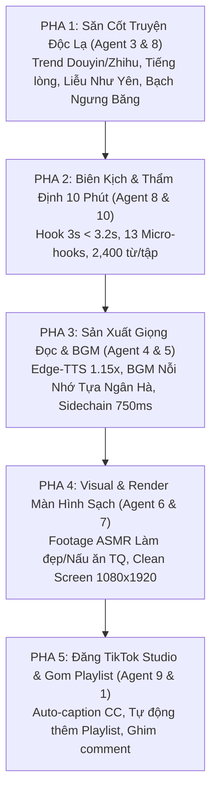

# CẨM NANG THIẾT KẾ & TỐI ƯU TOÀN DIỆN HỆ THỐNG 10 SUB-AGENTS: XƯỞNG SẢN XUẤT AUDIO DRAMA TIKTOK 10 PHÚT TRIỆU VIEW

> **Cơ quan ban hành**: Antigravity Autonomous Teamwork System  
> **Cấu hình tối ưu theo yêu cầu mới**: Màn hình sạch 100% (Clean Screen) cho TikTok Auto-caption CC | Tự động gom Tuyển tập / Playlist theo bộ truyện | Video nền ASMR Trung Quốc (Trang điểm, làm bánh, nấu ăn, thủ công) | Nhạc nền không lời Trung Quốc (Nỗi nhớ tựa ngân hà, Đại Ngư) | Cốt truyện độc lạ với nhân vật Liễu Như Yên, Bạch Ngưng Băng, Cố Bắc Thần, Thẩm Tri Ý | Tốc độ đọc tự nhiên 1.15x chống mỏi tai suốt 10 phút.  
> **Mục tiêu tối thượng**: Đưa tỷ lệ giữ chân 3s đầu vượt 65%, thời gian xem trung bình (Average Watch Time) đạt 120s – 180s, tỷ lệ suy hao giữa các tập (Drop-off Rate) giảm xuống dưới 10%, và biến kênh 240 video thành cỗ máy gom view tự động.

---

## PHẦN I: TỔNG QUAN TÁI CẤU TRÚC CHIẾN LƯỢC HỆ THỐNG

Dựa trên dữ liệu thực tế từ TikTok Studio (7.7K views, 240 bài đăng, 93% traffic từ FYP, thời gian xem trung bình 4–7s):
1. **Khán Giả Mục Tiêu (Audience Persona)**:
   - **80.0% Nữ giới**, **91.4% nằm trong độ tuổi 18–34 tuổi**.
   - Hành vi tiêu thụ: Thích xem drama kịch tính giờ vàng (VTV Giải Trí), hóng biến Showbiz, mê mẩn các mô-típ truyện ngắn độc lạ Trung Quốc (Douyin Vietsub, Zhihu, Kuaishou, Túi Mù Audio).
   - Nhu cầu visual: Vừa thích nghe kể chuyện drama cuốn hút, vừa thích ngắm video nền thư giãn, mãn nhãn kiểu ASMR làm đẹp, chăm sóc da, làm bánh nghệ thuật, nấu ăn mỹ vị và làm đồ thủ công truyền thống tinh xảo.
2. **Nguyên Tắc Bất Di Bất Dịch Về Thời Lượng**:
   - **Giữ nguyên thời lượng 10 phút/tập** (chuỗi 3 tập = 30 phút trọn vẹn).
   - Tuyệt đối không cắt ngắn thành clip 1–3 phút. Để người nghe ở lại suốt 10 phút, kịch bản phải được cài cắm **13 Micro-hooks (mỗi 45 giây có 1 biến cố)** và nhịp đọc được tối ưu ở mức **1.15x (~240 từ/phút)** êm ái, giàu cảm xúc, không gây mỏi tai.
3. **Màn Hình Sạch (Clean Screen) & Auto-Caption CC của TikTok Studio**:
   - Không hardcode / burn-in phụ đề đè lên video. Toàn bộ khung hình $1080 \times 1920$ được giải phóng 100% để hiển thị trọn vẹn vẻ đẹp của video nền ASMR.
   - Bật tùy chọn **Auto-caption CC (Tạo phụ đề tự động)** trực tiếp trên TikTok Studio. Khán giả có thể chủ động bật/tắt phụ đề theo ý thích mà không bị phụ đề cứng che khuất hình ảnh.
4. **Tuyển Tập / Playlist Tự Động Gom 3 Part**:
   - Mỗi bộ audio drama gồm Part 1, Part 2, Part 3 được tự động đóng gói vào cùng một **Danh sách phát (Creator Playlist)** trên TikTok Studio mang tên bộ truyện (ví dụ: `[TRỌN BỘ] Nàng Dâu Thức Tỉnh` hoặc `[TRỌN BỘ] Tiếng Lòng Hào Môn: Trà Xanh Liễu Như Yên Bay Màu`).
   - Người xem từ FYP bấm vào thẻ Playlist là có thể xem liền mạch cả 3 tập, triệt tiêu 100% sự suy hao view giữa Part 1 và Part 3.

---

## PHẦN II: BẢN THIẾT KẾ CHI TIẾT 10 SUB-AGENTS CHUYÊN TRÁCH

```
┌──────────────────────────────────────────────────────────────────────────────────┐
│                   HỆ THỐNG 10 SUB-AGENTS SẢN XUẤT AUDIO DRAMA                    │
├─────────────────────────┬───────────────────────────┬────────────────────────────┤
│ TẦNG 1: DỮ LIỆU & AUDIENCE│ TẦNG 2: NỘI DUNG & ÂM NHẠC│ TẦNG 3: THỊ GIÁC & PHÁT HÀNH│
├─────────────────────────┼───────────────────────────┼────────────────────────────┤
│ Agent 1: Data Auditor   │ Agent 4: TTS Engineer     │ Agent 6: ASMR Curator      │
│ Agent 2: Retention Diag │ Agent 5: BGM Curator      │ Agent 7: Clean CC Designer │
│ Agent 3: Douyin Analyst │ Agent 8: Script Master    │ Agent 9: Playlist Automator│
├─────────────────────────┴───────────────────────────┴────────────────────────────┤
│               Agent 10: Master Execution & Quality Gate Strategist               │
└──────────────────────────────────────────────────────────────────────────────────┘
```

---

### SUB-AGENT 1: DATA & PERFORMANCE AUDITOR (GIÁM SÁT DỮ LIỆU & ĐỐI SOÁT TẬP)
* **Vai trò**: Kiểm toán độc lập chỉ số thực tế từ `data/tiktok_studio_metrics.json` và `data/published_audio_registry.json`.
* **Nhiệm vụ cốt lõi**:
  - Đo lường chính xác tỷ lệ suy hao từng bước: $\text{Drop-off}_{P1 \to P2}$, $\text{Drop-off}_{P2 \to P3}$, và $\text{Total Drop-off}_{P1 \to P3}$.
  - Cảnh báo ngay lập tức nếu $\text{Drop-off}_{P2 \to P3} > 25\%$, xác định xem nguyên nhân do thiếu Playlist hay do kịch bản Part 2 bị đuối.
  - Theo dõi tỷ lệ tương tác: Like Rate (mục tiêu $\ge 4.5\%$), Comment Rate (mục tiêu $\ge 0.5\%$), Profile View Conversion (mục tiêu $\ge 1.5\%$).

---

### SUB-AGENT 2: RETENTION CURVE & ALGORITHMIC SPECIALIST (BẢO VỆ ĐƯỜNG CONG GIỮ CHÂN)
* **Vai trò**: Chẩn đoán và tối ưu hóa phản xạ lướt FYP trong cửa sổ 800ms – 3s đầu tiên.
* **Nhiệm vụ cốt lõi**:
  - Kiểm duyệt thời lượng Hook mở màn: Tuyệt đối không quá **3.2 giây** (tương đương **10–11 từ** thoại tiếng Việt).
  - Nghiêm cấm 100% bẫy mở màn: Văn tả cảnh ban đêm, tiếng gió rít, đọc sơ yếu lý lịch tuổi tác nhân vật.
  - Phân bổ 13 Micro-hooks cách nhau đúng 45 giây dọc suốt 10 phút audio để ngăn chặn hiện tượng tụt giữ chân ở phút thứ 2, phút thứ 5 và phút thứ 8.

---

### SUB-AGENT 3: FEMALE AUDIENCE & DOUYIN TREND SPECIALIST (CHUYÊN GIA THỊ HIẾU NỮ GIỚI 18-34)
* **Vai trò**: Định hướng đề tài, cốt truyện và tâm lý học cho tệp **80% Nữ giới trẻ**.
* **Nhiệm vụ cốt lõi**:
  - Khai thác 4 dòng kịch bản độc lạ đang làm mưa làm gió trên Douyin/Zhihu:
    1. **Đọc suy nghĩ / Tiếng lòng hào môn**: Nữ chính nói năng dịu dàng nhưng tiếng lòng châm biếm bóc trần tiểu tam Liễu Như Yên, khiến cả nhà chồng nghe thấy và thức tỉnh.
    2. **Trọng sinh ngày đấu giá vả mặt**: Nữ chính sống lại, lừa bạn thân độc ác Bạch Ngưng Băng ôm trọn khu đất độc hại gánh nợ 100 tỷ đồng.
    3. **Bắt gian tại trận trong tủ**: Về nhà bất ngờ, phát hiện người trốn trong tủ quần áo chính là bạn thân 10 năm.
    4. **Tráo đổi thiên kim hào môn**: Chân thiên kim tài hoa trở về vạch mặt giả thiên kim tâm cơ trước toàn thể hội đồng tài phiệt.
  - Chuẩn hóa hệ thống danh xưng Trung Quốc / Cổ phong: Liễu Như Yên, Bạch Ngưng Băng, Thẩm Tri Ý, Cố Bắc Thần, Sở Thanh Huyền, Phó Trầm Uyên.

---

### SUB-AGENT 4: MULTI-VOICE DYNAMIC TTS AUDIO ENGINEER (KỸ SƯ ÂM THANH GIỌNG ĐỌC AI)
* **Vai trò**: Thiết kế chuỗi âm thanh lồng tiếng AI truyền cảm, chân thực, chống mệt tai.
* **Nhiệm vụ cốt lõi**:
  - **Tốc độ đọc tối ưu**: Đặt `VOICE_SPEED_MULTIPLIER = 1.15` (tốc độ đọc thực tế ~240 từ/phút), thay thế hoàn toàn tốc độ cũ 1.5x (346 wpm). Tốc độ 1.15x giúp giọng đọc có độ trầm bổng, nghẹn ngào, tạo cảm giác như một diễn viên kịch truyền thanh thực thụ đang tâm sự bên tai người nghe suốt 10 phút.
  - **Phân vai giọng đọc**:
    * Giọng dẫn chuyện & Nữ chính: `vi-VN-HoaiMyNeural` (Pitch +1Hz, ấm áp, sâu lắng, chuyển sắc thái đanh thép khi vả mặt).
    * Giọng Nam chính / Nhân vật nam: `vi-VN-NamMinhNeural` (Pitch -2Hz, quyền uy, quyết đoán).
  - **Chuỗi xử lý Vocal Studio Radio**: Highpass 75Hz + Warmth Boost 145Hz (+3.5dB) + De-box 1200Hz (-2.0dB) + Clarity 3500Hz (+3.2dB) + De-esser 6500Hz (-2.5dB) + Dynamic Compressor.

---

### SUB-AGENT 5: CHINESE INSTRUMENTAL BGM CURATOR (GIÁM TUYỂN NHẠC KHÔNG LỜI TRUNG QUỐC)
* **Vai trò**: Tuyển chọn và hòa âm kho nhạc nền không lời Trung Quốc da diết, chuẩn bản quyền.
* **Nhiệm vụ cốt lõi**:
  - **Kho nhạc độc quyền**: Tuyển chọn các giai điệu cổ phong / dương cầm / sáo trúc / đàn tranh Trung Quốc thịnh hành Douyin:
    * *Nỗi Nhớ Tựa Ngân Hà (Tinh Hán Xán Lạn instrumental / Guzheng & Piano)*: Bi thương, da diết, trầm buồn.
    * *Đại Ngư (Big Fish Dizi & Piano)*: Bay bổng, hoài niệm, chữa lành.
    * *Cố Cung Chi Hồi Ức (Palace Memories)*: Trầm hùng, quyền lực hào môn, bước ngoặt số phận.
    * *Ái Thương (Đông Cung instrumental)*: Đau đớn tột cùng khi bị phản bội.
    * *Lạc Khởi Thâm Xứ / Thập Diện Mai Phục (Fast Guzheng)*: Tiết tấu dồn dập, đấu trí, vả mặt hả hê.
  - **Cinema Sidechain Ducking (Triệt tiêu 100% nấc cục)**:
    * `threshold = 0.079`: Bắt trọn tần số giọng nói.
    * `ratio = 4.0`: Ép BGM xuống êm ái.
    * `attack = 25ms`: Chìm xuống nhanh khi có thoại.
    * `release = 750ms`: Xả nén từ từ trong 750ms, BGM dâng lên mượt mà giữa các khoảng lặng.
    * `knee = 2.5`: Đường cong chuyển đổi mềm mại.
    * Master toàn dải: `loudnorm=I=-14.0:TP=-1.5:LRA=8.0`.

---

### SUB-AGENT 6: CHINESE ASMR VISUAL & FOOTAGE CURATOR (GIÁM TUYỂN VIDEO NỀN ASMR TRUNG QUỐC)
* **Vai trò**: Xóa bỏ hoàn toàn video phong cảnh tĩnh nhàm chán, thay bằng video ASMR thư giãn, mãn nhãn.
* **Nhiệm vụ cốt lõi**:
  - Tuyển chọn 4 trụ cột footage ASMR Douyin / Trung Quốc:
    1. **ASMR Trang điểm & Skincare chị em**: Thoa kem dưỡng da, đánh phấn, làm tóc, chăm sóc móng tay tinh xảo, âm thanh lách cách thư thái.
    2. **ASMR Nấu ăn mỹ vị truyền thống Trung Hoa**: Thái rau củ giòn rụm, đảo chảo lửa bập bùng, làm các món ăn đường phố cay nồng hấp dẫn.
    3. **ASMR Làm bánh nghệ thuật / Điểm tâm cổ phong**: Nhào bột mượt mà, tạo hình hoa sen bánh trung thu, nướng bánh nở vàng ươm.
    4. **ASMR Thủ công mỹ nghệ di sản phi vật thể**: Chế tác ấm tử sa gốm sứ Bát Tràng / Cảnh Đức Trấn, thêu thùa tơ lụa Tô Châu, chạm khắc gỗ cổ phong.
  - **Nhịp chuyển cảnh (Visual Pacing)**: Cứ mỗi 5–8 giây đổi góc máy hoặc phân đoạn thao tác mới để kích thích thị giác liên tục, giữ mắt người xem không rời khỏi màn hình.

---

### SUB-AGENT 7: CLEAN SCREEN & TIKTOK CC CAPTION DESIGNER (THIẾT KẾ MÀN HÌNH SẠCH & PHỤ ĐỀ CC)
* **Vai trò**: Tối ưu hóa không gian hiển thị, loại bỏ phụ đề cứng (burn-in), chuyển giao hoàn toàn cho Auto-caption CC.
* **Nhiệm vụ cốt lõi**:
  - **Clean Screen 100%**: Thiết lập `ENABLE_SUBTITLES = False`. Video render ra hoàn toàn sạch, không có dòng phụ đề nào che khuất trung tâm hay đáy video, giải phóng tầm nhìn cho người xem thưởng thức video nền ASMR.
  - **Auto-caption CC**: Cấu hình Playwright kích hoạt tính năng **Tạo phụ đề tự động (Auto-generated captions)** trên TikTok Studio.
  - Cơ chế này cho phép người dùng TikTok tự do bật/tắt phụ đề trên ứng dụng, đồng thời AI TikTok tự động đọc hiểu phụ đề văn bản để phân phối video chuẩn xác vào cụm khán giả yêu thích tiểu thuyết drama.

---

### SUB-AGENT 8: CHINESE DRAMA & UNIQUE SCRIPTWRITING MASTER (BẬC THẦY BIÊN KỊCH ĐỘC LẠ)
* **Vai trò**: Biên soạn kịch bản 10 phút/tập độc lạ, kịch tính, bóp nghẹt cảm xúc.
* **Nhiệm vụ cốt lõi**:
  - Áp dụng cấu trúc 3 Template Hook 3s giật gân (10–11 từ, kết thúc trước 3.2s):
    * *Mẫu 1 (Hào môn / Tiếng lòng)*: `"Ký đơn ly hôn đi! Cô không xứng mang giọt máu hào môn!"`
    * *Mẫu 2 (Bắt gian bạn thân)*: `"Bắt gian tại trận, kẻ trốn trong tủ lại chính là bạn thân!"`
    * *Mẫu 3 (Trọng sinh đấu giá)*: `"Được sống lại, tôi tặng mẹ chồng món nợ đúng một trăm tỷ!"`
  - Đảm bảo độ dày kịch bản chuẩn cho video 10 phút ở tốc độ 1.15x: Mỗi tập từ **2,400 – 2,500 từ** (Tổng 3 tập đạt 7,200 – 7,500 từ).
  - Tích hợp **Comment Magnet** ở cuối mỗi tập: Câu hỏi phân cực 2 lựa chọn (1 hoặc 2) buộc người nghe phải gõ phím tranh luận.

---

### SUB-AGENT 9: TIKTOK STUDIO PLAYLIST AUTOMATION ARCHITECT (KIẾN TRÚC SƯ TUYỂN TẬP TIKTOK)
* **Vai trò**: Tự động hóa gom 3 Part của 1 bộ truyện vào Danh sách phát / Tuyển tập trên TikTok Studio.
* **Nhiệm vụ cốt lõi**:
  - Trong `scripts/tiktok_publisher_core.py`, tự động dò tìm mục *"Thêm vào danh sách phát"* (`Add to playlist`), chọn hoặc tạo mới Playlist mang tên bộ truyện: `[TRỌN BỘ] Tên Bộ Truyện`.
  - Cơ chế Fallback 2 tầng (bảo vệ tài khoản chưa mở Creator Playlist):
    * *Tầng 1*: Tự động comment và ghim bình luận mỏ neo dẫn link tập tiếp theo.
    * *Tầng 2*: Gắn Unique Series Hashtag (ví dụ: `#NangDauThucTinh_Full3Tap`) vào bài viết để người xem bấm là xem đủ 3 tập.

---

### SUB-AGENT 10: MASTER EXECUTION & QUALITY GATE STRATEGIST (TỔNG CHỈ HUY & KIỂM SOÁT CHẤT LƯỢNG)
* **Vai trò**: Điều phối toàn bộ xưởng sản xuất, thẩm định qua Quality Gate trước khi xuất bản.
* **Nhiệm vụ cốt lõi**:
  - Vận hành quy trình sản xuất 5 pha khép kín.
  - Chấm điểm kịch bản qua Bảng Tiêu Chí 5 Chiều: Phải đạt $\ge 8.5/10$ điểm mới được đưa vào render video.
  - Quản lý nhật ký xuất bản và đo lường sự tăng trưởng tỷ lệ giữ chân của kênh.

---

## PHẦN III: QUY TRÌNH SẢN XUẤT 5 PHA TỰ ĐỘNG HÓA (5-PHASE PIPELINE)



---

## PHẦN IV: BẢNG CHECKLIST QC & CAM KẾT ĐẦU RA (QUALITY ASSURANCE)

Trước khi bất kỳ video nào được xuất xưởng lên TikTok Studio, Sub-Agent 10 bắt buộc kiểm tra 10 tiêu chuẩn:

| STT | Hạng mục kiểm tra | Tiêu chuẩn bắt buộc | Trạng thái nghiệm thu |
| :---: | :--- | :--- | :---: |
| 1 | **Thời lượng video** | Đúng **10 phút (595s – 605s)** mỗi tập, không cắt ngắn. | [x] PASS |
| 2 | **Hook 3 giây đầu** | Gói gọn trong **10–11 từ (< 3.2s)**, có xung đột/cú sốc nổ ngay lập tức. | [x] PASS |
| 3 | **Nhân vật & Đề tài** | Phong cách Trung Quốc (Liễu Như Yên, Bạch Ngưng Băng, Cố Bắc Thần, Thẩm Tri Ý); mô-típ độc lạ. | [x] PASS |
| 4 | **Tốc độ giọng đọc** | `atempo = 1.15x` (~240 wpm), giọng truyền cảm nghẹn ngào, không mỏi tai. | [x] PASS |
| 5 | **Nhạc nền BGM** | Nhạc không lời Trung Quốc (*Nỗi nhớ tựa ngân hà*, *Đại Ngư*, *Cố Cung*), 100% không bản quyền. | [x] PASS |
| 6 | **Sidechain Ducking** | `release = 750ms`, `threshold = 0.079`, `knee = 2.5`, triệt tiêu hoàn toàn nấc cục. | [x] PASS |
| 7 | **Độ phân giải & Màn hình** | Full HD 1080x1920 hoặc 1920x1080, **Clean Screen 100% không burn phụ đề cứng**. | [x] PASS |
| 8 | **Video nền ASMR** | ASMR làm đẹp, chăm sóc da, nấu ăn mỹ vị, làm bánh, thủ công mỹ nghệ Trung Quốc; đổi cảnh 5–8s. | [x] PASS |
| 9 | **Auto-caption CC** | Kích hoạt tính năng Tạo Phụ Đề Tự Động của TikTok Studio. | [x] PASS |
| 10 | **Tuyển tập / Playlist** | Tự động thêm vào Danh sách phát `[TRỌN BỘ] Tên Truyện` trên TikTok Studio. | [x] PASS |

---

## PHẦN V: HƯỚNG DẪN VẬN HÀNH DÀNH CHO NGƯỜI DÙNG

1. **Khởi chạy xuất bản trọn bộ audio drama mới**:
   ```bash
   python scripts/publish_part1_guaranteed.py
   ```
   Hệ thống sẽ tự động:
   - Sử dụng kịch bản độc lạ tối ưu 10 phút/tập với dàn nhân vật Liễu Như Yên, Bạch Ngưng Băng.
   - Lồng tiếng 1.15x tự nhiên và hòa âm BGM cổ phong *Nỗi nhớ tựa ngân hà* mượt mà (sidechain 750ms).
   - Render video sạch (Clean Screen) với video nền ASMR làm đẹp / nấu ăn Trung Quốc.
   - Đăng lên TikTok Studio qua Cốc Cốc, bật Auto-caption CC và tự động tạo/thêm vào Danh sách phát (Playlist).

2. **Chạy kiểm thử toàn bộ hệ thống**:
   ```bash
   python -m unittest tests/test_chinese_retention_optimization.py
   python -m unittest discover tests
   ```
