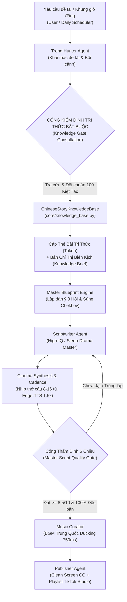

# CẨM NANG VẬN HÀNH LUỒNG BIÊN KỊCH TÍCH HỢP TRI THỨC 100 KIỆT TÁC ĐOẢN VĂN TRUNG QUỐC

> **Phiên bản**: 3.0 Master Codex Enterprise  
> **Áp dụng**: Bắt buộc trên toàn bộ Đội ngũ Agent (Team Agent Architecture) & Hệ Thống Tự Động Hóa TikTok Studio.  
> **Căn cứ**: `GEMINI.md`, `docs/DAI_KINH_NGHIEM_100_BO_TRUYEN_NGAN_TRUNG_QUOC.md`, `core/knowledge_base.py`.

---

## 1. TỔNG QUAN KIẾN TRÚC HỆ THỐNG TRI THỨC (KNOWLEDGE BASE ARCHITECTURE)

Hệ thống đã mã hóa và tích hợp toàn bộ tinh hoa từ **100 bộ truyện ngắn xuất sắc nhất Trung Quốc** (từ Zhihu 盐选, Douyin 短剧, Fanqie, Jinjiang, Qidian) thành Cơ Sở Dữ Liệu Tri Thức Sống (`ChineseStoryKnowledgeBase` tại `core/knowledge_base.py`).

Cơ sở dữ liệu này không phải là kho tài liệu tĩnh, mà là một **Động Cơ Kiểm Duyệt & Chỉ Thị Biên Kịch (Active Knowledge Consultation Gate)**. Bất kỳ kịch bản nào được sản xuất – dù do AI Agent viết, do hệ thống tự động sinh, hay do con người yêu cầu – đều **BẮT BUỘC 100% PHẢI TRA CỨU VÀ ĐƯỢC CẤP THẺ BÀI TRI THỨC (CONSULTATION TOKEN)** trước khi tiến hành viết hay phát hành audio.



---

## 2. 8 CHIỀU TRI THỨC CỐT LÕI ĐƯỢC ĐỐI CHUẨN TỰ ĐỘNG

Khi một đề tài được đưa vào hệ thống, `ChineseStoryKnowledgeBase` quét và trích xuất 8 chiều tri thức từ các tác phẩm kinh điển tương đồng nhất:

| STT | Chiều Tri Thức | Mô Tả & Quy Chuẩn | Ví Dụ Thực Chiến |
|---|---|---|---|
| **1** | **Vật Chất Hữu Hình (Tangible Props)** | Mọi xung đột BẮT BUỘC neo vào đạo cụ cơ học có thật, không cãi vã trừu tượng. | Bản di chúc tín thác 15 năm, que thử độc bốc khói xám tro, máy ghi âm mini kẹp cổ áo. |
| **2** | **Mở Đầu 3 Giây Kép (Dual-Engine Hook)** | 15 từ đầu tiên bắt buộc chứa Dị Thường Thị Giác hoặc Nghịch Lý Hành Động. | Chiến thuật A (Thoáng qua 12-20 từ) hoặc Chiến thuật B (Hiện trường cận cảnh 25-45 từ). |
| **3** | **Cấu Trúc 3 Hồi (Three-Act Architecture)** | Phân bổ nhịp căng thẳng toán học: Thiết lập & Nén bậc 1 -> Tuyệt cảnh bậc 2 -> Đại đối đầu. | Hồi 1 (Hook + Chekhov Gun) -> Hồi 2 (Tương kế tựu kế) -> Hồi 3 (Tháo ngòi + Vả mặt triệt để). |
| **4** | **Điểm Sảng & Công Thức Hạ Gục (Shuangdian)** | Đòn trừng phạt phải bóc trần tử huyệt logic không thể chối cãi, kẻ địch không đầu hàng trẻ con. | Phong tỏa tài khoản bảo lãnh 100 tỷ, trích xuất log máy chủ 2h sáng, hủy toàn bộ giao dịch dân sự. |
| **5** | **Thoại Nhát Gừng Có Dao Găm (Knife-Stab Dialogue)** | Câu thoại ngắn 5-12 từ (tối đa 14 từ), mỗi câu là một nhát dao tâm lý hoặc bẫy logic. | CẤM thoại dài > 16 từ mang tính thuyết giảng bệnh án; sau 2 câu thoại có 1 chuyển động cơ thể. |
| **6** | **Âm Học Edge-TTS (Acoustic Cadence)** | Câu ngắn 8-16 từ, mật độ dấu phẩy lấy hơi cao, kết câu bằng thanh trắc dứt khoát. | Tuyệt đối CẤM câu văn dài > 25 từ không có dấu ngắt nghỉ gây nghẹt thở cho giọng đọc AI. |
| **7** | **Điểm Cắt Đỉnh Cao (Action-Apex Cliffhanger)** | Cắt tập đúng giây phút hiểm nguy hoặc hành động then chốt, cấm cắt lúc suy nghĩ nội tâm. | Cắt lúc ngón tay đặt hờ trên van xả khí, lúc còi xe thanh tra rú lên dưới sảnh. |
| **8** | **Chống Đồng Hóa Toàn Diện (Anti-Homogenization)** | Jaccard từ vựng < 28%, Hook Overlap < 40%, không trùng nhịp cú pháp câu mở đầu. | Luân chuyển 10 Vũ trụ nghề nghiệp, 10 Hook Archetypes, 10 Cơ chế lật kèo độc bản. |

---

## 3. CÁC VŨ TRỤ NGHỀ NGHIỆP & BẢNG MA TRẬN 10 THỂ LOẠI ĐỐI CHUẨN

Hệ thống luân chuyển 10 Thể loại kinh điển đối chuẩn với 100 tác phẩm trong Knowledge Base:

```
┌────────────────────────────────────────────────────────────────────────────────────────┐
│                   MA TRẬN 10 THỂ LOẠI & VŨ TRỤ NGHỀ NGHIỆP ĐỐI CHUẨN                  │
├────┬─────────────────────────────┬────────────────────────────────────┬────────────────┤
│ Slot│ Thể Loại                    │ Vũ Trụ Nghề Nghiệp Đặc Thù         │ Benchmark Case │
├────┼─────────────────────────────┼────────────────────────────────────┼────────────────┤
│ 01 │ Sa Điêu / Đọc Tâm Thuật     │ Buồng Điều Khiển Âm Thanh / Mixer │ Case 061 - 070 │
│ 02 │ Thanh Xuân / Cứu Rỗi        │ Đội Tuyển Olympic Khoa Học         │ Case 081 - 090 │
│ 03 │ Cung Đấu / Y Điển Cơ Mật    │ Thái Y Viện / Ngự Thiện Dược Điển  │ Case 071 - 080 │
│ 04 │ Trọng Sinh / Vả Mặt         │ Đấu Giá Đất / Kiểm Toán Tài Phiệt │ Case 011 - 020 │
│ 05 │ Mạt Thế / Sinh Tồn Boong Ke │ Boong Ke Băng Hà Âm 50 Độ / Radar │ Case 091 - 100 │
│ 06 │ Hào Môn / Đàm Phán Con Tin  │ Ngoại Giao Khủng Hoảng / Ký Thác   │ Case 041 - 050 │
│ 07 │ Mẹ Chồng / Bạo Lực Lạnh     │ Hợp Đồng Tín Thác / Viện Phí       │ Case 031 - 040 │
│ 08 │ Trinh Thám / Kỳ Án Đô Thị   │ Vi Phẫu Thần Kinh / Pháp Y ADN     │ Case 021 - 030 │
│ 09 │ Vô Hạn Lưu / Quái Đàm       │ Phòng Chiếu Phim Cổ / Tàu Buýt Đêm│ Case 051 - 060 │
│ 10 │ Kinh Dị / Tâm Linh Đô Thị   │ Áp Lực Âm BSL-4 / Móng Ngầm Đô Thị│ Case 051 - 060 │
└────┴─────────────────────────────┴────────────────────────────────────┴────────────────┘
```

---

## 4. HƯỚNG DẪN SỬ DỤNG CÔNG CỤ THỰC CHIẾN

### 4.1. Tạo Kịch Bản Nhanh Bằng CLI Flagship (`scripts/create_viral_script.py`)

Công cụ chính thức để tạo kịch bản triệu view hoàn chỉnh khép kín 5 giai đoạn:

```bash
# 1. Tạo kịch bản Trọng sinh vả mặt với giọng Hoài My
python scripts/create_viral_script.py --genre TRONG_SINH --title "Đấu Giá Khu Đất Ngầm Trăm Tỷ"

# 2. Tạo kịch bản Gia đấu mẹ chồng kèm tiền đề tùy biến
python scripts/create_viral_script.py --genre ME_CHONG \
    --title "Bát Yến Bảo Hiểm Nhân Thọ Sáu Mươi Triệu" \
    --premise "Phát hiện hợp đồng bảo hiểm nhân thọ người thụ hưởng tên mẹ chồng dưới đáy bát yến"

# 3. Tạo kịch bản Trinh thám với giọng Nam Minh và xuất file JSON chi tiết
python scripts/create_viral_script.py --genre HUYEN_NGHI \
    --voice vi-VN-NamMinhNeural \
    --title "Bệnh Án Pháp Y Phòng Giải Phẫu Số Bốn" \
    --export-json
```

**Đầu ra của lệnh:**
- Tự động tra cứu `ChineseStoryKnowledgeBase` và cấp thẻ bài `TOKEN_KB_...`.
- Tự động dựng dàn ý kiến trúc 3 hồi, cài cắm đạo cụ mỏ neo từ Case Study đối chuẩn.
- Tự động biên soạn nội dung 3 tập chuẩn âm học Edge-TTS.
- Tự động chạy qua `validate_story_series` kiểm định chất lượng >= 8.5/10.
- Xuất file mã nguồn Python tại `core/stories/<ten_truyen>_masterpiece.py` và file JSON tại `data/generated_scripts/<ten_truyen>.json`.

---

### 4.2. Khởi Động Động Cơ Biên Kịch Triệu View Cốt Lõi (`scripts/generate_master_script.py`)

Động cơ tiêu chuẩn phục vụ các luồng chạy ngầm tự động:

```bash
# Tạo kịch bản mẫu thuộc thể loại Cung Đấu
python scripts/generate_master_script.py --genre CUNG_DAU

# Tạo kịch bản Mạt Thế Sinh Tồn
python scripts/generate_master_script.py --genre VO_HAN
```

---

### 4.3. Vận Hành Tự Động Hóa 10 Khung Giờ Hàng Ngày (`core/stories/daily_story_factory.py`)

Khi hệ thống TikTok Studio chạy theo lịch trình hàng ngày (06:30 đến 23:00):
- Hàm `get_daily_10_series(target_date="YYYY-MM-DD")` tự động khởi chạy.
- Từng bộ truyện trong 10 slot đều được tự động gắn token tri thức và đối chuẩn benchmark case.
- Đảm bảo 100% không trùng lặp tiêu đề với quá khứ và không lặp mô-típ mở đầu.

---

### 4.4. Kiểm Tra & Audit Toàn Diện Hệ Thống Bằng Unit Test

Để đảm bảo không có bất kỳ quy chuẩn nào bị vi phạm, chạy bộ kiểm thử tự động:

```bash
# Chạy toàn bộ 44 kiểm thử cốt lõi
python -m unittest tests.test_chinese_retention_optimization \
                   tests.test_cycles_21_to_30_evolution \
                   tests.test_cycles_31_to_40_evolution \
                   tests.test_knowledge_gate_enforcement \
                   tests.test_script_evolution_and_quality_gate \
                   tests.test_cycles_11_to_20_evolution
```

---

## 5. BỘ TIÊU CHÍ ĐÁNH GIÁ KỊCH BẢN (RUBRIC 6 CHIỀU CỦA REVIEWER AGENT)

Mọi kịch bản trước khi xuất bản đều được thẩm định tự động theo 6 tiêu chí:

```
[1] CỔNG TRI THỨC & ĐẠO CỤ HỮU HÌNH (20%):
    - Có Token hợp lệ từ ChineseStoryKnowledgeBase không?
    - Xung đột có neo vào vật thể vật lý cụ thể không?

[2] HOOK 3S ĐẦU VÀNG & ZERO-BIOGRAPHY (20%):
    - 15 từ đầu tiên có chứa Dị thường thị giác / Nghịch lý hành động không?
    - CẤM mở đầu bằng tả thời tiết mưa gió hoặc đọc lý lịch tuổi tác.

[3] THOẠI NHÁT GỪNG CÓ DAO GĂM (15%):
    - Thoại ngắn dưới 12-14 từ, đanh thép, mang tính bẫy tâm lý.
    - CẤM thoại dài > 16 từ mang tính thuyết giảng bệnh án.

[4] ÂM HỌC EDGE-TTS & TIẾT TẤU MICRO-PACING (15%):
    - Câu ngắn 8-16 từ, mật độ dấu phẩy lấy hơi tự nhiên cao.
    - CẤM câu dài > 25 từ không dấu ngắt nghỉ. Có vi chuyển động sau mỗi 2 câu thoại.

[5] TÍNH ĐỘC BẢN & CHỐNG ĐỒNG HÓA (15%):
    - Jaccard từ vựng < 28% và Hook overlap < 40% so với 10 audio gần nhất.
    - Không trùng nhịp cú pháp câu mở đầu liên tiếp.

[6] ACTION-APEX CLIFFHANGER & COMMENT MAGNET (15%):
    - Tập 1 và Tập 2 cắt tại đỉnh cao hành động sinh tử.
    - Tập 3 hạ gục hả dạ và chốt câu hỏi phân cực 1 hoặc 2 kích nổ bình luận.
```

---

## 6. DANH MỤC CÁC TỆP QUAN TRỌNG

1. [GEMINI.md](file:///c:/Users/duydo/OneDrive/Tài%20liệu/idk/GEMINI.md): Bộ Quy Chuẩn Vĩnh Viễn & Master Scriptwriting Codex.
2. [core/knowledge_base.py](file:///c:/Users/duydo/OneDrive/Tài%20liệu/idk/core/knowledge_base.py): Cơ sở tri thức 100 tác phẩm kinh điển & Cổng kiểm định Token.
3. [core/prompts.py](file:///c:/Users/duydo/OneDrive/Tài%20liệu/idk/core/prompts.py): System Prompts chuẩn hóa toàn bộ Team Agent.
4. [core/script_generator.py](file:///c:/Users/duydo/OneDrive/Tài%20liệu/idk/core/script_generator.py): Động cơ biên kịch 5 giai đoạn tích hợp Chekhov Props.
5. [core/stories/script_quality_gate.py](file:///c:/Users/duydo/OneDrive/Tài%20liệu/idk/core/stories/script_quality_gate.py): Cổng kiểm duyệt chất lượng & Tối ưu hóa nhịp thở tự động.
6. [core/stories/daily_story_factory.py](file:///c:/Users/duydo/OneDrive/Tài%20liệu/idk/core/stories/daily_story_factory.py): Kho cung cấp & luân chuyển 10 bộ truyện hàng ngày.
7. [scripts/create_viral_script.py](file:///c:/Users/duydo/OneDrive/Tài%20liệu/idk/scripts/create_viral_script.py): Công cụ CLI biên kịch triệu view tức thì.
8. [docs/DAI_KINH_NGHIEM_100_BO_TRUYEN_NGAN_TRUNG_QUOC.md](file:///c:/Users/duydo/OneDrive/Tài%20liệu/idk/docs/DAI_KINH_NGHIEM_100_BO_TRUYEN_NGAN_TRUNG_QUOC.md): Kho tư liệu chi tiết 100 kiệt tác phân tích chuyên sâu.
