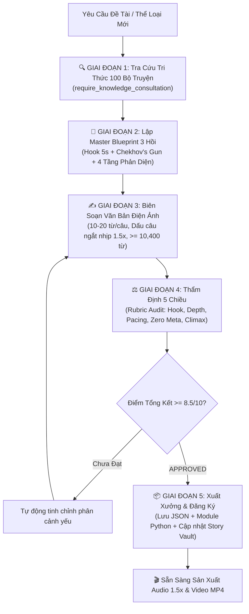

# QUY TRÌNH BIÊN KỊCH TỐI ƯU HÓA & VẬN HÀNH CƠ SỞ TRI THỨC 100 BỘ TRUYỆN ĐOẢN VĂN
## Hướng Dẫn Vận Hành Quy Trình 5 Giai Đoạn Tạo Kịch Bản Triệu View Tự Động (Chuẩn Audio 30 Phút)

> [!IMPORTANT]
> **Nguyên tắc cốt tử:** Bắt buộc 100% kịch bản mới sinh ra đều phải trải qua **Giai đoạn 1: Tra cứu & Đối chuẩn Cơ sở Tri thức 100 tác phẩm kinh điển** (Chinese Short Story Knowledge Base). Tuyệt đối không cho phép AI tự biên tự diễn thiếu cấu trúc.

---

## 🔄 SƠ ĐỒ LUỒNG BIÊN KỊCH 5 GIAI ĐOẠN



---

## 🛠️ CHI TIẾT 5 GIAI ĐOẠN VẬN HÀNH

### Giai đoạn 1: Bắt buộc Tra Cứu Cơ Sở Tri Thức (Mandatory Knowledge Base Consultation)
- **Cơ chế:** Khi nhận đề tài (Ví dụ: *Trọng sinh vả mặt*, *Huyền nghi trinh thám*, *Mẹ chồng nàng dâu*...), động cơ `core/knowledge_base.py` tự động:
  1. Quét kho tàng 100 tác phẩm đoản văn kinh điển.
  2. Lọc ra 3 Case Study thành công nhất có bối cảnh và mâu thuẫn tương đồng.
  3. Chỉ định **Mẫu Hook Mở Màn 5s** phù hợp nhất từ kho 6 mẫu (Xung đột tiền trí, Nghiền ép thân phận, Nghịch cảnh cực hạn, Đảo tự nghịch lý, Ngọt sủng độc tôn, Trọng sinh tức thì).
  4. Xác lập **Ma trận Điểm Sảng (Shuangdian Matrix)**: Tỷ lệ phân bổ giữa Thân phận nghiền ép (35%), Vả mặt báo thù (40%), Nghịch tập lật kèo (15%).
  5. Thiết lập **Mô hình 4 Tầng Bất Đối Xứng Thông Tin**: Điều phối khoảng cách nhận thức giữa Sự thật khách quan, Người kể chuyện, Nhân vật và Độc giả.
  6. Tự động ghi vết vào nhật ký kiểm toán: `data/knowledge_consultations.jsonl`.

### Giai đoạn 2: Lập Master Blueprint 3 Hồi & Điểm Cắt Nghẹt Thở (Card-Points)
- **Tập 1 (Khởi thế - 0-15%):**
  - Giây 0 - 5: Bốc thẳng xung đột nghẹt thở lên 15 từ đầu tiên (Tuân thủ 100% Zero-Biography).
  - Cài cắm **Khẩu súng Chekhov 1 & 2** (Vật chứng vô hại ở Tập 1 nhưng đoạt mạng ở Tập 3).
  - Pháo hôi (Phản diện bậc 1) ra đòn khiêu khích $\rightarrow$ Nhân vật chính nhẫn nhịn tích lực $\rightarrow$ **Cliffhanger 1 (卡点 1)** cắt đúng 0.5s trước khi hé lộ biến cố.
- **Tập 2 (Leo thang bão táp - 15-60%):**
  - Tiếp nối tự nhiên (100% Zero-Recap, không tóm tắt 'Ở tập 1').
  - Trung phản diện (Phản diện bậc 2) giở thủ đoạn dơ bẩn dồn nhân vật chính vào đường cùng.
  - Nhân vật chính âm thầm tương kế tựu kế, giăng bẫy ngầm $\rightarrow$ **Cliffhanger 2 (卡点 2)** trước giờ G.
- **Tập 3 (Đại quyết chiến & Đại kết cục - 60-100%):**
  - Màn đối đầu trực diện tại Đại hội cổ đông / Lễ cưới / Phòng xử án.
  - Tháo ngòi toàn bộ súng Chekhov $\rightarrow$ Vả mặt triệt để (Shuangdian 100%).
  - Bóc trần **Ẩn tàng phản diện (Phản diện bậc 4)** – người thân cận nhất phản trắc với ít nhất 3 manh mối phục bút khiến người xem lạnh gáy (细思极恐).
  - Dư âm nhân sinh sâu sắc & Chốt bằng **Comment Magnet Trigger** kích hoạt tranh cãi.

### Giai đoạn 3: Biên Soạn Văn Bản Điện Ảnh & Ngắt Nhịp 1.5x (Audio-First Text)
- **Định mức dung lượng toán học:**
  - Tốc độ đọc 1.5x (atempo=1.5): **346 từ / phút**.
  - Mỗi tập bắt buộc: **>= 3,460 từ** (Tiêu chuẩn 3,500 - 3,550 từ).
  - Tổng 3 tập: **>= 10,380 từ** (Đảm bảo xuất xưởng video tròn 30 phút audio).
- **Kỹ thuật ngắt nhịp cho Edge-TTS Neural:**
  - Câu ngắn 10 - 20 từ. Dùng dấu phẩy `,`, dấu ba chấm `...`, gạch ngang ` - ` tại các bước ngoặt cảm xúc để giọng đọc AI nhấn nhá, nghẹn ngào, kịch tính.
  - Tỷ lệ đối thoại: 40 - 50% thoại đanh thép, gãy gọn, giàu tính chiến đấu.
  - Show, Don't Tell: Miêu tả chi tiết bàn tay run rẩy, ánh mắt sắc lẹm, âm thanh gót giày, mùi vị, màu sắc.
  - 100% sạch từ meta (Không có "Ở tập 1", "Đón xem tập 2", "Bấm follow").

### Giai đoạn 4: Thẩm Định 5 Chiều Tự Động (Automated Rubric Audit)
1. **Hook 5s Retention (Trọng số 25%):** Không lý lịch, bốc xung đột ngay 15 từ đầu?
2. **Chiều sâu & Dung lượng (Trọng số 20%):** Đạt >= 3,460 từ/tập và >= 10,380 từ tổng?
3. **Nhịp điệu & Câu ngắn 1.5x (Trọng số 20%):** Mật độ dấu câu hỗ trợ AI ngắt nhịp?
4. **Tính nối tiếp & Sạch Meta (Trọng số 15%):** Nối tiếp mạch lạc như một cuốn tiểu thuyết?
5. **Cliffhanger & Màn lật kèo (Trọng số 20%):** Cao trào nghẹt thở và kết thúc hả dạ?
> Đạt **>= 8.5/10 điểm** mới được cấp chứng chỉ "APPROVED" xuất xưởng.

### Giai đoạn 5: Xuất Xưởng & Tích Hợp Vào Hệ Thống Sản Xuất
- Lưu dữ liệu kịch bản chuẩn cấu trúc vào `data/generated_scripts/{slug}.json`.
- Sinh module Python độc lập vào `core/stories/{slug}_masterpiece.py`.
- Tự động định tuyến trong `core/story_vault.py` qua hàm `get_story_by_category()`.
- Sẵn sàng kích hoạt lệnh sản xuất TTS và dựng video 16:9 MP4:
  `python scripts/produce_series.py`

---

## 🚀 HƯỚNG DẪN TẠO KỊCH BẢN MỚI BẰNG LỆNH ĐƠN

Bạn có thể tạo ra một bộ kịch bản kiệt tác mới bất kỳ lúc nào bằng lệnh:

```bash
# Tạo kịch bản theo thể loại Trọng Sinh Vả Mặt
python scripts/generate_master_script.py --genre TRONG_SINH

# Tạo kịch bản theo thể loại Trinh Thám High-IQ với giọng Nam Minh
python scripts/generate_master_script.py --genre HUYEN_NGHI --voice vi-VN-NamMinhNeural

# Tạo kịch bản với đề tài tùy chỉnh
python scripts/generate_master_script.py --genre ME_CHONG --title "Mẹ Chồng Cay Nghiệt Và Bản Hợp Đồng 50 Tỷ"
```
